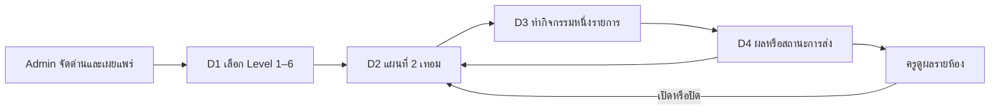

# ภารกิจบทเรียน · UX handoff สำหรับตรวจ

Rev 1 · 2026-11-05 · บันทึกโดย นายช่าง · ขอโดย ผู้ใช้ · ร่างจาก D1–D4 ใน [target/ref](../../../../../target/ref) และเกณฑ์ [AC-01–06](../shared/requirements/f3-lessons-missions.md) · ใช้ [สัญญาระบบ](../build/lessons-missions-contract.md) สำหรับสถานะและเงื่อนไข

## Desktop นักเรียน

ใช้ School Bot Studio [brand และ token](../../../shared/brand/README.md), WindowBar และส่วนประกอบเดิมของ Desktop ยึด 1440×900 ตาม [ขนาดมาตรฐาน Desktop](../../../shared/brand/components/layout.md) และให้แผงเลื่อนเองเมื่อหน้าต่าง Preview แคบ หัวข้อและปุ่มหลักยังอยู่ในลำดับโฟกัสเดิม

| แบบ / AC | โครงหน้าและปุ่มหลัก | สถานะและข้อความสำคัญ |
|---|---|---|
| **D1** `QuizLevelsV1.dc.html` / AC-01, AC-06 | Sidebar เลือก «บทเรียน» · การ์ด Level 1–6 เรียงตามระดับ · แสดงจำนวนด่านผ่าน/ทั้งหมดและดาวเฉพาะเมื่อมีข้อมูล · การ์ดเปิดแผนที่ Level | แสดง «ยังไม่มีภารกิจ» เมื่อเปิด Level ที่ว่าง · «กำลังโหลดบทเรียน» ขณะโหลด · «โหลดความคืบหน้าไม่ได้» พร้อม «ลองอีกครั้ง» และค่าความคืบหน้าไม่ทราบ · แสดงสถานะออฟไลน์ที่ WindowBar |
| **D2** `QuizMapV1.dc.html` / AC-01, AC-03, AC-04, AC-06 | พื้นที่แผนที่เต็มกว้าง · แถบ «เทอม 1 / เทอม 2», «ไปที่ฉัน» และแผนที่ย่อ · เลือก node เพื่อเปิดแผงด้านขวาที่มีชื่อ คำสั่ง กติกาผ่าน และ «เริ่มภารกิจ» หรือ «ทำต่อ» · วาง node จากรายการเผยแพร่ ภาพพื้นหลังแยกจากเลขและตำแหน่งด่าน | «เริ่มได้», «กำลังทำ», «รอครูตรวจ», «ผ่านแล้ว», «ยังไม่ผ่าน» และป้ายปิดหรือเหตุผลล็อกแยกจากผลเดิม · «ครูปิดเทอมนี้», «ผ่านภารกิจก่อนหน้าเพื่อเริ่ม» หรือ «เชื่อมต่อเพื่อดาวน์โหลดภารกิจ» ตามเหตุ · เทอมว่างแสดงข้อความและยังสลับเทอมได้ |
| **D3** `QuizPlayV1.dc.html` / AC-02, AC-05 | หัวหน้าด่านแสดงชื่อกับความคืบหน้า · Quiz แสดงทีละข้อและมี «ตรวจ» → เฉลย → «ไปต่อ» · ด่านบทเรียนแสดงเนื้อหาและปุ่มตามเงื่อนไข เช่น «ทำเสร็จแล้ว» · ด่าน Lab เปิดพื้นที่ทำงานเดิมในบริบทด่าน แสดงคำสั่งและ «ส่งงาน» ก่อนกลับหน้าผล | Quiz มีสถานะรอคำตอบ/ถูก/ผิด และตัวเลือกแบบข้อความหรือภาพ เรียง จับคู่ สไลเดอร์ · Lab ใช้ไฟล์งานและโหมดที่ผูกไว้ตามนโยบายเดิม · กลับแผนที่หรือปิดหน้าต่างขณะมีงานค้างใช้กล่องยืนยันร่วมกับ shell ระบุสิ่งที่เก็บไว้กับสิ่งที่จะหายอย่างชัดเจน |
| **D4** `QuizResultV1.dc.html` / AC-03, AC-05, AC-06 | การ์ดผลตามชนิดกิจกรรม · แสดง «กลับไปที่แผนที่» ทุกกรณี · «ภารกิจต่อไป» เมื่อเริ่มได้ตามกติกา · «เล่นอีกครั้ง» สำหรับกิจกรรมที่เปิดให้เล่นซ้ำ | «ทำเสร็จแล้ว», «ส่งงานแล้ว», «รอครูตรวจ», «ผ่านแล้ว» หรือ «ยังไม่ผ่าน» · คะแนนและดาวแสดงตาม config แยกจากผลสำเร็จ · «บันทึกในเครื่องแล้ว · รอซิงก์» หรือ «รอตรวจสอบเวลาเริ่ม» สำหรับผลที่เซิร์ฟเวอร์ยังตัดสินไม่ได้ |

## Admin และเว็บครู

ใช้โครงเว็บและ design token ของ checkout ตาม [frontend/AGENTS.md](../../../../../target/sb-web-school-robot/frontend/AGENTS.md) จัดแบบหลัก 1280px และตรวจที่ 1024px ใช้ชื่อเมนูและแบบฟอร์มเดิมของหน้าที่เชื่อมต่อ

| แบบ / AC | โครงและลำดับการใช้ | สถานะและข้อความสำคัญ |
|---|---|---|
| **A1 จัดด่านในหลักสูตร** / AC-01–03 | หน้า Admin → หลักสูตร → «ภารกิจบทเรียน» → เลือก Level/เทอม → ตารางลำดับและชนิดกิจกรรม → «เพิ่มด่าน» หรือ «แก้ไข» · ฟอร์มระบุชื่อ เลือกกิจกรรมหนึ่งรายการ ตั้งคะแนนหรือไม่มีคะแนน เงื่อนไขผ่าน และตัวเลือก «ต้องผ่านก่อนเปิดด่านถัดไป» · แสดงสรุปจำนวนด่านต่อเทอมในขั้น «เผยแพร่» | Draft/เผยแพร่แล้ว · ตารางว่าง · กำลังบันทึก · validation ที่ช่อง เช่น «เลือกกิจกรรม 1 รายการ» หรือ «เปิดคะแนนก่อนใช้เงื่อนไขผ่านตามคะแนน» · เมื่อแก้จาก revision เก่าให้แจ้ง «มีการแก้ไขจากอีกหน้าต่าง» และคงค่าฟอร์มไว้ให้ตรวจ |
| **T1 ควบคุมการเปิดภารกิจ** / AC-04 | เว็บครู → จัดการบทเรียน → เลือกห้องที่มีสิทธิ์ → Level/เทอม → สถานะเทอมและตารางด่าน · ปุ่ม «เปิด/ปิดเทอม» และ «เปิด/ปิดด่าน» แสดงผลกับห้องที่เลือกในกล่องยืนยัน | เมื่อมีคนเริ่มแล้ว แสดงข้อความ «ปิดไม่ได้ เพราะมีนักเรียนเริ่มแล้ว» · ด่านที่อยู่ในเทอมปิดแสดงสาเหตุจากเทอม · หากเปิดคืนเมื่อซิงก์ย้อนหลัง แสดง «เปิดกลับอัตโนมัติ เนื่องจากมีนักเรียนเริ่มก่อนปิด» พร้อมเวลาและขอบเขต · ถ้าสถานะเปลี่ยนระหว่างยืนยัน ให้แสดงค่าล่าสุด |
| **T2 ดูและตรวจผลรายห้อง** / AC-03–04, AC-06 | ห้อง → เทอม/ด่าน → ตารางนักเรียน → เปิดรายละเอียดผลและหลักฐานงาน · ด่านที่กำหนด «ครูอนุมัติ» แสดงปุ่มในรายละเอียดงานตามสิทธิ์ | กรองยังไม่เริ่ม/กำลังทำ/ส่งแล้ว/รอตรวจ/ผ่าน · ด่านไม่มีคะแนนแสดงสถานะโดยไม่ใช้ 0 แทน · ผลที่รอตรวจสอบเวลาแสดงต่างจากผลที่ตรวจรับแล้ว · ตารางว่าง โหลดผิดพลาด และหมดสิทธิ์เข้าห้องมีข้อความแยกกัน |

## ข้อกำหนดในการตรวจแบบ

- คีย์บอร์ดเข้าถึงการ์ดและ node ทุกด่าน ปุ่มเลื่อนแผนที่ใช้แทน drag ได้ ปุ่มเรียงและจับคู่ใช้เลือกและวางด้วยคีย์บอร์ด สไลเดอร์มีปุ่มลด/เพิ่มและค่าอ่านได้
- ย้ายโฟกัสไปหัวข้อเมื่อเปลี่ยนหน้า คืนโฟกัสไปปุ่มเดิมเมื่อยกเลิก dialog แสดงสถานะด้วยข้อความหรือไอคอนร่วมกับสี ข้อความแจ้งผลอัตโนมัติใช้ live region ที่ไม่อ่านซ้ำทุกครั้งที่เลื่อนแผนที่
- ใช้ข้อความ Desktop ผ่าน `th`, `en`, `zh` ชื่อเนื้อหาจาก Admin ยืดหรือขึ้นบรรทัดได้ ใช้ภาพตกแต่งโดยไม่ใส่ข้อความหรือเลขด่านในภาพ ตรวจกรณี 0, 1, 20 และมากกว่า 20 ด่าน รวมทั้ง focus, contrast และ reduced motion
- ภาพ D1–D4 เดิมเป็น reference สำหรับ Desktop ส่วน A1/T1/T2 เป็น handoff เชิงโครงและพฤติกรรมสำหรับทำแบบต่อ ยังรอตรวจภาพที่เรนเดอร์และ UX sign-off
