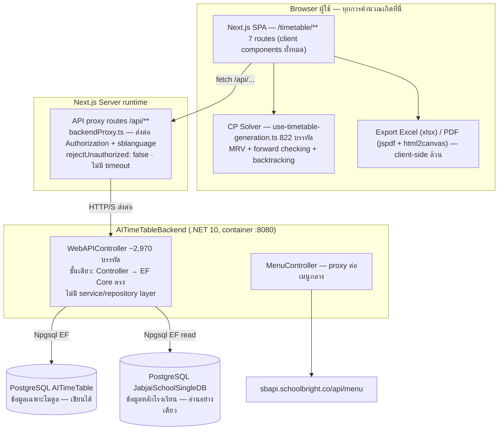
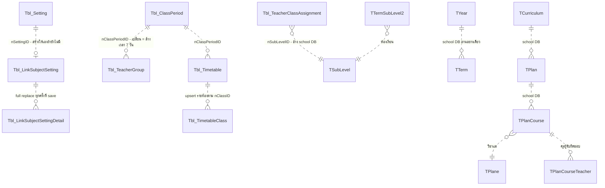
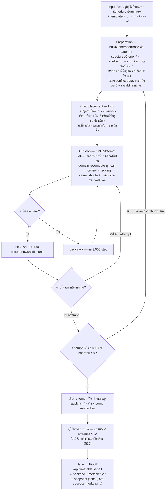
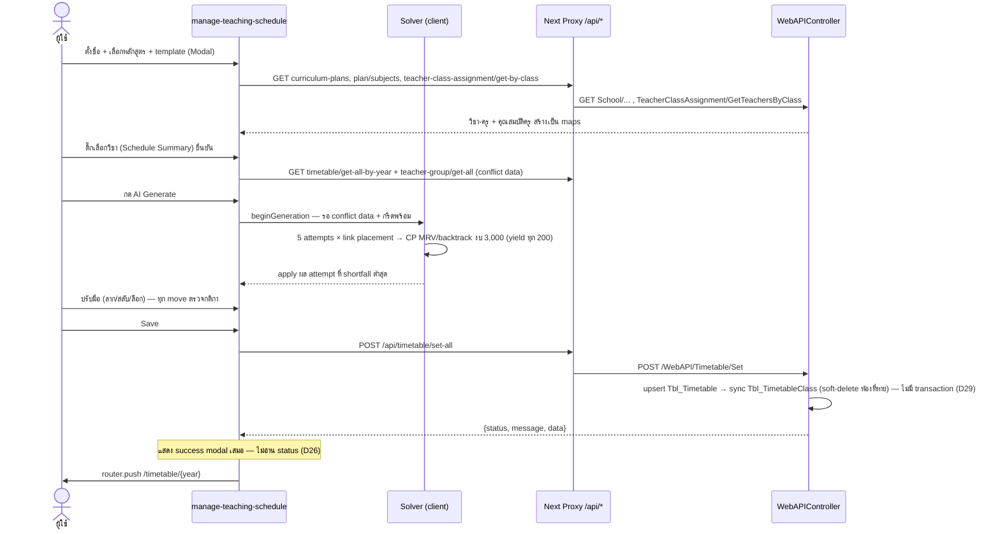
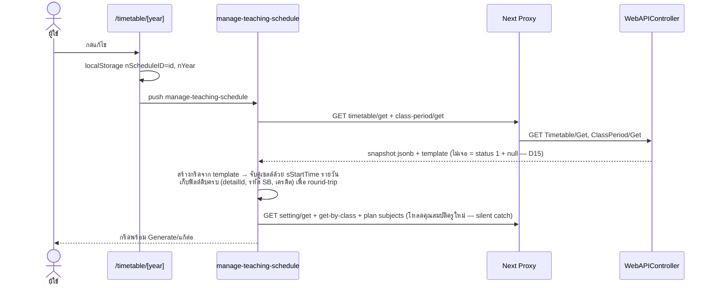

# Timetable AI (จัดตารางสอน) — Feasibility & Design

> **Rev 1 (2026-09-08)** — เอกสารฉบับแรก จัดทำโดย **Reverse Engineering จาก code จริงทั้งสองฝั่ง** ไม่ใช่ requirement ใหม่
> ทุกข้อในเอกสารนี้อ้างอิง implementation จริง (Frontend: `C:\src\sb-tech-upgrade-web-system` · Backend: `C:\src\sb-api-academic-timetable-ai`) — ห้ามตีความเป็นข้อกำหนดที่ "ควรจะเป็น" · ข้อเสนอแนะแยกไว้ชัดเจนใน §23 · สิ่งที่ยืนยันจาก code ไม่ได้ ทำเครื่องหมาย `Needs Confirmation`
> **Rev 2 (2026-09-08) — SA Technical Design (system-analyst run)** — ตรวจสอบ Rev 1 กับ code จริงทั้งสองฝั่งซ้ำ (อ่านครบทั้ง WebAPIController, solver, proxy, models) — ยืนยันได้ทุกข้อ พร้อมเพิ่ม **Part II: Technical Design (§24–§33)**: system context, frontend/backend/data architecture, generation engine, sequence, integration, risks · ข้อไม่สอดคล้องใหม่จากการตรวจซ้ำเพิ่มใน §20 เป็น D26–D35 · ไม่มีการแก้ข้อความ Rev 1 ใด ๆ
> **Rev 4 (2026-09-21) — SA amend สำหรับ REQ-012 / REQ-013 (term dimension + copy)** — **amend เท่านั้น ไม่ regenerate**: §1–§33 ที่บันทึก Current Architecture ไม่ถูกเขียนทับ ข้อความใหม่ทั้งหมดอยู่ใน §34 (DES-009 — term dimension) · §35 (DES-010 — copy) · §27.5 (target data model) · D36–D37 · R13–R18 · Open Questions ใหม่ · Module D — จุดที่แตะของเดิมมีเฉพาะการเติมหมายเหตุ "as-built ข้อนี้อยู่ระหว่างเปลี่ยนตาม REQ-012" (§4 หมายเหตุ, §18.3) และแถวใหม่ใน §13
> **ประตูมนุษย์ที่เปิดอยู่ (Rev 4):** REQ-012/REQ-013 เป็น **schema change + migration/backfill** — ต้องได้ **schema confirmation จากคนจริง** ก่อน engineer เริ่ม implement และ **OQ-8 (กันครูชนข้ามเทอม) ยังไม่มีคำตอบ** ซึ่งเปลี่ยนความหมายของ AC-015 (hard constraint ของ REQ-008) โดยตรง — SA ไม่ตอบแทน
> **Rev 5 (2026-09-23) — SA amend สำหรับ REQ-013 (แก้กลไกเป็น 5 จุดเข้า) + REQ-014..REQ-019 (UI redesign Phase 2)** — **amend เท่านั้น ไม่ regenerate**: ที่มาคือ `requirement.md` ฉบับ 2026-09-23 ที่ business-analyst สำรวจ UI ใหม่ (Figma "AI Timetable to SB System" + โค้ด frontend ที่ **ยังไม่ commit** ใน `sb-tech-upgrade-web-system` ต่อจาก `e7a916e…`) แล้วยืนยันธุรกิจกับผู้ใช้รายประเด็น · SA ตรวจสมมติฐานของ requirement กับ code จริงทั้งสองฝั่งในรอบนี้ · ข้อความใหม่อยู่ใน §36 (DES-011 — บล็อก Generate) · §37 (DES-012 — คาบต่อเนื่อง) · §38 (DES-013 — ห้องเรียนประจำวิชา) · §39 (DES-014 — เพดานครูหน่วยเวลาจริง) · §40 (DES-015 — ครูประจำชั้นจำกัดห้อง) · §41 (DES-016 — ส่งตารางเข้า `/academic`) · §35.7 (REQ-013 5 จุดเข้า) · §27.6 · D38–D45 · R19–R25 · §21.2 · Module E/F — จุดที่แตะของเดิมมีเฉพาะหมายเหตุ Rev 5 ใน DES-001 (BR-8/10/13/16), §22, §28.3, §21 ข้อ 2 (ปิดบางส่วน → ย้ายคำถามเดิมไป `design-archive.md`) และแถวใหม่ใน §13
> **ประตูมนุษย์ที่เปิดอยู่ (Rev 5) — ยังไม่มี REQ ใดในกลุ่มนี้ implementation-ready:** (1) **schema confirmation จากคนจริง** ของ §27.6 — REQ-016 (ตาราง mapping ห้อง + key ห้องใน snapshot), REQ-017 (คอลัมน์เพดานหน่วยนาที), REQ-018 (ที่เก็บรายชื่อครูจำกัดห้อง), REQ-019 (สถานะการส่ง — ถ้าเลือก) · (2) **migration/backfill** ของ REQ-017 — ค่าเพดานหน่วย "คาบ" ที่ทุกโรงเรียนบันทึกไว้แล้วจะแปลง/ทิ้ง/ตีความใหม่ (OQ-16) · (3) **material ambiguity** ทางธุรกิจ OQ-14..OQ-21 (ส่งกลับ business-analyst) · (4) **REQ-019 เป็น cross-backend integration** — OQ-12/OQ-13 (requirement.md ยังไม่ตอบ) + OQ-18 + SA-Q6 (สัญญาจริงของ Service Academic) ต้องปิดก่อนจึงออกแบบ transaction boundary ได้ · (5) **D44** — REQ-018 + AC-046a ตัดแหล่ง "ครูสอนห้องใดได้" แหล่งเดียวที่มีอยู่ทิ้ง ต้องได้กติกาแทน (OQ-17) ก่อนตัดของเดิม · REQ-014 ไม่มี schema change แต่มี material ambiguity (OQ-19) และผูกกับ D44 · SA ไม่ตอบแทนข้อใด และไม่เซ็น schema แทน
> **Rev 6 (2026-09-29) — SA amend ตามคำตอบธุรกิจที่ปิดแล้วของ REQ-013..REQ-019** — **amend เท่านั้น ไม่ regenerate**: ที่มาคือ `requirement.md` ฉบับ 2026-09-28 ที่ business-analyst ปิด OQ-9..OQ-24 ครบ (Change Log รายการสุดท้าย) · SA ตรวจคำตอบกับ code/spec จริงในรอบนี้ · ทุกสัญญา DES-010..DES-016 **แก้ในที่ภายใต้ `.v1`** (ยังไม่มี caller/implementation ใด — precedent §35.7) · จุดที่แก้: §35.8 (REQ-013: ทับ = แทนที่ทั้งหมด, template ที่อ้างหาย = บล็อก, จับคู่ไม่ได้บางส่วน = คัดลอกส่วนที่จับคู่ได้, เลือกบางตารางได้) · §36 DES-011 (แหล่งสิทธิ์ BR-41, ตรวจทุกวิชาของแผน, ทางลัดข้ามระบบ) · §37 DES-012 (กติกาย่อยครบ) · **§38 DES-013 ออกแบบใหม่เกือบทั้งหมด** (ห้องชนแบบไบนารี → แบบจำลองความจุ + อ่านการใช้ห้องข้ามระบบจาก `/academic`) · §39 DES-014 (ชั่วโมงเต็ม, M1) · §40 DES-015 (H1 `TClassMember`, ตัวจำกัดอย่างเดียว, ไม่ยกเว้นเพดาน — แก้ tooltip D43) · §41 DES-016 (แทนที่ทั้งหมด, `calculate=true`+default, ส่งหลายชุด, `isActive` เป็น gate, Preview→Confirm→Apply, บันทึกผลการส่งบังคับ) · **เพิ่ม §42 DES-017** (`subjectGroups`) · §27.6 · §13 · D46–D48 · R26–R30 · §21.2 (คำถามที่ปิดย้ายไป `design-archive.md`; SA-Q9..SA-Q13; คำถามค้างที่พบระหว่างออกแบบ OQ-25..OQ-28) · ข้อความ "ประตูมนุษย์ (Rev 5)" ข้างบนถูกแทนด้วยบรรทัดถัดไป
> **ประตูมนุษย์ที่เปิดอยู่ (Rev 6) — "ปิดคำถามธุรกิจ" ≠ "พร้อม implement": ยังไม่มี REQ ใดในกลุ่ม REQ-013..REQ-019 implementation-ready** — (1) **schema confirmation จากคนจริง** ของ §27.6 ทั้ง 4 ส่วน (ห้อง+ความจุ, คอลัมน์ชั่วโมง, รายชื่อครูจำกัดห้อง, ตารางบันทึกผลการส่ง — ส่วนหลังนี้ **บังคับ** แล้ว ไม่ใช่ทางเลือก) · (2) **REQ-016 — schema จริงของ `TRoom` (SA-Q5) + ที่เก็บความจุ/ครูผู้ดูแลห้อง (SA-Q9) + วิธีอ่านการใช้ห้องข้าม `/academic` (SA-Q10)** ต้องได้คนเซ็นร่วมกับเจ้าของ school DB / Service Academic · (3) **REQ-019 — สัญญาจริงของ Service Academic (SA-Q6), ค่า default ต่อฟิลด์ (SA-Q11), transaction boundary ของการแทนที่ + ส่งซ้ำ (SA-Q12)** ต้องยืนยันกับเจ้าของ `/academic` · (4) คำถามค้างที่พบระหว่างออกแบบ **OQ-25..OQ-28** (ส่ง business-analyst — ทุกข้อมี fallback ที่ executable) · (5) REQ-013 ยัง `blocked-by` DES-009 (OQ-8, SA-Q1..SA-Q3 เปิด) · (6) ลำดับ cutover SA-Q8 · (7) รอบ `security` (DES-010, DES-013 cross-system read, DES-016) · (8) UX artifact ที่มีคนเซ็นก่อน `frontend-engineer` · SA ไม่ตอบแทนข้อใด และไม่เซ็น schema แทน
> **Rev 7 (2026-09-29) — SA amend ตามคำตอบ OQ-25..OQ-28 (`requirement.md` Change Log 3 รายการสุดท้ายของ 2026-09-29 — business-analyst + main session ปิดครบ; OQ-9..OQ-28 ปิดทั้งหมด)** — **amend เฉพาะจุดที่คำตอบจริงต่างจาก หรือยืนยัน fallback ของ Rev 6 · ไม่ regenerate** · สัญญาแก้ในที่ภายใต้ `.v1` (ยังไม่มี caller/implementation — precedent §35.7) · จุดที่แก้: **§38 DES-013** (OQ-26 ต่างจาก fallback 2 จุด — ครูผู้ดูแลห้อง **มีผลต่อการจัด** → BR-71 ใหม่ + `roomCaretakerMismatch`; ความจุ/ผู้ดูแลเป็นค่า **ต่อ (ปี, เทอม)** → BR-54 แก้) · **§27.6 (ก2)** `Tbl_RoomSetting` + `nYear`/`sTermID` (C1 "คอลัมน์บน `TRoom`" ตกไป → C1′) · **§42 DES-017** (OQ-25: G2, รหัสเดียวกัน = ชนเฉพาะครูคนเดียวกัน, link ชนะ + เตือน — เลิก fallback "ไม่บังคับ") · §37 DES-012 (OQ-25 ค ยืนยัน fallback) · §41 DES-016 BR-60 (OQ-27 ยืนยัน fallback) · §35.8 DES-010 BR-67/BR-70 (OQ-28 ยืนยัน fallback) + BR-66 (`Tbl_RoomSetting` ต่อเทอมแล้วแต่ยังไม่อยู่ใน scope ใด — OQ-29 ค) · §36 DES-011 BR-27 (ตัวกรองผู้ดูแลห้อง) · §40 DES-015 (ลำดับตัวกรองสิทธิ์) · §13, §28.3 หมายเหตุ Rev 7 · R29/R30 แก้ + R31 ใหม่ · §21.1 OQ-8 (ผลต่อ DES-013/DES-017) · §21.2 (OQ-25..OQ-28 ย้าย `design-archive.md`; SA-Q9 แก้; **OQ-29 ใหม่ ส่ง business-analyst**; requirement drift Rev 7) · EVD-084 · **Drift:** HEAD ทั้งสอง repo ไม่เลื่อนจาก Rev 6 (backend `6d997a33…`, frontend `e7a916e9…` + งานไม่ commit — volatile) · ไม่มี shell → `hash=pending-sha256`
> **ประตูมนุษย์ที่เปิดอยู่ (Rev 7) — แทนบรรทัด Rev 6 ข้างบน · คำถามธุรกิจชุด UI redesign OQ-9..OQ-28 ปิดครบ แต่ยังไม่มี REQ ใดในกลุ่ม REQ-013..REQ-019 implementation-ready** — (1) **schema confirmation จากคนจริง** ของ §27.6 ทั้ง 4 ส่วน — ส่วน (ก2) **เปลี่ยนรูปเป็นต่อ (ปี, เทอม) ในรอบนี้ ต้องเซ็นรูปใหม่** · (2) REQ-016 — SA-Q5 / SA-Q9 / SA-Q10 (เจ้าของ school DB / Service Academic) · (3) REQ-019 — SA-Q6 / SA-Q11 / SA-Q12 (เจ้าของ `/academic`) + SA-Q7 · (4) **OQ-29 ใหม่** (ส่ง business-analyst — ช่องว่างที่เกิดจากคำตอบ OQ-26: ผู้ดูแลห้องกับความจุ ≥ 2, ห้องที่ไม่ตั้งผู้ดูแล, การตั้งค่าห้องอยู่หน้า/จุดคัดลอกใด — ทุกข้อมี fallback ที่ executable) · (5) REQ-012/REQ-013 — DES-009 gates (OQ-8, SA-Q1..SA-Q3) · (6) SA-Q8 ลำดับ cutover · (7) รอบ `security` (DES-010, DES-013, DES-016) · (8) UX artifact ที่มีคนเซ็นก่อน `frontend-engineer` (รวมหน้าตั้งค่าห้องต่อเทอม) · OQ-1..OQ-8 เดิมยังเปิด · SA ไม่ตอบแทนข้อใด และไม่เซ็น schema แทน
> **Rev 8 (2026-09-29 — วันที่ของ session ผู้ใช้ไม่ได้ระบุซ้ำ) — SA amend ตามคำตอบ OQ-1..OQ-8 + req OQ-29/OQ-30** — amend เฉพาะจุด ไม่ regenerate · สัญญาใหม่: **§43 DES-018** (auth ของ API — แก้ D1) · **§44 DES-019** (`nCourseIntensity` แบบ soft ต่อตาราง — สูตรเป็นข้อเสนอ) · **§45 DES-020** (แจ้ง shortfall หลัง Generate) · **§46 DES-021** (ลบ legacy `Tbl_TeachingSchedule`) · แก้ในที่: §34.3 DES-009 (BR-17 = เทอมเดียวกัน — OQ-8), DES-005/DES-008 (OQ-1/OQ-4 ปิด — D17 เป็นความเสี่ยงชั่วคราวที่ยอมรับ R32), §27.7, §21 (คำถามที่ปิดย้าย archive), D49..D53, R32..R35 · OQ-7 ยืนยันทิศทางเดียว timetableai → `/academic` (ไม่มีการเปลี่ยนสัญญา — DES-016 BR-49 คงเดิม) · **เลข OQ:** OQ-29 (ห้อง) ของ Rev 7 = **OQ-31** ตั้งแต่ Rev 8 (ดู §21.2)
> **ประตูมนุษย์ที่เปิดอยู่ (Rev 8) — เพิ่มจากบรรทัด Rev 7 ข้างบน (ซึ่งยังมีผล; "OQ-29" ในบรรทัดนั้น = OQ-31):** (1) **DES-018** — breaking contract (caller ไม่มี token/localhost) + **Critical security** (`token_secret` ที่ใช้ร่วมทั้งระบบ SB อยู่ใน repo — D49) + SA-Q14 (ค่า MenuID/role ยังหาไม่พบ) + SA-Q15 · (2) **DES-019** — schema change (ค่าต่อตาราง) + migration choice B1/B2 + material ambiguity req OQ-30 (0/1/2, สูตร, ขอบเขต) + SA-Q16 · (3) **DES-021** — DROP ข้อมูลจริง (SA-Q17) · (4) รอบ `security` ของ DES-018 ก่อน production · SA ไม่ตอบแทนและไม่เซ็นแทน
> **Rev 9 (2026-09-29 — วันที่ของ session ผู้ใช้ไม่ได้ระบุซ้ำ) — SA amend ตามคำตอบสุดท้าย (requirement.md Change Log 2026-09-29 ท้ายสุด):** req OQ-29 ปิด (MenuID 401/402/403/404/422 + "API ต่อหน้าต้องมีเมนูของหน้านั้น" + สิทธิ์ตามระบบ SB → DES-018 BR-74..BR-76 + §43.2a) · req OQ-30 ปิด (ระดับ 0/1/2, สูตรยืนยัน, **ระบบคำนวณเท่านั้น**, สรุป + ข้อเสนอแนะหนักเกิน → DES-019; เกณฑ์ T_c = ข้อเสนอ SA BR-81a) · schema §27.7 (ก) **ยืนยัน 1 คอลัมน์** ไม่ backfill · §27.7 (ข) + DES-021: **ไม่ DROP** ลบเฉพาะโค้ด · OQ-31 ปิด (DES-013, DES-010 BR-66 → `subjectConditions`; ความไม่ตรงของคำตอบ "สองเมนู" → OQ-33 มี fallback) · OQ-32 ปิด · breaking change DES-018 **อนุมัติ** · `Token_Secret` **ผู้ใช้เลือกไม่ rotate — ความเสี่ยงที่ผู้ใช้รับ**
> **ประตูมนุษย์ที่เปิดอยู่ (Rev 9) — แทนบรรทัด Rev 8 ข้างบน:** สำหรับงานชุด Rev 8 (DES-018..DES-021, BR-17a) เหลือ **(1) รอบ `security` ของ DES-018 ก่อน production** (Critical/Important — รวม `Token_Secret` ที่ผู้ใช้รับความเสี่ยง; **ไม่ถือว่าปิด**) · **(2) `devops` รัน DDL มือ 1 คอลัมน์** `Tbl_Timetable.nCourseIntensity` · ไม่มีอื่น · ประตูของ REQ-012..REQ-019 ตามบรรทัด Rev 7 (schema confirmation §27.5/§27.6, SA-Q1..SA-Q13, UX sign-off) **ยังเปิดตามเดิม** — Rev 9 ไม่ได้ปิด
> **Rev 10 (2026-09-29 — วันที่ของ session ผู้ใช้ไม่ได้ระบุซ้ำ) — evidence-only + drift check:** ไม่มีกติกาธุรกิจใหม่ ยกเว้น SA-Q16 ปิด (หมวดพื้นฐาน/เพิ่มเติม = `TCourseGroup` → DES-019 BR-77) · ทุกบรรทัด Evidence เขียนใหม่ด้วย revision = HEAD ของ Target + sha256 ปัจจุบัน + tool/symbol ตาม grammar · หลักฐานนอก Target/hash ไม่ได้ 20 บรรทัดถอนไป §32.5 (เรื่องเล่า `inferred`) · บรรทัดคีย์เวิร์ดการตัดสินทั้ง 21 สัญญาเป็นคีย์เวิร์ดล้วน (คำอธิบายย้ายไปบรรทัด "รายละเอียด") · ID/เวอร์ชันสัญญาคงเดิม (`.v1`) · ประตูมนุษย์ไม่เปลี่ยนจาก Rev 9
> **Rev 11 (2026-09-30 — วันที่จากผู้ใช้) — SA amend ตามการตัดสินใจของผู้ใช้ในแชท 2026-09-30 (OQ-34/OQ-35/OQ-36 — business-analyst กำลังบันทึกใน requirement.md; ณ เวลาที่ amend requirement.md ยังแสดงสามข้อนี้เป็น "เปิด" → ที่มา = "per user chat 2026-09-30"):** (1) **OQ-34 → DES-019 BR-81a ยืนยัน** (เกณฑ์สัมพัทธ์ T_c = ⌈H_c / D_c⌉ ต่อตาราง; `ConsecutiveHeavy` เฉพาะระดับ 2; ระดับ 0 ไม่มีข้อเสนอแนะ; T_c เดียวกันป้อน BR-78 L1) · (2) **OQ-35 → สัญญาใหม่ §47 DES-022** (เมนู Sidebar ผูก MenuID 401/402/403/404/422 — ไม่มีสิทธิ์ = แสดงแบบปิด ไม่ซ่อน) + แถวใหม่ §43.2a · (3) **OQ-36 / SA-Q2 ปิด** (ข้อมูล legacy เป็นข้อมูลช่วงทดสอบ — ไม่ต้องดูแล) → §27.5 (จ) + DES-009 BR-24 ย่อ · **ต้องยืนยันซ้ำก่อนมีข้อมูล production — และ R32 ระบุว่า production ใช้ฐานข้อมูล dev อยู่แล้ว (R36)** · schema ไม่เปลี่ยน · (4) **BR-77 ตรวจกับ code จริง:** `sCourseGroupDesc` **แปลตามภาษา** (`sblanguage`) → จับคู่ "พื้นฐาน/เพิ่มเติม" พังเมื่อ UI เป็นภาษาอังกฤษ → BR-77 เปลี่ยนเป็นจับคู่ค่าภาษาไทยดิบ (`TCourseGroup.Description`) + ฟิลด์ additive `sCourseGroupDescTh` · ค่าข้อมูลจริงเข้าไม่ถึง (dump ไม่มีแถวข้อมูล) → **ค่าจริงยังไม่ยืนยัน** (R37) · (5) แก้การอ้าง OQ-33 ที่ยังเขียนว่าเปิด (ปิดแล้ว 2026-09-29) · **Drift:** HEAD ทั้งสอง repo ไม่เลื่อน (backend `6d997a33…`, frontend `c212ca68…`) **แต่ working tree ทั้งสองมีงาน implement ที่ยังไม่ commit** (เช่น backend `Security/TimetableAuthorizationFilter.cs`, `Startup.cs:78-82`; frontend `_lib/course-weight.ts`; `WebAPIController.cs` `nCourseGroupID` อยู่บรรทัด 523 ไม่ใช่ 522; `backendProxy.ts` `Authorization` อยู่บรรทัด 100 ไม่ใช่ 98) → EVD ที่ชี้ไฟล์เหล่านี้ **stale-by-worktree** (ถูกต้องเฉพาะเทียบ HEAD) · ไม่มี shell → ไม่ได้คำนวณ sha256 ใหม่ · ไม่ได้รัน `sta context` / `--check-doc-structure`
> **Rev 12 (2026-09-30 — วันที่จากผู้ใช้) — SA amend ตามคำตอบผู้ใช้ในแชทรอบถัดไปของวันเดียวกัน:** (1) **OQ-37:** "ไม่ต้องสนใจข้อมูลเก่า" ใช้ **เฉพาะปีที่ไม่มี `TTerm`** — การย้ายเข้าเทอมแรก (AC-028) คงอยู่ → ทางเลือก "ข้ามขั้น 3" ของ Rev 11 ตกไป (2) **ผู้ใช้ยืนยันว่าฐานข้อมูลโมดูล (backend dev ตาม R32) มีเฉพาะข้อมูลทดสอบ** → เงื่อนไข "ยืนยันไม่มีข้อมูล production ก่อนขั้น 3" ของ Rev 11 ผ่านแล้ว (ยืนยันซ้ำถ้ามีข้อมูลโรงเรียนจริงก่อน backfill — R36) (3) BR-81a T_c **ต่อห้องเรียน** ยืนยัน (4) **SA-Q3 ปิด:** "เริ่มเลย" = โหมดบังคับเทอมมีผลตั้งแต่ release ของ DES-009 ไม่มีช่วงผ่อนผัน — **ไม่มีวันที่ตามปฏิทิน (ไม่บันทึกวันใด)** → VR-9, §27.5 (จ), DES-009 Compatibility เปลี่ยนเป็น `breaking` (caller ที่ไม่ส่งเทอมถูกปฏิเสธทันทีที่ release; ผู้ใช้เลือกพฤติกรรมนี้) · ข้อความบรรทัดประตูมนุษย์ Rev 11 ที่ถูกแทนอยู่ใน `design-archive.md`
> **ประตูมนุษย์ (Rev 12) — แทนบรรทัด Rev 11 · ต่อจากบรรทัด Rev 9:** งาน Rev 11/12 ของ DES-019/DES-022 **ไม่เปิดประตูใหม่** — ยังต้องมี UX sign-off (สถานะเมนูปิด, ข้อเสนอแนะ) ก่อน `frontend-engineer` · **DES-009:** schema confirmation §27.5 (คนเซ็น) + migration/backfill (คนสั่งรันผ่าน `devops`) **ยังเปิด** · SA-Q1 ยังเปิด · breaking-at-release ของ DES-009 = ผลของการเลือก "เริ่มเลย" ของผู้ใช้ (บันทึกไว้ — backend + frontend ต้องออก release เดียวกัน) · เงื่อนไขข้อมูล production **ผ่านแล้ว** (ผู้ใช้ยืนยัน 2026-09-30)
> **Rev 18 (2026-10-01 — วันที่จากผู้ใช้) — SA amend ตามการตัดสินใจของผู้ใช้ในแชท 2026-10-01 ("SA-Q19 เลือก A, SA-Q20 รับทั้ง (ก) และ (ข)"):** (1) **SA-Q19 → A** — required load ล้ม (non-401) = บล็อกเฉพาะ Generate/Regenerate/Save + ยกเลิก Generate ที่รออยู่ · หน้ายังดูได้ · กู้คืน = reload หน้า จนกว่า UX-004 เซ็น (หน้าตาทางกู้คืน = UX) · แก้ gate `setting/get` ที่เปิดเมื่อ 200 + `status !== 1` → **§43.2b ข้อ 4** (2) **SA-Q20 (ก) → BR-76:** admin ที่ไม่ active หรือถูกลบถูกปฏิเสธ (3) **SA-Q20 (ข) → BR-74:** เส้นทางผู้ใช้ทั่วไปต้องมีโรงเรียน active และไม่ถูกลบ (เท่าเส้นทาง admin และ `BypassAcademic.Login`) · **ยังไม่ตัดสิน:** คอลัมน์จริง/ความหมายของ "active / ถูกลบ" ของ admin และโรงเรียน → **SA-Q21** (เจ้าของระบบ SB + `devops` + `security`) — สัญญาเขียนเป็น "active และไม่ถูกลบ" · R38 ลดด้วยทางเลือก A · สัญญาคง `.v1`
> **Rev 18 — หมายเหตุ cross-reference (2026-10-02 = วันที่ของ session ไม่ใช่วันที่ผู้ใช้ระบุ · ไม่ bump revision — ไม่มีเนื้อสัญญาเปลี่ยน):** ผูก id ใหม่ของ requirement.md (business-analyst 2026-10-02) เข้ากับสัญญา DES-018/DES-022 — §43.2b ข้อ 1 → **AC-066** · ข้อ 4 (a) → **AC-067**, (b)(d) → **AC-068**, (c) → **AC-069**, (e) → **AC-070** · BR-76 (ก) → **AC-071** · BR-74 (ข) → **AC-072** · BR-88 (ผลของ (ก)(ข) ต่อ `MenuPermissions/Get`) → AC-071/AC-072 (AC-064 คงเดิม) · **SA-Q21 = requirement.md OQ-39** (คำถามเดียวกัน) · **ประตูมนุษย์การขยาย breaking ของบรรทัดข้างบน = requirement.md OQ-40** (ผู้ใช้ / Product owner — **ยังไม่รับทราบ**; agent ไม่บันทึกแทน) · "ไม่พบโรงเรียนในทะเบียน = ไม่ผ่าน" — *(ปิดแล้ว 2026-10-02 ดูบรรทัดถัดไป; วลีเดิมอยู่ใน `design-archive.md`)* = **กฎธุรกิจที่ยืนยัน** (SA-Q22 = OQ-41 = A, AC-072) · ประตูมนุษย์ไม่เปลี่ยน
> **Rev 18 — หมายเหตุปิด SA-Q22 (2026-10-02 = วันที่ของ session ไม่ใช่วันที่ผู้ใช้ระบุ · ไม่ bump revision — ไม่มีเนื้อสัญญาเปลี่ยน):** ผู้ใช้ตอบ requirement.md **OQ-41 (= SA-Q22)** ว่า "A ทำตามคำแนะนำ" ใน chat ส่งต่อโดย coordinator · business-analyst บันทึกใน requirement.md 2026-10-02 (OQ-41 ปิด = A · AC-072 เพิ่มกรณีไม่พบแถวโรงเรียนของ `NCompany` ในทะเบียน master → 403 ที่ endpoint ที่ตรวจสิทธิ์ · `MenuPermissions/Get` 200 ทุกเมนูอ่านไม่ได้) → DES-018 BR-74 (ข) กรณี "ไม่พบ = ไม่ผ่าน" เปลี่ยน**สถานะ**จากการเลือกระดับ design ของ SA เป็น **กฎธุรกิจที่ยืนยัน** — พฤติกรรม, พื้นผิว API, message ของ error, Compatibility/Data/Migration/Security/Material ambiguity ทุกค่าคงเดิม · **ขอบเขต breaking ที่ต้องรับทราบ = สามกลุ่ม** (ผู้ใช้ทั่วไปของโรงเรียนไม่ active/ถูกลบ · ผู้ใช้ทั่วไปของโรงเรียนที่ไม่พบในทะเบียน · admin ไม่ active/ถูกลบ) = requirement.md **OQ-40 — ยังเปิด ยังไม่รับทราบ** (การเลือกกติกาไม่ใช่การรับทราบ; agent ไม่บันทึกแทน) · Security ไม่ต้องประเมินใหม่ · SA-Q21/OQ-39 ไม่กระทบ · ประตูมนุษย์ไม่เปลี่ยน
> **Rev 19 (2026-10-02 — วันที่จากผู้ใช้) — SA amend ตาม requirement.md 2026-10-02 (business-analyst บันทึกคำตอบผู้ใช้ที่ orchestrator เก็บผ่าน AskUserQuestion — OQ-39 = SA-Q21 ปิด · OQ-40 รับทราบ):** (1) **SA-Q21 ปิด → predicate ที่ยืนยันใน DES-018 BR-74 (ข) / BR-76 (ก):** โรงเรียนผ่าน = `TCompany.isActive != false` และ `TCompany.cDel != true` · admin ผ่าน = `TAdmin.active != false` และ `TAdmin.del != true` · ไม่ใช้ `TAdmin.IsActive` · null = active / ไม่ถูกลบ — Fallback "คอลัมน์ที่ resolver ใช้อยู่" ตกไป (2) **ผลตรวจ resolver (worktree, `inferred`):** ฝั่ง admin ตรงแล้ว (`TimetableMenuPermissionResolver.cs:71-72`) · ฝั่งโรงเรียนใช้คอลัมน์เดียวกัน แต่ **ความหมายของ null ไม่ตรง** — `company.isActive && !company.cDel` (`:74-75`) บน model `bool` ไม่ nullable (`Models/TCompany.cs:24-26`) ขณะที่ dump `school_db.sql:1251-1252` ประกาศ `BOOLEAN NULL` → แถวที่ค่าเป็น null อ่านเป็น `bool` ไม่ได้ (ล้ม → 403) แทนที่จะผ่าน · เส้นทางผู้ใช้ทั่วไปยังไม่อ่านโรงเรียน (`:93-121`) → ทั้งหมดนี้เป็นงานของ BE-008 (3) **RV-2:** ส่วน admin (`active`/`del`) ได้รับการยืนยันจากผู้ใช้แล้ว (OQ-39) · ส่วน `TGroupPermissionUser.IsDel` **ยังไม่มีคนยืนยัน** → **SA-Q23 (เปิด)** — สัญญาและ code คงเดิมระหว่างรอ *(ปิดแล้ว 2026-10-02 — ดูหมายเหตุปิด SA-Q23 ด้านล่าง)* (4) **OQ-40 รับทราบ** (ผู้ใช้ 2026-10-02: "รับทราบทั้ง 3 กลุ่ม") → DES-018 Compatibility · **bump เป็น Rev 19:** predicate เป็นกติกาที่เปลี่ยนผลของกรณี null และค่า Fallback/Material ambiguity เปลี่ยน · สัญญาคง `.v1` (ยังไม่มี consumer ที่ deploy) · ไม่มี schema/migration
> **ประตูมนุษย์ (Rev 19, 2026-10-02 — แทนบรรทัด Rev 18 · ต่อจากบรรทัด Rev 12; บรรทัด Rev 18 อยู่ใน `design-archive.md`):** SA-Q19/SA-Q20/SA-Q21/SA-Q22/SA-Q23 **ปิดโดยผู้ใช้** (SA-Q23 — 2026-10-02 ดูหมายเหตุปิดด้านล่าง; วลีเดิมของบรรทัดนี้อยู่ใน `design-archive.md`) · การขยาย breaking สามกลุ่มของ DES-018 **รับทราบแล้ว** (OQ-40, 2026-10-02) · **ยังเปิด (SA ไม่อนุมัติแทน):** รอบ `security` ของ DES-018 (ยังไม่เคยรัน — ยังเปิดตั้งแต่ Rev 9) ต้องครอบ (ก)(ข) + predicate ของ OQ-39 รวมความหมาย null และยืนยันว่าผลเป็น fail-closed · `devops` ตรวจข้อมูลจริงตามกฎ OQ-39 ก่อน production · SA-Q14 / SA-Q15 = ตรวจข้อเท็จจริงก่อน deploy (มี fallback — SA-Q14 รวมการตรวจแถว `TGroupPermissionUser` ที่ IsDel ขัดกัน) · ไม่มี schema/migration ใหม่ · UX-004 sign-off ยังเป็นเงื่อนไขของทางกู้คืนแบบปุ่ม
> **Rev 19 — หมายเหตุปิด SA-Q23 (2026-10-02 — วันที่จากผู้ใช้ · ไม่ bump revision — กติกาไม่เปลี่ยน: fallback ถูกยืนยันตามที่เขียน):** ผู้ใช้ตอบผ่าน AskUserQuestion ของ orchestrator ว่า **"ถูกต้อง: IsDel != true"** (ตัวเลือกที่แสดง: null = ยังไม่ถูกลบ, ตรงกับโค้ดปัจจุบัน → SA-Q23 ปิด) → DES-018 BR-74: แถว `TGroupPermissionUser` นับเป็นสิทธิ์เมื่อ `IsDel != true` (null = ไม่ถูกลบ) เปลี่ยน**สถานะ**จากการตีความของ SA / fallback เป็น **กติกาที่ยืนยัน** — พฤติกรรม, พื้นผิว API, error, Compatibility/Data/Migration/Security/Material ambiguity คงค่าเดิม · สัญญาคง `.v1` · **RV-2 settle ครบในระดับสัญญา** (ส่วน admin โดย OQ-39 · ส่วน IsDel โดย SA-Q23) — การปิดแถว RV-2 ใน `review.md` เป็นของ `reviewer` · ยังค้างก่อน production: `devops` ตรวจข้อมูลจริง (SA-Q14 + กฎ OQ-39) · รอบ `security` ของ DES-018 · ไม่มีประตูมนุษย์ใหม่
> **Rev 20 (2026-10-04 — วันที่จากผู้เรียกใช้):** ตอบ TP-Q10/TP-Q11 ของ `test-plan.md` §S12-H (FE-019) → DES-018 §43.2b **ข้อ 5** (รูปขั้นต่ำต่อ load, restore `displayOnly` = "ดู", กริดไม่มีโครงของโรงเรียน = `ok:false`, toast ต่อ load, key ของบริบท) + `curriculum-plans` ของ restore เข้าชั้น required · drift ที่ engineer ต้องแก้ใน FE-019: 5 จุด (5.1 ×2, 5.3, 5.5, 5.6) · **ประตูมนุษย์ใหม่: SA-Q24** (การตีความ AC-067 เมื่อ restore ไม่มีกริด — ผู้ใช้ผ่าน `business-analyst`) · ไม่มี schema/migration/breaking · สัญญาคง `.v1`
> **Rev 20 — หมายเหตุปิด SA-Q24 (2026-10-04 — วันที่จากผู้ใช้ · ไม่ bump revision — กติกาที่ตัดสิน = พฤติกรรมเดิม ไม่มีพื้นผิว/ค่าใดเปลี่ยน):** ผู้ใช้ตอบผ่าน AskUserQuestion ของ driver **"A: ยอมรับตามที่เป็นอยู่ (Recommended)"** · `business-analyst` บันทึกเป็น requirement.md **OQ-42 (= SA-Q24) ปิด** + ข้อชี้แจงต่อท้าย AC-067 → §43.2b ข้อ 5.4: restore ที่ `class-period/get`/`timetable/get` ของหน้าล้ม = header + toast = "หน้ายังดูได้" ผ่าน AC-067 · กู้คืน = reload (AC-070) · ไม่มี UI ใหม่ · ประตูมนุษย์ SA-Q24 ปิด · ไม่มีประตูใหม่
> **หมายเหตุปิดประตู (2026-10-04 — วันที่ของ session · ไม่ bump revision — ไม่มีเนื้อสัญญา/schema ใดเปลี่ยน; ทุกการเซ็นยืนยันรูปที่เขียนไว้ในเอกสารนี้):** ผู้ใช้สั่งในแชต "ปิด human gate ทั้งหมด ถามมาได้เลย" → driver ถามรายประตูผ่าน AskUserQuestion แล้วไม่ได้รับคำตอบ จึงปิดตามคำสั่งโดยใช้ข้อเสนอของ design ที่เขียนไว้ (บันทึกรายแถวครบที่ `plan.md ## Waiting on Human` #1..#16 ฉบับหลัง PM amend + SA Rev 21): **(1) schema confirmation §27.5 เซ็นแล้ว** (`sTermID varchar NULL` 4 ตาราง + index (ง)) รวม **SA-Q1 ปิด** · **(2) schema confirmation §27.6 เซ็นแล้ว** — (ก)(ข)(ค)(ง) ตาม design, (ก2) เลือก **C2** `Tbl_RoomSetting` ตามสัญญาปัจจุบัน (RoomSetting/Set/editor/Copy — Rev 21) → **SA-Q9 ปิด**; **SA-Q5 ยืนยันตามข้อเสนอ** (map `TRoom` ใน `StudentDataContext`) — schema จริงของ `TRoom` ยังต้องตรวจกับ DB จริงก่อน BE-012 (Unverified) · **(3) SA-Q10 ปิด = X2** (endpoint อ่านใหม่ของ Service Academic — Target ใหม่: ต้องตามด้วย SA amend endpoint ที่ยืนยัน และสั่งทีม Service Academic แยก) · **(4) SA-Q6/SA-Q7/SA-Q11/SA-Q12 ยืนยันตามข้อเสนอ §41** — T1 = endpoint atomic ใหม่ (Target ใหม่ ต้องตามด้วย SA amend ก่อน Phase 13) · **(5) SA-Q14/SA-Q15/SA-Q18 ใช้ fallback ตาม §21.3 เป็นกติกา** — ตรวจข้อเท็จจริงกับ DB จริงภายหลังได้ ถ้าไม่ตรง → SA amend · **(6) `Token_Secret`: บันทึกการรับความเสี่ยงเป็นลายลักษณ์อักษร** (ผู้ใช้ — สืบเนื่อง Rev 9 "ผู้ใช้เลือกไม่ rotate"; รอบ `security` ต้องอ้างข้อนี้) · **(7) สั่งรันรอบ `security` ของ DES-018 แล้ว** (ยังไม่ได้รันจริง — อยู่ในคิว stage ถัดไป) · **คงเปิด (SA ไม่ปิดแทน):** ตรวจข้อมูลจริง master DB ตาม OQ-39 (WoH #3) · environment/ผู้รับมอบต่อ release (WoH #6) · commit/merge โดยผู้ใช้ (WoH #7) · UX sign-off UX-007..UX-013 (WoH #16 — ผู้ใช้อนุมัติให้ `uxui-designer` ร่าง ยังไม่เริ่มร่าง)

Design evidence format: 1

> **หมายเหตุหลักฐาน addressable (อ่านก่อน EVD ทุกบรรทัด):** EVD ในเอกสารนี้ผูกกับ repo จริง 2 แหล่งตามที่ Rev 1 ระบุ โดย `path` เป็น **repository-relative กับ repo ของตัวเอง**:
> path ขึ้นต้น `AITimeTableBackend/…` = backend **`sb-api-academic-timetable-ai`** @ revision `6d997a336feac50828aa84383437dfabe05566bc`
> path ขึ้นต้น `src/…` = frontend **`sb-tech-upgrade-web-system`** @ revision `a2c9138d49602f49f50f860f038308089be10c0f`
> **Drift ที่ตรวจพบใน Rev 4 (2026-09-21):** repo backend ยัง HEAD ตรงกับที่บันทึก (`6d997a33…` — `.git/refs/heads/backlog/ACA-5111`) แต่ repo **frontend เลื่อนไปแล้ว**: HEAD ปัจจุบัน = `927ef84334935f9b99001fdb6daf5f6541ce4071` ไม่ใช่ `a2c9138d…` → EVD-016..EVD-022 (ฝั่ง frontend) เป็นหลักฐาน **stale-by-revision** ยังไม่ถูกตรวจซ้ำกับ working tree ปัจจุบันในรอบนี้ · หลักฐาน frontend ที่เพิ่มใน Rev 4 บันทึก revision `927ef843…`
> **หมายเหตุ hash ของ Rev 4:** SA run นี้ไม่มี shell (Bash ถูกปิดใน session) จึงคำนวณ sha256 ไม่ได้ — EVD-025..EVD-041 บันทึก `hash=pending-sha256` ทุกบรรทัด: claim ถูกยืนยันด้วยการ **อ่านไฟล์จริงใน working tree** ณ revision ที่ระบุ (basis=source) ผู้ปฏิบัติหรือ orchestrated run ถัดไปต้องเติม sha256 ก่อนถือเป็นหลักฐานปิดรอบ
> **Drift ที่ตรวจพบใน Rev 5 (2026-09-23):** backend ยัง HEAD `6d997a33…` เหมือนเดิม · frontend **เลื่อนอีกรอบ**: HEAD = `e7a916e9a98e2ed7b84009c8929d9d833615777c` (branch `backlog/ACA-5111`) **พร้อมงานที่ยังไม่ commit** ใน working tree → หลักฐาน frontend ของ Rev 4 (EVD-034, EVD-041 @ `927ef843…`) เป็น stale-by-revision เพิ่มจาก EVD-016..EVD-022 · หลักฐาน frontend ของ Rev 5 บันทึก `revision=e7a916e9a98e2ed7b84009c8929d9d833615777c+worktree` = อ่านจากไฟล์ใน working tree ที่ยังไม่ commit (**volatile** — เปลี่ยนได้โดยไม่มี commit ให้ตรวจย้อน) · หลักฐานเรื่อง **Service Academic** มาจากเอกสาร spec ใน repo frontend (`_docs/academic/academic-api-spec.md`) และ client code เท่านั้น ไม่มี source ของ server ให้อ่าน → ทุกบรรทัดที่อ้างพฤติกรรมฝั่ง server เป็น `state=inferred` · `school_db.sql` เป็น dump ที่ล้าสมัย (D24) → หลักฐานจาก dump เป็น `state=inferred` · SA run นี้ไม่มี shell เช่นเดียวกับ Rev 4 → EVD-042..EVD-071 `hash=pending-sha256`
> **Drift ที่ตรวจใน Rev 6 (2026-09-29):** HEAD ทั้งสอง repo **ไม่เลื่อน** จาก Rev 5 (อ่านจาก `.git/refs/heads/backlog/ACA-5111` ของแต่ละ repo: backend `6d997a33…`, frontend `e7a916e9…`) · งาน frontend ยังไม่ commit (volatile เหมือนเดิม) · หลักฐานใหม่ EVD-072..EVD-083 — ของ Service Academic ยังมาจาก spec ใน repo frontend เท่านั้น (`state=inferred`) และของ school DB ยังมาจาก dump ที่ล้าสมัย (D24 → `state=inferred`) · ไม่มี shell → `hash=pending-sha256`
> **Drift ที่ตรวจใน Rev 7 (2026-09-29):** HEAD ทั้งสอง repo **ไม่เลื่อน** จาก Rev 6 (อ่านซ้ำจาก `.git/refs/heads/backlog/ACA-5111`: backend `6d997a336feac50828aa84383437dfabe05566bc`, frontend `e7a916e9a98e2ed7b84009c8929d9d833615777c`; frontend `HEAD` → branch เดียวกัน) · หลักฐานใหม่ EVD-084 เท่านั้น (grep ยืนยันว่า worktree ยังไม่มี UI ตั้งความจุ/ครูผู้ดูแลห้อง) · สัญญาที่แก้ในรอบนี้เป็นกติกาเป้าหมายจากคำตอบธุรกิจ ไม่ได้อ้างข้อเท็จจริงของ code ใหม่ · ไม่มี shell → `hash=pending-sha256`
> **Drift ที่ตรวจใน Rev 8 (2026-09-29):** HEAD ไม่เลื่อน (backend `6d997a33…`, frontend `e7a916e9…` + worktree) · **`page-old.tsx` และโฟลเดอร์ `create-classroom|create-courses-and-credits|create-teachers-schedule` ไม่มีแล้วใน worktree** → D32 ส่วน "ยังอยู่ใน tree" stale (D52) · หลักฐานใหม่จาก repo อื่น (อ่านอย่างเดียว): `sb-web-academic-dev-1` @ `1ac95443…` (`BypassAcademic.aspx.cs`), `sb-tech-upgrade-api-system` @ `4b587169…` (แบบอย่าง auth handler) · EVD-085..EVD-113 · ไม่มี shell → `hash=pending-sha256`
> **Drift ที่ตรวจใน Rev 10 (2026-09-29):** backend HEAD `6d997a336feac50828aa84383437dfabe05566bc` (clean — ไม่เลื่อน) · **frontend ถูก commit แล้ว: HEAD = `c212ca685eab1753520b30b2181328a0a63f594a`** (47 ไฟล์เปลี่ยนจาก `e7a916e9…` ตาม main session) → revision `e7a916e9…+worktree`, `927ef843…`, `a2c9138d…` ของ EVD ฝั่ง frontend ทั้งหมดถูกแทนด้วย `c212ca6…` หลังตรวจเนื้อไฟล์ที่บรรทัด/symbol จริง · **ที่เปลี่ยน:** `manage-teaching-schedule/page.tsx` — `validateDrop` 314→**339**, `getEffectiveMaxPeriod` 203→**228** (EVD-018, EVD-019; ตำแหน่งอื่นที่อ้าง 180/228/370/1119 ตรง) · `use-select-curriculum.ts` `subject: c.sCourseTypeDesc` 151→**153** (EVD-100) · `settings/[year]/page.tsx` tooltip ครูประจำชั้นบรรทัด 564→**560** (D43) · `client.academic.ts` เพิ่มคำอธิบาย header เฉพาะของ gateway (D54 ใหม่) · **ไม่เปลี่ยน (hash เดิม):** `use-timetable-generation.ts`, `backendProxy.ts` · **ยังจริงทุกข้อที่ตรวจ:** D38 (`nMaxTeachingPeriodPerWeek` บรรทัด 259), D39, D41 (parse/serialize 85/120), D42 (`classrooms` 180, `ClassroomList/Get`), D43 (`MOCK_HOMEROOM_CLASSROOMS` 29), D44 (`getEligibleClasses` 108), D45 (copy modal ยัง UI-only บรรทัด 31), D48 (Sidebar 576), D51 (`INTENSITY_MAP` 80 + ป้าย th.json 711-716), D52 (ไม่มี `page-old*`; proxy `schedule*` ยังอยู่ไม่มีผู้เรียก), D53 (Sidebar 884), การไม่มี proxy terms และ UI ตั้งค่าห้อง · ไฟล์ frontend ที่ commit เปลี่ยนแต่ **ไม่มี EVD ชี้** ไม่ได้ถูกตรวจทีละไฟล์ในรอบนี้ (ไม่มี shell/`git diff`) — รายการ 47 ไฟล์ควรถูกไล่เทียบใน orchestrated run · ไม่มี shell → sha256 ใช้ค่าที่ main session คำนวณ (`evd.json`), SA ไม่ได้คำนวณเอง
> **Evidence refresh 2026-10-04 (SA — ตามคำสั่งผู้ใช้หลัง ACA-5111):** backend HEAD = `0beb20096dd5b2d54d6758a4ac64bc76e5b126de` (commit เดียว "ACA-5111" ต่อจาก `6d997a33…` — `.git/logs/HEAD`) · frontend HEAD ยัง `c212ca685eab1753520b30b2181328a0a63f594a` + งานที่ยังไม่ commit ใน working tree (volatile) · ทุก EVD ตรวจซ้ำด้วย Read/Grep บนไฟล์ปัจจุบัน: 90 แถวยังจริง → อัปเดต `line`/`revision`, `hash` = sha256 ของไฟล์ปัจจุบันที่ main session คำนวณตอนลงการแก้นี้ (SA ไม่มี shell) · 6 แถว `state=unresolved` (พฤติกรรมที่อ้างเปลี่ยนแล้ว — คงค่าที่บันทึกเดิม): EVD-013 (DES-005), EVD-102 (DES-019), EVD-106/EVD-107/EVD-109/EVD-113 (DES-021) — เหตุผลอยู่ท้ายบล็อก Evidence ของ section นั้น · บรรทัด header 31-32 ยังพิมพ์ revision ระดับ repo เก่า (`6d997a33…` / `a2c9138d…`) ไว้เหมือนเดิม — stale, ไม่ได้แก้ในรอบนี้ ให้ถือค่า `revision` รายแถวเป็นตัวตั้ง
> `hash` = sha256 ของไฟล์จริง ณ วันที่ยืนยัน 2026-09-13 · สัญญาทั้งหมด (DES-001–DES-008) บันทึก **Current Architecture** — `Compatibility: unchanged / Data/schema: unchanged` เพราะเป็นการทำให้สิ่งที่มีอยู่แล้วอ่านได้เชิงสัญญา ไม่ใช่การเสนอแก้ระบบ (ข้อเสนอแยกชัดที่ §32.1 และยังรอการตัดสินใจหลัง requirement interview ตาม §23)

---

## Feasibility Summary

> DES-001 — traceability anchor: สรุปนี้อ้างอิงสัญญาทั้งหมด DES-001–DES-008 ที่ลงทะเบียนในเอกสารนี้

- ระบบนี้ **มีอยู่และทำงานจริงแล้ว** — เอกสารฉบับนี้เป็น **reverse engineering จาก code จริงทั้งสองฝั่ง** ไม่ใช่ requirement ใหม่ (หัวเอกสาร Rev 1, §0) และ SA ตรวจยืนยัน Rev 1 กับ code จริงครบทุกข้อ (§33)
- **ไม่มีงาน implement ใหม่ที่เอกสารนี้ตัดสินใจแล้ว** — §32.1 Recommendation เขียนชัดว่า "ข้อเสนอ — ไม่ใช่ Current Architecture · ห้ามถือเป็น requirement · รอการตัดสินใจหลัง requirement interview"
- **ขั้นต่อไปตามที่เอกสารระบุ (§23):** ประเด็น D1/D17/D19 เข้ารอบ `security` agent โดยไม่รอ · D2/D10/D3/D5 จัด priority เป็น bug list ของฝ่าย engineer · ต้องมี `requirement.md` จากการ interview เจ้าของผลิตภัณฑ์ก่อนเดิน production pipeline
- **Blocker ก่อน production (Rev 8 — แทน bullet เดิมที่ย้ายไป `design-archive.md`):** OQ-1 ปิดแล้ว → **D1 ยังเปิดจริงจนกว่า DES-018 ถูก implement + ผ่านรอบ `security`** (รวม D49 secret ร่วมทั้งระบบ SB ใน repo — Critical; Rev 9: ผู้ใช้รับความเสี่ยงไม่ rotate แต่ `security` ยังต้องตรวจ) · OQ-4 ปิดเป็นการตัดสินใจชั่วคราว (production ชี้ dev — R32 ยอมรับแล้ว ไม่ใช่ blocker)
- ความเสี่ยงรวม R1–R38 อยู่ที่ `## Risks & Dependencies` · สถาปัตยกรรมและกติกาทั้งหมดถูกทำให้อ่านได้เชิงสัญญาที่ DES-001–DES-022 (DES-009 ขึ้นไปเป็นสัญญาเป้าหมาย `target` — Rev 11: DES-018/DES-019/DES-020/DES-021 มีงาน implement `verified` ใน plan.md แต่ยังไม่ commit ใน Target)

**เพิ่มใน Rev 4 — งานใหม่ที่มี requirement รองรับแล้ว (`requirement.md` REQ-012, REQ-013 · ยืนยันธุรกิจ 2026-09-21):**

- **REQ-012 (term dimension ทั้งโมดูล) — `feasible-with-risk`** สถาปัตยกรรมรองรับได้โดยไม่ต้องรื้อ: หน่วยขอบเขตของโมดูลวันนี้คือคอลัมน์ `nYear` บนตาราง "ราก" 4 ตาราง + การ derive ขอบเขตของตารางลูกผ่าน id ของแม่ (ยืนยัน EVD-027..EVD-029) และ **master data ฝั่ง school DB พร้อมอยู่แล้ว** — endpoint `GET School/{schoolid}/Year/{yearid}/Terms` **มีอยู่และทำงานแล้วใน backend** (EVD-026) จึงไม่ต้องสร้าง read path ใหม่ฝั่ง backend เพื่อทำ AC-027 · ความเสี่ยงไม่ได้อยู่ที่ความยาก แต่อยู่ที่ **blast radius + ไม่มี constraint ระดับฐานข้อมูลคอยจับความผิด** (DES-001 Fallback): ลืมเติม filter เทอมที่จุดใดจุดหนึ่ง = ข้อมูลข้ามเทอมเงียบ ๆ ซึ่งเป็น failure mode ตรงตัวของ AC-026 (R14) · สัญญาเต็มอยู่ที่ **§34 / DES-009** และ target data model อยู่ที่ **§27.5**
- **REQ-013 (copy กติกา/ตารางข้ามเทอม-ปี) — `feasible-with-risk` และ `blocked-by` REQ-012** เป็น write path **ใหม่ทั้งหมด** (ไม่มีอะไรใน as-built ให้ต่อยอด) ปริมาณข้อมูลเล็กและ backend เป็น CRUD sync ล้วน → **synchronous 2 phase (Preview → Apply) พอ ไม่ต้องมี job/queue/worker** · ประเด็นยากไม่ใช่การคัดลอกแถว แต่คือ **การ re-point id ภายในชุดที่คัดลอก** (ไม่ทำ = ปลายทางผูกกับต้นทาง ผิด AC-032) และ **class id ของ school DB เป็น per-term อยู่แล้ว** (`TTermSubLevel2.nTerm` — EVD-030) ทำให้การคัดลอกข้ามเทอมต้อง map ห้องเรียนใหม่ ไม่ใช่ copy ตรง · สัญญาเต็มอยู่ที่ **§35 / DES-010**
- **ประตูมนุษย์ (ยังเปิด — ห้าม implement ก่อนปิด):** (1) **schema confirmation** ของ §27.5 (เพิ่มคอลัมน์ + migration/backfill บน 4 ตาราง) — คนต้องเซ็น SA ไม่เซ็นแทน · (2) ~~OQ-8~~ **ปิดแล้ว 2026-09-29** (S1 เทอมเดียวกัน → §34.3 BR-17a; ข้อความเดิมอยู่ใน `design-archive.md`) · (3) **SA-Q1** ชนิดคีย์เทอม (`sTermID` string ตาม PK จริงของ `TTerm` — ไม่ใช่ `nTermID` int อย่างที่หมายเหตุใน requirement.md สมมติ) · (4) ~~OQ-9/OQ-10~~ **ปิดแล้ว 2026-09-28** (= requirement.md OQ-22/OQ-23 — แทนที่ทั้งหมด / คัดลอกส่วนที่จับคู่ได้) → กติกาอยู่ที่ §35.8 · ข้อความเดิมอยู่ใน `design-archive.md`
- **UI:** อยู่ระหว่าง redesign รอบใหญ่ — ดู §34.6 (ข้อเท็จจริงเท่าที่ตรวจได้ + ขอบเขตงานของ `uxui-designer`) เอกสารนี้ไม่ตัดสิน UX ใด ๆ

**Rev 7 — สถานะปัจจุบันของ REQ-013..REQ-019 (คำตอบธุรกิจ OQ-9..OQ-28 ปิดครบ 2026-09-29 · บล็อก Rev 6 ฉบับเดิมย้ายไป `design-archive.md` แบบ verbatim):**

- **REQ-013 (copy, 5 จุดเข้า) — `feasible-with-risk · blocked-by DES-009`** กติกาปิดครบรวม OQ-28: ทับ = แทนที่ทั้งหมด, template ที่อ้างหาย = บล็อกทั้งหมด, จับคู่ไม่ได้บางส่วน = เตือนแล้วคัดลอกส่วนที่จับคู่ได้, เลือกบางตารางได้, ของปลายทางนอก scope ที่อ้าง template ที่จะถูกแทนที่ = **บล็อก** (`DependentsWouldBeOrphaned` — ยืนยันธุรกิจ), จับคู่ template = ชื่อตรงกัน + ชนิดเดียวกัน + พบแถวเดียว (ยืนยันธุรกิจ) · **ช่องว่างใหม่:** การตั้งค่าห้อง (ความจุ/ผู้ดูแล) เป็นค่าต่อ (ปี, เทอม) แล้ว แต่ requirement ไม่ระบุว่าอยู่หน้าใด/คัดลอกกับจุด Copy ใด (OQ-31 ค — fallback: ไม่อยู่ใน scope ใด) · สัญญา **§35.8**
- **REQ-014 (บล็อก Generate) — `feasible`** ไม่มี schema · แหล่ง "ครูผู้มีคุณสมบัติ" = BR-41 + ตัวจำกัด BR-42 ของ DES-015 + **ตัวกรองผู้ดูแลห้อง BR-71 ของ DES-013 (Rev 7)** — ยังเป็นเหตุบล็อก `NoEligibleTeacher` เดิม ไม่ใช่เหตุที่สาม · ต้องออกรุ่นเดียวกับ DES-015 (SA-Q8) · ทางลัดไปหน้า "จัดการหลักสูตร/แผน" นอกโมดูล — URL จากเมนูฝั่ง server (D48, SA-Q13 — มี fallback) · สัญญา **§36**
- **REQ-015 (คาบต่อเนื่อง + กลุ่มวิชา) — `feasible-with-risk`** ไม่มี DDL · คาบต่อเนื่องปิดครบ (§37 — link ที่ตรึงไว้ชนะ + เตือน ยืนยันธุรกิจ) · กลุ่มวิชา **§42 DES-017 ปิดครบ**: ขอบเขต G2 (ทุกห้องเรียนของตารางที่แก้ + ตารางอื่นที่บันทึกแล้วของปี), รหัสเดียวกันต่างห้องเรียน = ชนเฉพาะเมื่อครูคนเดียวกัน, link ชนะ + เตือน → **เลิก fallback "ไม่บังคับ"** บังคับจริงเมื่อ implement · ความเสี่ยงอยู่ที่ความหนาแน่นของข้อบังคับบน solver (R22, R30)
- **REQ-016 (ห้อง + ความจุ + ผู้ดูแล + ข้ามระบบ) — `feasible-with-risk (high)` · schema change + cross-system read** · Rev 7 (OQ-26 — ต่างจาก fallback ของ Rev 6): **ครูผู้ดูแลห้องเป็นข้อบังคับการจัด** — ทุกคาบของวิชาที่ใช้ห้องนั้นต้องสอนโดยผู้ดูแล (BR-71) และ **ความจุ/ผู้ดูแลเป็นค่าต่อ (ปี, เทอม)** (BR-54, §27.6 ก2 — ผูก DES-009) · ผลที่ตามมาจากการออกแบบ: สิทธิ์สอนของวิชาที่มีห้องหดเหลือผู้ดูแลคนเดียว, ความจุ ≥ 2 ใช้พร้อมกันในโมดูลได้เฉพาะผ่าน Link Subject, ทุกเทอมใหม่เริ่มโดยไม่มีค่าห้อง (R31 → OQ-31) · ข้อเท็จจริงเดิมยังกำหนดการออกแบบ: `TRoom` ไม่มีความจุ/ผู้ดูแล (EVD-072), `TSchedule` ไม่มีคอลัมน์ห้อง (D46), ไม่มี endpoint อ่านการใช้ห้อง (D47 → SA-Q10) · สัญญา **§38**
- **REQ-017 (เพดานชั่วโมง) — `feasible-with-risk`** schema change (คอลัมน์ชั่วโมงเต็ม — SA-Q4) · migration ปิดทางธุรกิจเป็น **M1 (ไม่แปลง)** → ไม่มี backfill แต่ **เพดานเดิมของทุกโรงเรียนหมดผลทันทีที่ cutover** (ผลที่ธุรกิจยืนยันแล้ว — ต้องสื่อสารผู้ใช้) · สัญญา **§39**
- **REQ-018 (ครูประจำชั้นจำกัดห้อง) — `feasible-with-risk`** H1 (`TClassMember`) → เก็บเพียงรายชื่อครู · breaking-behavior ต่อสิทธิ์สอนของครู **ทุกคน** (BR-41 — ยืนยันธุรกิจแล้ว) · ตัวกรองผู้ดูแลห้อง (BR-71) ทำงานต่อจาก BR-41/BR-42 ในจุด eligibility เดียวกัน · ต้องแก้ข้อความ tooltip D43 · สัญญา **§40**
- **REQ-019 (ส่งเข้า `/academic`) — `feasible-with-risk (high)`** ทางธุรกิจปิดครบรวม OQ-27 (≥ 2 ชุดครอบ (ห้องเรียน, เทอม) เดียวกัน = ไม่ส่งคู่นั้นจนผู้ใช้เลือกชุดเดียว — ยืนยันธุรกิจ) · แต่ endpoint `timetables/import` ที่ all-or-nothing **แบก `calculate`/`roomId` ไม่ได้** (EVD-077) ขณะที่ upsert รายแถวแบกได้แต่ไม่ atomic → "แทนที่ทั้งหมดต่อ (ห้องเรียน, เทอม)" ยังไม่มีวิธี atomic บนสัญญาที่มีอยู่ (SA-Q12) · ตารางบันทึกผลการส่ง **บังคับ** (AC-048/AC-049 + กันนับห้องซ้ำ BR-56) · สัญญา **§41**
- **ประตูมนุษย์ Rev 7:** ดูหัวเอกสาร — คำถามธุรกิจปิดครบ แต่ **ไม่มี REQ ใดในกลุ่มนี้ implementation-ready** (schema confirmation §27.6, SA-Q5..SA-Q13, OQ-31, DES-009 gates, `security`, UX sign-off) · UX ของหน้าที่เกี่ยว (ตั้งค่าห้อง/ความจุ/ผู้ดูแลต่อเทอม, รายการปัญหาก่อน Generate, คำเตือนแทนที่ทั้งหมด, ผลการส่งรายห้อง) เป็นงาน `uxui-designer` ที่ต้องมีคนเซ็นก่อน `frontend-engineer`

**Rev 9 — สถานะงานชุด Rev 8 หลังคำตอบสุดท้าย (2026-09-29 · บล็อก Rev 8 ฉบับเดิมย้ายไป `design-archive.md`) — ไม่มีคำถามธุรกิจเหลือที่บล็อก; project-manager วางแผนได้:**

- **Auth ของ API (DES-018 §43) — `feasible-with-risk (critical security)` · พร้อมวางแผน** MenuID ต่อหน้าได้ครบ (401/402/403/404/422 — ตาราง endpoint §43.2a), สิทธิ์อ่าน/เขียนตามระบบ SB (BR-75 — P2 lookup master DB), breaking change **อนุมัติแล้ว** · ความเสี่ยงที่ผู้ใช้รับ: `Token_Secret` ใน `appsettings.json:13` ไม่ rotate (D49/R33) · ก่อน deploy: ตรวจ MenuID/Type ใน DB (SA-Q14 — `devops`/เจ้าของ SB) · **ก่อน production: รอบ `security`** (ประตูมนุษย์)
- **`nCourseIntensity` (DES-019 §44) — `feasible` · พร้อมวางแผน** schema ยืนยัน (1 คอลัมน์, ไม่ backfill), ระดับ/สูตรยืนยัน, ระบบคำนวณเท่านั้น, สรุปหนัก/เบาต่อวัน + ข้อเสนอแนะห้อง/วันหนักเกิน · DDL SQL มือ → `devops` · SA-Q16 ปิด (Rev 10 — `TCourseGroup`) · **Rev 11: BR-81a ยืนยัน (OQ-34 — per user chat 2026-09-30)** → `lstRecommendations` วางแผนได้ · **BR-77 ต้องจับคู่ค่าภาษาไทยดิบ** (`sCourseGroupDescTh` — ค่าที่แปลตามภาษาทำให้ UI อังกฤษจำแนกไม่ได้) · ตัวจำแนกที่ implement แล้ว (FE-002) มี fallback ไป `sCourseTypeDesc` ที่ขัด BR-77 → ต้องแก้ (drift — ส่ง `project-manager`)
- **เมนู Sidebar ผูกสิทธิ์ (DES-022 §47 — Rev 11) — `feasible` · พร้อมวางแผน** OQ-35 ปิด (per user chat 2026-09-30): ไม่มีสิทธิ์ = แสดงแบบปิด · แหล่งสิทธิ์ = endpoint อ่านใหม่ที่ใช้ตัว resolve สิทธิ์เดียวกับ BR-74/BR-75 · ไม่มี schema · ไม่มีประตูมนุษย์ · เหลือ UX sign-off
- **แจ้ง shortfall (DES-020 §45) — `feasible` · พร้อมวางแผน** (UX sign-off)
- **ลบ legacy (DES-021 §46) — `feasible` · พร้อมวางแผน** ลบเฉพาะโค้ด ไม่ DROP ไม่แตะข้อมูล
- **BR-17a (DES-009 §34.3) — กติกาปิด** (OQ-8 + OQ-32: เทอมเดียวกันสำหรับครูชน, กลุ่มวิชา, ความจุห้อง) · implement ได้พร้อม DES-009 เท่านั้น (ต้องมี `sTermID`) — DES-009 ยังมีประตู schema confirmation §27.5 + migration/backfill + SA-Q1 (Rev 11: SA-Q2 ปิด — OQ-36 · Rev 12: SA-Q3 ปิด — cutover = release ไม่มี grace; OQ-37 ปิด)
- **`BACKEND_URL` (OQ-4)** — ยอมรับชั่วคราว (R32) ไม่มีงาน · **OQ-7** — ไม่เปลี่ยนสัญญา
- **ประตูมนุษย์ของงานชุดนี้ (Rev 9):** (1) รอบ `security` ของ DES-018 รวม `Token_Secret` ที่ผู้ใช้เลือกไม่ rotate — Critical/Important, ยังไม่ปิด (2) `devops` รัน DDL มือ 1 คอลัมน์ (§27.7 ก) · **ไม่มีอื่น** · ประตูของงาน REQ-012..REQ-019 จาก Rev 7 (schema confirmation §27.5/§27.6, SA-Q1..SA-Q13, UX) **ยังเปิดตามเดิม** — Rev 9 ไม่ได้ปิด

## Feature-by-Feature Feasibility

**REQ-001..REQ-011 (as-built baseline):** ไม่มีคำวินิจฉัย feasibility เพราะ **implement แล้วและทำงานจริง** — สถานะความเป็นไปได้ = ข้อเท็จจริง ให้ดู §4 Feature Catalog (F1–F12) ประกอบ §33 SA Validation Summary · คำวินิจฉัยราย feature ของข้อเสนอแก้ไข as-built (bug list / §32.1) จะเติมเมื่อเจ้าของผลิตภัณฑ์ตัดสินตาม §23 ยังไม่ใช่รอบนี้

**REQ-012 / REQ-013 (Rev 4 — requirement ที่ยืนยันธุรกิจแล้ว):**

| REQ | คำวินิจฉัย | เหตุผลที่ตัดสินได้ (หลักฐาน) | สิ่งที่ยังปิดไม่ได้ |
|---|---|---|---|
| REQ-012 รองรับเทอมทั้งโมดูล | **feasible-with-risk** | หน่วยขอบเขตเป็นคอลัมน์ `nYear` บนตารางราก + derive ผ่าน id แม่ (EVD-027..EVD-029) → เพิ่มมิติเทอมได้ด้วยรูปแบบเดิม · `TTerm` + endpoint Terms มีอยู่แล้ว (EVD-025, EVD-026) → AC-027 ไม่ต้องสร้าง read path ใหม่ฝั่ง backend | **schema confirmation (คน)** · ~~OQ-8~~ ปิด 2026-09-29 (S1 → §34.3 BR-17a; แถวเดิมใน `design-archive.md`) · **SA-Q1** (ชนิดคีย์เทอม) · ~~SA-Q2~~ ปิด 2026-09-30 (OQ-36 — ข้อมูล legacy ไม่ต้องดูแล → §27.5 จ; ต้องยืนยันซ้ำก่อนมีข้อมูล production — R36) · Rev 12: เฉพาะปีที่ไม่มี `TTerm` (OQ-37 — AC-028 คงอยู่) · ~~SA-Q3~~ ปิด (release, ไม่มี grace) |
| REQ-013 คัดลอกกติกา/ตารางข้ามเทอม-ปี | **feasible-with-risk · blocked-by REQ-012** | write path ใหม่ล้วน แต่ปริมาณเล็กและ backend CRUD sync (DES-005) → 2 phase synchronous พอ (§35.3) · snapshot semantics ของ REQ-010 ทำให้ "ตารางที่คัดลอกแล้วเป็นอิสระ" (AC-032) เป็นผลพลอยได้ ถ้า re-point id ครบ (EVD-036..EVD-038) | ~~OQ-9 / OQ-10~~ ปิดแล้ว 2026-09-28 (→ §35.8; ข้อความเดิมใน `design-archive.md`) · ต้องมี §27.5 ก่อน |

คำวินิจฉัยทั้งสองข้อคือ **feasibility เชิงสถาปัตยกรรม ไม่ใช่ใบอนุญาตเริ่มงาน** — ประตูมนุษย์ใน `## Feasibility Summary` ยังเปิดอยู่

**REQ-013 (ฉบับแก้) / REQ-014..REQ-019 (Rev 7 — คำตอบธุรกิจ OQ-9..OQ-28 ปิดครบ 2026-09-29 · ตาราง Rev 6 ฉบับเดิมอยู่ใน `design-archive.md`):**

| REQ | คำวินิจฉัย | เหตุผลที่ตัดสินได้ (หลักฐาน) | สิ่งที่ยังปิดไม่ได้ (ประตูที่เหลือ) |
|---|---|---|---|
| REQ-013 (5 จุดเข้า) | **feasible-with-risk · blocked-by REQ-012** | กติกาครบและยืนยันธุรกิจทุกข้อ (§35.8 BR-66..BR-70 — OQ-28 ปิด) · ไม่ต้องเพิ่ม endpoint/ตาราง · UI Copy ปัจจุบันเป็น mock (EVD-071, D45) | DES-009 gates (SA-Q1; OQ-8 ปิด; SA-Q2 ปิด Rev 11; SA-Q3 ปิด Rev 12) · (Rev 9) OQ-31 ค ปิด → ค่าห้องคัดลอกกับ `subjectConditions` (OQ-33 ปิด 2026-09-29 — ยืนยันตามนั้น) · รอบ `security` |
| REQ-014 บล็อก Generate | **feasible** | จุดตัดวิชาเงียบจุดเดียว (EVD-042) · แหล่งสิทธิ์ BR-41 อ่านได้จากข้อมูลที่หน้าโหลดอยู่แล้ว (EVD-031, EVD-043) · ตัวกรองผู้ดูแลห้องใช้ข้อมูลห้องที่หน้า generate โหลดอยู่แล้ว (§38.3) · เมนู "จัดการหลักสูตร/แผน" มาจากเมนูฝั่ง server (EVD-079) · ไม่มี schema | SA-Q8 (ต้องออกพร้อม DES-015) · SA-Q13 (identity/deep-link ของหน้าจัดการหลักสูตร/แผน — มี fallback) · ทางลัดไปหน้าตั้งค่าห้อง (Rev 9: subject-settings) · UX sign-off |
| REQ-015 คาบต่อเนื่อง + กลุ่มวิชา | **feasible-with-risk** | blob เข้ากันได้ (EVD-045, EVD-046) · กลุ่มวิชาอยู่ใน blob เดียวกัน (EVD-081) · ขอบเขต G2 ใช้ชุด conflict data เดียวกับ BR-17 (EVD-035) · solver ต้องเป็นบล็อก (R22) | ขอบเขตข้ามเทอมของ G2 = เทอมเดียวกัน (OQ-8 + OQ-32 ปิด — Rev 9) · R22/R30 วัดผล solver |
| REQ-016 ห้อง + ความจุ + ผู้ดูแล + ข้ามระบบ | **feasible-with-risk (high)** | `TRoom` ไม่มีความจุ/ผู้ดูแล (EVD-072) · `TSchedule` ไม่มีคอลัมน์ห้อง (EVD-073) · ไม่มี read API ตามห้อง (EVD-074, EVD-075) · snapshot ห้องเดิมชนิดไม่ตรง (EVD-048, D42) · ยังไม่มี UI ตั้งความจุ/ผู้ดูแล (EVD-084) · ผู้ดูแลเป็นตัวกรองสิทธิ์ในจุด eligibility เดียว (EVD-060) | **schema confirmation** (รูปใหม่ต่อ ปี/เทอม) · **SA-Q5, SA-Q9, SA-Q10** (เจ้าของ school DB / Service Academic) · (Rev 9) OQ-31 ปิด · DES-009 · รอบ `security` |
| REQ-017 เพดานชั่วโมง | **feasible-with-risk** | เวลาจริงของช่องมีอยู่แล้ว (BR-17, EVD-057) · M1 ไม่ต้อง backfill · เพดาน/สัปดาห์รวมไม่เคยถูกบันทึก (EVD-054, EVD-055, D38) | **schema confirmation** (SA-Q4 — ชั่วโมงเต็มในคอลัมน์ใหม่) · SA-Q8 |
| REQ-018 ครูประจำชั้นจำกัดห้อง | **feasible-with-risk** | จุดกรองเดียว (EVD-060) · `TClassMember` อ่านได้อยู่แล้ว (EVD-059) · แหล่งสิทธิ์แทน BR-41 ยืนยันแล้ว | **schema confirmation** (`jHomeroomRestrictedTeachers`) · SA-Q8 · UX sign-off (รวมข้อความ tooltip D43) |
| REQ-019 ส่งเข้า `/academic` | **feasible-with-risk (high)** | upsert รายแถวแบก `calculate`/`roomId` ได้ (EVD-076) · import แบกไม่ได้ (EVD-077) · ลบได้รายแถว (EVD-078) · gateway ใช้ JWT (EVD-066) · BR-60 ยืนยันธุรกิจ (OQ-27 ปิด) | **schema confirmation** (`Tbl_TimetableAcademicSync`) · **SA-Q6, SA-Q11, SA-Q12** (เจ้าของ `/academic`) · SA-Q7 · รอบ `security` |

**Rev 9 — REQ-002 (intensity) / REQ-008 (shortfall) / auth / REQ-020 legacy / D17 (ตาราง Rev 8 ฉบับเดิมอยู่ใน `design-archive.md`):**

| เรื่อง | คำวินิจฉัย | เหตุผลที่ตัดสินได้ (หลักฐาน) | สิ่งที่ยังปิดไม่ได้ (ประตูที่เหลือ) |
|---|---|---|---|
| Auth ของ API (DES-018) | **feasible-with-risk (critical security)** | ตัวถอด JWT มีแล้ว (EVD-086) · frontend ส่ง Bearer (EVD-089) · แบบอย่าง handler + fallback policy (EVD-092) · lookup สิทธิ์แบบ `BypassAcademic` (EVD-091) · MenuID ครบ (§43.2a) · breaking อนุมัติ · ไม่มี DDL | ตรวจ DB ก่อน deploy (SA-Q14) · **รอบ `security`** (รวม `Token_Secret` — ผู้ใช้รับความเสี่ยง, R33) · (Rev 18 — วลี Rev 17 อยู่ใน `design-archive.md`) SA-Q19 ปิด (A → §43.2b ข้อ 4 — งาน FE; retry รอ UX ที่ครอบ control จริง — §43.2b ข้อ 4(e)) · SA-Q20 ปิด ((ก) BR-76, (ข) BR-74 — งาน BE + ทดสอบ) · (Rev 19 — วลีเดิมอยู่ใน `design-archive.md`) ~~SA-Q21~~ ปิด (= OQ-39 → predicate ใน BR-74 ข / BR-76 ก — งาน BE-008; ตรวจข้อมูลจริง `devops` + ยืนยัน fail-closed `security` ก่อน production) · ~~การขยาย breaking สามกลุ่ม~~ รับทราบแล้ว 2026-10-02 (= OQ-40) · ~~SA-Q23~~ ปิด 2026-10-02 (ผู้ใช้ยืนยัน `TGroupPermissionUser.IsDel != true`, null = ไม่ถูกลบ → BR-74 กติกาที่ยืนยัน; วลีเดิมอยู่ใน `design-archive.md`) · ~~SA-Q22~~ ปิด 2026-10-02 (= OQ-41 = A → BR-74 ข กฎธุรกิจ; วลีเดิมอยู่ใน `design-archive.md`) |
| REQ-002 `nCourseIntensity` (DES-019) | **feasible** | ข้อมูลหน่วยกิต/หมวดมีแล้ว (EVD-099, EVD-100) · soft ผ่าน value ordering/attempt selection (BR-80) · schema/ระดับ/สูตรยืนยัน | DDL มือ → `devops` · SA-Q16 ปิด (`TCourseGroup`) · BR-81a ยืนยัน (Rev 11 — OQ-34) · BR-77 ฟิลด์ภาษาไทยดิบ `sCourseGroupDescTh` (Rev 11) + แก้ fallback `sCourseTypeDesc` ใน FE-002 · ค่าจริงของ `TCourseGroup.Description` ยังไม่ยืนยัน (R37) · UX (modal ตาราง + ป้ายระดับ D51 + หน้าสรุป + ข้อเสนอแนะ) |
| เมนู Sidebar ผูกสิทธิ์ (DES-022 — Rev 11) | **feasible** | Sidebar inject เมนู 5 รายการฝั่ง client จุดเดียว (EVD-114) · `SidebarSubItem` ยังไม่มีสถานะปิด (EVD-115) · ข้อมูลเมนูจาก menu API ไม่ถูกอ่าน MenuID (EVD-116) → ใช้ resolver สิทธิ์ของ backend เดียวกับ BR-74/BR-75 · ไม่มี schema | UX sign-off (หน้าตาเมนูปิด) |
| REQ-008 แจ้ง shortfall (DES-020) | **feasible** | shortfall/remaining มีใน solver (EVD-103..EVD-105) · ไม่มี schema | UX sign-off |
| REQ-020 ลบ legacy (DES-021) | **feasible** | ไม่มี caller (EVD-109) · page-old หายแล้ว (EVD-110) · ไม่ DROP | — |
| `BACKEND_URL` (OQ-4) | **ยอมรับความเสี่ยงชั่วคราว** — ไม่มีงานออกแบบ | D17 | ทบทวนเมื่อมี prod backend (R32) |

คำวินิจฉัย Rev 7 ทุกข้อคือ **feasibility เชิงสถาปัตยกรรม ไม่ใช่ใบอนุญาตเริ่มงาน** — "คำถามธุรกิจปิดแล้ว" ไม่ได้แปลว่า "พร้อม implement": ประตูมนุษย์ Rev 7 ในหัวเอกสารยังเปิดทั้งหมด

---

## Targets

- sb-api-academic-timetable-ai (backend-engineer)
- sb-tech-upgrade-web-system (frontend-engineer)


## 0. วิธีวิเคราะห์ และขอบเขตของเอกสาร

> DES-001 — traceability: ขอบเขตและวิธีวิเคราะห์ในหัวข้อนี้เป็นฐานของสัญญาทั้งหมดในเอกสาร (DES-001–DES-008)

**แหล่งหลักฐาน (อ่านจริงทั้งหมด ไม่สรุปจากชื่อ route/README):**

| ฝั่ง | พาธ | สิ่งที่อ่าน |
|---|---|---|
| Frontend | `src/app/[locale]/timetable/**` | ทุกไฟล์ใน 5 route trees (page.tsx, _components, _lib, tabs) |
| Frontend | `src/app/api/**` (proxy routes), `src/lib/backendProxy.ts`, `src/lib/config.ts` | ชั้น proxy ทั้งหมดที่โดเมนนี้ใช้ |
| Frontend | `src/components/modals/home/create-teaching-schedule/*`, `src/components/layout/home/manage-teaching-schedule/TimetableGrid.tsx`, `src/components/layout/Sidebar.tsx` | modals + grid + เมนู |
| Backend | `Controllers/WebAPIController.cs` (2,973 บรรทัด อ่านครบ), `MenuController.cs`, `APIController.cs` | ทุก endpoint |
| Backend | `Helpers/DataContext.cs`, `StudentDataContext.cs`, `MasterDataContext.cs`, `appsettings.json`, `Startup.cs` | data layer + integration |
| Backend | `db_20260606.sql`, `school_db.sql`, `Models/*.cs` | schema จริง (หมายเหตุ: dump ล้าสมัยกว่า model — ใช้ model + controller เป็นตัวตั้ง ดู §20 D24) |

**ขอบเขตหลักคือ 5 routes นี้** — `/timetable`, `/timetable/create-class-period`, `/timetable/manage-timetable`, `/timetable/subject-settings`, `/timetable/settings` — บวกอีก 2 หน้าที่เป็น**ปลายทางของ flow จริง** (ยืนยันจาก code): `/timetable/[year]` (รายการตารางของปี) และ `/timetable/manage-teaching-schedule` (หน้าสร้าง/Generate ตาราง — ไม่อยู่ในเมนู เข้าถึงได้ทางเดียวจาก `/timetable/[year]`)

**ระบบเพื่อนบ้านที่ต้องแยกออก (ไม่ใช่โมดูลนี้):** `/academic/*` (ตารางเก่า TSchedule + Service Academic อีก backend หนึ่ง, มี AI import จริง), `/api/timetable-pdf-import` (OCR) — ดู §22

---

## 1. ระบบนี้คืออะไร (Business Summary)

> DES-001 — traceability: Business Summary นี้คือบทสรุปของกติกาที่ code บังคับจริง (สัญญา: DES-001)

**Timetable AI** คือโมดูล**จัดตารางสอน (teaching schedule / class timetable) รายปีการศึกษาของโรงเรียน** ในระบบ School Bright ผู้ใช้ (ฝ่ายวิชาการ/admin โรงเรียน) กำหนด "กติกา" ทั้งหมดก่อน — คาบเรียน (bell schedule), เงื่อนไขครู, กติกาวิชา — แล้วให้ระบบ**จัดตารางอัตโนมัติโดยไม่ผิดกติกา** จากนั้นปรับมือได้ (ลาก/สลับ/ล็อก) และบันทึกเป็นตารางสอนของปีนั้น เปิด/ปิดใช้งาน (active/inactive) และลบได้

**ใครใช้:** ผู้ดูแลระบบโรงเรียน/ฝ่ายวิชาการ ผ่านเมนู "Teaching Schedule" (จะเห็นเมนูหรือไม่ **คุมจากเมนูฝั่ง server** — Sidebar inject เฉพาะเมื่อ menu API คืนกลุ่ม Academic id = "22"; ฝั่ง client ไม่มีการเช็ค role ใด ๆ) · ไม่มี role แยกระดับภายในโมดูล (ทุกคนที่เข้าถึงเมนูได้ ทำได้ทุกอย่าง)

**ข้อเท็จจริงสำคัญที่สุดเรื่อง "AI":** **ไม่มี AI/LLM/ML ฝั่ง server ใน repo นี้เลย** (grep ยืนยันทั้ง backend) ตัวกำเนิดตารางที่ปุ่ม "AI Generate" เรียก คือ **constraint solver (Constraint Programming) ที่รันทั้งหมดใน browser ของผู้ใช้** — MRV + forward checking + backtracking (งบ 3,000 step, ลองสูงสุด 5 รอบ เลือกผลที่วิชาค้างน้อยสุด) "AI" ในชื่อ repo/ผลิตภัณฑ์ = positioning ของผลิตภัณฑ์ ไม่ใช่เทคโนโลยีที่ implement อยู่ (ความสามารถ AI จริง เช่น import ตารางจาก PDF/Excel ด้วย OCR/กล้อง AI อยู่ในโมดูล `/academic` ซึ่งเป็นอีกระบบ — §22)

**สถาปัตยกรรมโดยสรุป (เท่าที่จำเป็นต่อการเข้าใจ flow):**

```
Browser (Next.js SPA)
  └─ /timetable/** pages ──fetch──▶ Next.js API proxy routes (/api/class-period/..., /api/timetable/..., ...)
       └─ proxyToBackend (ส่งต่อ Authorization + sblanguage, ปลายทาง BACKEND_URL = https://dev-service-academic-timetable-ai.schoolbright.co — hardcoded)
            └─ AITimeTableBackend (.NET 10, ASP.NET Core) ──EF Core──▶ PostgreSQL "AITimeTable" (ข้อมูลเฉพาะของโมดูลนี้)
                 └─ อ่านอย่างเดียว ──▶ PostgreSQL "JabjaiSchoolSingleDB" (ข้อมูลหลักโรงเรียน: ปี/ภาคเรียน/ระดับ/ห้อง/ครู/วิชา/หลักสูตร/แผน)
                      (PostgreSQL "JabjaiMasterSingleDB" ลงทะเบียนไว้แต่ WebAPI ไม่ได้ใช้ — §14)
```

ข้อควรระวังเชิง security ที่พบจาก code จริง (บันทึกตามหลักฐาน ไม่ใช่ข้อเสนอแนะ): backend **ไม่มีการตรวจสิทธิ์ใด ๆ** — `[Authorize]` ถูก comment ทิ้ง, CORS AllowAnyOrigin/AnyMethod/AnyHeader, ทุก endpoint เชื่อ `nSchoolID`/`nTeacherID` จาก client · มี header service (`HTTPHeaderParseService`) แต่เป็น dead code · จึงต้องถือว่าการป้องกันอยู่ที่ชั้น infrastructure/gateway หน้า backend — `Needs Confirmation` ว่า production มีอะไรคุมอยู่

---

## 2. User Goals และ Use Cases

> DES-001 — traceability: Use Cases ทั้งหมดทำงานบนกติกาใน DES-001 และผลลัพธ์สถานะตาม DES-003

**User Goals (สรุปจากสิ่งที่ระบบทำให้ทำได้จริง):**

1. ตั้ง "กติกา" ของปีการศึกษาให้ครบก่อนจัดตาราง — คาบเรียน, เพดานสอนของครู, กติกาวิชา, กลุ่มครู/ครูที่ปรึกษา
2. กดปุ่มเดียวให้ระบบจัดตารางให้ทุกห้องเรียนในกลุ่มแผนที่เลือก โดยไม่ให้ครูสอนทับซ้อน ไม่เกินเพดาน ไม่ละเมิดกติกาวิชา
3. ปรับตารางด้วยมือเฉพาะจุดที่อัตโนมัติทำไม่ลงตัว โดยระบบยังกันไม่ให้ทำผิดกติกา
4. รักษาตารางหลายชุดต่อปี (ชุดทดลอง/ชุดใช้จริง) เปิด-ปิดชุดที่ใช้จริง ลบชุดที่ไม่ใช้
5. ดูภาพรวม/ส่งออกตารางรายห้องและรายครู (Excel/PDF)

**Use Cases หลัก (map ตรงกับ Feature ใน §5):**

| # | Use Case | ผู้ใช้ทำ | ผลลัพธ์ |
|---|---|---|---|
| UC-1 | ตั้งเงื่อนไขระบบ (ต่อปี) | กรอกเพดานคาบ/วันของครู, ตัวยกเว้น, ตั้งรายคน, กติกาครูที่ปรึกษา, ความหนักของตาราง | บันทึกลง `Tbl_Setting` 1 แถวต่อ (โรงเรียน, ปี) |
| UC-2 | ตั้งกติกาวิชา (ต่อปี) | กำหนดวิชาต้องต่อเนื่อง N คาบ; ตรึงวิชาไว้วัน/คาบใดของกลุ่มห้องใด | `Tbl_Setting.jSetSubjectsClassContinuity` + `Tbl_LinkSubjectSetting(+Detail)` |
| UC-3 | สร้างโครงคาบเรียน (class period template) | สร้าง template มาตรฐาน/แบบกำหนดเอง (รายวันต่างกันได้), แต่ละคาบมีชื่อ/เวลาเริ่ม-จบ, มีคาบพักได้ | `Tbl_ClassPeriod` + `jPeriodConfig` (jsonb) |
| UC-4 | จัดกลุ่มครู + เวลาที่ครูไม่ว่าง | สร้างกลุ่มครู ผูก template, เพิ่ม/ตั้งครูในกลุ่ม, ปิดสล็อตเวลาที่ครูไม่สอน | `Tbl_TeacherGroup` (สมาชิกเป็น CSV, เวลา 7 วันเป็น jsonb) |
| UC-5 | กำหนดครูที่ปรึกษาประจำระดับ/ห้อง | wizard เลือกระดับ → ห้อง → ครูที่ปรึกษา | `Tbl_TeacherClassAssignment` |
| UC-6 | สร้างตารางสอน | ตั้งชื่อ + เลือกปี/หลักสูตร/template → เลือกวิชา-ครูที่ยืนยัน → AI Generate → ปรับมือ → บันทึก | `Tbl_Timetable` + `Tbl_TimetableClass` (grid jsonb) |
| UC-7 | จัดการตารางที่สร้างแล้ว | เปิด/ปิดใช้งาน, ลบ, แก้ไข (กลับเข้าหน้าสร้างอีกครั้ง) | เปลี่ยน `isActive` / soft delete |
| UC-8 | ดู/ส่งออก | กรองตามห้อง/ระดับ/วิชา/ครู, มุมมองรายครู (pie view), export Excel/PDF | client-side ล้วน ไม่มี API |

---

## 3. End-to-End Business Flows (ยืนยันจาก code ทั้งสาย)

> DES-001, DES-006 — traceability: Flow A/B/C/D ทำงานบนกติกาใน DES-001 และกลไก generate ใน DES-006

### Flow A — เตรียมกติกาของปีการศึกษา (Setup, ทำครั้งแรกของปี สลับลำดับได้ ไม่มี gate บังคับ)

```
เมนู Teaching Schedule (server-controlled)
  ├─ /timetable/settings/[year]        → เงื่อนไขครู (เพดาน/ต่อเนื่อง/ครูที่ปรึกษา) ──▶ Tbl_Setting
  ├─ /timetable/subject-settings/[year] → วิชาต่อเนื่อง + ตรึงวิชา ──▶ Tbl_Setting + Tbl_LinkSubjectSetting(+Detail)
  ├─ /timetable/create-class-period/[year] → โครงคาบเรียน ──▶ Tbl_ClassPeriod
  └─ /timetable/manage-timetable/[year]  → กลุ่มครู (+เวลาไม่ว่าง) ──▶ Tbl_TeacherGroup
                                          ครูที่ปรึกษาประจำระดับ/ห้อง ──▶ Tbl_TeacherClassAssignment
```

ตัวกำเนิดตาราง**อ่าน**ข้อมูลจากทั้ง 4 ที่นี้ตอน Generate (ไม่มีการบังคับว่าต้องตั้งครบก่อน — ไม่ตั้งก็จัดได้ แต่กติกานั้นจะไม่มีผล)

### Flow B — สร้างตารางสอนใหม่ (ยืนยันจาก `manage-teaching-schedule/page.tsx` + `_lib/*`)

```
/timetable/[year] ──กด "สร้าง"──▶ เก็บ nScheduleID=0, nYear ลง localStorage ──▶ /timetable/manage-teaching-schedule
  1. Modal ตั้งชื่อตาราง + เลือกหลักสูตร + เลือกโครงคาบเรียน (template จาก Tbl_ClassPeriod เฉพาะปีนั้น)
  2. ระบบดึงแผน (plans) ของหลักสูตร กรองด้วยห้องที่ template ผูกไว้ → สร้างรายวิชา-ครูผู้สอน
     (คุณสมบัติครูมาจาก TPlanCourseTeacher + Tbl_TeacherClassAssignment → teacherEligibleClassesMap / teacherSubjectsInChargeMap)
  3. Modal สรุปวิชา (Schedule Summary) — ผู้ใช้ติ๊กเลือกวิชาที่จะจัด → ยืนยัน
  4. ระบบสร้างกริดคาบเรียนต่อห้องจาก template (ทุกห้องในชุดนี้ใช้ template เดียวกัน)
  5. กด "AI Generate" → CP solver วางวิชาลงกริดตามกติกา (§3.1)
  6. ปรับมือ: ลากวาง / สลับ (กดค้าง) / เพิ่มวิชาในช่องว่าง / ล็อกช่อง / ล้างทั้งหมด — ทุกการกระทำผ่านการตรวจกติกาเดียวกับ generator (§3.2)
  7. บันทึก → POST /WebAPI/Timetable/Set (ขึ้นรูปเป็น snapshot jsonb) → กลับ /timetable/[year]
```

### Flow B.1 — กติกาที่ตัวกำเนิด (CP solver) บังคับจริง ตามลำดับความสำคัญ

1. **ตรึงวิชาจาก Link Subject Setting ก่อนเสมอ (สูงสุด)** — วางตามวัน/คาบที่กำหนด, ครู 1 คนสอนทุกห้องในกลุ่มพร้อมกัน (นับเป็นสล็อตเดียว), วันไหนมีคาบไม่พอตามลำดับที่ตรึง → ข้ามวันนั้น, ชนะการวางเดิม (เขียนทับ + คืนสถิติการใช้ครูของช่องเดิม)
2. **ช่องที่ล็อกไว้** ถูกรักษาไว้ และนับเข้าโควตาวิชาแล้ว (ห้ามวางเกินโควตา)
3. **ต่อวิชา**: วางให้ครบโควตา `periods/week` — วิชาที่ไม่มีครูผู้มีคุณสมบัติ หรือโควตา 0 ถูก**ตัดออกจากการจัดอัตโนมัติ** (วางมือได้เท่านั้น)
4. **ต่อครู**: ไม่เกินเพดานคาบ/วัน (รายคน > apply-to-all ลบตัวยกเว้น > ไม่จำกัด), ไม่เกินคาบต่อเนื่องไม่หยุดพัก, ไม่ชนกับ**ตารางอื่นที่บันทึกแล้วของปีเดียวกัน** (เทียบด้วยเวลาจริง start/end ไม่ใช่ลำดับคอลัมน์), ไม่ชนกับสล็อตที่กลุ่มครูปิดไว้ (isOn=false), ไม่สอน 2 ห้องพร้อมกัน (ยกเว้น link subject ในกลุ่มเดียวกัน)
5. **ลำดับการไล่วาง**: สุ่มลำดับวิชา+ครู (ให้ผลลัพธ์ต่างกันได้แต่ละครั้ง) แล้วเรียงวิชาที่ครูเลือกได้น้อยก่อน · CSP เลือกตัวแปรที่มีทางเลือกน้อยสุดก่อน (MRV) + forward checking + backtrack เมื่อตัน
6. **ไม่มีการรับประกันวางครบ**: หมดงบ backtrack แล้ววิชาไหนยังไม่ได้วาง ก็ปล่อยว่าง (ผู้ใช้ต้องจัดมือเอง) — ระบบเลือกผลจาก 5 attempt ที่วิชาค้างน้อยสุด

### Flow B.2 — กติกาที่การปรับมือ (drag/drop/swap/add) บังคับจริง

- เทียบเวลาด้วย**เวลาจริงของสล็อต**จาก columnMetas ของกริดห้องนั้นเสมอ (ห้ามเทียบ index เพราะแต่ละห้อง/ตารางใช้ template ต่างกันได้)
- เงื่อนไขวางได้: ครูในรายชื่อผู้มีคุณสมบัติของห้องนั้น + เป็นครูผู้รับผิดชอบวิชานั้น + วิชาไม่เกินโควตารายสัปดาห์/รายวัน (0 = ไม่จำกัด) + ครูไม่ละเมิดเพดาน/ต่อเนื่อง/ทับซ้อนข้ามตาราง/เวลาไม่ว่าง
- กดค้าง 500 ms เข้าโหมดสลับ → สลับสองช่องได้ถ้าทั้งสองทิศผ่านกติกา
- การ Generate ซ้ำ (Regenerate) จะรีเซ็ตกริดเป็น template เปล่า **ยกเว้นช่องล็อก**

### Flow C — จัดการตารางหลังสร้าง

```
/timetable/[year]
  ├─ การ์ดสรุป + แท็บ ทั้งหมด / ใช้งาน / ไม่ใช้งาน (draft = isActive false)
  ├─ Toggle เปิด/ปิดใช้งาน → POST Timetable/SetStatus {nTimetableID, isActive}
  ├─ เมนู ⋮ → ลบ (confirm) → POST Timetable/Delete (soft delete พ่อ+ลูกทั้งหมด)
  └─ เมนู ⋮ → แก้ไข → localStorage(nScheduleID, nYear) → /timetable/manage-teaching-schedule (restore จาก Timetable/Get)
```

### Flow D — แก้ไขตารางเดิม (Restore)

เปิด manage-teaching-schedule ด้วย `nScheduleID > 0` → ดึง `Timetable/Get` → สร้างกริดจาก template แล้วเติมช่องจาก snapshot โดยจับคู่**ด้วยเวลาเริ่ม (sStartTime) รายวัน** → ฟิลด์ดิบทั้งหมด (รวม detailId, รหัสวิชา SB เดิม, ห้อง, เครดิต) ถูกเก็บไว้เพื่อ round-trip กลับเข้า save ให้เหมือนเดิม → โหลด catalog/คุณสมบัติครูซ้ำ → พร้อม Generate/แก้ต่อ

---

## 4. Feature Catalog

> DES-001 — traceability: ทุก feature อ้างข้อมูลปลายทางตาม entity ใน DES-004 และเส้นทาง API ใน DES-008

| # | Feature | หน้า | ข้อมูลปลายทาง | อัตโนมัติ/มือ |
|---|---|---|---|---|
| F1 | เงื่อนไขระบบต่อปี (เพดานครู, ครูที่ปรึกษา, ความหนัก) | settings | Tbl_Setting | มือ |
| F2 | วิชาต้องสอนต่อเนื่อง N คาบ | subject-settings | Tbl_Setting.jSetSubjectsClassContinuity | มือ (เก็บ) |
| F3 | ตรึงวิชาไว้วัน/คาบของกลุ่มห้อง (Link Subjects) | subject-settings | Tbl_LinkSubjectSetting + Detail | มือ (เก็บ) → generator ใช้ |
| F4 | โครงคาบเรียน มาตรฐาน/กำหนดเอง | create-class-period | Tbl_ClassPeriod | มือ (เก็บ) → ทุกอย่างใช้ |
| F5 | กลุ่มครู + เวลาไม่ว่างรายสล็อต | manage-timetable (tab 1) | Tbl_TeacherGroup | มือ (เก็บ) → generator ใช้ |
| F6 | ครูที่ปรึกษาประจำระดับ/ห้อง (Main Teaching Grade) | manage-timetable (tab 2) | Tbl_TeacherClassAssignment | มือ (เก็บ) → กำหนดคุณสมบัติครู |
| F7 | รายการตารางของปี + เปิด/ปิด/ลบ | /timetable, /timetable/[year] | Tbl_Timetable | มือ |
| F8 | สร้าง/Generate ตารางอัตโนมัติ (CP solver) | manage-teaching-schedule | — (in-memory) | อัตโนมัติ |
| F9 | ปรับตารางด้วยมือ ทั้งหมดผ่านกติกา | manage-teaching-schedule | — | มือ |
| F10 | บันทึก/อัปเดตตาราง (snapshot jsonb) | manage-teaching-schedule | Tbl_Timetable + Tbl_TimetableClass | มือ (ทริกเกอร์) |
| F11 | กรองมุมมอง + มุมมองรายครู + export Excel/PDF | manage-teaching-schedule | client-side ล้วน | มือ |
| F12 | ปีการศึกษาเป็นศูนย์กลางการเข้าถึงทุกหน้า | ทุก hub | TYear (school DB) | มือ |

หมายเหตุ: ไม่มี feature "publish/approve", "copy ปีก่อน", "undo/redo history", "notification", "multi-term (ภาคเรียน)" — ทั้งโมดูลทำงานเป็น**รายปีการศึกษา** ไม่แยกภาคเรียน (เทอมปรากฏเฉพาะในข้อมูลโรงเรียนฝั่งอ่าน)

> **Rev 4:** ข้อความข้างบนยังเป็น **as-built fact ณ 2026-09-21** (ยังไม่มี code ใดเปลี่ยน) แต่ **"multi-term" และ "copy ปีก่อน" ไม่ใช่ gap อีกต่อไป** — เป็น REQ-012/REQ-013 ที่ยืนยันธุรกิจแล้ว มีสัญญาเป้าหมายที่ §34 (DES-009) และ §35 (DES-010) · F1–F12 ทุกตัวที่ผูก (โรงเรียน, ปี) จะผูก (โรงเรียน, ปี, เทอม) เมื่อ §27.5 ผ่าน schema confirmation

---

## 5. รายละเอียดรายหน้า (ตามโครง 10 ข้อ)

> DES-002, DES-008 — traceability: ทุกหน้าอ้าง API ผ่าน proxy (DES-008) และ validation ที่ backend บังคับ (DES-002)

### 5.1 `/timetable` (hub)

1. **จุดประสงค์** — จุดเข้าโมดูล: เลือกปีการศึกษาเพื่อไปดูรายการตารางของปีนั้น
2. **User ทำได้** — เลือกปี (ปุ่ม "Manage" ต่อแถว) → `/timetable/[year]`
3. **ข้อมูลที่แสดง** — ตาราง: ลำดับ / ปีการศึกษา (พ.ศ. เมื่อ th, ค.ศ. เมื่อ en = numberYear − 543) / ปุ่ม Manage; เรียงปีใหม่→เก่า
4. **Form/Action สำคัญ** — ปุ่ม "User Guide" (ตกแต่งเท่านั้น — **ไม่มี onClick**)
5. **Validation** — ไม่มี
6. **API** — `GET /api/school/{schoolId}/years` → `/WebAPI/School/{id}/Years`; รับเฉพาะ `status===1` และ data เป็น array
7. **Business Rule** — โหลดไม่ได้ = ตารางว่างเงียบ ๆ (catch ทิ้ง); ต้องมี `user.schoolId` จึงจะ fetch
8. **Flow ต่อ** — เฉพาะไป `/timetable/{yearID}`
9. **Loading/Empty/Error** — ไม่มี spinner; ว่าง → "ไม่พบข้อมูล"; error เงียบ
10. **Feature** — ทางเข้า F7

### 5.2 `/timetable/settings` + `/[year]` (เงื่อนไขระบบ)

1. **จุดประสงค์** — ตั้งเพดานการสอนของครูและกติกาครูที่ปรึกษาของปีนั้น (ข้อมูลตั้งต้นของ generator)
2. **User ทำได้** — ติ๊ก "ใช้กับครูทุกคน" (เปิดช่องตัวเลขเพดานคาบ/วัน), ติ๊ก "ยกเว้นครูที่เลือก" (multi-select ครู), ติ๊ก "ตั้งรายคน" (เปิดปุ่ม Manage → `SetIndividuallyModal` ตั้ง {ครู, เพดาน, ต่อเนื่อง} รายคน + ตาราง accordion แก้/ลบรายแถว), กรอกจำนวน "คาบต่อเนื่องไม่เกิน" (เปิดตลอด), กติกาครูที่ปรึกษา: ใช้ทุกคน / ยกเว้นบางคน / เฉพาะประถม / ม.ต้น / ม.ปลาย (mutual exclusive กับ "ใช้ทุกคน" — ติ๊กอันไหนก็ปิดอีกฝั่ง), เลือกความหนักตาราง (ต่ำ/กลาง/สูง), Save
3. **ข้อมูลที่แสดง** — ค่าที่เคยบันทึกของปีนั้นจาก `Setting/Get` (รวม `jSetMaxPeriodIndividually` ที่ backend ส่งมาเป็น JSON string **หรือ** array ก็ parse ได้)
4. **Form/Action** — ดูข้อ 2; modal ตั้งรายคน: โหมดสร้าง = เลือกครูหลายคน, โหมดแก้ = คนเดียว
5. **Validation** — modal รายคน: ต้องเลือกครู + ทั้งสองเลข > 0 จึงกดได้ · **หน้าหลัก: มีคำนวณ `isFormValid` (เพดาน/ต่อเนื่องไม่ว่างและ > 0, เลือกความหนัก) แต่ปุ่ม Save ไม่ได้ใช้** (disable แค่ตอนกำลังบันทึก) — ค่าว่างถูกส่งเป็น 0 ได้จริง (Discrepancy D2)
6. **API** — `GET /api/setting/get?nSchoolID&nYear` · `POST /api/setting/set` (ส่ง `nTeacherID/sTeacherName` จาก token เป็น audit, `jSetMaxPeriodIndividually` เป็น JSON string)
7. **Business Rule** — ค่ารายคนชนะ apply-to-all ชนะยกเว้น (ลำดับนี้ enforce ที่ generator, §3.1-4); mutual-exclusive ของ checkbox ครูที่ปรึกษาทำใน UI
8. **Flow ต่อ** — breadcrumb กลับ `/timetable/{year}`
9. **Loading/Empty/Error** — error ตอน save = ข้อความแดงเหนือปุ่ม; ไม่มี spinner ตอนโหลด; รายชื่อครูว่าง = dropdown ว่าง
10. **Feature** — F1

### 5.3 `/timetable/subject-settings` + `/[year]` (กติกาวิชา)

1. **จุดประสงค์** — กติการะดับวิชา 2 แบบ: (a) วิชาต้องสอนต่อเนื่อง N คาบ (Class Continuity), (b) ตรึงวิชาไว้สล็อตใดของกลุ่มห้องใด (Link Subjects)
2. **User ทำได้** — (a) Manage → `ClassContinuityModal` เพิ่มแถว {วิชา, จำนวนคาบต่อเนื่อง} หลายแถว → Save ทั้งชุด; accordion แสดงตาราง แก้/ลบรายแถว (ลบ = **เฉพาะหน้าจอ** จนกว่าจะ Save ครั้งถัดไป — D3) · (b) Manage → `LinkSubjectsModal` wizard 3 ขั้น: เลือก template คาบเรียน (หลายอัน) → ดูรายละเอียดแผน/ห้องที่ template ผูก → ต่อ "บล็อก" (ระดับ+แผน+ห้อง) กำหนดรายวิชา {คาบที่ 1–9, วัน (จ–ส หรือ "ทุกวัน")} → Record; หน้า accordion แสดงรายการที่ตรึงแล้ว ลบรายละเอียด/ลบทั้งลิงก์ (มี confirm สำหรับลบลิงก์)
3. **ข้อมูลที่แสดง** — continuity: วิชา/รหัส/จำนวนคาบ · link: วิชา, รหัส, คาบที่, ระดับ, แผน, ห้อง (join ", "), วัน (`nWeekday = -1` แสดง "ทุกวัน"; 0=อาทิตย์ … 6=เสาร์)
4. **Form/Action** — ไม่มีปุ่ม Save รวมของหน้า — สองกติกา save แยกกันคนละ endpoint
5. **Validation** — continuity: ≥1 แถว และทุกแถวมีวิชา+จำนวน > 0 (input min=1) · link: ขั้น 1 ต้องเลือก ≥1 template; รายวิชาที่ไม่ครบ {แผน, คาบ, วัน} ถูกกรองทิ้งตอน build payload; บล็อกที่ไม่เหลือรายการถูกทิ้ง; ปุ่ม Record ไม่มีเงื่อนไข disabled นอกจาก isSaving
6. **API** — continuity: `POST /api/class-continuity/set` (ส่ง JSON string ทั้งชุด — **full replace**) · link: ลบทีละลิงก์ `POST /api/link-subject-setting/delete` + สร้างใหม่ `POST /api/link-subject-setting/set` (`nLinkSubjectSettingID: 0` ทุกครั้ง, รายละเอียด full replace ฝั่ง backend); ลบบางรายละเอียด = ส่ง set ซ้ำด้วยรายการที่เหลือ · โหลดรวม: `GET /api/subject-settings/get?nSchoolID&nYear`
7. **Business Rule** — backend enforce การ overlap เวลาไม่ได้ (ไม่เกี่ยว); การ save link จริง ๆ = **soft-delete ของเดิมทั้งหมดแล้ว insert ใหม่** (full replace ฝั่ง backend — การแก้ครั้งละจุดของ UI เป็นแค่ลำดับการเรียก)
8. **Flow ต่อ** — breadcrumb กลับ `/timetable/{year}`
9. **Loading/Empty/Error** — link loading มีข้อความ; ว่าง = "ไม่พบข้อมูล"; save error = ข้อความแดง; **ลบรายละเอียด link แล้ว error ถูกกลืน** (ตารางไม่สะท้อน — D3)
10. **Feature** — F2, F3

### 5.4 `/timetable/create-class-period` + `/[year]` (โครงคาบเรียน)

1. **จุดประสงค์** — สร้าง/แก้/ลบ "template คาบเรียน" (bell schedule) ที่ทุกหน้าอื่นอ้างถึง
2. **User ทำได้** — overview แสดงการ์ด 2 กลุ่ม (มาตรฐาน / กำหนดเอง); กดการ์ด → **popup เล็ก** Edit/Delete (ไม่มีปุ่มตรง — D4); สร้างใหม่ → form; form: เลือกชนิด (มาตรฐาน = วันที่เลือกใช้โครงเดียวกัน, กำหนดเอง = หลายกลุ่มวัน แต่ละกลุ่มมีโครงตัวเอง — วันซ้ำข้ามกลุ่มไม่ได้), ตั้งชื่อ, เลือก cascade ระดับ → แผน → ห้อง (multi-select ทั้งสามชั้น), จัดรายการคาบ {ชื่อ, เวลาเริ่ม, เวลาจบ} + "เพิ่มพัก" ต่อคาบได้ 1 พัก, ลบคาบ (มี confirm)
3. **ข้อมูลที่แสดง** — การ์ดชื่อ template + ประเภท; form โหลด plans (`School/{id}/Year/{y}/Plans`) และ level-classes (`School/{id}/LevelClasses`)
4. **Form/Action** — ชนิดของ template **เปลี่ยนไม่ได้หลังสร้าง** (ปุ่มสลับชนิด disabled ตอนแก้); เวลาเริ่มของคาบถัดไปถูกลากตามเวลาจบของคาบก่อนอัตโนมัติ (พิเศษ: ขอบเวลา 12:00 → เริ่มคาบถัดไปที่ 13:00)
5. **Validation** — ทุกคาบ: ชื่อ+เวลาเริ่ม+เวลาจบไม่ว่าง, ถ้ามีพักต้องมีชื่อพัก+เวลาพักครบ; มาตรฐาน: ต้องมีชื่อ+แผน+ระดับ+ห้อง+วัน ≥1 วัน+คาบ ≥1; กำหนดเอง: ทุกกลุ่มต้องมีวัน+คาบครบเงื่อนไขเดียวกัน; ลำดับเวลา enforce ผ่าน minTime ของ dropdown (เริ่ม ≥ จบพักของคาบก่อน ฯลฯ) · **backend ตรวจซ้ำอีกชั้น**: `Utils.HasInvalidOrOverlapInPeriods` — เริ่ม ≥ จบ หรือ ช่วงเวลาทับกัน (หลัง sort) → ปฏิเสธ `status 0 OverlappedTimeRanges`
6. **API** — `GET /api/class-period/get?nSchoolID&nYear` (data = `{lstPeriods}`), `POST /api/class-period/set` (`nPeriodID: 0` = สร้าง; `lstPeriodConfig` = หนึ่ง entry ต่อกลุ่มวัน `{sWeekdays: "Monday,Tuesday,..." | null, lstDetails: [{sPeriodName, sStartTime, sEndTime, isBreakTime}]}` — **ชื่อวันเป็นภาษาอังกฤษเสมอ** และหน้าอื่นพึ่งพาข้อความนี้), `POST /api/class-period/delete` (soft delete; **response ถูกเมิน** — ลบสำเร็จ/ไม่สำเร็จหน้าก็หายเหมือนกัน, D5)
7. **Business Rule** — `sWeekdays: null` = ใช้ได้ทุกวัน; template หนึ่งอันผูกได้หลายระดับ/แผน/ห้อง; **ไม่มีการกันลบ template ที่ตารางกำลังใช้อยู่**; ไม่มีกันชื่อซ้ำ; ไม่มีจำกัดจำนวนคาบ
8. **Flow ต่อ** — บันทึกสำเร็จ → กลับ overview + refetch; breadcrumb กลับ `/timetable/{year}`
9. **Loading/Empty/Error** — ส่วนว่าง = "ไม่มีรายการ"; save error = toast; success = modal (แยกข้อความ สร้าง/แก้)
10. **Feature** — F4

### 5.5 `/timetable/manage-timetable` + `/[year]` (เงื่อนไขครู)

1. **จุดประสงค์** — 2 แท็บ: "กำหนดกลุ่มครู" และ "กำหนดครูที่ปรึกษาประจำระดับ" (Main Teaching Grade)
2. **User ทำได้** — แท็บ 1: สร้างกลุ่มครู (ตั้งหลายชื่อใน modal เดียว + เลือก template คาบ), เปลี่ยนชื่อ/เปลี่ยน template, ลบ (confirm), เพิ่ม/ถอดครูในกลุ่ม (จอแบ่งสองฝั่ง + Save = **แทนที่รายชื่อทั้งหมด**), ปิด/เปิดสล็อตเวลาต่อวันต่อคาบ (Manage Time modal — กดช่อง toggle), รีเฟรช · แท็บ 2: สร้าง "กลุ่มปีหลัก" wizard 3 ขั้น (ระดับ → ห้อง → ครูที่ปรึกษา), แก้ (เปิด wizard ด้วยค่าเดิม), ลบ (**ไม่มี confirm**)
3. **ข้อมูลที่แสดง** — กลุ่มครู: ชื่อ, สี, จำนวนครู, template ที่ผูก, badge `${active}/${total}` คาบ/สัปดาห์ (แถบเขียว + overlay แดงตามสัดส่วนที่ปิด; กด badge เปิด Manage Time) · แท็บ 2: ระดับ + ห้องที่รวม + ครูที่ปรึกษา
4. **Form/Action** — badge มี logic `warning/success/error` คำนวณจาก isOn แต่**สีที่แสดงจริงไม่ขึ้นกับ status** (คงที่; เฉพาะ overlay แดงเปลี่ยน — D6); แท็บทั้งสองถูก mount พร้อมกัน (fetch ทันทีที่เปิดหน้า ทั้งที่มองเห็นแท็บเดียว)
5. **Validation** — สร้างกลุ่ม: ≥1 ชื่อไม่ว่าง + เลือก template · แก้กลุ่ม: ชื่อ+template ไม่ว่าง · เพิ่มครู (SetTeachers): ต้องมี ≥1 คนในลิสต์ใหม่ (เซ็ตเป็นว่างไม่ได้จาก UI นี้ — backend รับว่างได้) · Manage Time: ไม่มี validation (save ได้ทุกสถานะ) · wizard แท็บ 2: เลือกระดับ → เลือกห้อง ≥1 → เลือกครูที่ปรึกษา ≥1; **ไม่มีการกันระดับซ้ำ** (สร้าง assignment ซ้ำระดับเดิมได้ — D7)
6. **API** — `GET teacher-group/get-all?nSchoolID&nYear` (หมายเหตุ: การโหลด template คาบในแท็บนี้ **ไม่ส่ง nYear** — เห็น template ข้ามปี, D8), `POST teacher-group/add-multiple|update|delete|add-teacher (→ backend SetTeachers)|set-times`, `GET teacher-class-assignment/get-all`, `POST teacher-class-assignment/set|delete` (ลบ = fire-and-forget เมิน response)
7. **Business Rule** — เวลาไม่ว่างเก็บเป็น 7 อาร์เรย์รายวันของ `{sStartTime, sEndTime, isOn}` — สล็อตที่ `isOn=false` คือครูไม่รับงาน (generator และหน้ารายครูใช้); **เปลี่ยน template ของกลุ่ม → backend ล้างตารางเวลาทั้ง 7 วันทิ้ง** (ตั้งใจ: โครงเวลาเก่าไม่ตรงแล้ว); ลบกลุ่ม/ลบ assignment เป็น soft delete
8. **Flow ต่อ** — breadcrumb กลับ `/timetable/{year}`
9. **Loading/Empty/Error** — มี spinner ตอนรีเฟรช; ว่าง = ภาพประกอบ + "ไม่พบข้อมูล"; error ส่วนใหญ่ = toast; หลาย write เมิน response (D5)
10. **Feature** — F5, F6

### 5.6 `/timetable/[year]` (รายการตารางของปี — ปลายทางของ hub)

1. **จุดประสงค์** — รวมตารางทุกชุดของปี และเป็น**ประตูเดียว**เข้าหน้าสร้าง/แก้
2. **User ทำได้** — สลับแท็บ ทั้งหมด/ใช้งาน/ไม่ใช้งาน; toggle เปิด-ปิดใช้งานรายชุด; ⋮ → ลบ (confirm) / แก้ไข; ปุ่มส้ม "สร้างตารางสอน"
3. **ข้อมูลที่แสดง** — การ์ดสรุปนับทั้งหมด/active/inactive + รายการชุด (ชื่อ, สถานะจาก `isActive`)
4. **Form/Action** — สร้าง: ตั้ง `localStorage.nScheduleID = "0"` + `nYear` แล้ว push `/timetable/manage-teaching-schedule`; แก้: ตั้ง `nScheduleID = id` เช่นเดียวกัน
5. **Validation** — ไม่มี (toggle/ลบส่งไปเลย; **response ของ toggle ถูกเมิน** — UI เปลี่ยนสถานะ optimistic)
6. **API** — `GET /api/timetable/get-all-by-year`, `POST /api/timetable/set-status`, `POST /api/timetable/delete`
7. **Business Rule** — "draft" ใน UI = `isActive=false` เท่านั้น (ไม่มีสถานะ draft แยกในข้อมูล); backend สร้างใหม่ด้วย `isActive=true` เสมอ
8. **Flow ต่อ** — เข้า manage-teaching-schedule ทางเดียวของโมดูลทั้งหมด
9. **Loading/Empty/Error** — ว่างต่อแท็บ; error เงียบ
10. **Feature** — F7

### 5.7 `/timetable/manage-teaching-schedule` (หน้าสร้าง/Generate — ปลายทางของ flow)

รายละเอียดพฤติกรรมอยู่ใน §3 แล้ว สรุปเชิงหน้า:

1. **จุดประสงค์** — workspace สร้างตาราง: ตั้งชื่อ/หลักสูตร/template → เลือกวิชา → Generate อัตโนมัติ → ปรับมือ → บันทึก
2. **User ทำได้** — ดูข้อ 2–6 ของ §3; เพิ่ม: กรองมุมมอง (ห้อง/ระดับ/วิชา/ครู), สลับมุมมองรายห้อง ↔ รายครู (pie view), export Excel/PDF (ทำใน browser), ล้างทั้งหมด, Regenerate (คงช่องล็อก)
3. **ข้อมูลที่แสดง** — กริดคาบ×วันต่อห้อง (เซลล์: วิชา+ครู+สี, พัก, พิเศษ lunch 12:00–13:00 ถ้าวันข้ามเที่ยงโดยไม่มีพัก), การ์ดวิชา, จำนวนครั้ง/สัปดาห์
4. **Form/Action** — modal ตั้งค่าเริ่ม (ชื่อ + ปี fixed + หลักสูตร + template); summary ติ๊กวิชา; ปุ่ม Save
5. **Validation** — ทุกการวาง/สลับ/เพิ่มผ่านกติกา §3.2 (ฝั่ง grid + ฝั่ง page ตรวจซ้ำ); **Save ไม่มี validation ว่าวิชาครบโควตา** — บันทึกตารางที่ยังวางไม่ครบได้
6. **API** — โหลด: setting/get, subject-settings/get, school/{...} (classes/teachers/years/curriculum-plans/plan subjects), class-period/get, timetable/get (restore), timetable/get-all-by-year + teacher-group/get-all (conflict data) · บันทึก: `POST /api/timetable/set-all` → **backend `Timetable/Set`** (ชื่อ route ของ Next กับ backend ไม่ตรง — D9)
7. **Business Rule** — ทุกห้องในชุดเดียวใช้ template เดียวกัน; conflict data (ตารางอื่น + เวลาไม่ว่าง) ต้องโหลดเสร็จก่อน Generate หรือลากวาง (`isConflictDataReady`); payload บันทึกเป็น **snapshot ข้อมูล ณ ตอนบันทึก** (ชื่อวิชา/ครู/ห้องถูกฝังใน jsonb — แก้ข้อมูลหลักทีหลังไม่กระทบตารางเก่า)
8. **Flow ต่อ** — สำเร็จ → modal แล้ว `router.push('/timetable/{year}')`
9. **Loading/Empty/Error** — มี spinner ตอน Generate (yield ให้ browser วาดทุก 200 iteration), **error ตอน Save ถูกกลืนเงียบ ๆ** (catch ว่าง) — กดแล้วไม่มีอะไรเกิดได้ (D10)
10. **Feature** — F8–F11

---

## DES-001 — 6. Business Rules รวบรวม (ที่ code บังคับจริง)

**เอกลักษณ์/ขอบเขตข้อมูล**
- BR-1 ทุกตารางผูกกับ `nSchoolID` (multi-tenant) + ส่วนใหญ่ผูก `nYear` — ปีการศึกษาคือขอบเขตของ settings/กติกา/ตาราง
- BR-2 id = 0 หมายถึง "สร้างใหม่" ในทุก endpoint แบบ Set
- BR-3 ลบทุกอย่างเป็น soft delete (`isDeleted`); ทุก read กรองของที่ลบแล้วออก
- BR-4 การตั้งค่า/กติกาต่อ (โรงเรียน, ปี) เป็นแถวเดียว (`Tbl_Setting` key = lookup ฝั่ง app ไม่มี unique index — D11)

**คาบเรียน (Class Period)**
- BR-5 ช่วงเวลาใน template ห้ามเริ่ม≥จบ และห้ามทับกัน — ตรวจทั้ง UI (minTime chaining) และ backend (`OverlappedTimeRanges`)
- BR-6 `sWeekdays` เก็บชื่อวันภาษาอังกฤษ; `null` = ทุกวัน — ค่านี้ถูก match แบบข้อความโดยหน้าอื่น (TeacherGroupsTab, Manage Time)
- BR-7 ชนิด template (มาตรฐาน/กำหนดเอง) ตายตัวตั้งแต่สร้าง; กลุ่มวันในแบบกำหนดเองห้ามซ้ำวันกัน

**เงื่อนไขครู (Setting)**
- BR-8 ลำดับความสำคัญเพดานคาบ/วันต่อครู: ค่ารายคน (jSetMaxPeriodIndividually) > ค่ารวม (isApplyMaxPeriodToAllTeachers เมื่อไม่อยู่ในรายยกเว้น) > ไม่จำกัด
- BR-9 จำนวนคาบต่อเนื่องไม่หยุดพักมีผลเสมอ เว้นแต่ครูนั้นมีค่ารายคนทับ
- BR-10 กติกาครูที่ปรึกษามีผลต่อ "ครูคนในมีสิทธิ์สอนห้องไหน" (homeroom ตามระดับ, ยกเว้นรายคน) → ใช้กรองทั้ง generate และวางมือ

**กติกาวิชา**
- BR-11 Link Subject = ตรึงวิชาที่วัน/ลำดับคาบที่กำหนด (ลำดับคาบนับเฉพาะคาบเรียน ไม่นับพัก) กับกลุ่มห้อง; ครู 1 คนสอนหลายห้องพร้อมกันได้เฉพาะในกลุ่มเดียวกัน; มี priority สูงสุดในการ generate และเขียนทับของเดิมได้
- BR-12 วันที่มีจำนวนคาบไม่พอตามลำดับที่ตรึง → ข้าม (ไม่ผิดพลาด)
- BR-13 Class Continuity (จำนวนคาบต่อเนื่องของวิชา) **ถูกเก็บไว้เท่านั้น** — ตัวกำเนิดปัจจุบันไม่ได้อ่านใช้ (D12, `Needs Confirmation` ว่าตั้งใจให้ผู้ใช้บังคับเองหรือยังไม่ implement)

**กลุ่มครู/การมอบหมาย**
- BR-14 สมาชิกกลุ่มครูและครูที่ปรึกษาเก็บเป็น CSV ของรหัสครู; SetTeachers = แทนที่ทั้งชุด
- BR-15 สล็อตเวลาไม่ว่างเป็นรายสล็อตต่อวัน (`isOn`); เปลี่ยน template ของกลุ่ม = ล้างเวลาทั้งหมด
- BR-16 assignment ครูที่ปรึกษาอ้างระดับ (nSubLevelID) + ห้อง (CSV) + ครู (CSV) + ปี — ไม่มีกันซ้ำระดับ

**การจัดตาราง/บันทึก**
- BR-17 การเทียบชนกันทั้งหมดใช้เวลาจริง start/end ของสล็อต เทียบข้าม template/ตารางได้
- BR-18 ตารางหนึ่งชุด = template คาบเดียว + หลักสูตรเดียว + หลายแผน + หลายห้อง
- BR-19 สร้างตารางใหม่ → `isActive=true` ทันที; toggle เป็นช่องเดียวควบคุม "ใช้งาน"
- BR-20 ตัวแทนค่าใน jsonb (`ItemTimetableSubject`) เก็บ snapshot (รหัส+ชื่อ+สีวิชา, ครู, ห้อง, เครดิต, isCoreCourse) — ข้อมูลตายายเวลาบันทึก
- BR-21 บันทึกแบบ upsert ต่อห้อง (soft-delete ห้องที่หายไปจาก payload ระดับ "แถวต่อห้อง"); แต่ `Timetable/SetAll` (endpoint backend) **ไม่**ลบตารางที่ไม่อยู่ใน payload (ต่างจาก `TeacherGroup/SetAll` ที่ sync เต็ม — D13)

> **Rev 5 — กติกาที่มีสัญญาเป้าหมายมาแทน (ยังไม่ implement — BR ข้างบนยังเป็น as-built จริง ณ 2026-09-23):** BR-8 → DES-014 (BR-37..BR-40: หน่วยนาที, เพดาน/สัปดาห์, ลำดับ 2 ระดับ) · BR-10 + BR-16 → DES-015 (BR-41..BR-44: flag ครูจำกัดห้อง; wizard/checkbox homeroom เดิมเลิกใช้) · BR-13 → DES-012 (BR-29..BR-32: continuity เป็น hard constraint) · Flow B.1 ข้อ 3 (ตัดวิชาเงียบ) → DES-011 (BR-27..BR-28) · BR-19 / ความหมายของ `isActive` → DES-016 (ขึ้นกับ OQ-13/OQ-18) · กติกาใหม่ที่ไม่มีคู่ใน as-built: กันห้องชน → DES-013 (BR-33..BR-36), ส่งเข้า `/academic` → DES-016 (BR-45..BR-49)

> **Rev 6 — ต่อจากหมายเหตุข้างบน (target ทั้งหมด — BR-1..BR-21 ยังเป็น as-built จริง ณ 2026-09-29):** BR-19 / `isActive` → **gate ของการส่ง** (DES-016 BR-58) · กันห้องชน BR-33..BR-36 เปลี่ยนเป็น **แบบความจุ + นับการใช้ห้องใน `/academic`** (DES-013 BR-54..BR-57) · กติกาใหม่: กลุ่มวิชาห้ามชนกันเอง → DES-017 (BR-62..BR-65) · REQ-013 แทนที่ทั้งหมด → DES-010 §35.8 (BR-66..BR-70) · DES-011 เพิ่ม BR-50..BR-51 · DES-012 เพิ่ม BR-52..BR-53 · DES-016 เพิ่ม BR-58..BR-61
> **Rev 7 (target — BR-1..BR-21 ยังเป็น as-built จริง ณ 2026-09-29):** กติกาใหม่ ครูผู้ดูแลห้องต้องเป็นผู้สอนวิชาที่ใช้ห้อง → DES-013 **BR-71** (ตัวกรองสิทธิ์ต่อจาก BR-41/BR-42) · BR-54 ความจุเป็นค่าต่อ (ปี, เทอม) · BR-63..BR-65 ของ DES-017 และ BR-60/BR-67/BR-70 เปลี่ยนจากข้อเสนอ/fallback เป็นกติกาที่ธุรกิจยืนยัน
> **Rev 8 (target — BR-1..BR-21 ยังเป็น as-built จริง ณ 2026-09-29):** BR-17 ขอบเขต → **BR-17a เทอมเดียวกัน** เมื่อ DES-009 ใช้งาน (OQ-8 — §34.3) · `nCourseIntensity` → DES-019 (soft, ต่อตาราง — BR-77..BR-81) · shortfall หลัง Generate → DES-020 (BR-82..BR-85) · auth/tenant/สิทธิ์เมนู → DES-018 (BR-72..BR-76) · legacy → DES-021

Contract:TimetableBusinessRules.v1
DEC-001

> path ด้านล่างสัมพัทธ์กับ repo backend `sb-api-academic-timetable-ai` @ `6d997a336feac50828aa84383437dfabe05566bc`

Evidence EVD-001: claim=DES-001 | state=confirmed | path=AITimeTableBackend/Controllers/WebAPIController.cs | symbol=Tbl_Setting | line=1889 | revision=0beb20096dd5b2d54d6758a4ac64bc76e5b126de | basis=source | tool=rg-read | hash=0a5aed803ecf85a46e60e9077fc15f9e3ca3d881592b332132d18c732cf294d6
Evidence EVD-002: claim=Contract:TimetableBusinessRules.v1 | state=confirmed | path=AITimeTableBackend/Controllers/WebAPIController.cs | symbol=SetTeachersInGroup | line=1493 | revision=0beb20096dd5b2d54d6758a4ac64bc76e5b126de | basis=source | tool=rg-read | hash=0a5aed803ecf85a46e60e9077fc15f9e3ca3d881592b332132d18c732cf294d6
Evidence EVD-003: claim=DEC-001 | state=confirmed | path=AITimeTableBackend/Helpers/Utils.cs | symbol=HasInvalidOrOverlapInPeriods | line=449 | revision=0beb20096dd5b2d54d6758a4ac64bc76e5b126de | basis=source | tool=rg-read | hash=2222faf465ec10c762dabd6e9d98863019688fc813f8b5931d3ea5a298cfd78d

Compatibility: unchanged
Data/schema: unchanged
Migration/backfill: none
Security: sensitive
Fallback: กติกาทั้ง 21 ข้อถูกบังคับที่ app layer เท่านั้น (WebAPIController ฝั่ง server + solver/validateDrop ฝั่ง client) เพราะตารางฝั่ง A ไม่มี FK/unique/check — การ implement หรือแก้กติกาใด ๆ ต้องคงจุดบังคับเดิมไว้ และห้ามย้ายไปพึ่ง constraint ระดับฐานข้อมูลโดยไม่แก้ DES-004 ประกอบ
Material ambiguity: none

---

## DES-002 — 7. Validation Rules สรุปเฉพาะที่ backend บังคับ (นอกเหนือจากใน §5 รายหน้า)

| รหัส | เงื่อนไข | ผลลัพธ์ |
|---|---|---|
| VR-1 | ClassPeriod/Set: ช่วงเวลา invalid/ทับกัน | `status 0` ข้อความ OverlappedTimeRanges |
| VR-2 | ทุก Set: แก้ของที่ไม่พบ (id+school+not deleted) | `status 0` NotFound เฉพาะรายการ |
| VR-3 | TeacherGroup/AddMultiple: `lstGroups` ว่าง | `status 0` NoGroupsProvided |
| VR-4 | TeacherGroup/AddTeacher: รายการครูว่าง | `status 0` NoTeacherIDs; ไม่มีคนใหม่เลย → `0` AllTeachersInGroup |
| VR-5 | TeacherGroup/RemoveTeacher: ครูไม่อยู่ในกลุ่ม | `status 0` TeacherNotInGroup |
| VR-6 | Classes/Courses โดยไม่ส่ง `sLevelIDs` | `status 0` NoLevelIDs / NoClassIDs |
| VR-7 | exception ที่ไม่ถูก catch ใด ๆ (เช่น CSV เสีย, parse ล้ม) | `status -1` "Server Error : ..." (HTTP ยังเป็น 200) |

**หมายเหตุโครงสร้าง response:** ทุก endpoint ตอบ HTTP 200 เสมอ + `{status: 1|0|-1, message, data}` — success คือ `status===1`; frontend ส่วนใหญ่เช็คตามนี้ **ยกเว้น** teacher-class-assignment set (เช็คแค่ `data.nAssignmentID` — D14) และหลาย call ที่เมิน response ทั้งหมด (D5)

Contract:TimetableServerValidation.v1
DEC-002

> path ด้านล่างสัมพัทธ์กับ repo backend `sb-api-academic-timetable-ai` @ `6d997a336feac50828aa84383437dfabe05566bc`

Evidence EVD-004: claim=DES-002 | state=confirmed | path=AITimeTableBackend/Helpers/Utils.cs | symbol=HasInvalidOrOverlapInPeriods | line=449 | revision=0beb20096dd5b2d54d6758a4ac64bc76e5b126de | basis=source | tool=rg-read | hash=2222faf465ec10c762dabd6e9d98863019688fc813f8b5931d3ea5a298cfd78d
Evidence EVD-005: claim=Contract:TimetableServerValidation.v1 | state=confirmed | path=AITimeTableBackend/Controllers/WebAPIController.cs | symbol=NoGroupsProvided | line=1320 | revision=0beb20096dd5b2d54d6758a4ac64bc76e5b126de | basis=source | tool=rg-read | hash=0a5aed803ecf85a46e60e9077fc15f9e3ca3d881592b332132d18c732cf294d6
Evidence EVD-006: claim=DEC-002 | state=confirmed | path=AITimeTableBackend/Controllers/WebAPIController.cs | symbol=ServerError | line=2465 | revision=0beb20096dd5b2d54d6758a4ac64bc76e5b126de | basis=source | tool=rg-read | hash=0a5aed803ecf85a46e60e9077fc15f9e3ca3d881592b332132d18c732cf294d6

Compatibility: unchanged
Data/schema: unchanged
Migration/backfill: none
Security: none
Fallback: ทุก endpoint ตอบ HTTP 200 + `{status: 1|0|-1, message, data}` เสมอ — VR-1 ปฏิเสธคาบเวลาย้อน/ทับด้วย `status 0 OverlappedTimeRanges`, VR-2..VR-6 ปฏิเสธรายการไม่ครบด้วยรหัส NotEmpty ราย endpoint (NoGroupsProvided, NoTeacherIDs, TeacherNotInGroup, NoLevelIDs), VR-7 คืน `status -1` พร้อมข้อความ exception ดิบ — frontend ต้องเช็ค `status===1` เสมอ ห้ามตัดสินสำเร็จจาก HTTP status
Material ambiguity: none

---

## 8. Preconditions / Postconditions (ต่อ flow สำคัญ)

> DES-003 — traceability: เงื่อนไขก่อน/หลังของทุก flow ผูกกับสถานะข้อมูลใน DES-003

**สร้างตาราง (Flow B)**
- Pre: login ผ่าน (มี token/schoolId — localhost ยอมให้ anonymous), มีปีการศึกษา, มี template คาบของปีนั้น (ไม่มี = เลือกไม่ได้), มีหลักสูตรของปีนั้น; การ Generate ต้องรอ conflict data โหลดเสร็จ
- Post: มี `Tbl_Timetable` + `Tbl_TimetableClass` ต่อห้อง (isActive=true), กลับหน้ารายการ · บันทึกไม่สำเร็จ = ไม่มีอะไรเปลี่ยน (แต่ผู้ใช้อาจไม่รู้ — D10)

**แก้ไขตาราง (Flow D)**
- Pre: `nScheduleID` ใน localStorage; Timetable/Get ตอบข้อมูล (ถ้าไม่เจอ ตอบ `status 1` + `data: null` — D15, หน้าจะ restore เป็นกริดเปล่า)
- Post: upsert ทับชุดเดิมตาม id

**ตั้งกติกาทั้ง 4 หน้า**
- Pre: เลือกปี (route `[year]`), schoolId จาก token
- Post: full-replace ตามชนิด (setting/continuity = แถวเดียวรายปี; link = ลบแล้วใส่ใหม่ทั้งชุด)

---

## DES-003 — 9. Status / State Transitions

**สถานะที่มีจริงในข้อมูล:**

| สถานะ | อยู่ที่ | ค่า | การเปลี่ยน |
|---|---|---|---|
| ใช้งาน/ไม่ใช้งานตาราง | `Tbl_Timetable.isActive` | true/false (สร้างใหม่ = true) | Timetable/SetStatus (toggle จาก UI; UI เรียก "active/draft") |
| ลบแล้ว | `isDeleted` ทุกตาราง | true (irreversible ผ่าน API — ไม่มี undelete) | Delete endpoints |
| สล็อตเวลาครูเปิด/ปิด | `Tbl_TeacherGroup.s*Times[].isOn` | true/false | TeacherGroup/SetTimes (toggle ทีละสล็อตใน modal) |
| ช่องตารางล็อก | เฉพาะ UI (grid cell `locked`) — **ไม่ถูก persist เป็นฟิลด์** | — | toggle ใน grid; หายไปเมื่อปิดหน้า (D16) |

**สถานะ UI ชั่วคราว:** กำลัง Generate (isGeneratingTimetable), conflict data ยังไม่พร้อม (isConflictDataReady=false → กด Generate/ลากวางยังไม่ทำงาน), isSaving ต่าง ๆ — ไม่ persist

**ไม่มีสถานะ:** draft/published แยกจริง, approve workflow, version history, audit trail เชิงธุรกิจ (มีแค่ CreatedBy/UpdatedBy ที่เก็บ nTeacherID จาก client โดยไม่พิสูจน์)

Contract:TimetableStatusLifecycle.v1
DEC-003

> path ด้านล่างสัมพัทธ์กับ repo backend `sb-api-academic-timetable-ai` @ `6d997a336feac50828aa84383437dfabe05566bc`

Evidence EVD-007: claim=DES-003 | state=confirmed | path=AITimeTableBackend/Controllers/WebAPIController.cs | symbol=Timetable/SetStatus | line=2583 | revision=0beb20096dd5b2d54d6758a4ac64bc76e5b126de | basis=source | tool=rg-read | hash=0a5aed803ecf85a46e60e9077fc15f9e3ca3d881592b332132d18c732cf294d6
Evidence EVD-008: claim=Contract:TimetableStatusLifecycle.v1 | state=confirmed | path=AITimeTableBackend/Controllers/WebAPIController.cs | symbol=isActive | line=2499 | revision=0beb20096dd5b2d54d6758a4ac64bc76e5b126de | basis=source | tool=rg-read | hash=0a5aed803ecf85a46e60e9077fc15f9e3ca3d881592b332132d18c732cf294d6
Evidence EVD-009: claim=DEC-003 | state=confirmed | path=AITimeTableBackend/Controllers/WebAPIController.cs | symbol=isDeleted | line=2431 | revision=0beb20096dd5b2d54d6758a4ac64bc76e5b126de | basis=source | tool=rg-read | hash=0a5aed803ecf85a46e60e9077fc15f9e3ca3d881592b332132d18c732cf294d6

Compatibility: unchanged
Data/schema: unchanged
Migration/backfill: none
Security: none
Fallback: สร้างตารางใหม่ = `isActive=true` เสมอ (WebAPIController.cs:2650) · toggle = Timetable/SetStatus เปลี่ยนคอลัมน์ `isActive` เท่านั้น · ลบทุกชนิด = `isDeleted=true` (soft delete กู้คืนไม่ได้ผ่าน API — UI ต้อง confirm ก่อนลบ ตาม Flow C) · ล็อกช่องกริดไม่ persist (D16) จึงห้ามใช้แทนสถานะจริงในข้อมูล
Material ambiguity: none

---

## 10. Role / Permission (Current Behavior)

> DES-005 — traceability: พฤติกรรมสิทธิ์ปัจจุบันเป็นผลโดยตรงจากสถาปัตยกรรม backend ที่ไม่มี authorization (DES-005)

- **ฝั่ง client:** ไม่มีการเช็ค role/permission ในทั้ง 5 trees และ Sidebar — ทุกคนที่มี session ทำได้ทุกอย่างในโมดูล
- **การเห็นเมนู:** คุมจาก menu API ฝั่ง upgrade-backend (`PortfolioService.getLeftMenu`) — เมนู Teaching Schedule ถูก inject เมื่อผู้ใช้มีกลุ่ม Academic (id "22"); cache เมนูอยู่ localStorage ต่อ school+employee
- **ฝั่ง backend:** ไม่มี authorization เลย (§1); identity (`nSchoolID`, `nTeacherID`) มาจาก client เสมอ
- **`Needs Confirmation`:** ชั้น gateway/infrastructure หน้า backend ใน production บังคับ auth หรือไม่ (frontend hardcode ชี้ `dev-service-academic-timetable-ai.schoolbright.co` — D17)
- **Rev 8:** Needs Confirmation ข้างบนปิดแล้ว (OQ-1: ไม่มี gateway — D1 เป็นช่องโหว่; OQ-4: ชี้ dev ต่อไปชั่วคราว) · สิทธิ์เป้าหมาย = §43 DES-018 (Bearer + tenant binding + MenuID; all-or-nothing จนกว่า role ยืนยัน) · การเห็นเมนูฝั่ง client ยัง inject ตามกลุ่ม "22" ไม่ผูก MenuID (D53) · **Rev 11:** สัญญาเป้าหมายของการแสดงเมนู = §47 DES-022 (ไม่มีสิทธิ์ = แสดงแบบปิด — OQ-35)

---

## 11. Settings และ Configuration ที่มีผลต่อพฤติกรรม (Reference)

> DES-007 — traceability: ค่าทั้งหมดในหัวข้อนี้คือฝั่ง "ตั้งที่หน้า" ของผังอิทธิพลสู่ generation ใน DES-007

`Tbl_Setting` ต่อ (โรงเรียน, ปี) — ทุกค่า default 0/false ถ้ายังไม่เคยบันทึก:

| ค่า | ความหมาย | ใครใช้ |
|---|---|---|
| `nMaxTeachingPeriodPerDay` | เพดานคาบ/วันต่อครู | generator + วางมือ |
| `isApplyMaxPeriodToAllTeachers`, `isExceptMaxPeriodTeachers`, `sMaxPeriodExceptTeacherIDs` | ขอบเขตการบังคับ + ตัวยกเว้น | เดียวกัน |
| `jSetMaxPeriodIndividually` (jsonb) | ค่ารายคน `{nTeacherID, nMaxTeachingPeriodPerDay, nConsecutiveTeachingPeriodWithoutBreak}` | ชนะทุกชั้น (BR-8/9) |
| `nConsecutiveTeachingPeriodWithoutBreak` | คาบต่อเนื่องสูงสุดก่อนพัก | generator + วางมือ |
| `nCourseIntensity` (0 ต่ำ/1 กลาง/2 สูง) | "ความหนักตาราง" | **บันทึกได้แต่ไม่มีใครอ่านใช้** (D12) |
| `isUseAllHomeroomTeachers`, `isExceptHomeroomTeachers` + `sHomeroomExceptTeacherIDs` | ใช้ครูที่ปรึกษาเป็นผู้มีสิทธิ์สอน + ยกเว้น | สร้าง teacherEligibleClassesMap |
| `isUseOnlyPrimary/LowerSecondary/UpperSecondary(/Kindergarten)HomeroomTeachers` | จำกัดตามระดับ | เดียวกัน (**ปัจจุบัน ม.ต้น กับ ม.ปลาย filter ค่าเดียวกัน — D18**) |
| `jSetSubjectsClassContinuity` (jsonb) | วิชาต้องต่อเนื่อง N คาบ | เก็บเท่านั้น (D12) |

**Config ฝั่งระบบ:** `BACKEND_URL` hardcoded ใน `src/lib/config.ts`; proxy แนบ header `Authorization` + `sblanguage` ตาม cookie `NEXT_LOCALE`; TLS ฝั่ง proxy ปิดการตรวจ cert (`rejectUnauthorized: false` — D19); การแสดงปี พ.ศ./ค.ศ. อิง locale ทุกหน้า (ยกเว้น D20)

---

## DES-004 — 12. Data / Entity สำคัญ (มุมมองธุรกิจ)

**ฐานข้อมูล A — "AITimeTable" (ของโมดูลนี้, เขียนได้):**

| ตาราง | หน้าที่ | Key/โครงสร้างสำคัญ |
|---|---|---|
| `Tbl_Setting` | เงื่อนไขระบบต่อปี (รวม continuity jsonb) | (nSchoolID, nYear) — uniqueness ฝั่ง app เท่านั้น |
| `Tbl_ClassPeriod` | template คาบเรียน | `jPeriodConfig` jsonb + CSV ระดับ/แผน/ห้อง + isCustom + nYear |
| `Tbl_TeacherGroup` | กลุ่มครู + เวลาไม่ว่าง | sTeacherIDs CSV + 7 คอลัมน์ jsonb รายวัน + nClassPeriodID |
| `Tbl_TeacherClassAssignment` | ครูที่ปรึกษาประจำระดับ/ห้อง | nSubLevelID + CSV ห้อง + CSV ครู + nYear |
| `Tbl_Timetable` | หัวตารางสอน | ชื่อ, nYear, nClassPeriodID, nCurriculumID, sPlanIDs CSV, isActive |
| `Tbl_TimetableClass` | กริดรายห้อง (ลูก) | nTimetableID + nClassID + 7 คอลัมน์ jsonb รายวัน |
| `Tbl_LinkSubjectSetting` + `_Detail` | กติกาตรึงวิชา | พ่อผูก nSettingID+nPeriodID+nSubLevelID+CSV; ลูก = วิชา+sPlaneID(string)+nPeriod+nWeekday |
| `Tbl_TeachingSchedule` | หัวตารางแบบเก่า (ถูกหน้า page-old ใช้) | ยังมี endpoint อยู่ (Schedules/Schedule) แต่ 5 routes ไม่ใช้ — D21 |
| (`Tbl_ClassPeriodDetail` model) | model กากับาย ไม่มี DbSet/ไม่มีตาราง | — |

**ฐานข้อมูล B — School DB (อ่านอย่างเดียว):** `TYear`(ปี) → `TTerm`(ภาคเรียน) → `TLevel/TSubLevel`(ระดับ) → `TTermSubLevel2`(ห้องเรียน = nTermSubLevel2 ที่ `Tbl_TimetableClass.nClassID` อ้าง) · `TCurriculum`(หลักสูตร) → `TPlan`(แผน/แผนก) → `TPlanCourse`(วิชาในแผน) → `TPlane`(วิชาหลัก) + `TPlanCourseTeacher`(ครูผู้รับผิดชอบ) · `TEmployees`(ครู) · `TClassMember`(ครูที่ปรึกษา+ผู้ช่วย ของห้อง/เทอม)

**ฐานข้อมูล C — Master DB:** ลงทะเบียนแต่ไม่ถูกเรียกใช้โดย WebAPI (มีแต่ MenuController อ่าน TMessageSystem จาก school DB + cookie) — dead wiring (D22)

**ข้อสังเกตเชิงข้อมูล:** ตารางฝั่ง A ไม่มี FK/unique/check ใด ๆ เลย (มีแค่ PK) — ทุกความสัมพันธ์/กันซ้ำอยู่ที่ app layer; ระบบตารางสอน**เก่า** (`TSchedule, TTermTimeTable, TPeriod, TCourseAbbreviation` …) ยังอยู่ใน school DB และถูกอีก backend (Service Academic) ใช้อยู่ — สองระบบตารางคู่ขนานกัน ไม่ sync กัน

Contract:TimetableEntityModel.v1
DEC-004

> path ด้านล่างสัมพัทธ์กับ repo backend `sb-api-academic-timetable-ai` @ `6d997a336feac50828aa84383437dfabe05566bc` · มุมมอง schema เชิงลึก (ER diagram, lifecycle ราย entity, snapshot semantics) อยู่ที่ `## Data Model` (§27)

Evidence EVD-010: claim=DES-004 | state=confirmed | path=AITimeTableBackend/Models/Request.cs | symbol=ItemTimetableSubject | line=279 | revision=0beb20096dd5b2d54d6758a4ac64bc76e5b126de | basis=source | tool=rg-read | hash=c8b380570b410fd99c27ee375cfcd97bce074af384258e674cc21dca9789f48a
Evidence EVD-011: claim=Contract:TimetableEntityModel.v1 | state=confirmed | path=AITimeTableBackend/Controllers/WebAPIController.cs | symbol=UpsertTermSubLevel2Rows | line=2787 | revision=0beb20096dd5b2d54d6758a4ac64bc76e5b126de | basis=source | tool=rg-read | hash=0a5aed803ecf85a46e60e9077fc15f9e3ca3d881592b332132d18c732cf294d6
Evidence EVD-012: claim=DEC-004 | state=confirmed | path=AITimeTableBackend/Helpers/StudentDataContext.cs | symbol=SchoolConnectionForPostgre | line=20 | revision=0beb20096dd5b2d54d6758a4ac64bc76e5b126de | basis=source | tool=rg-read | hash=1ec580d10628bb39a7a2a8922b14cf38f4cf44541e3655917aa003a718126b21

Compatibility: unchanged
Data/schema: unchanged
Migration/backfill: none
Security: none
Fallback: ตารางฝั่ง A เขียนผ่าน DataContext เท่านั้น · ข้อมูลหลักโรงเรียนอ่านอย่างเดียวผ่าน StudentDataContext (`SchoolConnectionForPostgre`) — ห้ามเขียน school DB จาก backend นี้ · snapshot jsonb (`ItemTimetableSubject`) เก็บข้อมูลตายายเวลาบันทึก การแก้ข้อมูลหลักทีหลังไม่กระทบตารางเก่า (BR-20) · dump SQL ใน repo ล้าสมัยกว่า model (D24) ห้ามใช้ตัดสิน schema
Material ambiguity: none

---

## 13. API / Endpoint ที่รองรับแต่ละ Feature (ผ่าน Next proxy → backend)

> DES-008 — traceability: ตารางนี้คือเส้นทางที่ผัง integration ใน DES-008 อ้างถึง

| Feature | Proxy (frontend เรียก) | Backend | ชนิด |
|---|---|---|---|
| ปีการศึกษา | `/api/school/{id}/years` | `GET School/{id}/Years` | อ่าน |
| ระดับ/ห้อง/ครู/วิชา/หลักสูตร/แผน | `/api/school/{id}/levels|level-classes|classes|teachers|all-courses|courses|years/{y}/curriculums|curriculum-plans|years/{y}/plans|plan/{p}/subjects|sub-level/{l}/teachers` | `GET School/...` | อ่าน |
| F1 เงื่อนไขระบบ | `/api/setting/get`, `/api/setting/set` | `Setting/Get`, `Setting/Set` | อ่าน/เขียน |
| F2 วิชาต่อเนื่อง | `/api/class-continuity/set` (+get ผ่าน subject-settings) | `ClassContinuity/Set`, `Get` | เขียน |
| F3 ตรึงวิชา | `/api/link-subject-setting/set`, `/delete`; `/api/subject-settings/get` | `LinkSubjectSetting/Set,Delete`, `LinkSubjectSettings/Get`, `SubjectSettings/Get` | เขียน/อ่าน |
| F4 คาบเรียน | `/api/class-period/get`, `/set`, `/delete` | `ClassPeriod/Get,Set,Delete` | อ่าน/เขียน |
| F5 กลุ่มครู | `/api/teacher-group/get-all|add-multiple|update|delete|add-teacher|set-times` | `TeacherGroup/GetAll,AddMultiple,Update,Delete,SetTeachers,SetTimes` | อ่าน/เขียน |
| F6 ครูที่ปรึกษา | `/api/teacher-class-assignment/get-all|get-by-class|set|delete` | `TeacherClassAssignment/GetAll,GetTeachersByClass,Set,Delete` | อ่าน/เขียน |
| F7 รายการ/สถานะตาราง | `/api/timetable/get-all-by-year`, `/set-status`, `/delete`, `/get-all`, `/get` | `Timetable/GetAllByYear,SetStatus,Delete,GetAll,Get` | อ่าน/เขียน |
| F10 บันทึกตาราง | `/api/timetable/set-all` | **`Timetable/Set`** | เขียน |
| — (มีใน backend แต่ 5 routes ไม่ใช้) | — | `Schedule/Set,SetWithPeriods,Delete,Schedules/{id}`, `TeacherGroup/Add,RemoveTeacher,SetAll,Get,GetAllByYear`, `TeacherClassAssignment/GetAllByYear,GetTeachersBySubLevel`, `Timetable/SetAll`, `LinkSubjectSettings/Set`, `Setting/Edit(proxy)`, `SubjectSettings/Set`, `LinkSubjectSetting/Get` | — |
| **ภาคเรียน (REQ-012 · AC-027)** — *backend มีแล้ว ไม่มี proxy* | **ยังไม่มี** → ต้องเพิ่ม `/api/school/{id}/years/{y}/terms` | **`GET School/{schoolid}/Year/{yearid}/Terms` — มีอยู่แล้ว (EVD-026)** คืน `{sTermID, sTermNumber, dStart, dEnd}` | อ่าน |
| **copy กติกา/ตาราง (REQ-013)** — *ยังไม่มีทั้งสองฝั่ง* | ต้องเพิ่ม `/api/timetable/copy/preview`, `/api/timetable/copy/apply` | ต้องเพิ่ม `Timetable/Copy/Preview`, `Timetable/Copy/Apply` (สัญญา §35) | อ่าน/เขียน |
| **บล็อก Generate (REQ-014)** — *Rev 6* | ไม่มีใหม่ — GET plan subjects (+ `TPlanCourseTeacher`) ของ **ทุกแผนที่เลือก** + ข้อมูลครูจำกัดห้อง (DES-015) ซ้ำเพื่อตรวจใหม่ (§36) · ทางลัดไปหน้า "จัดการหลักสูตร/แผน" (นอกโมดูล) — URL จากข้อมูลเมนูฝั่ง server ที่ layout โหลดอยู่แล้ว (BR-51) | — | อ่าน |
| **คาบต่อเนื่อง + กลุ่มวิชา (REQ-015)** — *Rev 6* | ไม่มีใหม่ — `/api/class-continuity/set`, `/api/subject-settings/get` (blob รูปแบบ object `{continuityRows, subjectGroups}` — §37.2, §42) | `ClassContinuity/Set`, `SubjectSettings/Get` — **ไม่ต้องแก้** (เก็บ verbatim — EVD-045) | อ่าน/เขียน |
| **ห้อง + ความจุ + mapping วิชา→ห้อง + การใช้ห้องของ `/academic` (REQ-016)** — *Rev 6 · ยังไม่มีทั้งสองฝั่ง* | ต้องเพิ่ม `/api/school/{id}/rooms`, `/api/subject-room/get|set`, `/api/room-setting/set` (ถ้า SA-Q9 = C2) · การใช้ห้องของ `/academic`: X2 `/api/gateway/service-academic/timetables/room-usage?nTerm=…` (**endpoint ใหม่ของ Service Academic — ยังไม่มี**, SA-Q10) · **ห้ามต่อยอด** `/api/classroom-list/get|set` (D42) | ต้องเพิ่ม `GET School/{schoolid}/Rooms` (อ่าน `TRoom` + ความจุ/ผู้ดูแล **ของ (ปี[, เทอม])** — Rev 7), `SubjectRoom/Get|Set`, `RoomSetting/Set` (ถ้า C2 — ต่อ (ปี[, เทอม]) — Rev 7) · ถ้า SA-Q10 = X1: `GET School/{schoolid}/Terms/{nTerm}/AcademicRoomUsage` (อ่านอย่างเดียว) (§38.3–§38.4) | อ่าน/เขียน + อ่านข้ามระบบ |
| **เพดานชั่วโมง (REQ-017)** — *Rev 6* | `/api/setting/get|set` + ฟิลด์ `nMaxTeachingHoursPerDay`, `nMaxTeachingHoursPerWeek` (จำนวนเต็มชั่วโมง) | `Setting/Get|Set` เพิ่มฟิลด์ additive (§39.2) — วันนี้ `nMaxTeachingPeriodPerWeek` ที่ frontend ส่งถูกทิ้งเงียบ (D38) | อ่าน/เขียน |
| **ครูประจำชั้นจำกัดห้อง (REQ-018)** — *Rev 6* | `/api/setting/get|set` + `jHomeroomRestrictedTeachers` (`[{nTeacherID}]` — H1); `/api/teacher-class-assignment/get-by-class` คืน `lstRestrictedClasses` จาก `TClassMember` · `/api/teacher-class-assignment/set|delete` ไม่มี caller หลังเลิก wizard | `Setting/Get|Set`, `TeacherClassAssignment/GetTeachersByClass` (§40.3) | อ่าน/เขียน |
| **ส่งตารางเข้า `/academic` (REQ-019)** — *Rev 6 · Service Academic มีบางส่วน ฝั่งโมดูลยังไม่มี* | Preview: `GET /api/gateway/service-academic/timetables/by-room` ต่อ (ห้องเรียน, เทอม) · Apply: T1 endpoint แทนที่แบบ atomic (**ยังไม่มี** — SA-Q12) หรือ T2 `POST /timetables/by-room` + `DELETE /timetables/{scheduleId}` (มีแล้ว) · ฝั่งโมดูล: `/api/timetable/academic-sync-result/set|get` (**บังคับ**) | **Service Academic** `timetables/*` (คนละ backend, envelope `{code, message, messageTh, results}` — EVD-064) · ฝั่งโมดูล: `Timetable/SetAcademicSyncResult`, `Timetable/GetAcademicSyncResults` (§41.4) | เขียน (ข้ามระบบ) |

รูปแบบ response ทุกตัว: HTTP 200 + `{status, message, data}` (§7)

> **Rev 4 — ผลของ REQ-012 ต่อตารางนี้ (ยังไม่ implement):** endpoint ที่รับ `nYear` อยู่แล้วต้องรับคีย์เทอมเพิ่มเป็น **พารามิเตอร์ทางเลือก (optional, additive)** — `Setting/Get|Set`, `ClassPeriod/Get|Set`, `TeacherGroup/GetAll|GetAllByYear`, `TeacherClassAssignment/GetAll|GetAllByYear`, `Timetable/GetAllByYear|Set`, `SubjectSettings/Get` (ผ่าน `nSettingID`) · **ละเว้น = พฤติกรรมเดิมทั้งปี** เพื่อให้ช่วงย้ายข้อมูลไม่พัง แต่ทุกหน้าของโมดูลต้องส่งคีย์เทอมเสมอหลัง cutover (§34.2) — รูปแบบ request/response เป็นการ **เพิ่มฟิลด์** ไม่ลบ/ไม่เปลี่ยนชนิด จึงไม่ใช่ breaking change เชิงสัญญา ส่วนที่ผู้ใช้เห็นต่าง (หน้าเห็นเฉพาะข้อมูลของเทอมตัวเอง) คือส่วนที่ต้องได้ยืนยันจากคน · **Rev 14 — ถูกแทนบางส่วน:** "ละเว้น = พฤติกรรมเดิม" ใช้ได้เฉพาะภายใน release window ของ migration — SA-Q3/AC-065 (ไม่มีช่วงผ่อนผัน) ทำให้ request ที่ละเว้นเทอมถูกปฏิเสธ (VR-9) ตั้งแต่ release และ DES-009 เป็น `breaking` (§34 Compatibility, §27.5 จ)

> **Rev 5 — ผลต่อตารางนี้ (ยังไม่ implement):** `Timetable/Copy/Preview|Apply` รับ `scope` เป็น enum 5 ค่า (`all|systemConditions|subjectConditions|classPeriods|teacherConditions`) ตาม §35.7 แทน `["rules"|"timetable"]` · Service Academic อยู่หลัง API Gateway (school/user มาจาก JWT claims) และใช้ envelope `{code, message, messageTh, results}` — **ห้ามตีความผลของมันด้วยกติกา `{status, message, data}` ของ backend โมดูลนี้** (§7) · แถว REQ-016/017/018 ข้างบนเป็นการเพิ่มฟิลด์/endpoint แบบ additive ทั้งหมด แต่ REQ-017/018 เปลี่ยนความหมายของการบังคับกติกา (ดู Compatibility ของ DES-014/DES-015)

> **Rev 6 — ผลต่อตารางนี้ (ยังไม่ implement):** แถว REQ-014..REQ-019 ข้างบนแก้ในที่ตามคำตอบธุรกิจ 2026-09-28 · endpoint ที่ต้อง **มีเจ้าของระบบอื่นสร้าง** (ไม่อยู่ใน `## Targets` ของโมดูลนี้): X2 `timetables/room-usage` (DES-013) และ T1 endpoint แทนที่แบบ atomic (DES-016) — ถ้าคนเลือกทางนี้ ต้องเพิ่ม Target ของ Service Academic ผ่าน binding ก่อนวางงาน · `Copy/Preview|Apply` ได้ error ใหม่ `MissingTemplate`, `PartialMatchConfirmationRequired`, `DependentsWouldBeOrphaned` และ input `isConfirmPartial` (§35.8) · ข้อความ "Service Academic … 5 routes ไม่ยุ่ง" ใน §14 ไม่จริงอีกต่อไปสำหรับ DES-013 (อ่าน) และ DES-016 (เขียน)

---

## 14. Dependencies / Integrations

> DES-008 — traceability: ตารางนี้เป็นมุมมองรวมของผัง integration เชิงลึกใน DES-008

| องค์ประกอบ | บทบาท | สถานะจริง |
|---|---|---|
| PostgreSQL AITimeTable | ข้อมูลเฉพาะโมดูล | ใช้งานจริง |
| PostgreSQL JabjaiSchoolSingleDB | ข้อมูลหลักโรงเรียน (ปี/เทอม/ระดับ/ห้อง/ครู/วิชา/แผน) | อ่านอย่างเดียวจาก backend นี้ |
| PostgreSQL JabjaiMasterSingleDB | master user | ลงทะเบียนแต่ไม่ถูกใช้โดย WebAPI (dead) |
| Huawei Cloud OBS | file storage | **dead code** — APIController ไม่มี action ใด ๆ |
| `sbapi.schoolbright.co/api/menu` | แหล่งเมนู (MenuController proxy ต่อ) | ใช้โดย layout เมนูฝั่ง frontend |
| Legacy OCR `api-grade.schoolbright.co/api/TimeTable/ImportTimeTable` | import ตารางจาก PDF | ของโมดูล academic (ผ่าน `/api/timetable-pdf-import`) — ไม่เกี่ยวกับ 5 routes |
| kruai AI `dev-api-kruai.schoolbright.co` | AI import ตารางจากไฟล์ (xlsx/pdf) | ของโมดูล academic (`/api/import-timetable`) — ไม่เกี่ยวกับ 5 routes |
| Service Academic (gateway) | ตารางแบบใหม่อีกชุด (`/timetables/by-room` ฯลฯ) | โมดูล `/academic` ใช้ — คนละ backend กับ repo นี้; 5 routes ไม่ยุ่ง |
| Next.js proxy (`backendProxy`) | ชั้นกลางทุก call ของโมดูลนี้ | แนบ Authorization + sblanguage; TLS verify ปิด |

---

## 15. Manual vs Automatic Behavior (สรุปแยกชัด)

> DES-006 — traceability: การแบ่ง manual/automatic ตรงกับขอบเขตของ CP solver และกติกา 2 ชั้นใน DES-006

**อัตโนมัติ:** จัดตาราง (CP solver) ตาม §3.1 — ตรึง link subjects → รักษาช่องล็อก → เติมตามโควตา/เพดาน/ทับซ้อน · ลากเวลาเริ่มคาบถัดไปตามคาบก่อน (form) · สร้างแถว lunch อัตโนมัติ · ลากค่าครู-ห้องจาก assignment มาเป็นคุณสมบัติครู

**มือทั้งหมด:** ทุกการตั้งค่า (4 หน้า), การเลือกวิชา, การวาง/สลับ/ลบเซลล์, การสั่งบันทึก, การเปิด-ปิด/ลบตาราง, export

**ขอบเขตสำคัญ:** ไม่มีการตรวจ "ความครบของโควตา" อัตโนมัติก่อนบันทึก; ไม่มี auto-save; ไม่มี re-generate อัตโนมัติเมื่อกติกาเปลี่ยน (กติกาใหม่มีผลเมื่อ Generate ครั้งถัดไปหรือตอนวางมือจุดใหม่เท่านั้น); ตารางที่บันทึกแล้วไม่ถูกผลกระทบโดยการแก้ template/settings (snapshot)

---

## 16. Error / Failure Flows ที่ผู้ใช้เจอจริง

> DES-002 — traceability: พฤติกรรม error ทั้งหมดเกิดจากรูปแบบ response contract ใน DES-002

| สถานการณ์ | พฤติกรรมปัจจุบัน |
|---|---|
| Save setting/continuity/link ล้มเหลว (`status≠1` หรือ HTTP fail) | ข้อความแดง / ไม่ปิด modal — ผู้ใช้แก้แล้วลองใหม่ได้ |
| บันทึก template คาบผิดกติกาเวลา | backend ปฏิเสธ `OverlappedTimeRanges` → toast ข้อความจาก backend |
| ลบ template/กลุ่มครู/assignment/สถานะตาราง | fire-and-forget: UI ลบ/เปลี่ยนทันทีไม่ว่า backend สำเร็จหรือไม่ (D5) |
| บันทึกตาราง (manage-teaching-schedule) ล้มเหลว | เงียบสนิท — ไม่มี toast/error (D10) |
| Backend exception ใด ๆ | HTTP 200 + `status -1 "Server Error : ..."` (ข้อความ exception ดิบหลุดถึง client) |
| Token หมด/ไม่มี (นอก localhost) | หน้า SessionExpired พาไป `system.schoolbright.co` |
| เวลาทับกันตอนลากวาง | modal แดงตำแหน่ง fixed อธิบายเหตุผล (ทับซ้อนครู/เกินเพดาน/เกินต่อเนื่อง) |
| Generate แล้ววางไม่ครบ | ไม่แจ้งเตือนเป็นตัวเลข shortfall — ผู้ใช้ต้องสังเกตช่องว่างเอง (`Needs Confirmation` ว่าเคยมี UI แจ้งไหม) |

---

## 17. Edge Cases ที่ code จัดการไว้แล้ว (พฤติกรรมจริง)

> DES-001 — traceability: edge cases เหล่านี้คือกติกาใน DES-001 ที่ code จัดการไว้แล้ว

1. วันข้ามเที่ยงโดยไม่มีพัก → แทรกคอลัมน์ lunch 12:00–13:00 ให้อัตโนมัติ; ขอบเขต 12:00 ใน form → เว้นเป็น 13:00
2. ห้อง/ตารางอื่นใช้ template ต่างกัน → เทียบด้วยเวลาจริงเสมอ (คอลัมน์ที่ 3 ของกริดนี้ ≠ คอลัมน์ที่ 3 ของอีกกริด)
3. ครูคนเดียวสอนหลายห้องพร้อมกันโดย design (link subject) → นับเป็นสล็อตเดียว ไม่ถือว่าทับ
4. `jSetMaxPeriodIndividually` มาจาก backend เป็น string หรือ array → parse ได้ทั้งคู่
5. template id รูปแบบเก่า `basic-type-` → มี compatibility path (slotCount = 30) แม้ UI ปัจจุบันสร้างไม่ได้แล้ว
6. ปีที่ยังไม่เคยตั้ง setting → ตอบค่า default ครบทุกฟิลด์ (ไม่ error)
7. ผู้ใช้กด Generate ก่อน conflict data โหลด → รอ (ไม่ Generate ด้วยข้อมูลว่าง)
8. `Setting/Get` ตอนยังไม่มีแถว → ให้ default object ทันที (ไม่บังคับสร้างก่อน)
9. ลบห้องออกจาก payload ตอนบันทึก → แถว `Tbl_TimetableClass` ของห้องนั้นถูก soft delete ให้
10. แก้ template ของกลุ่มครู → เวลาไม่ว่างถูกล้าง (กันโครงเวลาค้างจาก template เก่า)

---

## 18. ข้อจำกัดที่พบจาก implementation (ข้อเท็จจริง ไม่ใช่ข้อเสนอ)

> DES-006 — traceability: ข้อจำกัดข้อ 1–2 มาจากการ compute ฝั่ง client ทั้งหมดใน DES-006

1. **ไม่มี AI ฝั่ง server** — ทุกอย่างคำนวณในเครื่องผู้ใช้; ตารางใหญ่/เครื่องอ่อน = ช้า (มี yield กันค้าง แต่ยังเป็น main thread)
2. ไม่รับประกันผลลัพธ์ครบ 100% — CP มีงบ backtrack 3,000 × 5 attempt; ตันแล้วปล่อยว่าง
3. **ไม่รองรับภาคเรียน** — ทุกอย่างจัดต่อปี; โครงสร้างข้อมูลไม่มี term ในตารางฝั่ง A — **(Rev 4: ยังจริงในฐานะ as-built แต่ถูกกลับโดย REQ-012 ที่ยืนยันธุรกิจแล้ว → เป้าหมายอยู่ที่ §34/DES-009 + §27.5 รอ schema confirmation จากคน ห้าม implement ก่อน)** · หมายเหตุสำคัญที่พบใน Rev 4: มิติเทอม **รั่วเข้ามาอยู่แล้วโดยไม่ตั้งใจ** เพราะห้องเรียนฝั่ง school DB (`TTermSubLevel2`) เป็นแถวต่อเทอม (EVD-030) และ endpoint Plans/LevelClasses ไม่กรองเทอม (D36)
4. ทุกห้องในตารางเดียวใช้ template คาบเดียวกัน (ห้องละ template ไม่ได้)
5. ไม่มี undo/redo/version history; ลบแล้วกู้ไม่ได้ผ่านระบบ
6. ไม่มี validation "ครบโควตา" ก่อนบันทึก; ไม่มีการเตือนวิชาค้าง
7. การเปลี่ยนข้อมูลหลัก (ย้ายครู/เปลี่ยนชื่อวิชา) หลังบันทึกตาราง **ไม่**อัปเดตตารางเดิม (by design — snapshot)
8. ความจุข้อมูลจำกัดโดยโครงสร้าง CSV/jsonb — ไม่มี index/query ระดับฐานข้อมูลบนเนื้อหาใน jsonb
9. dump SQL ใน repo ล้าสมัยกว่า schema จริง (ใช้ตัดสินอะไรจาก dump ไม่ได้ — §20 D24)
10. `Setting/Edit` proxy มีอยู่ใน frontend แต่ backend ไม่มี action `Setting/Edit` (D23)

---

## 19. พฤติกรรมที่รองรับจริง แต่ UI/documentation ไม่ได้บอก (Hidden Behaviors)

> DES-001 — traceability: พฤติกรรมซ่อนเหล่านี้คือกติกาใน DES-001 ที่ UI ไม่ได้บอก

1. ปุ่ม "User Guide" และ "Usage History" ทุกหน้าเป็นของตกแต่ง — ไม่มี event
2. Edit/Delete ของ template คาบซ่อนใน popup ที่ต้องกดการ์ดก่อน
3. ชื่อวันภาษาอังกฤษใน `sWeekdays` เป็นคีย์การ match ข้ามหน้า — localize แล้วระบบพัง
4. กด badge สถานะกลุ่มครู = ปุ่มเปิด Manage Time (ไม่ใช่แค่การแสดงผล)
5. ปิดสล็อตเวลาในกลุ่มครูคือกลไก "ครูลา/ติดธุระ" ที่ generator หลักใช้จริง
6. Generate ซ้ำเข้าใจช่องล็อก (Regenerate คงล็อกไว้)
7. สลับช่องตารางด้วยการกดค้าง 500 ms (นอกจากลากวาง)
8. export Excel/PDF ทำใน browser ทั้งหมด (ไม่มี API/export service)
9. ปีแสดงเป็น พ.ศ./ค.ศ. ตาม locale ของ UI ไม่ใช่ข้อมูล (ข้อมูลเก็บ numberYear เดียว)
10. ลบแถว continuity / ลบครูรายคนในกลุ่ม = ยังไม่บันทึกจริงจนกว่าจะ save รอบถัดไป (ดู D3)
11. `/api/timetable/set-all` ของ Next จริง ๆ ยิงเข้า `Timetable/Set` ของ backend
12. แท็บทั้งสองของ manage-timetable โหลดข้อมูลพร้อมกันตั้งแต่เปิดหน้า

---

## 20. Discrepancies / ข้อไม่สอดคล้องที่พบ (บันทึกไว้ ไม่แก้อะไร)

> DES-005 — traceability: D1–D35 ส่วนใหญ่เป็นผลจากสถาปัตยกรรม backend ชั้นเดียวใน DES-005 (ความเสี่ยงรวมดู `## Risks & Dependencies`)

> ทั้งหมดนี้เป็นข้อเท็จจริงจาก code ณ วันวิเคราะห์ — เสนอให้ระบุเจ้าของต่อใน review ไม่ใช่ scope ของเอกสารนี้ไปแก้

| # | ประเด็น | หลักฐาน | ความเสี่ยงเชิงธุรกิจ |
|---|---|---|---|
| D1 | Backend ไม่มี authorization ใด ๆ (Authorize ถูก comment, CORS เปิดหมด, เชื่อ nSchoolID จาก client); token JWT มี connection string ฝังใน payload | WebAPIController.cs:31, Startup.cs CORS | สูงถ้าไม่มี gateway คุม — `Needs Confirmation` |
| D2 | หน้า settings คำนวณ `isFormValid` แต่ Save ไม่ผูก — บันทึกค่าว่าง/0 ได้ | settings/[year]/page.tsx:164-168 vs 553-559 | เพดานเป็น 0 = ไม่มีผลบังคับโดยไม่รู้ตัว |
| D3 | ลบแถว continuity และลบครูรายคนในกลุ่ม = local-only; ลบ link detail error ถูกกลืน | subject-settings page.tsx:445, TeacherGroupsTab 255-259, 311-313 | UI กับข้อมูลจริงไม่ตรงกันหลัง refresh |
| D4 | Edit/Delete template ซ่อนใน popup | TimetableTypeCard | ผู้ใช้ใหม่หาไม่เจอ |
| D5 | ลบ (template, กลุ่มครู, assignment, toggle สถานะ) เมิน response ทั้งหมด | หลายจุด | ลบล้มเหลวเงียบ — state จอหลอน |
| D6 | badge สถานะไม่ใช้ค่า status ที่ส่งเข้า (สีคงที่) | ScheduleBadge.tsx:9-31 | สัญญาณสีบอกอะไรไม่ได้ |
| D7 | สร้าง assignment ระดับซ้ำได้ ไม่มีกัน | MainTeachingGradeTab | ข้อมูลซ้ำ/คลุมเครือครูที่ปรึกษา |
| D8 | โหลด template ใน manage-timetable ไม่ส่ง nYear → เห็นข้ามปี | TeacherGroupsTab.tsx:77 | เลือก template ปีอื่นได้ |
| D9 | ชื่อ proxy `set-all` ↔ backend `Timetable/Set` ไม่ตรง; backend มี `Timetable/SetAll` แต่ไม่มีใครใช้ | route.ts, WebAPIController.cs:2859 | สับสนตอน debug/ต่อยอด |
| D10 | Save ตารางล้มเหลวเงียบ (catch ว่าง) | manage-teaching-schedule page.tsx:663 | งานหายโดยไม่รู้ตัว |
| D11 | `Tbl_Setting` (school,year) ไม่มี unique index — lookup แล้วสร้าง; ชนกันได้ตอนเขียนพร้อมกัน | WebAPIController.cs:2046 | setting ซ้ำ 2 แถวเป็นไปได้ |
| D12 | `nCourseIntensity` และ `jSetSubjectsClassContinuity` ถูกเก็บแต่ generator ไม่อ่านใช้ | grep ทั้ง frontend | ผู้ใช้ตั้งแล้วคิดว่ามีผล — ไม่มีผล (`Needs Confirmation` เจตนาผลิตภัณฑ์) |
| D13 | `Timetable/SetAll` ไม่ลบของที่ไม่อยู่ใน payload ต่างจาก `TeacherGroup/SetAll` | WebAPIController.cs:2859 vs 1750 | สมมาตรของ sync ไม่เท่ากัน |
| D14 | teacher-class-assignment set เช็คสำเร็จจาก `data.nAssignmentID` ไม่ได้เช็ค `status` | MainTeachingGradeTab.tsx:618 | error ถูกถือว่าสำเร็จได้ในบางกรณี |
| D15 | `Timetable/Get` not-found ตอบ `status 1` + null (ไม่เหมือน endpoint อื่น) | WebAPIController.cs:2591 | client แยก "ไม่พบ" ออกจาก "สำเร็จ" ไม่ได้ตรง ๆ |
| D16 | สถานะล็อกช่องตารางไม่ถูก persist | grid cell state | ล็อกหายทุกครั้งที่ปิดหน้า |
| D17 | `BACKEND_URL` hardcoded เป็นโดเมน dev ใน frontend config | config.ts:3-4 | ต่อสภาพแวดล้อม production อย่างไร — `Needs Confirmation` |
| D18 | filter ครูที่ปรึกษา ม.ต้น/ม.ปลาย ใช้ค่า nSortValue เดียวกัน (300000) → สลับกันไม่ได้จริง | timetable-helpers.ts:121 | toggle 2 อันทำงานเหมือนกัน |
| D19 | proxy ปิด TLS verification (`rejectUnauthorized: false`) | backendProxy.ts:41 | ความปลอดภัยช่องทาง server-to-server |
| D20 | `LinkSubjectsModal` แปลงปีกลับด้าน (th: +543) ต่างจากทุกหน้าอื่น (th: แสดงตรง/en: −543) | LinkSubjectsModal.tsx:209-210 | ปีที่โชว์ผิดใน locale ใด locale หนึ่ง |
| D21 | `Schedule/SetWithPeriods` ทำงานเหมือน `Schedule/Set` เป๊ะ (ไม่รับ periods ทั้งที่ชื่อบอก) และ `Tbl_TeachingSchedule` ถูกใช้เฉพาะหน้า legacy | WebAPIController.cs:713-762 | endpoint หลอกผู้เรียกใช้ |
| D22 | MasterDataContext ลงทะเบียนแต่ไม่มี controller ไหนฉีดใช้ (ยกเว้น header service ที่ dead) | Startup.cs, APIController | wiring ตาย — ทำให้เข้าใจ auth ผิด |
| D23 | proxy `Setting/Edit` ชี้ endpoint ที่ backend ไม่มี | api/setting/edit/route.ts | ยิงแล้ว 404 จาก backend |
| D24 | dump SQL (`db_20260606.sql`) เก่ากว่า model จริงหลาย migration (ไม่มี nYear, Tbl_TimetableClass ไม่มีใน dump) | dump vs Models | ห้ามใช้ dump ตัดสิน schema |
| D25 | การโหลดห้องจาก `localStorage["schedules"]` ใน manage-teaching-schedule — ไม่มีใครเขียน key นี้แล้ว (legacy read path) | page.tsx:822 | สาขาที่ตาย/พึ่งพาไม่ได้ |
| D26 | บันทึกตาราง: **success modal แสดงเสมอโดยไม่อ่าน response body** (แม้ backend ตอบ status 0/-1) + `catch {}` เงียบ — รวมกับ D10: ผู้ใช้เห็น "สำเร็จ" แม้บันทึกล้มเหลว | manage-teaching-schedule/page.tsx:645-664 (modal :662, catch :663) | งานหายทั้งชุดทั้งที่ผู้ใช้เชื่อว่าสำเร็จ |
| D27 | Next proxy ไม่ตั้ง timeout ใด ๆ (raw http/https request, ไม่มี AbortSignal) — backend ค้าง = call ค้างไม่มีวันจบ | backendProxy.ts:25-86 | request ค้างสะสม ทรัพยากร server หมด |
| D28 | credentials จริงถูก commit ใน repo: `appsettings.json` (JWT `Token_Secret`, Huawei AK/SK, รหัสผ่าน PostgreSQL/SQL Server ทุกตัว), `app.config` (connection string SQL Server ภายนอก + LibraryManagement) — ขัดกับ comment ใน Dockerfile ที่บอกว่า secrets ต้อง inject ผ่าน compose/K8s | appsettings.json:12-34, app.config, Dockerfile:53 | ความลับรั่วผ่าน source control |
| D29 | **ไม่มี DB transaction ใด ๆ ทั้ง repo** (grep ไม่พบ BeginTransaction/TransactionScope) — flow หลาย SaveChanges เช่น LinkSubjectSetting/Set (สร้าง Setting → save → link → save → details), SubjectSettings/Set (ลบทั้งชุด → insert รายลิงก์ save ใน loop), Timetable/Set (บันทึกพ่อ → save → sync ลูก) ไม่เป็น atomic | WebAPIController.cs:1027-1123, 1199-1298, 2626-2682+2923-2971 | ล้มกลางทาง = ข้อมูลครึ่งก้อน (เช่น ตารางไม่มีกริดลูก, กติกาวิชาหายเปล่า) |
| D30 | Global exception handler ชี้ `/Home/Error` ซึ่ง**ไม่มี controller นี้อยู่** (จริง 404) — ชดเชยด้วย try/catch ราย action ทุกตัว แต่ exception ที่หลุดรอบนอกนั้นไม่มีทางไป | Startup.cs:92 | error path ที่ไม่เคยทำงานจริง |
| D31 | ไม่มี unique index บน (nTimetableID, nClassID) — `Timetable/Set` จับคู่แถวลูก in-memory; request ซ้อนเวลาสร้างแถวกริดซ้ำต่อห้องได้ | WebAPIController.cs:2923-2971 | กริดซ้ำ 2 แถวของห้องเดียว |
| D32 | โฟลเดอร์ legacy `create-classroom` / `create-courses-and-credits` / `create-teachers-schedule` มีแต่ `page-old.tsx` — **ไม่มี page.tsx = ไม่มี route เลย แม้ทาง URL** (ชี้ขาด §22 ที่เขียนแบบมีเงื่อนไข) | find ใน tree (ไม่มี page.tsx ทั้ง 3 โฟลเดอร์) | ตายสนิท — เหลือเพียง `ManageTimeModal` ที่ถูก reuse |
| D33 | Algorithm greedy (`handleAiGenerate`) ถูกเก็บไว้ใน code แต่**ไม่มี UI เรียก** — CP เป็นทางเดียวที่ active (`generationAlgorithmRef = "cp"`) | use-timetable-generation.ts:166-167, 486-565, 745-754 | dead code path — คนต่อไปอาจเข้าใจว่ามี 2 algorithm ใช้งานได้ |
| D34 | "ล้างทั้งหมด" (Clear All) **ลบช่องล็อกด้วย** — ต่างจาก Regenerate ที่เก็บล็อกไว้ | page.tsx:503-516 vs 366-382 | ล็อกหายโดยไม่ตั้งใจ |
| D35 | Backend synchronous ทั้งหมด (EF `SaveChanges` ไม่ async), ไม่มี cache, ไม่มี concurrency token/row version, ไม่มี background job — last-writer-wins ทุก endpoint | grep ทั้ง repo (ไม่พบ async EF/cache/queue) | รองรับผู้ใช้พร้อมกันต่ำ; แก้ทับกันเงียบ ๆ |
| D36 | **ห้องเรียนที่โมดูลใช้เป็น "ห้องต่อเทอม" อยู่แล้ว แต่ไม่มีการกรองเทอม** — `Tbl_TimetableClass.nClassID` = `TTermSubLevel2.nTermSubLevel2` ซึ่งมีคอลัมน์ `nTerm` (แถวหนึ่งต่อห้องต่อเทอม) ส่วน `School/{id}/Year/{y}/Plans` join `TPlanTermSubLevel2 → TTermSubLevel2` **โดยไม่กรองเทอม** และ `School/{id}/LevelClasses` ไม่กรองทั้งปีและเทอม | WebAPIController.cs:451-470 (Plans), :573-584 (LevelClasses), Models/TTermSubLevel2.cs:16 | ปีหนึ่งอาจคืน "ห้องเดียวกัน" หลายแถวจากหลายเทอม → ผู้ใช้เลือกห้องของเทอมอื่นได้โดยไม่รู้ตัว และเป็นรากของปัญหา map ห้องตอน copy (§35.4) — **พบใน Rev 4 ก่อนงาน REQ-012 จะเริ่ม** |
| D37 | **backend มี endpoint ภาคเรียนอยู่แล้ว แต่ frontend ไม่มี proxy route ให้เรียก** — `GET School/{schoolid}/Year/{yearid}/Terms` ทำงานได้ (:134-152) ขณะที่ `src/app/api/school/[schoolId]/**` ไม่มี route `years/[yearId]/terms` · คนละเส้นกับ `/api/directory/terms` ที่ proxy ไป **system API อีกตัว** (`proxyToSystemApi`) ไม่ใช่ backend ของโมดูลนี้ | WebAPIController.cs:134; ราย route ใต้ `src/app/api/school/[schoolId]` (ไม่มี terms); `src/app/api/directory/terms/route.ts:6` | งาน AC-027 ฝั่ง backend เกือบไม่มีต้นทุน แต่ต้องระวังไม่ไปดึงเทอมจากคนละแหล่ง (เสี่ยงคีย์ไม่ตรงกับที่ `Tbl_*` เก็บ) |
| D38 | **เพดาน/สัปดาห์ "รวม" ไม่ถูกบันทึกเลย** — หน้า settings (ยังไม่ commit) ส่ง `nMaxTeachingPeriodPerWeek` แต่ `RequestSetting` และ `Tbl_Setting` ไม่มีฟิลด์นี้ → model binding ทิ้งเงียบ · ค่า/สัปดาห์ "รายคน" รอดเพราะอยู่ในสตริง jsonb `jSetMaxPeriodIndividually` · ไม่มีใครอ่านทั้งสองค่า — **แก้ข้อสมมติใน requirement.md REQ-017 ที่ว่า "บันทึกได้แต่ไม่มีใครอ่านใช้"** (จริงเฉพาะค่ารายคน) — **พบใน Rev 5** | settings/[year]/page.tsx:259 (worktree), Request.cs:119-128, Tbl_Setting.cs:14-20 | ผู้ใช้กรอกเพดานรายสัปดาห์แล้วค่าหายหลัง reload |
| D39 | UI ใหม่เอา checkbox "ใช้กับครูทุกคน/ยกเว้น" ออก แต่ยังส่งค่าธงเดิมที่ซ่อนอยู่กลับไปทุกครั้ง ขณะที่ `getEffectiveMaxPeriod` ยังบังคับเพดานรวมเฉพาะเมื่อ `isApplyMaxPeriodToAllTeachers=true` → ปีที่ธงเป็น false (ค่าเริ่มต้นของปีใหม่) เพดานรวมที่กรอกในหน้าใหม่ **ไม่มีผล** — **พบใน Rev 5** | settings/[year]/page.tsx:240-262 (worktree), manage-teaching-schedule/page.tsx:228-235 | เพดานไม่ถูกบังคับ และผู้ใช้ไม่มีทางเห็น/แก้ธงที่ซ่อน |
| D40 | ป้ายหน่วยใน UI ใหม่เป็น "ชั่วโมง/วัน", "ชั่วโมง/สัปดาห์" แต่ solver/validateDrop นับ **จำนวนช่อง** (`ranges.length >= maxPeriod`) · ตารางรายคนมีป้ายผสม "จำนวนคาบสอนสูงสุดต่อวัน" กับ "ชม./วัน" — **พบใน Rev 5** | messages/th.json:567-573, 603-606 (worktree); manage-teaching-schedule/page.tsx:370 | ผู้ใช้กรอก 5 ชั่วโมง ระบบบังคับ 5 คาบ |
| D41 | `jSetSubjectsClassContinuity` ถูกเปลี่ยนเป็น object `{continuityRows, subjectGroups}` — backend เข้ากันได้ (เก็บ verbatim) แต่ **`subjectGroups` (กลุ่มวิชา) เป็นแนวคิดใหม่ที่ไม่มี REQ และไม่มีฟิลด์ backend** ถูกฝากไว้ใน blob ของ continuity · `SubjectSettings/Set` (ไม่มี caller วันนี้) เขียนทับ blob ทั้งก้อนได้ — **พบใน Rev 5** | subject-settings/[year]/page.tsx:80-125 (worktree), WebAPIController.cs:1214, 1225, 1343 | feature ที่ไม่มีใครอนุมัติ + ข้อมูลกลุ่มหายถ้า caller ใดเขียน array เดิม |
| D42 | **โครง "ห้อง" ค้างครึ่งทาง** — snapshot `ItemTimetableSubject.nClassroomID int?/sClassroomName/sClassroomColor` round-trip ได้แต่ไม่มีแหล่งข้อมูล; state `classrooms` ของหน้า generate ไม่เคยถูก set; proxy `/api/classroom-list/get|set` ชี้ `ClassroomList/*` ที่ **ไม่มีใน backend** และไม่มี caller; `nClassroomID` เป็น int ขณะที่ `TRoom.sRoomID` (dump) เป็น varchar — **พบใน Rev 5** | Request.cs:317-319; manage-teaching-schedule/page.tsx:180; src/app/api/classroom-list/get/route.ts:6 (worktree); school_db.sql:3799 | ต่อยอดผิดโครง (บทเรียนเดียวกับ D21/D23) |
| D43 | การ์ด "3. ครูประจำชั้นสอนเฉพาะห้องที่รับผิดชอบ" ใน /settings เป็น **mock** (`MOCK_HOMEROOM_CLASSROOMS`, ไม่มี API) และ tooltip ระบุกติกาที่ **ไม่มีใน requirement**: "การตั้งค่าจำนวนคาบสอนสูงสุดต่อวัน และการตั้งค่าจำนวนคาบสอนต่อเนื่องโดยไม่พักไม่มีผลกับการตั้งค่านี้" — **พบใน Rev 5** | settings/[year]/page.tsx:28-41, 564 (worktree); messages/th.json:617-619 | กติกาธุรกิจเกิดจากข้อความ UI โดยไม่มีใครยืนยัน |
| D44 | **สิทธิ์ "ครูสอนห้องใดได้" มาจาก `Tbl_TeacherClassAssignment` แหล่งเดียว** (`lstClassTaught`) และ `getEligibleClasses` คืนค่านี้เป็นค่าตั้งต้นทุกกรณีที่ไม่ใช้ธง homeroom → REQ-018 + AC-046a (เลิก wizard, ไม่ migrate, ไม่อ่านต่อ) ทำให้ **ไม่มีแหล่งสิทธิ์ห้องเหลือ** — **พบใน Rev 5** | WebAPIController.cs:2489-2544; timetable-helpers.ts:108-130 | ทุกวิชา "ไม่มีครูผู้มีคุณสมบัติ" → REQ-014 บล็อก Generate ทั้งหมด |
| D45 | ปุ่ม Copy ของหน้า list ทั้ง 5 หน้าเปิด `timetable-copy-modal` ที่เป็น **UI-only mock** (ตัวเลือกเทอม mock, ไม่มี API — ระบุในคอมเมนต์ของไฟล์เอง) — **พบใน Rev 5** | timetable-copy-modal.tsx:27-32, 69 (worktree) | ถ้าถูกปล่อยออกไป ผู้ใช้กดคัดลอกแล้วไม่มีอะไรถูกคัดลอก |
| D46 | **ที่เก็บ "ห้อง" ของ `/academic` ไม่ตรงกันระหว่าง schema กับ API** — `TSchedule` (dump) ไม่มีคอลัมน์ห้องเลย (มี `sClassID`, `sPlaneID`, `sEmp`, `nTermTable`, เวลาเช็คชื่อ, `calculate`, `cActive`, `cDel`) ขณะที่ Service Academic รับ `roomId` ตอน upsert และคืน `roomId` ใน detail · และ `TRoom` (dump) ไม่มีคอลัมน์ความจุ/ครูผู้ดูแล ที่ AC-038a ต้องการ — **พบใน Rev 6** | school_db.sql:3799-3809 (TRoom), :3836-3861 (TSchedule); academic-api-spec.md:880, :924 | ออกแบบการอ่านการใช้ห้องของ `/academic` ด้วย SQL ตรงไม่ได้จนกว่าเจ้าของยืนยันว่าห้องเก็บที่ใด (dump ล้าสมัย — D24) |
| D47 | **Service Academic ไม่มี endpoint อ่านการใช้ห้องตาม `roomId`** — `GET timetables/by-room` คือ "ต่อห้องเรียน `nTermSubLevel2`" และ `TimeTableItem` ในรายการไม่มี `roomId`; `roomId` มีเฉพาะ `GET timetables/{scheduleId}` ทีละแถว · `timetables/import` (all-or-nothing) รับเพียง `day, courseCode, timeStart, timeEnd, userName, teacherName` — ไม่มี `calculate`/`roomId` — **พบใน Rev 6** | academic-api-spec.md:766-801, :868-891, :1003 | นับการใช้ห้องทั้งโรงเรียนด้วย API วันนี้ = N+1 ทุกแถวของเทอม; และส่งแบบ atomic พร้อม `calculate=true` (AC-052) ด้วย import ไม่ได้ |
| D48 | **หน้า "จัดการหลักสูตร/แผน" ไม่อยู่ใน frontend repo นี้เป็น route** — มีเพียงป้ายแปลใน Sidebar ของเมนูที่มาจาก menu API ฝั่ง server (URL มากับข้อมูลเมนู) · ทางลัดของ REQ-014 จึงต้อง resolve จากข้อมูลเมนู ไม่ใช่ path ในโค้ด — **พบใน Rev 6** | src/components/layout/Sidebar.tsx:576 (worktree) | hardcode URL = ลิงก์ตายเมื่อเมนูเปลี่ยน/ผู้ใช้ไม่มีสิทธิ์เมนูนั้น |
| D49 | **`token_secret` ที่ใช้ร่วมกับทั้งระบบ SB (req OQ-29 ข) ถูก commit เป็น plaintext ใน repo backend** — ยกระดับ D28: ผู้อ่าน repo ปลอม JWT ที่ระบบ SB ทุกระบบที่ใช้ secret นี้ยอมรับได้ (ข้ามโรงเรียน) · ค่าไม่ถูกคัดลอกลงเอกสารนี้ — **พบใน Rev 8** | appsettings.json:13 (EVD-093) | Critical — ต้อง rotate + ย้ายไป secret store โดยเจ้าของระบบ SB (ประตูมนุษย์ + `security`) |
| D50 | backend **มีโค้ดถอด/verify JWT อยู่แล้ว** (`ParseToken` — JwtDecoder HMACSHA256 `verify:true` กับ `token_secret`) แต่ใช้เป็น endpoint ธรรมดาที่เรียกได้โดยไม่มี auth และไม่มีใครใน frontend เรียก · `TokenModel` ไม่มี `Menus`/`admin_id` — D1 "ไม่มี auth" ยังจริง แต่ building block มีแล้ว — **พบใน Rev 8** | WebAPIController.cs:52-96 (EVD-086), Request.cs:11 (EVD-088) | งาน DES-018 ต่อยอดตัวถอดเดิมได้ ไม่ต้องเพิ่ม library |
| D51 | ป้าย `nCourseIntensity` ใน UI: key `low/medium/high` = 0/1/2 แต่ข้อความ = "ไม่กำหนดเงื่อนไข"/"ความเข้มข้นต่ำ…"/"ความเข้มข้นปานกลาง…" (เลื่อนกันหนึ่งระดับ) และนิยามการสลับ **พื้นฐาน↔เพิ่มเติม** ขณะที่คำตอบธุรกิจนิยาม **หนัก↔เบา** (req OQ-30) — **พบใน Rev 8** | settings/[year]/page.tsx:80 (EVD-097), messages/th.json:711-716 (EVD-098) | กติกาเกิดจากข้อความ UI (แบบ D43) — ห้ามใช้เป็นนิยามระดับจนกว่าธุรกิจยืนยัน |
| D52 | **`page-old.tsx` ทั้ง 3 โฟลเดอร์ไม่มีแล้วใน worktree** (D32 stale) แต่ proxy `/api/schedule(s)/*` 4 ตัวยังอยู่โดยไม่มี caller และ component ที่ path ชื่อ legacy (`create-classroom/ManageTimeModal`, `create-teaching-schedule/**`) ยังถูกใช้โดยหน้าปัจจุบัน — **พบใน Rev 8** | EVD-109, EVD-110, EVD-111 | ลบตามชื่อโฟลเดอร์ = พังหน้า manage-timetable/generate → DES-021 inventory |
| D54 | **Service Academic gateway อ่าน token จาก custom header ที่ชื่อฝัง schoolId/userId** ไม่ใช่ `Authorization: Bearer` (คอมเมนต์ + `academicAuthHeaders`) — §41.3 และ SA-Q7 เขียนแบบรวม ๆ ว่า "JWT ผู้ใช้ผ่าน gateway" · พบเมื่อตรวจ frontend commit `c212ca6` — **พบใน Rev 10** | src/services/academic/client.academic.ts:19-30 (c212ca6) | ออกแบบ DES-016/DES-013 X2 ต้องใช้ header ของ gateway ตามจริง ไม่ใช่ Bearer ของ DES-018 |
| D53 | เมนู Teaching Schedule ถูก **inject ฝั่ง client** ให้ทุกคนในกลุ่ม Academic "22" — ไม่ผูก MenuID ใด → การเห็นเมนูไม่สัมพันธ์กับสิทธิ์เมนูที่ DES-018 จะบังคับ — **พบใน Rev 8** | Sidebar.tsx:884-915 (EVD-094) | ผู้ไม่มีสิทธิ์เห็นเมนูแต่ถูก 403 · MenuID ของ timetableai ยืนยันจาก repo ไม่ได้ (SA-Q14) · **Rev 11: แก้โดย §47 DES-022** (OQ-35 ปิด — per user chat 2026-09-30) |

---

## Unresolved Open Questions

**21. Open Questions / Needs Confirmation (รอคำตอบจากเจ้าของผลิตภัณฑ์/ทีม)**

> **Rev 8:** ข้อ 1–7 (= requirement.md OQ-1..OQ-7) **ปิดทางธุรกิจแล้ว 2026-09-29** — ข้อความเดิมย้ายไป `design-archive.md` แบบ verbatim · กติกาที่ใช้จริง: ข้อ 1 → §43 DES-018 (Rev 9: req OQ-29 ปิด — เหลือการตรวจ DB SA-Q14/SA-Q15 §21.3) · ข้อ 2 → เจตนาปิด (บังคับจริง แบบ soft) → §44 DES-019 (Rev 9: req OQ-30 ปิด · Rev 10: SA-Q16 ปิด · Rev 11: OQ-34 ปิด — ไม่มีคำถามเหลือ) · ข้อ 3 → draft = `isActive=false` (DES-003 คงเดิม) · ข้อ 4 → ตัดสินใจชั่วคราว: production ชี้ dev ต่อไป → DES-008 หมายเหตุ Rev 8 + R32 · ข้อ 5 → ลบทิ้ง → §46 DES-021 (Rev 9: ลบเฉพาะโค้ด ไม่ DROP — SA-Q17 ตกไป) · ข้อ 6 → มี UI แจ้งหลัง Generate → §45 DES-020 · ข้อ 7 → timetableai จัด → `/academic` เก็บ/ใช้ ทางเดียว (DES-016 BR-49 คงเดิม — ไม่มีการเปลี่ยนสัญญา)

**21.1 คำถามของงาน REQ-012 / REQ-013 (เพิ่ม Rev 4) — ต้องปิดก่อนหรือระหว่าง implement ตามที่ระบุ**

| # | คำถาม | เจ้าของคำตอบ | ต้องปิดเมื่อไร | กระทบอะไร |
|---|---|---|---|---|
| ~~OQ-8~~ | *(Rev 8: ปิด 2026-09-29 — S1 เทอมเดียวกัน → §34.3 BR-17a; แถวเดิมอยู่ใน `design-archive.md`; ผลต่อ G2/ความจุห้อง → OQ-32 §21.3)* | — | — | — |
| ~~SA-Q1~~ | *(ปิด 2026-10-04 — schema confirmation §27.5 เซ็น (คำสั่ง "ปิด human gate ทั้งหมด" ของผู้ใช้): ยืนยัน `sTermID varchar` (= `TTerm.nTerm` string) ตามข้อเสนอ SA · รายละเอียด `plan.md` WoH #10 + หมายเหตุหัวเอกสาร 2026-10-04)* | — | — | — |
| ~~SA-Q2~~ | *(Rev 11: ปิด 2026-09-30 = OQ-36 — ผู้ใช้: ข้อมูล legacy เป็นข้อมูลช่วงทดสอบ ไม่ต้องดูแล → §27.5 (จ), DES-009 BR-24 · **ต้องยืนยันซ้ำก่อนมีข้อมูล production** (R36) · แถวเดิมอยู่ใน `design-archive.md`)* | — | — | — |
| ~~SA-Q3~~ | *(Rev 12: ปิด 2026-09-30 per user chat — "เริ่มเลย" = โหมดบังคับเทอมมีผลตั้งแต่ release ของ DES-009 ไม่มีช่วงผ่อนผัน · **ผู้ใช้ไม่ได้ให้วันที่ปฏิทิน — ไม่บันทึกวันใด** → §27.5 (จ) จังหวะ cutover, VR-9, DES-009 Compatibility `breaking` · แถวเดิมอยู่ใน `design-archive.md`)* | — | — | — |
| ~~OQ-37~~ | *(Rev 12: ปิด 2026-09-30 per user chat — "ไม่ต้องสนใจข้อมูลเก่า" ใช้เฉพาะปีที่ไม่มี `TTerm`; การย้ายเข้าเทอมแรก (AC-028) คงอยู่ → §27.5 (จ), BR-24)* | — | — | — |

> 4 ข้อที่เหลือ **ไม่ใช่ข้อที่ SA ตัดสินได้เอง** — OQ-8 เป็นกฎธุรกิจ, SA-Q1/SA-Q2/SA-Q3 ต้องการอำนาจอนุมัติ schema/แผน deploy และวันที่จากคน · **Rev 11: เหลือเปิด SA-Q1 และ SA-Q3 (วัน cutover — คนเป็นผู้ให้ SA ไม่เดา)** · **Rev 12: SA-Q3 ปิด (release, ไม่มี grace, ไม่มีวันที่) → เหลือเปิด SA-Q1 เท่านั้น** · **Rev 6:** OQ-9/OQ-10 ของตารางนี้ปิดแล้ว 2026-09-28 (= requirement.md OQ-22 "เตือนแล้วแทนที่ทั้งหมด" / OQ-23 "เตือนแล้วคัดลอกส่วนที่จับคู่ได้") → แถวเดิมย้ายไป `design-archive.md` · กติกาอยู่ที่ §35.8

**21.2 คำถามของงาน Rev 5 / Rev 6 (REQ-013..REQ-019) — ต้องปิดก่อน implement ส่วนที่ระบุ**

> **Rev 7:** คำถามธุรกิจ **OQ-25..OQ-28 ปิดครบ** (requirement.md 2026-09-29) — แถวเดิม, หมายเหตุหัวตารางฉบับ Rev 6 และรายการ requirement drift ของ Rev 6 (BA แก้แล้ว 2026-09-29) **ย้ายไป `design-archive.md` แบบ verbatim** · กติกาที่ใช้จริงอยู่ที่ §35.8 (OQ-28), §37/§42 (OQ-25), §38 + §27.6 ก2 (OQ-26), §41 BR-60 (OQ-27) · ตารางนี้เหลือ (ก) คำถามเทคนิค/อำนาจอนุมัติ SA-Q4..SA-Q13 และ (ข) **OQ-31** — ช่องว่างทางธุรกิจที่เกิดจากการนำคำตอบ OQ-26 มาออกแบบจริง (เลขที่ SA เสนอ ให้ BA ลงทะเบียนตรงกันใน requirement.md — เลขสูงสุดของ requirement.md ตอนนี้คือ OQ-28 จึงไม่ชน) — **ไม่ได้เปิดคำถามที่ธุรกิจปิดแล้วซ้ำ** และมี fallback ที่ executable

> **Rev 8 — ประสานเลขคำถาม (เลขชนกัน):** Rev 7 เสนอคำถามห้องเป็น "OQ-29" แต่ requirement.md ไม่ได้ลงทะเบียน และใช้ **OQ-29 = กลไก auth / MenuID** และ **OQ-30 = `nCourseIntensity`** ไปแล้ว (2026-09-29) → ตั้งแต่ Rev 8 ใน design.md: **OQ-31 = คำถามห้อง (เดิม "OQ-29" ของ Rev 7)** — ทุกการอ้างในเนื้อสัญญาถูกเปลี่ยนแล้ว · ข้อความประวัติ (หัวเอกสาร Rev 7, Change Log Rev 7, `design-archive.md`) คงเลข "OQ-29" เดิม ให้อ่านเป็น OQ-31 · **req OQ-29 / req OQ-30** = เลขของ requirement.md (auth / intensity) ใช้ตรงกันทั้งสองเอกสาร · **OQ-32** = คำถามใหม่ Rev 8 (§21.3) · BA ต้องลงทะเบียน OQ-31, OQ-32 ใน requirement.md *(Rev 9: BA ลงทะเบียนและปิดทั้งสองแล้ว 2026-09-29 · เลขใหม่ Rev 9 = **OQ-33** — ให้ BA ลงทะเบียนเลขเดียวกัน)*

| # | คำถาม | เจ้าของคำตอบ | ต้องปิดเมื่อไร | กระทบอะไร |
|---|---|---|---|---|
| **SA-Q4** | REQ-017: ยืนยันการเก็บเพดานเป็น **จำนวนเต็มชั่วโมง** ในคอลัมน์ใหม่ `nMaxTeachingHoursPerDay/PerWeek` (Rev 6 — แทนข้อเสนอหน่วยนาทีของ Rev 5 เพราะ AC-041 รับเฉพาะชั่วโมงเต็ม) แทนการนำคอลัมน์ `nMaxTeachingPeriodPerDay` เดิมมาใช้ซ้ำ (ใช้ซ้ำ = เปลี่ยนความหมายของข้อมูลเดิมเงียบ ๆ และขัด M1) | Technical owner + ผู้อนุมัติ schema | พร้อม schema confirmation | DES-014 |
| ~~SA-Q5~~ | *(ปิด 2026-10-04 — ยืนยันตามข้อเสนอ: map `TRoom` ใน `StudentDataContext` (คำสั่ง "ปิด human gate ทั้งหมด" ของผู้ใช้) — **schema จริงของ `TRoom` ยังต้องตรวจกับ DB จริงก่อน BE-012 = Unverified** · ดู `plan.md` WoH #12 + หมายเหตุหัวเอกสาร 2026-10-04)* | — | — | — |
| **SA-Q6** | REQ-019: ยืนยันสัญญาจริงของ Service Academic กับเจ้าของระบบ — `timetables/import` แทนที่หรือเพิ่มแถวของ (ห้องเรียน, เทอม), all-or-nothing จริงหรือไม่, รับ `calculate`/`roomId`/`teacherIds` ได้หรือไม่ (spec บอกไม่ได้ — EVD-077), `planeId` คือ id อะไรเทียบกับ snapshot (`nCourseID`/`nSubCourseID`/`sSBCourseCode`), รูปแบบ `day`/`nPlaneDay`, การจับคู่ครู, ขนาด request/rate limit | เจ้าของ Service Academic | ก่อน implement DES-016 | BR-47, BR-59, SA-Q12 |
| **SA-Q7** | REQ-019: orchestrate ที่ browser ผ่าน gateway ด้วย JWT ผู้ใช้ (ตัวเลือก A — ข้อเสนอ) หรือ server-to-server จาก backend โมดูล (ตัวเลือก B — ต้องมี service credential) | Technical owner + `security` | ก่อน implement DES-016 | §41.3 · ใช้ตัวเลือกเดียวกันกับ read path X2 ของ DES-013 |
| **SA-Q8** | ลำดับ cutover: DES-014 ออกรุ่นเดียว (ห้ามผสมหน่วย) · DES-015 (BR-41) ก่อน/พร้อม DES-011 · DES-016 (บันทึกผลการส่ง) ก่อน/พร้อมการเปิด BR-56 ของ DES-013 · DES-013 เปิดใช้เมื่อ read path ข้ามระบบพร้อมเท่านั้น (Fallback ของ DES-013) · งาน frontend ที่ยังไม่ commit ซึ่งขัดสัญญา (D38–D43, D45) จะถูกจัดการอย่างไรก่อน merge | Technical owner (+ project-manager เมื่อทำ plan.md) | ก่อน plan.md | R20, R21, R24, R27 |
| ~~SA-Q9~~ | *(ปิด 2026-10-04 — เลือก **C2** `Tbl_RoomSetting` ต่อ (ปี, เทอม) ตามข้อเสนอ SA (คำสั่ง "ปิด human gate ทั้งหมด" ของผู้ใช้) — ตรงสัญญาปัจจุบัน RoomSetting/Set/editor/Copy ตาม Rev 21 · ข้อเสนอ C1′ ตกไป · ดู `plan.md` WoH #12 + หมายเหตุหัวเอกสาร 2026-10-04)* | — | — | — |
| ~~SA-Q10~~ | *(ปิด 2026-10-04 — เลือก **X2**: endpoint อ่านใหม่ของ Service Academic ผ่าน gateway = Target ใหม่ (คำสั่ง "ปิด human gate ทั้งหมด" ของผู้ใช้) — นิยาม "แถวที่ใช้งาน" (`cActive`/`cDel`/`calculate`) + อ่านสดตอนเปิดหน้าไม่ cache ยืนยันตาม design · ต้องตามด้วย SA amend endpoint ที่ยืนยัน และสั่งทีม Service Academic แยก · ดู `plan.md` WoH #13 + หมายเหตุหัวเอกสาร 2026-10-04)* | — | — | — |
| **SA-Q11** | REQ-019: **ค่า default ต่อฟิลด์ของ payload** (ข้อเสนอ SA §41.7) — โดยเฉพาะ `timeStartIn/Out`, `timeEndIn/Out`, `timeHalf`, `timeLate` = `null` ในระบบเช็คชื่อหมายถึง "ใช้ค่าตั้งต้นของโรงเรียน" หรือ "ไม่เช็คชื่อคาบนี้" · `active=true` · `abbreviation*` = `null` | เจ้าของ `/academic` + เจ้าของระบบเช็คชื่อ | ก่อน implement DES-016 | BR-59, AC-052 |
| **SA-Q12** | REQ-019: **transaction boundary ของการแทนที่ต่อ (ห้องเรียน, เทอม) และการส่งซ้ำ (AC-049)** — **T1** endpoint แทนที่แบบ atomic ฝั่ง Service Academic ที่รับฟิลด์ครบ (ข้อเสนอ — ต้องเพิ่ม Target) หรือ **T2** เขียนใหม่ก่อนแล้วลบของเดิมบน API ที่มีวันนี้ (ลู่เข้าเมื่อส่งซ้ำ แต่มีช่วง "เก่า+ใหม่ซ้อนกัน") · T3 (ลบก่อนเขียน) ห้าม · idempotency ของการกด Apply ซ้ำ | เจ้าของ Service Academic + technical owner | ก่อน implement DES-016 | §41.4, R28 |
| **SA-Q13** | REQ-014: identity ของเมนู "จัดการหลักสูตร/แผน" ในข้อมูลเมนูฝั่ง server (key/URL ที่เสถียร) และหน้านั้นรับ deep-link (แผน/วิชา) หรือไม่ | Technical owner ของเมนู (upgrade-backend `PortfolioService.getLeftMenu` — §10) | ก่อน implement DES-011 (มี fallback — ไม่บล็อก) | BR-51, D48 |
| ~~OQ-31~~ | *(Rev 9: ปิด 2026-09-29 — (ก) อ่านตรงตัว (ข) ไม่บังคับ + `RoomSettingMissing` (ค) คัดลอกกับ `subjectConditions` → DES-013 BR-71, DES-010 BR-66; แถวเดิมอยู่ใน `design-archive.md`; ยืนยัน scope → OQ-33)* | — | — | — |
> SA-Q4..SA-Q13 ต้องการอำนาจอนุมัติ schema / เจ้าของระบบอื่น — SA ไม่ตัดสินแทน · OQ-31 เป็นการตัดสินใจทางธุรกิจ (ส่ง business-analyst) · **requirement drift ที่ส่ง business-analyst (Rev 7):** (1) ข้อความใน requirement.md ที่ยังเขียนว่า OQ-25..OQ-28 **เปิด** ทั้งที่ปิดแล้ว 2026-09-29 — REQ-013 AC-050 หมายเหตุ ("ยังเปิดอยู่ที่ OQ-28"), REQ-015 ย่อหน้า `subjectGroups` ("OQ-25 (เปิด)" + "fallback ว่ายังไม่บังคับ"), REQ-016 ย่อหน้า "กติกาปัจจุบัน" ("ยังเปิดอยู่ที่ OQ-26"), REQ-016 "ข้อค้นพบจากโค้ด" ("คำถามธุรกิจต่อเนื่อง = OQ-26"), REQ-019 หมายเหตุข้อเท็จจริง ("ยังเปิดอยู่ที่ OQ-27"), แถว OQ-21 ("เปิดต่อที่ OQ-25"), `## Scope` ("OQ-25..OQ-28 (เปิด …)") (2) REQ-016 ยังไม่มี AC ของคำตอบ OQ-26 (ก) ครูผู้ดูแลห้องต้องเป็นผู้สอน และ (ข) ค่าต่อปี/เทอม — มีเพียงในแถว OQ-26 (3) ตาราง 5 จุดเข้าของ REQ-013 ไม่ระบุว่าการตั้งค่าห้องต่อเทอมคัดลอกกับจุดใด (= OQ-31 ค) (4) ลงทะเบียน OQ-31

**21.3 คำถามของงาน Rev 8 / Rev 9 (DES-018..DES-021) — ตรวจก่อน deploy ส่วนที่ระบุ**

| # | คำถาม | เจ้าของคำตอบ | ต้องปิดเมื่อไร | กระทบอะไร |
|---|---|---|---|---|
> **Rev 9:** req OQ-29, req OQ-30, OQ-31, OQ-32 **ปิด 2026-09-29** · SA-Q17 ตกไป (ไม่ DROP) · แถว/ประโยคปิดฉบับ Rev 8 ย้ายไป `design-archive.md` · ที่เหลือด้านล่าง **ไม่มีข้อใดบล็อกการวางแผน** — เป็นการตรวจข้อเท็จจริงก่อน deploy หรือการยืนยันที่มี fallback

| # | คำถาม | เจ้าของคำตอบ | ต้องปิดเมื่อไร | กระทบอะไร |
|---|---|---|---|---|
| **SA-Q14** (Rev 9) | DES-018: **ตรวจใน master DB** ว่า MenuID 401, 402, 403, 404, **422** มีใน `TMenu` (active) และ `TMenuPermission.MenuUrl` ตรง route (§43.2a) · ค่าที่มีจริงของ `TGroupPermissionMenu.Type` (มีแต่ 'W' หรือมี 'R' ฯลฯ) และ `Role` มีความหมายอ่าน/เขียนหรือไม่ — SA ตรวจจาก repo ไม่ได้ (EVD-095) · (Rev 17) มีแถว `TGroupPermissionUser` ที่ IsActive = true แต่ IsDel = true ของผู้ที่ควรเข้าได้หรือไม่ (BR-74 ไม่นับแถวนี้) · *(2026-10-04: ผู้ใช้สั่งปิด gate — fallback ของแถวนี้ (`W` = เขียน, แถว active = อ่าน, Role ไม่ตีความ) ใช้เป็นกติกาจนกว่าจะตรวจ DB จริง ถ้าไม่ตรง → SA amend — ดูหมายเหตุหัวเอกสาร 2026-10-04)* | `devops` / เจ้าของระบบ SB | ก่อน deploy DES-018 | BR-74, BR-75 · fallback: BR-75 (`W` = เขียน, แถว active = อ่าน, Role ไม่ตีความ) |
| **SA-Q15** (Rev 9) | DES-018: token ที่ frontend ได้มี `admin_id` / `exp` หรือไม่ — ไม่บล็อก (เลือก P2 แล้ว) · *(2026-10-04: ปิด gate ตามคำสั่ง "ปิด human gate ทั้งหมด" ของผู้ใช้ — คง P2 ตามที่เลือกไว้; รอบ `security` ยังยืนยันข้อนี้)* | เจ้าของระบบ SB + `security` | ก่อนรอบ `security` | BR-72 (อายุ token), BR-76 |
| ~~SA-Q16~~ | *(Rev 10: ปิด 2026-09-29 — ผู้ใช้ตอบ: หมวด "พื้นฐาน/เพิ่มเติม" อยู่ที่ `TCourseGroup` → DES-019 BR-77 · ไม่ต้องถามต่อ · แถวเดิมอยู่ใน `design-archive.md`)* | — | — | — |
| ~~OQ-33~~ | *(Rev 11: ปิด 2026-09-29 ใน requirement.md — `Tbl_RoomSetting` อยู่ใน scope `subjectConditions` อย่างเดียว = ตรงกับ BR-66 ของ DES-010 · แถวเดิมอยู่ใน `design-archive.md`)* | — | — | — |
| ~~OQ-34~~ | *(Rev 11: ปิด per user chat 2026-09-30 → DES-019 BR-81a ยืนยัน)* | — | — | — |
| ~~OQ-35~~ | *(Rev 11: ปิด per user chat 2026-09-30 → §47 DES-022)* | — | — | — |
| **SA-Q18** (Rev 11) | DES-019 BR-77: **ตรวจค่าจริง** ของ `TCourseGroup.Description` (ไม่ลบ `cDel=false`) ใน school DB ทุกโรงเรียนที่ใช้โมดูล — ค่าที่เป็นหมวดพื้นฐาน/เพิ่มเติมขึ้นต้นด้วย "พื้นฐาน"/"เพิ่มเติม" จริงหรือไม่ (เช่น ไม่ใช่ "รายวิชาพื้นฐาน") · และคอลัมน์ `MasterCode`/`PurposeCode` (มีใน dump — ไม่มีใน EF model — D24) เป็นรหัสมาตรฐานของหมวดหรือไม่ · SA ตรวจจาก repo ไม่ได้ (dump ไม่ export แถวข้อมูล; ค่า "พื้นฐาน"/"เพิ่มเติม" พบเฉพาะใน mock ของ frontend) · *(2026-10-04: ผู้ใช้สั่งปิด gate — fallback ของแถวนี้ (BR-77 ค่าภาษาไทยดิบ + ไม่ตรง = เบา/ทั้งแผน "จำแนกวิชาหนักไม่ได้") ใช้เป็นกติกาจนกว่าจะตรวจ DB จริง ถ้าไม่ตรง → SA amend — ดูหมายเหตุหัวเอกสาร 2026-10-04)* | `devops` / technical owner (school DB) | ก่อนเปิดใช้ intensity กับโรงเรียนจริง — ไม่บล็อกการวางแผน | BR-77, R37 · fallback: กติกาขึ้นต้นด้วยค่าภาษาไทย (BR-77) + ไม่ตรง = เบา / ทั้งแผน = "จำแนกวิชาหนักไม่ได้" · ถ้าพบรหัสมาตรฐาน → amend BR-77 ให้ใช้รหัสแทนข้อความ |
| ~~PM-Q1, TP-Q1..TP-Q8~~ | *(Rev 15: ปิด 2026-09-30 โดย SA — คำตัดสินเชิงเทคนิคจากสัญญา + code จริง ไม่มีกติกาธุรกิจใหม่ · PM-Q1/TP-Q1 → DES-019 BR-81b (ฟังก์ชันเดียว, D_c จากช่องสอนในโครงคาบ, H_c จากกริดสำหรับการประเมิน / จากโควตาสำหรับ value ordering) · TP-Q2 → BR-80 เทียบระดับคู่ · TP-Q3 → BR-80(4) หลักฐานเชิงโครงสร้าง + RNG ฉีดได้ · TP-Q4 → BR-80 ทริกเกอร์รวมการเปลี่ยนวิชาผ่าน `AddCourseModal` · TP-Q7 → BR-80(2) หน่วย = จำนวนแถวข้อเสนอแนะ · TP-Q5/TP-Q6/TP-Q8 + การจัด 401 ของ `timetableFetch` → DES-022 BR-88/BR-89/47.3)* | — | — | — |
| ~~TP-Q9~~ | *(Rev 16: ปิด 2026-09-30 — ผู้ใช้ยืนยัน: ชุดวันของ `lstClassDays` = ชุดวันของตัวนับ D_c (BR-81b ข); วันที่มีช่องสอนแต่ไม่มีวิชา แสดง `nHeavy 0, nLight 0`; วันที่มีแต่ club/break ไม่แสดงและไม่นับ → DES-019 BR-81)* | — | — | — |
| **TP-D1** (Rev 15 — จาก test-plan.md) | ตำแหน่งจริงของ `AuthTests` ที่ `review.md` อ้างว่าผ่าน 17/17 — ไม่พบใน Target backend | `qa-engineer` (หาไม่พบ → คนที่รันต้องชี้ที่อยู่ หรือ `qa-engineer` แก้บันทึก) | ก่อนใช้เป็น baseline ของ AC-062 (BE-006) | BE-006 regression · fallback: baseline ด้วย `[manual-API]` ก่อนแก้ filter |
| **TP-D2** (Rev 15) | บัญชีทดสอบ U0–U6 + แถวสิทธิ์ใน master DB ที่ใช้ร่วมทั้งองค์กร — agent สร้าง/แก้ไม่ได้ | `devops` / เจ้าของระบบ SB (คน) | ก่อนทดสอบ S1 ของ BE-006/BE-007 | AC-062, AC-064 · ไม่มี → S1 ทำได้เพียงอ่านโค้ด (Unverified Behaviour) |
| **TP-D3** (Rev 15) | เพิ่ม backend test project ใน `sb-api-academic-timetable-ai` หรือไม่ (tests opt-in; เพิ่มโปรเจกต์ใน solution = การตัดสินของคน) | ผู้ใช้ / technical owner | ก่อนเริ่ม BE-006 | ไม่เพิ่ม → S1 เป็น `[manual-API]` + อ่านโค้ด และเข้า Unverified Behaviour |
| ~~SA-P5-Q1 (1) RV-10 · RV-2 ส่วน IsDel~~ | *(Rev 17: ปิด 2026-10-01 โดย SA — เชิงเทคนิค · 401 ไม่มี toast/Alert ของหน้า → §43.2b ข้อ 1 · นิยามโหลดสำเร็จ + ชั้น required → §43.2b ข้อ 2–3 · `TGroupPermissionUser.IsDel ≠ true` → BR-74 · คำถามเดิมอยู่ใน `design-archive.md` · Rev 19: ส่วน IsDel เป็นการตีความของ SA ยังไม่มีคนยืนยัน → ~~SA-Q23~~ (ปิด 2026-10-02 — ผู้ใช้ยืนยัน; วลีเดิม "**SA-Q23** (เปิด)" อยู่ใน `design-archive.md`))* | — | — | — |
| ~~SA-Q19~~ | *(Rev 18: ปิด per user chat 2026-10-01 — ผู้ใช้เลือก **A** → §43.2b ข้อ 4 (บล็อกเฉพาะ Generate/Regenerate/Save, ยกเลิก Generate ที่รออยู่, หน้ายังดูได้, กู้คืน = reload จนกว่า UX-004 เซ็น, แก้ gate `setting/get`) · R38 · แถวเดิมอยู่ใน `design-archive.md`)* | — | — | — |
| ~~SA-Q20~~ | *(Rev 18: ปิด per user chat 2026-10-01 — ผู้ใช้รับทั้ง **(ก)** → BR-76 (admin ไม่ active หรือถูกลบ = ปฏิเสธ) และ **(ข)** → BR-74 (เส้นทางผู้ใช้ทั่วไปต้องมีโรงเรียน active และไม่ถูกลบ) · ส่วนที่ผู้ใช้ไม่ได้ตัดสิน (คอลัมน์จริง) → SA-Q21 · แถวเดิมอยู่ใน `design-archive.md`)* | — | — | — |
| ~~SA-Q21~~ | *(Rev 19: ปิด 2026-10-02 = requirement.md OQ-39 — ผู้ใช้ตอบผ่าน AskUserQuestion ของ orchestrator (วันที่ผู้ใช้ให้) · โรงเรียนผ่าน = `TCompany.isActive != false` และ `TCompany.cDel != true` · admin ผ่าน = `TAdmin.active != false` และ `TAdmin.del != true` · ไม่ใช้ `TAdmin.IsActive` · null = active / ไม่ถูกลบ → DES-018 BR-74 (ข), BR-76 (ก) · **ส่วนที่ยังไม่ทำ (ก่อน production):** `devops` ตรวจข้อมูลจริงตามกฎนี้ · `security` ยืนยันว่าผลเป็น fail-closed · แถวเดิม + คำตอบตามตัวอักษรอยู่ใน `design-archive.md`)* | — | — | — |
| ~~SA-Q23~~ | *(Rev 19 หมายเหตุปิด: ปิด 2026-10-02 (วันที่ผู้ใช้ให้) — ผู้ใช้ตอบผ่าน AskUserQuestion ของ orchestrator "ถูกต้อง: IsDel != true" (null = ยังไม่ถูกลบ, ตรงกับโค้ดปัจจุบัน) → DES-018 BR-74: แถว `TGroupPermissionUser` นับเป็นสิทธิ์เมื่อ `IsDel != true` (null = ไม่ถูกลบ) = **กติกาที่ยืนยัน** (fallback เดิมยืนยันตามที่เขียน — ไม่มีพฤติกรรมเปลี่ยน, ไม่ต้อง amend code) · RV-2 settle ครบในระดับสัญญา (admin = OQ-39 · IsDel = SA-Q23) — แถว RV-2 ใน `review.md` เป็นของ `reviewer` · **ส่วนที่ยังไม่ทำ (ก่อน production):** `devops` ตรวจแถวข้อมูลจริงที่ IsActive = true แต่ IsDel = true (SA-Q14) · แถวเดิม + คำตอบตามตัวอักษรอยู่ใน `design-archive.md`)* | — | — | — |
| ~~SA-Q24~~ | ปิด 2026-10-04 = requirement.md OQ-42 = A (ผู้ใช้) → DES-018 §43.2b ข้อ 5.4; คำถาม/ทางเลือก/คำตอบเดิมย้าย verbatim ไป design-archive.md รอบ clarification 2026-10-04 | — | — | — |
| ~~SA-Q22~~ | *(ปิด 2026-10-02 = วันที่ของ session — ผู้ใช้ตอบ requirement.md OQ-41 (= SA-Q22) "A ทำตามคำแนะนำ" ใน chat ส่งต่อโดย coordinator · business-analyst บันทึกใน requirement.md (OQ-41 ปิด, AC-072) → ไม่พบแถวโรงเรียนของ `NCompany` ในทะเบียน master = ปฏิเสธ = **กฎธุรกิจ** ใน DES-018 BR-74 (ข) (พฤติกรรมเดิม — ไม่ amend สัญญา, ไม่ประเมิน Security ใหม่) · กลุ่มนี้รวมในขอบเขต breaking OQ-40 (ยังเปิด — ยังไม่รับทราบ; *Rev 19: รับทราบแล้ว 2026-10-02*) · แถวเดิม + คำตอบอยู่ใน `design-archive.md`)* | — | — | — |

> SA-Q14..SA-Q16 เป็นการตรวจข้อเท็จจริงถึงเจ้าของระบบ — SA ไม่ตัดสินแทน · *(requirement drift cross-ref 2026-10-02 ข้อ (1)–(3) ปิดแล้ว 2026-10-02 — REQ-021 อ้าง §43.2b ข้อ 4 (a)–(e) แล้ว · SA-Q22 = OQ-41 = A · OQ-39 = SA-Q21 และ OQ-40 ตรงกัน · ข้อความเดิมอยู่ใน `design-archive.md`)* · *(Rev 11: OQ-33 ปิดแล้ว — ประโยคเดิม "OQ-33 เป็นการยืนยันทางธุรกิจ (ส่ง business-analyst ลงทะเบียน)" อยู่ใน `design-archive.md`)* · **requirement drift ที่ส่ง business-analyst (Rev 11):** (1) ปิด OQ-34/OQ-35/OQ-36 ตามคำตอบผู้ใช้ 2026-09-30 (2) REQ-002 AC-055 — เกณฑ์ BR-81a ไม่ใช่ (สมมติฐาน) แล้ว + ระดับ 0 ไม่มีข้อเสนอแนะ + `ConsecutiveHeavy` เฉพาะระดับ 2 (3) REQ-002 AC-054 — กติกาจับคู่หมวดใช้ค่าภาษาไทยของ `TCourseGroup` (ไม่ขึ้นกับภาษา UI) (4) *(Rev 12 — แทนข้อความ Rev 11 ที่อยู่ใน `design-archive.md`)* REQ-012 AC-028 **คงอยู่** (ย้ายเข้าเทอมแรก) — เพิ่มเพียงข้อยกเว้นของ OQ-37: (โรงเรียน, ปี) ที่ไม่มี `TTerm` ไม่ต้องดูแล · บันทึกคำยืนยันผู้ใช้ 2026-09-30 ว่าฐานข้อมูลโมดูลมีเฉพาะข้อมูลทดสอบ (ยืนยันซ้ำถ้ามีข้อมูลจริงก่อน backfill — R36) · SA-Q3: cutover = release ไม่มีช่วงผ่อนผัน ไม่มีวันที่ปฏิทิน (ถ้า requirement มี AC/Constraint เรื่องช่วงเปลี่ยนผ่าน ต้องแก้ตาม) (5) REQ-021 — ยังไม่มี AC ของการแสดงเมนู Sidebar แบบปิด (DES-022) · *(Rev 14: ข้อ (1), (4), (5) BA แก้แล้วใน requirement.md 2026-09-30 — OQ-34..OQ-38 ปิด, AC-028 ข้อยกเว้น, AC-064/AC-065 ใหม่)* · **requirement drift ที่ส่ง business-analyst (Rev 9):** (1) `## Constraints & Assumptions` bullet Auth ยังเขียน "รายละเอียดกลไก = OQ-29 (สมมติฐาน — ยังไม่ยืนยัน)" และ bullet `nCourseIntensity` ยังเขียน "กติกา… = OQ-30 (สมมติฐาน)" ทั้งที่ปิดแล้ว (2) REQ-002 AC-054 ยังเขียน "รอ schema confirmation" — schema ยืนยันแล้ว (3) `## Target Users & Roles` bullet ที่ 1–2 (ไม่มี role/สิทธิ์เห็นเมนูเท่านั้น) ควรชี้ไป bullet สิทธิ์ API (4) REQ-015/`## Scope` ยังมีสถานะเก่า (5) ลงทะเบียน OQ-33 · *(รายการ requirement drift Rev 8 — แก้แล้ว 2026-09-29 — ย้ายไป `design-archive.md` แบบ verbatim ในรอบ cross-ref 2026-10-02)*

---

## 22. Out of Scope / ระบบเพื่อนบ้าน (อย่าปนกับโมดูลนี้)

> DES-008 — traceability: ระบบเพื่อนบ้านถูกแยกขอบเขตออกจากผัง integration ของโมดูลนี้ (DES-008)

- `/academic/schedule*`, `/academic/import-timetable` — ระบบตารางอีกชุด (backend Service Academic ผ่าน gateway; มี import OCR/AI จริง) — ใช้ตารางเก่า `TSchedule*` ใน school DB
- `/api/timetable-pdf-import`, `/api/import-timetable` — proxy ไปยัง OCR service / kruai AI ของโมดูล academic
- หน้า `page-old.tsx` ภายใต้ `/timetable/create-classroom|create-courses-and-credits|create-teachers-schedule` — legacy ที่ยังอยู่ใน tree แต่ไม่มีเมนู (ยังเข้าได้ทาง URL ถ้ามี route file)
- Menu/notification (`MenuController`) — เป็นบริการเมนู/แจ้งเตือนรวม ไม่ใช่ตรรกะตาราง

> **Rev 5:** `/academic` ไม่ใช่ "ระบบที่ไม่เกี่ยว" อีกต่อไปในฐานะ **ปลายทางของการส่งตาราง** (REQ-019 ยืนยันธุรกิจ 2026-09-23 → §41 DES-016) — ยังเป็นระบบ/backend คนละตัว และโมดูลนี้ **ไม่** ใช้ข้อมูล/ตรรกะของ `/academic` ในการจัดตาราง · ข้อห้ามเขียน school DB ตรง (DES-004 Fallback) ยังมีผลเต็ม: การส่งต้องผ่าน API ของ Service Academic เท่านั้น (BR-45) · รายการอื่นในหัวข้อนี้ (OCR/kruai import, page-old, MenuController) ยังนอกขอบเขตเหมือนเดิม

> **Rev 8:** bullet `page-old.tsx` ไม่จริงแล้ว — ไฟล์หายจาก worktree (D52) และ OQ-5 ตัดสินให้ลบ legacy ทั้งชุด → §46 DES-021 · OQ-7 ปิด: timetableai จัด → `/academic` เก็บ/ใช้ ทางเดียว (ไม่เปลี่ยนสัญญา)

> **Rev 6:** ประโยค Rev 5 ข้างบนที่ว่าโมดูลนี้ "**ไม่** ใช้ข้อมูล/ตรรกะของ `/academic` ในการจัดตาราง" **ไม่จริงอีกต่อไปเฉพาะเรื่องห้อง**: AC-039 (แก้ 2026-09-28) ให้การกันห้องเกินความจุ **นับการใช้ห้องใน `/academic`** → โมดูล **อ่าน** การใช้ห้องของ `/academic` ตอนเปิดหน้า generate (§38 DES-013 BR-55; read path = SA-Q10) · ยังไม่อ่านอย่างอื่นของ `/academic` (ครู/วิชา/เวลาเช็คชื่อ) ในการจัดตาราง และไม่มี read-back ของเนื้อตาราง (OQ-12 ปิด — ทางเดียว) · ข้อห้ามเขียน school DB ตรงยังมีผลเต็ม

---

## 23. สิ่งที่ทีมต่อไปควรทำกับเอกสารนี้ (ข้อเสนอแนะกระบวนการ — ไม่ใช่ Current Behavior)

> DES-005 — traceability: ประเด็นที่เสนอให้เข้ารอบ security (D1/D17/D19) อยู่ในสัญญา DES-005 และ DES-008

- ประเด็น D1/D17/D19 ควรเข้ารอบ security (ตาม pipeline: `security` agent) โดยไม่รอ
- D2/D10/D3/D5 ควรถูกจัด priority เป็น bug list ของฝ่าย engineer — เอกสารนี้บันทึกไว้ให้แล้ว
- หากจะเดิน production pipeline ต่อ: ต้องมี `requirement.md` จากการ interview เจ้าของผลิตภัณฑ์ (เอกสารนี้เป็น reverse-engineering ล้วน ไม่ได้ invent requirement ใด) และ `plan.md` โดย project-manager

---

## 24. Technical Architecture Overview (SA — Rev 2)

> DES-005 — traceability: system context นี้คือภาพรวมของสัญญา backend ใน DES-005

**System Context — ยืนยันจาก code จริงทั้งสองฝั่ง:**



**ข้อเท็จจริงเชิงสถาปัตยกรรมที่กำหนดทุกอย่างอื่น (fact จาก code):**

1. **การคำนวณทั้งหมดอยู่ฝั่ง client** — backend เป็น CRUD-over-EF ล้วน: grep ทั้ง repo ไม่พบ solver/ML/คำนวณตาราง/background job ใด ๆ (ยืนยันซ้ำต่างจากชื่อผลิตภัณฑ์ — §28.1)
2. **ชั้น backend แบนชั้นเดียว** — `WebAPIController` อ่าน request model → query EF → ตอบ anonymous object; ไม่มี application service / repository / DTO mapping / unit-of-work
3. **สองฐานข้อมูล สองบทบาทชัดเจน** — เขียนได้เฉพาะ `AITimeTable`; school DB ถูกอ่านอย่างเดียว (join เชิงธุรกิจทำใน controller ไม่ใช่ใน DB)
4. **ไม่มี state ฝั่ง server ระหว่าง request** — ไม่มี session/cache/queue; ทุก request อ่าน DB ใหม่เสมอ
5. **Deployment จริง:** frontend Next.js (Dockerfile), backend .NET 10 container 3-stage, non-root user, port 8080; ปลายทางที่ frontend ชี้จริงคือ `dev-service-academic-timetable-ai.schoolbright.co` hardcoded (D17) · Swagger ไม่มี · body limit 500 MB (FormOptions+Kestrel — สูงผิดปกติสำหรับโดเมนนี้)

---

## 25. Frontend Architecture

> DES-006 — traceability: สถาปัตยกรรม frontend นี้คือ host ของ solver และกติกา 2 ชั้น (solver + validateDrop) ใน DES-006

**25.1 แผนที่ route → responsibility → state → API** (ทุกหน้า `"use client"`; ไม่มี Zustand/Redux/Context ร่วม — state รายหน้า + localStorage เท่านั้น)

| Route (ไฟล์) | Responsibility | State หลัก | API ผ่าน proxy |
|---|---|---|---|
| `/timetable` (125 บรรทัด) | เลือกปี → ประตูเข้าโมดูล | useState | GET school/years (catch ทิ้ง) |
| `/timetable/[year]` (369) | รายการตารางของปี + toggle/ลบ/แก้ | useState; **เขียน localStorage `nScheduleID`/`nYear`** (จุดเดียวของโมดูล) | timetable/get-all-by-year, set-status*, delete* (*fire-and-forget D5) |
| `/timetable/settings/[year]` (680) | เงื่อนไขครูต่อปี + SetIndividuallyModal | form useState | setting/get, setting/set, school/teachers |
| `/timetable/subject-settings/[year]` (678) | กติกาวิชา (continuity + link wizard) | form useState | subject-settings/get, class-continuity/set, link-subject-setting/set\|delete, school/all-courses |
| `/timetable/create-class-period/[year]` (form 874) | template คาบเรียน มาตรฐาน/กำหนดเอง | form useState | class-period/get\|set\|delete, school/plans, level-classes |
| `/timetable/manage-timetable/[year]` (tab 645+621) | กลุ่มครู + ครูที่ปรึกษา — 2 tabs **mount พร้อมกัน** toggle ด้วย CSS hidden | useState ต่อ tab | teacher-group/* (7), teacher-class-assignment/*, class-period/get (**ไม่ส่ง nYear — D8**), school/* |
| `/timetable/manage-teaching-schedule` (1,514) | workspace สร้าง/แก้ตาราง + solver host | useState + refs จำนวนมาก: `gridRefsMap` (imperative handle ต่อห้อง), `gridPlacements` (mirror ของทุกกริดไว้ตรวจกติกาข้ามห้อง), refs สำหรับ conflict data | 13 GET (§5.7-6) + POST timetable/set-all → backend `Timetable/Set` (D9) |

**25.2 State architecture สำคัญ:**

- **ไม่มี shared client store** — 5 หน้าตั้งค่ากับหน้า generate ไม่แชร์ state เลย หน้า generate ดึง setting/กติกาใหม่จาก API เองทุกครั้ง → **single source of truth คือ DB เสมอ**
- สะพานข้ามหน้ามีแค่ `localStorage.nScheduleID` + `nYear` (เขียนโดย `/timetable/[year]` เท่านั้น); key `schedules` ถูกอ่านแต่ไม่มีใครเขียนแล้ว (D25)
- กริดแต่ละห้องเป็น **owner ของ rows ตัวเอง**; หน้าแม่ควบคุมผ่าน imperative ref (`TimetableGridHandle.getRows/setGridRows/getColumnMetas`) และเก็บ mirror `gridPlacements` ไว้ตรวจกติกาข้ามห้อง — สอง state นี้ต้อง sync กันทุก drop/add/clear (จุดเสี่ยง consistency ของ UI)

**25.3 Logic ที่ถูก implement ซ้ำกระจายหลายไฟล์ (จาก code จริง):**

| Logic ซ้ำ | จำนวนจุด |
|---|---|
| แปลงปี พ.ศ./ค.ศ. `displayYear` | 5 (4 หน้า year-list + MainTeachingGradeTab) |
| ชื่อวันภาษาอังกฤษ (คีย์ match `sWeekdays`) | 6+ (TimetableGrid, timetable-helpers, create-period form, TeacherGroupsTab, manage page, solver) |
| `parseJsonArray` (jsonb มาเป็น string หรือ array) | 3 ไฟล์ |
| `timeToMin`/เทียบเวลา | 3 จุด |
| แทรกคอลัมน์ lunch 12:00–13:00 | 2 จุด |
| **กติกาการวาง (เพดานครู/ทับซ้อน/ต่อเนื่อง)** | **2 ชั้นเต็ม: solver (`buildGenerationBase`) และ `validateDrop` ของหน้า — ตรวจซ้ำตอนลากวาง** |

ผลเชิงสถาปัตยกรรม: กติกาเดียว implement ซ้ำหลายจุด — การแก้กติกาต้องแก้หลายไฟล์ให้ตรงกัน (Risk R5)

**25.4 รูปแบบ error handling จริง 4 แบบ (catalog จาก code):**

1. ตรวจ `res.ok && status===1` ครบ — setting/set, class-continuity/set, link-subject-setting/set, class-period/set, teacher-group/add-multiple\|update (ทำถูกต้อง)
2. เช็คเฉพาะ field ข้อมูล — teacher-class-assignment/set เช็คแต่ `data.nAssignmentID` (D14)
3. fire-and-forget เมิน response — timetable/delete, set-status, class-period/delete, teacher-group/delete, set-times, teacher-class-assignment/delete (D5)
4. เมินทั้ง response และ error — **timetable/set-all (บันทึกตาราง)**: awaited แต่ไม่อ่าน body, success modal ขึ้นเสมอ, `catch {}` (D26)

---

## DES-005 — 26. Backend Architecture

**26.1 โครงสร้าง:** `WebAPIController` (`[Route("[controller]")]` → ฐาน `/WebAPI`) รวมทุก endpoint ของโดเมน — อ่าน request model → คิวรี่/เขียน EF ตรง → `Ok(new { status, message, data })` ทันที ไม่มีชั้นกลางใด ๆ · controller อื่น: `MenuController` (proxy เมนูกลาง + Messages งานเก่า), `apiController` (dead — ไม่มี action, เหลือแต่ wiring OBS)

**26.2 กติกาเชิง runtime (ยืนยันจาก code ทุกข้อ):**

- **Response contract:** HTTP 200 เสมอ + `{status: 1|0|-1, message, data}`; exception ราย action → `status:-1` พร้อม**ข้อความ exception ดิบหลุดถึง client** (`Messages.ServerError`) — ไม่มี global middleware ทำงานจริง (handler ชี้ controller ที่ไม่มี — D30)
- **Validation ฝั่ง server มีเฉพาะ:** เวลาย้อน/ทับ (`Utils.HasInvalidOrOverlapInPeriods` — Utils.cs:449-480 → `OverlappedTimeRanges`), กติกา NotEmpty ราย endpoint (NoGroupsProvided, NoTeacherIDs, TeacherNotInGroup, NoLevelIDs ฯลฯ = VR-1..VR-6) — **ไม่มี validation เชิงธุรกิจอื่นเลย** (โควตา/ความครบของตาราง/ความถูกของกริด ไม่เคยถูกตรวจฝั่ง server)
- **Auth: ไม่มี** — `[Authorize]` comment (WebAPIController.cs:31), ไม่มี `AddAuthentication`, `UseAuthorization()` ไม่มีของให้ใช้, CORS AllowAnyOrigin/Method/Header (Startup.cs:48-53), ทุก endpoint เชื่อ `nSchoolID/nTeacherID` จาก client; `HTTPHeaderParseService` ลงทะเบียน+inject แต่ไม่มีใครเรียก (dead)
- **Transaction: ไม่มี (D29)** · **Concurrency: last-writer-wins ไม่มี row version (D35)** · **Caching: ไม่มี** · **Async: sync EF ทั้งหมด** · **Background job: ไม่มี** · จุดเชื่อมภายนอกเดียวที่มีชีวิต: MenuController → sbapi.schoolbright.co (new HttpClient ต่อ request)
- **Secrets จริงใน repo (D28)** + app.config สืบทอดจาก LibraryManagement backend (connect string ที่ไม่มีใครอ่าน)

Contract:BackendRuntimeContract.v1
DEC-005

> path ด้านล่างสัมพัทธ์กับ repo backend `sb-api-academic-timetable-ai` @ `6d997a336feac50828aa84383437dfabe05566bc`

Evidence EVD-013: claim=DES-005 | state=unresolved | path=AITimeTableBackend/Controllers/WebAPIController.cs | symbol=Authorize | line=31 | revision=6d997a336feac50828aa84383437dfabe05566bc | basis=source | tool=rg-read | hash=ea5e218e2aabf8fb597f8529be90db111a10bed98c4352ea53dde0121582c461
Evidence EVD-014: claim=Contract:BackendRuntimeContract.v1 | state=confirmed | path=AITimeTableBackend/Startup.cs | symbol=AllowAnyOrigin | line=53 | revision=0beb20096dd5b2d54d6758a4ac64bc76e5b126de | basis=source | tool=rg-read | hash=3d69ece39afd0379da2d10883a294c3256da0c26fed5a0d16f24438b28a312ca
Evidence EVD-015: claim=DEC-005 | state=confirmed | path=AITimeTableBackend/Controllers/WebAPIController.cs | symbol=ServerError | line=2465 | revision=0beb20096dd5b2d54d6758a4ac64bc76e5b126de | basis=source | tool=rg-read | hash=0a5aed803ecf85a46e60e9077fc15f9e3ca3d881592b332132d18c732cf294d6

> **2026-10-04 (evidence refresh):** EVD-013 → `unresolved` — as-built ที่อ้าง (`[Authorize]` ถูก comment ที่ :31, ไม่มี `AddAuthentication`) ไม่จริงแล้วที่ `0beb200`: `[Authorize]` ใช้งานจริง (`WebAPIController.cs:33`), `AddAuthentication` + fallback `RequireAuthenticatedUser` (`Startup.cs:77-85`), `UseAuthentication` (`Startup.cs:137`) = งานของ DES-018 · bullet "Auth: ไม่มี" ของ §26.2 และ Fallback ของ section นี้ stale เทียบ code (drift — ไม่แก้ในรอบ evidence นี้)

> **Rev 8:** §21 ข้อ 1 (= OQ-1) ปิด 2026-09-29 — **ไม่มีสมมติฐานว่า gateway คุม auth; D1 เป็นช่องโหว่ที่ต้องแก้** · สัญญาเป้าหมาย = §43 DES-018 · สัญญานี้ยังบันทึก as-built (ข้อความ Fallback/Material ambiguity ฉบับก่อนอยู่ใน `design-archive.md`)

Compatibility: unchanged
Data/schema: unchanged
Migration/backfill: none
Security: sensitive
Fallback: as-built: backend ไม่มี authorization ใด ๆ (`[Authorize]` ถูก comment — WebAPIController.cs:31, CORS AllowAnyOrigin/AnyMethod/AnyHeader — Startup.cs:48-53, ทุก endpoint เชื่อ `nSchoolID/nTeacherID` จาก client) และ **ห้ามถือว่ามีชั้น gateway คุม** (OQ-1 ปิด) — endpoint ใหม่ใด ๆ ห้ามถูกปล่อย production ก่อน DES-018 ทำงาน · การแก้ไขเป็นไปตาม DES-018 เท่านั้น (ไม่แก้สัญญา as-built นี้)
Material ambiguity: none
> ความกำกวม (รายละเอียด — Rev 10): OQ-1 ปิด 2026-09-29 (ความกำกวมเหลือของ auth อยู่ที่ DES-018: SA-Q14/SA-Q15)

---

## Data Model

**27. Data Architecture**

> DES-004 — traceability: หัวข้อนี้คือมุมมอง schema/ER เชิงลึกของ entity ที่สัญญา DES-004 สรุปไว้

**27.1 ความสัมพันธ์ข้อมูล (ฐาน A — AITimeTable, เขียนได้; ทุกเส้นคือ app-level reference — ไม่มี FK ใน schema จริง):**



**27.2 Entity ฐาน A — responsibility / read / write / lifecycle:**

| Entity | Responsibility | ใครอ่าน | ใครเขียน | Lifecycle / ข้อจำกัด |
|---|---|---|---|---|
| `Tbl_Setting` | กติกากลางรายปี — แหล่งเดียวของเพดานครู/homeroom/continuity/intensity | generator + วางมือ (ผ่าน Setting/Get — default object ถ้ายังไม่มีแถว) | Setting/Set (lookup แล้วสร้างเอง — D11), ClassContinuity/Set, LinkSubjectSetting/Set (สร้างแทนถ้าไม่มี) | upsert แถวเดียวต่อ (school, year); **ไม่มี isDeleted**; ไม่มี unique index |
| `Tbl_ClassPeriod` | template คาบ = โครงกริดของทุกอย่าง | ทุกหน้า + generator | ClassPeriod/Set\|Delete | soft delete; **ไม่มีกันลบ template ที่ตารางกำลังใช้**; ไม่มีกันชื่อซ้ำ |
| `Tbl_TeacherGroup` (CLR class ชื่อ `Tbl_TeacherSchedule`) | กลุ่มครู + เวลาไม่ว่าง 7 วัน (jsonb รายวัน) | generator (isOn=false = ครูไม่ว่าง) + หน้ารายครู | TeacherGroup/* (SetTeachers = full replace CSV) | soft delete; เปลี่ยน template = backend ล้างเวลาทั้ง 7 วัน (WebAPIController.cs:1578-1592) |
| `Tbl_TeacherClassAssignment` | ครูที่ปรึกษารายระดับ/ห้อง → แหล่ง "คุณสมบัติครู" | หน้า generate (GetTeachersByClass) | Set\|Delete | soft delete; อนุญาตระดับซ้ำ (D7) |
| `Tbl_Timetable` | หัวตาราง 1 ชุด (ชื่อ/ปี/template/หลักสูตร/แผน CSV/isActive) | [year] page, generator (conflict) | Timetable/Set (upsert), SetStatus, Delete | สร้างใหม่ isActive=true; soft delete cascade ลูก |
| `Tbl_TimetableClass` | กริดรายห้อง = **snapshot jsonb 7 วัน** | Timetable/Get, GetAllByYear | Timetable/Set → UpsertTermSubLevel2Rows | จับคู่ in-memory ตาม nClassID (ไม่มี unique — D31); ห้องที่หายจาก payload ถูก soft delete |
| `Tbl_LinkSubjectSetting` + `_Detail` | กติกาตรึงวิชา (พ่อ: กลุ่มห้อง+template; ลูก: วิชา+คาบ+วัน) | generator (ผ่าน SubjectSettings/Get) | LinkSubjectSetting/Set (full replace รายลิงก์), Delete | soft delete; save = ลบของเดิมทั้งชุดแล้วใส่ใหม่ — non-atomic (D29) |

**27.3 Snapshot semantics (หัวใจของ data model):** เซลล์ jsonb (`ItemTimetableSubject` — Request.cs:298-320) เก็บทั้งโครงเวลา **และ** ข้อมูลวิชา/ครู/ห้อง/เครดิต/สี/รหัส SB ณ วินาทีบันทึก → ตารางที่บันทึกแล้ว**ไม่ผูกกับข้อมูลหลักด้วย key ใด ๆ** แก้ชื่อวิชา/ย้ายครูทีหลังไม่กระทบตารางเก่า (BR-20) และการ restore จับคู่เซลล์ด้วย `sStartTime` รายวัน ไม่ใช่ id

**27.4 ข้อเท็จจริง schema:** PK-only ทุกตาราง (ไม่มี FK/unique/check); **ไม่มี EF Migrations และไม่มี EnsureCreated/Migrate** — schema ดูแลด้วย SQL มือ (dump ใน repo เก่ากว่าจริง — D24); jsonb mapping ผ่าน fluent config เฉพาะ 7 คอลัมน์รายวันของ `Tbl_TimetableClass`; UTC converter กับทุก DateTime; school DB อ่านผ่าน `StudentDataContext` (TYear/TTerm/TSubLevel/TTermSubLevel2/TCurriculum/TPlan/TPlanCourse/TPlane/TPlanCourseTeacher/TEmployees/TClassMember)

**27.5 Target data model ของมิติภาคเรียน (REQ-012) — `Data/schema: changed` · รอ schema confirmation จากคน — เซ็นแล้ว 2026-10-04 (ผู้ใช้ — ดูหมายเหตุหัวเอกสาร 2026-10-04)**

> **สถานะ: ข้อเสนอทางเทคนิคที่ผูกกับ requirement ที่ยืนยันแล้ว — ยังไม่มีแถว/คอลัมน์ใดถูกแก้** สัญญาเชิงกติกาอยู่ที่ §34 (DES-009) หัวข้อนี้คือรูป schema เป้าหมายเท่านั้น · **ห้าม engineer แตะ schema ก่อนคนเซ็น** (ประตูมนุษย์: schema change + migration/backfill)

**(ก) ชนิดและชื่อของคีย์เทอม — จุดที่ต้องแก้ความเข้าใจจาก requirement.md**

`requirement.md` (REQ-012 หมายเหตุ) พูดถึง `nTermID`; **schema จริงไม่รองรับชื่อ/ชนิดนั้น**: PK ของ `TTerm` ใน school DB คือ **`nTerm` ชนิด `string`** ไม่ใช่ int (Models/TTerm.cs:16 — EVD-025) และ endpoint ที่มีอยู่แล้วก็คืนค่าเป็น `sTermID = x.nTerm` (WebAPIController.cs:143 — EVD-026) · ตารางอื่นของ school DB ที่อ้างเทอมก็ใช้ string ทั้งหมด (`TTermSubLevel2.nTerm`, `TClassMember.nTerm`)

→ **ข้อเสนอ: คอลัมน์ `sTermID varchar NULL` เก็บ `TTerm.nTerm` ตรง ๆ** — รูปแบบเดียวกับที่ `nYear` เก็บ `TYear.nYear` วันนี้ (อ่านอย่างเดียว ไม่มี FK ตามข้อเท็จจริง §27.4)
ห้ามใช้ `numberTerm`/`sTerm` เป็นคีย์: ทั้งสองไม่ unique ข้ามปี/ข้ามโรงเรียน ใช้ได้เฉพาะการแสดงผลและการเรียงลำดับ · ชื่อคอลัมน์/ชนิดสุดท้ายเป็น **SA-Q1 (รอยืนยัน)**

**(ข) ตารางที่ได้คอลัมน์ใหม่จริง — 4 ตาราง ("ราก" ที่วันนี้ถือ `nYear` เอง)**

| ตาราง | วันนี้ | หลังเปลี่ยน | จุดที่ต้องแก้ตาม |
|---|---|---|---|
| `Tbl_Setting` | `nYear int?` (Models/Tbl_Setting.cs:12) — 1 แถวต่อ (school, year) | + `sTermID` → 1 แถวต่อ **(school, year, term)** | lookup ที่ `Setting/Set` (:2046 — EVD-033) และ `Setting/Get` (:1967) ต้องเติมเงื่อนไขเทอม ไม่ใช่แค่ส่งค่าไปเก็บ |
| `Tbl_ClassPeriod` | `nYear int?` (:12) | + `sTermID` → template เป็นของเทอม | `ClassPeriod/Get` (:816), `Set` (:856) · **ตัวนี้เป็นตัวส่งต่อขอบเขตให้ `Tbl_TeacherGroup` และ `Tbl_LinkSubjectSetting`** |
| `Tbl_TeacherClassAssignment` | `nYear int?` (:11) | + `sTermID` | `TeacherClassAssignment/GetAll` (:2107), `GetAllByYear` (:2167), `Set` (:2289) |
| `Tbl_Timetable` | `nYear int` (:12) | + `sTermID` | `Timetable/GetAllByYear` (:2809 — EVD-035), `Get` (:2579), `Set` (:2626) · เป็นตัวกำหนด conflict set ของ BR-17 (§34.3) |

**(ค) ตารางที่ *ไม่* ได้คอลัมน์ใหม่ — เพราะวันนี้ก็ไม่ได้ถือ `nYear` เอง (derive ตามแม่)**

| ตาราง | ขอบเขตวันนี้ derive จากอะไร | หลักฐาน | ผลเมื่อแม่มี `sTermID` |
|---|---|---|---|
| `Tbl_TeacherGroup` (CLR `Tbl_TeacherSchedule`) | **ไม่มีคอลัมน์ปีเลย** — `TeacherGroup/GetAll|GetAllByYear` กรองปีด้วยการหาชุด `nPeriodID` ของปีนั้นก่อน แล้วค่อยกรองกลุ่มด้วย `nClassPeriodID` | Models/Tbl_TeacherSchedule.cs:12-20 (EVD-029) · WebAPIController.cs:1868-1875, 1921-1927 (EVD-028) | กลุ่มครูกลายเป็นของ (ปี, เทอม) ของ template ที่ผูกไว้ **โดยอัตโนมัติ** — แก้เฉพาะ query ที่หา `periodIDsInYear` ให้เป็น `periodIDsInYearTerm` |
| `Tbl_LinkSubjectSetting` + `_Detail` | ไม่มีทั้ง `nSchoolID`/`nYear` — ผูกผ่าน `nSettingID` (→`Tbl_Setting`) + `nPeriodID` (→`Tbl_ClassPeriod`) | Models/Tbl_LinkSubjectSetting.cs:9-14 (EVD-039) | ได้เทอมตาม setting/template ที่อ้าง |
| `Tbl_TimetableClass` | ลูกของ `nTimetableID` เท่านั้น | Models/Tbl_TimetableClass.cs:11-13 | ได้เทอมตามตารางแม่ · **และ `nClassID` เป็นห้องของเทอมอยู่แล้วโดยธรรมชาติ** (EVD-030) |

**ทางเลือกที่พิจารณาแล้วและไม่เลือก:** เติม `sTermID` ซ้ำลง 3 ตารางนี้ด้วย (denormalize ให้ query ตรง) — **ไม่เลือก** เพราะจะเกิดแหล่งความจริง 2 ที่ (คอลัมน์ของตัวเอง vs เทอมของแม่) ในระบบที่ **ไม่มี FK/constraint ใดคอยบังคับให้ตรงกัน** (§27.4, DES-001 Fallback) — ค่าที่ค้างไม่ตรงกันจะกลายเป็นข้อมูลข้ามเทอมเงียบ ๆ ซึ่งแย่กว่าการ join เพิ่มหนึ่งชั้น · หากผู้ตัดสิน schema เลือกทาง denormalize ต้องมาพร้อมกฎการเขียนที่อัปเดตทั้งสองที่พร้อมกันทุกครั้ง และ §34 ต้องถูก amend ก่อน implement

**(ง) index ที่ควรมาพร้อมกัน (ไม่ใช่ข้อบังคับของ REQ-012 แต่เป็นจุดที่ถูกที่สุดที่จะทำ)**

`Tbl_Setting` วันนี้ไม่มี unique index (D11) และการเพิ่มมิติเทอมทำให้จำนวนแถวต่อโรงเรียนคูณจำนวนเทอม → โอกาสได้แถวซ้ำเพิ่มขึ้นตามตัวคูณ (R15) · ข้อเสนอเดิม §32.1 ข้อ 3 (unique index) จึงมีน้ำหนักขึ้น: `unique (nSchoolID, nYear, sTermID)` บน `Tbl_Setting` และ `unique (nTimetableID, nClassID)` บน `Tbl_TimetableClass` (D31) — **เป็นการตัดสินใจ schema แยกเรื่อง ต้องยืนยันพร้อมกันในรอบเดียวกัน ไม่ใช่ของแถมที่ engineer เพิ่มเอง**

**(จ) Migration / backfill (AC-028) — ลำดับบังคับ**

ข้อจำกัดจริงที่กำหนดวิธีทำ: **ไม่มี EF Migrations และไม่มี EnsureCreated/Migrate** (§27.4) → DDL เป็น SQL มือ · และ **module DB กับ school DB อยู่คนละ host** (`ConnectionStrings` — `DefaultConnectionForPostgreSQL` ≠ `SchoolConnectionForPostgre` — EVD-032) → **backfill ไม่สามารถเป็น SQL join เดียวได้** ต้องอ่าน `TTerm` ผ่าน application/สคริปต์ที่ต่อได้ทั้งสองฝั่ง

1. เพิ่มคอลัมน์ `sTermID` แบบ **nullable ไม่มี default** ทั้ง 4 ตาราง (แถวเดิมทั้งหมด = NULL, ระบบเดิมยังทำงานได้เหมือนเดิม)
2. deploy code ที่ **อ่านแบบเข้ากันได้ย้อนหลัง**: `sTermID` ที่ส่งมาเป็น null/ละเว้น = พฤติกรรมเดิมทั้งปี และแถวที่ `sTermID IS NULL` ยังถูกอ่านเห็น (นี่คือ Fallback ของ DES-009)
3. backfill: ต่อ (nSchoolID, nYear) หา `TTerm` ที่ `SchoolID` ตรง, `nYear` ตรง, `cDel != "1"` แล้วเลือก **เทอมแรกตาม `dStart`** (tie-break: `numberTerm` น้อยสุด) → เขียน `sTermID` ของทุกแถวของ (school, year) นั้น — นี่คือคำแปลทางเทคนิคของ "default เป็นเทอม 1" ตาม AC-028 (ยึด `dStart` เพราะ `numberTerm` เป็น nullable ใน model จริง)
4. (Rev 11) รายงาน backfill บันทึกจำนวนแถวที่ยังเป็น NULL ต่อ (school, year) **เป็นข้อมูลประกอบ** — ไม่ใช่เงื่อนไขให้คนแก้ก่อนขั้นถัดไปอีกต่อไป (OQ-36)
5. เปิดโหมดที่ทุกการเขียนใหม่ต้องมี `sTermID` (บังคับที่ app layer เท่านั้น ตาม DES-001 Fallback)

**จังหวะ cutover (Rev 12 — SA-Q3 ปิด per user chat 2026-09-30: "เริ่มเลย"):** โหมดบังคับเทอม (ขั้น 5 + VR-9) **มีผลตั้งแต่ release ของ DES-009 — ไม่มีช่วงผ่อนผัน (grace period)** ให้ frontend เดิมที่ไม่ส่งเทอม → ขั้น 1–5 ทำใน release window เดียว: DDL → backfill → deploy backend + frontend ที่ส่ง `sTermID` **พร้อมกัน** · ความสามารถอ่านแถว NULL ของขั้น 2 ยังต้องมี (BR-17a, แถวของปีที่ไม่มี `TTerm`) แต่ไม่มีช่วงที่ backend รับ request ไม่มีเทอมหลัง release · **ไม่มีวันที่ตามปฏิทิน** — ผู้ใช้ไม่ได้ให้วัน; วัน release เป็นของคนที่สั่ง deploy (SA ไม่กำหนด ไม่เดา)

**ข้อมูลในฐานข้อมูลโมดูล (Rev 12 — แทนเงื่อนไขก่อนขั้น 3 ของ Rev 11 ที่อยู่ใน `design-archive.md`):** ผู้ใช้ยืนยัน 2026-09-30 ว่าฐานข้อมูลโมดูล (backend dev ที่ production ชี้อยู่ — R32) **มีเฉพาะข้อมูลทดสอบ ไม่มีข้อมูลโรงเรียนจริง** → เงื่อนไขนี้ผ่านแล้ว ไม่ใช่จุดหยุดของ migration อีก · **ต้องยืนยันซ้ำถ้ามีข้อมูลโรงเรียนจริงเกิดขึ้นก่อน backfill ถูกรัน** (R36) — ถ้ามี → OQ-36/OQ-37 เปิดใหม่ (ข้อความ SA-Q2 เดิมใน `design-archive.md`)

**กรณีที่ backfill แปลไม่ได้ (Rev 11 — OQ-36 / SA-Q2 ปิด per user chat 2026-09-30: ข้อมูล legacy เป็นข้อมูลช่วงทดสอบ ไม่ต้องดูแล · ข้อความเดิมอยู่ใน `design-archive.md` · Rev 12 — OQ-37: "ไม่ต้องสนใจข้อมูลเก่า" ใช้ **เฉพาะปีที่ไม่มี `TTerm`** — ปีที่มี `TTerm` ต้องย้ายเข้าเทอมแรกตามขั้น 3 / AC-028 เสมอ):** (school, year) ที่ **ไม่มีแถว `TTerm` เลย** → `sTermID` ค้าง NULL และ **ไม่มีการจัดการพิเศษ**: ไม่แสดงเป็น "ไม่ระบุเทอม", ไม่ต้องรายงานให้คนแก้, ไม่สร้างเทอมใน school DB (ห้ามตาม DES-004 Fallback) · ผลเชิงพฤติกรรม: หน่วยนั้นเลือกเทอมไม่ได้ จึงตกอยู่ใต้ Fallback เดิมของ DES-009 ("`TTerm` ว่าง → หน้าแจ้งผู้ใช้ ห้ามเดาเทอม") และแถว NULL ไม่ถูกแสดงในมุมมองรายเทอมใด · **ห้ามลบ/ย้ายแถวอัตโนมัติ** (การลบข้อมูลเป็นการกระทำแยกที่ต้องมีคนอนุมัติ — ไม่อยู่ในสัญญานี้)

**ผลของการย่อนี้ต่อประตู schema confirmation §27.5 (บันทึกเท่านั้น — ไม่ได้แก้ schema):** DDL ไม่เปลี่ยน (ยังเป็น `sTermID varchar NULL` บน 4 ตาราง + index (ง) — ต้องเป็น nullable ต่อไปเพราะแถวของปีที่ไม่มี `TTerm` ค้าง NULL) · SA-Q2 หลุดจากรายการที่ต้องปิดก่อนเซ็น (เหลือ SA-Q1) · ขั้น 4 ไม่เป็นจุดหยุดรอคนอีก · (Rev 12) **ขั้น 3 (backfill เข้าเทอมแรก) บังคับ — ข้ามไม่ได้** (OQ-37: AC-028 คงอยู่; ทางเลือก "ข้ามขั้น 3" ของ Rev 11 ตกไป — อยู่ใน `design-archive.md`) · migration ทั้งหมดอยู่ใน release window เดียวกับ cutover (SA-Q3)

**27.6 Target data model ของ Rev 5 / Rev 6 (REQ-016 / REQ-017 / REQ-018 / REQ-019) — `Data/schema: changed` · รอ schema confirmation จากคน — เซ็นแล้ว 2026-10-04 (ผู้ใช้ — (ก2) เลือก C2 · ดูหมายเหตุหัวเอกสาร 2026-10-04)**

> **Rev 6:** แก้ในที่ตามคำตอบธุรกิจ 2026-09-28 — (ก) เพิ่มความจุ/ครูผู้ดูแลห้อง (ก2) · (ข) หน่วยเปลี่ยนเป็น **ชั่วโมงเต็ม** · (ค) รูปแบบ H1 เท่านั้น · (ง) **บังคับ** และเปลี่ยนจากคอลัมน์บน `Tbl_Timetable` เป็นตารางใหม่ · (จ) M1 — ไม่มี backfill · ทั้ง 4 ส่วนยังรอคนเซ็น

> **Rev 7:** แก้ในที่เฉพาะ (ก2) ตามคำตอบ OQ-26 (ข) — ความจุ/ครูผู้ดูแลเป็นค่า **ต่อ (ปี, เทอม)** → `Tbl_RoomSetting` ได้ `nYear` + `sTermID` และผู้ดูแลมีผลต่อการจัด (BR-71) · C1 (คอลัมน์บน `TRoom`) ตกไป → C1′ · (จ) เติมผลของ DES-009 backfill ต่อ (ก2) · ข้อความ (ก2) ฉบับ Rev 6 อยู่ใน `design-archive.md` · ทั้ง 4 ส่วนยังรอคนเซ็น — **(ก2) ต้องเซ็นรูปใหม่**

> **สถานะ: ข้อเสนอทางเทคนิคที่ผูกกับ requirement ที่ยืนยันแล้ว — ยังไม่มีตาราง/คอลัมน์ใดถูกแก้** กติกาอยู่ที่ §38–§41 · **ห้าม engineer แตะ schema ก่อนคนเซ็น** · ตาราง/แถวราก ใหม่ทุกตัวต้องมี `sTermID` ตาม DES-009 **ถ้า** DES-009 ผ่านก่อนหรือพร้อมกัน (รูปแบบเดียวกับ §27.5 ข) · ฐานข้อมูลไม่มี FK/unique (§27.4) — uniqueness บังคับที่ app layer ตาม DES-001 Fallback เว้นแต่ผู้อนุมัติ schema เลือก unique index ในรอบเดียวกัน · REQ-014 และ REQ-015 **ไม่มี DDL** (REQ-015 เปลี่ยนรูปแบบภายใน jsonb เท่านั้น — §37.2)

**(ก) REQ-016 — ตารางใหม่ `Tbl_SubjectRoom` (ตารางราก ถือขอบเขตเอง) + key ห้องใน snapshot**

| คอลัมน์ | ชนิด | ความหมาย |
|---|---|---|
| `nSubjectRoomID` | int PK | |
| `nSchoolID` | int | |
| `nYear` | int | |
| `sTermID` | varchar NULL | ตาม DES-009 (ถ้ามี) |
| `sCourseCode` | varchar | key เดียวกับแถว continuity และ snapshot `sSBCourseCode` |
| `sRoomID` | varchar(10) | = `TRoom.sRoomID` (ความยาวตาม dump — ยืนยันที่ SA-Q5) |
| `isDeleted`, `CreatedBy/At`, `UpdatedBy/At` | | ตามแบบแผนตารางอื่นของโมดูล |

- uniqueness (app layer): `(nSchoolID, nYear, sTermID, sCourseCode)` ที่ `isDeleted=false` (BR-34)
- snapshot: `ItemTimetableSubject` + `sRoomID string?`, `sRoomName string?` — อยู่ใน jsonb รายวันของ `Tbl_TimetableClass` จึง **ไม่มี DDL** (เพิ่ม property ใน `Request.cs` เท่านั้น) · `nClassroomID/sClassroomName/sClassroomColor` เดิมคงไว้ไม่ใช้ (D42)
- school DB: map `TRoom` แบบอ่านอย่างเดียวใน `StudentDataContext` (ไม่เขียน — DES-004 Fallback)
- ทางเลือกที่ไม่เลือก: เก็บ mapping เป็น jsonb ใน `Tbl_Setting` — ไม่เลือกเพราะเป็น collection ที่ต้องตรวจ VR-10/VR-11 รายแถว และ `Tbl_Setting` ถือ 2 เมนูอยู่แล้ว (R25)
- Rev 6: 1 วิชา : 1 ห้อง ยืนยันแล้ว (OQ-15 ข) → uniqueness `(nSchoolID, nYear, sTermID, sCourseCode)` คงเดิม · ตั้งที่ `/timetable/subject-settings` (OQ-15 จ) → อยู่ในเมนู "กติกาวิชา" ของ REQ-013

**(ก2) REQ-016 — ความจุ + ครูผู้ดูแลห้อง ต่อ (ปี, เทอม) (Rev 7 — AC-038a + OQ-26 ก/ข ปิด 2026-09-29) · ที่เก็บ = SA-Q9**

ข้อเท็จจริง: `TRoom` (dump) มีเพียง `sRoomID varchar(10)`, `sRoomName`, `cDel`, `SchoolID` + audit — **ไม่มีคอลัมน์ความจุ/ครูผู้ดูแล** (EVD-072) · worktree frontend ยังไม่มี UI ตั้งค่าทั้งสอง (EVD-084) · Rev 7: ธุรกิจยืนยันว่าค่าทั้งสองเป็น **ของ (โรงเรียน, ปี, เทอม, ห้อง)** ไม่ใช่ของห้องกายภาพ → ที่เก็บต้องมีมิติปี/เทอม ซึ่ง `TRoom` (แถวต่อ `(SchoolID, sRoomID)`) ไม่มี

- **C2 — ข้อเสนอ SA:** ตารางใหม่ฝั่งโมดูล `Tbl_RoomSetting` — **ตารางราก ถือขอบเขตเอง** (รูปแบบเดียวกับ `Tbl_SubjectRoom` §27.6 ก และตารางรากของ §27.5 ข)

| คอลัมน์ | ชนิด | ความหมาย |
|---|---|---|
| `nRoomSettingID` | int PK | |
| `nSchoolID` | int | |
| `nYear` | int | ปีการศึกษาของค่า (OQ-26 ข) |
| `sTermID` | varchar NULL | = `TTerm.nTerm` ตาม DES-009 (§27.5 ก — ชนิดสุดท้าย = SA-Q1) · NULL = ทั้งปี (legacy ก่อน DES-009 — BR-22/BR-24) |
| `sRoomID` | varchar(10) | = `TRoom.sRoomID` (ความยาวตาม dump — SA-Q5) |
| `nCapacity` | int NULL | จำนวนห้องเรียนที่ใช้ห้องพร้อมกันได้ (≥ 1) · NULL = ยังไม่ตั้ง → K = 1 (BR-54) |
| `nCaretakerTeacherID` | int NULL | ครูผู้ดูแลห้อง → `TEmployees` · **มีผลต่อการจัด** (BR-71) · NULL = ไม่มีผู้ดูแลในหน่วยนี้ (fallback OQ-31 ข) |
| `isDeleted`, `CreatedBy/At`, `UpdatedBy/At` | | ตามแบบแผนตารางอื่นของโมดูล |

 - uniqueness (app layer): `(nSchoolID, nYear, sTermID, sRoomID)` ที่ `isDeleted=false` · ห้องที่ไม่มีแถวในหน่วยนั้น = ไม่ได้ตั้งทั้งสองค่า → K = 1 และไม่มีข้อบังคับผู้ดูแล (BR-54, BR-71)
 - **ไม่สืบค่าข้ามหน่วย:** เทอม/ปีใหม่ไม่รับค่าของเทอมก่อนอัตโนมัติ (ตรงคำตอบ "ต่อปี/เทอม") — ทางเดียวที่ได้ค่าเดิมคือการคัดลอก (REQ-013) ซึ่ง requirement ยังไม่ระบุจุด → **จนกว่า OQ-31 (ค) ตอบ: ไม่อยู่ใน scope คัดลอกใด** (§35.8 BR-66)
 - เหตุผลที่เสนอ C2: โมดูลเขียนเองได้ (DES-004 ห้ามเขียน school DB), คัดลอกข้ามเทอมได้ใน transaction เดียวกับ `Copy/Apply` (§35.3), ไม่ต้องรอทีม school DB
- **C1′ — ทางเลือก (แทน C1 ของ Rev 6):** ตารางใหม่ใน school DB คีย์ `(SchoolID, nYear, nTerm, sRoomID)` ที่เจ้าของ school DB สร้าง — ระบบอื่นเห็นค่าเดียวกัน แต่ **โมดูลเขียนไม่ได้** → ต้องมีช่องทางแก้ค่านอกโมดูล, `RoomSetting/Set` ไม่มี, และ REQ-013 คัดลอกค่าชุดนี้จากโมดูลไม่ได้ · **คอลัมน์บน `TRoom` ตรง ๆ (C1 เดิม) ตกไป** เพราะไม่มีมิติปี/เทอม
- ทางที่ไม่เลือก: เก็บความจุ/ผู้ดูแลใน `Tbl_SubjectRoom` ต่อวิชา — ผิดแบบจำลอง (เป็นของห้อง: สองวิชาที่ใช้ห้องเดียวกันต้องเห็นค่าเดียวกัน) · เก็บต่อห้องกายภาพทุกปี (ข้อเสนอ Rev 6) — ธุรกิจปฏิเสธ (OQ-26 ข)

**(ข) REQ-017 — `Tbl_Setting` + คอลัมน์เพดานหน่วยชั่วโมงเต็ม (Rev 6 — AC-041: จำนวนเต็มเท่านั้น)**

- `nMaxTeachingHoursPerDay int NOT NULL DEFAULT 0`, `nMaxTeachingHoursPerWeek int NOT NULL DEFAULT 0` (0 = ไม่กำหนด) — Rev 5 เสนอหน่วยนาทีเพื่อรองรับเศษ; ไม่จำเป็นแล้ว เก็บตรงตามค่าที่ผู้ใช้กรอก ไม่ต้องแปลง/ปัด
- jsonb `jSetMaxPeriodIndividually` แต่ละแถว + key `nMaxTeachingHoursPerDay`, `nMaxTeachingHoursPerWeek` (ไม่มี DDL)
- คอลัมน์เดิม `nMaxTeachingPeriodPerDay`, `isApplyMaxPeriodToAllTeachers`, `isExceptMaxPeriodTeachers`, `sMaxPeriodExceptTeacherIDs` **คงไว้ ไม่ลบ แต่ไม่ถูกอ่านหลัง cutover** · ชื่อ/ชนิดสุดท้าย = SA-Q4

**(ค) REQ-018 — `Tbl_Setting` + `jHomeroomRestrictedTeachers jsonb NULL`**

- รูปแบบ **H1** `[{nTeacherID}]` เท่านั้น (Rev 6 — OQ-17 ก ปิด: ห้องที่รับผิดชอบมาจาก `TClassMember` อัตโนมัติ; H2 ตกไป)
- ธง homeroom 7 คอลัมน์เดิม (`isUseAllHomeroomTeachers` … `sHomeroomExceptTeacherIDs`) คงไว้ ไม่อ่านหลัง cutover
- `Tbl_TeacherClassAssignment` **ไม่แก้ ไม่ลบ** (AC-046a — dead data; การลบเป็นการตัดสินใจแยกที่ต้องมีคนอนุมัติ)

**(ง) REQ-019 — ตารางใหม่ `Tbl_TimetableAcademicSync` (Rev 6 — บังคับ ไม่ใช่ทางเลือก)**

| คอลัมน์ | ชนิด | ความหมาย |
|---|---|---|
| `nSyncID` | int PK | |
| `nSchoolID` | int | |
| `nTimetableID` | int | ตารางต้นทาง (`Tbl_Timetable`) |
| `nClassID` | int | ห้องเรียน = `nTermSubLevel2` ที่ส่ง |
| `sTermID` | varchar | = `nTerm` ที่ส่ง (BR-46) |
| `nStatus` | int | 1 Sent / 2 Rejected / 3 Failed / 4 Partial (BR-48, §41.4) |
| `jScheduleIDs` | jsonb | `scheduleId` ที่ Service Academic คืนมาของชุดล่าสุดที่เขียนสำเร็จ (ใช้โดย BR-56 และการลู่เข้าของ T2) |
| `jDetail` | jsonb | ผลรายแถว/ข้อความจาก Service Academic |
| `dSentAt`, `nSentBy` | timestamp, int | ผู้ส่ง/เวลา (ค่าจาก client — §9) |
| `CreatedBy/At`, `UpdatedBy/At` | | |

- 1 แถวต่อ `(nTimetableID, nClassID, sTermID)` — upsert (uniqueness ที่ app layer) · เหตุผลที่เป็นตาราง ไม่ใช่คอลัมน์บน `Tbl_Timetable` ตามข้อเสนอ Rev 5: ผลเป็น **รายห้องเรียน** (BR-48) และ BR-56 ต้อง lookup ตาม `scheduleId` ทั้งปี
- ไม่มี state lock (OQ-13 ปิด — ไม่มี publish/lock) → DES-003 ไม่เปลี่ยน

**(จ) Migration / backfill (Rev 6)**

- (ก)(ก2)(ค)(ง): ตาราง/คอลัมน์ใหม่แบบ nullable/default → ไม่มี backfill · DDL เป็น SQL มือ (ไม่มี EF Migrations — §27.4)
- (ก)(ก2) กับ DES-009 (Rev 7): ถ้า `Tbl_SubjectRoom`/`Tbl_RoomSetting` ออกก่อน DES-009 แถวที่สร้างจะมี `sTermID` NULL (ทั้งปี) และถูก backfill ตาม §27.5 (จ) ข้อ 3 เป็น **เทอมแรกของปี** → เทอมอื่นของปีนั้นเริ่มโดยไม่มี mapping/ค่าห้อง (K = 1, ไม่มีผู้ดูแล) หลัง backfill — ผลที่ต้องแจ้งคนในรายงาน backfill (ขั้น 4) ไม่ใช่การคัดลอกให้อัตโนมัติ · ถ้าออกพร้อม/หลัง DES-009 ทุกแถวใหม่ต้องมี `sTermID` (BR-22) และไม่มี backfill
- (ข): **M1 — ไม่แปลง ไม่ backfill** (ยืนยันธุรกิจ — OQ-16 ข ปิด 2026-09-28): คอลัมน์ใหม่ default 0 = ไม่จำกัด จนกว่าผู้ใช้กรอกค่าใหม่เป็นชั่วโมง · ค่าเดิม `nMaxTeachingPeriodPerDay` ไม่ถูกแปลงและไม่ถูกอ่านหลัง cutover · M2/M3 ตกไป · ผลที่ต้องแจ้งคน: เพดานที่ทุกโรงเรียนตั้งไว้หมดผลทันทีที่ cutover — SA เสนอรายงานรายชื่อ (โรงเรียน, ปี) ที่เคยตั้งเพดานไว้เพื่อใช้สื่อสารผู้ใช้ก่อน deploy (เอกสารประกอบการสื่อสาร ไม่ใช่ขั้น migration)

**27.7 Target data model ของ Rev 8 — `Data/schema: changed` · รอ schema confirmation จากคน**

> **สถานะ (Rev 9): (ก) schema ยืนยันโดยผู้ใช้แล้ว — ยังไม่มีคอลัมน์ใดถูกแก้จริง (DDL เป็นงาน `devops`)** · (ข) ไม่มี DDL · DES-018 และ DES-020 **ไม่มี DDL**

**(ก) DES-019 — ความเข้มข้นต่อตาราง: `Tbl_Timetable` + 1 คอลัมน์ (Rev 9 — schema ยืนยันโดยผู้ใช้ 2026-09-29)**

| คอลัมน์ | ชนิด | ความหมาย |
|---|---|---|
| `nCourseIntensity` | smallint NULL | ระดับ L ของตารางนี้: 0 = ไม่กระจาย, 1 = พยายามกระจายวิชาหนัก, 2 = พยายามสลับหนัก-เบา (BR-78) · **NULL = 0** |

- DDL (SQL มือ — §27.4; `devops` รัน): `ALTER TABLE "Tbl_Timetable" ADD COLUMN "nCourseIntensity" smallint NULL;` · model `Tbl_Timetable.cs` + `int? nCourseIntensity`
- **ไม่ backfill** (ยืนยัน) — ตารางเดิม NULL · `Tbl_Setting.nCourseIntensity` **คงไว้ ไม่ลบ** (ยืนยัน) — ใช้เป็นค่า prefill ของตารางใหม่เท่านั้น
- ข้อขัดที่แก้: as-built เก็บต่อ (โรงเรียน, ปี) (EVD-096) แต่คำตอบธุรกิจ = ต่อตาราง · ไม่มีคอลัมน์ความหนักรายวิชา (ระบบคำนวณเท่านั้น — BR-77) · ถ้า DES-009 ออกพร้อมกัน ไม่มีผลเพิ่ม (คอลัมน์อยู่บนตารางราก `Tbl_Timetable`)

**(ข) DES-021 — ลบ legacy (Rev 9: ไม่มี DDL)**

- ผู้ใช้ตัดสินใจ 2026-09-29: **ไม่ DROP `Tbl_TeachingSchedule`** — ตารางและข้อมูลคงอยู่ (REQ-020 AC-059) · ลบเฉพาะโค้ด (§46) · คอลัมน์เก่า `Tbl_Timetable.nTeachingScheduleID` (ถ้ามีใน production — EVD-112) ก็ไม่ถูกแตะ · schema confirmation ของส่วนนี้ **หมดความจำเป็น (moot)** · ข้อความฉบับ Rev 8 อยู่ใน `design-archive.md`

---

## DES-006 — 28. Timetable Generation Architecture

**28.1 "AI" คืออะไรจาก code จริง:** ไม่มี AI/LLM/ML ทั้งสองฝั่ง (grep ยืนยัน backend และ timetable tree) — "AI Generate" คือ **CSP solver แบบ constraint programming รันใน browser** ที่ไฟล์เดียว `use-timetable-generation.ts` (822 บรรทัด); algorithm ที่ active คือ CP (`handleCpGenerate`, default ที่ `generationAlgorithmRef = "cp"`); มี greedy fill (`handleAiGenerate`) เหลือเป็น dead code (D33) ความสามารถ AI จริงของผลิตภัณฑ์ (OCR/kruai import) อยู่โมดูล `/academic` — คนละระบบ (§22)

**28.2 ผัง flow การ generate (จาก code):**



- Solver **async แบบ cooperative**: `YIELD_EVERY = 200` iteration → `setTimeout(0)` ให้ browser วาด spinner — main thread เดียว **ไม่มี Web Worker** (use-timetable-generation.ts:647-655)
- วิชาที่**ถูกตัดจากการจัดอัตโนมัติ**: ไม่มีครูผู้มีคุณสมบัติ หรือโควตา 0 — เหลือให้วางมือ/ผูกด้วย link subject เท่านั้น (:205-207)
- Gate ก่อนยิง: `isConflictDataReady` (ตารางอื่น + เวลาไม่ว่างโหลดครบ) **และ** กริดทุกห้องพร้อม (:757-801)

**28.3 Constraint — แยก hard / soft / ไม่บังคับ:**

| ประเภท | Constraint | บังคับที่ไหน |
|---|---|---|
| Hard | ครูไม่เกินเพดานคาบ/วัน — ลำดับ: รายคน > apply-all−ยกเว้น > ไม่จำกัด (page.tsx:203-210) | solver + validateDrop |
| Hard | ครูไม่เกินคาบต่อเนื่องไม่พัก (รายคนทับ global, เทียบด้วยนาทีจริง) | solver + validateDrop |
| Hard | ครูไม่ชน**ตารางอื่นที่บันทึกแล้วของปีเดียวกัน** — เทียบเวลาจริง start/end ข้าม template (externalBusyRanges) | solver + validateDrop |
| Hard | ครูไม่สอนในสล็อตที่กลุ่มครูปิด (`isOn=false`) | solver + validateDrop |
| Hard | ครูไม่สอน 2 ห้องพร้อมกัน — ยกเว้น link subject กลุ่มเดียวกัน (นับเป็นสล็อตเดียว) | solver (hasSlotConflict) + validateDrop |
| Hard | วิชาไม่เกินโควตา periods/week และ max/วัน รายห้อง | grid + solver |
| Hard (ลำดับ) | Link subject: วางก่อนเสมอ เขียนทับได้ วันคาบไม่พอ = ข้าม | solver pre-placement (:365-461) |
| Soft (สุ่มได้) | ลำดับวิชา/ครู/ค่า value ถูก shuffle — ผลต่างกันได้แต่ละรัน แล้วเลือก attempt ดีสุด | solver |
| **ไม่บังคับ** | Class continuity (`jSetSubjectsClassContinuity`) และ `nCourseIntensity` — เก็บเท่านั้น ไม่มีใครอ่าน (D12) | — |
| **ไม่มีเลย** | Scoring/ranking นอกจาก shortfall · validation หลัง generate · completeness check · conflict detection ฝั่ง server · retry อัตโนมัติหลัง save | — |

> **Rev 5 (target — ยังไม่ implement; ตารางข้างบนยังเป็น as-built):** แถว "ครูไม่เกินเพดานคาบ/วัน" → DES-014 (นาที/วัน + นาที/สัปดาห์, 2 ระดับ) · แถว "ไม่บังคับ: Class continuity" → DES-012 (hard constraint แบบบล็อก; `nCourseIntensity` ยังไม่บังคับ) · hard ใหม่: ห้องไม่ชนข้ามตารางของปี → DES-013 · ตัวกรองวิชาก่อน solve (ตัดเงียบ) → DES-011 (บล็อกแทน) · แหล่งสิทธิ์ห้องของครู (`teacherEligibleClassesMap`) → DES-015 · ทุกข้อต้องบังคับทั้ง solver และ validateDrop ด้วยฟังก์ชันร่วมตัวเดียว (R5)

> **Rev 6 (target — ต่อจากหมายเหตุ Rev 5):** ห้อง: จาก "ไม่ชน" เป็น **ไม่เกินความจุ นับรวมการใช้ห้องใน `/academic`** (DES-013) — การใช้ห้องของ `/academic` เป็นส่วนหนึ่งของ conflict data (gate `isConflictDataReady` — BR-57) · continuity: ห้ามข้ามพัก, วางเป็นบล็อกเต็มเท่านั้น, เพดานต่อเนื่องครูชนะ (DES-012) · เพดานครู: ชั่วโมงเต็ม (DES-014) · hard ใหม่: กลุ่มวิชาห้ามชนกันเอง (DES-017 — **ยังไม่บังคับ** จนกว่า OQ-25 ตอบ)

> **Rev 7 (target — ต่อจากหมายเหตุ Rev 6):** กลุ่มวิชา (DES-017) ขอบเขตยืนยันแล้ว = G2 (ชุดเดียวกับ BR-17) รหัสเดียวกันต่างห้องเรียนชนเฉพาะเมื่อครูคนเดียวกัน — **บังคับเมื่อ implement** (หมายเหตุ "ยังไม่บังคับ" ข้างบนหมดผล) · hard ใหม่: วิชาที่ใช้ห้องที่มีครูผู้ดูแลในหน่วย (ปี, เทอม) ต้องสอนโดยผู้ดูแลเท่านั้น (DES-013 BR-71) — ทำงานเป็นตัวกรองสิทธิ์ครูในจุด eligibility เดียวกับ DES-015 · ความจุห้องอ่านจากค่าของ (ปี, เทอม) ของตาราง (BR-54)

> **Rev 8 (target — ต่อจากหมายเหตุ Rev 7):** แถว hard "ครูไม่ชนตารางอื่นที่บันทึกแล้วของปีเดียวกัน" → **เทอมเดียวกัน** (BR-17a — §34.3) เมื่อ DES-009 ใช้งาน · แถว "ไม่บังคับ: `nCourseIntensity`" → **soft** (DES-019 — ไม่ปฏิเสธการวาง, ไม่ backtrack, ใช้ใน value ordering + เลือก attempt รองจาก shortfall) · แถว "ไม่มีเลย: scoring นอกจาก shortfall" → shortfall ถูกแสดงผู้ใช้ทุกครั้ง (DES-020) + intensity violation เป็นเกณฑ์รอง

**28.4 Manual override / failure handling:**

- มือ: ลากวาง, กดค้าง 500 ms เข้าโหมดสลับ (ตรวจทั้งสองทิศ), `AddCourseModal` เพิ่ม/เปลี่ยน (กลไกล็อกช่องอยู่ที่นี่ — `locked` flag), Regenerate (สร้างกริดเปล่า **คงช่องล็อก**), Clear All (**ลบล็อกด้วย — D34**); ล็อกไม่ persist (D16)
- ทุก move ผ่านกติกาเดียวกับ solver (ตรวจซ้ำ 2 ชั้น: ในกริด + `validateDrop` ของหน้า) — ผิด = modal แดงอธิบายเหตุผล
- ล้มเหลวบางส่วน: หมดงบ backtrack → วิชาค้าง (shortfall) → เลือก attempt ที่ค้างน้อยสุด → ช่องว่างให้จัดมือ; **ไม่มีการแจ้ง shortfall เป็นตัวเลข**
- Save: ไม่ตรวจความครบ, success modal ขึ้นเสมอ (D26) — ตารางยังวางไม่ครบบันทึกได้โดยไม่มีเตือน

Contract:TimetableGeneration.v1
DEC-006

> path ด้านล่างสัมพัทธ์กับ repo frontend `sb-tech-upgrade-web-system` @ `a2c9138d49602f49f50f860f038308089be10c0f` (solver รันทั้งหมดใน browser — ฝั่ง server ไม่มีการคำนวณตารางใด ๆ ตาม DES-005)

Evidence EVD-016: claim=DES-006 | state=confirmed | path=src/app/[locale]/timetable/manage-teaching-schedule/_lib/use-timetable-generation.ts | symbol=handleCpGenerate | line=874 | revision=e300ca33bce4a0124983fe814a6b2b47870153c4 | basis=source | tool=rg-read | hash=355c785d39b4484906272499ea2177688c13508cec096c6963bd7ceae6cb4030
Evidence EVD-017: claim=Contract:TimetableGeneration.v1 | state=confirmed | path=src/app/[locale]/timetable/manage-teaching-schedule/_lib/use-timetable-generation.ts | symbol=backtrackBudget | line=729 | revision=e300ca33bce4a0124983fe814a6b2b47870153c4 | basis=source | tool=rg-read | hash=355c785d39b4484906272499ea2177688c13508cec096c6963bd7ceae6cb4030
Evidence EVD-018: claim=DEC-006 | state=confirmed | path=src/app/[locale]/timetable/manage-teaching-schedule/page.tsx | symbol=validateDrop | line=378 | revision=e300ca33bce4a0124983fe814a6b2b47870153c4 | basis=source | tool=rg-read | hash=78c7e8e453d176b6b3e6fedf9ae17969e1f0dd055d564389a267741a5259c188

Compatibility: unchanged
Data/schema: unchanged
Migration/backfill: none
Security: none
Fallback: งบ backtrack 3,000 step ต่อ attempt × 5 attempts (CP_MAX_ATTEMPTS) หมดแล้ววิชาใดยังไม่ได้วาง = ปล่อยว่าง (shortfall) — ระบบเลือก attempt ที่วิชาค้างน้อยสุด ช่องว่างให้ผู้ใช้จัดมือ ทุก move ผ่านกติกาเดียวกับ solver (validateDrop ตรวจซ้ำ 2 ชั้น) · solver yield ให้ browser วาดทุก 200 iteration บน main thread (ไม่มี Web Worker — YIELD_EVERY = 200)
Material ambiguity: none

---

## DES-007 — 29. Settings → Generation Influence Map (ความสัมพันธ์ settings กับ generate/validate)

| ตั้งที่หน้า | Persist ที่ | ผลต่อ Generation | ผลต่อ Manual Edit | หมายเหตุ |
|---|---|---|---|---|
| create-class-period: template | `Tbl_ClassPeriod.jPeriodConfig` | โครงกริดทั้งหมด (วัน/คอลัมน์/เวลา) + เพดานสล็อตต่อห้อง | โครงกริดที่ลากวาง | server ตรวจ OverlappedTimeRanges (VR-1) |
| settings: เพดานคาบ/วัน + รายคน + ยกเว้น | `Tbl_Setting` | hard constraint ต่อครูต่อสล็อต | เดียวกัน (`getEffectiveMaxPeriod`) | ลำดับความสำคัญ BR-8 |
| settings: คาบต่อเนื่องไม่พัก | `Tbl_Setting` | hard constraint ต่อครู | เดียวกัน | มีผลเสมอ (BR-9) |
| settings: homeroom flags | `Tbl_Setting` | กำหนด `teacherEligibleClassesMap` (ครูไหนสอนห้องไหน) | เดียวกัน | ม.ต้น/ม.ปลาย filter ค่าเดียวกัน (D18) |
| settings: `nCourseIntensity` | `Tbl_Setting` | **ไม่มีผล (D12)** | ไม่มี | เก็บไว้อย่างเดียว |
| subject-settings: continuity | `Tbl_Setting.jSetSubjectsClassContinuity` | **ไม่มีผล (D12)** | ไม่มี | เก็บไว้อย่างเดียว |
| subject-settings: link subjects | `Tbl_LinkSubjectSetting(+Detail)` | pre-placement สูงสุด เขียนทับได้ | ช่อง `isLinkedSubject` ห้ามแตะ/สลับ | บังคับทั้ง generate และวางมือ |
| manage-timetable: กลุ่มครู + เวลา `isOn=false` | `Tbl_TeacherGroup` | hard: ครูไม่ว่างช่วงนั้น | เดียวกัน | แสดงเป็น unavailable ในมุมมองรายครู |
| manage-timetable: ครูที่ปรึกษา | `Tbl_TeacherClassAssignment` | แหล่งคุณสมบัติครู (eligible classes + วิชาที่รับผิดชอบ) | เดียวกัน | get-by-class |
| ตารางอื่นของปีเดียวกัน (บันทึกแล้ว) | `Tbl_TimetableClass` jsonb | hard: กันชนข้ามตารางด้วยเวลาจริง | เดียวกัน | โหลดครั้งเดียวตอนเปิดหน้า |

> **Rev 8 (target):** แถว `nCourseIntensity` → ค่า **ต่อตาราง** บน `Tbl_Timetable` (§27.7 ก) มีผลแบบ soft (DES-019) · แถว "ตารางอื่นของปีเดียวกัน" → เทอมเดียวกัน (BR-17a)

**จังหวะการอ่าน:** setting/กติกาทั้งหมดถูกอ่าน**ตอนเปิดหน้า generate** เท่านั้น — แก้กติกาขณะเปิดหน้าอยู่ไม่มีผลกับ session นั้น และตารางที่บันทึกแล้วไม่เคยถูก re-validate ด้วยกติกาใหม่ (snapshot — §15)

Contract:SettingsGenerationInfluence.v1
DEC-007

> path ด้านล่างสัมพัทธ์กับ repo frontend `sb-tech-upgrade-web-system` @ `a2c9138d49602f49f50f860f038308089be10c0f` (ค่าที่ persist ในตารางฝั่ง A ผูกกับ entity ตาม DES-004)

Evidence EVD-019: claim=DES-007 | state=confirmed | path=src/app/[locale]/timetable/manage-teaching-schedule/page.tsx | symbol=getEffectiveMaxPeriod | line=253 | revision=e300ca33bce4a0124983fe814a6b2b47870153c4 | basis=source | tool=rg-read | hash=78c7e8e453d176b6b3e6fedf9ae17969e1f0dd055d564389a267741a5259c188
Evidence EVD-020: claim=Contract:SettingsGenerationInfluence.v1 | state=confirmed | path=src/app/[locale]/timetable/manage-teaching-schedule/_lib/use-timetable-generation.ts | symbol=isConflictDataReady | line=914 | revision=e300ca33bce4a0124983fe814a6b2b47870153c4 | basis=source | tool=rg-read | hash=355c785d39b4484906272499ea2177688c13508cec096c6963bd7ceae6cb4030
Evidence EVD-021: claim=DEC-007 | state=confirmed | path=src/app/[locale]/timetable/manage-teaching-schedule/_lib/use-timetable-generation.ts | symbol=isLinkedSubject | line=475 | revision=e300ca33bce4a0124983fe814a6b2b47870153c4 | basis=source | tool=rg-read | hash=355c785d39b4484906272499ea2177688c13508cec096c6963bd7ceae6cb4030

Compatibility: unchanged
Data/schema: unchanged
Migration/backfill: none
Security: none
Fallback: setting/กติกาทั้งหมดถูกอ่านตอนเปิดหน้า generate เท่านั้น — Generate หรือลากวางต้องรอ `isConflictDataReady` (ตารางอื่นของปี + เวลาไม่ว่างกลุ่มครูโหลดครบ) และกริดทุกห้องพร้อม · แก้กติกาขณะเปิดหน้าอยู่ไม่มีผลกับ session นั้น ต้องเปิดหน้าใหม่ · ตารางที่บันทึกแล้วไม่ re-validate ด้วยกติกาใหม่ (snapshot) · `nCourseIntensity` และ `jSetSubjectsClassContinuity` เก็บเท่านั้น ไม่มีผล (D12)
Material ambiguity: none

---

## 30. Important Sequence Flows

> DES-006, DES-008 — traceability: sequence ทั้งสองเดินตามกลไก generate ใน DES-006 และเส้นทาง integration ใน DES-008

**30.1 สร้างตารางใหม่: Generate + Save (happy path พร้อมจุดล้มเหลว):**



**30.2 แก้ไขตารางเดิม (Restore):**



(4 หน้าตั้งค่าเป็น CRUD ตรง — รายละเอียดอยู่ §3 Flow A และ §5 ไม่ซ้ำด้วย diagram)

---

## DES-008 — 31. Dependency & Integration Map

| ขอบ | Direction / ข้อมูล | ถ้าล้มเหลว |
|---|---|---|
| `/timetable` routes → Next proxy → WebAPIController | JSON `{status,message,data}` + Authorization + sblanguage | หน้าโหลดไม่ได้/เขียนไม่ได้ — หลายจุดล้มเหลวเงียบ (D5, D26) |
| WebAPIController → PostgreSQL AITimeTable | CRUD ทุกตาราง `Tbl_*` (EF Npgsql, sync) | ทั้งโมดูลใช้ไม่ได้ — single point of failure |
| WebAPIController → PostgreSQL JabjaiSchoolSingleDB (อ่าน) | ปี/เทอม/ระดับ/ห้อง/ครู/วิชา/หลักสูตร/แผน | หน้า generate สร้าง catalog ไม่ได้; หน้าตั้งค่าบางส่วนยังทำงาน |
| Next proxy → backend (ชั้นกลาง) | ส่งต่อทุก call — TLS verify ปิด (D19), ไม่มี timeout (D27), URL dev hardcoded (D17) | call ค้างไม่จบ / ต่อ environment ผิด |
| MenuController → sbapi.schoolbright.co/api/menu | เมนูกลาง (Sidebar inject 5 รายการเมื่อได้กลุ่ม Academic id "22") | เมนูหาย — ไม่กระทบ logic ตาราง |
| (อย่าปน) /academic → kruai + api-grade OCR/AI | ของโมดูล academic — ไม่มี route ใดใน /timetable เรียก | ไม่กระทบโมดูลนี้ |

Internal dependencies (frontend): manage-teaching-schedule พึ่งข้อมูลจาก 4 หน้าตั้งค่า**ทางอ้อมผ่าน API เท่านั้น** (ไม่มี coupling ใน code); shared components: TimetableGrid/TimetableCell, ManageTimeModal, SuccessModal, modals ของ create-teaching-schedule; logic ที่ duplicate กระจายตาม §25.3

Contract:IntegrationMap.v1
DEC-008

> path `src/…` สัมพัทธ์กับ repo frontend `sb-tech-upgrade-web-system` @ `a2c9138d49602f49f50f860f038308089be10c0f` · path `AITimeTableBackend/…` สัมพัทธ์กับ repo backend `sb-api-academic-timetable-ai` @ `6d997a336feac50828aa84383437dfabe05566bc`

Evidence EVD-022: claim=DES-008 | state=confirmed | path=src/lib/backendProxy.ts | symbol=rejectUnauthorized | line=41 | revision=e300ca33bce4a0124983fe814a6b2b47870153c4 | basis=source | tool=rg-read | hash=f895306b176fe14cfad4bc777e5621a32c3ed83607eb422c2dc4d800df23d842
Evidence EVD-023: claim=Contract:IntegrationMap.v1 | state=confirmed | path=AITimeTableBackend/Startup.cs | symbol=AddDbContext | line=96 | revision=0beb20096dd5b2d54d6758a4ac64bc76e5b126de | basis=source | tool=rg-read | hash=3d69ece39afd0379da2d10883a294c3256da0c26fed5a0d16f24438b28a312ca
Evidence EVD-024: claim=DEC-008 | state=confirmed | path=AITimeTableBackend/Controllers/MenuController.cs | symbol=sbapi.schoolbright.co | line=62 | revision=0beb20096dd5b2d54d6758a4ac64bc76e5b126de | basis=source | tool=rg-read | hash=2fc5bcf1eb72223c277c5721804bf8825ee2be700454029de0e47d4b48a00a57

> **Rev 8:** §21 ข้อ 4 (= OQ-4) ปิดเป็น **การตัดสินใจชั่วคราว** 2026-09-29 — production ชี้ `dev-service-academic-timetable-ai.schoolbright.co` ต่อไป **ไม่ต้องออกแบบกลไก override ในตอนนี้** · D17 = **ความเสี่ยงที่ยอมรับชั่วคราว (R32)** — ทบทวนเมื่อมี prod backend (ไม่มีกำหนด — ห้ามเดาวันที่) · ข้อความ Fallback/Material ambiguity ฉบับก่อนอยู่ใน `design-archive.md`

Compatibility: unchanged
Data/schema: unchanged
Migration/backfill: none
Security: sensitive
Fallback: proxy แนบ `Authorization` + `sblanguage` ทุก call แต่ปิด TLS verification (D19 — `rejectUnauthorized: false`) และไม่มี timeout (D27) — backend ค้าง = call ค้างไม่มีวันจบ · `BACKEND_URL` = โดเมน dev ทั้ง dev และ production (D17 — ยอมรับชั่วคราว, OQ-4) · เมื่อ DES-018 ใช้งาน backend ปลายทางนั้นต้อง verify token ของ production ได้ (R32) · Master DB และ Huawei OBS ลงทะเบียนแต่ไม่ถูกใช้โดย WebAPI (dead wiring — D22; Master DB จะถูกใช้ถ้า DES-018 เลือก P2)
Material ambiguity: none
> ความกำกวม (รายละเอียด — Rev 10): OQ-4 ปิด (ตัดสินใจชั่วคราว) 2026-09-29

---

## Modules

> DES-001 — traceability: การจัดกลุ่มต่อไปนี้สรุปจาก §4 Feature Catalog และตารางความครอบคลุมใน §33 เท่านั้น (การแบ่ง phase/task เป็นของ project-manager — ยังไม่มี plan.md)

| Module | ครอบคลุม | อ้างอิงในเอกสาร |
|---|---|---|
| Module A — ตั้งค่ากติกาของปีการศึกษา | F1–F6: settings, subject-settings, create-class-period, manage-timetable (กลุ่มครู + ครูที่ปรึกษา) | §3 Flow A, §5.2–5.5, DES-007 |
| Module B — สร้าง/จัดการตารางสอน | F7–F11: รายการตารางของปี, Generate (CP solver), ปรับมือ, บันทึก, export | §3 Flow B–D, §5.6–5.7, DES-003, DES-006 |
| Module C — ฐานรากที่ใช้ร่วมทั้งโมดูล | F12 (ปีการศึกษาเป็นศูนย์กลางการเข้าถึง) + ชั้น proxy/backend/data ที่ทุกหน้าเรียกผ่าน | §13, §25, DES-004, DES-005, DES-008 |
| **Module D — มิติภาคเรียน + การคัดลอกข้ามเทอม-ปี** *(Rev 4 — ยังไม่ implement)* | REQ-012 (เปลี่ยนหน่วยการทำงานเป็น (โรงเรียน, ปี, เทอม) ทั้งโมดูล → กระทบทุก feature ของ Module A/B/C), REQ-013 (copy กติกา/ตาราง) | §27.5, §34 (DES-009), §35 (DES-010), §13 หมายเหตุ Rev 4, D36–D37, R13–R18 · Rev 5: §35.7 (5 จุดเข้า), D45, R25 · Rev 6: §35.8 (แทนที่ทั้งหมด/บล็อก/คัดลอกบางส่วน/เลือกบางตาราง), R29 |
| **Module E — กติกาการจัดตารางชุด UI redesign Phase 2** *(Rev 5/6 — ยังไม่ implement)* | REQ-014 (บล็อก Generate), REQ-015 (continuity บังคับจริง + กลุ่มวิชา), REQ-016 (ห้องประจำวิชา + ความจุ + ครูผู้ดูแลห้องเป็นข้อบังคับ + ค่าห้องต่อปี/เทอม + นับการใช้ห้องของ `/academic`), REQ-017 (เพดานชั่วโมงเต็ม), REQ-018 (ครูประจำชั้นจำกัดห้อง) — กระทบหน้า settings/subject-settings ของ Module A (+ หน้าตั้งค่าห้องที่ตำแหน่งยังไม่กำหนด — OQ-31 ค) และ solver + validateDrop ของ Module B · ส่วน REQ-016 มี read ข้ามระบบไป Service Academic และผูก Module D (ค่าห้องต่อเทอม) | §36–§40 (DES-011–DES-015), §42 (DES-017), §27.6 (ก–ค), D38–D44, D46–D48, R20–R24, R26, R30, R31 |
| **Module F — ส่งตารางเข้า `/academic`** *(Rev 5/6 — ยังไม่ implement · cross-backend)* | REQ-019 (ปุ่ม "ใช้งานตารางสอน" → Service Academic: แทนที่ทั้งหมดต่อ (ห้องเรียน, เทอม), หลายชุดต่อครั้ง, `isActive` เป็น gate, บันทึกผลการส่ง) — บันทึกผลการส่งถูกใช้ย้อนโดย Module E (BR-56) | §41 (DES-016), §27.6 (ง), §22 หมายเหตุ Rev 5/6, D47, R19, R27, R28 |
| **Module G — ความปลอดภัยของ API** *(Rev 8/9 — ยังไม่ implement · cross-cutting)* | OQ-1/req OQ-29: Bearer JWT ของระบบ SB, tenant binding, สิทธิ์เมนูต่อหน้า (401/402/403/404/422 — §43.2a) ครอบทุก endpoint ของ backend (รวม endpoint ใหม่ของ Module D/E/F โดยอัตโนมัติ) · D17 ยอมรับชั่วคราว · (Rev 11) การแสดงเมนู Sidebar ตามสิทธิ์เดียวกัน — ไม่มีสิทธิ์ = แสดงแบบปิด (OQ-35) | §43 (DES-018), §47 (DES-022), DES-005/DES-008 หมายเหตุ Rev 8, D49, D50, D53, R32, R33 |
| **Module B (เพิ่ม Rev 8)** — ผลการ Generate | REQ-008 แจ้ง shortfall หลัง Generate (OQ-6) + REQ-002 ความเข้มข้นแบบ soft ต่อตาราง + สรุปผล (req OQ-30) | §45 (DES-020), §44 (DES-019), §27.7 (ก), D51, R34 |
| **Module H — เก็บกวาด legacy** *(Rev 8/9)* | OQ-5 / REQ-020: ลบโค้ดที่อ้าง `Tbl_TeachingSchedule` + endpoint/proxy `Schedule*` (page-old หายแล้ว) — **ไม่ DROP ตาราง/ข้อมูล** (Rev 9) | §46 (DES-021), §27.7 (ข), D52, R35 |

---

## Risks & Dependencies

**32. Architecture Risks (จากหลักฐาน Current Architecture เท่านั้น)**

> Dependencies ของโมดูลอยู่ที่ §14 และ DES-008 — หัวข้อนี้ครอบคลุมฝั่งความเสี่ยง (R1–R12) และข้อเสนอแนะ 32.1 ที่ยังรอการตัดสินใจ

| # | Risk | หลักฐาน | ผลกระทบ |
|---|---|---|---|
| R1 | **Security boundary ไม่มีจริงใน app layer** — endpoint เชื่อ id จาก client, CORS เปิดหมด, secrets commit ใน repo | D1, D28 | ถ้าไม่มี gateway คุมจริง = อ่าน/เขียนข้ามโรงเรียนได้ (`Needs Confirmation` §21.1) |
| R2 | **Write ไม่ atomic + ไม่มี unique index** | D29, D11, D31 | ข้อมูลครึ่งก้อน/แถวซ้ำ — โดยเฉพาะ full-replace กติกาวิชา และบันทึกตาราง (พ่อ save แล้วลูกพัง) |
| R3 | **Save ตารางแจ้งผลเท็จ** | D26 | งานหายทั้งชุดทั้งที่ผู้ใช้เห็น "สำเร็จ" — ความเสี่ยงธุรกิจสูงสุดฝั่ง UX |
| R4 | **Compute ทั้งหมดบน client main thread** (yield แต่ไม่มี Worker) | §28.2 | ตารางใหญ่/เครื่องอ่อน = ช้า/กระตุก — เพดานขนาดโรงเรียนผูกกับเครื่องผู้ใช้ |
| R5 | **กติกา duplicate หลายชั้น** (solver / validateDrop / grid) + logic เล็กซ้ำกระจาย | §25.3 | แก้กติกาเดียวต้องแก้หลายไฟล์พร้อมกัน — เสี่ยงกติกาเหลื่อมกัน |
| R6 | **ค่าที่ผู้ใช้ตั้งแต่ไม่มีผล** (continuity, intensity) | D12 | ผู้ใช้เชื่อว่าระบบบังคับ — ตารางออกมาไม่ตรงความคาดหวัง |
| R7 | **ไม่มีตรวจความครบก่อนบันทึก + ตารางเก่าไม่ re-validate** เมื่อกติกา/ข้อมูลหลังเปลี่ยน | §28.4, §29 | ตารางเสียเงียบ ๆ — ไม่มีกลไกใดรู้ |
| R8 | **Response contract ไม่สม่ำเสมอ** (เมิน status / เช็คไม่ครบ / รูปแบบพิเศษ) ทั้งสองฝั่ง | D5, D14, D15, D26 | จุดผิดพลาดเงียบกระจายทั้งระบบ |
| R9 | **ชั้น proxy เปราะ** — ไม่มี timeout, TLS verify ปิด, URL dev hardcoded | D27, D19, D17 | call ค้าง / ต่อ production ผิด environment |
| R10 | **Performance ข้อมูล** — เปิดหน้า generate = อ่านตารางทั้งปีเป็น jsonb ทั้งก้อน + ไม่มี index บนเนื้อใน jsonb | §13, §18.8 | ยิ่งห้อง/ตารางเยอะ ยิ่งช้าทั้งโหลดและ solve |
| R11 | Backend instance sync-EF ไม่มี cache — throughput จำกัด | D35 | โดเมนนี้ผู้ใช้น้อย — ผลกระทบต่ำ-กลาง |
| R12 | **Maintainability: dead stack สืบทอด** (OBS, MasterDB, Messages, Schedule/Schedules legacy, greedy solver, page-old) | D21-D23, D32, D33, §26.2 | เข้าใจผิด/ต่อยอดผิด endpoint ได้ง่าย (พิสูจน์แล้วจาก D21, D23) |

**32.2 ความเสี่ยงของงาน REQ-012 / REQ-013 (เพิ่ม Rev 4 — ความเสี่ยงของ *แผน* ไม่ใช่ของ code ที่มีอยู่):**

| # | Risk | หลักฐาน / ที่มา | ผลกระทบ · การลด |
|---|---|---|---|
| R13 | **ชนิดคีย์เทอมผิด** — ถ้า implement เป็น `nTermID int` ตามที่หมายเหตุ requirement.md สมมติ จะ join `TTerm` (PK เป็น string) ไม่ติด | EVD-025 (Models/TTerm.cs:16), EVD-026 (:143 คืน `sTermID` เป็น string) | คืนค่าว่าง/รายการเทอมหายเงียบ ๆ ไม่มี error · ลด: ปิด SA-Q1 ก่อน implement |
| R14 | **Blast radius กว้าง + ไม่มีอะไรจับความผิด** — ต้องเติม filter เทอมทุกจุดอ่าน/เขียนใน 2 repo รวมชุด conflict data ของ solver ขณะที่กติกาถูก implement ซ้ำหลายชั้นอยู่แล้ว (R5) และฐานข้อมูล **ไม่มี FK/unique/check** ให้จับ | §25.3, DES-001 Fallback, §27.4 | ลืมจุดเดียว = ข้อมูลข้ามเทอมเงียบ ๆ = AC-026 fail โดยไม่มีสัญญาณ · ลด: ทำรายการจุดอ่าน/เขียนให้ครบใน §34.2 และให้ test-planner คุมด้วยเคสข้ามเทอมโดยเฉพาะ |
| R15 | **แถวซ้ำมากขึ้นตามจำนวนเทอม** — `Tbl_Setting` ไม่มี unique index (D11) และจะมี 1 แถวต่อ (school, year, term) | D11, §27.5 (ง) | setting ซ้ำ → generator อ่านแถวผิด · ลด: ทำ unique index พร้อมรอบเดียวกัน |
| R16 | **Migration ไม่มีเครื่องมือรองรับ** — ไม่มี EF Migrations, DDL เป็น SQL มือ, และ backfill ต้องข้าม 2 host จึง join ใน SQL ไม่ได้ | §27.4, EVD-032 | backfill ผิด/ไม่ครบ = ข้อมูลกำพร้า (AC-028 fail) · ลด: ลำดับ 5 ขั้นใน §27.5 (จ) + รายงานให้คนอ่านก่อนขั้นถัดไป |
| R17 | **copy ไม่เป็น atomic** — ไม่มี transaction ทั้ง repo (D29) และ pattern การ save ที่มีอยู่แจ้งผลเท็จ (D26) | D29, D26 | ชุดกติกาถูกคัดลอกครึ่งเดียวโดยผู้ใช้เห็นว่า "สำเร็จ" · ลด: §35.3 บังคับ transaction ใน write path ใหม่ + frontend ต้องอ่าน `status` |
| R18 | **id ของ school DB ไม่ portable ข้ามเทอม/ปี** — ห้องเรียนเป็นแถวต่อเทอม (`TTermSubLevel2.nTerm`) และหลักสูตรผูกปี (`TCurriculum.nYear`) | EVD-030, WebAPIController.cs:434, D36 | copy ตรง ๆ = ตารางปลายทางชี้ห้องของเทอมต้นทาง · ลด: §35.4 map ด้วย natural key + รายงานที่จับคู่ไม่ได้ (รอ OQ-10) |

> **§32.1 ข้อ 3 (transaction + unique index) เปลี่ยนสถานะเฉพาะจุด:** ยังเป็น "ข้อเสนอ" สำหรับ write path เดิมทั้งหมด แต่**กลายเป็นข้อบังคับภายในสัญญาใหม่ DES-010 เท่านั้น** (write path ใหม่ที่ยังไม่มีใครเรียก จึงไม่เปลี่ยนพฤติกรรมของเดิม) — ข้ออื่นใน §32.1 ยังรอการตัดสินใจตามเดิม

**32.3 ความเสี่ยงของงาน Rev 5 (REQ-013 ฉบับแก้, REQ-014..REQ-019 — ความเสี่ยงของ *แผน* ไม่ใช่ของ code ที่มีอยู่):**

| # | Risk | หลักฐาน / ที่มา | ผลกระทบ · การลด |
|---|---|---|---|
| R19 | **REQ-019 เขียนข้ามระบบเข้า `/academic` โดยไม่มี transaction ร่วม** — `/academic` เป็นต้นทางเวลาเข้าเรียน/สาย และ Service Academic เพิ่งเปลี่ยน route/field แบบ breaking 2 รอบ (spec changelog 17/8/2569) · Rev 6: ธุรกิจยืนยัน "แทนที่ทั้งหมด" รวมแถวที่คนสร้างเองใน `/academic` | EVD-064, EVD-067, EVD-068, EVD-076..EVD-078 | ส่งครึ่งชุด / ข้อมูลที่คนสร้างใน `/academic` หาย (โดยเจตนาที่ยืนยันแล้ว) / กระทบการเช็คชื่อ · ลด: BR-48 ผลรายห้องเรียน, BR-61 Preview→Confirm→Apply ทุกครั้ง, §41.4 (T1 หรือ T2 — ห้าม T3), บันทึกผลการส่ง, SA-Q6/SA-Q11/SA-Q12 ยืนยันกับเจ้าของ, รอบ `security` |
| R20 | **REQ-017 เปลี่ยนหน่วยของ hard constraint หลักใน 2 ชั้นที่ implement ซ้ำกัน** (solver + validateDrop — R5) · Rev 6: M1 ยืนยันแล้ว = เพดานเดิมทุกโรงเรียนหมดผลที่ cutover | EVD-056, EVD-057, D38–D40 | ผสมหน่วยในรุ่นเดียว = ตารางผิดกติกาเงียบ ๆ; ผู้ใช้ไม่รู้ว่าเพดานหาย = ตารางหลัง cutover ไม่มีเพดาน · ลด: ฟังก์ชันเพดานตัวเดียวใช้ทั้ง 2 ชั้น, cutover รุ่นเดียว (SA-Q8), รายงาน (โรงเรียน, ปี) ที่เคยตั้งเพดานเพื่อสื่อสารก่อน deploy |
| R21 | **สุญญากาศสิทธิ์สอนจาก REQ-018** — แหล่งสิทธิ์ห้องแหล่งเดียวถูกยกเลิกโดยไม่ migrate (AC-046a) · Rev 6: แหล่งแทน BR-41 ยืนยันแล้ว — ความเสี่ยงเหลือที่ลำดับการออกรุ่น | EVD-058, EVD-060, D44 | ทุกวิชาถูกบล็อก (คู่กับ DES-011) ถ้าตัดของเดิมก่อน BR-41 ทำงาน · ครูได้สิทธิ์กว้างขึ้น (ทุกห้องของแผน) จนกว่าตั้ง flag — ผลที่ธุรกิจยืนยัน · ลด: ห้ามตัดแหล่งเดิมก่อนแหล่งใหม่ทำงาน (DES-015 Fallback), DES-015 ก่อน/พร้อม DES-011 (SA-Q8) |
| R22 | **REQ-015 เปลี่ยนโมเดล solver จาก "ช่อง" เป็น "บล็อก"** บน main thread ที่มีงบ backtrack คงที่ (R4) · Rev 6: ห้ามข้ามพัก + เพดานต่อเนื่องครูชนะ ทำให้ domain ของบล็อกแคบลง | §28.2, DES-006 Fallback | shortfall เพิ่ม/ช้าลง; บาง config จัดไม่ได้เลย · ลด: คำเตือน config ก่อน Generate (BR-53), วัดผลกับข้อมูลโรงเรียนจริงก่อนปรับงบ |
| R23 | **REQ-016 เพิ่มมิติ conflict แบบนับความจุ ข้ามตาราง + ข้ามระบบ** + ชนิด id ห้องเดิมไม่ตรง + schema `TRoom` รู้จากเพียง dump ที่ล้าสมัย | D42, D24, D46, EVD-049, EVD-072 | conflict data ใหญ่ขึ้น (R10); การนับพร้อมกันต้อง sweep เวลาจริง (ช่วงทับกันบางส่วนข้าม template); เทียบ id ผิดชนิดคืนว่างเงียบ · ลด: key `sRoomID` string (§27.6 ก), ฟังก์ชัน `canUseRoom` ตัวเดียว (§38.3), SA-Q5 |
| R24 | **งาน frontend ที่ยังไม่ commit นำหน้าสัญญา** — UI ส่งฟิลด์ที่ backend ทิ้ง, ป้ายหน่วยไม่ตรงการบังคับ, panel/modal เป็น mock, กติกาจาก tooltip | D38–D43, D45 | ถูก merge ในสภาพ "หน้าจอเสร็จ" ทั้งที่กติกาไม่ทำงาน — ผู้ใช้เชื่อว่าระบบบังคับ (รูปแบบเดียวกับ R6) · ลด: SA-Q8, `qa-engineer` ตรวจกับสัญญา §36–§41 ไม่ใช่กับหน้าจอ |
| R25 | **คัดลอกรายเมนู (REQ-013 ฉบับแก้) ทำให้ id อ้างลอย / ทับคอลัมน์ของอีกเมนู** — `Tbl_Setting` แถวเดียวถือ 2 เมนู; link subject และกลุ่มครูผูก template | §35.7, EVD-039 | ปลายทางมีกติกาที่ชี้ template ที่ไม่มี → Generate เพี้ยนเงียบ · ลด: partial-column update, รายงานใน Preview, Rev 6: template ที่อ้างหาย = บล็อกทั้งหมด (BR-67 — ยืนยันธุรกิจ) |
| R26 | **การนับห้องพึ่งระบบอื่นแบบสด** — ความพร้อมของ Service Academic (maintenance 503) และสัญญาที่เปลี่ยนแบบ breaking กลายเป็นเงื่อนไขของการ Generate | D46, D47, EVD-074 | `/academic` ล่ม = Generate ไม่ได้และวางมือวิชาที่มีห้องไม่ได้ (BR-57 fail-closed) · ลด: endpoint เดียวต่อเทอม (X2), ข้อความเหตุผลชัด, วิชาไม่มีห้องยังวางมือได้, SA-Q10 |
| R27 | **นับการใช้ห้องซ้ำกับสำเนาของตัวเองใน `/academic`** หลังส่งตาราง (REQ-019) | BR-56, §41.4 | ห้อง K=1 วางวิชานั้นไม่ได้อีกเลย / ความจุเต็มเท็จ · ลด: บันทึก `scheduleId` ที่ส่ง + ตัดออกตาม BR-56; บันทึกผลล้มเหลว → นับเข้ม ไม่หละหลวม · ต้องออก DES-016 (บันทึกผล) ก่อน/พร้อม DES-013 ส่วน (ค) (SA-Q8) |
| R28 | **"แทนที่ทั้งหมด" ใน `/academic` ไม่ atomic บน API ที่มีวันนี้** | EVD-076..EVD-078, D47 | T2 ค้างครึ่งทาง = แถวเก่า+ใหม่ซ้อนกันชั่วคราว (การเช็คชื่อ/รายงานของห้องเรียนนั้นเพี้ยนจนส่งซ้ำ) · ลด: T1 (ต้องมีเจ้าของสร้าง), ไม่งั้น T2 ที่ลู่เข้า + สถานะ `Partial` ชัดเจน, **ห้าม T3**, SA-Q12 |
| R29 | **คัดลอกรายเมนูแบบแทนที่ทั้งหมด ทำให้ของปลายทางนอก scope อ้าง template ที่ถูกลบ** — ระบบไม่มีการกันลบ template ที่ถูกใช้ (§5.4) | §35.8 BR-70 | ปลายทางมีกลุ่มครู/link/ตารางที่ชี้ template ที่ไม่มี · ลด: **บล็อก `DependentsWouldBeOrphaned` (ยืนยันธุรกิจ OQ-28 ก — 2026-09-29)** · ความเสี่ยงที่เหลือเป็นภาระผู้ใช้: ต้องแก้/ลบ dependents ที่ปลายทางก่อนคัดลอกโครงคาบเรียน — Preview ต้องแสดง `lstDependents` ครบพร้อมชื่อ (งาน UX) |
| R30 | **กลุ่มวิชาเป็น hard constraint ข้ามห้องเรียนและข้ามตาราง (G2)** เพิ่มความหนาแน่นของข้อบังคับบน solver งบคงที่ (R4, R22) และต้องมีรหัสวิชา+ครูของทุกตารางที่บันทึกแล้วของปีใน conflict data | DES-017, OQ-25 (ปิด) | shortfall เพิ่ม; conflict data ใหญ่ขึ้น (R10) · ลด: G เป็นพารามิเตอร์เดียวของชุดข้อมูลที่โหลด (BR-63), ข้อยกเว้นรหัสเดียวกัน-ครูต่างกัน (BR-64), กลุ่ม Link Subject นับเป็นการวางเดียว (BR-65), วัดผลกับข้อมูลโรงเรียนจริงก่อนปรับงบ |
| R31 | **ครูผู้ดูแลห้องเป็นตัวกรองสิทธิ์สอน + ค่าห้องต่อ (ปี, เทอม)** — วิชาที่ map กับห้องที่มีผู้ดูแลเหลือผู้สอนได้คนเดียว · ครูหนึ่งคนสอนหลายห้องเรียนพร้อมกันได้เฉพาะใน Link Subject (BR-11) → ความจุ ≥ 2 ใช้พร้อมกันในโมดูลได้เฉพาะผ่าน link · ทุกเทอม/ปีใหม่เริ่มโดยไม่มีค่าห้อง และยังไม่มีจุดคัดลอก | BR-71, BR-54, §27.6 ก2, OQ-31 | Generate ถูกบล็อกเพิ่ม (`NoEligibleTeacher` เมื่อผู้ดูแลไม่อยู่ใน `TPlanCourseTeacher` หรือถูกจำกัดห้อง) · shortfall เพิ่ม (ผู้ดูแลคนเดียวแบกทุกคาบของห้อง ภายใต้เพดาน DES-014) · ความจุที่ตั้ง ≥ 2 ไม่มีผลนอก link · เทอมใหม่กลับเป็น K = 1 / ไม่มีผู้ดูแลเงียบ ๆ · ลด: ตัวกรองอยู่ในจุด eligibility เดียว (DES-015 §40.3), เหตุ `sDetail: RoomCaretaker` + คำเตือน `RoomSettingMissing` (DES-011), คำเตือนตอนบันทึก `CaretakerNotTeachingMappedSubject`, OQ-31 (ก)(ข)(ค) |

**32.4 ความเสี่ยงของงาน Rev 8 (DES-018..DES-021, OQ-4, OQ-8):**

| # | Risk | หลักฐาน / ที่มา | ผลกระทบ · การลด |
|---|---|---|---|
| R32 | **ความเสี่ยงที่ยอมรับชั่วคราว (OQ-4 — ตัดสินใจ 2026-09-29): production ใช้ backend + ฐานข้อมูลของ dev** (D17) | D17, requirement.md Constraints | ข้อมูลโรงเรียนจริงอยู่ในสภาพแวดล้อม dev; การ deploy/ทดสอบบน dev กระทบผู้ใช้จริง; เมื่อ DES-018 ใช้งาน dev backend ต้องถือ `token_secret` ของ production · **ไม่ออกแบบ override ตอนนี้ (ตามมติ)** · ลด: ทบทวนเมื่อมี prod backend (ไม่มีกำหนด), รอบ `security` รับทราบ |
| R33 | **เปิด auth แล้ว caller หลุด / secret รั่ว** — call ที่ไม่ส่ง Bearer (fire-and-forget D5, localhost dev) พังเป็น 401; `token_secret` ร่วมทั้งระบบ SB อยู่ใน repo (D49) · (Rev 9) ผู้ใช้ที่ไม่มีแถว `TGroupPermissionMenu` ของหน้าได้ 403 | EVD-089, EVD-090, EVD-093 | ฟีเจอร์เงียบพัง (คู่กับ D5/D26) / ปลอม token ได้ทั้งระบบ · ลด: fallback policy ทั่วทั้ง backend, ตรวจทุก call ของ 7 routes, 401/403 ต้องแสดงผล, ตรวจ MenuID ใน DB ก่อน deploy (SA-Q14) · **Rev 9: breaking อนุมัติ · `Token_Secret` ผู้ใช้เลือกไม่ rotate = ความเสี่ยงที่ผู้ใช้รับ (2026-09-29) — ยังเป็น finding Critical ที่ `security` ต้องตรวจก่อน production (ไม่ถือว่าปิด)** |
| R34 | **soft intensity ทำให้ solver ช้าลง/เลือก attempt ผิดลำดับ** | DES-019 BR-80, R4, R22 | ถ้า implement ผิด (ใช้เป็น hard) = shortfall เพิ่มเงียบ ๆ · ลด: shortfall ก่อน intensity ในการเลือก attempt, ห้าม backtrack เพราะ intensity, DES-020 แสดง shortfall ทุกครั้ง |
| R35 | **ลบโค้ด legacy ผิดชิ้น** — ชื่อ legacy ปนกับของที่ใช้อยู่ · (Rev 9) ไม่ DROP แล้ว — ความเสี่ยงข้อมูลหายตกไป | D52, EVD-108, EVD-111 | ลบ DTO/component ผิดตัว = หน้า manage-timetable/generate พัง · ลด: inventory §46.1, ตรวจรับ §46.2 ข้อ 3, ห้าม `Migrate()`/`EnsureCreated()` |
| R36 | **(Rev 11/12) สมมติฐาน "ข้อมูล legacy เป็นข้อมูลทดสอบ" (OQ-36/OQ-37) คู่กับ R32** — production ใช้ backend + ฐานข้อมูล dev · **Rev 12: ผู้ใช้ยืนยัน 2026-09-30 ว่าฐานข้อมูลโมดูลมีเฉพาะข้อมูลทดสอบ ไม่มีข้อมูลโรงเรียนจริง** — สมมติฐานยืนยันแล้ว ณ วันนั้น; ความเสี่ยงที่เหลือคือข้อมูลจริงเกิดขึ้นก่อน backfill ถูกรัน (production ชี้ฐานข้อมูลนี้อยู่) | OQ-36, OQ-37 (per user chat 2026-09-30), R32, D17 | ถ้ามีข้อมูลจริงในปีที่ไม่มี `TTerm` ก่อน backfill → หายจากมุมมองรายเทอมหลัง cutover โดยไม่มีใครรู้ · ปีที่มี `TTerm` ไม่เสี่ยง (ย้ายเข้าเทอมแรกเสมอ — AC-028) · ลด: ยืนยันซ้ำถ้ามีข้อมูลโรงเรียนจริงก่อน backfill (§27.5 จ) — ถ้ามี = OQ-36/OQ-37 เปิดใหม่ · ห้ามลบแถวอัตโนมัติ · ฉบับ Rev 11 ของแถวนี้อยู่ใน `design-archive.md` |
| R37 | **(Rev 11) การจำแนกวิชาหนักพึ่งข้อความอิสระต่อโรงเรียน + ค่าแปลตามภาษา** — `sCourseGroupDesc` ของ `GetSubjectsByPlan` คืน `DescriptionEn` เมื่อ header `sblanguage=en` (backendProxy ส่งตาม cookie ภาษา) · `TCourseGroup.Description` เป็น VARCHAR(30) ต่อโรงเรียน ค่าจริงไม่ได้ตรวจ (dump ไม่มีแถวข้อมูล) | EVD-099, §44.1 หมายเหตุ Rev 11 | UI อังกฤษ = ทุกแผน "จำแนกวิชาหนักไม่ได้" → ความเข้มข้นไม่มีผลเงียบ ๆ · โรงเรียนที่ตั้งชื่อหมวดต่างรูป (เช่น "รายวิชาพื้นฐาน") = จำแนกไม่ได้ · ลด: BR-77 จับคู่ค่าภาษาไทยดิบ (`sCourseGroupDescTh`), สรุปแจ้ง "จำแนกวิชาหนักไม่ได้" (ห้ามเดา), `devops`/technical owner ตรวจค่าจริงใน school DB ก่อนเปิดใช้ (SA-Q18) |
| R38 | **(Rev 17) Generate/Save บนข้อมูลที่โหลดไม่สำเร็จ** — load required (§43.2b ข้อ 3) 4 ตัวตั้ง loaded ใน `finally` และกริดที่ period load ล้มยังรายงานพร้อม → solver ข้ามกติกาเงียบ ๆ หรือวางบนโครงคาบ placeholder · ไม่ใช่ regression (มีมาก่อน แบบเงียบ — ตอนนี้มี toast) | RV-11, RV-12, §43.2b | ตารางที่บันทึกละเมิด link subject / ชนตารางอื่น / เวลาไม่ว่างของครู หรือผิดโครงคาบ · `settings/[year]` Save ทับค่าจริงด้วยค่าเริ่มต้นเมื่อโหลดล้มชั่วคราว · 403 ไม่ทำให้บันทึกผิด (write คู่กันได้ 403 ตาม §43.2a) — ความเสี่ยงมาจาก 5xx/network/`status:-1` · **ลด (Rev 18 — SA-Q19 = A, ผู้ใช้เลือก 2026-10-01; วลี "ลด: SA-Q19 (คนตัดสิน)" อยู่ใน `design-archive.md`):** §43.2b ข้อ 4 — Generate/Regenerate/Save ถูกบล็อกและ Generate ที่รออยู่ถูกยกเลิกเมื่อ required load ใดไม่สำเร็จ (รวม 200 + `status !== 1`) · `settings/[year]` Save ถูกบล็อกจน `setting/get` สำเร็จ · **ความเสี่ยงที่เหลือ:** (1) **ยังไม่ลดจนกว่างาน FE ของ §43.2b ข้อ 4 ถูก implement + verify** (as-built ยังเป็นแบบ R38 เดิม) (2) ทางกู้คืน = reload ทั้งหน้า จนกว่า UX-004 เซ็น — ผู้ใช้ที่ไม่ reload ทำงานต่อไม่ได้ (ไม่ใช่ความเสี่ยงความถูกต้อง) (3) load ของหน้าอื่นที่ยังไม่ถูกจัดชั้นตาม §43.2b ข้อ 3 ยังเป็นแบบเดิมจนกว่า engineer แตะหน้านั้น |

> **Rev 8 — ผลต่อความเสี่ยงเดิม:** R1 — OQ-1 ปิด: ไม่มี gateway ให้พึ่ง, การลด = DES-018 · R6 — ส่วน intensity มีสัญญาแล้ว (DES-019) · R3/R8 — ส่วน shortfall UI ของ §32.1 ข้อ 2 มี requirement แล้ว (DES-020) · R9 — D17 ยอมรับชั่วคราว (R32) · R12 — legacy `Schedule*` มีแผนลบ (DES-021) · R14/R30 — ขอบเขต conflict ข้ามเทอมปิดแล้ว (S1 — §34.3)

> **Rev 5 — ต่อจากหมายเหตุ §32.1 ข้อ 3 ข้างบน:** write path ใหม่ของ Rev 5 (`SubjectRoom/Set` — §38.3 ตั้งแต่ Rev 6) อยู่ภายใต้หลักเดียวกับ DES-010: ต้องอยู่ใน transaction เดียว เพราะเป็น path ใหม่ที่ยังไม่มี caller · write path เดิม (`Setting/Set` ที่ได้ฟิลด์ใหม่จาก DES-014/DES-015) ยังเป็นแถวเดียวต่อ request จึงไม่ต้องเพิ่ม transaction ในรอบนี้
> **Rev 6:** write path ใหม่เพิ่ม `RoomSetting/Set` (ถ้า C2 — §38.3) และ `Timetable/SetAcademicSyncResult` (§41.4) — อยู่ใต้หลักเดียวกัน (transaction เดียวต่อ request) · ข้อความ R19–R23, R25 ฉบับ Rev 5 ย้ายไป `design-archive.md` แบบ verbatim
> **Rev 7:** R29/R30 แก้ตามคำตอบ OQ-28/OQ-25 (ฉบับ Rev 6 ย้ายไป `design-archive.md` แบบ verbatim) · เพิ่ม R31 (ผลของคำตอบ OQ-26) · `RoomSetting/Set` ได้ขอบเขต (ปี[, เทอม]) — ยังอยู่ใต้หลัก transaction เดียวต่อ request

**32.5 หลักฐานนอก Target / ที่ hash ไม่ได้ (Rev 10 — `inferred` เชิงเล่า ไม่ใช่บรรทัด Evidence)**

> เหตุผล: `design-evidence-v1` ต้องการ path ภายใน Target + sha256 ของไฟล์ + basis ในชุดที่อนุญาต — รายการด้านล่างไม่ผ่านอย่างน้อยหนึ่งข้อ จึงถอนจาก Evidence โดย **ไม่ทิ้งข้อมูล** (บรรทัดเดิมทั้งหมดอยู่ใน `design-archive.md` Rev 10) · ข้อสรุปที่พึ่งพารายการเหล่านี้ยังเป็นคำถามเทคนิคที่ต้องให้เจ้าของยืนยัน (คอลัมน์สุดท้าย) · ตรวจซ้ำที่ `c212ca6`/`6d997a3` ในรอบนี้ตามที่ระบุ

| id เดิม | แหล่ง (repo) | ข้อเท็จจริงที่อ้าง | สถานะ Rev 10 | พึ่งพาใน |
|---|---|---|---|---|
| EVD-034 | frontend `src/app/api/school/[schoolId]/` (directory) | ไม่มี proxy `years/[yearId]/terms` | **ยังจริงที่ `c212ca6`** (มีเพียง `curriculums`, `plans`) | DES-009 §34.2 ข้อ 1 |
| EVD-049, EVD-072 | backend repo root `school_db.sql:3799` (dump ล้าสมัย — D24; ไม่ได้ hash) | `TRoom` = `sRoomID varchar(10)`, `sRoomName`, `cDel`, `SchoolID` — ไม่มีความจุ/ผู้ดูแล | inferred | SA-Q5, SA-Q9 |
| EVD-073, EVD-068 | `school_db.sql:3836` | `TSchedule` ไม่มีคอลัมน์ห้อง | inferred | SA-Q10 (D46) |
| EVD-067 | `school_db.sql:4445` | `TTermTimeTable` ผูกเทอม | inferred | DES-016 BR-46 |
| EVD-052, 074, 075, 063, 064, 076, 077, 078 | frontend `_docs/academic/academic-api-spec.md` (spec ของ Service Academic — ไม่ใช่ source/schema) | 6.12 Get Rooms (1114) · 6.1 by-room ไม่มี `roomId` (801) · 6.5 detail มี `roomId` (880) · 12.3 Get Home Teacher (1366) · 6.9 import (989) · 6.6 upsert `calculate` required (926) · import row ไม่มี `calculate`/`roomId` (1003) · 6.8 delete (976) | inferred | SA-Q6, SA-Q10, SA-Q11, SA-Q12 |
| EVD-084 | frontend `src/app/[locale]/timetable/` (directory) | ไม่มี UI ตั้งความจุ/ผู้ดูแลห้อง | **ยังจริงที่ `c212ca6`** (grep `caretaker|roomCapacity|ความจุ|ครูผู้ดูแล|room-setting` ใน `src` = 0) | DES-013 §38.3 |
| EVD-062, 080, 098 (ส่วนข้อความ) | frontend `messages/th.json:617`, `:687-689`, `:711-716` (ไม่ได้ hash) | ข้อความ tooltip ครูประจำชั้น (D43), tooltip กลุ่มวิชา, ป้ายระดับความเข้มข้น (D51) | ตำแหน่ง key ยืนยันที่ `c212ca6` (617/687/711) · Evidence ย้ายไปบรรทัดที่ `src` ใช้ key | DES-015, DES-017, DES-019 |
| EVD-091 | repo `sb-web-academic-dev-1` @ `1ac95443…` `jabjaiuniversity/FingerprintPayment/BypassAcademic.aspx.cs:96-225, 357-405` (ไม่ใช่ Target) | JWT verify ด้วย `token_secret`; เมนูจาก `TGroupPermissionUser→TGroupPermissionMenu(Type='W')→TMenuPermission`; admin ได้ทุกเมนูที่ active; payload `Menus{id,role,url}` เก็บใน Session | inferred (อ่านจริง ไม่ใช่ Target) | DES-018 BR-74..BR-76 · SA-Q14 |
| EVD-092 | repo `sb-tech-upgrade-api-system` @ `4b587169…` `src/Web.API/Security/LegacyTokenAuthenticationHandler.cs:30` + `src/Web.API/Program.cs:159-167` (ไม่ใช่ Target — resolver อ่านเป็น path ของ frontend จึง "missing") | แบบอย่าง AuthenticationHandler + FallbackPolicy | inferred (แบบอย่าง ไม่บังคับ) | DES-018 §43.2 |
| EVD-095 | Knowledge repo `_docs/schema-map/jabjai-master-single-db.md:1203-1414` | `TMenuPermission(Id, MenuID, MenuName, MenuUrl)` ไม่มีข้อมูลอ่าน/เขียน; `TGroupPermissionMenu(MenuID, GroupID, Type, Role, …)` | inferred (schema-map ไม่ใช่ Target) | DES-018 BR-75 · SA-Q14 |
| EVD-110 | frontend `src/` (directory) | ไม่มี `page-old.tsx` | **ยังจริงที่ `c212ca6`** | DES-021 |
| EVD-112 | backend repo root `db_20260606.sql:108` (dump ล้าสมัย) | `Tbl_Timetable.nTeachingScheduleID` เคยมี | inferred — ไม่มีผลต่อสัญญาแล้ว (ไม่ DROP) | DES-021 (ข้อมูลประกอบ) |

> **ทางเลือกของผู้ใช้ (ยังไม่ตัดสิน):** การปฏิบัติต่อหลักฐานนอก Target — SA ใช้ข้อเสนอของ main session (ย้ายเป็นเรื่องเล่า + คงคำถาม SA-Q) · ถ้าผู้ใช้ต้องการให้เป็น Evidence จริง ต้อง bind repo เหล่านั้นเป็น Target หรือคำนวณ hash ของ dump/spec/messages ใน Target ที่มีอยู่ แล้ว amend

**32.1 Recommendation (ข้อเสนอ — ไม่ใช่ Current Architecture · ห้ามถือเป็น requirement · รอการตัดสินใจหลัง requirement interview):**

1. ยืนยัน auth ชั้น gateway ให้เป็นข้อเท็จจริงก่อนขึ้น production (R1 — ตรงกับ §23 ข้อ 1 และ open question §21.1)
2. แก้ R3/R8 ระดับ bug-fix: อ่าน status ตอน save, แจ้งผลล้มเหลว, shortfall UI — ไม่ต้อง redesign
3. R2: ครอบ multi-step write ด้วย DB transaction + เพิ่ม unique index (school, year) และ (timetable, class) — schema change เล็ก
4. R4/R10: หากพบโรงเรียนขนาดใหญ่จริงจาก requirement ค่อยพิจารณา Web Worker หรือย้าย solver ขึ้น server — **ยังไม่แนะนำทำตอนนี้** เพราะไม่มี requirement รองรับ
5. R5: รวมกติกาเป็น module เดียวที่ solver กับ UI ใช้ร่วมกัน — ทำเมื่อมี amend รอบใหญ่
6. เก็บกวาด dead code (D32, D33, legacy endpoints, OBS/MasterDB) เมื่อเริ่ม phase พัฒนาจริง

---

## 33. SA Validation Summary — ผลการตรวจ BA Design และความครอบคลุม

> DES-001 — traceability: ผลการตรวจนี้ยืนยันสัญญา DES-001–DES-008 กับ code จริงทั้งสองฝั่ง

**ผลการตรวจ Rev 1 กับ code จริง** (SA อ่านซ้ำ + 2 explore passes อ่านครบ WebAPIController, solver, proxy, models, ทุก page):

- Business Summary / Flows / Use Cases (§1-3): **ตรงกับ implementation ทุกข้อที่ตรวจ**
- Business Rules BR-1..BR-21 (§6): ยืนยันครบ รวมจุดละเอียด — ลำดับเพดานรายคน (page.tsx:203-217), เทียบเวลาจริงข้าม template (externalBusyRanges), SetTeachers full-replace (WebAPIController.cs:1649-1676), เปลี่ยน template ล้างเวลา (:1578-1592)
- Validation Rules VR-1..VR-7 (§7): ยืนยัน (OverlappedTimeRanges = Utils.cs:449-480; status -1 พร้อม exception ดิบหลุด client)
- API map (§13): ยืนยันทุกเส้นทาง proxy→backend รวม D9 (`set-all` → `Timetable/Set`)
- Data (§12): ยืนยัน และเพิ่มข้อเท็จจริง: PK-only, ไม่มี migrations/EnsureCreated, `Tbl_Setting` ไม่มี isDeleted, UTC converter
- Discrepancies D1-D25 (§20): **ยืนยันทั้ง 25 ข้อ**; ปรับปรุง 3 จุด: D10 (แย่กว่านั้น — success modal ขึ้นเสมอ → D26), D15 (ไม่มี field `message` ด้วย), §22 (legacy ไม่มี route แม้ทาง URL → D32)
- ข้อใหม่ที่ BA ไม่ได้จับ: **D26-D35** (บันทึกใน §20) — เด่นสุด: D26 (save แจ้งผลเท็จ), D29 (ไม่มี transaction), D28 (secrets ใน repo), D27 (proxy ไร้ timeout)

**Technical Constraint เพิ่มเติมจาก SA** (นอกเหนือจาก §18 ของ BA): sync-EF ทั้งหมด/ไม่มี cache (D35), ไม่มี transaction (D29), body limit 500 MB, Swagger ไม่มี, backend สืบทอดจาก LibraryManagement (lineage อธิบาย dead stack ทั้งชุด)

**ความครอบคลุมของสถาปัตยกรรม (self-check ตามขอบเขตงาน):**

| ขอบเขต | ครอบคลุมที่ |
|---|---|
| `/timetable` (hub) | §5.1, §25.1 |
| `/timetable/create-class-period` | §5.4, §25.1, §29 |
| `/timetable/manage-timetable` | §5.5, §25.1, §29 |
| `/timetable/subject-settings` | §5.3, §25.1, §29 |
| `/timetable/settings` | §5.2, §25.1, §29 |
| `/timetable/[year]` + `/timetable/manage-teaching-schedule` (flow destinations) | §5.6-5.7, §25.1-25.2, §28, §30 |
| Backend ทุกกลุ่ม endpoint ที่เกี่ยว | §13 (Rev 1), §26 |
| Generation engine เชิงลึก | §28 |
| Data layer จริง | §27 |
| Integration / dependency | §31, §14 (Rev 1) |
| Risks + Recommendation (แยกกันชัดเจน) | §32 |

**Needs Confirmation ที่ยังค้าง** = §21 ของ BA (SA ไม่เพิ่ม) — โดยข้อ 1 (auth ชั้นไหนคุมจริง) และข้อ 4 (BACKEND_URL production) เป็น blocker ที่ต้องได้คำตอบก่อนเดิน production pipeline ตาม §23 · **Rev 4 เพิ่มคำถามของงานใหม่ไว้ที่ §21.1 (OQ-8, SA-Q1..SA-Q3, OQ-9, OQ-10)**

---

## DES-009 — 34. มิติภาคเรียน (Term Dimension) — สัญญาเป้าหมายของ REQ-012

> **สถานะสัญญา: `target` ไม่ใช่ `current`** — §1–§33 ยังบรรยาย as-built ที่ไม่มีเทอม หัวข้อนี้คือสิ่งที่ต้องเป็นจริงหลังงาน REQ-012 เสร็จ · **ประตูมนุษย์เปิดอยู่: schema confirmation + OQ-8** — ห้าม engineer เริ่มก่อนปิดทั้งสอง · *Rev 8: OQ-8 ปิดแล้ว (S1 — §34.3 BR-17a); เหลือ schema confirmation + SA-Q1..SA-Q3* · *Rev 11: SA-Q2 ปิด (OQ-36) → เหลือ schema confirmation + migration/backfill (พร้อมเงื่อนไขยืนยันว่าไม่มีข้อมูล production) + SA-Q1, SA-Q3* · *Rev 12: SA-Q3 ปิด (cutover = release, ไม่มี grace), OQ-37 ปิด (AC-028 คงอยู่สำหรับปีที่มี `TTerm`), เงื่อนไขข้อมูล production ผ่าน (ผู้ใช้ยืนยันข้อมูลทดสอบ) → เหลือ schema confirmation §27.5 + migration/backfill (คนสั่งรัน) + SA-Q1 · breaking ตั้งแต่ release (ผู้ใช้เลือก "เริ่มเลย")*

**34.1 กฎกำกับ (governing rule) และกติกาใหม่**

กฎกำกับ: **หน่วยขอบเขต (scoping unit) ของโมดูลคือ (nSchoolID, nYear, sTermID)** แทน (nSchoolID, nYear) — ขยาย BR-1 ของ DES-001 โดยไม่ยกเลิกกลไกเดิม: ตารางที่ถือขอบเขตเองได้คอลัมน์เทอม ตารางที่ derive ขอบเขตจากแม่ยัง derive ต่อ (§27.5 ข้อ ข/ค)

- **BR-22** ทุกการอ่านและเขียนของโมดูลผูกกับ (nSchoolID, nYear, sTermID) — การละเว้น `sTermID` อนุญาตเฉพาะช่วงย้ายข้อมูลและมีความหมายเดียวคือ "ทั้งปี (legacy)" ห้ามใช้เป็นพฤติกรรมปกติหลัง cutover (AC-026)
- **BR-23** รายการเทอมมาจาก `TTerm` ของ school DB **อ่านอย่างเดียว** ผ่าน endpoint ที่มีอยู่แล้ว `GET School/{schoolid}/Year/{yearid}/Terms` เท่านั้น — **ห้าม hardcode จำนวน/ชื่อเทอม** และ **ห้ามสร้าง/แก้ `TTerm`** (การเขียน school DB ถูกห้ามโดย DES-004 Fallback) โรงเรียนมีกี่เทอมก็ได้ตามที่ตั้งไว้ (AC-027) · ห้ามดึงเทอมจากแหล่งอื่น เช่น `/api/directory/terms` ที่ชี้ system API อีกตัว (D37)
- **BR-24** (Rev 11 — OQ-36 ปิด per user chat 2026-09-30; ถ้อยคำเดิมอยู่ใน `design-archive.md`) `sTermID IS NULL` = แถว legacy ก่อน migration (ความหมาย "ทั้งปี") · ก่อน cutover ยังมองเห็นได้ตาม as-built · backfill เขียนเทอมแรกของปีตามลำดับ `dStart` เฉพาะ (school, year) ที่มี `TTerm` (§27.5 จ ขั้น 3) · (school, year) ที่ไม่มี `TTerm` → ค้าง NULL **ไม่มีการจัดการพิเศษ** (ข้อมูล legacy เป็นข้อมูลช่วงทดสอบ — ไม่ต้องรับประกันการมองเห็นหลัง cutover) · ห้ามลบ/ย้ายอัตโนมัติทุกกรณี · (Rev 12 — OQ-37) การ "ไม่ต้องดูแล" ใช้ **เฉพาะ (school, year) ที่ไม่มี `TTerm`** — ปีที่มี `TTerm` ต้อง backfill เข้าเทอมแรก (AC-028) เสมอ · ผู้ใช้ยืนยัน 2026-09-30 ว่าฐานข้อมูลโมดูลมีเฉพาะข้อมูลทดสอบ · **ต้องยืนยันซ้ำถ้ามีข้อมูลโรงเรียนจริงก่อน backfill** (§27.5 จ, R36) · ถ้อยคำ Rev 11 ของประโยคนี้อยู่ใน `design-archive.md`
- **BR-25** เทอมของตารางลูก **ไม่ถูกเก็บซ้ำ** — กลุ่มครูได้เทอมจาก template (`nClassPeriodID`), link subject ได้จาก `nSettingID`/`nPeriodID`, กริดรายห้องได้จากตารางแม่ (`nTimetableID`) · การย้าย template ของกลุ่มครูจึงเท่ากับการย้ายเทอมของกลุ่มนั้น และยังคงล้างเวลาไม่ว่างทั้ง 7 วันตาม BR-15 เหมือนเดิม
- **BR-26** `sTermID` ที่รับจาก client ต้องอยู่ในชุดเทอมของ (school, year) นั้นจริง — ถ้าไม่ใช่ ให้ปฏิเสธ (ดู VR-8 ใน §34.4) ไม่เขียนค่าที่ตรวจไม่ผ่านลงฐาน

**34.2 จุดที่ต้องแก้ให้ครบ (inputs/outputs) — รายการนี้คือเกณฑ์วัด AC-026**

*ฝั่ง backend (`sb-api-academic-timetable-ai`) — เพิ่มพารามิเตอร์/ฟิลด์เทอมแบบ additive:*

| กลุ่ม | endpoint (บรรทัดปัจจุบัน) | สิ่งที่ต้องเปลี่ยน |
|---|---|---|
| Setting | `Setting/Get` (:1967), `Setting/Set` (:2036) | เงื่อนไข lookup ต้องรวม `sTermID` (**ไม่ใช่แค่เก็บค่า** — ถ้าเติมเฉพาะตอนเขียน จะได้แถวปีเดิมทับกันข้ามเทอม, EVD-033) |
| กติกาวิชา | `SubjectSettings/Get` (:1164), `ClassContinuity/Get|Set` (:1301/:1318), `LinkSubjectSetting/Get|Set|Delete` (:924/:1027/:1126) | ผูกผ่าน `nSettingID` ของ (school, year, term) — ตัว `Tbl_LinkSubjectSetting` ไม่ต้องมีคอลัมน์ใหม่ (EVD-039) |
| Class period | `ClassPeriod/Get` (:816), `Set` (:856), `Delete` (:790) | filter + เก็บ `sTermID` |
| กลุ่มครู | `TeacherGroup/GetAll` (:1859), `GetAllByYear` (:1915) | เปลี่ยน `periodIDsInYear` → ชุด period ของ (year, term) (EVD-028) · endpoint เขียนอื่นไม่ต้องแก้เพราะกลุ่มไม่ถือปี/เทอมเอง (EVD-029) |
| ครูที่ปรึกษา | `TeacherClassAssignment/GetAll` (:2107), `GetAllByYear` (:2167), `GetTeachersByClass` (:2252), `Set` (:2289) | filter + เก็บ `sTermID` |
| ตาราง | `Timetable/GetAllByYear` (:2809), `Get` (:2579), `Set` (:2626) | filter + เก็บ `sTermID`; `GetAllByYear` ต้องรับขอบเขต conflict ได้ตาม §34.3 |
| ห้องเรียน/แผน (school DB, อ่าน) | `School/{id}/Year/{y}/Plans` (:421), `School/{id}/LevelClasses` (:567) | **ต้องกรองเทอม** ผ่าน `TTermSubLevel2.nTerm` — วันนี้ไม่กรอง จึงคืนห้องข้ามเทอม (D36) นี่คือจุดที่ AC-026 พังได้ง่ายที่สุดเพราะไม่ได้อยู่ในตารางฝั่งโมดูล |
| เทอม (school DB, อ่าน) | `School/{id}/Year/{y}/Terms` (:134) | **ไม่ต้องแก้ — มีอยู่แล้ว** (EVD-026) |

*ฝั่ง frontend (`sb-tech-upgrade-web-system`):*

1. proxy route ใหม่ `/api/school/[schoolId]/years/[yearId]/terms` → `School/{id}/Year/{y}/Terms` (ยังไม่มี — D37, EVD-034) รูปแบบเดียวกับ `years/[yearId]/plans` ที่มีอยู่
2. ทุกหน้าใน 7 routes ที่วันนี้อ่าน `[year]` จาก route ต้องได้ **เทอมที่เลือก** เพิ่ม และส่งไปทุก call (§25.1 มีรายการ API ต่อหน้าอยู่แล้ว)
3. **สะพานข้ามหน้า `localStorage`** — วันนี้มีแค่ `nScheduleID` + `nYear` เขียนจาก `/timetable/[year]` เท่านั้น (§25.2) → ต้องพา `sTermID` ไปด้วย ไม่งั้นหน้า `manage-teaching-schedule` จะไม่รู้เทอมของตัวเอง (จุดนี้พลาดแล้วตารางจะถูกบันทึกผิดเทอมโดยไม่มีอะไรฟ้อง)
4. ชุด conflict data ของ solver (`isConflictDataReady` — ตารางอื่น + เวลาไม่ว่าง) ต้องโหลดตามขอบเขตที่ §34.3 ระบุ
5. การแสดงชื่อเทอมใช้ `sTermNumber`/`dStart` จาก endpoint — ห้ามคำนวณหรือ hardcode (BR-23) และห้าม localize คีย์ (บทเรียนเดียวกับชื่อวันภาษาอังกฤษ §19-3)

**34.3 ขอบเขตการกันชนของ BR-17 เมื่อมีเทอม — กลไกพร้อม แต่คำตอบเป็นของธุรกิจ (OQ-8)**

ข้อเท็จจริงเชิงกลไก: BR-17 เทียบ **เวลาจริง start/end** ไม่เทียบ index จึงเทียบข้าม template ได้อยู่แล้ว (DES-001, DES-006) — สิ่งที่กำหนด "ชนกับอะไร" ไม่ใช่ตัวเปรียบเทียบ แต่เป็น **ชุดตารางที่ถูกโหลดเข้าไปเป็น `externalBusyRanges`** ซึ่งวันนี้คือ `Timetable/GetAllByYear` = ทุกตารางของปีเดียวกัน (EVD-035)

→ **ข้อเสนอเชิงสถาปัตยกรรม: ทำ "ขอบเขต conflict" เป็นพารามิเตอร์เดียวของ query ไม่ใช่ตรรกะใน solver** เพื่อให้คำตอบของ OQ-8 ข้อใดก็ตามเป็นการเปลี่ยน scope ของการโหลดข้อมูล ไม่ใช่การแก้ solver (ลด R14/R5)

| ตัวเลือก | ความหมาย | สิ่งที่ต้องทำ |
|---|---|---|
| **S1** | กันชนเฉพาะภายใน (ปี, เทอม) เดียวกัน | `GetAllByYear` + `sTermID` — งานน้อยสุด และเท่ากับ "พฤติกรรมเดิมย่อลงมาที่หน่วยการทำงานใหม่" |
| **S2** | กันชนทุกเทอมของปีเดียวกัน (= พฤติกรรมเดิมเป๊ะ) | ไม่ต้องส่งเทอมในชุด conflict |
| **S3** | กันชนกับเทอมที่ **ช่วงวันที่ทับกัน** (`TTerm.dStart`–`dEnd`) ข้ามปีได้ | ต้องอ่าน `dStart/dEnd` ของเทอม (endpoint คืนมาให้แล้ว — EVD-026) แล้วส่งรายการเทอมที่ทับช่วงเข้าไปเป็นขอบเขต |

**คำตอบ (Rev 8 — OQ-8 ปิด 2026-09-29): S1** — "ไม่ต้องกัน (เทอมคนละช่วงเวลา) — การเช็คชน (BR-17) จำกัดเฉพาะตารางของ**เทอมเดียวกัน**" (requirement.md OQ-8) · ย่อหน้าเหตุผลเดิมย้ายไป `design-archive.md`

- **BR-17a** (ใหม่ — แทน BR-17 ส่วนขอบเขตเมื่อ DES-009 ใช้งาน) ชุด conflict (`externalBusyRanges`) = ตาราง `Tbl_Timetable` ที่บันทึกแล้ว ของ `(nSchoolID, nYear)` เดียวกัน **และ** (`sTermID` = เทอมของตารางที่กำลังแก้ **หรือ** `sTermID IS NULL`) ยกเว้นตัวเอง · แถว NULL (legacy ทั้งปี — BR-24) ถูกนับในทุกเทอมของปีนั้นจนกว่า backfill (เข้มกว่า ไม่หละหลวม) · ตัวเทียบเวลาจริงไม่เปลี่ยน · implement เป็นพารามิเตอร์ของ `Timetable/GetAllByYear` (+ `sTermID`) ตามข้อเสนอเดิมข้างบน — solver/validateDrop ไม่แก้
- **ก่อน DES-009 cutover:** ไม่มีเทอมในข้อมูล → BR-17 คง as-built (ทั้งปี)
- **ผลต่อสัญญาที่ใช้ชุด conflict เดียวกัน (การอ่านของ SA — ตามที่ Rev 7 บันทึกไว้ในแถว OQ-8 และคำตอบไม่ได้ขอข้อยกเว้น):** DES-017 G2 ส่วน (2) และ DES-013 กฎกำกับ (ข) ย่อเป็นเทอมเดียวกันด้วย (เหตุผลเดียวกัน: เทอมไม่ทับเวลา) · DES-013 (ค) `/academic` เป็นรายเทอมอยู่แล้ว (BR-55) · **Rev 9: ยืนยันธุรกิจ — OQ-32 ปิด 2026-09-29 (ใช้เทอมเดียวกันทั้งสองเรื่อง)**
- AC-015 ความหมายเปลี่ยน: "ไม่ชนตารางอื่นที่บันทึกแล้วของ**ปี**เดียวกัน" → "ของ**เทอม**เดียวกัน" — ส่ง BA แก้ REQ-008/AC-015

**34.4 Validation / errors ที่เพิ่ม (ต่อจาก DES-002)**

| รหัส | เงื่อนไข | ผลลัพธ์ |
|---|---|---|
| VR-8 | `sTermID` ที่ส่งมาไม่อยู่ในชุดเทอมของ (nSchoolID, nYear) นั้น (เทียบกับ `TTerm` ตาม BR-23/BR-26) | `status 0` `TermNotInYear` — ไม่เขียนอะไรลงฐาน |
| VR-9 | request ที่ไม่มี `sTermID` มาถึง endpoint ที่ต้องมีเทอม | `status 0` `TermRequired` ไม่เขียนอะไร — **มีผลตั้งแต่ release ของ DES-009 ไม่มีช่วงผ่อนผัน** (Rev 12 — SA-Q3 ปิด: "เริ่มเลย"; ไม่มีวันที่ตามปฏิทิน · ถ้อยคำเดิมอยู่ใน `design-archive.md`) |

โครงสร้าง response ยังเป็น HTTP 200 + `{status, message, data}` ตาม DES-002 ทุกกรณี — และ frontend ต้องเช็ค `status===1` จริง (ห้ามทำซ้ำ D5/D26)

**34.5 Traceability** — REQ-012 · AC-026 (§34.2 = รายการจุดที่ต้องครบ), AC-027 (BR-23 + EVD-026), AC-028 (BR-24 + §27.5 (จ)) · ขยาย BR-1/BR-17 ของ DES-001 · schema เป้าหมาย §27.5 · ความเสี่ยง R13–R16, R18

**34.6 UI / UX — ไม่ใช่ขอบเขตของเอกสารนี้**

ผู้ใช้แจ้งว่า UI ของส่วนที่กระทบกำลังถูก redesign และให้ลิงก์ Figma: `https://www.figma.com/design/2GIsX1uMROXVApM7tcyXNk/AI-Powered-Timetabling?node-id=5964-151249` · ที่ตรวจได้ในรอบนี้ (ผ่าน Figma connector ที่เพิ่ง authenticate ระหว่าง session): node ที่ให้มาเป็น **board ภาพรวมทั้งเฟส ไม่ใช่หน้าจอเดียว** ชื่อ "Phase 2 — AI Timetable to SB System" จัดกลุ่มหน้าจอเป็น จัดตารางสอนด้วย AI (general / >1 item / edge cases), เพิ่มวิชาเรียนและล็อค, การย้ายและสลับวิชา, กรองข้อมูล, เปลี่ยนแบบการแสดงข้อมูล Over Views, ตารางสอนของครู, ภาพรวม, Export File — **กินเกือบทุกหน้าจอของ REQ-002..REQ-011** · ที่ระดับ zoom ที่อ่านได้ **ไม่มีรายละเอียดระดับ "เทอม" ที่อ่านออก** จึง**ไม่บันทึกข้อสรุป UX ใด ๆ จากภาพย่อ**

→ ผลต่อเอกสารนี้: บันทึกเป็น **dependency ภายนอก** ว่ามี UI redesign รอบใหญ่กำลังดำเนินอยู่ · การออกแบบหน้าจอ/route/ตำแหน่งตัวเลือกเทอม/หน้าตา flow ยืนยันการเขียนทับ เป็นงานของ **`uxui-designer`** หลังจาก design นี้ผ่าน schema confirmation แล้ว และต้องมีคนเซ็นรับ UX artifact ก่อน `frontend-engineer` เริ่ม — เอกสารนี้กำหนดเฉพาะ **สัญญา**: ทุกหน้าต้องมีเทอมเป็นส่วนหนึ่งของ context, เทอมมาจาก `TTerm` เท่านั้น, และการเขียนทับต้องมีขั้นยืนยัน (§35.2)

Contract:TimetableTermScope.v1
DEC-009

> path `AITimeTableBackend/…` สัมพัทธ์กับ repo backend `sb-api-academic-timetable-ai` @ `6d997a336feac50828aa84383437dfabe05566bc` (HEAD ปัจจุบัน ตรงกับที่บันทึกไว้) · path `src/…` สัมพัทธ์กับ repo frontend `sb-tech-upgrade-web-system` @ `927ef84334935f9b99001fdb6daf5f6541ce4071` (**HEAD ปัจจุบัน — เลื่อนจาก `a2c9138d…` ที่ Rev 1–3 ใช้**) · `hash=pending-sha256` ทุกบรรทัด: ไม่มี shell ใน session นี้ ดูหมายเหตุหัวเอกสาร

Evidence EVD-025: claim=DES-009 | state=confirmed | path=AITimeTableBackend/Models/TTerm.cs | symbol=nTerm | line=16 | revision=0beb20096dd5b2d54d6758a4ac64bc76e5b126de | basis=source | tool=read | hash=3456132f0a24767ac1f6535072e58ad9e629b7c3794c1aec8b9dc2d9e947fac8
Evidence EVD-026: claim=Contract:TimetableTermScope.v1 | state=confirmed | path=AITimeTableBackend/Controllers/WebAPIController.cs | symbol=GetTermsInYear | line=139 | revision=0beb20096dd5b2d54d6758a4ac64bc76e5b126de | basis=source | tool=read | hash=0a5aed803ecf85a46e60e9077fc15f9e3ca3d881592b332132d18c732cf294d6
Evidence EVD-027: claim=DES-009 | state=confirmed | path=AITimeTableBackend/Models/Tbl_Setting.cs | symbol=nYear | line=12 | revision=0beb20096dd5b2d54d6758a4ac64bc76e5b126de | basis=source | tool=read | hash=c8353ef095580aaa51c13522fb5d60e0ee91eda31ffc4527c68b05e241acbbfb
Evidence EVD-028: claim=DES-009 | state=confirmed | path=AITimeTableBackend/Controllers/WebAPIController.cs | symbol=GetTeacherGroupsByYear | line=1759 | revision=0beb20096dd5b2d54d6758a4ac64bc76e5b126de | basis=source | tool=read | hash=0a5aed803ecf85a46e60e9077fc15f9e3ca3d881592b332132d18c732cf294d6
Evidence EVD-029: claim=DES-009 | state=confirmed | path=AITimeTableBackend/Models/Tbl_TeacherSchedule.cs | symbol=Tbl_TeacherSchedule | line=12 | revision=0beb20096dd5b2d54d6758a4ac64bc76e5b126de | basis=source | tool=read | hash=122f95537497f0a961920750dd62b4f0d22b222d6a5bd64fd91c0b3c4a215187
Evidence EVD-030: claim=DEC-009 | state=confirmed | path=AITimeTableBackend/Models/TTermSubLevel2.cs | symbol=nTerm | line=16 | revision=0beb20096dd5b2d54d6758a4ac64bc76e5b126de | basis=source | tool=read | hash=46350c50d3cbe0860a89df3d4ce30e41852caa6a008f9ed8954eae706514153e
Evidence EVD-031: claim=DEC-009 | state=confirmed | path=AITimeTableBackend/Controllers/WebAPIController.cs | symbol=GetPlansByYear | line=426 | revision=0beb20096dd5b2d54d6758a4ac64bc76e5b126de | basis=source | tool=read | hash=0a5aed803ecf85a46e60e9077fc15f9e3ca3d881592b332132d18c732cf294d6
Evidence EVD-032: claim=DES-009 | state=confirmed | path=AITimeTableBackend/appsettings.json | symbol=ConnectionStrings | line=32 | revision=0beb20096dd5b2d54d6758a4ac64bc76e5b126de | basis=source | tool=read | hash=98560b19f05a43cc0e0eb2bf73198019b2f86ccb0ed32fe49419ea64e84ceac9
Evidence EVD-033: claim=DES-009 | state=confirmed | path=AITimeTableBackend/Controllers/WebAPIController.cs | symbol=Tbl_Setting | line=1889 | revision=0beb20096dd5b2d54d6758a4ac64bc76e5b126de | basis=source | tool=read | hash=0a5aed803ecf85a46e60e9077fc15f9e3ca3d881592b332132d18c732cf294d6
Evidence EVD-035: claim=DES-009 | state=confirmed | path=AITimeTableBackend/Controllers/WebAPIController.cs | symbol=GetAllTimetablesByYear | line=2664 | revision=0beb20096dd5b2d54d6758a4ac64bc76e5b126de | basis=source | tool=read | hash=0a5aed803ecf85a46e60e9077fc15f9e3ca3d881592b332132d18c732cf294d6

> **Rev 10:** EVD-034 (ไม่มี proxy `years/[yearId]/terms`) ถอนออกจาก Evidence เพราะชี้ directory (hash ไม่ได้) — ข้อเท็จจริงยังจริงที่ `c212ca6` (มีเพียง `years/[yearId]/curriculums|plans`) → บันทึกใน §32.5 · บรรทัดของ EVD-026/028/031/035 ถูกแก้ให้ชี้บรรทัดประกาศ method (เดิมชี้ attribute/บรรทัดใกล้เคียง)

Compatibility: breaking
> ความเข้ากันได้ (รายละเอียด — Rev 12; ฉบับ Rev 10 อยู่ใน `design-archive.md`): เพิ่มพารามิเตอร์/ฟิลด์ `sTermID` (ไม่ลบ/ไม่เปลี่ยนชนิดของเดิม) และเปลี่ยนความหมายของข้อมูลที่ผู้ใช้เห็น (แต่ละหน้าเห็นเฉพาะข้อมูลของเทอมตัวเอง) · **breaking ตั้งแต่ release:** SA-Q3 ปิด ("เริ่มเลย" — ผู้ใช้ 2026-09-30) = ไม่มีช่วงผ่อนผัน → caller ใดที่ไม่ส่ง `sTermID` ได้ `TermRequired` (VR-9) ทันทีที่ release · ผู้ใช้ยอมรับพฤติกรรมนี้แล้ว (เลือก "เริ่มเลย") · เงื่อนไขปฏิบัติ: backend + frontend ต้องออกใน release เดียวกัน · caller ภายนอกโมดูลที่เรียก endpoint เหล่านี้ไม่ทราบ (ไม่มีใน 2 Target)
Data/schema: additive
> ข้อมูล/schema (รายละเอียด — Rev 10): changed — เพิ่มคอลัมน์ `sTermID varchar NULL` บน `Tbl_Setting`, `Tbl_ClassPeriod`, `Tbl_TeacherClassAssignment`, `Tbl_Timetable` (4 ตาราง) + index ที่แนะนำใน §27.5 (ง) · `Tbl_TeacherGroup`, `Tbl_TimetableClass`, `Tbl_LinkSubjectSetting(+Detail)` **ไม่เปลี่ยน** (derive ตามแม่) · **ต้องมี schema confirmation จากคนก่อน implement — SA ไม่เซ็นแทน**
Migration/backfill: required
> Migration (รายละเอียด — Rev 10): ลำดับ 5 ขั้นที่ §27.5 (จ): เพิ่มคอลัมน์ nullable → deploy code ที่อ่าน NULL ได้ → backfill เป็นเทอมแรกของปีตาม `dStart` (AC-028) → รายงานแถวที่แปลไม่ได้ให้คนอ่าน → เปิดโหมดบังคับเทอม · ไม่มี EF Migrations (DDL เป็น SQL มือ) และ backfill ข้าม 2 host จึง join ใน SQL เดียวไม่ได้ · **Rev 11:** ขั้น 4 เป็นข้อมูลประกอบ (ไม่ใช่จุดหยุดรอคน) · แถวของปีที่ไม่มี `TTerm` ค้าง NULL ไม่มีการจัดการพิเศษ (OQ-36) · **Rev 12:** ขั้น 3 บังคับสำหรับปีที่มี `TTerm` (OQ-37 — AC-028 คงอยู่) · ผู้ใช้ยืนยันว่าฐานข้อมูลโมดูลมีเฉพาะข้อมูลทดสอบ (เงื่อนไข Rev 11 ผ่านแล้ว — ยืนยันซ้ำถ้ามีข้อมูลจริงก่อน backfill, R36) · ขั้น 1–5 อยู่ใน release window เดียว (SA-Q3 — ไม่มี grace, ไม่มีวันที่ปฏิทิน) · ยังเป็นประตูมนุษย์ (migration/backfill — คนสั่งรัน `devops`)
Security: sensitive
> ความปลอดภัย (รายละเอียด — Rev 10): `sTermID` เป็น identity เพิ่มอีกตัวที่ backend **เชื่อจาก client** เหมือน `nSchoolID`/`nYear` วันนี้ (D1) จึงต้องผ่าน VR-8 ทุกครั้ง และไม่เปลี่ยนสมมติฐานว่าการคุม auth อยู่ชั้น gateway (OQ-1 ยังเป็น blocker ก่อน production) · *Rev 8: OQ-1 ปิด — ไม่มีสมมติฐาน gateway อีกต่อไป; auth = DES-018 (tenant binding BR-73 ครอบ `nSchoolID`; `sTermID` ยังต้องผ่าน VR-8)*
Fallback: (Rev 12) แถวในฐานข้อมูลที่ `sTermID` เป็น NULL = "ทั้งปี (legacy)" — อ่านได้ไม่ error และนับในชุด conflict ตาม BR-17a · request ที่ **ละเว้น** `sTermID` หลัง release → VR-9 `TermRequired` (ไม่มีช่วงผ่อนผัน — SA-Q3) · release ล้มกลางทาง (backfill ไม่ครบ/frontend ไม่ออกพร้อม) → ห้ามเปิดโหมดบังคับเทอมบางส่วน: ถอย release ทั้งชุด · ถ้า `TTerm` ของปีนั้นว่างหรือ endpoint Terms ล้มเหลว: หน้าที่ต้องเลือกเทอมต้องแจ้งผู้ใช้และ **ห้ามเดาเทอมเอง / ห้าม hardcode "เทอม 1"** (BR-23) · `sTermID` ที่ตรวจไม่ผ่าน VR-8 ถูกปฏิเสธก่อนเขียนทุกกรณี
Material ambiguity: unresolved
> ความกำกวม (รายละเอียด — Rev 12): SA-Q1 (ชื่อ/ชนิดคีย์เทอม) — ต้องได้คำตอบจากคน ก่อน implement · **SA-Q3 ปิด 2026-09-30** ("เริ่มเลย" = มีผลตั้งแต่ release ไม่มี grace; ผู้ใช้ไม่ได้ให้วันที่ปฏิทิน — ไม่มีการกำหนดวัน) · **OQ-37 ปิด 2026-09-30** ("ไม่ต้องสนใจข้อมูลเก่า" เฉพาะปีที่ไม่มี `TTerm`; AC-028 คงอยู่) · **SA-Q2 ปิด 2026-09-30 (OQ-36 — per user chat: legacy ไม่ต้องดูแล → BR-24, §27.5 จ; ต้องยืนยันซ้ำก่อนมีข้อมูล production)** · (Rev 8) OQ-8 **ปิด** 2026-09-29 → S1 / BR-17a (§34.3; บรรทัดเดิมอยู่ใน `design-archive.md`) · (Rev 9) OQ-32 **ปิด** 2026-09-29 · ข้อความ Rev 10 ของบรรทัดนี้อยู่ใน `design-archive.md`

---

## DES-010 — 35. การคัดลอกกติกา/ตารางข้ามเทอม-ปี — สัญญาเป้าหมายของ REQ-013

> **สถานะสัญญา: `target` · `blocked-by` DES-009** — ต้องมีมิติเทอมก่อนจึงจะมี "เทอม-ปีปลายทาง" ให้เลือก (REQ-013 ระบุเอง) · write path นี้ **ยังไม่มีอยู่** ทั้งสองฝั่ง

**35.1 กฎกำกับ + ขอบเขตของ artifact**

กฎกำกับ: **คัดลอก = สร้างแถวใหม่ทั้งชุดที่ปลายทาง แล้ว re-point ทุก id ภายในชุดให้ชี้กันเองที่ปลายทาง** ห้ามแชร์แถวหรือ id ข้ามปลายทาง-ต้นทางเด็ดขาด (AC-032 — สอดคล้องกับ snapshot semantics §27.3)

| กลุ่ม (ผู้ใช้เลือกได้ตาม AC-030) | อ่านจากต้นทาง | เขียนที่ปลายทาง | id ที่ต้อง re-point |
|---|---|---|---|
| (1) กติกา/การตั้งค่า | `Tbl_Setting` 1 แถว (รวม `jSetMaxPeriodIndividually`, `jSetSubjectsClassContinuity`) | 1 แถวของ (school, year, term) ปลายทาง | — (แถวเดียวต่อหน่วย ตาม BR-4) |
| | `Tbl_ClassPeriod` (template ที่เลือก/ทั้งหมด) | แถวใหม่ `nPeriodID` ใหม่ | ทุกที่ที่อ้าง `nPeriodID` เดิม |
| | `Tbl_TeacherGroup` (`sTeacherIDs` + jsonb เวลา 7 วัน) | แถวใหม่ | `nClassPeriodID` → template ใหม่ (ถ้าไม่ re-point กลุ่มจะยังอยู่เทอมต้นทางตาม BR-25) |
| | `Tbl_TeacherClassAssignment` | แถวใหม่ | `sClassIDs` (ดู §35.4) |
| | `Tbl_LinkSubjectSetting` + `_Detail` | แถวใหม่ | `nSettingID` → setting ปลายทาง, `nPeriodID` → template ใหม่ |
| (2) ตารางที่สร้างเสร็จแล้ว | `Tbl_Timetable` + `Tbl_TimetableClass` (snapshot jsonb รายห้อง) | ตารางชุดใหม่ `isActive` ตามกติกา BR-19 | `nClassPeriodID` → template ปลายทาง, `nClassID` (ดู §35.4) |

**35.2 Phase 1 — `Copy/Preview` (อ่านอย่างเดียว ไม่เขียนอะไรเลย) — กลไกที่ทำให้ AC-031 เป็นจริง**

- **Input:** `{nSchoolID, src:{nYear, sTermID}, dst:{nYear, sTermID}, scope:["rules"|"timetable"], lstTimetableIDs?}` (ปลายทางเป็นเทอม-ปีใดก็ได้ที่ผู้ใช้เลือก รวมข้ามปี — AC-029)
- **Output:** (ก) รายการของที่ **มีอยู่แล้วที่ปลายทาง** แยกตามชนิด artifact พร้อมชื่อ/จำนวน (ข) รายการที่จะ **เพิ่ม** และที่จะ **ถูกเขียนทับ** (ค) คำเตือนการตรวจสอบก่อนคัดลอก: ห้องที่จับคู่ปลายทางไม่ได้, หลักสูตร/แผนที่ไม่มีในปีปลายทาง, template ที่ปลายทางมีชื่อซ้ำ (ง) `sPreviewToken` = ลายนิ้วมือสถานะปลายทางตอน preview
- **กติกา:** ถ้าปลายทางมี artifact ของ scope ที่เลือกอยู่แล้ว **แม้ชิ้นเดียว** ต้องคืนสถานะ "ต้องยืนยัน" — UI ห้ามข้ามขั้นนี้ และ **ห้ามมี code path ใดเรียก Apply ได้โดยไม่ผ่าน Preview**

**35.3 Phase 2 — `Copy/Apply` (เขียน) — synchronous, มี transaction, อ่านผลจริง**

- **Input:** `{nSchoolID, src, dst, scope, lstTimetableIDs?, sPreviewToken, isConfirmOverwrite:true, nTeacherID}`
- **Errors:** `status 0 ConfirmationRequired` (ไม่มี `isConfirmOverwrite` ขณะปลายทางมีข้อมูล) · `status 0 DestinationChanged` (`sPreviewToken` ไม่ตรงสถานะปลายทางปัจจุบัน → ต้อง preview ใหม่ — นี่คือสิ่งเดียวที่ป้องกัน last-writer-wins ได้ เพราะระบบไม่มี row version, D35) · `status 0 TermNotInYear` (VR-8) · `status 0 NothingToCopy` · `status -1` ตาม DES-002
- **Output:** `{status:1, data:{ mapping: [...], lstCreated: [...], lstOverwritten: [...], lstSkipped: [{reason}] }}` — **frontend ต้องอ่าน `status` และแสดงผลจริง** ห้ามทำซ้ำ D26/D10 (success modal ที่ไม่อ่าน response)
- **ชนิดการทำงาน:** **synchronous CRUD ครั้งเดียว ไม่ต้องมี job/queue/worker** — ปริมาณคือ setting 1 แถว + template จำนวนหลักหน่วย + กลุ่มครู (jsonb 7 คอลัมน์) + ตาราง 1 ชุด (แถวต่อห้อง) ซึ่งอยู่ในระดับเดียวกับ `Timetable/Set` ที่ทำ sync อยู่แล้ว (EVD-036, EVD-037) และ backend ไม่มี async/job ให้ใช้ (DES-005, D35)
- **Atomicity — ข้อบังคับของสัญญานี้:** `Copy/Apply` ต้องอยู่ใน **DB transaction เดียว** (commit ทั้งชุด หรือ rollback ทั้งชุด) · repo วันนี้ไม่มี transaction ที่ไหนเลย (D29) แต่ **นี่คือ path ใหม่ที่ยังไม่มีใครเรียก** จึงเพิ่ม transaction ได้โดยไม่เปลี่ยนพฤติกรรมของเดิม — และจำเป็น เพราะชุดกติกาที่คัดลอกครึ่งเดียว (เช่น ได้ template แต่ไม่ได้ link subject) เป็นความผิดที่ผู้ใช้มองไม่เห็น (R17)
- **ลำดับการเขียน (คงที่ เพื่อให้ re-point ได้):** `Tbl_Setting` → `Tbl_ClassPeriod` → `Tbl_TeacherGroup` → `Tbl_TeacherClassAssignment` → `Tbl_LinkSubjectSetting(+Detail)` → `Tbl_Timetable` → `Tbl_TimetableClass`
- **ความหมายของ "เขียนทับ" ต่อชนิดข้อมูล — Rev 6: แทนด้วย BR-66 (§35.8)** — ข้อเสนอ "เพิ่มซ้อน (additive) เป็นค่าเริ่มต้น" ของ Rev 4 **ถูกผู้ใช้ปฏิเสธ** (requirement.md OQ-22 ปิด 2026-09-28: เตือนแล้วแทนที่ทั้งหมด) · ข้อความเดิมอยู่ใน `design-archive.md`

**35.4 การอ้างข้อมูล school DB — จุดที่คัดลอกตรง ๆ ไม่ได้**

`nClassID` ที่โมดูลเก็บคือ `TTermSubLevel2.nTermSubLevel2` ซึ่ง **เป็นแถวต่อเทอม** (มีคอลัมน์ `nTerm` — EVD-030) ดังนั้นการคัดลอกค่า id ตรง ๆ ไปเทอม-ปีอื่น จะทำให้ตาราง/assignment ปลายทางชี้ห้องของ **เทอมต้นทาง** = ข้อมูลข้ามเทอมโดยไม่ตั้งใจ (ผิด AC-026) และ `TCurriculum` ก็ผูกปี (`curr.nYear` — WebAPIController.cs:434) ทำให้การคัดลอกข้ามปีอาจอ้างหลักสูตรที่ปลายทางไม่มี

- **ข้อเสนอ: map ด้วย natural key** — ห้องปลายทาง = แถวของ `TTermSubLevel2` ที่ `(SchoolID, nTerm = เทอมปลายทาง, nTSubLevel, nTSubLevel2)` ตรงกับห้องต้นทาง (คู่ `nTSubLevel`+`nTSubLevel2` คือ "ม.1/1" ที่ผู้ใช้เข้าใจ) · หลักสูตร/แผน = จับคู่ตามปีปลายทาง
- **สิ่งที่จับคู่ไม่ได้** ต้องถูกรายงานใน Preview (§35.2 ค) · **Rev 6:** ผู้ใช้ตัดสินแล้ว (requirement.md OQ-23 ปิด 2026-09-28) = **เตือนแล้วคัดลอกส่วนที่จับคู่ได้ต่อ** → กติกาอยู่ที่ BR-68 (§35.8)
- **ค่าใน snapshot jsonb ไม่ต้อง map** — ชื่อวิชา/ครู/เครดิต/สี เป็น snapshot ตาม BR-20 (EVD-038) การคัดลอกคือการคัดลอก snapshot ตามเจตนาเดิมของ REQ-010

**35.5 สิทธิ์ / ความปลอดภัยของ path ใหม่**

- **ปลายทางต้องเป็นโรงเรียนเดียวกับต้นทางเสมอ** — endpoint ต้องไม่รับ `nSchoolID` ปลายทางแยก (ไม่มี requirement ให้คัดลอกข้ามโรงเรียน และ backend ไม่มี authorization ใด ๆ ที่จะกันได้ — D1)
- copy เป็น **write ที่แรงที่สุดต่อหนึ่ง request** ในโมดูล (หนึ่ง call สร้างชุดกติกาทั้งชุด) จึงต้องเข้ารอบ `security` ก่อน production พร้อมกับ D1/OQ-1 — และต้องบันทึก `CreatedBy/UpdatedBy` จาก `nTeacherID` เหมือน endpoint อื่น (ยังเป็นค่าที่ client ส่งมาโดยไม่พิสูจน์ — §9)

**35.6 Traceability** — REQ-013 · AC-029 (§35.2 input), AC-030 (`scope`), AC-031 (§35.2 + `ConfirmationRequired`/`DestinationChanged`), AC-032 (§35.1 กฎกำกับ + §35.4) · ขึ้นกับ DES-009 · ความเสี่ยง R17, R18

**35.7 Rev 5 — กลไก 5 จุดเข้า (`requirement.md` REQ-013 แก้ 2026-09-23) — amend สัญญานี้ในที่**

> สัญญานี้ยังไม่มี caller ใด (ไม่มี endpoint ทั้งสองฝั่ง และ UI Copy ปัจจุบันเป็น mock — EVD-071, D45) จึงแก้ในที่ภายใต้ `.v1` โดยไม่ bump version · §35.1–§35.5 ยังมีผล ยกเว้นจุดที่หัวข้อนี้ระบุว่าแทน

กฎกำกับเพิ่ม: **ขอบเขตการคัดลอกถูกกำหนดโดยจุดเข้าที่ผู้ใช้กด เพียงค่าเดียวต่อครั้ง — ไม่มีการผสมเมนูเอง** (AC-030) · `scope` ของ `Copy/Preview` และ `Copy/Apply` เปลี่ยนจาก `["rules"|"timetable"]` เป็น enum ค่าเดียว (แทน §35.2 input และคอลัมน์ "กลุ่ม" ของ §35.1):

| `scope` | จุดเข้า | artifact ที่คัดลอก | re-point / ขอบเขตตรวจ AC-031 |
|---|---|---|---|
| `all` | `/timetable` | ทุกแถวของ §35.1 (1)+(2) — 4 เมนู + ตารางที่สร้างเสร็จแล้ว (+ `Tbl_SubjectRoom` — DES-013) | ลำดับเขียนเดิมของ §35.3 · ตรวจครอบคลุมทุก artifact |
| `systemConditions` | `/timetable/settings` | **เฉพาะคอลัมน์เงื่อนไขระบบ** ของ `Tbl_Setting`: เพดานเดิม + ชั่วโมง (DES-014), คาบต่อเนื่องไม่พัก, `jSetMaxPeriodIndividually`, `nCourseIntensity`, ธง homeroom เดิม + `jHomeroomRestrictedTeachers` (DES-015 — Rev 6: ยืนยันว่าอยู่เมนูนี้, OQ-20 ข) | `Tbl_Setting` แถวเดียวถือ 2 เมนู → **partial-column update ห้ามทับ `jSetSubjectsClassContinuity` ของปลายทาง** · Rev 6: H1 เก็บเพียง `nTeacherID` (ระดับโรงเรียน) → ไม่ต้อง map |
| `subjectConditions` | `/timetable/subject-settings` | `Tbl_Setting.jSetSubjectsClassContinuity` (ทั้ง blob รวม `subjectGroups` — DES-017) + `Tbl_LinkSubjectSetting(+Detail)` + `Tbl_SubjectRoom` (Rev 6: ตั้งที่หน้านี้ — OQ-15 จ) | partial-column update ของ `Tbl_Setting` (เฉพาะ blob) · link ผูก `nPeriodID` → จับคู่ template ปลายทางตาม BR-67; จับคู่ไม่ได้ = **บล็อกทั้งหมด** (Rev 6 — OQ-20 ก) |
| `classPeriods` | `/timetable/create-class-period` | `Tbl_ClassPeriod` | ไม่มี artifact อื่นในชุดอ้างกลับ · `lstPlanIDs/lstClassIDs` ของ template ต้อง map ตาม §35.4 · Rev 6: ของปลายทางนอก scope ที่อ้าง template ที่จะถูกแทนที่ → BR-70 |
| `teacherConditions` | `/timetable/manage-timetable` | `Tbl_TeacherGroup` (+เวลาไม่ว่าง 7 วัน) เท่านั้น · Rev 6: `Tbl_TeacherClassAssignment` **ไม่คัดลอกในทุก scope** (REQ-006 ยกเลิก — requirement.md REQ-013 แก้ 2026-09-28) | กลุ่มผูก `nClassPeriodID` → จับคู่ template ปลายทางตาม BR-67; จับคู่ไม่ได้ = บล็อกทั้งหมด |

- **AC-031 ต่อ scope:** Preview คืน "ต้องยืนยัน" เมื่อปลายทางมี artifact **ของ scope นั้น** อยู่แล้ว — สำหรับ `systemConditions`/`subjectConditions` หมายถึงคอลัมน์ของเมนูตัวเองใน `Tbl_Setting` มีค่าที่ไม่ใช่ค่าเริ่มต้น (ไม่ใช่แค่ "มีแถว `Tbl_Setting`")
- ตารางที่สร้างเสร็จ (กลุ่ม (2) ของ §35.1) คัดลอกได้ **เฉพาะ `scope=all`** · `lstTimetableIDs` ใช้ได้เฉพาะ `all` — Rev 6: เลือกบางตารางได้ (BR-69)
- error เพิ่ม: `status 0 InvalidCopyScope` (ค่า `scope` ไม่อยู่ใน enum หรือส่ง `lstTimetableIDs` กับ scope ที่ไม่ใช่ `all`)
- ลำดับเขียนของ §35.3 ใช้ได้กับทุก scope โดยข้ามตารางที่ไม่อยู่ใน scope · transaction เดียวต่อ `Copy/Apply` ยังบังคับ
- Traceability เพิ่ม: AC-029 (ทั้ง 5 จุดเข้า), AC-030 (enum ค่าเดียว), AC-031 (ตรวจต่อ scope) · R25, D45 · OQ-20

**35.8 Rev 6 — กติกาที่ธุรกิจปิดแล้ว (requirement.md 2026-09-28: OQ-20 ก–ค, OQ-22, OQ-23) — amend สัญญานี้ในที่**

> ยังไม่มี caller → แก้ในที่ภายใต้ `.v1` (precedent ข้างบน) · หัวข้อนี้ **แทน** bullet "ความหมายของเขียนทับ" ของ §35.3 และการตัดสินที่ค้างใน §35.4/§35.7 · §35.1–§35.7 ส่วนอื่นยังมีผล (Preview→Apply, transaction เดียว, ลำดับเขียน, re-point, map ห้องด้วย natural key, `scope` enum)

กฎกำกับเพิ่ม: **การคัดลอกทับข้อมูลปลายทาง = แทนที่ทั้งหมดของ scope นั้นหลังผู้ใช้ยืนยัน · การอ้าง template ที่ปลายทางไม่มี = บล็อกทั้งคำสั่ง · ข้อมูล school DB ที่จับคู่ไม่ได้บางส่วน = คัดลอกส่วนที่จับคู่ได้หลังผู้ใช้ยืนยัน** — สองกรณีหลังแยกกันโดยเจตนาของธุรกิจ

- **BR-66 แทนที่ทั้งหมด (AC-031 — OQ-22 ปิด):** ปลายทางมี artifact ของ scope อยู่แล้ว → Preview คืน "ต้องยืนยัน" + รายการสิ่งที่จะถูกลบ/ทับ → Apply ที่มี `isConfirmOverwrite:true` **soft-delete ทุก artifact ของ scope นั้นที่ปลายทาง แล้วเขียนชุดที่คัดลอก ใน transaction เดียวกัน** (§35.3) — ห้ามเพิ่มซ้อน · ต่อ scope: `systemConditions` = ทับเฉพาะคอลัมน์เงื่อนไขระบบของ `Tbl_Setting` รวม `jHomeroomRestrictedTeachers` · `subjectConditions` = ทับ blob continuity ทั้งก้อน (รวม `subjectGroups`) + ลบ/เขียน `Tbl_LinkSubjectSetting(+Detail)` + `Tbl_SubjectRoom` · `classPeriods` = ลบ/เขียน `Tbl_ClassPeriod` · `teacherConditions` = ลบ/เขียน `Tbl_TeacherGroup` · `all` = ทุกข้อข้างบน **+ ตารางสอนทุกชุดของปลายทางถูกแทนด้วยชุดที่เลือก** (คำเตือนต้องแสดงรายชื่อตารางปลายทางที่จะถูกลบทุกชุด) · **Rev 7:** `Tbl_RoomSetting` (ความจุ/ผู้ดูแลห้อง — DES-013) **เป็นค่าต่อ (ปี, เทอม) แล้ว** (OQ-26 ข) แต่ requirement ยังไม่ระบุว่าคัดลอกกับจุดเข้าใด → **จนกว่า OQ-31 (ค) ตอบ: ไม่อยู่ใน scope ใด** — ไม่ถูกคัดลอก และของปลายทางไม่ถูกลบ/ทับ · เมื่อ scope ที่เลือกคัดลอก `Tbl_SubjectRoom` (`all`/`subjectConditions`) และต้นทางมีแถว `Tbl_RoomSetting` ของห้องที่ mapping ใช้ → Preview (§35.2 ค) ต้องเตือน "การตั้งค่าห้อง (ความจุ/ผู้ดูแล) ไม่ถูกคัดลอก" พร้อมรายชื่อห้อง (ไม่บล็อก) · **Rev 9 (OQ-31 ค ปิด 2026-09-29 — แทนข้อความ "ไม่อยู่ใน scope ใด" ข้างบน):** `Tbl_RoomSetting` ของหน่วยปลายทาง **ถูกลบ/เขียนพร้อม scope `subjectConditions`** (และจึงอยู่ใน `all`) คู่กับ `Tbl_SubjectRoom` · `nCaretakerTeacherID` (→ `TEmployees` ของโรงเรียน) และ `sRoomID` (→ `TRoom` ของโรงเรียน) portable ข้ามปี/เทอมในโรงเรียนเดียว ไม่ต้อง re-point · ห้อง/ครูที่ไม่มีแล้วที่ปลายทาง → เข้า BR-68 (`lstUnmatched kind:"room"|"teacher"`) · คำเตือน "ไม่ถูกคัดลอก" ของ Rev 7 หมดผล · **ความไม่ตรงที่ต้องแจ้ง BA (OQ-33):** คำตอบระบุ "เมนูโครงคาบ/เงื่อนไขวิชา" (สองเมนู) แต่ BR-66 เป็น "แทนที่ทั้งหมดต่อ scope" — ถ้าอยู่ทั้ง `classPeriods` และ `subjectConditions` การคัดลอกโครงคาบจะทับค่าห้องที่ผู้ใช้ไม่ได้ตั้งใจแตะ และ `classPeriods` ไม่มีข้อมูลห้องใดเลย · SA เลือก `subjectConditions` อย่างเดียว (ที่เดียวกับ mapping วิชา→ห้อง) — fallback จนกว่า BA ยืนยัน = ตามนี้ (ไม่บล็อก) · **Rev 11: OQ-33 ปิดแล้ว 2026-09-29 (requirement.md) — ยืนยัน `subjectConditions` อย่างเดียว → เป็นกติกาที่ยืนยัน ไม่ใช่ fallback**
- **BR-67 template ที่อ้างหาย = บล็อกทั้งหมด (AC-050 — OQ-20 ก ปิด):** scope `subjectConditions`/`teacherConditions` — ทุก `nPeriodID`/`nClassPeriodID` ที่ artifact อ้าง ต้องจับคู่ได้กับ template ที่ **มีอยู่แล้วที่ปลายทาง** · กติกาจับคู่ (**ยืนยันธุรกิจ — OQ-28 ข ปิด 2026-09-29**): ชื่อ template ตรงกันทุกตัวอักษร (ตัดช่องว่างหัวท้าย) **และ** ชนิดเดียวกัน (มาตรฐาน/กำหนดเอง — BR-7) **และ** พบเพียงแถวเดียว · 0 แถว หรือ > 1 แถว = "ไม่มี template ที่อ้าง" → Preview คืน `lstMissingTemplates:[{sourceTemplateName, referencedBy}]` และ Apply ปฏิเสธ **ทั้งคำสั่ง** ด้วย `status 0 MissingTemplate` (ไม่เขียนอะไร — ไม่ข้าม ไม่นำ template มาเอง) · scope `all` ไม่เข้ากติกานี้ (template ถูกคัดลอกมาด้วยและ re-point ตาม §35.1) · scope `systemConditions`/`classPeriods` ไม่มีการอ้าง template
- **BR-68 จับคู่ได้บางส่วน = เตือนแล้วคัดลอกส่วนที่จับคู่ได้ (AC-051 — OQ-23 ปิด):** ห้องเรียน/หลักสูตร/แผน ที่ map ตาม §35.4 ไม่ได้ → Preview คืน `lstUnmatched:[{kind:"class"|"curriculum"|"plan", source, reason}]` · Apply ต้องมี `isConfirmPartial:true` (ไม่มี ขณะที่ `lstUnmatched` ไม่ว่าง = `status 0 PartialMatchConfirmationRequired` ไม่เขียนอะไร) แล้วข้ามเฉพาะส่วนที่จับคู่ไม่ได้: แถวกริด (`Tbl_TimetableClass`) ของห้องเรียนที่จับคู่ไม่ได้ถูกข้าม · แผนที่จับคู่ไม่ได้ถูกตัดออกจาก `sPlanIDs`/`lstPlanIDs` · ห้องเรียนที่จับคู่ไม่ได้ถูกตัดออกจาก `lstClassIDs` ของ template · ตารางที่ **หลักสูตร** จับคู่ไม่ได้ถูกข้ามทั้งชุด (ตาราง = หลักสูตรเดียว — BR-18) · ทุกสิ่งที่ข้ามอยู่ใน `lstSkipped:[{kind, source, reason}]` ของผล
- **BR-69 เลือกบางตาราง (AC-030 — OQ-20 ค ปิด):** `scope=all` รับ `lstTimetableIDs` = ตารางต้นทางที่ผู้ใช้เลือก (0..ทุกชุด; **ไม่** จำกัดเฉพาะ `isActive=true`) · 0 ชุด = คัดลอก 4 เมนูโดยไม่มีตาราง (ตารางปลายทางยังถูกแทนตาม BR-66 — คำเตือนต้องบอกชัด) · id ที่ไม่ใช่ตารางของ (school, src) → `status 0 InvalidCopyScope` · `lstTimetableIDs` กับ scope อื่นยังเป็น `InvalidCopyScope` (§35.7)
- **BR-70 ของปลายทางนอก scope ที่อ้าง template ที่จะถูกแทนที่ (R29 — ยืนยันธุรกิจ OQ-28 ก ปิด 2026-09-29: บล็อก):** scope `classPeriods` แทนที่ template ของปลายทาง ขณะที่กลุ่มครู/link/ตารางของปลายทาง (นอก scope) ยังอ้าง `nPeriodID` เดิม → หลัง Apply จะอ้างของที่ถูกลบ (ไม่มีการกันลบ template ที่ถูกใช้ — §5.4) · **กติกา:** Preview คืน `lstDependents:[{kind, name, nPeriodID}]` และ Apply ปฏิเสธ **ทั้งคำสั่ง** ด้วย `status 0 DependentsWouldBeOrphaned` เมื่อมี dependents (ไม่เขียนอะไร — ไม่ปล่อยอ้างลอย ไม่ re-point เอง) · ผู้ใช้ต้องจัดการ dependents ที่ปลายทางก่อน แล้ว Preview ใหม่ · scope อื่นไม่เกิดกรณีนี้ (`all` แทนที่ dependents ทั้งหมดด้วย; เมนูอื่นไม่ลบ template)

*Inputs เพิ่ม:* `isConfirmPartial?: bool` ใน `Copy/Apply` · *Outputs เพิ่ม:* `lstMissingTemplates`, `lstUnmatched`, `lstDependents` ใน Preview; `lstSkipped` ใน Apply (มีอยู่แล้วใน §35.3 — ความหมายตาม BR-68)

*Errors เพิ่ม:* `status 0 MissingTemplate` (BR-67) · `status 0 PartialMatchConfirmationRequired` (BR-68) · `status 0 DependentsWouldBeOrphaned` (BR-70) — ทุกตัวไม่เขียนอะไร · ลำดับตรวจใน Apply: `InvalidCopyScope` → `TermNotInYear` → `DestinationChanged` → `MissingTemplate` → `DependentsWouldBeOrphaned` → `ConfirmationRequired` → `PartialMatchConfirmationRequired`

*Traceability เพิ่ม:* AC-030 (BR-69), AC-031 (BR-66), AC-050 (BR-67 + BR-70 — OQ-28 ปิด Rev 7), AC-051 (BR-68) · R25, R29 · OQ-28 (ปิด) · OQ-31 (ค) ปิด Rev 9 — `Tbl_RoomSetting` ใน `subjectConditions` (BR-66) · OQ-33

Contract:TimetableCopyAcrossTermYear.v1
DEC-010

> path `AITimeTableBackend/…` สัมพัทธ์กับ repo backend `sb-api-academic-timetable-ai` @ `6d997a336feac50828aa84383437dfabe05566bc` · path `src/…` สัมพัทธ์กับ repo frontend `sb-tech-upgrade-web-system` @ `927ef84334935f9b99001fdb6daf5f6541ce4071` · `hash=pending-sha256` (ไม่มี shell ใน session นี้ — ดูหมายเหตุหัวเอกสาร)

Evidence EVD-036: claim=DES-010 | state=confirmed | path=AITimeTableBackend/Controllers/WebAPIController.cs | symbol=SetTimetable | line=2471 | revision=0beb20096dd5b2d54d6758a4ac64bc76e5b126de | basis=source | tool=read | hash=0a5aed803ecf85a46e60e9077fc15f9e3ca3d881592b332132d18c732cf294d6
Evidence EVD-037: claim=Contract:TimetableCopyAcrossTermYear.v1 | state=confirmed | path=AITimeTableBackend/Controllers/WebAPIController.cs | symbol=UpsertTermSubLevel2Rows | line=2787 | revision=0beb20096dd5b2d54d6758a4ac64bc76e5b126de | basis=source | tool=read | hash=0a5aed803ecf85a46e60e9077fc15f9e3ca3d881592b332132d18c732cf294d6
Evidence EVD-038: claim=DES-010 | state=confirmed | path=AITimeTableBackend/Models/Request.cs | symbol=ItemTimetableSubject | line=279 | revision=0beb20096dd5b2d54d6758a4ac64bc76e5b126de | basis=source | tool=read | hash=c8b380570b410fd99c27ee375cfcd97bce074af384258e674cc21dca9789f48a
Evidence EVD-039: claim=DES-010 | state=confirmed | path=AITimeTableBackend/Models/Tbl_LinkSubjectSetting.cs | symbol=nSettingID | line=10 | revision=0beb20096dd5b2d54d6758a4ac64bc76e5b126de | basis=source | tool=read | hash=7d3a21ff22bb1e1620efd6c9011b4d78d92ac3e130fed670a970cd242becd4e4
Evidence EVD-040: claim=DEC-010 | state=confirmed | path=AITimeTableBackend/Models/Tbl_Timetable.cs | symbol=nYear | line=12 | revision=0beb20096dd5b2d54d6758a4ac64bc76e5b126de | basis=source | tool=read | hash=7554f57dddace6a02560a12ad40d19e17931cb2373937bfc2c704fbee2e59154
Evidence EVD-041: claim=DEC-010 | state=confirmed | path=src/app/[locale]/academic/schedule/schedule-copy-modal.tsx | symbol=TimetableService.copy | line=139 | revision=e300ca33bce4a0124983fe814a6b2b47870153c4 | basis=source | tool=read | hash=0b406938d2eda0ea7e646434db9bce9b1dd745d3ff3d16cbca1b7198e754f6e0

> **Rev 10:** EVD-041 อ่านเนื้อไฟล์แล้วที่ `c212ca6` → `confirmed`: modal นี้เรียก `TimetableService.copy` → Service Academic `timetables/copy` (`timetable-service.academic.ts:221`) = คัดลอกตาราง `/academic` รายห้องเรียน **ไม่ใช่** precedent ของ REQ-013 (ยืนยันหมายเหตุ Rev 5 ข้างล่าง) · ข้อความ Rev 4 ต่อไปนี้คงไว้เป็นประวัติ
> ~~**EVD-041 เป็น `inferred` เท่านั้น** — ทราบเพียงว่ามีไฟล์ชื่อนี้อยู่ในโมดูล `/academic`~~ (ซึ่งอยู่นอกขอบเขต §22) **ยังไม่ได้อ่านเนื้อหา** ห้ามใช้เป็นฐานของสัญญานี้หรืออ้างว่ามี precedent ที่ตรงกัน — บันทึกไว้เพื่อให้รอบถัดไปตรวจว่ามีอะไรใช้ซ้ำได้หรือไม่ · *(Rev 5: ไฟล์นี้เรียก Service Academic `timetables/copy` ซึ่งคัดลอกตาราง `/academic` รายห้อง-เทอม — คนละข้อมูลกับ `Tbl_*` ของโมดูลนี้ ใช้เป็น precedent ของ REQ-013 ไม่ได้)*

> Rev 5 — path `src/…` ด้านล่างสัมพัทธ์กับ repo frontend @ `e7a916e9a98e2ed7b84009c8929d9d833615777c+worktree` (ยังไม่ commit)

Evidence EVD-071: claim=DES-010 | state=confirmed | path=src/app/[locale]/timetable/timetable-copy-modal.tsx | symbol=UI-only | line=31 | revision=e300ca33bce4a0124983fe814a6b2b47870153c4 | basis=source | tool=read | hash=ec27af497224bc6da67f41da4c383068b6562246df4738bb0db24c5cd6471037

Compatibility: additive-external
> ความเข้ากันได้ (รายละเอียด — Rev 10): endpoint ใหม่ 2 ตัว (`Timetable/Copy/Preview`, `Timetable/Copy/Apply`) + proxy 2 route ไม่มีการเปลี่ยน endpoint เดิม จึงไม่กระทบ caller ใด · ขึ้นกับ DES-009 ที่ต้องเสร็จก่อน
Data/schema: unchanged
> ข้อมูล/schema (clarification 2026-10-04): REQ-013 ไม่เพิ่มตาราง/คอลัมน์ของ Copy เอง แต่ consume schema ของ DES-009/§27.5 และ DES-013/014/015/§27.6 เพื่อคัดลอกครบ artifact ตาม §35.9; gates การยืนยัน schema เหล่านั้นยังเปิด · ถ้ารอบ implement ต้องใช้ batch id หรือ write contract ภายนอกเพิ่ม (C1′) ต้องกลับ SA amend ก่อน ไม่เพิ่มเอง · วลี Rev 10 เดิมอยู่ใน design-archive.md
Migration/backfill: none
Security: sensitive
> ความปลอดภัย (รายละเอียด — Rev 10): write ที่แรงที่สุดต่อ request ในโมดูล บน backend ที่ไม่มี authorization (D1) · บังคับปลายทาง = โรงเรียนเดียวกับต้นทาง (§35.5) และต้องเข้ารอบ `security` ก่อน production พร้อม OQ-1
Fallback: ถ้า `Copy/Apply` ล้มเหลวกลางทาง → **rollback ทั้ง transaction** ปลายทางต้องเหมือนก่อนเรียกทุกกรณี (ไม่มีสถานะครึ่งก้อน) · ถ้าปลายทางถูกแก้ไประหว่าง Preview→Apply → `status 0 DestinationChanged` และต้อง preview ใหม่ ห้ามเขียนต่อ · ถ้าผู้ใช้ไม่ยืนยันขณะปลายทางมีข้อมูล → `status 0 ConfirmationRequired` ไม่เขียนอะไร (AC-031 — ห้ามเขียนทับเงียบ ๆ) · ถ้า transaction ใช้ไม่ได้ในสภาพแวดล้อมจริง **ห้าม fallback ไปเขียนทีละชิ้นแบบเงียบ ๆ** ต้องกลับมา amend สัญญาก่อน · (Rev 5) `scope` ที่ไม่อยู่ใน enum ของ §35.7 → `status 0 InvalidCopyScope` ไม่เขียนอะไร · (Rev 6) artifact อ้าง template ที่ปลายทางไม่มี → `status 0 MissingTemplate` ไม่เขียนอะไร (BR-67) · จับคู่ได้บางส่วนโดยไม่ยืนยัน → `PartialMatchConfirmationRequired` (BR-68) · ของปลายทางนอก scope จะอ้าง template ที่ถูกลบ → `DependentsWouldBeOrphaned` (BR-70 — ยืนยันธุรกิจ OQ-28 ก) · (Rev 9) การตั้งค่าห้อง `Tbl_RoomSetting` คัดลอกกับ scope `subjectConditions`/`all` (BR-66 — OQ-31 ค) · (Rev 9) ผู้ใช้ไม่มีสิทธิ์เขียนของเมนูของ scope (DES-018 §43.2a) → 403 ไม่เขียนอะไร
Material ambiguity: unresolved
> ความกำกวม (clarification 2026-10-04): OQ-9/OQ-10/OQ-20/OQ-28/OQ-31(ค)/OQ-33 ปิดแล้วตามบันทึกเดิม; gates ที่ Copy consume คือ DES-009 SA-Q1 + schema/migration และ schema ของ DES-013/014/015 ตาม §35.9 · SA-Q9 (C2/C1′) ยังเป็นการตัดสินของคน; ถ้า C1′ ต้องเจ้าของระบุ write/edit/copy contract และ SA amend ก่อน dependent implementation · ไม่เปิดคำถามธุรกิจที่ปิดแล้วซ้ำ ไม่อนุมัติ schema/Target ภายนอกแทนคน · วลี Rev 11 เดิมอยู่ใน design-archive.md

---

**35.9 Dependencies / conditional implementation (clarification 2026-10-04)**

- Copy ครบ 5 scopes ต้องมี term model/API (DES-009, BE-010), mapping/ค่าห้องตาม schema ที่คนเลือก (DES-013, BE-012) และคอลัมน์ชั่วโมง/jHomeroomRestrictedTeachers (DES-014/015, BE-013) ก่อน BE-011 เสร็จ: all/subjectConditions รวมค่าห้องตาม BR-66; all/systemConditions รวมชั่วโมง/flag ตาม §35.7 · ห้ามละ artifact ที่สัญญากำหนดจาก Copy เงียบ ๆ · ไม่ต้องรอ FE-024/FE-025/FE-027 เพื่อเขียน backend Copy แต่ gates ของ schema/API ที่เกี่ยวข้องยังเปิด
- **SA-Q9 = C2:** คัดลอก Tbl_SubjectRoom และ Tbl_RoomSetting ใน transaction เดียวกับ artifact อื่นตาม scope · **ถ้าเลือก C1′:** §27.6 ก2 ห้ามโมดูลเขียน school DB และไม่มี RoomSetting/Set; การคัดลอกค่าห้องจึงยังไม่มี write contract ที่ทำ BR-66 ได้ · ต้องให้เจ้าของระบบยืนยันช่องทางและให้ SA amend สัญญา edit/copy ก่อน BE-011 และ UI ที่พึ่งสัญญานั้น implement · การเลือก C1′ ไม่ยกเลิก BR-66 อัตโนมัติ ไม่ถือว่าเลือก C2 หรืออนุมัติ Target/การเขียนภายนอกใหม่
- **Auth ของ endpoint ใหม่เป็นส่วนของ BE-011:** Copy/Preview และ Copy/Apply ใช้สิทธิ์เขียนของ MenuID ตาม parsed scope ทั้งคู่ และสิทธิ์อ่านต้นทางเมนูเดียวกัน (§43.2a); scope ไม่ถูกต้อง = InvalidCopyScope ตาม §35.7 · tenant/audit ใช้ BR-73 (nTeacherID จาก client ไม่ใช่ identity ที่เชื่อถือได้) ซึ่งแทนคำอธิบาย as-built ใน §35.5 · ไม่เพิ่มสิทธิ์หรือข้อยกเว้น authentication
## DES-011 — 36. ตรวจความพร้อมก่อน Generate และบล็อกเมื่อพบวิชาจัดไม่ได้ — สัญญาเป้าหมายของ REQ-014

> **สถานะสัญญา: `target`** — แทน Flow B.1 ข้อ 3 และ bullet "วิชาที่ถูกตัดจากการจัดอัตโนมัติ" ของ §28.2 เมื่อ implement · **ไม่มี schema change** · **Rev 6:** คำถามธุรกิจปิดครบ (OQ-19, OQ-17 ง — 2026-09-28) → แหล่ง "ครูผู้มีคุณสมบัติ" = BR-41 ของ DES-015, ขอบเขตตรวจ = ทุกวิชาของแผนที่เลือก, ทางลัด = หน้าจัดการหลักสูตร/แผนนอกโมดูล · ประตูที่เหลือ: SA-Q8 (ต้องออกรุ่นเดียวกับ DES-015 — ห้าม implement แยก), SA-Q13 (identity/deep-link ของเมนูปลายทาง — มี fallback), UX sign-off

**36.1 กฎกำกับ**

กฎกำกับ: **ห้ามเรียก solver ขณะที่วิชาใดของแผนที่เลือกมีเหตุ "จัดไม่ได้โดยนิยาม" แม้แต่รายการเดียว** — แทนการตัดทิ้งเงียบที่ `use-timetable-generation.ts:205-207` (EVD-042)

- **BR-27** (Rev 6) รายการ "จัดไม่ได้โดยนิยาม" ของ (sub-course, ห้องเรียน) หนึ่ง = (ก) ไม่มีครูที่ **อยู่ใน `TPlanCourseTeacher` ของวิชานั้นในแผนนั้น** และ **สอนห้องเรียนนั้นได้ตาม DES-015** (BR-41: ทุกห้องเรียนของแผน · BR-42: ครูที่มี flag จำกัดเหลือห้องที่รับผิดชอบ) **และ (Rev 7) ผ่านตัวกรองผู้ดูแลห้องของ DES-013 BR-71** (วิชาที่ map กับห้องที่มีผู้ดูแลในหน่วยของตาราง → ชุดครูเหลือผู้ดูแลคนเดียว) → `NoEligibleTeacher` — ถ้าชุดว่างเพราะตัวกรองผู้ดูแล รายการมี `sDetail: "RoomCaretaker"` + ชื่อห้อง/ผู้ดูแล (ยังเป็นเหตุ "ไม่มีครูผู้มีคุณสมบัติ" ของ REQ-014 ไม่ใช่เหตุบล็อกที่สาม) และทางลัดเพิ่มไปหน้าตั้งค่าห้อง (Rev 9: หน้า `/timetable/subject-settings` — ตามการเลือก scope ของ OQ-31 ค/OQ-33; ตำแหน่งจริงบนหน้า = UX) หรือ (ข) โควตาคาบ/สัปดาห์ (`periods` ← `nClassPeriodCnt`) = 0 หรือไม่มีค่า → `ZeroPeriodsPerWeek` — **สองเหตุนี้เท่านั้นที่บล็อก** (ตามถ้อยคำ REQ-014) · **เลิกใช้ `Tbl_TeacherClassAssignment` / `lstClassTaught` เป็นแหล่ง** (AC-046a)
- **BR-28** ตรวจครบทุกรายการ ไม่หยุดที่รายการแรก (AC-034) และตรวจซ้ำได้โดยไม่ reload หน้า (AC-035): การตรวจซ้ำ = เรียก GET ชุดที่ใช้สร้าง maps (plan subjects + `TPlanCourseTeacher` ของทุกแผนที่เลือก + ข้อมูลครูจำกัดห้องของ DES-015) แล้วคำนวณ BR-27 ใหม่ **โดยไม่ล้างกริดและช่องล็อกที่มีอยู่** — เป็นข้อยกเว้นเฉพาะจุดของ DES-007 Fallback ("อ่านกติกาตอนเปิดหน้าเท่านั้น") สำหรับข้อมูลชุดนี้เท่านั้น
- **BR-50** (Rev 6 — AC-033 แก้ 2026-09-28) **ขอบเขตที่ตรวจ = ทุก sub-course ของทุกแผนใน `sPlanIDs` ของตาราง × ห้องเรียนของแผนนั้นในตาราง** ไม่ใช่เฉพาะวิชาที่ผู้ใช้ติ๊กใน Schedule Summary · ขอบเขตที่ **จัด** ยังเป็นชุดที่ผู้ใช้ยืนยันใน Schedule Summary ตามเดิม — การขยายนี้กระทบเฉพาะการตรวจ (วิชาที่ไม่ได้ติ๊กแต่มีปัญหาก็บล็อก)
- **BR-51** (Rev 6 — ทางลัดข้ามระบบ) ทุกรายการ blocker มีทางลัดไปหน้า **"จัดการหลักสูตร/แผน"** ซึ่งอยู่ **นอกโมดูลนี้** และเป็นจุดเดียวที่แก้ `TPlanCourseTeacher`/โควตาคาบต่อสัปดาห์ได้ · หน้านั้นไม่มี route ใน frontend repo นี้ — URL มากับข้อมูลเมนูฝั่ง server (Sidebar แปลป้ายเท่านั้น — EVD-079, D48; เมนู cache ต่อ school+employee — §10) → **resolve URL ตอน runtime จากข้อมูลเมนูที่ layout โหลดไว้แล้ว ด้วย identity ของรายการเมนู (SA-Q13) — ห้าม hardcode URL และห้ามใช้หน้าของ `/academic` แทน** · เปิดใน **แท็บใหม่** เพื่อคงกริด/ช่องล็อก แล้วผู้ใช้กด "ตรวจใหม่" (BR-28) · ส่ง deep-link (แผน/วิชา) เฉพาะเมื่อ SA-Q13 ยืนยันว่าหน้าปลายทางรองรับ · ผู้ใช้ไม่มีรายการเมนูนั้น (ไม่มีสิทธิ์) → แสดงข้อความแนะนำโดยไม่มีลิงก์

**36.2 Inputs / outputs**

- **Input:** ชุด sub-course ทั้งหมดของแผนที่เลือก (BR-50) × ห้องเรียนของตาราง + maps สิทธิ์ครูตาม DES-015 + ข้อมูลเมนู (BR-51)
- **Output (state ฝั่ง client ไม่ persist):** `lstGenerateBlockers: [{ sCourseCode, sCourseName, nPlanID, nClassID?, reason: "NoEligibleTeacher" | "ZeroPeriodsPerWeek", sDetail?: "RoomCaretaker", sShortcutUrl? }]` · `lstGenerateWarnings: [{ sCourseCode, reason, detail }]` — คำเตือน config ที่ **ไม่บล็อก** จาก DES-012 (BR-53), DES-013 (ห้องที่ mapping ชี้ถูกลบ · Rev 7: `RoomSettingMissing` — ห้องที่ mapping ใช้ไม่มีค่าความจุ/ผู้ดูแลในหน่วยของตาราง จึงใช้ K = 1 และไม่มีข้อบังคับผู้ดูแล), DES-017 (`SubjectGroupPinnedConflict`) · ปุ่ม "จัดตารางสอนด้วย AI" และ Regenerate disabled เมื่อ `lstGenerateBlockers` ไม่ว่าง
- ไม่มี endpoint ใหม่ · การวางมือ (REQ-009) ไม่ถูกบล็อกโดยรายการนี้ · Link Subject pre-placement อยู่ภายใน Generate จึงรอด้วย

**36.3 States / errors**

- state ใหม่ฝั่ง UI เท่านั้น: `isGenerateBlocked` (derive จาก `lstGenerateBlockers`) ทำงานร่วมกับ gate เดิม `isConflictDataReady` (ซึ่ง Rev 6 รวมการใช้ห้องของ `/academic` — DES-013 BR-57) — ต้องผ่านทั้งสองจึงกดได้ (AC-018 คงเดิม)
- GET ตรวจซ้ำล้มเหลว → คงสถานะบล็อกเดิม แสดง error — **ห้ามปลดบล็อกด้วยข้อมูลที่โหลดไม่สำเร็จ**
- resolve URL ทางลัดไม่ได้ → รายการยังแสดงพร้อมข้อความแนะนำ (ไม่ใช่ error และไม่ปลดบล็อก)

**36.4 Traceability** — REQ-014 · AC-033 (BR-27 + BR-50 ขอบเขต + BR-51 ทางลัด), AC-034 (BR-28 รายการครบ), AC-035 (BR-28 ตรวจซ้ำ) · ยกเลิก AC-016 · แทน Flow B.1 ข้อ 3, §28.2 · ผูก DES-015 (BR-41/BR-42) · ผูก DES-013 BR-71 (Rev 7 — ตัวกรองผู้ดูแลห้อง) · R21, R31, D44, D48 · (Rev 8) ผลหลัง Generate (วิชาที่มีสิทธิ์แต่วางไม่ลง) = DES-020 — precheck นี้กับ shortfall report ไม่ซ้อนกัน (BR-83)

Contract:TimetableGeneratePrecheck.v1
DEC-011

> path `src/…` สัมพัทธ์กับ repo frontend `sb-tech-upgrade-web-system` @ `e7a916e9a98e2ed7b84009c8929d9d833615777c+worktree` (ยังไม่ commit — volatile) · path `AITimeTableBackend/…` สัมพัทธ์กับ repo backend @ `6d997a336feac50828aa84383437dfabe05566bc` · `hash=pending-sha256` (ไม่มี shell — ดูหัวเอกสาร)

Evidence EVD-042: claim=DES-011 | state=confirmed | path=src/app/[locale]/timetable/manage-teaching-schedule/_lib/use-timetable-generation.ts | symbol=itemsToPlace | line=231 | revision=e300ca33bce4a0124983fe814a6b2b47870153c4 | basis=source | tool=read | hash=355c785d39b4484906272499ea2177688c13508cec096c6963bd7ceae6cb4030
Evidence EVD-043: claim=Contract:TimetableGeneratePrecheck.v1 | state=confirmed | path=src/app/[locale]/timetable/manage-teaching-schedule/page.tsx | symbol=eligibleClassesMap | line=1205 | revision=e300ca33bce4a0124983fe814a6b2b47870153c4 | basis=source | tool=read | hash=78c7e8e453d176b6b3e6fedf9ae17969e1f0dd055d564389a267741a5259c188
Evidence EVD-044: claim=DEC-011 | state=confirmed | path=AITimeTableBackend/Controllers/WebAPIController.cs | symbol=lstClassTaught | line=2414 | revision=0beb20096dd5b2d54d6758a4ac64bc76e5b126de | basis=source | tool=read | hash=0a5aed803ecf85a46e60e9077fc15f9e3ca3d881592b332132d18c732cf294d6
Evidence EVD-079: claim=DES-011 | state=confirmed | path=src/components/layout/Sidebar.tsx | symbol=จัดการหลักสูตร/แผน | line=579 | revision=e300ca33bce4a0124983fe814a6b2b47870153c4 | basis=source | tool=read+grep | hash=98ce974a5adf4a40cb86413cb40e123ce3825d72f7df0ab783ccd0a4cb55ef67

> EVD-044 (Rev 6): ยังเป็นหลักฐานของ as-built ที่ **ถูกเลิกใช้** เป็นแหล่งสิทธิ์ (AC-046a) — คงไว้เพื่อระบุจุดที่ต้องตัด · EVD-079: หน้า "จัดการหลักสูตร/แผน" มีเพียงป้ายแปลของเมนูจาก server — ไม่มี route ใน repo (D48)

Compatibility: additive-internal
> ความเข้ากันได้ (รายละเอียด — Rev 10): behavior-change เท่านั้น (ไม่มีสัญญา API เปลี่ยน) — ผู้ใช้ที่เคย Generate ได้ทั้งที่มีวิชาจัดไม่ได้จะถูกบล็อก และ Rev 6 ขยายขอบเขตตรวจเป็นทุกวิชาของแผน (วิชาที่ไม่ได้ติ๊กก็บล็อกได้) — พฤติกรรมที่ธุรกิจยืนยันแล้ว (REQ-014, AC-033) ไม่ใช่ breaking contract ระหว่างระบบ · แหล่งสิทธิ์เปลี่ยนตาม DES-015 (breaking-behavior ของสัญญานั้น)
Data/schema: unchanged
Migration/backfill: none
Security: none
> ความปลอดภัย (รายละเอียด — Rev 10): ทางลัดใช้ URL จากข้อมูลเมนูที่ผู้ใช้ได้รับสิทธิ์อยู่แล้ว ไม่สร้างลิงก์จาก input ของผู้ใช้
Fallback: ถ้ารายการ blocker คำนวณไม่ได้ (maps โหลดไม่ครบ/ล้มเหลว) → ปุ่ม Generate คง disabled พร้อมข้อความให้โหลดใหม่ — **ห้าม fallback กลับไปพฤติกรรมเดิม** (ตัดวิชาแล้ว Generate ต่อ) · resolve URL ทางลัดไม่ได้ / ผู้ใช้ไม่มีเมนูนั้น → แสดงข้อความแนะนำโดยไม่มีลิงก์ (ห้าม hardcode) · ก่อน DES-015 cutover (SA-Q8) → สัญญานี้ **ไม่ถูกเปิดใช้** (as-built ตัดวิชาเงียบคงอยู่) เพราะ BR-27 ต้องใช้ BR-41 · การวางมือยังทำได้ตาม REQ-009
Material ambiguity: none
> ความกำกวม (รายละเอียด — Rev 10): คำถามธุรกิจปิดครบ (OQ-19, OQ-17 ง — 2026-09-28) · SA-Q13 เป็นคำถามเทคนิคที่มี fallback · ลำดับ cutover SA-Q8 เป็นประตูของ plan ไม่ใช่ความกำกวมของกติกา · (Rev 7) ปลายทางทางลัดของ `sDetail: RoomCaretaker` ขึ้นกับ OQ-31 (ค) ซึ่งมี fallback (ข้อความแนะนำไม่มีลิงก์) — ไม่เปลี่ยนเหตุบล็อก · กติกาตัวกรองผู้ดูแลเองเป็นของ DES-013 (ความกำกวม OQ-31 ก/ข อยู่ที่สัญญานั้น)

---

## DES-012 — 37. Class Continuity เป็น hard constraint — สัญญาเป้าหมายของ REQ-015

> **สถานะสัญญา: `target`** — แทน BR-13 และ D12 **เฉพาะส่วน continuity** (`nCourseIntensity` คง as-built) · ไม่มี DDL (รูปแบบภายใน jsonb เปลี่ยน) · **Rev 6:** OQ-14 (ก)–(ง) ปิดครบ 2026-09-28 → BR-29..BR-31 เป็นกติกาที่ยืนยันแล้ว + BR-52..BR-53 · `subjectGroups` (OQ-21 ปิด) ย้ายไปสัญญาของตัวเอง **DES-017 (§42)** · **Rev 7:** OQ-25 (ค) ปิด 2026-09-29 — **Link Subject ที่ตรึงไว้ชนะ + เตือน ไม่บล็อก** (ตรงกับ BR-11 และ fallback เดิม ซึ่งเปลี่ยนสถานะเป็นกติกาที่ยืนยันแล้ว)

**37.1 กฎกำกับ**

กฎกำกับ: **วิชาที่มีแถว continuity `{sCourseCode, nContinuousPeriod = N}` โดย N ≥ 2 ต้องปรากฏในกริดรายห้องเป็นบล็อกติดกัน N ช่องเรียนในวันเดียวกันเสมอ** — บังคับใน 2 ชั้นเดียวกับกติกาอื่น (solver + validateDrop — DES-006) ด้วยฟังก์ชันร่วมตัวเดียว (R5)

- **BR-29** (ยืนยัน — AC-036 แก้ 2026-09-28, OQ-14 ก) "ติดกัน" = ช่องเรียน (ไม่ใช่พัก) ที่อยู่ลำดับถัดกันในวันเดียวกันของกริดห้องนั้นตาม columnMetas **และไม่มีคอลัมน์พัก/lunch คั่น** — ช่องก่อนและหลังพักไม่นับเป็นต่อเนื่อง · การอ่านของ SA: ช่องว่างเวลาระหว่างคาบที่ template ไม่ได้ประกาศเป็นคอลัมน์พัก (เวลาเปลี่ยนคาบ) ไม่ทำให้ขาดความต่อเนื่อง — ตัวแบ่งคือคอลัมน์พัก/lunch ตามถ้อยคำ AC-036
- **BR-30** (ยืนยัน — AC-037a, OQ-14 ข) solver วางวิชา continuity เป็นหน่วย "บล็อก" (ตัวแปร = จุดเริ่มบล็อก; domain = ตำแหน่งที่มี N ช่องเรียนติดกันตาม BR-29 ว่าง และทุกช่องผ่านกติกาครู/ห้อง/เพดาน) · วางไม่ได้ทั้งบล็อก = ไม่วางเลย — **ห้ามวางบางส่วน** (shortfall นับเป็นบล็อก) · **โควตาคาบ/สัปดาห์ไม่ลงตัวกับ N = การตั้งค่าผิด** → คำเตือน `ContinuityQuotaNotDivisible` (BR-53) ให้ผู้ใช้แก้ค่าใดค่าหนึ่ง · **ห้าม auto-split** (ไม่วาง 1 บล็อก + คาบเดี่ยว) — solver วางได้เฉพาะบล็อกเต็ม ⌊โควตา/N⌋ บล็อก ส่วนเหลือเป็น shortfall
- **BR-31** (ยืนยัน — AC-037, AC-037c, OQ-14 ง) การวางมือ/สลับ/เพิ่มที่ทำให้บล็อกของวิชา continuity ไม่ครบ N ช่องติดกัน หรือแยกวัน → ปฏิเสธพร้อมเหตุผล `continuityBroken` (AC-037) · **ลบได้เฉพาะทั้งบล็อกพร้อมกัน** — คำสั่งลบบนช่องใดของบล็อกลบทั้งบล็อก UI ไม่มีคำสั่งลบทีละช่องของบล็อก · ผลตามมาเพื่อคง invariant เดียวกัน: ล็อกช่องใดของบล็อก = ล็อกทั้งบล็อก (Regenerate เก็บ/ล้างทั้งบล็อก ไม่เหลือครึ่งบล็อก) · สลับได้เฉพาะเมื่อผลลัพธ์ทั้งสองฝั่งยังเป็นบล็อกครบตาม BR-29 (มิฉะนั้นปฏิเสธ) · การลากทั้งบล็อกเป็นหน่วยเดียวหรือไม่ เป็นงาน UX (`uxui-designer`) แต่ทุกทางต้องผ่าน BR-31
- **BR-32** key = `sCourseCode` ตาม blob — sub-course ที่ใช้รหัสเดียวกันใช้กติกาเดียวกัน · ไม่มีแถว หรือ N ≤ 1 = ไม่มีข้อบังคับ
- **BR-52** (ใหม่ — AC-037b, OQ-14 ค) **เพดาน "คาบต่อเนื่องไม่พัก" ของครู (BR-9) ชนะ N เสมอ**: บล็อกวางได้เฉพาะเมื่อรวมกับช่องที่ครูสอนติดกันอยู่แล้วไม่เกินเพดานของครูคนนั้น · ถ้าไม่มีครูที่มีสิทธิ์คนใดวางบล็อก N ได้ภายใต้เพดาน → บล็อกนั้นเป็น shortfall (**ไม่หดบล็อกให้สั้นกว่า N** — AC-036 "ติดกัน N คาบเสมอ") + คำเตือน `ContinuityExceedsTeacherCap`
- **BR-53** (ใหม่) คำเตือน config — แสดงในหน้า subject-settings (ตอนบันทึก) และในรายการ `lstGenerateWarnings` ของ DES-011 — **ไม่บล็อก Generate** (REQ-014 บล็อกเฉพาะ 2 เหตุ): `ContinuityQuotaNotDivisible` (BR-30) · `ContinuityExceedsDay` (N มากกว่าจำนวนช่องเรียนติดกันสูงสุดตาม BR-29 ของทุกวันใน template) · `ContinuityExceedsTeacherCap` (BR-52) · `LinkedSubjectContinuityConflict` (วิชามี N ≥ 2 และถูกตรึงด้วย Link Subject — OQ-25 ค ปิด: link ชนะ ช่องที่ link ตรึงไม่ถูกตรวจ continuity)

**37.2 Inputs / รูปแบบข้อมูล — และคำตอบคำถามความเข้ากันได้ของ BA**

- แหล่ง: `Tbl_Setting.jSetSubjectsClassContinuity` (คอลัมน์ `jsonb` — EVD-047) · backend **เก็บ/คืนเป็นสตริง verbatim ไม่ deserialize** ที่ใดเลย: `ClassContinuity/Set` (:1319-1350 — EVD-045), `ClassContinuity/Get` (:1302), `SubjectSettings/Get` (:1177), `SubjectSettings/Set` (:1214/:1225), `Setting/Get` (:1990)
- **ข้อสรุป: backend เข้ากันได้กับรูปแบบ object ใหม่แล้ว ไม่ต้องแก้ backend** — คอลัมน์ `jsonb` รับได้ทั้ง array และ object
- reader ต้องรับ **ทั้งสองรูปแบบ** (EVD-046): legacy `[{sCourseCode, nContinuousPeriod}]` และใหม่ `{continuityRows:[{sCourseCode, nContinuousPeriod}], subjectGroups:[{name, courseCodes[]}]}` · writer เขียนรูปแบบใหม่เสมอ · solver/validateDrop **ต้องใช้ parser ตัวเดียวกับหน้า subject-settings** (`parseSubjectSettingsExtra`) ห้ามเขียน parser ซ้ำ
- จุดที่ต้องระวังจริง: (ก) `SubjectSettings/Set` เขียนทับ blob ทั้งก้อนได้ — caller ใดที่ส่ง array เดิมจะลบ `subjectGroups` (วันนี้ไม่มี caller ใน 7 routes — §13) (ข) Rev 6: `subjectGroups` **เป็น requirement แล้ว** (OQ-21 ปิด) — ความหมาย/การบังคับอยู่ที่ **DES-017 (§42)** ซึ่งอ่านด้วย parser ตัวเดียวกันนี้ · สัญญานี้ (continuity) ยังไม่ให้ความหมายกับ `subjectGroups` เอง
- Outputs: ไม่มี endpoint ใหม่

**37.3 Errors**

- ข้อความปฏิเสธฝั่ง UI ใหม่ `continuityBroken` (บล็อกไม่ครบ/แยกวัน/ข้ามพัก/ลบช่องเดียว/สลับที่ทำลายบล็อก)
- คำเตือน config ทั้ง 4 ของ BR-53 — ไม่ใช่ error ของ API (ไม่มี endpoint ใหม่) และไม่บล็อก Generate · Rev 5 เคยเสนอ `ContinuityExceedsDay` เป็นเหตุบล็อกใน BR-27 — Rev 6 เปลี่ยนเป็นคำเตือน เพราะ REQ-014 กำหนดเหตุบล็อกไว้ 2 เหตุ และ AC-037a/AC-037b กำหนดผลเป็น "เตือน" / "เพดานครูชนะ" ไม่ใช่บล็อก

**37.4 Traceability** — REQ-015 · AC-036 (BR-29/BR-30), AC-037 (BR-31), AC-037a (BR-30 + BR-53), AC-037b (BR-52), AC-037c (BR-31) · แทน BR-13, D12 (บางส่วน), แถว "ไม่บังคับ" ของ §28.3, แถว continuity ของ DES-007 · ปิด §21 ข้อ 2 ส่วน continuity (ย้ายไป `design-archive.md`) · R22, D41 · `subjectGroups` → DES-017

Contract:ClassContinuityConstraint.v1
DEC-012

> path `AITimeTableBackend/…` @ `6d997a336feac50828aa84383437dfabe05566bc` · path `src/…` @ `e7a916e9a98e2ed7b84009c8929d9d833615777c+worktree` · `hash=pending-sha256`

Evidence EVD-045: claim=DES-012 | state=confirmed | path=AITimeTableBackend/Controllers/WebAPIController.cs | symbol=SetClassContinuity | line=1162 | revision=0beb20096dd5b2d54d6758a4ac64bc76e5b126de | basis=source | tool=read | hash=0a5aed803ecf85a46e60e9077fc15f9e3ca3d881592b332132d18c732cf294d6
Evidence EVD-046: claim=Contract:ClassContinuityConstraint.v1 | state=confirmed | path=src/app/[locale]/timetable/subject-settings/[year]/page.tsx | symbol=parseSubjectSettingsExtra | line=90 | revision=e300ca33bce4a0124983fe814a6b2b47870153c4 | basis=source | tool=read | hash=3b6b462428fde76f9ed7b9e9adecd554d0bf1ea2cc4e247c0bdbcac74edcd847
Evidence EVD-047: claim=DEC-012 | state=confirmed | path=AITimeTableBackend/Models/Tbl_Setting.cs | symbol=jSetSubjectsClassContinuity | line=28 | revision=0beb20096dd5b2d54d6758a4ac64bc76e5b126de | basis=source | tool=read | hash=c8353ef095580aaa51c13522fb5d60e0ee91eda31ffc4527c68b05e241acbbfb

Compatibility: additive-internal
> ความเข้ากันได้ (รายละเอียด — Rev 10): additive ที่ระดับข้อมูล (reader รับทั้ง 2 รูปแบบ, backend ไม่เปลี่ยน) · behavior-change ต่อผล Generate และการวางมือ: ค่า continuity ที่ผู้ใช้เคยตั้ง "ไว้เฉย ๆ" จะเริ่มมีผลทันทีหลัง deploy · ตารางที่บันทึกแล้วไม่ถูก re-validate (snapshot — §15)
Data/schema: unchanged
> ข้อมูล/schema (รายละเอียด — Rev 10): ไม่มี DDL — รูปแบบภายใน jsonb เปลี่ยนเป็น object โดยมี reader รองรับ legacy array
Migration/backfill: none
> Migration (รายละเอียด — Rev 10): แถว legacy array อ่านได้ตรงและถูกเขียนเป็นรูปแบบใหม่เมื่อบันทึกครั้งถัดไป (lazy) · ผลที่ต้องแจ้งคน: continuity ที่บันทึกไว้ก่อนหน้าจะเริ่มบังคับทันที (ไม่ใช่ migration แต่เป็นผลที่ผู้ใช้มองไม่เห็น)
Security: none
Fallback: blob parse ไม่ได้ → ถือว่า "ไม่มีกติกา continuity" พร้อมแสดงคำเตือนในหน้า subject-settings และหน้า generate (ห้าม Generate ด้วยกติกาที่อ่านผิดโดยไม่แจ้ง) · บล็อกวางไม่ได้ครบ (รวมกรณีเพดานครูต่ำกว่า N — BR-52) → ปล่อยทั้งบล็อกเป็น shortfall ไม่วางบางส่วน ไม่หดบล็อก · โควตาไม่ลงตัวกับ N → วางเฉพาะบล็อกเต็ม + คำเตือน ไม่ auto-split · วิชาที่ถูกตรึงด้วย Link Subject และมี N ≥ 2 → **(กติกา — ยืนยันธุรกิจ OQ-25 ค, 2026-09-29):** link pre-placement คงลำดับความสำคัญเดิม (BR-11) ช่องที่ link ตรึงไม่ถูกตรวจ continuity และแสดง `LinkedSubjectContinuityConflict` (ไม่บล็อก)
Material ambiguity: none
> ความกำกวม (รายละเอียด — Rev 10): Rev 7: OQ-25 (ค) ปิด 2026-09-29 (link ชนะ + เตือน) · OQ-14 และ OQ-21 ปิดแล้ว 2026-09-28 (บันทึกเดิมทั้งหมดอยู่ใน `design-archive.md`)

---

## DES-013 — 38. ห้องเรียนประจำวิชา + ความจุห้อง + นับการใช้ห้องข้าม `/academic` — สัญญาเป้าหมายของ REQ-016

> **สถานะสัญญา: `target`** — กติกาใหม่ ไม่มีคู่ใน as-built · **Rev 6: ออกแบบใหม่เกือบทั้งหมด** — แบบจำลอง "ห้องชนแบบไบนารี" ของ Rev 5 (1 ห้อง 1 การสอนต่อช่วงเวลา) ถูกแทนด้วย **แบบจำลองความจุ** (AC-038a) และเพิ่ม **การอ่านการใช้ห้องข้ามระบบจาก `/academic`** (AC-039 แก้ 2026-09-28) · แก้ในที่ภายใต้ `.v1` (ยังไม่มี caller/implementation — precedent §35.7) · **schema change** (§27.6 ก, ก2) + **cross-system read** · **Rev 7 (OQ-26 ปิด 2026-09-29 — ต่างจาก fallback ของ Rev 6 สองจุด):** ครูผู้ดูแลห้อง **มีผลต่อการจัด** (BR-71 ใหม่) และความจุ/ผู้ดูแลเป็นค่า **ต่อ (ปี, เทอม)** (BR-54 แก้, §27.6 ก2) · ประตูที่เปิด: **schema confirmation** (รูป ก2 ใหม่), **SA-Q5** (schema จริงของ `TRoom`), **SA-Q9** (ที่เก็บ C2/C1′), **SA-Q10** (read path ข้าม `/academic` — ต้องมีเจ้าของ Service Academic/school DB ร่วมเซ็น), **OQ-31** (ช่องว่างจากคำตอบ OQ-26 — มี fallback), DES-009 (มิติเทอมของค่าห้อง), รอบ `security` · **ห้าม implement ก่อนประตูเหล่านี้ปิด แม้คำถามธุรกิจ OQ-15/OQ-24/OQ-26 ปิดแล้ว**
> **Rev 9:** OQ-31 (ก)(ข)(ค) และ OQ-32 **ปิด 2026-09-29** → BR-71 (อ่านตรงตัว), ไม่ตั้งผู้ดูแล = ไม่บังคับ + `RoomSettingMissing`, ตั้งค่าห้องบน subject-settings + คัดลอกกับ `subjectConditions` (BR-66 — OQ-33 ยืนยัน scope), (ข) ของกฎกำกับ = เทอมเดียวกัน (BR-17a) · ประตูที่ **ยังเปิดจาก Rev 7** ของสัญญานี้: schema confirmation (§27.6 ก, ก2), SA-Q5, SA-Q9, SA-Q10, DES-009, รอบ `security`

**38.0 คำตอบธุรกิจที่สัญญานี้ใช้ (requirement.md 2026-09-28 — OQ-15 ก–จ, OQ-24 ปิด)** — (ก) ห้องมี **ความจุ + ครูผู้ดูแลห้อง** ไม่ใช่กันชนแบบไบนารี (AC-038a) · (ข) **1 วิชา : 1 ห้อง** ไม่มี pool · (ค) ห้องตายตัวต่อวิชา **เปลี่ยนรายเซลล์ไม่ได้** · (ง) **นับการใช้ห้องใน `/academic` ด้วย** · (จ) ตั้ง mapping ที่ **`/timetable/subject-settings`** · ทะเบียนห้อง = **`TRoom` ของ school DB เดิม** (AC-038)

**38.0a คำตอบธุรกิจเพิ่ม (requirement.md 2026-09-29 — OQ-26 ปิด)** — (ก) **ครูผู้ดูแลห้องมีผลต่อการจัดตาราง: ต้องเป็นผู้สอนวิชาที่ใช้ห้องนั้น** (แทน fallback "เก็บ/แสดงเท่านั้น" ของ Rev 6) · (ข) **ความจุ/ครูผู้ดูแลเป็นค่าต่อปี/เทอม** (แทน fallback "ต่อ (school, room) ทุกปี" ของ Rev 6) · ตำแหน่งหน้าจอยังไม่ถูกกำหนด (ร่วมกับ `uxui-designer`) และ requirement ไม่ระบุจุดคัดลอก → OQ-31 (ค) · ข้อความ Rev 6 ที่ถูกแทนอยู่ใน `design-archive.md`

**38.1 ข้อเท็จจริงที่กำหนดการออกแบบ (Rev 6 — ตรวจใหม่)**

- `TRoom` (dump — ล้าสมัย D24) มีเพียง `sRoomID varchar(10)`, `sRoomName`, `cDel`, `SchoolID` + audit, PK `(SchoolID, sRoomID)` — **ไม่มีคอลัมน์ความจุหรือครูผู้ดูแล** (EVD-072) → ฟิลด์ที่ AC-038a ต้องการยังไม่มีที่ใดใน school DB ที่ทราบ (SA-Q9)
- `TSchedule` ของ `/academic` (dump) **ไม่มีคอลัมน์ห้อง** (มี `sClassID`, `sPlaneID`, `sEmp`, `nTermTable`, เวลาเช็คชื่อ, `calculate`, `cActive`, `cDel` — EVD-073) ขณะที่ Service Academic รับ `roomId` ตอน upsert และคืน `roomId` ใน detail (EVD-075) → **ที่เก็บห้องจริงของ `/academic` ไม่ทราบ** (D46)
- Service Academic **ไม่มี endpoint อ่านการใช้ห้องตาม `roomId`**: `GET timetables/by-room` คือ "ต่อห้องเรียน (`nTermSubLevel2`)" และ `TimeTableItem` ในรายการไม่มี `roomId` (EVD-074) · `roomId` มีเฉพาะ `GET timetables/{scheduleId}` ทีละแถว (EVD-075) → รวบรวมการใช้ห้องทั้งโรงเรียนด้วย API วันนี้ = N+1 ทุกแถวของเทอม (D47)
- `/academic` ผูกเทอมเสมอ (`nTerm` — EVD-067) · conflict set ของโมดูลวันนี้คือ "ทุกตารางของปี" (BR-17, EVD-035) และจะตามคำตอบ OQ-8 เมื่อมีเทอม (DES-009) · *Rev 8: OQ-8 = เทอมเดียวกัน → (ข) ของกฎกำกับใช้ BR-17a (§34.3) เมื่อ DES-009 ใช้งาน · Rev 9: ยืนยันธุรกิจแล้ว (OQ-32 ปิด 2026-09-29)* · BR-71 ข้อ "ไม่ยกเว้นกติกาอื่น": BR-17 อ่านเป็น BR-17a เมื่อมีเทอม
- snapshot `nClassroomID int?` เดิมชนิดไม่ตรง `sRoomID` และไม่มีแหล่งข้อมูล (EVD-048, EVD-050, EVD-051, D42) — คงข้อห้ามของ Rev 5

**38.2 กฎกำกับ**

กฎกำกับ: **ห้อง (room) เป็นทรัพยากรที่มีความจุ K — ณ ทุกขณะเวลาจริง จำนวนห้องเรียน (`nTermSubLevel2`) ที่ต่างกันซึ่งใช้ห้องนั้นพร้อมกัน ต้องไม่เกิน K โดยนับรวม (ก) กริดของตารางที่กำลังแก้ (ข) ตารางอื่นที่บันทึกแล้วในขอบเขต conflict เดียวกับ BR-17 และ (ค) ตารางใน `/academic` ของเทอมที่เกี่ยวข้อง ยกเว้นแถวที่โมดูลนี้ส่งไปเอง (BR-56)** — hard constraint ใน solver และ validateDrop ด้วยฟังก์ชันร่วมตัวเดียว (R5) · ขยาย BR-17 ไปมิติห้องแบบนับความจุ

กฎกำกับเพิ่ม (Rev 7 — OQ-26 ก): **ห้องที่มีครูผู้ดูแลในหน่วย (โรงเรียน, ปี[, เทอม]) ของตาราง — ทุกเซลล์ของวิชาที่ใช้ห้องนั้น (ตาม mapping BR-34) ภายในโมดูลนี้ต้องมีผู้สอน = ครูผู้ดูแลห้อง** — ตัวกรองสิทธิ์ครู (จำกัดอย่างเดียว ไม่ให้สิทธิ์เพิ่ม) ในจุด eligibility เดียวกับ DES-015 ซึ่ง solver, validateDrop และ DES-011 ใช้ร่วม (R5)

- **BR-33** (Rev 6 — ยืนยัน OQ-24) "ห้อง" = แถวของ `TRoom` (school DB, อ่านอย่างเดียว, key `(SchoolID, sRoomID)`) — **ไม่ใช่** ห้องเรียนของนักเรียน (`TTermSubLevel2`) · โมดูลไม่สร้างทะเบียนห้องเอง · ชุดเดียวกับที่ `/academic` ใช้เป็น `roomId` (EVD-052) · schema จริง = SA-Q5
- **BR-34** (Rev 6 — ยืนยัน OQ-15 ข, จ) mapping **1 วิชา (`sCourseCode`) : 1 ห้อง** ต่อหน่วยขอบเขต (school, year[, term — DES-009]) — ไม่มี pool · ตั้งที่หน้า `/timetable/subject-settings` จึงอยู่ในเมนู "กติกาวิชา" ของ REQ-013 (§35.8) · วิชาไม่มี mapping = ไม่มีข้อบังคับห้อง (AC-040)
- **BR-35** (Rev 6 — ยืนยัน OQ-15 ค) ห้องของเซลล์ **มาจาก mapping เสมอ ผู้ใช้เปลี่ยนรายเซลล์ไม่ได้** — ไม่มีตัวเลือกห้องใน AddCourseModal / ลากวาง / สลับ · เซลล์ฝัง snapshot `{sRoomID, sRoomName}` ใน `ItemTimetableSubject` (BR-20; key additive — **ห้ามใช้ `nClassroomID`**) · เปิดตารางเดิมมาแก้ (Flow D) → ห้องของทุกเซลล์ **คำนวณใหม่จาก mapping ปัจจุบัน** (ห้องเป็นคุณสมบัติตายตัวของวิชา) และหน้าแจ้งรายการเซลล์ที่ห้องเปลี่ยนจาก snapshot · ตารางที่บันทึกแล้วแต่ไม่ถูกเปิดแก้ คง snapshot เดิม และถูกนับใน (ข) ตามห้องใน snapshot (สิ่งที่บันทึกจริง)
- **BR-36** (Rev 6 — แทนแบบไบนารี) หน่วยนับ = 1 ต่อ (ห้องเรียน `nClassID`, ช่วงเวลาจริง) ที่ใช้ห้องนั้น · การตรวจการวาง 1 ช่อง = เพิ่มช่วง [start, end) ใหม่ แล้วหา **จำนวนห้องเรียนพร้อมกันสูงสุด** ของช่วงที่ทับกันในห้องนั้นวันนั้น (sweep ด้วยเวลาจริงตาม BR-17 — ช่วงจากต่าง template ทับกันบางส่วนได้) ต้อง ≤ K · ห้องเรียนเดียวกันที่มีหลายรายการทับเวลาเดียวกันนับ 1 · กลุ่ม Link Subject ที่หลายห้องเรียนเรียนพร้อมกันในห้องพิเศษเดียวนับ 1 ต่อห้องเรียน (ตัวอย่าง AC-038a: ป.1/1+ป.1/2+ป.1/3 = 3 ใช้ได้ถ้า K ≥ 3) — แบบจำลองความจุนี้ตอบ OQ-15 (ก) โดยไม่มีข้อยกเว้นพิเศษอีก
- **BR-54** (AC-038a · Rev 7 แก้ตาม OQ-26 ข) ความจุ K = จำนวนเต็ม ≥ 1 **ต่อ (ห้อง, หน่วยขอบเขต)** — หน่วย = (school, year[, term — DES-009]) **เดียวกับตารางที่กำลังแก้** (ความจุที่ใช้ตรวจคือค่าของปี/เทอมของตารางนั้น ไม่ใช่ค่าล่าสุดหรือค่าของเทอมอื่น) · ค่าของต่างหน่วยเป็นอิสระต่อกัน ไม่สืบทอดอัตโนมัติ · **ห้องที่ยังไม่ได้ตั้งความจุในหน่วยนั้น → K = 1** (ข้อเสนอ SA — เข้มที่สุด; ยืนยันพร้อม schema confirmation) + คำเตือน `RoomSettingMissing` ใน DES-011 · ครูผู้ดูแลห้องอยู่ที่ BR-71 · การนับตาราง (ข) และ `/academic` (ค) ของกฎกำกับใช้ K ของหน่วยของตารางที่กำลังแก้ · ที่เก็บ = SA-Q9 (§27.6 ก2)
- **BR-55** (ใหม่ — AC-039 ข้ามระบบ) การใช้ห้องจาก `/academic` = รายการ `{scheduleId, roomId, nTermSubLevel2, day, timeStart, timeEnd}` ของ **เทอมที่ตารางกำลังแก้ครอบคลุม**: เทอมของตาราง (DES-009) หรือก่อนมี DES-009 = `TTermSubLevel2.nTerm` ของห้องเรียนในตาราง (กติกาเดียวกับ BR-46) — ถ้าห้องเรียน derive ได้หลายเทอม (D36) ใช้ทุกเทอมที่ derive ได้ (เข้มกว่า ไม่หละหลวมกว่า) · ขอบเขตข้ามเทอมตามคำตอบ OQ-8 เมื่อมี · นับเฉพาะแถวที่ "ใช้งาน" ตามนิยามของเจ้าของ (`cActive`/`cDel`/`calculate` — SA-Q10) · **โหลดสดตอนเปิดหน้า generate พร้อม conflict data เดิม** (DES-007) — **ไม่ cache ข้ามหน้า ไม่ sync เข้าฐานของโมดูล** · read path = SA-Q10 (§38.4)
- **BR-56** (ใหม่ — กันนับซ้ำ) แถว `/academic` ที่ **โมดูลนี้ส่งเอง** (`scheduleId` อยู่ใน `Tbl_TimetableAcademicSync.jScheduleIDs` — DES-016 §41.4) **และ** ตารางต้นทางของแถวนั้นอยู่ใน (ก) หรือ (ข) → **ไม่นับ** เพราะการใช้ห้องชุดเดียวกันถูกนับจาก snapshot/กริดของโมดูลแล้ว — ถ้าไม่ตัด ตารางที่เคยส่งจะชนกับสำเนาของตัวเองใน `/academic` (ห้อง K=1 = วางวิชานั้นไม่ได้อีกเลย) · แถวที่ `/academic` สร้างเอง, หรือมาจากตารางโมดูลที่ถูกลบ/อยู่นอกขอบเขต, หรือไม่มีบันทึกผล → **นับเสมอ**
- **BR-57** (ใหม่ — fail-closed) การใช้ห้องของ `/academic` เป็นส่วนหนึ่งของ conflict data (AC-018) → state `isAcademicRoomUsageReady` · โหลดไม่สำเร็จ (503 maintenance / 401 / timeout) → **Generate ถูกระงับ** และ **การวางมือวิชาที่มี mapping ห้องถูกปฏิเสธ** พร้อมเหตุผล `academicRoomUsageUnavailable` · วิชาที่ไม่มี mapping ห้องยังวางมือได้ (ไม่มีข้อบังคับห้อง — AC-040) · **ห้ามถือว่า "ไม่มีการใช้ห้องใน `/academic`" เมื่ออ่านไม่ได้**
- **BR-71** (ใหม่ Rev 7 — OQ-26 ก ปิด) **ครูผู้ดูแลห้องต้องเป็นผู้สอนวิชาที่ใช้ห้องนั้น:** ให้ R = ห้องของวิชา S ตาม mapping (BR-34) และ T_R = `nCaretakerTeacherID` ของ R ในหน่วยของตาราง (BR-54) — ถ้า T_R มีค่า ทุกเซลล์ของ S ในทุกห้องเรียนของตารางนี้ต้องมี `nTeacherID` = T_R
  - **ลำดับตัวกรองสิทธิ์ (จุดเดียว):** ครูที่สอน (S, ห้องเรียน C) ได้ = [อยู่ใน `TPlanCourseTeacher` ของ S ในแผนของ C (BR-41)] ∩ [ผ่านการจำกัดห้องประจำชั้น (BR-42)] ∩ [**= T_R ถ้า R มีผู้ดูแล**] → ได้ {T_R} หรือว่าง · ผู้ดูแล **ไม่ได้สิทธิ์เพิ่ม**: T_R ที่ไม่อยู่ใน `TPlanCourseTeacher` ของ S หรือถูกจำกัดห้องจนไม่รวม C → ชุดว่าง → DES-011 BR-27 `NoEligibleTeacher` (`sDetail: RoomCaretaker`) บล็อก Generate · ห้ามเลือกครูอื่นแทนผู้ดูแล และห้ามข้ามตัวกรองเมื่อผู้ดูแล "ไม่ว่าง"
  - **ไม่ยกเว้นกติกาอื่น:** T_R ยังถูกบังคับ BR-17 (ไม่สอนซ้อนเวลาข้ามตารางของปี), เพดาน/วัน-สัปดาห์ (DES-014), คาบต่อเนื่องไม่พัก (BR-9), เวลาไม่ว่างของกลุ่มครู (BR-15), คาบต่อเนื่องของวิชา (DES-012) ทุกประการ — ทำไม่ได้ครบ = shortfall ตามปกติ (ไม่ใช่เหตุบล็อก)
  - **ผลต่อความจุ ≥ 2 (ข้อเท็จจริงเชิงตรรกะ — OQ-31 ก):** ครูหนึ่งคนสอนหลายห้องเรียนพร้อมกันได้เฉพาะภายในกลุ่ม Link Subject เดียวกัน (BR-11) → ในห้องที่มีผู้ดูแล การใช้พร้อมกัน ≥ 2 ห้องเรียนจากโมดูลเกิดได้เฉพาะผ่าน Link Subject ของ S · การใช้ห้องจาก `/academic` (BR-55) ยังนับเข้าความจุ แต่ **ไม่ถูกตรวจผู้ดูแล** (โมดูลบังคับกติกากับระบบอื่นไม่ได้ และทิศทาง sync เป็นทางเดียว — BR-49) · **ยืนยันธุรกิจ (OQ-31 ก ปิด 2026-09-29):** อ่านตรงตัวคือเจตนา — ผู้ดูแลเป็นผู้สอนทุกคาบที่ใช้ห้อง; ห้องความจุ ≥ 2 ใช้พร้อมกันหลายห้องเรียนได้เฉพาะผ่าน Link Subject เดียวกัน
  - **Link Subject:** กลุ่ม link ของ S เลือกครูจากชุดที่ผ่านตัวกรองเดียวกัน (= T_R) — ไม่มีกติกาลำดับความสำคัญใหม่ (link ตรึง "เวลา" ส่วนผู้ดูแลกำหนด "ครู") · link ที่ครูในกลุ่มไม่ใช่ T_R ไม่เกิด เพราะไม่มีครูอื่นผ่านตัวกรอง
  - **การวางมือ:** AddCourseModal ให้เลือกได้เฉพาะครูที่ผ่านตัวกรอง · ลาก/สลับ/เพิ่มที่ทำให้เซลล์ของ S มีครู ≠ T_R → ปฏิเสธด้วยเหตุผล `roomCaretakerMismatch` (ระบุห้อง, ผู้ดูแล, ครูที่พยายามวาง) เทียบ AC-019
  - **เปิดตารางเดิมมาแก้ (Flow D):** ผู้ดูแลอ่านจากค่าปัจจุบันของหน่วยของตาราง (สอดคล้อง BR-35) · เซลล์ที่ครูใน snapshot ≠ T_R ปัจจุบัน **ไม่ถูกเปลี่ยนครูให้อัตโนมัติ** (ห้ามเดาครู) — แสดงในรายการแจ้งเดียวกับ BR-35 และทุกการวาง/ย้ายใหม่ของเซลล์นั้นต้องผ่าน BR-71 · ตารางที่บันทึกแล้วไม่ถูก re-validate (§15)
  - **ห้องที่ไม่ได้ตั้งผู้ดูแลในหน่วยนั้น → ไม่มีข้อบังคับผู้ดูแล** + คำเตือน `RoomSettingMissing` (**ยืนยันธุรกิจ — OQ-31 ข ปิด 2026-09-29**; เหตุผลเดิมของข้อเสนอ: ค่าเป็นรายเทอมและเริ่มว่างทุกเทอม ถ้าถือว่า "จัดไม่ได้" วิชาที่มีห้องทุกวิชาจะถูกบล็อกจนกว่าตั้งค่าครบ)
  - ผู้ดูแลหนึ่งคนต่อ (ห้อง, หน่วย) ตามถ้อยคำ "ครูผู้ดูแลห้อง" (AC-038a) · ครูที่ถูกลบ/ไม่อยู่ใน `TEmployees` ของโรงเรียนแล้ว → ถือเป็นผู้ดูแลที่ไม่มีสิทธิ์ (ชุดว่าง → `NoEligibleTeacher`) ไม่ใช่ "ไม่มีผู้ดูแล" — ห้ามปลดข้อบังคับเงียบ ๆ

**38.3 Inputs / outputs**

*backend `sb-api-academic-timetable-ai`:*

- `GET School/{schoolid}/Rooms?nYear&sTermID?` (Rev 7 — รับหน่วยขอบเขต) → `{status, message, data:[{sRoomID, sRoomName, nCapacity, nCaretakerTeacherID, sCaretakerTeacherName}]}` — อ่าน `TRoom` ที่ `SchoolID` ตรงและ `cDel` ≠ '1' (map `TRoom` ใน `StudentDataContext` แบบอ่านอย่างเดียว) รวมกับความจุ/ผู้ดูแล **ของหน่วย (nYear, sTermID) นั้น** ตาม SA-Q9 (C2: left-join `Tbl_RoomSetting` ที่หน่วยตรง; ไม่มีแถว = `nCapacity: null`, `nCaretakerTeacherID: null` → K = 1 และไม่มีข้อบังคับผู้ดูแล — BR-54/BR-71) · `sTermID` ผ่าน VR-8 (DES-009)
- `RoomSetting/Set` `{nSchoolID, nYear, sTermID?, lstItems:[{sRoomID, nCapacity?, nCaretakerTeacherID?}], nTeacherID}` (Rev 7 — ต่อหน่วย) — **เฉพาะถ้า SA-Q9 = C2** · upsert รายห้องภายในหน่วย ใน DB transaction เดียว (write path ใหม่ — หลักเดียวกับ §35.3) · คืน `lstWarnings:[{sRoomID, reason:"CaretakerNotTeachingMappedSubject", sCourseCode}]` เมื่อผู้ดูแลไม่อยู่ใน `TPlanCourseTeacher` ของวิชาที่ map กับห้องในหน่วยนั้น (**เตือน ไม่ปฏิเสธ** — ลำดับการตั้ง mapping/ผู้ดูแลเป็นอิสระ; ผลจริงถูกบล็อกที่ DES-011) · หน้าที่เรียก (Rev 9) = `/timetable/subject-settings` (MenuID 422 — คู่กับ scope คัดลอก `subjectConditions`, OQ-31 ค/OQ-33) · ตำแหน่งบนหน้า = `uxui-designer`
- `SubjectRoom/Get?nSchoolID&nYear[&sTermID]` → `{status, data:[{nSubjectRoomID, sCourseCode, sRoomID, sRoomName}]}` (คงเดิม)
- `SubjectRoom/Set` `{nSchoolID, nYear, sTermID?, lstItems:[{sCourseCode, sRoomID}], nTeacherID}` → full replace ของชุดในหน่วยขอบเขต — **DB transaction เดียว** (คงเดิม)
- ถ้า SA-Q10 = X1 เท่านั้น: `GET School/{schoolid}/Terms/{nTerm}/AcademicRoomUsage` → `{status, data:[{scheduleId, roomId, nTermSubLevel2, day, timeStart, timeEnd}]}` (อ่านอย่างเดียวผ่าน `StudentDataContext`)

*frontend `sb-tech-upgrade-web-system`:*

- proxy `/api/school/[schoolId]/rooms`, `/api/subject-room/get|set`, `/api/room-setting/set` (ถ้า C2) · **ห้ามต่อยอด** `/api/classroom-list/get|set` (ชี้ `ClassroomList/*` ที่ไม่มีใน backend — EVD-050, D42)
- โหลดการใช้ห้องของ `/academic` ตอนเปิดหน้า generate (X2: เรียก Service Academic ผ่าน `/api/gateway/service-academic/*` ด้วย JWT ผู้ใช้; X1: เรียก backend โมดูล) + `Timetable/GetAcademicSyncResults` (BR-56)
- solver/validateDrop: `roomOccupancy` = (ก) + (ข) + ((ค) − BR-56) ต่อ `sRoomID` ต่อวัน → ฟังก์ชันเดียว `canUseRoom(sRoomID, day, start, end, nClassID)` ตาม BR-36/BR-54 ใช้ทั้ง 2 ชั้น · ข้อมูลห้องโหลดด้วย `GET School/{id}/Rooms` ของ **หน่วยของตาราง** (ไม่ใช่หน่วยที่หน้า settings เปิดอยู่)
- ตัวกรองผู้ดูแล (BR-71): `roomCaretakerBySubject` = map `sCourseCode → T_R` สร้างจาก mapping (BR-34) + ข้อมูลห้องของหน่วย → ใช้ในจุด eligibility เดียวกับ DES-015 (`getEligibleClasses`/teacher-candidate ของ solver, validateDrop, AddCourseModal, DES-011) — ห้ามเขียนตัวกรองซ้ำต่อชั้น
- หน้า `/timetable/subject-settings`: ตั้ง mapping ต่อวิชา เลือกห้องจาก `TRoom` ได้ 1 ห้อง (BR-34) · หน้าตั้งความจุ/ผู้ดูแลต่อหน่วย (Rev 9) = บน `/timetable/subject-settings` — **ยังไม่มี UI ใน worktree** (EVD-084) และไม่ถูก implement จนกว่า UX มีคนเซ็น
- ข้อความปฏิเสธ `roomCapacityExceeded` (แทน `roomOverlap` ของ Rev 5) ต้องระบุผู้ใช้ห้องในช่วงนั้น (ตารางของโมดูล หรือ `/academic`) เพราะต้นเหตุอาจอยู่นอกโมดูล

**38.4 read path ข้ามระบบ — ทางเลือก (SA-Q10 — ต้องได้เจ้าของเซ็น)**

| ตัวเลือก | ลักษณะ | ข้อดี | ข้อเสีย / เงื่อนไข |
|---|---|---|---|
| **X2 — endpoint อ่านใหม่ของ Service Academic ผ่าน gateway (ข้อเสนอ SA)** | เช่น `GET timetables/room-usage?nTerm=…` คืนการใช้ห้องทั้งโรงเรียนของเทอมนั้น — browser เรียกด้วย JWT ผู้ใช้ (school จาก claims — EVD-066) ตอนเปิดหน้า | เจ้าของนิยาม "ใช้งาน" และที่เก็บห้องเอง (ไม่ต้องรู้ schema ภายใน — D46); auth จาก gateway; 1 call ต่อเทอม; สอดคล้องตัวเลือก A ของ §41.3 | ต้องแก้ Service Academic = **Target ใหม่ที่ยังไม่อยู่ใน `## Targets`** (id ต้องได้จากคน/binding) + สัญญาใหม่กับทีมอื่น |
| **X1 — อ่าน school DB ตรงแบบอ่านอย่างเดียว** | backend โมดูลอ่านข้อมูลตารางของ `/academic` ผ่าน `StudentDataContext` (DES-004 อนุญาตอ่าน ห้ามเขียน) | ไม่ต้องรอทีมอื่นแก้ code | ผูกกับ schema ภายในของระบบอื่นที่ **ไม่ทราบว่าห้องเก็บที่ใด** (D46) และเพิ่งเปลี่ยนแบบ breaking (R19); ตีความ `cActive/cDel/calculate` เองเสี่ยงผิด; endpoint อ่านใหม่บน backend ที่ไม่มี authorization (D1) |
| ~~X2′ — N+1 ผ่าน API ที่มีวันนี้~~ | by-room ทุกห้องเรียน แล้ว detail ทุกแถว | ไม่ต้องแก้ใคร | **ไม่ยอมรับ** — จำนวน call = จำนวนแถวทั้งเทอม (D47) |
| ~~X3 — sync/cache เข้าฐานโมดูล~~ | job ดึงเป็นระยะ | query เร็ว | **ไม่ยอมรับ** — ไม่มี job infrastructure (D35), ข้อมูลเก่ากว่าความจริงโดยไม่มีสัญญาณ, ขัดหลัก "อ่านตอนเปิดหน้า" (DES-007) |

- **real-time vs cache:** อ่านสดตอนเปิดหน้า generate (ทั้ง X1/X2) — ความสดเท่ากับ conflict data อื่นของโมดูล (DES-007 Fallback: แก้ระหว่างเปิดหน้าไม่มีผลกับ session นั้น) · `/academic` ถูกแก้ระหว่างเปิดหน้า = ความเสี่ยงระดับเดียวกับตารางอื่นในโมดูล (R7) — ไม่เพิ่มกลไกล็อกข้ามระบบ

**38.5 Errors / validation**

| รหัส | เงื่อนไข | ผลลัพธ์ |
|---|---|---|
| VR-10 | `SubjectRoom/Set`: `sRoomID` ไม่อยู่ใน `TRoom` ของ `nSchoolID` นั้น (หรือ `cDel = '1'`) | `status 0 RoomNotFound` — ไม่เขียนอะไร |
| VR-11 | `SubjectRoom/Set`: `sCourseCode` ซ้ำในชุดเดียวกัน (1 วิชา : 1 ห้อง — BR-34) | `status 0 DuplicateSubjectRoom` — ไม่เขียนอะไร |
| VR-15 | `RoomSetting/Set`: `nCapacity` มีค่าแต่ไม่ใช่จำนวนเต็ม ≥ 1 / `sRoomID` ไม่อยู่ใน `TRoom` ของโรงเรียน / `nCaretakerTeacherID` ไม่อยู่ใน `TEmployees` ของโรงเรียน / `sRoomID` ซ้ำใน `lstItems` · (Rev 7) `sTermID` ไม่อยู่ในเทอมของ `nYear` → `TermNotInYear` (VR-8) | `status 0 InvalidRoomSetting` (หรือ `TermNotInYear`) — ไม่เขียนอะไร |

ฝั่ง UI: `roomCapacityExceeded` (AC-039 เทียบ AC-019) · `academicRoomUsageUnavailable` (BR-57) · (Rev 7) `roomCaretakerMismatch` (BR-71) · คำเตือน `RoomSettingMissing` (BR-54/BR-71 — ใน DES-011) และ `CaretakerNotTeachingMappedSubject` (ตอนบันทึก `RoomSetting/Set`) · response ของโมดูลเป็น HTTP 200 + `{status, message, data}` (DES-002); ของ Service Academic เป็น `{code, message, messageTh, results}` — ห้ามตีความปนกัน (§13)

**38.6 Traceability** — REQ-016 · AC-038 (BR-33/BR-34/BR-35 + `SubjectRoom/*`), AC-038a (BR-36, BR-54 + §27.6 ก2; Rev 7: ผู้ดูแล → BR-71), AC-039 (BR-36, BR-55..BR-57), AC-040 (BR-34) · OQ-26 ก (BR-71), OQ-26 ข (BR-54 + §27.6 ก2) · OQ-31 (fallback ใน BR-71, §35.8 BR-66) · ขยาย BR-17 ไปมิติห้องแบบนับความจุ · schema §27.6 (ก, ก2) · R23, R26, R27, R31 · D42, D46, D47 · เชื่อม DES-016 (`roomId` + บันทึกผลการส่งสำหรับ BR-56) · เชื่อม DES-015 / DES-011 (จุด eligibility เดียว — BR-71) · ขึ้นกับ DES-009 เรื่องเทอม (BR-54, BR-55)

**38.7 Dependencies / gates ของการเตรียมและเปิดใช้ (clarification 2026-10-04)**

- PM graph สำหรับงานครบสัญญา: BE-012 + BE-014 (GetAcademicSyncResults) + FE-021 (term context) + FE-025 (shared BR-41/BR-42 eligibility) → FE-024 → FE-026/FE-027 ตาม consumers เดิม · FE-024 ต่อ BR-71 ที่จุด eligibility ของ FE-025 และอ่าน sync results จาก BE-014 เพื่อ BR-56; **ไม่ต้องรอ FE-027** ซึ่งเป็น orchestration ส่งตารางและ consume Rooms · จึงไม่สร้างวงจร FE-024 ↔ FE-027
- การแบ่ง task/เตรียมงานไม่ปิด human gates: schema/SA-Q5/SA-Q9 และ SA-Q10 ตามหัว DES-013 ยังต้องปิดก่อน dependent implementation; BE-014 ยังอยู่ใต้ schema/SA-Q6/SA-Q7/SA-Q11/SA-Q12 ของ DES-016 · คง SA-Q8 cutover และ UX sign-off · ห้ามเปิดฟีเจอร์ห้องจน read path ข้าม /academic พร้อมตาม Fallback เดิม; ไม่ปล่อยรุ่นที่กันห้องแต่ไม่นับ /academic
- GetAcademicSyncResults ต้องมี contract/endpoint พร้อมก่อน FE-024 ครบงาน; ระหว่างใช้งาน ถ้า read นี้ล้ม **นับแถว /academic ทุกแถว** ตาม Fallback เดิม ไม่ใช่ถือว่าไม่มี usage/ส่ง scheduleId สมมติ · ความล้มเหลวของ AcademicRoomUsage เองยังใช้ BR-57 · readiness ของการอ่านและ readiness ของ orchestration FE-027 เป็นคนละเงื่อนไข
- **C2 เท่านั้น:** BE-012 เพิ่ม RoomSetting/Set + transaction, proxy /api/room-setting/set และ UX-010/FE-024 รับ editor ความจุ/ผู้ดูแลบน subject-settings ตาม §38.3 · **C1′:** โมดูลอ่านค่าที่เจ้าของ school DB จัดให้, ไม่มี endpoint/proxy editor นี้ และห้ามเขียน school DB · ช่องทางแก้ค่า/คัดลอกที่ทำ BR-66 ได้ยังต้องให้เจ้าของและ SA ระบุหลังการเลือกของคน (§35.9) ก่อน UX/engineer implement ส่วนที่พึ่งช่องทางนั้น; ห้ามเลือก schema หรือสร้าง external API แทนคน
Contract:SubjectRoomConstraint.v1
DEC-013

> path `AITimeTableBackend/…` @ `6d997a336feac50828aa84383437dfabe05566bc` · path `school_db.sql` = dump ที่ root ของ repo backend (ล้าสมัย — D24 → `state=inferred`) · path `src/…` และ `_docs/…` @ `e7a916e9a98e2ed7b84009c8929d9d833615777c+worktree` · `hash=pending-sha256`

Evidence EVD-048: claim=DES-013 | state=confirmed | path=AITimeTableBackend/Models/Request.cs | symbol=nClassroomID | line=298 | revision=0beb20096dd5b2d54d6758a4ac64bc76e5b126de | basis=source | tool=read | hash=c8b380570b410fd99c27ee375cfcd97bce074af384258e674cc21dca9789f48a
Evidence EVD-050: claim=DEC-013 | state=confirmed | path=src/app/api/classroom-list/get/route.ts | symbol=ClassroomList/Get | line=6 | revision=e300ca33bce4a0124983fe814a6b2b47870153c4 | basis=source | tool=read+grep | hash=fd7d7928f5baa69cf325554a61290d32309379ad7691e27abc629056d7aef3a4
Evidence EVD-051: claim=Contract:SubjectRoomConstraint.v1 | state=confirmed | path=src/app/[locale]/timetable/manage-teaching-schedule/page.tsx | symbol=classrooms | line=205 | revision=e300ca33bce4a0124983fe814a6b2b47870153c4 | basis=source | tool=read+grep | hash=78c7e8e453d176b6b3e6fedf9ae17969e1f0dd055d564389a267741a5259c188

> **Rev 10 — หลักฐานที่ถอนจาก Evidence (ไม่ใช่ไฟล์ Target ที่ hash/ยืนยันได้ หรือ basis ไม่อยู่ในชุดที่อนุญาต):** EVD-049, EVD-072, EVD-073 (`school_db.sql` — dump ล้าสมัย D24), EVD-052, EVD-074, EVD-075 (`_docs/academic/academic-api-spec.md` — spec ของระบบอื่น), EVD-084 (การไม่มี UI ตั้งค่าห้อง — ชี้ directory) → ย้ายเป็นหลักฐานเชิงเล่า `inferred` ใน §32.5 พร้อมข้อความเดิม · ข้อสรุปที่พึ่งพาหลักฐานเหล่านี้ยังคงเป็น SA-Q5/SA-Q9/SA-Q10 (ต้องให้เจ้าของยืนยัน) · EVD-051 เปลี่ยน claim เป็น `Contract:SubjectRoomConstraint.v1` เพื่อให้ Contract มีหลักฐานใน Target

> **Rev 7 — สถานะหลักฐาน:** BR-54 (ต่อหน่วย) และ BR-71 (ผู้ดูแล) เป็นกติกาเป้าหมายจากคำตอบธุรกิจ OQ-26 — ไม่อ้างข้อเท็จจริงของ code ใหม่ นอกจาก EVD-084 (ยังไม่มี UI ตั้งค่าห้อง — volatile เพราะ worktree ยังไม่ commit) · จุด eligibility เดียวที่ BR-71 ต่อเข้าคือ `getEligibleClasses` (EVD-060 ของ DES-015)
> **Rev 6 — สถานะหลักฐาน:** ข้อเท็จจริงที่กำหนดแบบจำลองใหม่ (EVD-072..EVD-075) เป็น `inferred` ทั้งหมด (dump ล้าสมัย / spec ของระบบอื่น — ไม่มี source ของ Service Academic) → ต้องยืนยันกับเจ้าของที่ SA-Q5/SA-Q9/SA-Q10 ก่อนถือเป็นข้อเท็จจริงของ implementation · EVD-049 (Rev 5) และ EVD-072 ชี้บรรทัดเดียวกันของ dump — EVD-072 เพิ่มข้อสังเกต "ไม่มีคอลัมน์ความจุ/ผู้ดูแล"

Compatibility: additive-external
> ความเข้ากันได้ (รายละเอียด — Rev 10): additive ที่ระดับ API (endpoint/proxy ใหม่ + key ใหม่ใน snapshot jsonb — reader เดิมไม่สนใจ key ที่ไม่รู้จัก) · ตารางเดิมที่ไม่มีห้องยังเปิด/บันทึกได้ · **behavior-change:** การวาง/Generate ถูกปฏิเสธเพิ่มเมื่อเกินความจุ — รวมถึงเพราะการใช้ห้องในระบบอื่น (`/academic`) ซึ่งผู้ใช้มองไม่เห็นในโมดูล (ต้องแสดงผู้ใช้ห้อง) · Generate ขึ้นกับความพร้อมของ Service Academic (BR-57) · ถ้า X2/C1′: สัญญาใหม่กับระบบของทีมอื่น (additive ฝั่งนั้น) · **(Rev 7) behavior-change:** สิทธิ์สอนของวิชาที่ใช้ห้องที่มีผู้ดูแลหดเหลือผู้ดูแลคนเดียว (BR-71 — อาจบล็อก Generate เพิ่มผ่าน DES-011 และเพิ่ม shortfall) · ค่าห้องเป็นรายเทอม — ตั้งในเทอมหนึ่งไม่มีผลกับเทอมอื่น · `GET School/{id}/Rooms` และ `RoomSetting/Set` ได้พารามิเตอร์หน่วย (ยังไม่มี caller — แก้ในที่ภายใต้ `.v1`)
Data/schema: additive
> ข้อมูล/schema (รายละเอียด — Rev 10): changed — `Tbl_SubjectRoom` (ใหม่ — §27.6 ก) + ความจุ/ครูผู้ดูแล **ต่อ (ห้อง, ปี, เทอม)** (Rev 7: **C2** `Tbl_RoomSetting` ใหม่ฝั่งโมดูลพร้อม `nYear`/`sTermID` — ข้อเสนอ; หรือ **C1′** ตารางใหม่ใน school DB ที่เจ้าของ school DB ต้องทำ — §27.6 ก2; C1 คอลัมน์บน `TRoom` ตกไป) + key `sRoomID/sRoomName` ใน snapshot (ไม่มี DDL) + map `TRoom` อ่านอย่างเดียว · **ต้องมี schema confirmation จากคน (SA-Q5, SA-Q9) ของรูปใหม่ — SA ไม่เซ็นแทน**
Migration/backfill: none
> Migration (รายละเอียด — Rev 10): ไม่มีข้อมูลห้อง/ความจุ/ผู้ดูแลเดิม (D42; ยืนยันการไม่มี UI ที่ c212ca6 — §32.5) · ห้องที่ยังไม่ตั้งความจุในหน่วยใช้ K = 1 (BR-54) · ตารางที่บันทึกก่อนหน้าไม่มีห้องจึงไม่ถูกนับ · (Rev 7) ถ้า (ก)(ก2) ออกก่อน DES-009 → แถว `sTermID` NULL ถูก backfill เป็นเทอมแรกตาม §27.5 (จ) และเทอมอื่นเริ่มว่าง — รายงานให้คนอ่าน (§27.6 จ)
Security: sensitive
> ความปลอดภัย (รายละเอียด — Rev 10): (1) endpoint เขียนใหม่ (`SubjectRoom/Set`, `RoomSetting/Set`) บน backend ที่เชื่อ `nSchoolID` จาก client (D1) → VR-10/VR-15 ตรวจกับ `TRoom`/`TEmployees` ของโรงเรียนนั้นทุกครั้ง (2) read ข้ามระบบ: X2 ใช้ JWT ผู้ใช้ผ่าน gateway (school จาก claims) — ห้ามส่ง `schoolId` จาก client · X1 = endpoint อ่านข้อมูลตารางของระบบอื่นบน backend ที่ไม่มี authorization → อ่านข้ามโรงเรียนได้ถ้าไม่มี auth ชั้น gateway (OQ-1) (3) `Tbl_TimetableAcademicSync` ที่ถูกเขียนเท็จทำให้ BR-56 ตัดการใช้ห้องจริงออก → ผูกกับ Security ของ DES-016 (4) (Rev 7) `RoomSetting/Set` เปลี่ยนสิทธิ์สอนจริงผ่านผู้ดูแล (BR-71) บน backend ที่เชื่อ `nSchoolID` จาก client — `nCaretakerTeacherID` ต้องผ่าน VR-15 กับ `TEmployees` ของโรงเรียนนั้น และ `sTermID` ผ่าน VR-8 ทุกครั้ง · ต้องเข้ารอบ `security`
Fallback: ก่อน SA-Q10 ถูกเซ็นและ read path พร้อม → **ฟีเจอร์ห้องทั้งฟีเจอร์ไม่ถูกเปิดใช้** (ห้ามปล่อยการกันห้องที่ไม่นับ `/academic` เพราะผิด AC-039 เงียบ ๆ) · หลังเปิดใช้: อ่าน `/academic` ไม่ได้ → BR-57 (ระงับ Generate + ปฏิเสธการวางมือวิชาที่มีห้อง พร้อมเหตุผล) · บันทึกผลการส่ง (BR-56) อ่านไม่ได้ → นับแถว `/academic` ทุกแถว (เข้มขึ้น — อาจปฏิเสธเกินจริง แต่ไม่หละหลวม) · ทะเบียนห้องโหลดไม่ได้ → หน้า mapping ไม่ให้บันทึก · ห้องถูกลบจาก `TRoom` หลังตั้ง mapping → "ไม่พบห้อง" + คำเตือนใน DES-011 และไม่ถูกบังคับห้องจนกว่าผู้ใช้แก้ — ห้ามเดาห้องแทน · ความจุไม่ได้ตั้งในหน่วย → K = 1 · (Rev 7) ข้อมูลห้องของหน่วยโหลดไม่ได้ → ถือเป็น conflict data ไม่พร้อม (Generate ระงับ, การวางมือวิชาที่มี mapping ห้องถูกปฏิเสธ — แบบเดียวกับ BR-57) ห้ามถือว่า "ไม่มีผู้ดูแล/K ไม่จำกัด" · ผู้ดูแลไม่มีสิทธิ์สอนวิชา → `NoEligibleTeacher` (`RoomCaretaker`) บล็อก ห้ามเลือกครูอื่นแทน · (Rev 9 — OQ-31 ปิด; ข้อความ "จนกว่า OQ-31 ตอบ" ฉบับ Rev 7/8 อยู่ใน `design-archive.md`) (ก) ผู้สอนทุกคาบ = ผู้ดูแล (ข) ไม่ได้ตั้งผู้ดูแล = ไม่มีข้อบังคับ + `RoomSettingMissing` (ค) การตั้งค่าห้องอยู่หน้า subject-settings และคัดลอกกับ `subjectConditions` · ก่อนหน้าตั้งค่าห้องถูก implement → ทุกห้องใช้ K = 1 ไม่มีผู้ดูแล
Material ambiguity: unresolved
> ความกำกวม (รายละเอียด — Rev 11): OQ-31 **ปิด** 2026-09-29 · OQ-33 **ปิด** 2026-09-29 (scope คัดลอก = `subjectConditions`) · SA-Q5, SA-Q9, SA-Q10 (อำนาจอนุมัติ schema / เจ้าของระบบอื่น) · OQ-15/OQ-24 ปิด 2026-09-28 · **OQ-26 ปิด 2026-09-29** (บันทึกเดิมอยู่ใน `design-archive.md`)

---

## DES-014 — 39. เพดานการสอนของครูเป็นเวลาสอนจริง + เพดานรายสัปดาห์ — สัญญาเป้าหมายของ REQ-017

> **สถานะสัญญา: `target`** — แทน BR-8, AC-003 และแถวเพดานของ §28.3 / DES-007 · **schema change** · **Rev 6:** OQ-16 (ก)(ข)(ค) ปิดครบ 2026-09-28 — ชั่วโมงเต็มเท่านั้น, **M1 ไม่แปลงค่าเดิม** (ไม่มี M2/M3), fallback ต่อฟิลด์ยืนยันแล้ว · ประตูที่เหลือ: **schema confirmation** (SA-Q4 — คอลัมน์ชั่วโมงใหม่) + SA-Q8 (cutover รุ่นเดียว)

**39.1 กฎกำกับ**

กฎกำกับ: **ภาระสอนของครู = ผลรวม "นาทีสอนจริง" ของช่องที่ครูถูกวาง (end − start ของแต่ละช่องตาม columnMetas — ตัวเดียวกับที่ BR-17 ใช้) เทียบกับเพดาน/วันและเพดาน/สัปดาห์ที่ผู้ใช้กรอกเป็นจำนวนเต็มชั่วโมง (× 60) ทั้งสองเป็น hard constraint ใน solver และ validateDrop**

- **BR-37** (Rev 6 — AC-041 แก้ 2026-09-28, OQ-16 ก) หน่วยเก็บ = **ชั่วโมงเต็ม (int)** ตรงกับที่ผู้ใช้กรอก — ไม่รับทศนิยม/เศษนาที · เทียบที่ความละเอียดนาที: `Σ นาทีจริง ≤ ชั่วโมง × 60` · (Rev 5 เสนอเก็บนาทีเพื่อรองรับเศษ — ไม่จำเป็นแล้ว และการเก็บชั่วโมงไม่ต้องแปลง/ปัด)
- **BR-38** ช่องที่นับ = ทุกช่องของครูใน (ก) ตารางที่กำลังแก้ และ (ข) ตารางอื่นที่บันทึกแล้วของขอบเขตเดียวกับ BR-17 (ชุด `externalBusyRanges` เดิม) · ช่อง Link Subject ที่ครูสอนหลายห้องพร้อมกันนับครั้งเดียว (เหมือน BR-11) · /วัน = ผลรวมต่อวัน · /สัปดาห์ = ผลรวมทั้ง 7 วัน
- **BR-39** (ยืนยัน — AC-043, AC-043a) ลำดับความสำคัญ **2 ระดับ ต่อฟิลด์**: ค่ารายคนของฟิลด์นั้น (> 0) → ไม่งั้นค่ารวมของฟิลด์นั้น (> 0) → ไม่งั้นไม่จำกัด · ครูที่ตั้งรายคนเฉพาะ /วัน → /สัปดาห์ใช้ค่ารวมของทุกคน (AC-043a — ไม่ใช่ไม่จำกัด) · **เลิกอ่าน** `isApplyMaxPeriodToAllTeachers`, `isExceptMaxPeriodTeachers`, `sMaxPeriodExceptTeacherIDs` (ยกเลิกขั้น "ยกเว้น" — AC-043) · ใช้กับครูทุกคนรวมครูที่มี flag จำกัดห้อง (DES-015 BR-44)
- **BR-40** เพดาน "คาบต่อเนื่องไม่พัก" (BR-9) **ไม่เปลี่ยนหน่วย** — ยังนับเป็นคาบ (REQ-017 ไม่ได้แตะ และ UI ใหม่ยังติดป้าย "คาบ") · ชนะ N ของ continuity เสมอ (DES-012 BR-52)

**39.2 Inputs / outputs**

- `Setting/Get|Set` เพิ่มฟิลด์ additive `nMaxTeachingHoursPerDay`, `nMaxTeachingHoursPerWeek` (int ชั่วโมงเต็ม, 0 = ไม่กำหนด) · แถวของ `jSetMaxPeriodIndividually` เพิ่ม key เดียวกัน (jsonb)
- ฟิลด์ `nMaxTeachingPeriodPerWeek` ที่ frontend ส่งวันนี้ **ถูก backend ทิ้งเงียบ** (`RequestSetting` ไม่มีฟิลด์นี้ — EVD-054, EVD-055, D38) → ต้องเปลี่ยนเป็นฟิลด์ชั่วโมงตามสัญญานี้ ไม่ใช่เพิ่ม `nMaxTeachingPeriodPerWeek` ให้ backend
- ฟิลด์เดิม `nMaxTeachingPeriodPerDay` (EVD-053) + ธง apply/except คงอยู่ในฐานแต่ **ไม่ถูกอ่านโดย solver หลัง cutover และไม่ถูกแปลง** (M1)
- solver/validateDrop: แทน `getEffectiveMaxPeriod` (EVD-056) และการเช็ค `ranges.length >= maxPeriod` (EVD-057) ด้วยฟังก์ชันเดียวที่คืน `{maxMinutesPerDay, maxMinutesPerWeek}` (= ชั่วโมง × 60 หลังใช้ BR-39) และตรวจ `Σduration + duration(ช่องใหม่) ≤ เพดาน` ทั้งสองระดับ — ใช้ร่วมกันทั้ง 2 ชั้น (R5)
- UI (หน้า settings): ช่องกรอกรับเฉพาะจำนวนเต็ม ≥ 0 และป้ายหน่วย "ชั่วโมง" ตรงกับการบังคับจริง (แก้ D40)

**39.3 Errors / validation**

| รหัส | เงื่อนไข | ผลลัพธ์ |
|---|---|---|
| VR-12 | `Setting/Set`: ค่าชั่วโมง **ไม่ใช่จำนวนเต็ม** หรือติดลบ หรือ /วัน > /สัปดาห์ เมื่อทั้งคู่ > 0 (ทั้งค่ารวมและรายคน) | `status 0 InvalidTeachingCap` — ไม่เขียนอะไร · **ห้ามปัด/ตัดเศษเงียบ ๆ** (ค่าที่ไม่ใช่จำนวนเต็มต้องถูกปฏิเสธ ไม่ใช่ถูก model binding แปลงเป็น 0 หรือตัดทศนิยม) |

ฝั่ง UI: ข้อความปฏิเสธแยก `teacherMaxHoursPerDay` / `teacherMaxHoursPerWeek` แทน `teacherMaxPeriodPerDay` เดิม

**39.4 Traceability** — REQ-017 · AC-041 (BR-37/BR-38 + VR-12), AC-042 (BR-38 /สัปดาห์), AC-043 + AC-043a (BR-39), AC-043b (M1 — §27.6 จ) · แทน BR-8, AC-003 · คง BR-9 (BR-40) · schema §27.6 (ข) · R20, D38–D40

Contract:TeacherTeachingLoadCap.v1
DEC-014

> path `AITimeTableBackend/…` @ `6d997a336feac50828aa84383437dfabe05566bc` · path `src/…` @ `e7a916e9a98e2ed7b84009c8929d9d833615777c+worktree` · `hash=pending-sha256`

Evidence EVD-053: claim=DES-014 | state=confirmed | path=AITimeTableBackend/Models/Tbl_Setting.cs | symbol=nMaxTeachingPeriodPerDay | line=15 | revision=0beb20096dd5b2d54d6758a4ac64bc76e5b126de | basis=source | tool=read | hash=c8353ef095580aaa51c13522fb5d60e0ee91eda31ffc4527c68b05e241acbbfb
Evidence EVD-054: claim=Contract:TeacherTeachingLoadCap.v1 | state=confirmed | path=AITimeTableBackend/Models/Request.cs | symbol=RequestSetting | line=128 | revision=0beb20096dd5b2d54d6758a4ac64bc76e5b126de | basis=source | tool=read+grep | hash=c8b380570b410fd99c27ee375cfcd97bce074af384258e674cc21dca9789f48a
Evidence EVD-055: claim=DEC-014 | state=confirmed | path=src/app/[locale]/timetable/settings/[year]/page.tsx | symbol=nMaxTeachingPeriodPerWeek | line=265 | revision=e300ca33bce4a0124983fe814a6b2b47870153c4 | basis=source | tool=read | hash=c2c4ea98ab579893bb7598f908ffea318fc6ac04e89881e25dc536952d55400b
Evidence EVD-056: claim=DES-014 | state=confirmed | path=src/app/[locale]/timetable/manage-teaching-schedule/page.tsx | symbol=getEffectiveMaxPeriod | line=253 | revision=e300ca33bce4a0124983fe814a6b2b47870153c4 | basis=source | tool=read | hash=78c7e8e453d176b6b3e6fedf9ae17969e1f0dd055d564389a267741a5259c188
Evidence EVD-057: claim=DES-014 | state=confirmed | path=src/app/[locale]/timetable/manage-teaching-schedule/page.tsx | symbol=maxPeriod | line=409 | revision=e300ca33bce4a0124983fe814a6b2b47870153c4 | basis=source | tool=read | hash=78c7e8e453d176b6b3e6fedf9ae17969e1f0dd055d564389a267741a5259c188

Compatibility: breaking
> ความเข้ากันได้ (รายละเอียด — Rev 10: keyword = breaking เพราะความหมายการบังคับเพดานเปลี่ยนสำหรับทุกโรงเรียน — ธุรกิจยืนยันแล้ว AC-043b): additive ที่ระดับ API (ฟิลด์ใหม่; ฟิลด์เดิมยังรับ/คืนได้) — **แต่เปลี่ยนความหมายของการบังคับเพดาน** (คาบ → ชั่วโมงจริง, 3 ระดับ → 2 ระดับ, เพิ่ม /สัปดาห์) และ **M1 ทำให้เพดานที่ทุกโรงเรียนตั้งไว้หมดผลทันทีที่ cutover** — ผลที่ธุรกิจยืนยันแล้ว (AC-043b) แต่ต้องสื่อสารผู้ใช้
Data/schema: additive
> ข้อมูล/schema (รายละเอียด — Rev 10): changed — `Tbl_Setting` + `nMaxTeachingHoursPerDay int NOT NULL DEFAULT 0`, `nMaxTeachingHoursPerWeek int NOT NULL DEFAULT 0` + key ใหม่ใน jsonb รายคน (§27.6 ข) · **ต้องมี schema confirmation จากคน (SA-Q4)**
Migration/backfill: none
> Migration (รายละเอียด — Rev 10): **M1 ยืนยันธุรกิจ** (AC-043b, OQ-16 ข ปิด 2026-09-28): ไม่แปลงค่าเดิม `nMaxTeachingPeriodPerDay` และค่า /วันในรายคน · คอลัมน์ใหม่ default 0 = ไม่จำกัด จนผู้ใช้กรอกใหม่ · ค่า /สัปดาห์รวมไม่เคยถูกบันทึก (D38) · M2/M3 ตกไป · SA เสนอรายงาน (โรงเรียน, ปี) ที่เคยตั้งเพดานไว้เพื่อการสื่อสาร — ไม่ใช่ขั้น migration และไม่ใช่ประตู
Security: none
Fallback: ก่อน cutover solver ใช้กติกาเดิม (BR-8, นับคาบ) ทั้งชุด — **ห้ามผสมหน่วยในรุ่นเดียว** (เช่น /วันเป็นคาบ แต่ /สัปดาห์เป็นชั่วโมง) · ช่องที่ไม่มีเวลาจริง (columnMeta ขาด start/end) → ถือว่าวางไม่ได้สำหรับครูที่มีเพดาน ห้ามนับเป็น 0 นาที · ค่าที่ไม่ใช่จำนวนเต็ม → VR-12 ปฏิเสธ ห้ามปัด
Material ambiguity: none
> ความกำกวม (รายละเอียด — Rev 10): OQ-16 (ก)(ข)(ค) ปิดครบ 2026-09-28 · SA-Q4 เป็นประตู schema confirmation ไม่ใช่ความกำกวมของกติกา

---

## DES-015 — 40. ครูประจำชั้นสอนเฉพาะห้องที่รับผิดชอบ — สัญญาเป้าหมายของ REQ-018

> **สถานะสัญญา: `target`** — แทน BR-10, BR-16, F6 (UI), checkbox homeroom 5 แบบของ §5.2 · schema change (H1) · **Rev 6:** OQ-17 (ก)–(ง) ปิดครบ 2026-09-28 — กติกาทดแทน BR-41 ยืนยันแล้ว (D44 ปิดทางธุรกิจ), ห้องที่รับผิดชอบมาจาก `TClassMember` (H1), flag เป็นตัวจำกัดอย่างเดียว, ไม่ยกเว้นเพดาน (tooltip D43 ต้องแก้) · ประตูที่เหลือ: **schema confirmation** (`jHomeroomRestrictedTeachers`) + **SA-Q8** (ออกรุ่นเดียวกับ DES-011) + UX sign-off · **ห้ามตัดแหล่งสิทธิ์เดิมก่อน BR-41 ทำงานในรุ่นเดียวกัน**

**40.1 ข้อเท็จจริง as-built ที่กำหนดการออกแบบ**

- สิทธิ์ "ครูสอนห้องใดได้" (`lstClassTaught`) มาจาก `Tbl_TeacherClassAssignment` **แหล่งเดียว** (WebAPIController.cs:2489-2544 — EVD-058) และ `getEligibleClasses` คืน `taught` เป็นค่าตั้งต้นทุกกรณีที่ไม่ใช้ธง homeroom (EVD-060)
- ครูประจำชั้น (`lstHomeroomClasses`) มาจาก `TClassMember` (หัวหน้า + ผู้ช่วย 1 + ผู้ช่วย 2) ต่อ (ห้อง, เทอม) ของ school DB อยู่แล้ว (:2446-2487 — EVD-059) · Service Academic เปิด `teachers/home-teacher` จากข้อมูลชุดเดียวกัน (EVD-063, inferred)
- "วิชาที่ครูรับผิดชอบ" (`teacherSubjectsInChargeMap`) มาจาก `TPlanCourseTeacher` ต่อแผน — **ไม่ใช่แหล่งสิทธิ์ห้อง**
- UI ใหม่ (การ์ด "3. ครูประจำชั้นสอนเฉพาะห้องที่รับผิดชอบ" ใน /settings) เป็น **mock ไม่มี API** (EVD-061) และ tooltip ระบุว่า **เพดาน/วันและคาบต่อเนื่องไม่มีผลกับครูกลุ่มนี้** — ไม่มีใน requirement (EVD-062, D43)

→ ผล: AC-046a (ไม่อ่าน `Tbl_TeacherClassAssignment` ต่อ) + การเลิก wizard = **ไม่เหลือแหล่งสิทธิ์ห้องสำหรับครูที่ไม่ได้ตั้ง flag** · **Rev 6: ปิดทางธุรกิจแล้ว** — ผู้ใช้ยืนยัน BR-41 เป็นกติกาทดแทน (AC-045 แก้ 2026-09-28, OQ-17 ง)

**40.2 กฎกำกับ (Rev 6 — ยืนยันธุรกิจครบ OQ-17 ก–ง, 2026-09-28)**

กฎกำกับ: **ครูสอน (วิชา, ห้องเรียน) ได้ เมื่อครูอยู่ใน `TPlanCourseTeacher` ของวิชานั้นในแผนที่ห้องเรียนนั้นสังกัด AND (ครูไม่มี flag จำกัดห้อง OR ห้องเรียนนั้นเป็นห้องที่ครูรับผิดชอบตาม `TClassMember`)**

- **BR-41** (ยืนยัน — AC-045) ครูที่ไม่มี flag: ห้องเรียนที่สอนได้ = **ทุกห้องเรียนของแผนที่ครูมีชื่อใน `TPlanCourseTeacher` ของวิชานั้น** — `TPlanCourseTeacher` จึงเป็นทั้ง "สิทธิ์วิชา" และ "สิทธิ์ห้อง" · ไม่ผูก `Tbl_TeacherClassAssignment` อีกต่อไป · การกันครูสอนซ้อนเวลายังเป็น BR-17 เดิม (ข้ามทุกตารางของปี)
- **BR-42** (ยืนยัน — AC-044 ก, H1) ครูที่มี flag: ห้องเรียนที่สอนได้ = ห้องที่รับผิดชอบเท่านั้น · "ห้องที่รับผิดชอบ" **ดึงจาก `TClassMember` ของ school DB อัตโนมัติ** ต่อ (ห้องเรียน, เทอม) — เทอม = เทอมของตาราง (DES-009) หรือก่อนมี DES-009 = `TTermSubLevel2.nTerm` ของห้องเรียนนั้น · ผู้ใช้ไม่ตั้งคู่ (ห้อง, ครู) เองในโมดูล (H2 ตกไป) · การอ่านของ SA: ใช้ชุดบทบาทเดียวกับที่ `lstHomeroomClasses` อ่านอยู่แล้ว (ครูประจำชั้น + ผู้ช่วย 1 + ผู้ช่วย 2 — EVD-059) เพราะคำตอบระบุ "จาก `TClassMember`" โดยไม่จำกัดบทบาท — ถ้าธุรกิจหมายถึงหัวหน้าอย่างเดียว ต้องแจ้งเพื่อ amend
- **BR-43** flag เป็นรายครู แก้ได้อิสระ (AC-046) ต่อหน่วยขอบเขต (school, year[, term]) · เก็บใน `Tbl_Setting` เป็น jsonb (§27.6 ค) · **คัดลอกไปกับเมนู "เงื่อนไขระบบ" (`/timetable/settings`)** ของ REQ-013 (ยืนยัน OQ-20 ข — §35.8 BR-66)
- **BR-44** (ยืนยัน — AC-044 ข, ค) flag **จำกัดอย่างเดียว ไม่ให้สิทธิ์เพิ่ม** — ครูที่มี flag ยังต้องมีชื่อใน `TPlanCourseTeacher` ของวิชานั้น · ครูกลุ่มนี้ **ไม่ได้รับยกเว้น** เพดาน/วัน-สัปดาห์ (DES-014) และคาบต่อเนื่องไม่พัก (BR-9) — บังคับเหมือนครูอื่นทุกประการ · **ข้อความ tooltip ใน UI ที่บอกว่ายกเว้น (D43 — `homeroomTeacherSettings.onlyAssignedClassroom` ใน `messages/th.json` และ locale อื่นที่มี key เดียวกัน) ผิด ต้องแก้** ให้สื่อว่าเพดาน/คาบต่อเนื่องยังมีผล (ถ้อยคำสุดท้าย = งาน `uxui-designer`)
- ธง homeroom 7 ตัวเดิมใน `Tbl_Setting` และ D18 **เลิกอ่าน** หลัง cutover (คงคอลัมน์ไว้)

**40.3 Inputs / outputs**

- `Setting/Get|Set` เพิ่มฟิลด์ additive `jHomeroomRestrictedTeachers` = `[{nTeacherID}]` (H1)
- `TeacherClassAssignment/GetTeachersByClass` (ตัวสร้าง maps ของหน้า generate) คืน `lstRestrictedClasses` ต่อครู (จาก `TClassMember` ของเทอมตาม BR-42) และ **เลิกคืน `lstClassTaught` จาก `Tbl_TeacherClassAssignment` หลัง cutover**
- `getEligibleClasses` เปลี่ยนเป็น BR-41/BR-42 — ยังเป็นจุดเดียวที่ทั้ง solver และ validateDrop ใช้ และเป็นแหล่งเดียวกับที่ DES-011 BR-27 ใช้ตรวจ · **Rev 7:** ตัวกรองผู้ดูแลห้อง (DES-013 BR-71 — ต่อ (วิชา, ห้อง) ในหน่วยของตาราง) ต่อท้าย BR-41/BR-42 ในจุดคำนวณสิทธิ์เดียวกันนี้ (ลำดับ: `TPlanCourseTeacher` → จำกัดห้องประจำชั้น → ผู้ดูแลห้อง) — จำกัดอย่างเดียวเหมือน BR-44 ห้ามแยกเป็นฟังก์ชันที่ solver/validateDrop เรียกคนละตัว
- การ์ด "3. ครูประจำชั้นสอนเฉพาะห้องที่รับผิดชอบ" ใน /settings (วันนี้ mock — EVD-061) ต้องแสดงห้องที่รับผิดชอบจาก `TClassMember` แบบอ่านอย่างเดียว (ไม่ใช่ `MOCK_HOMEROOM_CLASSROOMS`) + แก้ tooltip ตาม BR-44
- `TeacherClassAssignment/Set|Delete` + proxy `/api/teacher-class-assignment/set|delete` ไม่มี caller หลังเลิก wizard (คงไว้หรือเก็บกวาด = การตัดสินใจ dead code ตาม §32.1 ข้อ 6)

**40.4 Errors / validation**

| รหัส | เงื่อนไข | ผลลัพธ์ |
|---|---|---|
| VR-13 | `Setting/Set`: `nTeacherID` ใน `jHomeroomRestrictedTeachers` ไม่อยู่ใน `TEmployees` ของโรงเรียน | `status 0 InvalidHomeroomRestriction` — ไม่เขียนอะไร |

ครูที่มี flag แต่หา "ห้องที่รับผิดชอบ" ไม่พบ (ไม่มีแถว `TClassMember` ของเทอมนั้น) → ไม่มีห้องที่สอนได้ → วิชาที่พึ่งครูคนนี้เข้า BR-27 ของ DES-011 (`NoEligibleTeacher`) — **ไม่ใช่** ถือว่าสอนได้ทุกห้อง

**40.5 Traceability** — REQ-018 · AC-044 (BR-42, BR-44), AC-045 (BR-41), AC-046 (BR-43), AC-046a (เลิกอ่าน `Tbl_TeacherClassAssignment` — ไม่มี migration) · แทน BR-10, BR-16, F6 · D7, D14, D18 หมดความหมายเมื่อเลิกใช้ · schema §27.6 (ค) · R21, D43, D44 · ผูก DES-011 (แหล่งเดียวกัน)

Contract:HomeroomRestrictedTeaching.v1
DEC-015

> path `AITimeTableBackend/…` @ `6d997a336feac50828aa84383437dfabe05566bc` · path `src/…`, `messages/…`, `_docs/…` @ `e7a916e9a98e2ed7b84009c8929d9d833615777c+worktree` · `hash=pending-sha256`

Evidence EVD-058: claim=DES-015 | state=confirmed | path=AITimeTableBackend/Controllers/WebAPIController.cs | symbol=Tbl_TeacherClassAssignment | line=2333 | revision=0beb20096dd5b2d54d6758a4ac64bc76e5b126de | basis=source | tool=read | hash=0a5aed803ecf85a46e60e9077fc15f9e3ca3d881592b332132d18c732cf294d6
Evidence EVD-059: claim=Contract:HomeroomRestrictedTeaching.v1 | state=confirmed | path=AITimeTableBackend/Controllers/WebAPIController.cs | symbol=TClassMember | line=2289 | revision=0beb20096dd5b2d54d6758a4ac64bc76e5b126de | basis=source | tool=read | hash=0a5aed803ecf85a46e60e9077fc15f9e3ca3d881592b332132d18c732cf294d6
Evidence EVD-060: claim=DEC-015 | state=confirmed | path=src/app/[locale]/timetable/manage-teaching-schedule/_lib/timetable-helpers.ts | symbol=getEligibleClasses | line=113 | revision=e300ca33bce4a0124983fe814a6b2b47870153c4 | basis=source | tool=read | hash=d33545933a8fdd6c5b5339fcd49b04ab9b4c569eabaea2a941c76e6b9aaf1c6d
Evidence EVD-061: claim=DES-015 | state=confirmed | path=src/app/[locale]/timetable/settings/[year]/page.tsx | symbol=MOCK_HOMEROOM_CLASSROOMS | line=34 | revision=e300ca33bce4a0124983fe814a6b2b47870153c4 | basis=source | tool=read | hash=c2c4ea98ab579893bb7598f908ffea318fc6ac04e89881e25dc536952d55400b
Evidence EVD-062: claim=DES-015 | state=confirmed | path=src/app/[locale]/timetable/settings/[year]/page.tsx | symbol=homeroomTeacherSettings.onlyAssignedClassroom.tooltip | line=568 | revision=e300ca33bce4a0124983fe814a6b2b47870153c4 | basis=source | tool=grep | hash=c2c4ea98ab579893bb7598f908ffea318fc6ac04e89881e25dc536952d55400b

> **Rev 10:** EVD-062 ชี้ไฟล์ `src/…` ที่ใช้ key tooltip (บรรทัด 560) แทน `messages/th.json` (hash ไม่ได้คำนวณ) — ข้อความ tooltip จริงอยู่ที่ `messages/th.json:617` ของ frontend (§32.5) · EVD-063 (spec `/academic` Get Home Teacher) ถอนไป §32.5

Compatibility: breaking
> ความเข้ากันได้ (รายละเอียด — Rev 10): breaking-behavior — เปลี่ยนแหล่งสิทธิ์สอนของครู **ทุกคน** (ไม่ใช่แค่ครูที่ตั้ง flag) และตั้งใจทิ้งการตั้งค่า wizard เดิมโดยไม่ migrate (AC-046a) · ที่ระดับ API เป็น additive (ฟิลด์ใหม่) แต่ผล Generate/วางมือต่างจากเดิมทุกโรงเรียน → ต้องยืนยันจากคน
Data/schema: additive
> ข้อมูล/schema (รายละเอียด — Rev 10): changed — `Tbl_Setting` + `jHomeroomRestrictedTeachers jsonb NULL` (§27.6 ค — H1 `[{nTeacherID}]`) · `Tbl_TeacherClassAssignment` **ไม่แก้ ไม่ลบ** (dead data ตาม AC-046a — การลบเป็นการตัดสินใจแยกที่ต้องมีคนอนุมัติ; SA เสนอคงไว้อย่างน้อยหนึ่งปีการศึกษาเพราะลบแล้วย้อนไม่ได้) · **ต้องมี schema confirmation จากคน**
Migration/backfill: none
> Migration (รายละเอียด — Rev 10): ยืนยันธุรกิจแล้วว่าไม่ migrate (AC-046a; requirement.md OQ-10 ปิด 2026-09-23) · ผลที่ต้องแจ้งคน: หลัง cutover ทุกโรงเรียนที่เคยพึ่ง wizard จะได้สิทธิ์ตาม BR-41 ทันที (อาจกว้างขึ้น — ครูสอนได้ทุกห้องของแผน) จนกว่าจะตั้ง flag ใหม่
Security: none
Fallback: ก่อน cutover (SA-Q8) → **คงพฤติกรรม as-built ทั้งหมด** (`lstClassTaught` + ธง homeroom เดิม) — ห้ามตัดแหล่งเดิมก่อน BR-41 ทำงานในรุ่นเดียวกับ DES-011 · หลัง cutover ถ้าอ่าน `jHomeroomRestrictedTeachers` ไม่ได้ → ถือว่าไม่มีครูถูกจำกัด (BR-41 ล้วน) พร้อมคำเตือนในหน้า settings — ไม่บล็อก Generate ทั้งหมด · อ่าน `TClassMember` ไม่ได้ → ครูที่มี flag ไม่มีห้องที่สอนได้ (BR-27 บล็อกพร้อมเหตุ) — ห้ามปลดข้อจำกัดเงียบ ๆ
Material ambiguity: none
> ความกำกวม (รายละเอียด — Rev 10): OQ-17 (ก)–(ง) ปิดครบ 2026-09-28 · หมายเหตุการตีความ BR-42 (นับผู้ช่วยครูประจำชั้นตาม `lstHomeroomClasses` เดิม) ส่ง business-analyst ยืนยันแบบไม่บล็อก

---

## DES-016 — 41. ส่งตารางสอนเข้า `/academic` (ปุ่ม "ใช้งานตารางสอน") — สัญญาเป้าหมายของ REQ-019

> **สถานะสัญญา: `target`** — **cross-backend integration ใหม่** พลิก §22 และแถว "อย่าปน /academic" ของ DES-008 · **Rev 6:** คำถามธุรกิจปิดครบ (OQ-12, OQ-13, OQ-18 ก–ง — 2026-09-28): ทางเดียว, ไม่มี publish/lock, **แทนที่ทั้งหมดเสมอ**, `calculate=true` + default/null, ส่งหลายชุดพร้อมกันได้, `isActive` เป็น gate · ออกแบบ Preview→Confirm→Apply, บันทึกผลการส่ง (บังคับ) และทางเลือก transaction boundary แล้ว · **ประตูที่เหลือ — ห้าม implement ก่อนปิด:** schema confirmation (`Tbl_TimetableAcademicSync`), **SA-Q6** (สัญญาจริงของ Service Academic), **SA-Q11** (ค่า default ต่อฟิลด์), **SA-Q12** (transaction boundary — T1/T2), SA-Q7, รอบ `security` · **Rev 7:** OQ-27 ปิด 2026-09-29 — BR-60 (`ClassInMultipleTimetables`) เป็นคำตอบทางธุรกิจแล้ว

**41.1 ข้อเท็จจริงของปลายทาง**

- Service Academic อยู่หลัง API Gateway — frontend เรียกผ่าน `/api/gateway/service-academic/*` (proxy มีอยู่แล้ว) · auth = JWT ของผู้ใช้; `schoolId/userId` ถูกดึงจาก claims ที่ gateway **ไม่รับจาก client** (EVD-066) — ต่างจาก backend ของโมดูลนี้ที่เชื่อ `nSchoolID` จาก client (D1)
- write API ที่มีอยู่แล้ว (client code — EVD-065; พฤติกรรมฝั่ง server = inferred จาก spec — EVD-064): `POST timetables/import` `{nTerm, nTermSubLevel2, rows:[{day, courseCode, timeStart, timeEnd, userName?, teacherName?}]}` → ผลตรวจรายแถว `isValid/invalidReason`, all-or-nothing ต่อ request · `POST timetables/by-room` upsert ทีละแถว `{sScheduleId, nTerm, nTermSubLevel2, nPlaneDay, timeStart, timeEnd, active, planeId, roomId?, teacherIds?, calculate, …}` · `DELETE timetables/{scheduleId}` · `GET timetables/by-room?nTerm&nTermSubLevel2` · envelope `{code, message, messageTh, results}` (400 validation, 401, 503 maintenance)
- ข้อมูลปลายทางผูก **เทอม** เสมอ (`nTerm` string ในทุก request; `TTermTimeTable` เป็นแถวต่อ (ห้อง, เทอม) — EVD-067) และ `TSchedule` แบกเวลาเข้าเรียน/สาย (`dTimeStart_IN/OUT`, `dTimeEnd_IN/OUT`, `nTimeLate` — EVD-068) → ปลายทางเป็น **ข้อมูลต้นทางของระบบอื่น** (เช่น การเช็คชื่อ) ไม่ใช่แค่ที่แสดงผล
- as-built ของโมดูลนี้: ไม่มี code ใดส่งข้อมูลไป `/academic` — ปุ่มในหน้ารายการคือ toggle `isActive` (EVD-069)
- snapshot ของโมดูลมีข้อมูลพอสำหรับแถวปลายทางส่วนใหญ่ (`sStartTime/sEndTime`, `sSBCourseCode`, `nCourseID/nSubCourseID`, `nTeacherID` — EVD-070) แต่ **ไม่มี** `calculate`, เวลาเช็คชื่อ, `nTimeLate`, ตัวย่อวิชา
- (Rev 6) `POST timetables/by-room` (upsert ทีละแถว) **บังคับ** `calculate` และ `planeId`, รับ `roomId`/`teacherIds`/เวลาเช็คชื่อแบบ optional และคืน `scheduleId` (EVD-076) · `timetables/import` (all-or-nothing) รับเพียง `day, courseCode, timeStart, timeEnd, userName?, teacherName?` — **แบก `calculate`/`roomId` ไม่ได้** (EVD-077, D47) · `DELETE timetables/{scheduleId}` ลบทีละแถว (EVD-078) · `GET timetables/by-room` คืน `scheduleId` ของทุกแถวของ (ห้องเรียน, เทอม) (EVD-074) → ใช้ทำ Preview ได้ · ไม่มี endpoint "แทนที่ทั้งห้องเรียน-เทอม" แบบ atomic ที่แบกฟิลด์ครบ

**41.2 กฎกำกับ**

กฎกำกับ: **โมดูลนี้ส่งตารางเข้า `/academic` ผ่าน API ของ Service Academic เท่านั้น โดยใช้ snapshot ของตารางที่บันทึกแล้วเป็นแหล่งเดียว และรายงานผลจริงรายห้อง**

- **BR-45** ห้าม AITimeTableBackend เขียน `TSchedule`/`TTermTimeTable` ตรง (ขัด DES-004 Fallback "ห้ามเขียน school DB จาก backend นี้") และห้ามข้าม validation ของ Service Academic
- **BR-46** หน่วยการส่ง = ตาราง 1 ชุด (`Tbl_Timetable`) → ต่อห้อง (`Tbl_TimetableClass.nClassID` = `nTermSubLevel2`) → ต่อเซลล์ที่มีวิชา · `nTerm` = เทอมของตาราง (DES-009) หรือก่อนมี DES-009 = `TTermSubLevel2.nTerm` ของห้องนั้น (ห้องเป็นแถวต่อเทอมอยู่แล้ว — EVD-030) · ตารางที่ห้องของมัน derive ได้หลายเทอม (D36) → ปฏิเสธการส่ง (`NotSendable`)
- **BR-47** mapping เซลล์ → แถวปลายทางใช้ **snapshot ใน jsonb เท่านั้น** (BR-20): `sStartTime/sEndTime` → `timeStart/timeEnd` · วันของคอลัมน์รายวัน → `nPlaneDay` (รูปแบบ = SA-Q6) · id วิชา → `planeId` (id ใดของ snapshot = SA-Q6) · `nTeacherID` → `teacherIds` · `sRoomID` (DES-013) → `roomId` · ค่าที่ snapshot ไม่มี → ตาม BR-59 / §41.7 เท่านั้น (ห้ามเดาค่าอื่น)
- **BR-48** ผลต้องเป็นผลจริงต่อ (ห้องเรียน, เทอม) (AC-048): การส่งหนึ่งครั้งคืน `[{nTimetableID, nClassID, sTermID, status: "Sent" | "Rejected" | "Failed" | "Partial" | "NotSendable", lstInvalidRows}]` แสดงให้ผู้ใช้ครบ · ห้าม success modal ที่ไม่อ่าน response (D26) · ไม่มี distributed transaction: หลายคู่ **ไม่ atomic ข้ามคู่** — ผู้ใช้ต้องเห็นว่าคู่ใดเข้าแล้ว และส่งซ้ำเฉพาะที่ล้มได้ · ผลทุกคู่ถูกบันทึกใน `Tbl_TimetableAcademicSync` (§41.4)
- **BR-49** (Rev 6 — แทนข้อห้ามเดิม; OQ-18 ก, OQ-12, OQ-13 ปิด) การส่ง = **แทนที่ข้อมูลเดิมทั้งหมดของ (ห้องเรียน `nTermSubLevel2`, เทอม) ทุกคู่ที่ตารางที่ส่งครอบคลุม** — รวมแถวที่คนสร้างเองใน `/academic` — ไม่ merge บางส่วน · ห้ามแตะ (ห้องเรียน, เทอม) ที่ตารางที่ส่งไม่ครอบคลุม · **ทางเดียว** (timetableai → academic) ไม่มี read-back ของเนื้อตาราง — การอ่าน `/academic` ที่อนุญาตมีเพียง (ก) รายการแถวเดิมเพื่อ Preview/แทนที่ (BR-61) และ (ข) การใช้ห้องของ DES-013 (BR-55) · **ไม่มี publish/lock** — แก้ตารางในโมดูลต่อได้ และส่งซ้ำได้ไม่จำกัด
- **BR-58** (ใหม่ — AC-047, OQ-18 ง) **`isActive` = gate ของการส่ง**: ส่งได้เฉพาะ `Tbl_Timetable.isActive = true` — ปุ่ม "ใช้งานตารางสอน" disabled สำหรับตารางที่ปิดใช้งาน และตอน Apply ต้องอ่านสถานะล่าสุดจาก backend ก่อนส่ง (ห้ามเชื่อ state ของหน้า) → ไม่ active = `NotSendable(NotActive)` · ปิดใช้งานหลังส่งแล้ว **ไม่ลบ/ไม่ถอน** ข้อมูลใน `/academic` (ทางเดียว — การถอนเป็น requirement ใหม่) · แท็บ ใช้งาน/ไม่ใช้งาน ของ REQ-007 คงความหมายเดิม
- **BR-59** (ใหม่ — AC-052, OQ-18 ข) payload ต่อแถว: **`calculate = true` เสมอ** · ฟิลด์ที่โมดูลไม่มีข้อมูล (เวลาเช็คชื่อ IN/OUT, `timeHalf`, `timeLate`, ตัวย่อวิชา) = **default/`null` ตามตาราง §41.7** ซึ่งเป็นข้อเสนอ SA ต่อฟิลด์ · ค่าสุดท้ายต้องยืนยันกับเจ้าของ `/academic` และระบบเช็คชื่อ (SA-Q11) เพราะ `null` อาจหมายถึง "ไม่เช็คชื่อ" ในระบบนั้น
- **BR-60** (ใหม่ — AC-053, OQ-18 ค) ผู้ใช้เลือกตาราง `isActive=true` ของปีเดียวกันได้ **ไม่จำกัดจำนวน** ในการส่งครั้งเดียว · หน่วยทำงานยังเป็น (ห้องเรียน, เทอม) ตาม BR-46/BR-48 · **ถ้าตาราง ≥ 2 ชุดในชุดที่เลือกครอบ (ห้องเรียน, เทอม) เดียวกัน** ผลของ "แทนที่ทั้งหมด" คือชุดหลังลบชุดแรกของห้องเรียนนั้น → **กติกา (ยืนยันธุรกิจ OQ-27 ปิด 2026-09-29):** ส่งคู่นั้นไม่ได้จนกว่าผู้ใช้เลือกชุดเดียว — Preview ทำเครื่องหมาย `NotSendable(ClassInMultipleTimetables)` พร้อมรายชื่อตารางที่ครอบคู่นั้น และ Apply ไม่ส่งคู่นั้น (คู่อื่นส่งได้ตามปกติ) · ห้ามเลือกชุดให้เอง (เช่น ชุดล่าสุด) และห้าม merge
- **BR-61** (ใหม่ — AC-049) ทุกการส่งผ่าน **Preview → Confirm → Apply**: Preview อ่านแถวเดิมใน `/academic` ต่อ (ห้องเรียน, เทอม) ด้วย `GET timetables/by-room` แล้วคืน จำนวนแถวที่จะถูกแทนที่ + ลายนิ้วมือ (`scheduleId` ที่เรียงแล้ว) + รายการ `NotSendable` · UI ต้องแสดงคำเตือน "จะแทนที่ข้อมูลเดิมทั้งหมดใน `/academic`" **ทุกครั้งที่ปลายทางมีแถวอยู่** (รวมการส่งซ้ำของตารางเดิม) และรอการยืนยัน — ไม่มีทางลัดข้าม · Apply ต่อคู่ตรวจลายนิ้วมือซ้ำก่อนเขียน — ไม่ตรง = `DestinationChanged` ของคู่นั้น (ต้อง Preview ใหม่ — รูปแบบเดียวกับ §35.3)

**41.3 ทางเลือกตำแหน่ง orchestrate (ยังไม่เลือก — SA-Q7)**

| ตัวเลือก | ลักษณะ | ข้อดี | ข้อเสีย |
|---|---|---|---|
| **A — browser (ข้อเสนอ SA)** | frontend อ่าน snapshot จาก `Timetable/Get` แล้วเรียก Service Academic ผ่าน gateway ด้วย JWT ผู้ใช้ ทีละห้อง | auth จริงจาก gateway; ไม่ต้องมี credential ใหม่; สอดคล้องหลัก "compute ฝั่ง client" ของโมดูล (DES-005) | ไม่ atomic ข้ามห้อง; ปิดแท็บกลางทาง = ส่งครึ่งเดียว (ต้องแสดงสถานะและส่งซ้ำได้) |
| **B — server-to-server** | AITimeTableBackend เรียก Service Academic | ควบคุม retry ที่เดียว | backend นี้ไม่มี identity/authorization (D1) → ต้องมี service credential + ตรวจ school จาก token; outbound integration ใหม่ |
| **C — เขียน school DB ตรง** | — | — | **ห้าม** (BR-45) |

**41.4 บันทึกผลการส่ง + transaction boundary (Rev 6 — บังคับ ไม่ใช่ทางเลือก)**

- ตารางใหม่ `Tbl_TimetableAcademicSync` (§27.6 ง) 1 แถวต่อ (ตาราง, ห้องเรียน, เทอม): สถานะล่าสุด, `jScheduleIDs` ที่ Service Academic คืน (EVD-076 `results.scheduleId`), ผลรายแถว, ผู้ส่ง/เวลา — จำเป็นเพราะ (1) AC-048 ต้องแสดงผลจริงและส่งซ้ำเฉพาะที่ล้ม (2) DES-013 BR-56 ต้องรู้ว่าแถวใดใน `/academic` มาจากโมดูล (3) การลู่เข้าของ T2 ต้องรู้ชุดใหม่ล่าสุด
- endpoint ฝั่งโมดูล (ใหม่ — แทนชื่อ `SetSyncResult` ของ Rev 5): `Timetable/SetAcademicSyncResult` `{nSchoolID, nTimetableID, lstResults:[{nClassID, sTermID, nStatus, lstScheduleIDs, jDetail}], nTeacherID}` — upsert ต่อคู่ใน DB transaction เดียว · `Timetable/GetAcademicSyncResults?nSchoolID&nYear[&sTermID]` → ผลทุกคู่ของปี (ใช้โดยหน้าผลการส่งและ BR-56)
- orchestrate ที่ browser (ตัวเลือก A — SA-Q7) → ลำดับต่อคู่: Preview (BR-61) → ผู้ใช้ยืนยัน → เขียน `/academic` ตามตัวเลือกด้านล่าง → `SetAcademicSyncResult` ทันทีหลังได้ `scheduleId`
- **ไม่มี distributed transaction** (โมดูล ↔ Service Academic ↔ บันทึกผล) · หน่วย atomic ที่ต้องการ = **หนึ่ง (ห้องเรียน, เทอม)** · ทางเลือก (SA-Q12):

| ตัวเลือก | กลไก | ผลเมื่อล้มกลางทาง |
|---|---|---|
| **T1 — แทนที่แบบ atomic ฝั่ง Service Academic (ข้อเสนอ SA)** | endpoint เดียวต่อ (ห้องเรียน, เทอม) ที่ลบของเดิม + ใส่ของใหม่ใน transaction ของ `/academic` เอง และรับฟิลด์ครบ (`calculate`, `roomId`, `teacherIds`, `planeId`) — `timetables/import` วันนี้ all-or-nothing แต่ **แบก `calculate`/`roomId` ไม่ได้** (EVD-077) และไม่ทราบว่าแทนที่หรือเพิ่ม (SA-Q6) → ต้องขยาย/เพิ่ม endpoint (**Target ใหม่** — ยังไม่อยู่ใน `## Targets`) | ห้องเรียนนั้นเป็นของเดิมทั้งหมด หรือของใหม่ทั้งหมด |
| **T2 — ใช้ API ที่มีวันนี้: เขียนใหม่ก่อน แล้วลบของเดิม** | `POST timetables/by-room` ทีละแถว (`sScheduleId=0`) → บันทึก `lstScheduleIDs` ใหม่ลงบันทึกผล (สถานะ `Partial`) → `DELETE timetables/{scheduleId}` ทุกแถวเดิมที่ Preview เห็น → สถานะ `Sent` | ค้าง "ของเก่า + ของใหม่ซ้อนกัน" ชั่วคราว (`Partial`) — การส่งซ้ำ **ลู่เข้า** เพราะรอบถัดไป Preview เห็นทั้งสองชุดและลบทุกแถวที่ไม่ใช่ชุดใหม่ล่าสุด · ช่วงค้างอาจกระทบการเช็คชื่อ/รายงานของห้องเรียนนั้น (R28) |
| ~~T3 — ลบของเดิมก่อน แล้วเขียนใหม่~~ | — | **ห้าม** — ล้มกลางทาง = ห้องเรียนไม่มีตารางใน `/academic` (การเช็คชื่อของห้องนั้นหยุด) |

- **idempotency / ส่งซ้ำ (AC-049):** การกด Apply ซ้ำ (double-click / รีเฟรช / ส่งซ้ำตั้งใจ) ต้องไม่สร้างแถวซ้ำโดยไม่มีการลบ — ทุก Apply อ้างลายนิ้วมือของ Preview ล่าสุด: T1 ส่งลายนิ้วมือเป็นเงื่อนไขให้ฝั่ง `/academic` (ถ้าเจ้าของรองรับ); T2 ปุ่มถูกล็อกระหว่างส่ง และหลังเขียนแถวแรกลายนิ้วมือเปลี่ยน → Apply ซ้ำที่ยังถือลายนิ้วมือเก่าได้ `DestinationChanged` ต้อง Preview ใหม่ (ซึ่งจะเตือนอีกครั้ง)
- บันทึกผลล้มเหลวหลังเขียน `/academic` สำเร็จ → แสดงผลจริงจาก Service Academic ต่อผู้ใช้ และแจ้งว่าบันทึกผลในโมดูลไม่สำเร็จ · ผลคือ BR-56 จะนับแถวเหล่านั้นเป็นของ `/academic` จนกว่าส่งซ้ำ (เข้มกว่า ไม่หละหลวม)
- ไม่มี state lock (OQ-13 ปิด) → DES-003 ไม่เปลี่ยน · VR-14 ของ Rev 5 ถูกยกเลิก

**41.5 Errors / validation**

| รหัส | เงื่อนไข | ผลลัพธ์ |
|---|---|---|
| ~~VR-14~~ | ~~*(เฉพาะถ้า OQ-13 = ล็อก)* `Timetable/Set` กับตารางที่อยู่สถานะ "ส่งแล้ว"~~ | **ยกเลิก (Rev 6)** — OQ-13 ตอบว่าไม่มี publish/lock |
| VR-16 | `Timetable/SetAcademicSyncResult`: `nTimetableID` ไม่ใช่ของ `nSchoolID` / `nClassID` ไม่อยู่ในตารางนั้น / `sTermID` ไม่ใช่เทอมที่ derive ได้ตาม BR-46 / `nStatus` ไม่อยู่ใน enum | `status 0 InvalidSyncResult` — ไม่เขียนอะไร |
| — | ก่อนส่ง (client / Preview): `NotActive` (BR-58) · `NoTerm` (BR-46) · `MissingTeacherOrCourse` (เซลล์ไม่มีครู/รหัสวิชา) · `SchoolMismatch` (ตารางต้นทางไม่ใช่โรงเรียนเดียวกับ JWT) · `ClassInMultipleTimetables` (BR-60) | คู่นั้น `NotSendable` พร้อมเหตุ — คู่อื่นส่งได้ |
| — | Apply: ลายนิ้วมือไม่ตรง Preview | คู่นั้น `DestinationChanged` — ต้อง Preview ใหม่ |
| — | Service Academic `code ≠ 200` (400/401/503/อื่น) | คู่นั้น `Rejected` (400 + ผลรายแถว) หรือ `Failed` (อื่น ๆ) ตาม BR-48 · T2 ที่ล้มหลังเขียนบางแถว = `Partial` |

**41.6 Traceability** — REQ-019 · AC-047 (BR-45..BR-47, BR-58), AC-048 (BR-48 + §41.4), AC-049 (BR-61 + §41.4 idempotency), AC-052 (BR-59 + §41.7), AC-053 (BR-60) · พลิก §22, DES-008 · §21 ข้อ 7 (ปิดบางส่วน) · ขึ้นกับ DES-009 (เทอม), DES-013 (ห้อง) · ถูกใช้ย้อนโดย DES-013 BR-56 · R19, R24, R27, R28

**41.7 ค่าต่อฟิลด์ของ payload (`POST timetables/by-room` — ข้อเสนอ SA; ยืนยันที่ SA-Q6/SA-Q11)**

| ฟิลด์ปลายทาง | ค่า | ที่มา / สถานะ |
|---|---|---|
| `calculate` | `true` | **ธุรกิจยืนยัน** (AC-052) |
| `active` | `true` | ข้อเสนอ — ส่งได้เฉพาะตารางที่ใช้งาน (BR-58) |
| `sScheduleId` | `0` | แทนที่ทั้งหมด = สร้างใหม่เสมอ (BR-49) |
| `nTerm`, `nTermSubLevel2` | ตาม BR-46 | ตาราง / snapshot |
| `nPlaneDay` | วันของคอลัมน์รายวัน → รูปแบบตัวเลขของ `/academic` | SA-Q6 |
| `timeStart`, `timeEnd` | `sStartTime`, `sEndTime` | snapshot |
| `planeId` | id วิชาของ `/academic` เทียบ `nCourseID`/`nSubCourseID`/`sSBCourseCode` | SA-Q6 |
| `teacherIds` | `[nTeacherID]` | snapshot |
| `roomId` | `sRoomID` หรือ `null` | DES-013 |
| `timeStartIn`, `timeStartOut`, `timeEndIn`, `timeEndOut`, `timeHalf` | `null` (ไม่ส่งค่าเดา) | ข้อเสนอ — ต้องยืนยันว่า `null` = "ใช้ค่าตั้งต้นของโรงเรียน" ไม่ใช่ "ไม่เช็คชื่อ" (SA-Q11) |
| `timeLate` | `null` | เช่นเดียวกัน (SA-Q11) |
| `abbreviationId`, `abbreviationText` | `null` | ไม่มีในโมดูล (SA-Q11) |

Contract:AcademicTimetableSync.v1
DEC-016

> path `_docs/…`, `src/…` @ `e7a916e9a98e2ed7b84009c8929d9d833615777c+worktree` · `school_db.sql` และ `AITimeTableBackend/…` @ `6d997a336feac50828aa84383437dfabe05566bc` (dump ล้าสมัย — `state=inferred`) · **ไม่มี source ของ Service Academic ให้ตรวจ** · `hash=pending-sha256`

Evidence EVD-065: claim=Contract:AcademicTimetableSync.v1 | state=confirmed | path=src/services/academic/timetable-service.academic.ts | symbol=import | line=213 | revision=e300ca33bce4a0124983fe814a6b2b47870153c4 | basis=source | tool=read | hash=5ba4f724f96c2a7dca80c120268bb935454470d6a40b4df690789978d5c4087c
Evidence EVD-066: claim=DEC-016 | state=confirmed | path=src/services/academic/client.academic.ts | symbol=ACADEMIC_BASE | line=17 | revision=e300ca33bce4a0124983fe814a6b2b47870153c4 | basis=source | tool=read | hash=6fe3e535415091f14f4c1c284fbaa134d332f1c962d33ab8b0196a87bce0cf70
Evidence EVD-069: claim=DES-016 | state=confirmed | path=src/app/[locale]/timetable/[year]/page.tsx | symbol=toggleTimetableStatus | line=156 | revision=e300ca33bce4a0124983fe814a6b2b47870153c4 | basis=source | tool=read | hash=6fda265ab71489b534422fb68ce9c81d1e97a49dbdcc83a854d6150a58d5720b
Evidence EVD-070: claim=DES-016 | state=confirmed | path=AITimeTableBackend/Models/Request.cs | symbol=ItemTimetableSubject | line=279 | revision=0beb20096dd5b2d54d6758a4ac64bc76e5b126de | basis=source | tool=read | hash=c8b380570b410fd99c27ee375cfcd97bce074af384258e674cc21dca9789f48a

> **Rev 10:** EVD-064, EVD-076, EVD-077, EVD-078 (`_docs/academic/academic-api-spec.md`) และ EVD-067, EVD-068 (`school_db.sql`) ถอนจาก Evidence → §32.5 (`inferred`, ยังเป็นฐานของ SA-Q6/SA-Q11/SA-Q12) · **drift ที่ `c212ca6`:** `client.academic.ts:19-23` ระบุว่า gateway ของ Service Academic อ่าน token จาก **custom header ที่ชื่อฝัง schoolId/userId** ไม่ใช่ `Authorization: Bearer` — ข้อสรุป "school/user มาจาก JWT claims ฝั่ง gateway" ยังจริง แต่กลไก header ต่างจากที่ §41.3 อธิบาย (D54)

> **Rev 6 — สถานะหลักฐาน:** พฤติกรรมฝั่ง Service Academic ทั้งหมด (EVD-064, EVD-076..EVD-078) เป็น `inferred` จาก spec ใน repo frontend — ไม่มี source ของ server · transaction boundary (§41.4) และค่า default (§41.7) จึงยังเป็นข้อเสนอจนกว่าเจ้าของยืนยัน (SA-Q6, SA-Q11, SA-Q12)

Compatibility: additive-external
> ความเข้ากันได้ (รายละเอียด — Rev 10): additive ต่อสัญญา API ของโมดูล (endpoint ใหม่ 2 ตัว — §41.4) · **ผลต่อระบบอื่น: แทนที่ข้อมูลจริงทั้งหมดของ (ห้องเรียน, เทอม) ใน `/academic` รวมแถวที่คนสร้างเอง** (ยืนยันธุรกิจ — BR-49) ซึ่งเป็นต้นทางของการเช็คชื่อ · T1 = สัญญาใหม่กับ Service Academic · สัญญา `timetables/*` เพิ่งเปลี่ยน route/field แบบ breaking 2 รอบ (spec changelog 17/8/2569) → ยึดสัญญาที่ยืนยันกับเจ้าของ (SA-Q6)
Data/schema: additive
> ข้อมูล/schema (รายละเอียด — Rev 10): changed — ตารางใหม่ `Tbl_TimetableAcademicSync` ฝั่งโมดูล (§27.6 ง — **บังคับ**, ต้องมี schema confirmation) · ฝั่ง `/academic`: T2 ไม่เปลี่ยน schema; T1 ต้องเพิ่ม/ขยาย endpoint ของ Service Academic (Target ใหม่ที่ยังไม่อยู่ใน `## Targets` — ต้อง amend สัญญานี้ด้วยสัญญาที่ยืนยันแล้วก่อน implement)
Migration/backfill: none
> Migration (รายละเอียด — Rev 10): ไม่ส่งตารางเก่าเข้า `/academic` อัตโนมัติ (การส่งเป็นการกระทำของผู้ใช้) · ไม่ backfill บันทึกผล (แถวที่คนคีย์เข้า `/academic` เองไม่ถือว่ามาจากโมดูล) · ถ้าธุรกิจต้องการส่งย้อนหลังทั้งหมด = requirement ใหม่
Security: sensitive
> ความปลอดภัย (รายละเอียด — Rev 10): (1) write ที่ **ลบ** ข้อมูล production ของระบบอื่น (แทนที่ทั้งหมด) ซึ่งขับเคลื่อนการเช็คชื่อ (2) ตัวเลือก A: ตารางต้นทางอ่านจาก backend ที่ไม่มี authorization (D1) — ผู้ใช้โรงเรียน X ส่ง `nTimetableID` ของโรงเรียน Y ได้ แล้ว gateway เขียนเข้าโรงเรียน X = ข้อมูลรั่วข้ามโรงเรียน → ต้องตรวจ `nSchoolID` ของตารางต้นทาง = school ใน JWT ก่อนส่ง (`SchoolMismatch`) (3) `SetAcademicSyncResult` บน backend ที่เชื่อ `nSchoolID` จาก client — บันทึกเท็จทำให้ BR-56 ตัดการใช้ห้องจริงออกจากการนับ → VR-16 (4) ตัวเลือก B ต้องมี service credential ใหม่ · ต้องเข้ารอบ `security` ก่อน production ร่วมกับ OQ-1
Fallback: ก่อน SA-Q6/SA-Q11/SA-Q12 ถูกยืนยันและ schema ถูกเซ็น → ฟีเจอร์ **ไม่ถูกเปิดใช้** (ไม่มี code path ใดส่งข้อมูล) และ toggle `isActive` คงพฤติกรรม as-built · หลังเปิด: Service Academic ล้ม/503 → คู่นั้น `Failed` ไม่ retry อัตโนมัติแบบเงียบ แสดงให้ผู้ใช้ส่งซ้ำ · ส่งสำเร็จบางคู่ → ไม่ rollback คู่ที่สำเร็จ แสดงสถานะรายคู่ครบ · T2 ค้าง `Partial` → แสดงชัดและให้ส่งซ้ำ (ลู่เข้า) · **ห้าม T3 เด็ดขาด** · ตาราง `isActive=false` ณ เวลา Apply → `NotSendable(NotActive)` · ≥ 2 ตารางครอบคู่เดียวกัน → ไม่ส่งคู่นั้นจนกว่าผู้ใช้เลือกชุดเดียว (BR-60 — ยืนยันธุรกิจ OQ-27)
Material ambiguity: unresolved
> ความกำกวม (รายละเอียด — Rev 10): เฉพาะคำถามเทคนิค/อำนาจอนุมัติ SA-Q6, SA-Q7, SA-Q11, SA-Q12 (เจ้าของ `/academic` + technical owner) · ไม่มีคำถามธุรกิจค้าง: **OQ-27 ปิด 2026-09-29**, OQ-12/OQ-13/OQ-18 ปิด 2026-09-28 (บันทึกเดิมอยู่ใน `design-archive.md`)

---

## DES-017 — 42. กลุ่มวิชา (`subjectGroups`) ห้ามจัดชนกันเอง — สัญญาเป้าหมายของ REQ-015 (ส่วนกลุ่มวิชา)

> **สถานะสัญญา: `target`** — กติกาใหม่ (requirement.md REQ-015 ย่อหน้า `subjectGroups` — ยืนยันธุรกิจ 2026-09-28, ปิด OQ-21: "เป็น requirement จริง วิชาในกลุ่มเดียวกันห้ามถูกจัดชนกันเอง (เวลาเดียวกัน)") · ไม่มีคู่ใน as-built (D41: frontend เก็บไว้ใน blob แต่ไม่มีใครอ่าน) · **ไม่มี DDL** · **Rev 7: OQ-25 (ก)(ข)(ค) ปิด 2026-09-29** — ขอบเขต **G2**, รหัสเดียวกันต่างห้องเรียน = **ชนเฉพาะเมื่อครูคนเดียวกัน**, Link Subject ที่ตรึงไว้ **ชนะ + เตือน** → กติกาครบ บังคับจริงเมื่อ implement (fallback "ไม่บังคับ" ของ Rev 6 หมดผล — ข้อความเดิมอยู่ใน `design-archive.md`) · ประตูที่เหลือเป็นของแผน ไม่ใช่ของกติกา: ขอบเขตข้ามเทอมของ G2 ตาม OQ-8 (DES-009) · วัดผล solver (R30)

**42.1 ข้อเท็จจริง**

- ข้อมูลอยู่ใน `Tbl_Setting.jSetSubjectsClassContinuity` รูปแบบ object `{continuityRows, subjectGroups:[{name, courseCodes[]}]}` (EVD-081, EVD-083) — backend เก็บ/คืน verbatim ไม่ parse (EVD-045)
- UI บังคับชื่อกลุ่มไม่ซ้ำ (EVD-082) · คำอธิบายบนหน้าคือ "จัดกลุ่มวิชาเรียนเพื่อแบ่งหมวดหมู่ เช่น วิชาตามแผนการเรียน หรือกิจกรรม สำหรับใช้อ้างอิงในการจัดตารางสอน" (EVD-080) — ไม่ระบุกติกาการจัด
- กริดของ 1 ห้องเรียนมีได้ 1 วิชาต่อช่อง → สองวิชาของห้องเรียนเดียวกัน **ชนเวลากันไม่ได้อยู่แล้วโดยโครงสร้าง** (DES-006) — กติกา "ห้ามชนกันเอง" จะมีผลจริงก็ต่อเมื่อเทียบ **ข้ามห้องเรียน**

**42.2 กฎกำกับ**

กฎกำกับ (Rev 7 — OQ-25 ก/ข ปิด): **ภายในขอบเขต G2 — ทุกห้องเรียนของตารางที่กำลังแก้ + ตารางอื่นที่บันทึกแล้วในขอบเขต conflict เดียวกับ BR-17 — การวางสองรายการที่ห้องเรียนต่างกัน ในช่วงเวลาจริงที่ทับกัน ซึ่งรหัสวิชาอยู่ในกลุ่มวิชาเดียวกัน ถือว่า "ชนกันเอง" เมื่อ (ก) รหัสต่างกัน หรือ (ข) รหัสเดียวกันและครูคนเดียวกัน** — hard constraint ใน solver + validateDrop ด้วยฟังก์ชันร่วมตัวเดียว (R5) และตัวเทียบเวลาจริงตัวเดียวกับ BR-17

- **BR-62** กลุ่ม = `{name, courseCodes[]}` key ด้วย `sCourseCode` (ตัวเดียวกับ BR-32) · กลุ่มที่มี < 2 รหัส ไม่มีผล (Rev 7: กรณีเดียวที่กลุ่มรหัสเดียวจะมีคือ ข ของกฎกำกับ ซึ่ง BR-17 ปฏิเสธอยู่แล้วนอก Link Subject และ BR-65 ยกเว้นภายใน link — จึงไม่มีผลเพิ่มจริง ไม่ใช่การตัดกติกา) · รหัสหนึ่งอยู่หลายกลุ่มได้ — ข้อบังคับเป็น union ของทุกกลุ่มที่รหัสนั้นอยู่ · รหัสที่ไม่อยู่ในแผนของตาราง ไม่มีผล
- **BR-63** (ยืนยัน — OQ-25 ก) ขอบเขต = **G2**: (1) ทุกห้องเรียนในกริดของตารางที่กำลังแก้ (2) ทุกเซลล์ใน snapshot ของตารางอื่นที่บันทึกแล้วในขอบเขต conflict เดียวกับ BR-17 — วันนี้ = ทุกตารางของปีเดียวกัน (ตรงถ้อยคำคำตอบ "ตารางอื่นที่บันทึกแล้วของปีเดียวกัน"), เมื่อมี DES-009 = ขอบเขตตามคำตอบ OQ-8 เพราะเป็นชุด conflict data ชุดเดียวกัน (การอ่านของ SA — บันทึกเป็นผลกระทบในแถว OQ-8 ให้ธุรกิจยืนยันพร้อมกัน) · ไม่รวมการใช้ของ `/academic` (คำตอบไม่ได้รวม และ `/academic` ไม่มีกลุ่มวิชา) · G ยังเป็นพารามิเตอร์เดียวของชุดข้อมูลที่โหลด (แบบเดียวกับ §34.3) ไม่ใช่ตรรกะใน solver
- **BR-64** (ยืนยัน — OQ-25 ข) รหัสวิชาเดียวกันในสองห้องเรียน ช่วงเวลาทับกัน: **ครูคนเดียวกัน** (`nTeacherID` ของสองเซลล์ตรงกัน) = ชน · **ครูต่างกัน** = ไม่ชน · ผลเชิงปฏิบัติ: นอกกลุ่ม Link Subject กรณีครูคนเดียวกันถูก BR-17 (ครูสอน 2 ห้องพร้อมกัน) ปฏิเสธอยู่แล้ว — ผลลัพธ์การตัดสินไม่เปลี่ยน (`subjectGroupOverlap` แสดงเป็นเหตุเพิ่มจากเหตุครูชนเดิม) · ผลใหม่จริงของข้อนี้คือ **ข้อยกเว้น**: รหัสเดียวกันที่ครูต่างกันวางพร้อมกันข้ามห้องเรียนได้แม้อยู่ในกลุ่ม · เซลล์ที่ไม่มี `nTeacherID` (snapshot เก่า/ข้อมูลไม่ครบ) → พิสูจน์ "ครูต่างกัน" ไม่ได้ → **ถือว่าชน** (เข้มกว่า ไม่หละหลวม) พร้อมเหตุผลว่าไม่ทราบครู
- **BR-65** (ยืนยัน — OQ-25 ค) ลำดับกับ Link Subject: link ที่ตรึงไว้ (BR-11) วางก่อนตามเดิมและ **ชนะ** · ถ้า link ทำให้กลุ่มวิชาชนกันเองกับการวางอื่น → คำเตือน `SubjectGroupPinnedConflict` ใน `lstGenerateWarnings` ของ DES-011 และในผลการวางมือ — **ไม่บล็อก** · ห้องเรียนหลายห้องใน **กลุ่ม link เดียวกัน** ที่ครูคนเดียวสอนพร้อมกัน นับเป็นการวางเดียว (as-built: "นับเป็นสล็อตเดียว" — Flow B.1 ข้อ 1) จึงไม่ชนกันเองตาม BR-64 และไม่เกิดคำเตือน · การวาง/สลับมือที่ไม่ใช่ช่องที่ link ตรึง ยังต้องผ่านกฎกำกับเต็ม

**42.3 Inputs / outputs**

- ไม่มี endpoint ใหม่ · อ่านด้วย `parseSubjectSettingsExtra` ตัวเดียวกับหน้า subject-settings (EVD-046 — ห้ามเขียน parser ซ้ำ; §37.2) · writer เขียนรูปแบบ object เสมอ ห้ามทำให้ `subjectGroups` หาย
- solver/validateDrop: `subjectGroupOccupancy` ต่อกลุ่ม ต่อวัน จากชุดข้อมูลตาม G2 (กริดปัจจุบัน + snapshot ของตารางอื่นใน conflict data เดิม — ไม่มี endpoint ใหม่) → ฟังก์ชันเดียว `canPlaceBySubjectGroup(sCourseCode, nTeacherID, day, start, end, nClassID, linkGroupId?)` (Rev 7: เพิ่ม `nTeacherID` สำหรับ BR-64 และ `linkGroupId` สำหรับ BR-65)
- ข้อความปฏิเสธ `subjectGroupOverlap` ระบุชื่อกลุ่ม + วิชาคู่ที่ชน + ห้องเรียนของอีกฝั่ง + ตาราง (ถ้าเป็นตารางอื่น) + ครู (กรณีรหัสเดียวกัน)
- คัดลอกไปกับเมนู "กติกาวิชา" (blob ทั้งก้อน — §35.8 BR-66)

**42.4 Errors / validation**

| รหัส | เงื่อนไข | ผลลัพธ์ |
|---|---|---|
| VR-17 | บันทึกหน้า subject-settings: `subjectGroups[].name` ว่าง/ซ้ำ หรือ `courseCodes` ไม่ใช่ array ของสตริง | frontend ปฏิเสธก่อนบันทึก — backend เก็บ blob verbatim จึงไม่มี VR ฝั่ง server (เว้นแต่ schema confirmation เลือกให้ backend parse — ต้อง amend สัญญานี้ก่อน) |

**42.5 Traceability** — REQ-015 (`subjectGroups`, ปิด OQ-21) · OQ-25 ก (BR-63), ข (BR-64), ค (BR-65) — ปิด 2026-09-29 · แทน D41 ส่วน "ไม่มี REQ" · ใช้ blob เดียวกับ DES-012 · ใช้ชุด conflict data เดียวกับ BR-17 (ขึ้นกับ DES-009/OQ-8 เรื่องเทอม) · ถูกคัดลอกโดย DES-010 (§35.8) · R30

Contract:SubjectGroupSeparation.v1
DEC-017

> path `src/…`, `messages/…` @ `e7a916e9a98e2ed7b84009c8929d9d833615777c+worktree` (ยังไม่ commit — volatile) · path `AITimeTableBackend/…` @ `6d997a336feac50828aa84383437dfabe05566bc` · `hash=pending-sha256` (ไม่มี shell — ดูหัวเอกสาร)

Evidence EVD-080: claim=DES-017 | state=confirmed | path=src/app/[locale]/timetable/subject-settings/[year]/page.tsx | symbol=subjectSettings.subjectGroups.tooltip | line=991 | revision=e300ca33bce4a0124983fe814a6b2b47870153c4 | basis=source | tool=grep | hash=3b6b462428fde76f9ed7b9e9adecd554d0bf1ea2cc4e247c0bdbcac74edcd847
Evidence EVD-081: claim=Contract:SubjectGroupSeparation.v1 | state=confirmed | path=src/app/[locale]/timetable/subject-settings/[year]/page.tsx | symbol=serializeSubjectSettingsExtra | line=125 | revision=e300ca33bce4a0124983fe814a6b2b47870153c4 | basis=source | tool=read+grep | hash=3b6b462428fde76f9ed7b9e9adecd554d0bf1ea2cc4e247c0bdbcac74edcd847
Evidence EVD-082: claim=DEC-017 | state=confirmed | path=src/components/modals/home/create-teaching-schedule/SubjectGroupModal.tsx | symbol=subjectGroupModal.duplicateError | line=154 | revision=e300ca33bce4a0124983fe814a6b2b47870153c4 | basis=source | tool=grep | hash=6ad5f1358a4cc81eeb3a2b8daa5e5a7e207963171e8f03147054bc452c689631
Evidence EVD-083: claim=DES-017 | state=confirmed | path=AITimeTableBackend/Models/Tbl_Setting.cs | symbol=jSetSubjectsClassContinuity | line=28 | revision=0beb20096dd5b2d54d6758a4ac64bc76e5b126de | basis=source | tool=read | hash=c8353ef095580aaa51c13522fb5d60e0ee91eda31ffc4527c68b05e241acbbfb

> **Rev 10:** EVD-080 ชี้บรรทัดที่หน้า subject-settings ใช้ key tooltip แทน `messages/th.json:689` (ข้อความจริง — §32.5)

Compatibility: additive-internal
> ความเข้ากันได้ (รายละเอียด — Rev 10): additive ต่อข้อมูล (อ่าน key ที่มีอยู่แล้วใน blob — backend ไม่เปลี่ยน) · behavior-change เมื่อเปิดใช้: กลุ่มที่ผู้ใช้เคยตั้งไว้ "เฉย ๆ" (D41) จะเริ่มมีผลต่อ Generate/วางมือทันที · ตารางที่บันทึกแล้วไม่ถูก re-validate (snapshot — §15)
Data/schema: unchanged
> ข้อมูล/schema (รายละเอียด — Rev 10): ใช้ `subjectGroups` ใน jsonb `jSetSubjectsClassContinuity` เดิม (ไม่มี DDL)
Migration/backfill: none
> Migration (รายละเอียด — Rev 10): ผลที่ต้องแจ้งคน: กลุ่มที่บันทึกไว้แล้วจะเริ่มบังคับเมื่อเปิดใช้
Security: none
Fallback: ก่อนสัญญานี้ถูก implement/เปิดใช้ (ตาม plan) → พฤติกรรมวันนี้ (ไม่อ่าน `subjectGroups`) แต่ **ต้องคงข้อมูลกลุ่มไว้ครบ** ทุกการเขียน blob · blob parse ไม่ได้ → ถือว่าไม่มีกลุ่ม + คำเตือน (เหมือน DES-012) — ห้าม Generate ด้วยกลุ่มที่อ่านผิดโดยไม่แจ้ง · conflict data ของตารางอื่น (G2 ส่วน 2) โหลดไม่ได้ → gate `isConflictDataReady` เดิมระงับ Generate (ห้ามตรวจเฉพาะกริดปัจจุบันแล้วถือว่าผ่าน) · เซลล์ไม่มี `nTeacherID` → ถือว่าชนในกรณีรหัสเดียวกัน (BR-64) · link ขัดกับกลุ่ม → link ชนะ + คำเตือน (BR-65 — ยืนยันธุรกิจ)
Material ambiguity: none
> ความกำกวม (รายละเอียด — Rev 10): OQ-25 (ก)(ข)(ค) ปิด 2026-09-29 (บันทึกเดิมอยู่ใน `design-archive.md`) · ขอบเขตข้ามเทอมของ G2 ตามคำตอบ OQ-8 เป็นประตูของ DES-009 ไม่ใช่ความกำกวมของกติกานี้ (บันทึกผลกระทบไว้ที่แถว OQ-8 §21.1)

> **Rev 8:** OQ-8 ปิด (S1) → G2 ส่วน (2) = ตารางที่บันทึกแล้วของ **เทอมเดียวกัน** ตาม BR-17a (§34.3) เมื่อ DES-009 ใช้งาน (ก่อนนั้น = ทั้งปีตาม as-built) · ถ้อยคำ "ของปีเดียวกัน" ใน BR-63 ให้อ่านตามหมายเหตุนี้ · **Rev 9: ยืนยันธุรกิจแล้ว (OQ-32 ปิด 2026-09-29)**

---

## DES-018 — 43. Authentication + Authorization ของ API โมดูล (แก้ D1) — สัญญาเป้าหมายของ OQ-1 / req OQ-29

> **สถานะสัญญา: `target`** — แทนพฤติกรรม as-built ของ DES-005 ("Auth: ไม่มี") เมื่อ implement · ที่มา: requirement.md `## Constraints & Assumptions` (Auth — ยืนยัน 2026-09-29) + แถว OQ-1 (ปิด) และ **req OQ-29** (ตอบแล้ว 2026-09-29: `Authorization: Bearer`, `token_secret` ตัวเดียวกับระบบ SB, ระบบ SB เป็นผู้ออก token, **ไม่มี endpoint ยกเว้น**, ตรวจสิทธิ์เมนูของ timetableai ด้วย MenuID เฉพาะ) · **ไม่มี DDL** · **ประตูมนุษย์:** breaking contract ต่อ caller ที่ไม่ส่ง token (รวม localhost anonymous) + **Critical security consequence** (secret ที่ใช้ร่วมกับทั้งระบบ SB ถูก commit ใน repo — D49) + SA-Q14/SA-Q15 (ค่า MenuID/role และแหล่งสิทธิ์เมนู — ยังตรวจยืนยันจาก repo ไม่ได้) · ต้องเข้ารอบ `security` ก่อน production · SA ไม่เซ็นแทน
> **Rev 9 (2026-09-29 — req OQ-29 ปิด):** (1) **breaking change อนุมัติแล้วโดยผู้ใช้ 2026-09-29** — caller ไม่มี token (รวม localhost) ได้ 401 · (2) **MenuID ที่ผู้ใช้ให้:** 401 `/timetable` + `/timetable/[year]` ("สร้างตารางสอนด้วย AI"), 402 `/timetable/manage-timetable` ("ตั้งค่าเงื่อนไขครู"), 403 `/timetable/settings` ("ตั้งค่าเงื่อนไขระบบ"), 404 `/timetable/create-class-period` ("จัดการคาบเรียน"), 422 `/timetable/subject-settings` (ไม่ได้ให้ชื่อ) · กติกา "**API ของแต่ละหน้าต้องมีเมนูที่ตรงกับหน้านั้น**" → §43.2a · (3) สิทธิ์อ่าน/เขียน = **ตามสิทธิ์ของระบบ SB** ไม่กำหนด role ขั้นต่ำเอง → BR-75 ฉบับ Rev 9 · (4) **`Token_Secret` (appsettings.json:13): ผู้ใช้เลือกปล่อยไว้ ไม่ rotate — ความเสี่ยงที่ผู้ใช้รับ (R33)** · **ยังเป็น finding Critical ที่ `security` ต้องตรวจก่อน production (ประตูมนุษย์) — ไม่ถือว่าปิด** · ข้อความ BR-74..BR-76 ฉบับ Rev 8 ย้ายไป `design-archive.md`

**43.1 กฎกำกับ**

กฎกำกับ: **ทุก request เข้า `AITimeTableBackend` (ทุก controller: `WebAPIController`, `MenuController`, `apiController`) ต้องมี JWT ที่ระบบ SB ออก ใน header `Authorization: Bearer <token>` ที่ verify ลายเซ็น HMAC-SHA256 ด้วย `token_secret` ตัวเดียวกับระบบ SB ผ่าน และผู้ถือ token ต้องมีสิทธิ์เมนูของ timetableai — ไม่มี endpoint ใดยกเว้น (ห้าม `[AllowAnonymous]` รวมถึง `ParseToken` และ `Test`)** · identity ของ request (โรงเรียน, ผู้ใช้) มาจาก claims ของ token เท่านั้น

- **BR-72** (authentication) รับเฉพาะรูป `Bearer <token>` (req OQ-29 ก) — header ว่าง/รูปอื่น/ถอดไม่ได้/ลายเซ็นไม่ตรง/หมดอายุ (ถ้า token มี `exp` — ตรวจโดย `JwtValidator` ตัวเดียวกับที่ `ParseToken` ใช้อยู่ EVD-086) → **HTTP 401** `{status:-1, message:"Unauthorized"}` · ไม่เรียก action ใดเลย
- **BR-73** (tenant binding — ปิดรู D1 "เชื่อ `nSchoolID` จาก client") `nSchoolID`/`schoolid` ทุกที่ใน request (route, query, body) ต้อง **เท่ากับ claim `NCompany`** — ไม่ตรง → **HTTP 403** `{status:-1, message:"SchoolMismatch"}` ไม่อ่าน/ไม่เขียนอะไร · ฟิลด์ audit ที่ client ส่ง (`nTeacherID` ที่ใช้เป็น `CreatedBy/UpdatedBy`, `nSentBy` ของ DES-016) **ถูกแทนด้วย claim `user_id`** ฝั่ง server เสมอ (ไม่ปฏิเสธ เพื่อไม่ทำ caller เดิมพัง — ค่า client ถูกทิ้ง)
- **BR-74** (Rev 9 — authorization รายหน้า, req OQ-29 ปิด) ทุก endpoint E มีชุดเมนูเจ้าของ M(E) ตามตาราง §43.2a — ผู้ใช้ผ่านเมื่อมีสิทธิ์ใน **อย่างน้อยหนึ่ง** m ∈ M(E) · endpoint **เขียน** มีเจ้าของหน้าเดียวเสมอ (หน้าที่เขียนข้อมูลนั้น) · endpoint **อ่าน** ที่หลายหน้าใช้ร่วม (master data, template คาบ, setting) มี M(E) = ทุกหน้าที่อ่าน · endpoint ที่ **ไม่อยู่ในตาราง** (dead/legacy/utility เช่น `ParseToken`, `Test`, `MenuController`, `apiController`, endpoint ที่ §13 ระบุว่า "5 routes ไม่ใช้") → **403 เสมอ** (fail-closed; เพิ่มได้ด้วยการ amend สัญญาเท่านั้น) · MenuID เป็นค่า config ฝั่ง server ต่อหน้า (ไม่ hardcode กระจาย) · **แหล่งสิทธิ์ = P2** (ตัดสินใน Rev 9): lookup ฝั่ง server ใน master DB แบบเดียวกับ `BypassAcademic.Login` (EVD-091) — `TGroupPermissionUser` [SchoolID = `NCompany`, UserID = `user_id`, IsActive = true, **IsDel ≠ true** (null = ไม่ถูกลบ)] → `TGroupPermissionMenu` [SchoolID, GroupID, MenuID, IsActive, IsDel ≠ true] *(Rev 17 — RV-2: เงื่อนไข IsDel ของแถวสมาชิกกลุ่มเดิมเป็นการตีความเชิงเทคนิคของ SA (2026-10-02: **ผู้ใช้ยืนยันแล้ว — SA-Q23**; วลีเดิมอยู่ใน `design-archive.md`) แบบเดียวกับที่ BR-74 ใช้กับแถวเมนูอยู่แล้ว: แถวที่ถูก soft-delete ไม่ใช่การให้สิทธิ์ · `BypassAcademic.Login` ไม่กรอง IsDel ของทั้งสองตาราง (อ่าน `sb-web-academic-dev-1` @ worktree — `inferred`) จึงต่างจากแบบอย่างเฉพาะแถวที่ IsActive = true แต่ IsDel = true ซึ่งเป็นข้อมูลขัดกันเอง → ตรวจก่อน deploy ใน SA-Q14 · วลีเดิมอยู่ใน `design-archive.md`)* ผ่าน `MasterDataContext` (Startup.cs:64) อ่านอย่างเดียว · เหตุผลที่ไม่ใช้ claim `Menus` (P1): ยืนยันไม่ได้ว่า token ที่ frontend ได้มี claim นี้ (EVD-088) และ `Menus` ของ `BypassAcademic` มีเฉพาะแถว `Type='W'` จึงแยกสิทธิ์อ่าน/เขียนไม่ได้ · cache ผลต่อ request เท่านั้น (ไม่ cache ข้าม request — สิทธิ์ที่ถูกถอนต้องมีผลทันที) · ไม่มีสิทธิ์ → **HTTP 403** `{status:-1, message:"Forbidden"}` · **ข้อยกเว้นเดียว (Rev 14 — DES-022/AC-064):** `MenuPermissions/Get` เป็น authenticated-only (ต้องผ่าน BR-72/BR-73 แต่ไม่ต้องมีสิทธิ์เมนู) เพื่อให้ "ไม่มีสิทธิ์" คืนเป็นข้อมูล (200) แยกจาก "ตรวจไม่สำเร็จ" (401/403) — endpoint อื่นใดจะได้ข้อยกเว้นนี้ต้อง amend สัญญา · **(Rev 18 — SA-Q20 (ข) ผู้ใช้รับ 2026-10-01) เงื่อนไขโรงเรียนของเส้นทางผู้ใช้ทั่วไป:** ก่อนนับแถว `TGroupPermissionUser` ใด ๆ โรงเรียนของ claim `NCompany` ต้อง **มีแถวในทะเบียนโรงเรียนของ master DB, active และไม่ถูกลบ** — เงื่อนไขเดียวกันและจุดตรวจเดียวกัน (resolver ของ BR-88) กับเส้นทาง admin ของ BR-76 และ `BypassAcademic.Login` · ไม่ผ่าน (ไม่พบแถว / ไม่ active / ถูกลบ) = **ไม่มีสิทธิ์ทุก MenuID** *(2026-10-02 — ทั้งสามกรณีเป็น**กฎธุรกิจที่ยืนยัน**ตาม **AC-072**: "ไม่ active / ถูกลบ" = SA-Q20 (ข) ผู้ใช้รับ 2026-10-01 · "ไม่พบแถวโรงเรียนของ `NCompany` ในทะเบียนโรงเรียนของ master DB" = **SA-Q22 = requirement.md OQ-41 = A** (ผู้ใช้ตอบใน chat ส่งต่อโดย coordinator; business-analyst บันทึกใน requirement.md AC-072 2026-10-02) · กรณีไม่พบ**ไม่ใช่ fallback และไม่ใช่การเลือกระดับ design อีกต่อไป** · สอดคล้องหลัก fail-closed ของ VR-20 (lookup ล้มก็ปฏิเสธ) · วลีเดิมอยู่ใน `design-archive.md`)* → endpoint ที่ตรวจเมนูได้ **HTTP 403** `{status:-1, message:"Forbidden"}` (VR-20 — ไม่เพิ่ม message ใหม่) · `MenuPermissions/Get` ได้ **200 + `isRead:false`/`isWrite:false` ทุกตัว** (ผลการตัดสิน ไม่ใช่ความล้มเหลว — เทียบ BR-88 TP-Q8) · lookup โรงเรียนเกิด exception/timeout → 403 (VR-20 fail-closed) · **(Rev 19 — SA-Q21 = requirement.md OQ-39 ปิด 2026-10-02 โดยผู้ใช้; วลีเดิมอยู่ใน `design-archive.md`) predicate โรงเรียน — ตัวเดียว ใช้ทั้งเส้นทางผู้ใช้ทั่วไปและเส้นทาง admin ของ BR-76:** โรงเรียนผ่าน ⇔ พบแถว `TCompany` ที่ `nCompany` = claim `NCompany` **และ** `TCompany.isActive != false` **และ** `TCompany.cDel != true` · ค่า null ของ `isActive`/`cDel` = active / ไม่ถูกลบ (**ผ่าน**) · input = claim `NCompany` + แถว `TCompany` · output = ผ่าน / ไม่ผ่าน (การตัดสิน) แยกจาก lookup ล้ม (exception/timeout → 403) · ค่า null ต้องถูกประเมินตามกติกานี้ — ห้ามให้ค่า null ทำให้การอ่านแถวล้มแล้วกลายเป็น 403 · ไม่มี DDL: การอ่านค่า null ได้เป็นงาน mapping/query ฝั่ง backend · *(2026-10-02 — SA-Q23 ปิดโดยผู้ใช้; วลีเดิมอยู่ใน `design-archive.md`)* **กติกาแถวสมาชิกกลุ่ม (ยืนยัน):** แถว `TGroupPermissionUser` นับเป็นสิทธิ์ ⇔ SchoolID = claim `NCompany` **และ** UserID = claim `user_id` **และ** `IsActive = true` **และ** `IsDel != true` · ค่า null ของ `IsDel` = ไม่ถูกลบ (**นับ**) · input = claims + แถว `TGroupPermissionUser` · output = ชุด GroupID ที่นับ (ส่งต่อ `TGroupPermissionMenu`) · แถว `IsActive = true` แต่ `IsDel = true` **ไม่นับ** · lookup ล้ม → 403 (VR-20) · ตรงกับ resolver ปัจจุบัน (`TimetableMenuPermissionResolver.cs:95`, `inferred`) → ไม่มีงาน code ใหม่
- **BR-75** (Rev 9 — อ่าน/เขียน "ตามสิทธิ์ของระบบ SB") ข้อเท็จจริง: `TMenuPermission` เก็บเพียง `(MenuID, MenuName, MenuUrl)` — **ไม่มีข้อมูลอ่าน/เขียน** (EVD-095 schema-map); ข้อมูลสิทธิ์จริงอยู่ที่ `TGroupPermissionMenu.Type` (char 1) + `Role` (smallint) และระบบ SB ใช้ `Type='W'` เป็นเงื่อนไขการได้เมนู (EVD-091) → กติกา: **เขียน** = มีแถว `Type='W'` ของ MenuID นั้น · **อ่าน** = มีแถว active ของ MenuID นั้น (Type ใดก็ได้) · `Role` ถูกอ่านเก็บใน claim แต่ **ไม่ถูกตีความ** (ไม่มีนิยามในระบบ SB ที่ตรวจได้ — ห้ามแต่ง) · ถ้าเจ้าของระบบ SB ยืนยันว่า `Type` มีค่าอื่นที่หมายถึงสิทธิ์ (เช่น 'R') หรือ `Role` มีความหมายอ่าน/เขียน → amend BR-75 (SA-Q14 ฉบับ Rev 9) · ผลเชิงปฏิบัติวันนี้: ถ้าข้อมูล SB มีแต่แถว `W` (ตามที่ `BypassAcademic` กรอง) ทุกผู้ได้รับเมนู = อ่าน+เขียน ตรงกับ as-built §10
- **BR-76** (Rev 9 — admin token) token ที่มี `admin_id` → ใช้กติกาเดียวกับ `BypassAcademic.LoginAdmin` (EVD-091 บรรทัด 96–225): มีแถว `TAdmins.id = admin_id` และ `TCompanies` ของ `NCompany` active และไม่ถูกลบ → ได้ทุกเมนูที่ active (อ่าน+เขียน) · ไม่ผ่าน → 403 · ถ้า token ที่ frontend ได้ไม่เคยมี `admin_id` ทางนี้จะไม่ถูกใช้ (SA-Q15 — ไม่บล็อก) · **(Rev 18 — SA-Q20 (ก) ผู้ใช้รับ 2026-10-01; หมายเหตุ Rev 17 อยู่ใน `design-archive.md` · AC-071 — cross-ref 2026-10-02) เงื่อนไข admin:** นอกจากมีแถว admin ของ `admin_id` และโรงเรียนของ `NCompany` active และไม่ถูกลบ แล้ว **admin ต้อง active และไม่ถูกลบด้วย** — ไม่ผ่านข้อใด = ไม่มีสิทธิ์ทุก MenuID → endpoint ที่ตรวจเมนูได้ 403 `Forbidden` · `MenuPermissions/Get` ได้ 200 + false ทุกตัว (BR-88 TP-Q8) · เหตุผลที่ต่างจากแบบอย่าง `BypassAcademic.LoginAdmin` ที่ไม่ตรวจสองเงื่อนไขนี้ (`inferred`): token อาจไม่มี `exp` (SA-Q15) — ไม่ตรวจ = token ของ admin ที่ถูกปิดใช้ได้ตลอด · resolver ใน worktree (`TimetableMenuPermissionResolver.cs:70-75`) ตรวจครบตามกติกานี้แล้ว → **ไม่ต้องแก้ code ของ (ก)** · **(Rev 19 — SA-Q21 = OQ-39 ปิด 2026-10-02 โดยผู้ใช้; วลีเดิมอยู่ใน `design-archive.md`) predicate admin:** admin ผ่าน ⇔ พบแถว `TAdmin.id = admin_id` **และ** `TAdmin.active != false` **และ** `TAdmin.del != true` · null = active / ไม่ถูกลบ · **ไม่ใช้ `TAdmin.IsActive`** (ห้ามอ่านร่วม) · โรงเรียนของเส้นทางนี้ใช้ predicate โรงเรียนของ BR-74 (ตัวเดียวกัน) · ข้อเท็จจริง (worktree, `inferred`): ฝั่ง admin ของ resolver ตรงแล้ว (`:71-72`) — เงื่อนไขที่ resolver เข้มกว่า `LoginAdmin` (RV-2 ส่วน admin) เป็นกติกาที่ผู้ใช้ยืนยัน · ฝั่งโรงเรียนของเส้นทางนี้ (`:73-75` `company != null && company.isActive && !company.cDel` บน model `bool`) ใช้คอลัมน์ถูกแต่ null ไม่ผ่านตามกติกา → เปลี่ยนใน BE-008 พร้อมเส้นทางผู้ใช้ · baseline ของ AC-062 สำหรับ BE-006 (refactor ไม่เปลี่ยนพฤติกรรม) = ข้อความ BR-74/BR-76 ฉบับ Rev 18 **ยกเว้นเงื่อนไขโรงเรียนของเส้นทางผู้ใช้ (SA-Q20 ข)** ซึ่งเป็นการเปลี่ยนพฤติกรรม → ต้องเป็นงาน backend แยกพร้อมกรณีทดสอบของตัวเอง (ไม่มีฉบับก่อน refactor ให้เทียบ — HEAD backend `6d997a33…`, `Security/` ไม่เคย commit) · *(Rev 19)* ความหมาย null ของ predicate โรงเรียน (ทั้งสองเส้นทาง) เป็นส่วนของงานเดียวกันนี้ (BE-008) ไม่ใช่ baseline ของ BE-006

**43.2a ตาราง endpoint → MenuID (Rev 9 — "API ของแต่ละหน้าต้องมีเมนูที่ตรงกับหน้านั้น")**

หน้า → เมนู (ผู้ใช้ให้ 2026-09-29): `/timetable` + `/timetable/[year]` + หน้าปลายทางของ flow `/timetable/manage-teaching-schedule` (เข้าได้ทางเดียวจาก `/timetable/[year]` — REQ-007) = **401** · `/timetable/manage-timetable` = **402** · `/timetable/settings` = **403** · `/timetable/create-class-period` = **404** · `/timetable/subject-settings` = **422** · (การจัด `manage-teaching-schedule` ไว้ใต้ 401 เป็นการอ่านของ SA ตาม flow — ผู้ใช้ไม่ได้ระบุหน้านี้แยก)

| กลุ่ม endpoint (backend `WebAPI/…`) | อ่าน/เขียน | M(E) |
|---|---|---|
| `School/{id}/Years`, `School/{id}/Year/{y}/Terms` | อ่าน | 401, 402, 403, 404, 422 |
| `School/…` master อื่น (levels, level-classes, classes, teachers, all-courses, courses, curriculums, curriculum-plans, plans, plan subjects, sub-level teachers) และ `GET School/{id}/Rooms` | อ่าน | 401, 402, 403, 404, 422 |
| `Timetable/GetAllByYear`, `Timetable/GetAll`, `Timetable/Get` | อ่าน | 401 |
| `Timetable/Set`, `Timetable/SetStatus`, `Timetable/Delete` | เขียน | 401 |
| `Timetable/Copy/Preview` / `Apply` scope `all` (hub) | อ่าน / เขียน | 401 |
| `Timetable/SetAcademicSyncResult` / `GetAcademicSyncResults` (DES-016) | เขียน / อ่าน | 401 |
| `Setting/Get` | อ่าน | 403, 401 (หน้า generate อ่าน) |
| `Setting/Set` · `Copy/*` scope `systemConditions` | เขียน | 403 |
| `SubjectSettings/Get`, `ClassContinuity/Get`, `LinkSubjectSettings/Get`, `LinkSubjectSetting/Get`, `SubjectRoom/Get` | อ่าน | 422, 401 (หน้า generate อ่าน) |
| `ClassContinuity/Set`, `LinkSubjectSetting/Set|Delete`, `SubjectRoom/Set`, `RoomSetting/Set` (OQ-31 ค — §38.3) · `Copy/*` scope `subjectConditions` | เขียน | 422 |
| `ClassPeriod/Get` | อ่าน | 404, 402, 422, 401 |
| `ClassPeriod/Set|Delete` · `Copy/*` scope `classPeriods` | เขียน | 404 |
| `TeacherGroup/GetAll|GetAllByYear`, `TeacherClassAssignment/GetAll|GetAllByYear|GetTeachersByClass|GetTeachersBySubLevel` | อ่าน | 402, 401 (หน้า generate อ่าน conflict/คุณสมบัติครู) |
| `TeacherGroup/AddMultiple|Update|Delete|SetTeachers|SetTimes`, `TeacherClassAssignment/Set|Delete` · `Copy/*` scope `teacherConditions` | เขียน | 402 |
| `School/{id}/Terms/{nTerm}/AcademicRoomUsage` (ถ้า X1 — DES-013) | อ่าน | 401 |
| `MenuPermissions/Get` (Rev 11 — DES-022 §47; สิทธิ์ของผู้เรียกเอง ต่อ MenuID ของโมดูล) | อ่าน | (Rev 14 — ฉบับ Rev 11 อยู่ใน `design-archive.md`) **ไม่ต้องมีสิทธิ์เมนู — authenticated-only** (ข้อยกเว้นเดียวของ BR-74): ผ่าน BR-72/BR-73 แล้วคืน 200 เสมอ · ไม่มีสักเมนู = `isRead:false` ทุกตัว · 401/403 = ตรวจไม่สำเร็จ (BR-88) |
| อื่นทั้งหมด (`ParseToken`, `Test`, `Menu*`, `api/*`, `Schedule*` legacy — ถูกลบโดย DES-021, endpoint "5 routes ไม่ใช้" ใน §13) | — | ไม่มี → 403 |

- `Copy/Preview|Apply` ใช้ M ของ scope ใน request (endpoint เดียว หลายเจ้าของ) — ตรวจหลัง parse `scope`; scope ไม่อยู่ใน enum → `InvalidCopyScope` ตามเดิม · การคัดลอกต้องมีสิทธิ์ **เขียน** ของเมนูนั้น และสิทธิ์อ่านของต้นทางใช้เมนูเดียวกัน
- endpoint ใหม่ในอนาคตต้องเพิ่มแถวในตารางนี้ใน amend เดียวกับสัญญาของมัน (ไม่งั้นได้ 403 โดย fallback)
- **Implementation clarification 2026-10-04:** ตารางนี้มี target endpoint ของ DES-010/013/016 อยู่แล้ว; backend task ที่สร้าง endpoint ต้อง register policy ให้ตรงตารางใน task เดียวกัน (BE-011, BE-012, BE-014) โดยคง authentication/tenant/audit/permission resolver ของ DES-018 เดิม · Copy ใช้ parsed scope ตาม bullet ข้างต้นทั้ง Preview/Apply ไม่ใช่ dispatch ตาม action name อย่างเดียว · RoomSetting/Set register เฉพาะ C2; AcademicRoomUsage endpoint ของโมดูล register เฉพาะ X1 · หลักฐาน current source ที่อ่านจริง: C:/src/sb-api-academic-timetable-ai/AITimeTableBackend/Security/TimetableEndpointPolicy.cs:43–125 ยัง dispatch จาก action name และไม่มี mappings ของ endpoint ใหม่; default = null (:125) → TimetableAuthorizationFilter.cs:149–153 คืน 403 ก่อน action · confirmed จาก source ปัจจุบัน ไม่ใช่ผล runtime/test · การ register ตามตารางไม่ใช่การเปลี่ยนกฎสิทธิ์หรือยกเว้น fail-closed

- **ตรวจก่อน deploy (devops / เจ้าของระบบ SB — SA ตรวจจาก repo ไม่ได้):** MenuID 401, 402, 403, 404, **422** มีอยู่จริงใน `TMenu` (active) และ `TMenuPermission.MenuUrl` ตรงกับ route ข้างบน · มีแถว `TGroupPermissionMenu` ของกลุ่มที่ควรเข้าได้ · ถ้า 422 ไม่มี → ผู้ใช้ทุกคนได้ 403 ที่หน้า subject-settings (ต้องสร้างเมนูก่อนเปิด — ไม่ใช่การเดาเลขใหม่)

**43.2 Inputs / outputs / โครงสร้างที่เสนอ**

- backend: authentication scheme แบบกำหนดเอง (`AuthenticationHandler`) + **global fallback policy `RequireAuthenticatedUser()` + policy สิทธิ์เมนู** แทนการพึ่ง attribute รายตัว — แบบอย่างที่ใช้จริงแล้วในองค์กร: `LegacyTokenAuthenticationHandler` + `FallbackPolicy` ของ `sb-tech-upgrade-api-system` (EVD-092) · ต่างจากแบบอย่างนั้นตรงที่ **ห้ามมี `[AllowAnonymous]`** (req OQ-29 ง) · `Startup.Configure` ต้องมี `UseAuthentication()` ก่อน `UseAuthorization()` (วันนี้มีแต่ `UseAuthorization()` — EVD-087) · ถอด comment `// [Authorize]` ออก (EVD-085) · claims ที่ตั้ง: `user_id`, `NCompany`, (ถ้ามี) `admin_id`, ชุดเมนู · `TokenModel` ขยายแบบ additive ให้อ่าน `admin_id`, `Menus` (EVD-088)
- **token_secret:** อ่านจาก config key เดิม (`AppSettings:Token_Secret`) · ไม่มีค่า → service ไม่ start (fail-closed) · *Rev 9: ข้อเสนอเดิม "ห้ามอยู่ใน `appsettings.json` / อ่านจาก secret store เท่านั้น" ถูกผู้ใช้ปฏิเสธ (ปล่อยไว้ — R33 ความเสี่ยงที่รับ) — ยังเป็นข้อสังเกตของรอบ `security`*
- frontend: ส่ง `Authorization: Bearer` อยู่แล้วในทุกหน้า timetable (EVD-089, EVD-090) — ต้อง **ตรวจครบทุก call รวม fire-and-forget (D5)** · ตอบ 401 → หน้า SessionExpired (มีอยู่แล้ว — §16) · *(Rev 15: ข้อยกเว้นเดียว — `MenuPermissions/Get` ของ DES-022 เรียกผ่าน wrapper ด้วย opt-out: 401 = `checkFailed` ไม่พาไป SessionExpired — §47 BR-89)* · 403 → ข้อความ "ไม่มีสิทธิ์เมนูนี้" (UX = `uxui-designer`) · ห้ามตีความ 401/403 เป็น `{status}` ปกติ · *(Rev 17: ช่องทางแสดงผลของ 401 และนิยามการโหลดที่สำเร็จ/ข้อมูลที่ Generate ต้องใช้ → §43.2b)*
- response contract: **ข้อยกเว้นเดียวของ DES-002 "HTTP 200 เสมอ"** คือ 401/403 จากชั้น auth (ก่อนถึง action) — body ยังเป็น `{status:-1, message}`
- เมนูฝั่ง frontend: เมนู Teaching Schedule ถูก inject ฝั่ง client เมื่อผู้ใช้อยู่กลุ่ม Academic "22" ไม่ได้ผูก MenuID (EVD-094, D53) → ผู้ไม่มีสิทธิ์เห็นเมนูแต่ API ตอบ 403 · ข้อเสนอ: ผูกการแสดงเมนูกับ MenuID เดียวกัน (งาน frontend + UX — ไม่ใช่เงื่อนไขของ BR-72..BR-76) · **Rev 11: ไม่ใช่ข้อเสนอแล้ว — OQ-35 ปิด (per user chat 2026-09-30) → สัญญา §47 DES-022** (ยังไม่ใช่เงื่อนไขของ BR-72..BR-76 — การแสดงเมนูไม่ใช่ขอบเขตความปลอดภัย)

**43.2b ความล้มเหลวของ request ฝั่ง frontend (Rev 17 — SA-P5-Q1 = RV-10 + RV-11 + RV-12)**

กฎกำกับ: **ความล้มเหลวแต่ละครั้งมีช่องทางแสดงผลเพียงช่องเดียว และข้อมูลที่โหลดไม่สำเร็จห้ามถูกใช้ราวกับเป็นข้อมูลจริงของโรงเรียน** · ข้อ (1)–(3) ตัดสินแล้ว (เชิงเทคนิค ได้มาจาก AC-063, §43.2 และ Flow B.1) · ข้อ (4) ผลของการโหลดที่ Generate/Save ต้องใช้แล้วล้ม = **SA-Q19 ทางเลือก A — ผู้ใช้เลือก 2026-10-01 (Rev 18)** · inputs = ผลของแต่ละ load ตามนิยามข้อ (2) · outputs = สถานะอนุญาต/บล็อกของ Generate, Regenerate, Save · ไม่มีพื้นผิว API/สิทธิ์/schema ใหม่ (กติกาภายใน client)

1. **401 = SessionExpired เท่านั้น** *(AC-066 — cross-ref 2026-10-02)* — เมื่อ response เป็น 401 จาก `timetableFetch` ค่าเริ่มต้น (ซึ่งเรียก `notifySessionExpired()` แล้ว) ผู้เรียก **ห้าม** แสดง toast, `Alert`/`saveError`, หรือสถานะ error ของหน้า/ส่วนใด ๆ เพิ่ม และห้าม rollback ที่แสดงข้อความ (rollback state เงียบได้) · แบบอย่างที่ถูกต้อง = `notifyRequestFailed` ใน `src/lib/timetableRequestFailure.ts:15-17` (ข้าม 401) · ใช้กับทุกจุดของ 7 routes รวม `add-class-period-modal.tsx:191-197`, `create-class-period-form.tsx:259, 287, 477-485` และ `saveError` ของ `settings/[year]` (`page.tsx:288-292`) / `subject-settings/[year]` · เหตุผล: AC-063 กำหนดช่องทางของ 401 เป็นหน้า SessionExpired เดิม และ UX-004 (ร่าง) ไม่มีข้อความ 401 อื่น — ข้อความ "Request failed: 401" ซ้อนหน้า SessionExpired เป็นช่องทางที่สองที่สัญญาไม่ได้ให้ · ไม่มี copy ใหม่ · ข้อยกเว้นเดียว: hook ของ DES-022 ที่ใช้ opt-out (BR-89 — 401 = `checkFailed`)
2. **นิยาม "โหลดสำเร็จ"** — HTTP 2xx **และ** body `status === 1` **และ** ข้อมูลมีรูปที่ผู้เรียกต้องใช้ (เช่น `data.lstPeriods` เป็น array) · อย่างอื่นทั้งหมด (401, 403, 404, 5xx, network, abort ที่ไม่ใช่การยกเลิกเอง, 200 + `status !== 1`, body ผิดรูป) = **โหลดไม่สำเร็จ** · "ไม่มีแถว" ที่ backend คืน 200 + `status:1` + ค่าเริ่มต้น (เช่น `Setting/Get` — `WebAPIController.cs:1846-1870`) = **สำเร็จ** ไม่ใช่ความล้มเหลว · *(Rev 20)* รูปขั้นต่ำต่อ load และความหมายของ "ว่าง" → ข้อ 5.1
3. **ข้อมูลที่ Generate ต้องใช้ (required) vs ไม่บังคับ** — required = ทุก input ของกติกาที่ตัวกำเนิดบังคับ (Flow B.1) หรือของโครงกริด เพราะถ้าขาด solver จะ "ข้ามกติกานั้นเงียบ ๆ" ไม่ใช่ "ทำงานช้าลง":

   | load (proxy) | ป้อนกติกา | ชั้น |
   |---|---|---|
   | `class-period/get` (หน้า `page.tsx:1264` และกริด `TimetableGrid.tsx:462`) | โครงคาบ/เวลาจริงของช่อง (Flow B.2 เทียบเวลาจริง) — ล้มแล้วกริดเหลือ `DEFAULT_ROWS`/`DEFAULT_TIMES` ซึ่งเป็น placeholder ไม่ใช่โครงของโรงเรียน | required |
   | `setting/get` | เพดานคาบ/วัน, คาบต่อเนื่อง, รายคน, ครูประจำชั้น (Flow B.1 ข้อ 4) | required |
   | `subject-settings/get` | ตรึง Link Subject ก่อนเสมอ (Flow B.1 ข้อ 1) | required |
   | `timetable/get-all-by-year` | ไม่ชนตารางอื่นที่บันทึกแล้ว (Flow B.1 ข้อ 4, BR-17) | required |
   | `teacher-group/get-all` | สล็อตที่กลุ่มครูปิด (Flow B.1 ข้อ 4) | required |
   | load ของ restore ที่ป้อนคุณสมบัติครู/แผน (`teacher-class-assignment/get-by-class`, plan subjects, `setting/get` ของ restore — `page.tsx:1168-1176` · *Rev 20:* + `curriculum-plans` ของ restore — ข้อ 5.1) | ผู้มีคุณสมบัติ/โควตา (Flow B.1 ข้อ 3) | required (เส้นทาง restore) |
   | รายการปี, หลักสูตรใน modal, ชื่อครูเพื่อแสดงผล, ระดับชั้นสำหรับเลือก | ไม่ป้อนกติกา | ไม่บังคับ — ล้ม = toast ตาม AC-063 เท่านั้น |

   หน้า `settings/[year]`: `setting/get` = required ของการ **Save** (ค่าตั้งต้นของฟอร์ม — ล้มแล้ว Save ทับค่าจริงด้วยค่าว่าง/ค่าเริ่มต้น) · engineer ต้องทำรายการ load ของหน้าอื่นด้วยเกณฑ์เดียวกันเมื่อแตะหน้านั้น (input ของ write/กติกา = required)
4. **ผลเมื่อ required load ล้ม (non-401) — SA-Q19 = A (ผู้ใช้เลือก 2026-10-01; ข้อความ Rev 17 ของข้อนี้อยู่ใน `design-archive.md`)** — ใช้ทุกครั้งที่ load ใดในชั้น required ของข้อ (3) "โหลดไม่สำเร็จ" ตามข้อ (2) (รวม 200 + `status !== 1` และ body ผิดรูป) สำหรับบริบทปัจจุบันของหน้า (โรงเรียน, ปี, ตารางที่ restore):
   - *(cross-ref 2026-10-02 — การ map ข้อย่อยของข้อ 4 → AC ใช้ช่วง **(a)–(e)**: (a) → AC-067 · (b)+(d) → AC-068 · (c) → AC-069 · (e) → AC-070 · (f) ไม่มี AC — เป็นกติกาขอบเขตเชิงเทคนิคของ SA ตามข้อ 3 ย่อหน้าท้าย · ช่วง "(a)–(d)" ใน Fallback ข้างล่างเป็นกติกา "ออกพร้อมกัน" ไม่ใช่การ map AC)*
   - **(a) หน้ายังดูได้** *(AC-067)* — ห้ามปิดทั้งหน้า/ค้าง spinner เพราะ required load ล้ม · ส่วนที่โหลดสำเร็จแสดงตามปกติ · ช่องทางแสดงความล้มเหลว = toast เดิมของ AC-063 เท่านั้น (401 = ข้อ 1 — ไม่มี toast) · **load ที่ได้ 200 + `status !== 1` ต้องแสดง toast แบบเดียวกับ non-401 อื่น** (วันนี้เงียบ — ดู drift ข้างล่าง) · ไม่มี copy ใหม่
   - **(b) บล็อกเฉพาะ action:** *(AC-068)* **Generate และ Regenerate** ห้ามเริ่ม · **Save ของตาราง** (หน้า generate และเส้นทาง restore) ห้ามส่ง · **Save ของ `settings/[year]`** ห้ามส่งจนกว่า `setting/get` ของหน้านั้นสำเร็จ · การบล็อก = action ไม่ถูกเรียก (ไม่ใช่เรียกแล้ว backend ปฏิเสธ) · control ใช้สถานะ disabled ที่ component มีอยู่แล้ว · การวางมือ/ดูตาราง (Flow B.2) ไม่อยู่ในขอบเขตการบล็อกของข้อนี้ — ผลลัพธ์ของการวางมือบันทึกไม่ได้อยู่แล้วตาม (b)
   - **(c) ยกเลิก Generate ที่รออยู่:** *(AC-069)* ถ้าผู้ใช้กด Generate แล้วกำลังรอ load/กริด (`fireGeneration` ที่รอ `onReady`) และ load required ใดล้ม → Generate นั้น **ไม่รัน** และสถานะ "กำลัง Generate" ถูกปิด · กริดต้องรายงานผลของ period load ให้ผู้เรียกแยก "พร้อม" จาก "ล้ม" ได้ (เช่น `onReady({ ok })` แบบ additive — ผู้เรียกเดิมที่ไม่อ่าน `ok` ไม่พัง) · ห้ามรันบน `DEFAULT_ROWS`/`DEFAULT_TIMES`
   - **(d) gate ของ `setting/get` หน้า generate:** *(AC-068 — "200 + `status !== 1` ไม่ปลดการบล็อก")* "สำเร็จ" ตามข้อ (2) เท่านั้นที่ปลดการบล็อก Generate/Save · 200 + `status !== 1` = ล้ม (ปิด drift ข้างล่าง) · ความล้มเหลวไม่ทำให้หน้าค้างในสถานะ loading (ตาม a)
   - **(e) การกู้คืน:** *(AC-070 · clarification 2026-10-04)* **reload หน้า** (full page load) คงเป็นทางกู้คืนจาก required-load failure · ไม่มี retry อัตโนมัติ · uxui/UX-004-auth-messages.md เซ็นแล้ว 2026-10-04 **as-is เฉพาะข้อความ/ช่องทาง 401/403 และลิงก์กลับหน้าหลัก** (ขอบเขตบรรทัด 12–16, UI บรรทัด 22–42, 62–64, Sign-off บรรทัด 70–74); ไม่มี control ลองใหม่ จึงไม่ถือว่าเซ็น retry ของข้อนี้ · FE-016 รับ signed 401/403; FE-019 รับ required-load guards + reload ตาม AC-067..AC-070 · retry แบบผู้ใช้กดต้องมี artifact ที่ระบุ control/ถ้อยคำและ human sign-off จริง รวมทั้ง PM ยืนยัน task/release scope ก่อน implementation · หากถูกนำเข้าขอบเขตภายหลัง ต้องโหลดใหม่เฉพาะ load ที่ล้มและใช้นิยามข้อ (2) เดิม · ข้อความ AC-070 ที่อ้างการเซ็น UX-004 ไม่กำหนด control ใหม่ และไม่ใช่หลักฐานอนุมัติ UI ที่ไฟล์ไม่ได้ระบุ; ไม่เปลี่ยน AC หรือเพิ่มกฎธุรกิจ · วลีเดิมอยู่ใน design-archive.md รอบ clarification 2026-10-04
   - **(f) ขอบเขตหน้าอื่น:** engineer ที่แตะหน้าอื่นใน 7 routes ใช้กติกาเดียวกันกับ load ที่เป็น input ของ write/กติกา (ข้อ 3 ย่อหน้าท้าย)
   - **Fallback:** ก่อนงาน FE ของข้อนี้ถูก implement/verify → as-built คงไว้ (ทุกความล้มเหลว non-401 ที่ HTTP ไม่ใช่ 2xx มี toast แล้ว — AC-063) และ R38 ยังเป็นความเสี่ยงที่เปิด · ห้ามแก้ทีละส่วนจนกติกาไม่ครบ (เช่น แก้ gate `setting/get` ให้ไม่ค้าง spinner แต่ไม่บล็อก Generate = แย่กว่า as-built) — (a)–(d) ต้องออกพร้อมกันต่อหน้า *(cross-ref 2026-10-02: ช่วงนี้คือกติกาการออกพร้อมกันเท่านั้น — (e) ไม่ต้องมี code ใหม่นอกจาก "ไม่ retry อัตโนมัติ" ซึ่งต้องคงอยู่เสมอ · การ map AC ของข้อ 4 = (a)–(e) → AC-067..AC-070)*
   - **drift (ยืนยันกับ worktree รอบ Rev 18):** `manage-teaching-schedule/page.tsx:137-152` — เมื่อ HTTP 200 แต่ `status !== 1` (backend exception คืน `{status:-1}` — `WebAPIController.cs:1872-1875`) โค้ดข้ามการตั้งค่าแล้ว **ตั้ง `settingsLoaded = true` โดยไม่มี toast** (บรรทัด 152) → Generate รันบนค่าเริ่มต้น (false/0) แบบเงียบ · ขัดข้อ (2), (a), (d) และเจตนา FIND-P5-04 · `!res.ok` (131-135) และ network (154-158) ถูกต้องแล้วในส่วน fail-closed แต่ทำให้หน้าค้าง loading (`isScheduleDataReady` บรรทัด 342) ซึ่งขัด (a) · *(Rev 20: worktree 2026-10-04 แก้แล้ว — gate ผ่าน `settleRequiredLoad` `page.tsx:125-161`, หน้าไม่ค้างเมื่อล้ม `:354, 1461`)*
5. **คำตอบ TP-Q10 / TP-Q11 (Rev 20 — 2026-10-04 · SA เชิงเทคนิค ได้มาจากข้อ 2–4 + SA-Q19 = A · ไม่มีกฎธุรกิจใหม่ ยกเว้น 5.4 ที่ส่งคน — ปิด 2026-10-04 = SA-Q24 = OQ-42 = A)** — oracle ของ `test-plan.md` §S12-H H2 · inputs/outputs เหมือนข้อ 4 · as-built = worktree frontend ที่ยังไม่ commit (`inferred`, volatile) · ไม่มีพื้นผิว API/สิทธิ์/schema ใหม่
   - **5.1 รูปขั้นต่ำที่นับเป็น "สำเร็จ" (TP-Q10)** — เงื่อนไขเพิ่มจาก 2xx + `status === 1` · "ว่าง" = รายการว่างที่ backend คืนเองเท่านั้น · field หาย / `null` / ชนิดผิด ≠ ว่าง = **ผิดรูป** (การแปลง field ที่หายเป็นค่าว่างทำให้กติกาถูกข้ามเงียบ = R38)

     | load | รูปที่ต้องมี | ว่าง | as-built |
     |---|---|---|---|
     | `setting/get` (หน้า generate, restore, `settings/[year]`) | `data` เป็น object ไม่ null (ไม่ตรวจรายฟิลด์ — backend คืนครบทุกฟิลด์รวมค่าเริ่มต้น `WebAPIController.cs:1820-1867`) | ไม่มีแถว = object ค่าเริ่มต้น = สำเร็จ | ตรง — `page.tsx:139, 1190` · `settings/[year]/page.tsx:212` |
     | `subject-settings/get` | `data` เป็น object **และ** `data.lstLinkSubjectSettings` เป็น array | `[]` = สำเร็จ (backend คืน `[]` เองเมื่อไม่มีแถว `WebAPIController.cs:1024-1030`) · `data` null / ไม่มี key / ไม่ใช่ array = ผิดรูป | **ไม่ตรง** — `page.tsx:614` รับ `data` null และ `:619-620` แปลง list ที่หายเป็น `[]` |
     | `class-period/get` ของหน้า | `data.lstPeriods` เป็น array | `[]` = สำเร็จ (ยังไม่มีโครงคาบ — ไม่มีให้เลือกจึง Generate ไม่ได้อยู่แล้ว) | ตรง — `page.tsx:1304` |
     | `class-period/get` ของกริด | `data.lstPeriods` เป็น array **และ** หลังประมวลผลกริดถือโครงของโรงเรียน = ได้ `periodGridData` จากหน้า หรือสร้างได้ ≥ 1 แถววันจาก response | สร้างแถวไม่ได้ขณะไม่มี `periodGridData` (กริดยังเป็น `DEFAULT_*`) = ผิดรูป | **ไม่ตรง** — 5.3 |
     | `timetable/get-all-by-year`, `teacher-group/get-all` | `data` เป็น array (แถวกลุ่มครูที่ประมวลผลไม่ได้ = ผิดรูป) | `[]` = สำเร็จ | ตรง — `use-timetable-generation.ts:107, 141, 146-178` |
     | restore: `teacher-class-assignment/get-by-class`, plan subjects | `data` เป็น array | `[]` = สำเร็จ | ตรง — `page.tsx:1185-1203` |
     | restore: `curriculum-plans` (**เพิ่มเข้าชั้น required**) | `data` เป็น array | `[]` = สำเร็จ | **ไม่ตรง** — `page.tsx:1022-1040` ใช้ `readJsonOrNotify` ไม่ตั้ง `restoreLoadFailed` → ล้มแล้ว `restoredPlans = []` ข้ามบล็อกคุณสมบัติครูทั้งหมด (`:1167`) → Regenerate บนคุณสมบัติว่าง แล้ว Save ทับตารางเดิมได้ (R38) |

     เหตุที่เพิ่ม `curriculum-plans`: เป็น input ของคุณสมบัติครู/แผน (Flow B.1 ข้อ 3) ตามเกณฑ์ย่อหน้าท้ายข้อ 3 · `timetable/get` ของ restore ล้ม = **โหลดไม่สำเร็จตามข้อ 2** → toast + ตั้ง `restoreLoadFailed` บล็อก Generate/Save ตามข้อ 4 (b) / AC-068 — ไม่ใช่ "ไม่ต้องบล็อกเพิ่ม" *(RV-24 Review Round 10: premise เดิม "ล้มแล้วไม่มีตารางและไม่มี control Save จึงไม่ต้องบล็อกเพิ่ม — วลีเดิมอยู่ใน `design-archive.md`" พิสูจน์แล้วไม่จริงเสมอไป เพราะ toolbar + Save อาจ render จาก `localStorage.schedules` ที่ shell ภายนอกเขียน (`page.tsx:910`, `ClassDropdown.tsx:26-29`) = R38 · as-built บล็อกแล้ว fail-closed: `setRestoreLoadFailed(true)` เมื่อ `timetable/get` ล้ม (`page.tsx:1341-1370`, `inferred`) · การแสดงผลอยู่ใน 5.4)*
   - **5.2 restore แบบ `displayOnly` ขณะ required load ล้ม = "ดู" (TP-Q11 #1)** — การ apply ตารางที่บันทึกไว้ (`beginGeneration([], …, {displayOnly:true})` `page.tsx:1357`) ไม่วางวิชาใหม่ (courses = `[]`) และไม่เขียน → คือการแสดง "ส่วนที่โหลดสำเร็จ" ของข้อ 4 (a) (AC-067) ไม่ใช่ Generate/Regenerate ของ (b)/(c) → **อนุญาต** ขณะ `generationBlocked` · ใช้โครงจาก `class-period/get` ของหน้าเท่านั้น (`overrideDataMap`) · กริดใดรายงาน `ok:false` → run นั้นถูกยกเลิกทั้งชุด (ไม่ apply บางกริด) · **ห้าม** วาง placement ที่บันทึกลงบน `DEFAULT_ROWS`/`DEFAULT_TIMES` · as-built ตรง: `use-timetable-generation.ts:974, 1026, 1038` (ยกเว้นเฉพาะ displayOnly), `:999-1002` (`ok:false` ยกเลิกรวม displayOnly) · Regenerate/Save ยังบล็อก (`page.tsx:462, 628`)
   - **5.3 กริด `lstPeriods: []` (TP-Q11 #3)** — ตาม 5.1: มี `periodGridData` จากหน้า (แม้ 0 แถว) → `ok:true` (โครงของโรงเรียนเอง — Generate บนโครงว่างวางอะไรไม่ได้และไปที่ shortfall report DES-020 · ไม่ใช่ความล้มเหลวของ load และไม่อยู่ในขอบเขต AC-068) · ไม่มี `periodGridData` และ response สร้างแถวไม่ได้ → `ok:false` + toast เดิม id `timetable-grid-period-load` (ไม่มี copy ใหม่) · **drift:** `TimetableGrid.tsx:551-557` รายงาน `ok:true` แม้ `newRows` ว่างและกริดยังเป็น `DEFAULT_ROWS` → ขัดข้อ 4 (c) · ข้อเท็จจริงประกอบ: `ClassPeriod/Get` คืนวัน/คาบไว้ใน `lstPeriodConfig` ไม่ใช่ `lstWeekdayIndexs`/`lstDetails` ระดับบนของ `lstPeriods` (`WebAPIController.cs:670-688` เทียบ `TimetableGrid.tsx:496-500`) → fetch ของกริดเองสร้างแถวจาก backend จริงไม่ได้ จึงต้อง fail-closed · หน้าส่ง `periodGridData` เมื่อเลือกโครงคาบได้ (`page.tsx:230-234, 1519`; การเลือกบังคับใน modal `SelectCurriculumModal.tsx:49` — `inferred`) → drift แฝงในหน้าปัจจุบัน แต่สัญญาของ component ต้องถือ — ทดสอบระดับ component
   - **5.4 restore ที่ไม่มีกริดเลย (TP-Q11 #4) — ตัดสินแล้ว 2026-10-04: SA-Q24 (§21.3) = requirement.md OQ-42 = A (ผู้ใช้)** · **กติกา:** เส้นทาง restore (`nScheduleID > 0`) เมื่อ `class-period/get` หรือ `timetable/get` ของหน้าล้ม → ผู้ใช้เห็น header + toast เท่านั้น (ไม่มีกริด, ไม่มี spinner, ไม่มี Save ที่ส่งได้ — control อาจ render ดูหมายเหตุ RV-24 ท้ายข้อ, ไม่แสดงตารางที่บันทึก) = **"หน้ายังดูได้" ผ่าน AC-067** (ข้อชี้แจง 2026-10-04) · กู้คืน = reload (ข้อ 4 (e), AC-070) · ไม่มี UI ใหม่ — ไม่แสดง empty state `noDataFound` (B ไม่ได้เลือก) และไม่มีมุมมองลดรูป (C ไม่ได้เลือก) · ข้อเท็จจริง: `class-period/get` ของหน้าล้ม → `tryRestore` ไม่รัน (`page.tsx:1306-1316`) → พื้นที่เนื้อหาว่าง (`levelClassesLoaded=false` → `null` `:1571-1578`) + header + toast · ไม่ค้าง spinner · ไม่มี control Save *(worktree หลังรอบแก้ FE-019 2026-10-04, `inferred`: `:1322-1335` — ล้มแล้ว `setPeriodLoadFailed(true)` + `setIsRestoringSchedule(false)` ไม่เรียก `tryRestore` · `:1589-1596`)* · *(RV-24 Review Round 10 — ข้อควรระวังของ "ไม่มี control Save"):* บนเส้นทาง `timetable/get` ล้ม toolbar + Save อาจ render ได้เมื่อ shell มี classes list/`localStorage.schedules` (`page.tsx:910`, `ClassDropdown.tsx:26-29`) = R38 — as-built จึงปิดการส่ง fail-closed ด้วย `restoreLoadFailed` → `generationBlocked` (`page.tsx:327-328`, Save ไม่ส่ง `:631` · test `timetable-fe019-s12h-gaps.test.tsx:454-473`, `inferred`) ตาม AC-068 · ข้อจำกัดที่ตัดสินแล้ว: วาดตารางที่บันทึกโดยไม่มีโครงคาบไม่ได้ และห้ามวาดบน `DEFAULT_*` (กฎกำกับ) · as-implemented ตรงกติกานี้ = oracle ผ่านของ `test-plan.md` §S12-H H2 #4 (การตัดสินผ่าน/ไม่ผ่านเป็นของ QA) · *(วลีระหว่างรอเดิมอยู่ใน design-archive.md รอบ clarification 2026-10-04)* · **drift (พบรอบ Rev 20 — as-built แก้แล้ว ยืนยันรอบ RV-24, `inferred`):** เดิม `timetable/get` ของ restore ที่ได้ 200 + `status !== 1` หรือ `data` ว่าง ปิด restoring เงียบไม่มี toast (วลีเดิมอยู่ใน `design-archive.md`) · ปัจจุบันตรงกติกา: 200 + `status !== 1`/`data` ว่าง → toast `PAGE_LOAD_TOAST_ID` + `setRestoreLoadFailed(true)` (`page.tsx:1349-1358`), non-2xx → toast ผ่าน `readJsonOrNotify` (`:1342`), network → เช่นกัน (`:1362-1370`) · test `timetable-fe019-s12h-gaps.test.tsx:448-452` (toast + ปลด loading) · ไม่มี copy ใหม่
   - **5.5 หน่วยนับ toast = ต่อ load (TP-Q11 #5)** — "ช่องทางเดียวต่อความล้มเหลว" นับต่อ **load = (endpoint, บริบท)**: load ที่ล้มมี toast ≤ 1 ครั้งต่อ page instance ไม่ว่าอ่านกี่ request · load ต่างตัวใช้ toast id ร่วมกันได้ (รวมเป็นอันเดียว) · มี non-401 failure ≥ 1 → toast ≥ 1 · 401 → 0 · restore: `setting/get` ที่อ่านสองครั้งด้วยโรงเรียน + ปีเดียวกัน (`page.tsx:135`, `:1188`) ต้องใช้ toast id เดียวกัน → 1 toast (ถ้า `restore.nYear` ≠ ปีที่เลือก = สองบริบท ≤ 2) · **drift:** id ต่างกัน (`SETTINGS_LOAD_TOAST_ID` `:138` vs `"restore-schedule-data"` `:1189`) · oracle "1 ครั้ง" ของ S12-A ข้อ 1 ถูกต้อง
   - **5.6 "บริบท" ของผลโหลด (TP-Q11 #6)** — key ต่อ load · (ก) `setting/get`, `subject-settings/get`, `get-all-by-year`, `teacher-group/get-all` = (โรงเรียน `user.schoolId`, ปี `selectedAcademicYear`) — ตรง (`page.tsx:125-161, 600-624`, `use-timetable-generation.ts:95-119, 130-181`) · (ข) `class-period/get` ของกริด = (โรงเรียน, ปี, โครงคาบที่เลือก `selectedTimetableItem`) — `selectedTimetableItem` คือโครงคาบ **ไม่ใช่** ตารางที่ restore · **drift:** การล้าง `gridLoadFailed` ไม่รวมโรงเรียน (`use-timetable-generation.ts:947`) → ต้องรวม `user?.schoolId` · (ค) `class-period/get` ของหน้า + load ของ restore = (โรงเรียน, ตารางที่ restore `nScheduleID` + ปีจาก localStorage ตอน bootstrap `page.tsx:883-887`) — เปลี่ยนได้ด้วย full page load เท่านั้น → ผลอยู่ตลอด page instance (ตรงกับ (e)) · เปลี่ยนโรงเรียนใน page instance เดิม → bootstrap รันใหม่ (`:883-884`) แต่ `periodLoadFailed`/`restoreLoadFailed` ไม่ถูกล้าง = drift `inferred` (engineer ยืนยัน) · ทุก key: ผลของ key เก่าไม่ปลดและไม่บล็อก key ใหม่ (S12-E)

> หลักฐานของ §43.2b (Rev 17 — `inferred`: อ่าน working tree ของ frontend ที่มีงานไม่ commit, ไม่มี shell → ไม่มี sha256 จึงไม่เป็นบรรทัด Evidence): `src/lib/timetableRequestFailure.ts:15-35` · `src/lib/authHeaders.ts:37-54` · `manage-teaching-schedule/page.tsx:120-159, 342, 586-604, 1264-1284, 1426` · `_lib/use-timetable-generation.ts:85-104, 114-154, 914-957` · `TimetableGrid.tsx:448-477, 573-578` · `settings/[year]/page.tsx:198-231, 280-292` · `create-class-period/[year]/_components/add-class-period-modal.tsx:191-197`, `create-class-period-form.tsx:259, 287, 477-485`
> หลักฐานของ Rev 18 (`inferred` — อ่าน working tree ที่ยังไม่ commit ของทั้งสอง Target ด้วย Read/Grep, ไม่มี shell → ไม่มี sha256 จึงไม่เป็นบรรทัด Evidence): frontend `src/app/[locale]/timetable/manage-teaching-schedule/page.tsx:118-159` (gate `setting/get` — `!res.ok` 131-135, `status === 1` 137, `setSettingsLoaded(true)` 152 ไม่มีเงื่อนไข, catch 154-158), `:342` (`isScheduleDataReady`) · backend `AITimeTableBackend/Security/TimetableMenuPermissionResolver.cs:61-91` (admin: `admin.active != false`, `admin.del != true`, `company.isActive`, `!company.cDel` บรรทัด 70-75), `:93-121` (ผู้ใช้ทั่วไป: `TGroupPermissionUser` → `TGroupPermissionMenu` — **ไม่มีการอ่าน `TCompany`**), `Models/TAdmin.cs:14-16` (`active`, `del`, `IsActive` — `bool?`), `Models/TCompany.cs:24-26` (`isActive`, `cDel` — `bool`)
> หลักฐานของ Rev 19 (`inferred` — อ่าน working tree ที่ยังไม่ commit ของ backend ด้วย Read/Grep, ไม่มี shell → ไม่มี sha256 จึงไม่เป็นบรรทัด Evidence): `AITimeTableBackend/Security/TimetableMenuPermissionResolver.cs:64-75` (admin: `admin.active != false` 71, `admin.del != true` 72, `company != null` 73, `company.isActive` 74, `!company.cDel` 75 — ไม่อ่าน `IsActive`), `:94-95` (`TGroupPermissionUser`: `IsActive == true && (IsDel == null || IsDel == false)`), `:93-121` (ผู้ใช้ทั่วไป — ยังไม่อ่าน `TCompany`) · `Models/TCompany.cs:24-26` (`bool` ไม่ nullable) · `Helpers/MasterDataContext.cs:28` (`DbSet<TCompany>` — ไม่มี config nullability ใน `OnModelCreating` 39-54) · `school_db.sql:1251-1252` (`"isActive" BOOLEAN NULL`, `"cDel" BOOLEAN NULL` ของ `TCompany` — dump ล้าสมัย D24 และอาจไม่ใช่ master DB → ความเป็น nullable จริงของ master DB ยังไม่ยืนยัน = ส่วนหนึ่งของการตรวจข้อมูลของ `devops`) · `AITimeTableBackend.Tests/ResolverTests.cs:104-128` (test ของ admin/โรงเรียนใช้ค่า bool ไม่เป็น null เท่านั้น — ยังไม่มีกรณี null)
> หลักฐานหลังรอบแก้ FE-019 ของข้อ 5 (2026-10-04 · `inferred` — อ่าน working tree frontend ที่ยังไม่ commit ด้วย Read/Grep, ไม่มี shell → ไม่มี sha256 จึงไม่เป็นบรรทัด Evidence · ไม่ใช่คำตัดสิน QA · ช่อง as-built "ไม่ตรง"/drift ใน 5.1/5.3/5.5/5.6 ไม่ถูกแก้ในรอบนี้ — บรรทัดนี้แทนสถานะปัจจุบัน): 5.1 `subject-settings/get` → `settleRequiredLoad` + ตรวจ `data` เป็น object และ `lstLinkSubjectSettings` เป็น array (`page.tsx:609-625`) · `curriculum-plans` ของ restore → `settleRequiredLoad` (ตรวจ `data` เป็น array) + `setRestoreLoadFailed(true)` เมื่อล้ม (`:1031-1055`) · 5.3 `TimetableGrid.tsx:455` (`periodGridData` → `ok:true`), `:557-562` (`newRows` ว่างขณะไม่มี `periodGridData` → toast id `timetable-grid-period-load` + `ok:false`), `:484-487` (200 + `status !== 1`/ไม่มี `lstPeriods` → `ok:false`) · 5.5 `setting/get` ของ restore ใช้ `SETTINGS_LOAD_TOAST_ID` (`page.tsx:1203-1205`; ค่าคงที่ `:52`) · 5.6 (ข) `use-timetable-generation.ts:947-949` (ล้าง `gridLoadFailed` ตาม `user?.schoolId`, ปี, `selectedTimetableItem`) · ตัวช่วย `src/lib/timetableRequiredLoad.ts:17-37` (non-2xx → `notifyRequestFailed` ข้าม 401; 200 + `status !== 1`/ผิดรูป/network → `notifyRequestError`) · 5.4 → ดูข้อ 5.4 (รวม drift `timetable/get` `page.tsx:1341-1350`) · ไม่ได้ตรวจ: 5.6 (ค) การล้าง `periodLoadFailed`/`restoreLoadFailed` เมื่อเปลี่ยนโรงเรียน, control Save บนเส้นทาง restore ที่ล้ม *(RV-24 Review Round 10 ตรวจส่วน control Save แล้ว — บล็อกด้วย `restoreLoadFailed` ดูข้อ 5.1/5.4)*

**43.3 States / errors**

| รหัส | เงื่อนไข | ผลลัพธ์ |
|---|---|---|
| VR-18 | ไม่มี/ผิดรูป/verify ไม่ผ่าน/หมดอายุ (BR-72) | HTTP 401 `{status:-1, message:"Unauthorized"}` |
| VR-19 | `nSchoolID` ใน request ≠ claim `NCompany` (BR-73) | HTTP 403 `{status:-1, message:"SchoolMismatch"}` |
| VR-20 | ไม่มี `TimetableMenuID` ในชุดสิทธิ์ (BR-74) / lookup สิทธิ์ล้มเหลว | HTTP 403 `{status:-1, message:"Forbidden"}` — lookup ล้ม = ปฏิเสธ (fail-closed) ไม่ใช่อนุญาต |

**43.4 Traceability** — requirement.md Constraints (Auth), OQ-1 (ปิด), req OQ-29 (ก)(ข)(ค)(ง) · แก้ D1, D22 (MasterDataContext ได้ผู้ใช้จริงถ้าเลือก P2), D28/D49 (secret) · แทน DES-005 ส่วน Auth · กระทบ DES-002 (401/403) · ใช้ร่วมกับ DES-013 X1 / DES-016 (endpoint ใหม่ทุกตัวอยู่ใต้กฎนี้โดยอัตโนมัติผ่าน fallback policy) · R1, R33 · (Rev 17) AC-063 → §43.2b · RV-2 → BR-74/BR-76, SA-Q20 · RV-10/RV-11/RV-12 (SA-P5-Q1) → §43.2b, SA-Q19, R38 · (Rev 18 — per user chat 2026-10-01) SA-Q19 = A → §43.2b ข้อ 4 (RV-11, RV-12, drift gate `setting/get`) · SA-Q20 (ก) → BR-76 · SA-Q20 (ข) → BR-74 · ~~SA-Q21~~ (คอลัมน์ active/ถูกลบ — ปิด Rev 19 = OQ-39 → predicate ใน BR-74 ข / BR-76 ก) · REQ-021 / AC-062 / AC-063 / AC-064 (ข้อ (ข) มีผลต่อผลลัพธ์ของ `MenuPermissions/Get` ผ่าน BR-88) · R38 (ลดเมื่อ implement) · **(cross-ref 2026-10-02 — requirement.md ของ business-analyst 2026-10-02):** §43.2b ข้อ 1 → **AC-066** · §43.2b ข้อ 4 (a) → **AC-067** · (b)(d) → **AC-068** · (c) → **AC-069** · (e) → **AC-070** · BR-76 (ก) → **AC-071** · BR-74 (ข) → **AC-072** · BR-88 → AC-071/AC-072 (ผลต่อ `MenuPermissions/Get`; AC-064 ไม่เปลี่ยน) · SA-Q21 = **OQ-39** · การขยาย breaking = **OQ-40** · *(2026-10-02)* ~~SA-Q22~~ = **OQ-41 = A** (ปิด — ไม่พบโรงเรียนในทะเบียน = กฎธุรกิจ → BR-74 (ข), AC-072) · OQ-40 ครอบสามกลุ่ม (โรงเรียนไม่ active/ถูกลบ · โรงเรียนไม่พบในทะเบียน · admin ไม่ active/ถูกลบ) · **(Rev 19 — วลีเดิมอยู่ใน `design-archive.md`)** OQ-39 ปิด 2026-10-02 → predicate BR-74 (ข) / BR-76 (ก) (AC-071, AC-072) · OQ-40 รับทราบ 2026-10-02 → Compatibility · RV-2 ส่วน admin → BR-76 (ยืนยันโดยผู้ใช้) · RV-2 ส่วน `TGroupPermissionUser.IsDel` → ~~SA-Q23~~ (ปิด 2026-10-02 — ผู้ใช้ยืนยัน → BR-74 กติกาแถวสมาชิกกลุ่ม; วลีเดิมอยู่ใน `design-archive.md`) · **RV-2 settle ครบในระดับสัญญา** (admin = OQ-39 · IsDel = SA-Q23) — การปิดแถว RV-2 ใน `review.md` เป็นของ `reviewer` · **(Rev 20 — 2026-10-04)** `test-plan.md` TP-Q10 → §43.2b ข้อ 5.1 · TP-Q11 #1/#2/#3/#5/#6 → ข้อ 5.2/5.1/5.3/5.5/5.6 · TP-Q11 #4 → ~~**SA-Q24** (เปิด — คน)~~ **SA-Q24 = requirement.md OQ-42 — ปิด 2026-10-04 = A** → ข้อ 5.4 · AC-067 (ข้อชี้แจงต่อท้าย 2026-10-04 โดย `business-analyst` — เกณฑ์เดิมไม่เปลี่ยน) · AC-068..AC-070 ไม่เปลี่ยนถ้อยคำ

Contract:ApiAuthorization.v1 — สัญญายืนยันตัวตนและตรวจสิทธิ์ API: Bearer JWT authentication, tenant binding กับ claim NCompany, และการตรวจสิทธิ์รายหน้าตาม MenuID (BR-72..BR-76)
DEC-018 — บังคับ Bearer JWT ทุก endpoint, fallback policy ตรวจสิทธิ์เข้าถึงตาม MenuID ผ่าน MasterDataContext (P2) และไม่อนุญาต Anonymous

> path `AITimeTableBackend/…` @ `6d997a336feac50828aa84383437dfabe05566bc` · path `src/…` = `sb-tech-upgrade-web-system` @ `e7a916e9a98e2ed7b84009c8929d9d833615777c+worktree` (volatile) · `jabjaiuniversity/…` = `sb-web-academic-dev-1` @ `1ac954433e521c7169b5a05c72710841a205b386` (branch `release/beta`) · `src/Web.API/…` = `sb-tech-upgrade-api-system` @ `4b587169b749600a506da3fe7098c1fd6f70cd1b` · `_docs/schema-map/…` = Knowledge repo @ `d28aa7869e7f4eb79cc6000f3f5532ffb3bce2f7` · ไม่มี shell → `hash=pending-sha256`

Evidence EVD-085: claim=DES-018 | state=confirmed | path=AITimeTableBackend/Controllers/WebAPIController.cs | symbol=Authorize | line=33 | revision=0beb20096dd5b2d54d6758a4ac64bc76e5b126de | basis=source | tool=read+grep | hash=0a5aed803ecf85a46e60e9077fc15f9e3ca3d881592b332132d18c732cf294d6
Evidence EVD-086: claim=Contract:ApiAuthorization.v1 | state=confirmed | path=AITimeTableBackend/Controllers/WebAPIController.cs | symbol=token_secret | line=74 | revision=0beb20096dd5b2d54d6758a4ac64bc76e5b126de | basis=source | tool=read | hash=0a5aed803ecf85a46e60e9077fc15f9e3ca3d881592b332132d18c732cf294d6
Evidence EVD-087: claim=DEC-018 | state=confirmed | path=AITimeTableBackend/Startup.cs | symbol=UseAuthorization | line=138 | revision=0beb20096dd5b2d54d6758a4ac64bc76e5b126de | basis=source | tool=read | hash=3d69ece39afd0379da2d10883a294c3256da0c26fed5a0d16f24438b28a312ca
Evidence EVD-088: claim=DES-018 | state=confirmed | path=AITimeTableBackend/Models/Request.cs | symbol=TokenModel | line=11 | revision=0beb20096dd5b2d54d6758a4ac64bc76e5b126de | basis=source | tool=read | hash=c8b380570b410fd99c27ee375cfcd97bce074af384258e674cc21dca9789f48a
Evidence EVD-089: claim=DES-018 | state=confirmed | path=src/lib/backendProxy.ts | symbol=Authorization | line=100 | revision=e300ca33bce4a0124983fe814a6b2b47870153c4 | basis=source | tool=read | hash=f895306b176fe14cfad4bc777e5621a32c3ed83607eb422c2dc4d800df23d842
Evidence EVD-090: claim=DES-018 | state=confirmed | path=src/contexts/AuthContext.tsx | symbol=sb_api_system_token | line=39 | revision=e300ca33bce4a0124983fe814a6b2b47870153c4 | basis=source | tool=read | hash=41f38dee426c288edc13db6af0b1a09dc76b08d568fbaaf0a7719b6e5681adbc
Evidence EVD-093: claim=DES-018 | state=confirmed | path=AITimeTableBackend/appsettings.json | symbol=Token_Secret | line=13 | revision=0beb20096dd5b2d54d6758a4ac64bc76e5b126de | basis=source | tool=grep | hash=98560b19f05a43cc0e0eb2bf73198019b2f86ccb0ed32fe49419ea64e84ceac9
Evidence EVD-094: claim=DES-018 | state=confirmed | path=src/components/layout/Sidebar.tsx | symbol=MANUAL | line=887 | revision=e300ca33bce4a0124983fe814a6b2b47870153c4 | basis=source | tool=read | hash=98ce974a5adf4a40cb86413cb40e123ce3825d72f7df0ab783ccd0a4cb55ef67

> **2026-10-04 (evidence refresh):** ที่ `0beb200` EVD-085 ชี้ `[Authorize]` ที่ใช้งานจริง (ไม่ใช่ comment แล้ว — §43.2 ทำแล้ว), EVD-087 `UseAuthorization` ตามหลัง `UseAuthentication` (`Startup.cs:137-138`), EVD-088 `TokenModel` มี `admin_id`/`Menus` แบบ additive ตาม §43.2 · ข้อความ "`Security/` ไม่เคย commit" ใน BR-76 อาจ stale — ยืนยันด้วย `git show --stat 0beb200`

> **Rev 10:** EVD-091 (`BypassAcademic.aspx.cs` ใน repo `sb-web-academic-dev-1`), EVD-092 (`LegacyTokenAuthenticationHandler.cs` — อยู่ที่ repo `sb-tech-upgrade-api-system` path `src/Web.API/Security/LegacyTokenAuthenticationHandler.cs` ซึ่ง **ไม่ใช่ Target ที่ bind** จึงถูก resolver อ่านเป็น path ของ frontend แล้วหาไม่พบ) และ EVD-095 (schema-map ใน Knowledge repo) ถอนจาก Evidence → §32.5 (`inferred` — ข้อความเดิมครบ) · กติกา BR-74..BR-76 ที่อ้างรูปแบบของ `BypassAcademic` ยังคงอยู่ในสัญญาในฐานะ **กติกาที่ธุรกิจสั่ง ("วิธีเดียวกับ BypassAcademic")** ไม่ใช่ข้อเท็จจริงของ code ใน Target · การยืนยันพฤติกรรม `TGroupPermissionMenu`/`Type`/`Role` จริง = SA-Q14 (เดิม) · แบบอย่าง handler = ข้อเสนอเชิงเทคนิค ไม่บังคับ

Compatibility: breaking
> ความเข้ากันได้ (รายละเอียด — Rev 10): **อนุมัติแล้วโดยผู้ใช้ 2026-09-29** สำหรับ caller ใดที่ไม่ส่ง Bearer token หรือส่ง `nSchoolID` ไม่ตรง claim (รวม dev บน localhost ที่ AuthContext ยอมให้ไม่มี token — EVD-090, และ `ParseToken` ที่วันนี้เรียกได้โดยไม่มี header) · (Rev 9) ผู้ใช้ที่เข้าหน้าได้วันนี้แต่ไม่มีแถว `TGroupPermissionMenu` ของ MenuID หน้านั้นจะได้ 403 (เมนูฝั่ง client inject ตามกลุ่ม "22" — D53) · caller ที่ถูกต้องใน 7 routes ส่ง Bearer อยู่แล้ว (EVD-089) จึงไม่ต้องเปลี่ยน request · DES-002 ได้ข้อยกเว้น 401/403 · **(Rev 18 — ขยายขอบเขต breaking; รับทราบแล้ว Rev 19 — ดูท้ายย่อหน้า):** BR-74 (ข) + BR-76 (ก) ทำให้ผู้ถือ token ที่ถูกต้องอีก**สามกลุ่ม**ได้ 403 (และ `isRead:false` ใน Sidebar): (1) ผู้ใช้ทั่วไปของโรงเรียนที่ไม่ active/ถูกลบ (2) ผู้ใช้ทั่วไปของโรงเรียนที่ไม่พบในทะเบียน master (3) admin ที่ไม่ active/ถูกลบ · การอนุมัติ 2026-09-29 ครอบเฉพาะ caller ไม่มี token, `nSchoolID` ไม่ตรง, ผู้ไม่มีแถวเมนู — **ผู้ใช้เลือกกติกาเมื่อ 2026-10-01 แต่ SA ไม่ถือว่านั่นเป็นการอนุมัติ breaking ที่ขยาย → ประตูมนุษย์ `breaking-contract` (คนรับทราบก่อน release)** · *(cross-ref 2026-10-02)* ประตูนี้ = **requirement.md OQ-40** — ผู้รับทราบ: **ผู้ใช้ / Product owner** (ผู้อนุมัติ breaking 2026-09-29) · สถานะ: **(Rev 19 — วลีเดิมอยู่ใน `design-archive.md`) รับทราบแล้ว 2026-10-02 (วันที่ผู้ใช้ให้)** — ผู้ใช้ตอบใน chat ผ่าน AskUserQuestion ของ orchestrator ว่า **"รับทราบทั้ง 3 กลุ่ม"** (คำถามแสดงครบ: ผู้ใช้ทั่วไปของโรงเรียนไม่ active/ถูกลบ · admin ไม่ active/ถูกลบ · ผู้ใช้ทั่วไปที่ไม่พบโรงเรียนในทะเบียน master) · บันทึกโดย business-analyst ใน requirement.md (แถว OQ-40 + References) → ประตู `breaking-contract` ของการขยายนี้ **ปิด** (ทั้งก่อนเริ่มงานและก่อน release) · ครอบ AC-071 (admin) และ AC-072 (โรงเรียน) · *(Rev 19)* predicate ของ OQ-39 **ไม่เพิ่มกลุ่มที่ถูกปฏิเสธ**: null = ผ่าน ทำให้ผลหลวมกว่า Fallback ของ Rev 18 เฉพาะแถวที่ค่าเป็น null (ไม่ใช่ breaking ต่อ caller) · *(2026-10-02)* กลุ่ม (2) "ไม่พบในทะเบียน" ของ AC-072 เป็น**กฎธุรกิจที่ยืนยันแล้ว** (SA-Q22 = OQ-41 = A) และเป็นกลุ่มที่สามของ OQ-40 — การที่ผู้ใช้เลือกกติกานี้**ไม่ใช่**การรับทราบ breaking · วลีเดิมของประโยคนี้และรายการกลุ่มอยู่ใน `design-archive.md` · ยังไม่มี consumer ที่ deploy แล้ว (DES-018 ยังไม่ commit/deploy ใน Target) จึงแก้ในที่ภายใต้ `.v1` ตาม precedent §35.7 · ไม่กระทบ request shape หรือ response body (ใช้ 403 `Forbidden` เดิม)
Data/schema: unchanged
> ข้อมูล/schema (รายละเอียด — Rev 10): ไม่มี DDL (P2 อ่าน master DB อย่างเดียว)
Migration/backfill: none
Security: critical
> ความปลอดภัย (รายละเอียด — Rev 10): (1) ปิด D1 (อ่าน/เขียนข้ามโรงเรียนได้วันนี้) (2) `token_secret` ใช้ร่วมกับทั้งระบบ SB (req OQ-29 ข) แต่ค่าจริงอยู่ใน `appsettings.json:13` ของ repo (EVD-093) → ผู้อ่าน repo ปลอม token ของ **ทุกโรงเรียนในระบบ SB** ได้ (D49) · **Rev 9: ผู้ใช้ตัดสินใจปล่อยไว้ ไม่ rotate/ไม่ย้าย (ผู้ใช้ไม่มีสิทธิ์ rotate เอง — เป็นการกระทำของเจ้าของระบบ SB) = ความเสี่ยงที่ผู้ใช้รับ (R33) — ไม่ใช่การแก้ finding** · ข้อเสนอ "อ่าน secret จาก secret store" ของ §43.2 จึงไม่ใช่เงื่อนไขปล่อยงานของโมดูลนี้ แต่ห้ามเพิ่มสำเนา secret ที่อื่นในโค้ด/เอกสาร (3) ผลต่อ D17/R32: backend dev ที่ production ชี้อยู่ต้อง verify token ของ production (4) token ไม่มี `exp` (ถ้าจริง — SA-Q15) = token ไม่หมดอายุ · (5) (Rev 18) BR-74 (ข) / BR-76 (ก) ปิดช่อง "token ของผู้ที่ถูกปิดใช้ได้ตลอด" ระดับโรงเรียนและระดับ admin — มีผลจริงก็ต่อเมื่อคอลัมน์ที่ตรวจถูกต้อง (SA-Q21 = requirement.md OQ-39) · *(Rev 19)* คอลัมน์และความหมาย null **ยืนยันโดยผู้ใช้แล้ว** (OQ-39) · null = ผ่าน เป็นกติกาที่ผู้ใช้เลือก — โรงเรียน/admin ที่ค่าสถานะเป็น null ได้สิทธิ์ตามแถวสิทธิ์ปกติ → ถ้าระบบ SB ใช้ null แทน "ปิด" ในบางแถว แถวนั้นจะผ่าน: `devops` ตรวจข้อมูลจริง และ `security` ยืนยันว่าผลเป็น fail-closed **ก่อน production (ยังไม่ทำ)** · ระดับ `critical` คงเดิม · *(2026-10-02)* SA-Q22 ปิดเป็น A (ไม่พบโรงเรียน = ปฏิเสธ) → **ไม่ต้องประเมิน Security ใหม่**: สัญญาเป็น fail-closed อยู่แล้ว ระดับ `critical` คงเดิม (ต้องประเมินใหม่เฉพาะถ้าเลือก B = fail-open ซึ่งไม่ถูกเลือก) · สถานะ code (worktree, `inferred`): เส้นทาง admin ปฏิเสธเมื่อไม่พบโรงเรียนแล้ว (`TimetableMenuPermissionResolver.cs:73` `company != null`) · เส้นทางผู้ใช้ทั่วไปยังไม่อ่านโรงเรียนเลย (`:93-121`) → งาน backend ของ BR-74 (ข) ต้องครอบทั้งไม่ active/ถูกลบ **และ** ไม่พบ · รอบ `security` ที่ค้างต้องครอบกรณีไม่พบด้วย · รอบ `security` **ยังไม่เคยรัน** (review.md SEC-01 = finding ของ reviewer, qa.md ระบุว่าไม่ใช่ security sign-off) → ไม่ต้อง "รันซ้ำ" แต่รอบที่ค้างอยู่ต้องครอบ (ก)(ข) + predicate ของ OQ-39 (รวมความหมาย null) + กติกา `TGroupPermissionUser.IsDel != true` ของ SA-Q23 (ยืนยันโดยผู้ใช้ 2026-10-02 — fail-closed ต่อแถวที่ถูกลบ; วลีเดิมอยู่ใน `design-archive.md`) · **Critical/Important → รอบ `security` ก่อน production เป็นประตูมนุษย์ที่ยังเปิด**
Fallback: config MenuID ต่อหน้า หรือ `token_secret` ไม่มีค่า → service ไม่ start (fail-closed — ห้ามข้ามการตรวจสิทธิ์เงียบ ๆ) · lookup สิทธิ์ (P2) ล้ม/timeout → 403 · endpoint ไม่อยู่ในตาราง §43.2a → 403 · MenuID ใดไม่มีใน `TMenu` จริง → หน้านั้นได้ 403 ทุกคน (ห้ามแทนด้วยเลขอื่น) · `Role`/`Type` ค่าที่ไม่รู้จัก → ถือเป็นไม่มีสิทธิ์เขียน (อ่านได้ถ้าแถว active) · (Rev 18 — วลี Rev 17 อยู่ใน `design-archive.md`; ปรับ 2026-10-02 — วลีเดิมอยู่ใน `design-archive.md`) ผลของ admin ไม่ active/ถูกลบ และโรงเรียนไม่ active/ถูกลบ/ไม่พบในทะเบียน (ทั้งเส้นทาง admin และผู้ใช้ทั่วไป) เป็น**กติกาที่ยืนยัน**ของ BR-74 (ข)/BR-76 (ก) — ไม่มีสิทธิ์ (403; `MenuPermissions/Get` = 200 + false) — **ไม่ใช่ fallback** (อ้างที่นี่เพื่อความครบของ fail-closed เท่านั้น) · lookup admin/โรงเรียนล้ม → 403 · *(Rev 19 — วลี "ระหว่างรอ SA-Q21" อยู่ใน `design-archive.md`)* predicate admin/โรงเรียนของ BR-76/BR-74 เป็น**กติกาที่ยืนยัน** (OQ-39) ไม่ใช่ fallback · ก่อน BE-008 ถูก implement/verify → as-built คงไว้ (เส้นทางผู้ใช้ไม่ตรวจโรงเรียน — AC-072 ยังไม่ผ่าน; เส้นทาง admin อ่านแถว `TCompany` ที่ค่าเป็น null ไม่ได้ → 403 ซึ่งเข้มกว่ากติกา) · *(2026-10-02 — วลี "ระหว่างรอ SA-Q23" อยู่ใน `design-archive.md`)* `TGroupPermissionUser.IsDel != true` (null = ไม่ถูกลบ) เป็น**กติกาที่ยืนยัน**ของ BR-74 (SA-Q23) ไม่ใช่ fallback — resolver ตรงแล้ว · ก่อนงาน FE ของ §43.2b ข้อ 4 ถูก implement → as-built คงไว้ (R38 ยังเปิด) และห้ามแก้ทีละส่วนตาม §43.2b ข้อ 4 Fallback
Material ambiguity: none
> ความกำกวม (รายละเอียด — Rev 10/17/18; ฉบับ Rev 17 อยู่ใน `design-archive.md`): req OQ-29 ปิด 2026-09-29 · **SA-Q19 และ SA-Q20 ปิดโดยผู้ใช้ 2026-10-01** (กติกาอยู่ที่ §43.2b ข้อ 4, BR-74, BR-76) · เหลือเป็นการตรวจข้อเท็จจริงก่อน deploy ไม่ใช่กฎธุรกิจ และทุกข้อมี fallback ที่ executable: **SA-Q14** (MenuID ใน DB + ค่า `Type`/`Role` + แถว IsDel) · **SA-Q15** (claim `admin_id`/`exp`) · *(Rev 19 — วลีเดิมอยู่ใน `design-archive.md`)* ~~SA-Q21~~ ปิด 2026-10-02 (= OQ-39 — predicate อยู่ที่ BR-74 ข / BR-76 ก) · ~~SA-Q23~~ ปิด 2026-10-02 (ผู้ใช้ยืนยัน `TGroupPermissionUser.IsDel != true`, null = ไม่ถูกลบ → BR-74; วลีเดิมอยู่ใน `design-archive.md`) · **SA-Q22 ปิด 2026-10-02** (= requirement.md OQ-41 = A — ไม่พบโรงเรียนในทะเบียน = ปฏิเสธ เป็นกฎธุรกิจใน AC-072 / BR-74 ข; วลีเดิมอยู่ใน `design-archive.md`) · การรับทราบขอบเขต breaking สามกลุ่ม (OQ-40) เป็นประตูมนุษย์ของ Compatibility ไม่ใช่ความกำกวมของกติกา — **รับทราบแล้ว 2026-10-02** · หน้าตา/ถ้อยคำของ retry (§43.2b ข้อ 4 e) ยังไม่มี signed artifact ที่ครอบ control; UX-004 ที่เซ็นครอบ 401/403 เท่านั้น ไม่ใช่ความกำกวมของกติกา reload · **ก่อนรอบ `security` / production ยังต้องมี:** `devops` ตรวจข้อมูลจริงตามกฎ OQ-39 + `security` ยืนยัน fail-closed (ส่วนค้างของ OQ-39) · `devops` ตรวจแถว `TGroupPermissionUser` ที่ IsActive = true แต่ IsDel = true (SA-Q14)

---

## DES-019 — 44. ความเข้มข้นการจัดตาราง (`nCourseIntensity`) แบบ soft + สรุปผลต่อตาราง — สัญญาเป้าหมายของ REQ-002 (ส่วน intensity) / req OQ-30

> **สถานะสัญญา: `target` — กติกาธุรกิจยืนยันครบ (Rev 11, 2026-09-30)** · แทน D12 ส่วน `nCourseIntensity` · ที่มา: requirement.md OQ-2 (เจตนา: บังคับจริง), req OQ-30 (ปิด 2026-09-29 — ระดับ 0/1/2, สูตร, ระบบคำนวณเท่านั้น, สรุปต่อตาราง), SA-Q16 (ปิด 2026-09-29 — หมวดจาก `TCourseGroup`), **OQ-34 (ปิด per user chat 2026-09-30 — เกณฑ์ "หนักเกิน" = BR-81a แบบสัมพัทธ์ต่อตาราง, `ConsecutiveHeavy` เฉพาะระดับ 2, ระดับ 0 ไม่มีข้อเสนอแนะ)** · schema ยืนยันแล้ว (§27.7 ก — 1 คอลัมน์ ไม่ backfill) · ประตูที่เหลือ: DDL SQL มือ 1 คอลัมน์ → `devops` · UX sign-off ก่อน `frontend-engineer` · สถานะ implement: BE-003, FE-002..FE-004 `verified` ใน plan.md (worktree ยังไม่ commit) — **FE-002 มี drift กับ BR-77 (§44.1 หมายเหตุ Rev 11)** · บรรทัดสถานะฉบับ Rev 8 และหมายเหตุ Rev 9 ย้ายไป `design-archive.md` แบบ verbatim

**44.1 ข้อเท็จจริง**

- `nCourseIntensity int` อยู่ใน `Tbl_Setting` ต่อ (โรงเรียน, ปี) (EVD-096) — เก็บ/คืนเท่านั้น ไม่มีใครอ่าน (D12) · `Tbl_Timetable` ไม่มีคอลัมน์ใดของเรื่องนี้ (EVD-102) → **ขัดกับคำตอบ "ต่อตาราง"** (req OQ-30 ก) = schema change
- UI (worktree ยังไม่ commit) map `low:0, medium:1, high:2` (EVD-097) แต่ป้ายที่แสดง: 0 = "ไม่กำหนดเงื่อนไข", 1 = "ความเข้มข้นต่ำ: วิชาพื้นฐานสลับวิชาเพิ่มเติม ไม่เน้นหนักทางใดทางหนึ่ง", 2 = "ความเข้มข้นปานกลาง: วิชาพื้นฐาน 2 คาบสลับวิชาเพิ่มเติม 1 คาบ" (EVD-098) → (ก) key กับป้ายเลื่อนกันหนึ่งระดับ (ข) ป้ายนิยามการสลับ **พื้นฐาน ↔ เพิ่มเติม** ขณะที่คำตอบธุรกิจนิยาม **หนัก ↔ เบา** โดยทั้งพื้นฐานและเพิ่มเติมเป็นวิชาหนักได้ — **ขัดกัน (D51)** · ป้าย UI ไม่ใช่การยืนยันธุรกิจ (บทเรียน D43)
- ข้อมูลที่หน้า generate มีอยู่แล้วต่อวิชา: `nCredit`, `nCourseTypeID/sCourseTypeDesc` (`TCourseType`), `nCourseGroupID/sCourseGroupDesc` (`TCourseGroup`) จาก `GET School/{id}/Plan/{p}/Subjects` (EVD-099) · frontend ใช้ `sCourseTypeDesc` เป็นป้ายหมวดวิชา (EVD-100) · ทั้ง `TCourseType` และ `TCourseGroup` เป็นแถว **ต่อโรงเรียน ข้อความอิสระ** (EVD-101) → "กลุ่ม (พื้นฐาน, เพิ่มเติม)" อยู่ในฟิลด์ใดและจับคู่ด้วยอะไร = **SA-Q16** · *Rev 10: SA-Q16 ปิด — ผู้ใช้ตอบว่าอยู่ที่ `TCourseGroup` (กติกาจับคู่ค่าอยู่ที่ BR-77)*
- **Rev 11 — ผลการตรวจกติกาจับคู่ BR-77 กับ code จริง (อ่าน working tree; หลักฐานเสริม `inferred` เพราะไฟล์ยังไม่ commit/ไม่ได้ hash):** (1) **ค่าแปลตามภาษา:** `GetSubjectsByPlan` คืน `sCourseGroupDesc = isEn ? (DescriptionEn ว่าง ? Description : DescriptionEn) : Description` และ `sCourseGroupDescEn = DescriptionEn` (backend `WebAPIController.cs:524-525` ใน worktree — เทียบ EVD-099 ของ method เดียวกันที่ HEAD) · `isEn` มาจาก header `sblanguage` (`IsEnglish()` บรรทัด 48-50) ที่ frontend ตั้งจาก cookie `NEXT_LOCALE` ทุก call (`src/lib/backendProxy.ts:101`) → ผู้ใช้ UI อังกฤษที่โรงเรียนตั้ง `DescriptionEn` ไว้ จะได้ค่าอังกฤษ และ **ไม่มีฟิลด์ใดคืนค่าภาษาไทยดิบ** → กติกา "ขึ้นต้นด้วย พื้นฐาน/เพิ่มเติม" บน `sCourseGroupDesc` ใช้ไม่ได้ → BR-77 แก้เป็นค่าภาษาไทยดิบ (2) **ค่าข้อมูลจริงเข้าไม่ถึง:** `TCourseGroup.Description` = VARCHAR(30) ต่อโรงเรียน (`school_db.sql:1296-1309` — dump ล้าสมัย D24, "Data exporting was unselected" = ไม่มีแถวข้อมูล) · ค่า "พื้นฐาน"/"เพิ่มเติม" (En "Core"/"Additional") พบเฉพาะใน mock ของ frontend (`components/features/academic/import-timetable/types.ts:78-86`) · หน้า import ของ `/academic` จัดกลุ่มด้วย `includes("พื้นฐาน"|"เพิ่มเติม")` (`Step3SchedulePreview.tsx:374-375`) — หลักฐานว่าองค์กรใช้ข้อความนี้ แต่ไม่ใช่ข้อมูลจริง → **ค่าจริงยังไม่ยืนยัน (SA-Q18)** · dump มีคอลัมน์ `MasterCode`/`PurposeCode` ที่ EF model (`Models/TCourseGroup.cs`) ไม่ map — อาจเป็นรหัสมาตรฐาน (inferred) (3) **drift ของ implementation (design ชนะ):** `manage-teaching-schedule/_lib/course-weight.ts:70-83` (`isCoreOrElectiveGroup` — FE-002 `verified`) มี fallback "ถ้า `sCourseGroupDesc` ว่าง → ตรวจ `sCourseTypeDesc`" — **ขัด BR-77** (SA-Q16: ไม่ใช่ `TCourseType`) และขัด Fallback ของสัญญานี้ (จำแนกไม่ได้ = เบา ห้ามเดา) · ใช้ `sCourseGroupDesc` ที่แปลตามภาษา → ปัญหา (1) · ส่ง `project-manager` วาง task แก้ + `qa-engineer` ตรวจใหม่ (4) join `TCourseGroup` ไม่กรอง `cDel` (หมวดที่ถูกลบยังให้ค่า) — ข้อสังเกต ไม่เปลี่ยนกติกา
- **Rev 15 — ผลตรวจ code ของ T_c (อ่าน frontend worktree — `inferred`, ยังไม่ commit/ไม่ได้ hash; ยืนยันข้อค้นพบของ `test-plan.md` S4-B):** (1) `⌈H/D⌉` อยู่ 2 ที่ใน `_lib/intensity-config.ts:45-48, 53-56` (คืน **0** เมื่อ H ≤ 0 หรือ D ≤ 0) และถูกเรียกจาก 2 ทางที่นับ D ต่างกัน: `solver-intensity.ts:45` `computeClassHeavyTotals` = แถวที่ `cells.length > 0` · `:167-178` fallback ใน `computeAttemptIntensityViolations` = `rows.length` (2) `computeClassHeavyTotals:36-42` ได้ H จาก **โควตา** (`item.periods` ของ `itemsToPlace`) และ `use-timetable-generation.ts:486-491` คำนวณ `classThresholds` ครั้งเดียวก่อน search แล้วส่งต่อให้ทั้ง value ordering และ `computeAttemptIntensityViolations` (:834-840) → การเลือก attempt วันนี้ใช้ T จากโควตา ไม่ใช่จากกริดของ attempt (3) หน่วย violation วันนี้ = คาบส่วนเกิน + ครั้งที่ติดกัน (`:199-210`) (4) `timetable-helpers.ts:44` ใช้ `Math.random` ตรง ไม่มี seed · ทั้งหมดถูกแทนด้วย BR-81b + BR-80(2)(4) (งานของ FE-008)

**44.2 กฎกำกับ**

กฎกำกับ: **ความเข้มข้นเป็นเป้าหมายแบบ soft ต่อตาราง — solver พยายามจัดวิชาหนัก/เบาให้ตรงระดับที่ตั้ง แต่ห้ามทำให้วิชาใดวางไม่ได้ (shortfall) หรือปฏิเสธการวางมือใดเพราะเหตุนี้ และทุกครั้งที่ Generate เสร็จ + ทุกครั้งที่เปิดตาราง ต้องแสดงสรุปความเข้มข้นของตารางนั้น**

- **BR-77** (Rev 9 — ยืนยัน) ความหนักของวิชา w(s) ∈ {หนัก, เบา} **ระบบคำนวณเท่านั้น** (ไม่มีช่องให้ผู้ใช้กรอกรายวิชา): w(s) = หนัก ⇔ (ก) หมวด **`TCourseGroup`** ของ s ∈ {พื้นฐาน, เพิ่มเติม} (Rev 10 — SA-Q16 ปิด: ผู้ใช้ยืนยัน `TCourseGroup` ไม่ใช่ `TCourseType`; อ่าน `nCourseGroupID` + ค่าหมวดจาก `GetSubjectsByPlan` — EVD-099; frontend ต้องเพิ่มการ map ฟิลด์นี้ — EVD-100 · **กติกาจับคู่ค่า (Rev 11 — แทนวลีฉบับ Rev 10 ที่อยู่ใน `design-archive.md`):** ใช้ **ค่าภาษาไทยดิบ `TCourseGroup.Description`** ซึ่ง backend คืนเป็นฟิลด์ additive **`sCourseGroupDescTh`** (ไม่ขึ้นกับ `sblanguage`) · ตัดช่องว่างหัวท้ายแล้ว **ขึ้นต้นด้วย** "พื้นฐาน" หรือ "เพิ่มเติม" — ค่าอื่น/ว่าง/null = ไม่อยู่ในกลุ่ม · **ห้าม**ใช้ `sCourseGroupDesc`/`sCourseGroupDescEn` (แปลตามภาษา) และ **ห้าม** fallback ไป `sCourseTypeDesc`/`TCourseType` ในทุกกรณี · ค่าจริงของโรงเรียนยังไม่ตรวจ (SA-Q18 — ถ้าพบรหัสมาตรฐาน amend ให้ใช้รหัส)) **และ** (ข) `nCredit(s) > μ_P` โดย **μ_P = ค่าเฉลี่ย `nCredit` ของวิชาในแผน P ของห้องเรียนนั้น ที่หมวด ∈ {พื้นฐาน, เพิ่มเติม} และ `nCredit > 0`** · เท่ากับ μ_P พอดี = เบา · ที่เหลือ = เบา · ทุกวิชาหน่วยกิตเท่ากัน → ไม่มีวิชาหนัก (เป้าหมายไม่มีผล + สรุปแจ้ง "ไม่มีวิชาหนักตามสูตร") · คำนวณจากข้อมูลวิชาปัจจุบันของแผนทุกครั้งที่เปิดหน้า (ไม่เก็บผล)
- **BR-78** (Rev 9 — ยืนยัน) ระดับ L = `Tbl_Timetable.nCourseIntensity` (NULL = 0) ประเมินต่อ (ห้องเรียน, วัน): **0 = ไม่กระจาย** (ไม่มีเป้าหมายการจัด — สรุปยังแสดง) · **1 = พยายามกระจายวิชาหนัก** · **2 = พยายามสลับหนัก-เบา** · การแปลงเป็นเป้าหมายของ solver (การตีความเชิงเทคนิคของ SA — ไม่ใช่กติกาธุรกิจใหม่): L1 = ลดจำนวน (ห้องเรียน, วัน) ที่คาบหนัก > T_c (BR-81a — **ยืนยัน Rev 11**; T_c ตัวเดียวกับที่สรุปใช้ชี้ "หนักเกิน" — solver กับสรุปต้องอ่านจาก config/ฟังก์ชันเดียวกัน ห้ามคำนวณแยก) — กระจายวิชาหนักของห้องเรียนให้สม่ำเสมอข้ามวันของสัปดาห์ · L2 = L1 **และ** ภายในวันไม่ให้คาบหนักติดกัน (หนัก-เบาสลับ; `nMaxConsecutiveHeavy = 1`) · ค่าของแต่ละระดับอยู่ใน **ตาราง config เดียวของ solver** (แก้ค่าได้โดยไม่แก้ solver)
- **BR-79** "ติดกัน" = ช่องสอนที่ต่อกันตามเวลาจริงภายในห้องเรียน-วันเดียว · คอลัมน์พัก/lunch **ตัดความต่อเนื่อง** (หลักเดียวกับ BR-29 ของ DES-012 — ข้อเสนอ SA) · ช่องว่าง (ไม่มีวิชา) ตัดความต่อเนื่อง · บล็อกคาบต่อเนื่องของวิชาเดียว (DES-012) นับตามจำนวนคาบของบล็อก
- **BR-80** soft ในทางปฏิบัติ: (1) value ordering ของ CP ให้ความสำคัญกับช่องที่ไม่ทำให้เกิน `nMaxConsecutiveHeavy` ก่อน (Rev 15: และช่องที่ไม่ทำให้วันนั้นเกิน T_c ที่คำนวณจากโควตา — BR-81b ค2) (2) เลือก attempt: **shortfall น้อยสุดก่อนเสมอ** แล้วจึง intensity violation น้อยสุด — (Rev 15, TP-Q7) **หน่วยของ violation = จำนวนแถวที่ `lstRecommendations` จะมีบนกริดของ attempt นั้น** (จำนวนคู่ (ห้อง, วัน) ที่ `HeavyDayOverThreshold` + ที่ L = 2 จำนวนคู่ที่ `ConsecutiveHeavy`) คำนวณด้วยฟังก์ชัน/ตัวนับเดียวของ BR-81b ด้วย H จากกริด (ค1) · เท่ากัน → คง attempt แรก (แทนหน่วย "คาบส่วนเกิน + ครั้งที่ติดกัน" ของโค้ดวันนี้) (3) ห้ามใช้เป็นเหตุ backtrack/ปฏิเสธ/ตัด domain · (4) (Rev 15, TP-Q3) **หลักฐานของ "ไม่เพิ่ม shortfall" (R34):** สัญญารับประกันเชิงโครงสร้างเท่านั้น — (1)–(3) ภายในการ Generate ครั้งเดียว · การเทียบ L0 กับ L1/L2 บนลำดับสุ่มเดียวกันเป็นหลักฐานเชิงประจักษ์: solver ต้องรับ **ตัวสุ่มที่ฉีดได้** (ค่าเริ่มต้น `Math.random` ใน production; test ฉีดลำดับกำหนดได้) — ผลที่ L1/L2 ค้างมากกว่า L0 บนชุดใด **ไม่ถือเป็น defect อัตโนมัติ** แต่ต้องบันทึกเป็น finding ส่ง `system-analyst` (ทางแก้ที่เตรียมไว้: ให้ attempt แรกของทุกการ Generate ใช้ลำดับแบบ L0 เพื่อรับประกันว่า shortfall ที่เลือก ≤ ของ attempt นั้น — ต้อง amend ก่อนใช้) · การวางมือไม่ถูกปฏิเสธ · **คำเตือนแบบไม่บล็อก (Rev 13 — ยืนยันโดยผู้ใช้ 2026-09-30; วลีเดิมอยู่ใน `design-archive.md`):** หลังการวาง/สลับ/ย้าย/ลบด้วยมือแต่ละครั้งที่สำเร็จ (Rev 15, TP-Q4: **รวมการเปลี่ยนวิชาในช่องที่มีวิชาอยู่แล้วผ่าน `AddCourseModal`** — เป็นการวางด้วยมือที่เปลี่ยนกริด; ล็อก/ปลดล็อก และ Generate/Regenerate ไม่ใช่) → คำนวณ T_c ใหม่จากกริดปัจจุบัน (BR-81a) แล้วเทียบชุด (ห้องเรียน, วัน) ที่ละเมิด **ก่อน** กับ **หลัง** การแก้ครั้งนั้น · เตือน **เฉพาะคู่ที่เพิ่งกลายเป็นละเมิด** (ละเมิดหลัง แต่ไม่ละเมิดก่อน — ไม่ว่าจะเกิดจากคาบที่วางหรือจาก T_c ที่เปลี่ยน) · คู่ที่ละเมิดอยู่แล้วก่อนการแก้ ไม่เตือนซ้ำ · (Rev 15, TP-Q2) **การเทียบทำที่ระดับคู่ (ห้องเรียน, วัน)** ตามถ้อยคำที่ผู้ใช้ยืนยัน — วันที่ `HeavyDayOverThreshold` อยู่แล้วแล้วเพิ่ม `ConsecutiveHeavy` = ไม่เตือน · รายการคำเตือนของคู่ที่เพิ่งละเมิดแนบ `sReason` ทุกตัวที่คู่นั้นละเมิดหลังการแก้ (ใช้แสดงผล ไม่ใช้เทียบ) · "ละเมิด" ตามระดับ: L = 1 → `HeavyDayOverThreshold` · L = 2 → `HeavyDayOverThreshold` หรือ `ConsecutiveHeavy` · L = 0 → ไม่มีคำเตือน (ไม่มีเป้าหมาย — BR-78) · ไม่ปฏิเสธ ไม่เปลี่ยนกริด · หน้าตา/ถ้อยคำ = UX (UX-003)
- **BR-81** (Rev 9 — ตามคำตอบ req OQ-30) สรุปความเข้มข้นต่อตาราง (บังคับ): `{L, lstHeavyCourseCodes, lstClassDays:[{nClassID, sClassName, sDay, nHeavy, nLight}] — ครบทุกห้องเรียน × ทุกวันที่ **ตัวนับ D_c ของ BR-81b (ข)** นับ (Rev 16 — ถ้อยคำเดิมอยู่ใน `design-archive.md`), lstRecommendations:[{nClassID, sClassName, sDay, nHeavy, nThreshold: number|null, sReason:"HeavyDayOverThreshold"|"ConsecutiveHeavy", sSuggestion}]}` (Rev 13: `nThreshold` = T_c เฉพาะ `HeavyDayOverThreshold` · **`ConsecutiveHeavy` → `nThreshold = null` และ UI ไม่แสดงค่าเกณฑ์** — ยืนยันโดยผู้ใช้ 2026-09-30; รูปเดิมอยู่ใน `design-archive.md`) · **ข้อเสนอแนะเท่านั้น ไม่บล็อก/ไม่เปลี่ยนกริด** · แสดงหลัง Generate (ร่วมกับ DES-020 — AC-055 "หลัง Generate/บันทึก") และตอนเปิดตารางเดิม (Flow D) · คำนวณฝั่ง client จากกริดปัจจุบัน (ไม่ persist) · ตารางที่ `nCourseIntensity` NULL ยังได้สรุป (L = 0) · ไม่มี "ดัชนีเฉลี่ย" (ผู้ใช้ไม่ได้เลือก) · **Rev 11:** `lstRecommendations` สร้างตาม BR-81a เท่านั้น — **L = 0 → `[]` เสมอ ตามกติกา** (ไม่ใช่ placeholder; ผู้อ่านแยก "ไม่มีข้อเสนอแนะเพราะระดับ 0" จากค่า `L` ในสรุปเดียวกัน — ไม่มีฟิลด์ใหม่) · L = 1 → เฉพาะ `HeavyDayOverThreshold` · L = 2 → `HeavyDayOverThreshold` + `ConsecutiveHeavy` · **Rev 16 — ชุดวันของ `lstClassDays` (ยืนยันโดยผู้ใช้ 2026-09-30; TP-Q9 ปิด):** ต่อห้องเรียน c ชุดวันที่แสดง = **ชุดวันเดียวกับที่ตัวนับ D_c ของ BR-81b (ข) นับ** (เรียกตัวนับเดียวกัน ห้ามกรองวันแยก) → จำนวนแถวของ c = D_c เสมอ · วันที่มีช่องสอนแต่ยังไม่มีวิชาวาง **แสดง** เป็น `nHeavy 0, nLight 0` (นับใน D_c อยู่แล้ว) · วันที่มีแต่ `club`/`break`/`lunch`/`reduced`/`unavailable` หรือไม่มีคอลัมน์ **ไม่แสดง** และไม่นับใน D_c (ทางเลือก A ของผู้ใช้) · **การเปลี่ยนที่ตั้งใจ:** สรุปของ FE-004 วันนี้วนทุกแถวของกริด (`intensity-summary.ts:78-81` — worktree, `inferred`) จึงแสดงวันที่ไม่มีช่องสอนด้วย — การตัดวันเหล่านั้นออกเป็นผลที่ตั้งใจของ BR-81b (ข) ไม่ใช่ regression
- **BR-81a** (**ยืนยัน — OQ-34 ปิด per user chat 2026-09-30**; ถ้อยคำข้อเสนอฉบับ Rev 9 อยู่ใน `design-archive.md`) เกณฑ์ "หนักเกิน" แบบ **สัมพัทธ์ คำนวณต่อตาราง และต่อห้องเรียน** (T_c แยกทุกห้องเรียน c จากกริดปัจจุบันของตารางนั้น — ไม่ใช่ค่ารวมทั้งตาราง และไม่ใช่ค่าคงที่ของโรงเรียน/ปี · **ต่อห้อง ยืนยันโดยผู้ใช้ 2026-09-30**) ประเมินต่อ (ห้องเรียน, วัน) ตามขอบเขตของ req OQ-30: ให้ H_c = จำนวนคาบหนักทั้งสัปดาห์ของห้องเรียน c ในตารางนั้น, D_c = จำนวนวันที่ c มีคาบสอนในตารางนั้น · **T_c = ⌈H_c / D_c⌉** · (ห้องเรียน, วัน) **หนักเกิน** ⇔ `nHeavy > T_c` → `HeavyDayOverThreshold` (`nThreshold = T_c`) + ข้อเสนอแนะ "ย้ายวิชาหนัก {nHeavy − T_c} คาบไปวันที่ต่ำกว่า T_c" · **`ConsecutiveHeavy` เฉพาะ L = 2**: มีคาบหนักติดกัน (BR-79) ในวันนั้น · **L = 0: ไม่มีข้อเสนอแนะใด** (สรุปหนัก/เบาต่อวันยังแสดงครบ — BR-81) · H_c = 0 หรือ D_c = 0 → ไม่มี `HeavyDayOverThreshold` สำหรับห้องนั้น (ไม่มีอะไรให้เกิน; กันหารศูนย์) · T_c ตัวเดียวนี้เป็นเพดานเป้าหมาย L1 ของ solver (BR-78) — อยู่ใน config/ฟังก์ชันเดียวกัน · **(Rev 13 — ยืนยันโดยผู้ใช้ 2026-09-30) T_c ไม่ถูกตรึงจากตอน Generate:** คำนวณใหม่จาก **กริดปัจจุบัน** ต่อห้องเรียนทุกครั้งที่กริดเปลี่ยน — รวมหลังการวางมือแต่ละครั้ง (BR-80 คำเตือน) และตอนสร้างสรุป (BR-81) · solver, คำเตือนการวางมือ และสรุป **ต้องเรียกฟังก์ชันเดียวกัน** (ห้าม implement สูตรซ้ำ) · (Rev 15) นิยามฟังก์ชัน, ตัวนับ D_c และอินพุต H_c ของแต่ละผู้เรียก (รวมข้อยกเว้นเดียว: value ordering ระหว่าง search ใช้โควตา) อยู่ที่ **BR-81b** · `ConsecutiveHeavy` ไม่มีค่าเกณฑ์ (`nThreshold = null`) · ข้อความข้อเสนอแนะ (`sSuggestion`) เป็นงาน UX (ถ้อยคำข้างบนเป็นร่าง)
- **BR-81b** (**Rev 15 — นิยามเดียวของ T_c**; ปิด PM-Q1 + TP-Q1 — การตีความเชิงเทคนิคของ SA จากถ้อยคำที่ผู้ใช้ยืนยัน "÷ จำนวนวันที่มีคาบ" + ข้อบังคับ "ฟังก์ชันเดียว") มี **ฟังก์ชันเดียว** `heavyDayThreshold(H, D)` และ **ตัวนับ D_c เดียว** ที่ solver, คำเตือน BR-80 และสรุป BR-81 เรียกร่วมกัน — ห้ามมี `Math.ceil(H/D)` หรือการนับวันที่อื่นในโค้ด:
  - **(ก) ฟังก์ชัน:** `heavyDayThreshold(H, D)` = `⌈H / D⌉` เมื่อ H > 0 **และ** D > 0 · มิฉะนั้นคืน **"ไม่มีเกณฑ์"** (`null`) → ห้องนั้นไม่มี `HeavyDayOverThreshold` และไม่มี penalty ด้านเพดานใน solver (ห้ามคืน 0 — 0 ทำให้ทุกคาบหนักถูกลงโทษ) · ฟังก์ชันไม่ขึ้นกับ L (การปิด/เปิดตาม L ทำที่ผู้เรียก: L = 0 ไม่เรียกใช้ผลเพื่อ penalty/คำเตือน/ข้อเสนอแนะ)
  - **(ข) D_c (ตัวนับเดียว — TP-Q1):** จำนวน **วันของกริดห้องเรียน c ในตารางนั้นที่มีช่องสอนอย่างน้อยหนึ่งช่อง** — "ช่องสอน" = cell ที่ `variant ∈ {"subject", "empty"}` และคอลัมน์นั้นไม่ใช่เวลาพัก (`isBreakTime`) · **นับทั้งช่องที่มีวิชาและช่องที่ยังว่าง** (D_c มาจากโครงคาบ ไม่ใช่จากการวาง) · วันที่มีแต่ `break`/`lunch`/`reduced`/`club`/`unavailable` หรือไม่มีคอลัมน์ = ไม่นับ · ผลที่ตั้งใจ: D_c **คงที่** ระหว่าง search และระหว่างการแก้มือ — การลบคาบจนวันหนึ่งว่างทั้งวันไม่ทำให้ D_c ลด (เกณฑ์ไม่ผ่อนเพราะวันว่าง) · แทนนิยามที่โค้ดใช้วันนี้สองแบบ (`rows.filter(r => r.cells.length > 0)` และ `rows.length`)
  - **(ค) H_c — อินพุตสองแหล่งที่อนุญาต (PM-Q1) ป้อนฟังก์ชันเดียวกัน:** **(ค1) ประเมินกริด** (สรุป BR-81, คำเตือน BR-80, การนับ intensity violation ตอนเลือก attempt BR-80(2)) = จำนวน cell `variant = "subject"` ที่วิชาเป็น "หนัก" (BR-77) ในกริดที่ถูกประเมิน · **(ค2) value ordering ระหว่าง search ของ solver เท่านั้น** = **โควตาคาบหนักต่อสัปดาห์ของห้อง c** = Σ `periods` (`nCourseHour`) ของวิชาหนักในชุดที่ solver จะวาง (`itemsToPlace` — รวมคาบที่ seed จากล็อก/link; ไม่รวมวิชาที่ถูกตัดออกจาก auto-generate) · คำนวณ T_c ครั้งเดียวต่อ attempt ก่อนเริ่มวาง และคงที่ตลอด search ของ attempt นั้น · เหตุผล: กริดบางส่วนระหว่าง search มี H ต่ำกว่าจริง (เริ่มจาก 0) จึงให้เพดานที่ผิดเป้าหมาย "กระจายเท่ากันทั้งสัปดาห์" · เมื่อ attempt วางครบ (shortfall = 0) ค่า (ค1) = (ค2) พอดี · เมื่อมี shortfall ค่า (ค1) ≤ (ค2) — การเลือก attempt และสรุปใช้ (ค1) เสมอ (เป็นค่าจริงของกริดที่ผู้ใช้เห็น)
  - **ตัวอย่างคำนวณ** (5 วัน จ–ศ, ทุกวันมี 6 ช่องสอน + พัก 1 คอลัมน์ ยกเว้นที่ระบุ): **ตัวอย่าง 1 — ห้อง F (TP-Q1):** วาง H/วัน = [2, 2, 1, 0 (มีแต่เบา), 0 (ช่องว่างทั้งวัน)] → H = 5 · D = 5 (ศ มีช่องสอนว่าง นับ) → T = ⌈5/5⌉ = **1** → จ (2 > 1), อ (2 > 1) = `HeavyDayOverThreshold`, `nThreshold` 1, ย้าย 1 คาบ/วัน · **ตัวอย่าง 2 — วันไม่มีช่องสอน:** ห้อง G มีแถว ส. ที่มีแต่คอลัมน์กิจกรรม `club` + พัก, จ–ศ วาง H = [2, 2, 2, 1, 1] → H = 8, D = 5 (ส. ไม่นับ) → T = ⌈8/5⌉ = **2** → ไม่มีวันหนักเกิน · **ตัวอย่าง 3 — search vs ผลจริง (PM-Q1):** ห้อง K โควตาวิชาหนัก คณิต 4 + ไทย 2 = 6 คาบ, D = 5 → T_search = ⌈6/5⌉ = **2** (คงที่ทั้ง attempt; solver เลี่ยงวางหนักคาบที่ 3 ในวันเดียว) · attempt จบวางครบ → H(กริด) = 6 → T = 2 (เท่ากัน) · attempt อื่นค้างคณิต 1 คาบ → H(กริด) = 5 → T = ⌈5/5⌉ = 1 → วันที่มีหนัก 2 คาบกลายเป็น "หนักเกิน" ในการนับ violation ของ attempt นั้นและในสรุป — ถูกต้องตามกติกา (ประเมินกริดจริง) และการเลือก attempt ยังให้ shortfall มาก่อน · **ตัวอย่าง 4 — แก้มือ (BR-80):** [2, 1, 1, 1, 1] H 6 D 5 T 2 → ลบวิชาหนักตัวเดียวของ อ. (อ. ว่างทั้งวัน) → [2, 0, 1, 1, 1] H 5 **D ยัง 5** T 1 → จ. เพิ่งละเมิด → เตือน (ถ้าใช้ "วันที่มีวิชาวาง" D จะเป็น 4, T = 2, ไม่เตือน — ไม่ใช่นิยามนี้) · **ตัวอย่าง 5 — ไม่มีเกณฑ์:** ห้องไม่มีวิชาหนัก (H = 0) หรือไม่มีวันใดมีช่องสอน (D = 0) → `null` → ไม่มี `HeavyDayOverThreshold`, ไม่มี penalty เพดาน, ไม่มี error หารศูนย์ · **ตัวอย่าง 6 — ต่อห้อง:** ห้อง A H 8 D 5 → T 2 · ห้อง D H 20 D 5 → T 4 · ห้ามรวมทั้งตาราง (28/10 → 3 ผิด)

**44.3 Inputs / outputs**

- ต่อตาราง (§27.7 ก — Rev 9): **`nCourseIntensity` คอลัมน์เดียว** (NULL = 0) · คัดลอกไปกับแถว `Tbl_Timetable` ใน `Copy/*` (§35) โดยไม่ต้อง re-point
- `Timetable/Set` รับ `nCourseIntensity?: 0|1|2` (additive; ค่าอื่น → VR-21 `status 0 InvalidCourseIntensity` ไม่เขียนอะไร) · `Timetable/Get` / `GetAllByYear` คืนค่า (NULL → 0) · ตั้งค่าที่ modal สร้าง/แก้ตาราง (ตำแหน่ง = `uxui-designer`) · ตารางใหม่ prefill ได้จาก `Tbl_Setting.nCourseIntensity` ของหน่วย (ค่าเดิมคงไว้ตามมติ) — dropdown ใน `/timetable/settings` คงแสดงเป็นค่าตั้งต้น (ป้ายต้องแก้ตาม BR-78 — D51)
- solver: `courseWeightByClass` (sCourseCode → หนัก/เบา ต่อห้องเรียน เพราะ μ ต่อแผน) + ตาราง config ระดับ (BR-78) + T_c (BR-81a/BR-81b) · (Rev 15) **ตัวสุ่มที่ฉีดได้**: ฟังก์ชันสลับลำดับของ solver (วันนี้ `Math.random` ตรงใน `timetable-helpers.ts:44` — worktree, `inferred`) ต้องรับ RNG เป็นพารามิเตอร์ ค่าเริ่มต้น `Math.random` (พฤติกรรม production ไม่เปลี่ยน) เพื่อให้ test ของ BR-80(4) กำหนดลำดับได้ · ไม่ persist seed · ไม่แสดงผู้ใช้
- (Rev 11) `GET School/{schoolid}/Plan/{planid}/Subjects` (`ItemPlanSubject`) ได้ฟิลด์ **additive `sCourseGroupDescTh: string`** = `TCourseGroup.Description` ดิบ (ว่างเมื่อไม่มีหมวด) ไม่ขึ้นกับ `sblanguage` · ฟิลด์เดิม (`sCourseGroupDesc`, `sCourseGroupDescEn`) คงความหมายเดิมสำหรับการแสดงผล · ไม่มี schema change (อ่าน school DB อย่างเดียว) · endpoint อยู่ใต้ DES-018 ตามเดิม (§43.2a แถว master)

**44.4 Traceability** — REQ-002 (`nCourseIntensity`) AC-054 (BR-78/BR-80), AC-055 (BR-81/BR-81a), OQ-2 (ปิดเจตนา), req OQ-30 (ปิด 2026-09-29), **OQ-34 (ปิด per user chat 2026-09-30 — BR-81a)**, SA-Q18 (ค่าจริงของหมวด), R37 · แทน D12 (ส่วน intensity), R6 · D51 · schema §27.7 (ก) · สรุปแสดงร่วม DES-020 · ถูกคัดลอกโดย DES-010 (ฟิลด์ของ `Tbl_Timetable`) · SA-Q16 (ปิด Rev 10 — `TCourseGroup`)

Contract:CourseIntensityDistribution.v1 — สัญญาระดับความเข้มข้นรายวิชาต่อตาราง: nCourseIntensity (0, 1, 2) ใน Tbl_Timetable และ API Timetable/Set|Get|GetAllByYear พร้อมการจำแนกวิชาหนัก/เบา (BR-77..BR-81)
DEC-019 — ยืนยัน schema คอลัมน์เดียว nCourseIntensity smallint NULL ใน Tbl_Timetable ไม่ backfill และ solver ใช้ soft intensity goal ไม่เพิ่ม shortfall

> path `AITimeTableBackend/…` @ `6d997a336feac50828aa84383437dfabe05566bc` · path `src/…`, `messages/…` @ `e7a916e9a98e2ed7b84009c8929d9d833615777c+worktree` (volatile) · `hash=pending-sha256`

Evidence EVD-096: claim=DES-019 | state=confirmed | path=AITimeTableBackend/Models/Tbl_Setting.cs | symbol=nCourseIntensity | line=24 | revision=0beb20096dd5b2d54d6758a4ac64bc76e5b126de | basis=source | tool=grep | hash=c8353ef095580aaa51c13522fb5d60e0ee91eda31ffc4527c68b05e241acbbfb
Evidence EVD-097: claim=Contract:CourseIntensityDistribution.v1 | state=confirmed | path=src/app/[locale]/timetable/settings/[year]/page.tsx | symbol=INTENSITY_MAP | line=85 | revision=e300ca33bce4a0124983fe814a6b2b47870153c4 | basis=source | tool=grep | hash=c2c4ea98ab579893bb7598f908ffea318fc6ac04e89881e25dc536952d55400b
Evidence EVD-098: claim=DEC-019 | state=confirmed | path=src/app/[locale]/timetable/settings/[year]/page.tsx | symbol=scheduleSettings.courseIntensity.low | line=301 | revision=e300ca33bce4a0124983fe814a6b2b47870153c4 | basis=source | tool=grep | hash=c2c4ea98ab579893bb7598f908ffea318fc6ac04e89881e25dc536952d55400b
Evidence EVD-099: claim=DES-019 | state=confirmed | path=AITimeTableBackend/Controllers/WebAPIController.cs | symbol=nCourseGroupID | line=526 | revision=0beb20096dd5b2d54d6758a4ac64bc76e5b126de | basis=source | tool=read | hash=0a5aed803ecf85a46e60e9077fc15f9e3ca3d881592b332132d18c732cf294d6
Evidence EVD-100: claim=DES-019 | state=confirmed | path=src/app/[locale]/timetable/manage-teaching-schedule/_lib/use-select-curriculum.ts | symbol=sCourseTypeDesc | line=160 | revision=e300ca33bce4a0124983fe814a6b2b47870153c4 | basis=source | tool=grep | hash=d3aef2b3c6bdf8155e71538ae5cc9aba18eff48cd35057214f2e8f1442c0187c
Evidence EVD-101: claim=DES-019 | state=confirmed | path=AITimeTableBackend/Models/TCourseType.cs | symbol=TCourseType | line=7 | revision=0beb20096dd5b2d54d6758a4ac64bc76e5b126de | basis=source | tool=read | hash=a4707a04c8efee5b519fc9b8ab5eeaabf0caa742f7bd553bb7641ec938c760d5
Evidence EVD-102: claim=DES-019 | state=unresolved | path=AITimeTableBackend/Models/Tbl_Timetable.cs | symbol=Tbl_Timetable | line=6 | revision=6d997a336feac50828aa84383437dfabe05566bc | basis=source | tool=read | hash=5675930613698fba4c27ee98901460c89635d2e8740e635b24a4f2c76cec7434

> **2026-10-04 (evidence refresh):** EVD-102 → `unresolved` — ข้อเท็จจริง "`Tbl_Timetable` ไม่มีคอลัมน์ของเรื่องนี้" ไม่จริงแล้วที่ `0beb200`: model มี `int? nCourseIntensity` (`Tbl_Timetable.cs:19`) และ `Timetable/Set|SetAll|Get|GetAllByYear` อ่าน/เขียนค่านี้ + `InvalidCourseIntensity` (`WebAPIController.cs:2476-2479, 2730-2733`) · DDL 1 คอลัมน์ในฐานข้อมูลจริง (ประตู `devops`, §27.7 ก) ยังไม่ยืนยัน

> **Rev 10:** EVD-098 ชี้บรรทัดที่หน้า settings ใช้ key ป้ายระดับ (ข้อความป้ายจริงอยู่ที่ `messages/th.json:711-716` ของ frontend — §32.5) · EVD-099 ชี้ `nCourseGroupID` (`TCourseGroup`) ในผลของ `GetSubjectsByPlan` — **แหล่งหมวด "พื้นฐาน/เพิ่มเติม" ตามคำตอบ SA-Q16** · EVD-100: frontend ที่ `c212ca6` map เฉพาะ `sCourseTypeDesc` (บรรทัด 153 — เลื่อนจาก 151) **ยังไม่ map `nCourseGroupID`** → งาน implement DES-019 ต้องเพิ่ม · EVD-101 (`TCourseType`) คงไว้เป็นหลักฐานว่า **ไม่ใช่** ฟิลด์ที่ใช้

Compatibility: additive-external
> ความเข้ากันได้ (รายละเอียด — Rev 10): additive ที่ API (`Timetable/Set|Get` +1 ฟิลด์ optional) · behavior-change: ค่าที่ผู้ใช้เคยตั้งใน `/settings` ต่อปีไม่ใช่ตัวควบคุมอีกต่อไป (เป็นค่าตั้งต้นของตารางใหม่เท่านั้น) · ผลลัพธ์ Generate เปลี่ยนลำดับการวาง (soft) แต่ไม่ลดจำนวนที่วางได้ (BR-80) · ป้าย UI ของระดับต้องแก้ให้ตรง BR-78 (D51) · **Rev 11:** `GetSubjectsByPlan` +1 ฟิลด์ response `sCourseGroupDescTh` (additive — caller เดิมไม่กระทบ) · ตัวจำแนกของ FE-002 เปลี่ยนแหล่งค่า (แก้ข้อผิดพลาดตามภาษา + ตัด fallback `sCourseTypeDesc`) — ผู้ใช้ภาษาไทยได้ผลเท่าเดิมเมื่อหมวดมีค่า; วิชาที่หมวดว่างแต่ `sCourseTypeDesc` ขึ้นต้นด้วยพื้นฐาน/เพิ่มเติม จะกลายเป็นเบา (ตามสัญญา) · `lstRecommendations` เป็นส่วนเพิ่มของสรุป (ยังไม่ implement)
Data/schema: additive
> ข้อมูล/schema (รายละเอียด — Rev 10): **ยืนยันโดยผู้ใช้ 2026-09-29:** `Tbl_Timetable` + `nCourseIntensity smallint NULL` (NULL = 0) คอลัมน์เดียว (§27.7 ก) · `Tbl_Setting.nCourseIntensity` คงไว้ · DDL SQL มือ (ไม่มี EF Migrations — §27.4) → รันโดย `devops`
Migration/backfill: none
> Migration (รายละเอียด — Rev 10): ยืนยันโดยผู้ใช้: ตารางเดิมไม่ backfill (NULL = 0 → ไม่มีเป้าหมาย แต่สรุปยังแสดง)
Security: none
> ความปลอดภัย (รายละเอียด — Rev 10): ค่าเป็นพารามิเตอร์การจัด ไม่ใช่สิทธิ์ · endpoint อยู่ใต้ DES-018 (`Timetable/Set` = MenuID 401)
Fallback: ก่อน DDL ถูกรัน → `Timetable/Set` ไม่อ่านฟิลด์ใหม่ (as-built) และ solver ใช้ L = 0 · (Rev 11) ก่อน backend คืน `sCourseGroupDescTh` → ใช้ `sCourseGroupDesc` ได้ **เฉพาะเมื่อ request นั้นส่ง `sblanguage` ที่ไม่ใช่ `en`** (ค่าที่ได้คือ `Description` ภาษาไทย); ถ้า UI เป็นภาษาอังกฤษ → ทั้งแผนถือว่า "จำแนกวิชาหนักไม่ได้" (ห้ามจับคู่ค่าอังกฤษ ห้ามเดา) · จำแนกหมวดไม่ได้ (ค่าภาษาไทยว่าง/ไม่ตรงกติกา BR-77 หรือข้อมูลหาย) → วิชานั้นถือว่าเบา — **ห้าม fallback ไป `sCourseTypeDesc`**; ถ้าทั้งแผนจำแนกไม่ได้ → ถือว่าไม่มีวิชาหนัก + สรุปแจ้ง "จำแนกวิชาหนักไม่ได้" (ห้ามเดา) · ค่า L ไม่รู้จักใน DB → ถือเป็น 0 + คำเตือน · ห้ามให้ intensity ทำให้เกิด shortfall หรือปฏิเสธการวางมือทุกกรณี
Material ambiguity: none
> ความกำกวม (รายละเอียด — Rev 11): req OQ-30 ปิด 2026-09-29 (ระดับ, สูตร, ไม่มีโหมดกรอกเอง, ขอบเขตต่อห้องเรียนต่อวัน, รูปสรุป) · SA-Q16 ปิด 2026-09-29 (`TCourseGroup`) · **OQ-34 ปิด per user chat 2026-09-30** (BR-81a สัมพัทธ์ต่อตาราง, `ConsecutiveHeavy` เฉพาะ L = 2, L = 0 ไม่มีข้อเสนอแนะ) · เหลือ **SA-Q18** = การตรวจข้อเท็จจริงของค่าข้อมูล (ไม่ใช่กติกาธุรกิจ — มี fallback ที่ executable) · ข้อความ Rev 10 ของบรรทัดนี้อยู่ใน `design-archive.md`

---

## DES-020 — 45. แจ้งผลวิชาที่วางไม่ได้หลัง Generate (shortfall report) — สัญญาเป้าหมายของ REQ-008 / OQ-6

> **สถานะสัญญา: `target`** · ที่มา: requirement.md OQ-6 (ปิด 2026-09-29): **มี UI แจ้ง shortfall หลัง Generate** — รูปแบบ UI ยังไม่ระบุ (`uxui-designer`) · แทน §16 แถว "Generate แล้ววางไม่ครบ — ไม่แจ้ง" และ §28.4 "ไม่มีการแจ้ง shortfall เป็นตัวเลข" · **ไม่มี schema change** · ไม่มีประตูมนุษย์ตามนิยาม (additive-internal, ไม่มี DDL/migration/breaking/Critical) — เหลือ UX sign-off ก่อน `frontend-engineer`

**45.1 กฎกำกับ**

กฎกำกับ: **ทุกครั้งที่ Generate/Regenerate จบ ผู้ใช้ต้องเห็นผลเสมอ — จำนวนรวมคาบที่ยังวางไม่ได้ และรายการ (ห้องเรียน, วิชา) ที่ขาด พร้อมจำนวนที่ต้องการ/วางได้ — รวมกรณีครบ (แสดง "จัดครบ" ชัดเจน) ห้ามจบเงียบ**

- **BR-82** แหล่งข้อมูล = attempt ที่ถูก apply ลงกริด (attempt ที่ shortfall น้อยสุด — EVD-104) · `remaining[classId|courseId]` ของ attempt นั้น (EVD-105) คือ shortfall ต่อคู่ · ผลรวม = `shortfall` ที่ solver คำนวณอยู่แล้วแต่ทิ้ง (EVD-103) · ช่องล็อก/link ที่ seed เข้าโควตาแล้วนับเป็นวางได้
- **BR-83** ความสัมพันธ์กับ REQ-014 (DES-011): precheck บล็อกรายการ "จัดไม่ได้โดยนิยาม" (`NoEligibleTeacher`, `ZeroPeriodsPerWeek`) **ก่อน** เรียก solver → Generate ที่ไปถึง solver ไม่มีรายการเหล่านี้ · shortfall report จึงเป็น **"มีสิทธิ์จัดได้ แต่ solver วางไม่ลงภายใต้ข้อบังคับ/งบ"** เท่านั้น — สองกลไกไม่ซ้อนกัน · ถ้าสัญญานี้ออก **ก่อน** DES-011 (ลำดับตาม SA-Q8): รายการที่ as-built ตัดทิ้งเงียบ (EVD-042) ต้องแสดงในรายงานเป็นหมวดแยก `ExcludedFromAutoGenerate` (ข้อเสนอ SA — กันการซ่อนข้อมูล) · หลัง DES-011 หมวดนี้ว่างโดยโครงสร้าง
- **BR-84** ไม่แต่งเหตุผล: solver ไม่บันทึกว่าคู่ใดติดข้อบังคับใด → รายงานระบุ **จำนวน** ไม่ระบุสาเหตุรายคู่ · คำเตือน config ที่รู้ล่วงหน้า (DES-011 `lstGenerateWarnings` — continuity/กลุ่มวิชา/ห้อง) แสดงประกอบได้ · สรุปความเข้มข้น (DES-019 BR-81) แสดงร่วมในผลเดียวกันเมื่อเปิดใช้
- **BR-85** รายงานเป็นภาพ ณ เวลา Generate จบ — การแก้มือภายหลังไม่คำนวณรายงานใหม่ (ระบุเวลาของผลในรายงาน) · การตรวจความครบก่อนบันทึก (§32.1) **ไม่อยู่ในสัญญานี้** (ไม่มี requirement)

**45.2 Inputs / outputs** — client state เท่านั้น ไม่ persist ไม่มี endpoint ใหม่: `generateResult: {dFinishedAt, nAttemptsRun, nShortfallTotal, lstShortfall:[{nClassID, sClassName, sCourseCode, sCourseName, nRequired, nPlaced, nMissing}], lstExcluded?:[{sCourseCode, nClassID, reason:"ExcludedFromAutoGenerate"}], lstGenerateWarnings, intensitySummary?}` · `runCpAttempt` คืน `remaining` เพิ่มจาก `{gridRowsCopy, newPlacements, shortfall}` (additive ภายใน)

**45.3 States / errors** — คำนวณรายงานไม่ได้ (exception) → แสดง "ตรวจผลการจัดไม่ได้ — กรุณาตรวจกริด" ห้ามแสดงเป็น "จัดครบ" · Generate ล้มกลางทาง → ไม่แสดงรายงานของ attempt ที่ไม่ถูก apply

**45.4 Traceability** — REQ-008, OQ-6 (ปิด) · AC-017 (เลือก attempt ค้างน้อยสุด — คงเดิม) · ผูก REQ-014/DES-011 (BR-83) · แสดงร่วม DES-019 · แทน §16 แถว shortfall, §28.4 · R3/R8 (ส่วน shortfall ของ §32.1 ข้อ 2 ได้ requirement แล้ว)

Contract:GenerateShortfallReport.v1 — สัญญาโครงสร้างข้อมูลรายงาน shortfall หลัง generate: generateResult (dFinishedAt, nAttemptsRun, nShortfallTotal, lstShortfall, lstExcluded) สำหรับ UI รายงาน (BR-82..BR-85)
DEC-020 — สร้าง client state generateResult จาก attempt ที่ถูก apply ลงกริด และบันทึกวิชาที่ตัดทิ้งเงียบลงใน lstExcluded

> path `src/…` @ `e7a916e9a98e2ed7b84009c8929d9d833615777c+worktree` (volatile) · `hash=pending-sha256`

Evidence EVD-103: claim=DES-020 | state=confirmed | path=src/app/[locale]/timetable/manage-teaching-schedule/_lib/use-timetable-generation.ts | symbol=shortfall | line=852 | revision=e300ca33bce4a0124983fe814a6b2b47870153c4 | basis=source | tool=read | hash=355c785d39b4484906272499ea2177688c13508cec096c6963bd7ceae6cb4030
Evidence EVD-104: claim=Contract:GenerateShortfallReport.v1 | state=confirmed | path=src/app/[locale]/timetable/manage-teaching-schedule/_lib/use-timetable-generation.ts | symbol=handleCpGenerate | line=874 | revision=e300ca33bce4a0124983fe814a6b2b47870153c4 | basis=source | tool=read | hash=355c785d39b4484906272499ea2177688c13508cec096c6963bd7ceae6cb4030
Evidence EVD-105: claim=DEC-020 | state=confirmed | path=src/app/[locale]/timetable/manage-teaching-schedule/_lib/use-timetable-generation.ts | symbol=remaining | line=671 | revision=e300ca33bce4a0124983fe814a6b2b47870153c4 | basis=source | tool=read | hash=355c785d39b4484906272499ea2177688c13508cec096c6963bd7ceae6cb4030

Compatibility: additive-internal
> ความเข้ากันได้ (รายละเอียด — Rev 10): UI แสดงผลเพิ่ม ไม่เปลี่ยนผลการจัด/สัญญา API
Data/schema: unchanged
Migration/backfill: none
Security: none
Fallback: รายงานคำนวณไม่ได้ → ข้อความ "ตรวจผลไม่ได้" (ไม่ใช่ "จัดครบ") · ก่อน DES-011 เปิดใช้ → รายงานแสดง `ExcludedFromAutoGenerate` แยก (BR-83) · การวางมือ/บันทึกทำงานตามเดิม
Material ambiguity: none
> ความกำกวม (รายละเอียด — Rev 10): รูปแบบ UI เป็นงาน UX (OQ-6 ระบุเอง) ไม่ใช่ความกำกวมของกติกา

---

## DES-021 — 46. ลบ legacy `Tbl_TeachingSchedule` + `page-old.tsx` อย่างปลอดภัย — สัญญาเป้าหมายของ OQ-5

> **สถานะสัญญา: `target`** · ที่มา: requirement.md OQ-5 (ปิด 2026-09-29): ไม่ใช้แล้ว **ลบทิ้ง** (ไม่มีวันที่ — ห้ามเดา) · แทน D21, D32 และ §22 bullet `page-old.tsx` · *(Rev 8: ประตูมนุษย์ DROP + SA-Q17 — ตกไปใน Rev 9)*
> **Rev 9 (2026-09-29 — REQ-020):** ผู้ใช้ตัดสินใจ **ไม่ DROP `Tbl_TeachingSchedule` — ลบเฉพาะโค้ด เก็บตารางและข้อมูลไว้** (AC-058, AC-059) → ขั้น export/DROP (D2/D3 ฉบับ Rev 8) และประตูมนุษย์ของการลบข้อมูลตกไป · SA-Q17 ตกไป · ไม่มีประตูมนุษย์เหลือในสัญญานี้ (additive-internal code removal) · ข้อความ Rev 8 ที่ถูกแทนอยู่ใน `design-archive.md`

**46.1 กฎกำกับ + ขอบเขตการลบ (inventory จาก code จริง)**

กฎกำกับ (Rev 9): **ลบเฉพาะโค้ดที่อ้าง legacy ชุดนี้ — ไม่แตะ schema/ข้อมูลใดในฐานข้อมูล — และห้ามลบสิ่งที่ชื่อคล้าย legacy แต่ยังถูกใช้**

- **ลบ (backend):** endpoint `Schedules/{schoolid}`, `Schedule/Set`, `Schedule/SetWithPeriods`, `Schedule/Delete` (WebAPIController.cs:628–790 — EVD-106) · `DbSet<Tbl_TeachingSchedule>` (DataContext.cs:61 — EVD-107) · model `Tbl_TeachingSchedule.cs` · request `RequestSchedule`, `RequestScheduleWithPeriods`, `RequestScheduleDelete` (Request.cs:182/194/206) · message key `ScheduleNotFound` (Messages.cs:24 — ใช้เฉพาะ 3 endpoint นี้) · model กำพร้า `Tbl_ClassPeriodDetail` (ไม่มี DbSet, อ้าง `nTeachingScheduleID` — EVD-113)
- **ลบ (frontend):** proxy `src/app/api/schedules/[schoolId]/route.ts`, `src/app/api/schedule/{set,set-with-periods,delete}/route.ts` — ไม่มีผู้เรียกใน `src` (EVD-109) · `page-old.tsx` ทั้ง 3 โฟลเดอร์ **ไม่มีอยู่แล้วใน worktree** (EVD-110 — drift D52: ลบไปแล้วโดยไม่ทราบ commit)
- **ห้ามลบ (ชื่อหลอก — ยังถูกใช้):** `ItemTeachingSchedule` + `RequestTeachingScheduleList` (DTO ของ `TeacherGroup/SetAll|Get|GetAll|GetAllByYear` — EVD-108) · `components/modals/home/create-classroom/ManageTimeModal` (ใช้โดย TeacherGroupsTab — EVD-111) · `components/layout/home/create-teaching-schedule/**` (เช่น `SubjectAccordionItem` ใช้โดย ScheduleSummaryModal) · localStorage key `nScheduleID` (ถือ id ของ `Tbl_Timetable` ไม่ใช่ตารางนี้ — §25.2)

**46.2 ลำดับ (บังคับ)**

1. **D1 — code (ขั้นเดียวของสัญญานี้):** ลบ endpoint/proxy/request model/message key ข้างบนในรุ่นเดียว · endpoint ที่ถูกลบตอบ 404 ตามปกติของ routing (และถ้าออกหลัง DES-018 ก็ได้ 403 อยู่แล้วเพราะไม่อยู่ในตาราง §43.2a)
2. **ไม่แตะฐานข้อมูล (Rev 9):** **ห้าม** DROP/TRUNCATE/DELETE `Tbl_TeachingSchedule` · **ห้าม** DROP คอลัมน์ `Tbl_Timetable.nTeachingScheduleID` (ถ้ามี) · **คงไฟล์ model `Tbl_TeachingSchedule.cs` + `DbSet<Tbl_TeachingSchedule>` ไว้หรือไม่ก็ได้** — การลบ DbSet ไม่ลบตาราง (ไม่มี EF Migrations/EnsureCreated — §27.4) จึงปลอดภัยต่อข้อมูล; ข้อเสนอ SA: ลบทั้งคู่เพื่อไม่ให้มีโค้ดอ้าง legacy (AC-058) · ห้ามเพิ่ม `Migrate()`/`EnsureCreated()` ในรุ่นเดียวกัน
3. ตรวจรับ: grep ทั้ง 2 repo ไม่พบ `Tbl_TeachingSchedule`, `Schedule/Set`, `Schedules/`, `SetWithPeriods`, `RequestSchedule*` (ยกเว้นเอกสาร/dump) · หน้า manage-timetable (ManageTimeModal) และ generate (ScheduleSummaryModal) ยังทำงาน · TeacherGroup endpoints ยังใช้ `ItemTeachingSchedule` ได้

Contract:LegacyTeachingScheduleRemoval.v1 — สัญญาการลบระบบตารางสอนเก่าเฉพาะโค้ด: ลบ Schedule* endpoints, models, proxy routes โดยไม่ลบตารางในฐานข้อมูล (AC-058, AC-059)
DEC-021 — ลบเฉพาะโค้ด legacy ใน backend และ frontend proxy โดยไม่ DROP หรือแตะต้องข้อมูลใน Tbl_TeachingSchedule

> path `AITimeTableBackend/…`, `db_20260606.sql` @ `6d997a336feac50828aa84383437dfabe05566bc` (dump ล้าสมัย — D24 → `inferred`) · path `src/…` @ `e7a916e9a98e2ed7b84009c8929d9d833615777c+worktree` · `hash=pending-sha256`

Evidence EVD-106: claim=DES-021 | state=unresolved | path=AITimeTableBackend/Controllers/WebAPIController.cs | symbol=Schedules | line=628 | revision=6d997a336feac50828aa84383437dfabe05566bc | basis=source | tool=read | hash=ea5e218e2aabf8fb597f8529be90db111a10bed98c4352ea53dde0121582c461
Evidence EVD-107: claim=Contract:LegacyTeachingScheduleRemoval.v1 | state=unresolved | path=AITimeTableBackend/Helpers/DataContext.cs | symbol=Tbl_TeachingSchedule | line=61 | revision=6d997a336feac50828aa84383437dfabe05566bc | basis=source | tool=grep | hash=037772cea9d470214171bc3281e40adb6e41ee16fe8eda43de92eedb9aabfd0d
Evidence EVD-108: claim=DEC-021 | state=confirmed | path=AITimeTableBackend/Controllers/WebAPIController.cs | symbol=RequestTeachingScheduleList | line=1594 | revision=0beb20096dd5b2d54d6758a4ac64bc76e5b126de | basis=source | tool=grep | hash=0a5aed803ecf85a46e60e9077fc15f9e3ca3d881592b332132d18c732cf294d6
Evidence EVD-109: claim=DES-021 | state=unresolved | path=src/app/api/schedule/set/route.ts | symbol=/WebAPI/Schedule/Set | line=7 | revision=c212ca685eab1753520b30b2181328a0a63f594a | basis=source | tool=grep | hash=0614f2d50324ac350de3e6ab4bb51c144d870ec955d22d045b01008c8d4b8204
Evidence EVD-111: claim=DES-021 | state=confirmed | path=src/app/[locale]/timetable/manage-timetable/[year]/TeacherGroupsTab.tsx | symbol=ManageTimeModal | line=18 | revision=e300ca33bce4a0124983fe814a6b2b47870153c4 | basis=source | tool=grep | hash=a91140d62689010fb9ae939908a4503f8b0761e410f0455c3f999d404e0c2843
Evidence EVD-113: claim=DES-021 | state=unresolved | path=AITimeTableBackend/Models/Tbl_ClassPeriodDetail.cs | symbol=nTeachingScheduleID | line=14 | revision=6d997a336feac50828aa84383437dfabe05566bc | basis=source | tool=read | hash=7e5f0febad82e138e03c219378dcb64ab0adfef5b7e38c775f899b731f00905d

> **2026-10-04 (evidence refresh):** EVD-106, EVD-107, EVD-109, EVD-113 → `unresolved` — inventory §46.1 ถูกลบแล้ว: ไม่มี endpoint `Schedule*` ใน `WebAPIController.cs` (symbol `Schedules` ที่เหลือคือ `lstTeachingSchedules` :1603 — ไม่ใช่ legacy), ไม่มี `Tbl_TeachingSchedule` / `RequestSchedule*` / `ScheduleNotFound` ใน backend และไม่มี `Models/Tbl_ClassPeriodDetail.cs` (`0beb200`) · proxy `src/app/api/schedule*/` ไม่มีใน working tree frontend · `Contract:LegacyTeachingScheduleRemoval.v1` จึงไม่มีหลักฐานที่ current · ชื่อหลอกที่ห้ามลบยังอยู่ (EVD-108 `:1594`, EVD-111 `TeacherGroupsTab.tsx:18`) · AC-059 (ไม่แตะข้อมูล `Tbl_TeachingSchedule`) ตรวจจาก repo ไม่ได้

> **Rev 10:** EVD-110 (การไม่มี `page-old.tsx` — ชี้ directory) และ EVD-112 (`db_20260606.sql` — dump ล้าสมัย) ถอนจาก Evidence → §32.5 · ตรวจซ้ำที่ `c212ca6`: ไม่มี `page-old*` ใน `src`, proxy `/api/schedule(s)/*` ยังอยู่และไม่มีผู้เรียก, `ManageTimeModal` ยังถูกใช้

Compatibility: breaking
> ความเข้ากันได้ (รายละเอียด — Rev 10): เฉพาะ endpoint legacy 4 ตัว (ไม่มี caller ใน frontend — EVD-109; caller ภายนอกไม่ทราบ — ผู้ใช้ตัดสินใจลบแล้ว OQ-5) · สัญญาอื่นไม่เปลี่ยน
Data/schema: unchanged
> ข้อมูล/schema (รายละเอียด — Rev 10): (Rev 9) ไม่ DROP ไม่แก้ schema · ตารางและข้อมูล `Tbl_TeachingSchedule` คงอยู่ (AC-059)
Migration/backfill: none
Security: none
> ความปลอดภัย (รายละเอียด — Rev 10): ลดพื้นผิว endpoint ที่ไม่มี auth (ถ้าออกก่อน DES-018)
Fallback: ลบโค้ดแล้วพบว่ามีสิ่งที่ยังใช้ (หน้าเสีย/build ล้ม) → คืนเฉพาะชิ้นนั้นและกลับมา amend inventory §46.1 · ข้อมูลในฐานข้อมูลไม่ถูกแตะไม่ว่ากรณีใด
Material ambiguity: none
> ความกำกวม (รายละเอียด — Rev 10): OQ-5 ปิด + REQ-020 (ไม่ DROP) 2026-09-29 · วันลบเป็นของคน (ไม่ระบุ)

---

## DES-022 — 47. การแสดงเมนู Teaching Schedule ใน Sidebar ตามสิทธิ์เมนู (แก้ D53) — สัญญาเป้าหมายของ OQ-35

> **สถานะสัญญา: `target`** (Rev 11, 2026-09-30) · ที่มา: **OQ-35 ปิด per user chat 2026-09-30** — เมนูใน Sidebar ผูกกับสิทธิ์ MenuID 401/402/403/404/422 (ชุดเดียวกับ DES-018 §43.2a) · ผู้ไม่มีสิทธิ์ **เห็นรายการแบบปิด (disabled) — ไม่ซ่อน** · ไม่มีกติกาธุรกิจอื่นเพิ่ม · แทน D53 · **ไม่มี schema change · ไม่มีประตูมนุษย์ตามนิยาม** (additive, ไม่มี migration/breaking/Critical, ความกำกวมปิด) — เหลือ UX sign-off ของหน้าตาเมนูปิดก่อน `frontend-engineer`

**47.1 กฎกำกับ**

กฎกำกับ: **ส่วนเมนู "Teaching Schedule" ของ Sidebar แสดงรายการครบ 5 รายการเสมอ (เมื่อส่วนนี้ถูกแสดง) — แต่ละรายการ "เปิด" (คลิกไปหน้าได้) ก็ต่อเมื่อผู้ใช้ปัจจุบันมีสิทธิ์ **อ่าน** ของ MenuID ของหน้านั้นตาม BR-75/BR-76 ที่ backend ใช้ตัดสิน API จริง — นอกนั้น "ปิด" · การแสดงเมนูไม่ใช่ขอบเขตความปลอดภัย: การบังคับสิทธิ์ยังเป็นของ DES-018 เท่านั้น**

- **BR-86** (map รายการ → MenuID — ตาม §43.2a ที่ผู้ใช้ให้ 2026-09-29): `/timetable` → **401** · `/timetable/create-class-period` → **404** · `/timetable/manage-timetable` → **402** · `/timetable/subject-settings` → **422** · `/timetable/settings` → **403** · map นี้อยู่ใน config/ค่าคงที่จุดเดียวฝั่ง frontend (ห้ามกระจาย hardcode) และต้องตรงกับ config MenuID ฝั่ง backend (DES-018 BR-74) · เพิ่ม/เปลี่ยนเมนูได้ด้วยการ amend สัญญานี้พร้อม §43.2a เท่านั้น
- **BR-87** (นิยาม "มีสิทธิ์" สำหรับการแสดงผล — การตีความเชิงเทคนิคของ SA จากกติกาที่มีอยู่ ไม่ใช่กติกาธุรกิจใหม่): รายการ m เปิด ⇔ resolver สิทธิ์ของ backend ตอบว่าผู้ใช้มีสิทธิ์ **อ่าน** m (แถว `TGroupPermissionMenu` active ของ m — BR-75 · หรือ admin token ผ่าน BR-76) · เหตุผลที่ใช้ "อ่าน": การเปิดหน้าต้องการสิทธิ์อ่าน endpoint ของหน้านั้น (§43.2a) — ผู้มีเฉพาะสิทธิ์อ่านเข้าได้ แต่ปุ่มเขียนยังถูก 403 ตาม BR-75 (การแสดงปุ่มเขียนไม่อยู่ในสัญญานี้)
- **BR-88** (แหล่งสิทธิ์ — resolver เดียวกับการบังคับ API): frontend ไม่ตัดสินสิทธิ์เอง · อ่านจาก endpoint ใหม่ `GET WebAPI/MenuPermissions/Get` ของ backend โมดูล ผ่าน Next proxy (ส่ง `Authorization: Bearer` ตาม backendProxy เดิม) · backend คำนวณด้วย **ตัว resolve สิทธิ์ตัวเดียวกับ filter ของ BR-74/BR-75/BR-76** (แยก lookup `TGroupPermissionUser → TGroupPermissionMenu` / admin rule ออกเป็นบริการเดียวที่ทั้ง filter และ endpoint นี้เรียก — ห้ามเขียน query ซ้ำ) · identity จาก claims เท่านั้น (`NCompany`, `user_id`, `admin_id`) — ไม่รับ `nSchoolID`/ผู้ใช้จาก client · (Rev 14 — AC-064/OQ-38; วลีเดิมอยู่ใน `design-archive.md`) endpoint อยู่ในตาราง §43.2a เป็น **authenticated-only** (BR-72 + BR-73 ครบ แต่ไม่ต้องมีสิทธิ์เมนูใด — ข้อยกเว้นเดียวของ BR-74): ผู้ใช้ที่ไม่มีสักเมนู (รวมไม่มีแถว `TGroupPermissionUser`) ได้ **HTTP 200 + `isRead:false` ทุก MenuID** = สถานะ "ไม่มีสิทธิ์" · (Rev 15, TP-Q8) **admin token ที่ไม่ผ่าน BR-76** (ไม่พบ `TAdmins` / `TCompanies` ไม่ active หรือถูกลบ) = การตัดสินสิทธิ์ที่ได้ผลแล้ว ไม่ใช่ความล้มเหลว → **200 + false ทุกตัว** (`noPermission`) · (Rev 18 — SA-Q20) กติกาเดียวกันใช้กับ admin ที่ไม่ active/ถูกลบ (BR-76 ก — **AC-071**) และผู้ใช้ทั่วไปของโรงเรียนที่ไม่ active/ถูกลบ/ไม่พบในทะเบียน (BR-74 ข — **AC-072**; กรณีไม่พบ = กฎธุรกิจตาม OQ-41 = A, 2026-10-02 — วลีเดิมอยู่ใน `design-archive.md`) · *(cross-ref 2026-10-02)* · 403 เฉพาะเมื่อ lookup เกิด exception/timeout · HTTP 401/403 จาก endpoint นี้จึงหมายถึง **ตรวจสิทธิ์ไม่สำเร็จ** เท่านั้น (token ใช้ไม่ได้ / lookup ล้ม — VR-20 fail-closed) — ห้ามใช้ 403 แทน "ไม่มีสิทธิ์" · ไม่ cache ข้าม request ฝั่ง server (ตาม BR-74)
- **BR-89** (ที่คำนวณและวงจรชีวิตฝั่ง client — Rev 14 ตาม AC-064/OQ-38; วลีเดิมอยู่ใน `design-archive.md`): hook เดียว (เช่น `useTimetableMenuPermissions`) เรียก endpoint **ครั้งเดียวต่อการโหลดหน้า (full page load) ต่อ (schoolId, empId)** — ผลเก็บในหน่วยความจำตลอดอายุหน้า (Sidebar remount / เปลี่ยน route / เปลี่ยนภาษา ใช้ผลเดิม ไม่เรียกซ้ำ) และ `Sidebar.tsx` ใช้ผลที่จุด inject ส่วน Teaching Schedule (EVD-114) · **ไม่ retry อัตโนมัติ** ทุกกรณี (ไม่มี retry เมื่อ error, ไม่มี refetch ตาม focus/interval/route) — ความพยายามครั้งถัดไปเกิดเมื่อผู้ใช้ reload หน้าเท่านั้น · **(Rev 15) การจัดการ 401 กับ fetch wrapper ของ FE-001:** `timetableFetch` (`src/lib/authHeaders.ts:32-48` — worktree, `inferred`) เรียก `notifySessionExpired()` ทุกครั้งที่ได้ 401 ซึ่ง **ลบ token + `sb_user_data` จาก `localStorage` และ dispatch `sb-session-expired`** → ถ้า hook เรียกผ่านทางนี้ 401 ของ endpoint นี้จะพาทั้งแอปไปหน้า SessionExpired = ขัด 47.3 · กติกา: wrapper ได้ตัวเลือก **opt-out แบบ additive** (เช่น `timetableFetch(input, init, { suppressSessionExpired: true })`) — ค่าเริ่มต้นไม่เปลี่ยน (ผู้เรียกเดิมทุกตัวยังพาไป SessionExpired ตาม AC-063/FE-001) · hook ของ DES-022 **ต้อง**เรียกด้วย opt-out: ยังแนบ `Authorization: Bearer` เหมือนเดิม, 401 → คืน response ให้ hook ตีเป็น `checkFailed`, **ห้าม** เรียก `notifySessionExpired`, ห้ามลบ token/`sb_user_data`, ห้าม dispatch `sb-session-expired` · ห้าม hook เรียก `fetch` ตรงโดยประกอบ header เอง (ต้องใช้ wrapper เดียวเพื่อไม่ให้ตรรกะแนบ token แยกสองทาง) · **timeout (TP-Q6):** hook บังคับ timeout ฝั่ง client **10 วินาที** ด้วย `AbortController` (ค่าคงที่จุดเดียว — ค่าตั้งต้นเชิงเทคนิคของ SA ไม่ใช่กติกาธุรกิจ) → หมดเวลา = `checkFailed` · proxy (D27 — ไม่มี timeout) ไม่แก้ในสัญญานี้ · สถานะรายรายการมี 4 ค่าที่ **แยกกันได้** (47.3): `enabled` · `noPermission` · `loading` · `checkFailed` · `SidebarSubItem` ได้ฟิลด์ additive `disabled?: boolean` + `disabledReason?: "loading" | "noPermission" | "checkFailed"` (EVD-115) และ `SidebarChild` (หัวกลุ่ม Teaching Schedule) ได้ `headerIndicator?: "loading" | "checkFailed"` · รายการปิดทุกเหตุ: ไม่นำทาง (ไม่มี href ที่คลิกได้), มี `aria-disabled` · สิ่งบ่งชี้ต้องต่างกันตามเหตุ (ไม่มีสิทธิ์ = ไอคอนของสถานะไม่มีสิทธิ์ เช่น lock · กำลังโหลด = spinner เล็กที่หัวกลุ่ม · ตรวจไม่สำเร็จ = ไอคอนเตือน + tooltip ให้ reload หน้า) — หน้าตา/ถ้อยคำ = `uxui-designer` · **ห้ามเก็บผลสิทธิ์ลง `localStorage`** (รวม cache `sb_menu_cache_*` ของ menu API) — สิทธิ์ที่ถูกถอนต้องมีผลในการโหลดครั้งถัดไป · เงื่อนไขการแสดง **ส่วน** Teaching Schedule (อยู่ใต้กลุ่ม Academic "22" ที่ menu API คืน) **คงแบบ as-built** — สัญญานี้กำหนดเฉพาะสถานะของรายการ

**47.2 Inputs / outputs**

- request: `GET WebAPI/MenuPermissions/Get` — ไม่มีพารามิเตอร์ (identity จาก token)
- response (HTTP 200 ตาม DES-002): `{status: 1, message: "", data: {lstMenus: [{nMenuID: 401|402|403|404|422, isRead: boolean, isWrite: boolean}]}}` — ครบ 5 MenuID เสมอ · `isRead`/`isWrite` ตาม BR-75/BR-76 (`isWrite` คืนเพื่อความครบของ resolver — Sidebar ใช้เฉพาะ `isRead`)
- 401/403 จากชั้น auth ตาม DES-018 (body `{status:-1, message}`) = ตรวจสิทธิ์ไม่สำเร็จ (Rev 14 — ไม่ใช่ "ไม่มีสิทธิ์")
- (Rev 14 — รูปเดิมอยู่ใน `design-archive.md`) hook คืน `{ status: "loading" | "ready" | "checkFailed", permissions: Record<401|402|403|404|422, {isRead: boolean, isWrite: boolean}> | null }` — `permissions` ไม่เป็น null เฉพาะเมื่อ `status === "ready"` · สถานะรายรายการ m (BR-86) = `loading` ถ้า `status==="loading"` · `checkFailed` ถ้า `status==="checkFailed"` · มิฉะนั้น `enabled` ถ้า `permissions[m].isRead` ไม่งั้น `noPermission`

**47.3 States / errors (Rev 14 — ตาม AC-064 + OQ-38; ตารางเดิมอยู่ใน `design-archive.md`)**

| สถานะ | เงื่อนไข | ผลต่อ 5 รายการ + สิ่งบ่งชี้ |
|---|---|---|
| `loading` | ยังไม่ได้ผลของการโหลดหน้านี้ | **ทุกรายการ disabled** (fail-closed — ห้ามแสดงเปิดก่อนรู้ผล) + spinner เล็กที่หัวกลุ่ม (`headerIndicator: "loading"`) |
| `ready` → `enabled` | HTTP 200, `status === 1`, body ครบ 5 MenuID, `isRead === true` | รายการเปิด นำทางได้ |
| `ready` → `noPermission` | HTTP 200, `status === 1`, body ครบ 5 MenuID, `isRead === false` (รวมผู้ใช้ที่ไม่มีสักเมนู — BR-88) | รายการนั้น disabled + สิ่งบ่งชี้ "ไม่มีสิทธิ์" (เช่น lock) · ไม่มี spinner/ไอคอนเตือน |
| `checkFailed` | HTTP 401, HTTP 403, 404, 5xx, network, timeout (10 วินาที — BR-89), `status !== 1`, body ผิดรูป หรือ `lstMenus` ไม่ใช่ **ชุด 5 MenuID {401, 402, 403, 404, 422} ตรงตัว** — ขาดตัวใด, **มี MenuID นอกชุด, หรือมี MenuID ซ้ำ (ไม่ว่าค่าขัดกันหรือไม่)** (Rev 15, TP-Q5) | **ทุกรายการ disabled** + ไอคอนเตือน + tooltip ให้ผู้ใช้ reload หน้า (`headerIndicator: "checkFailed"`, `disabledReason: "checkFailed"`) — **ต้องแยกแยะได้จาก `noPermission`** · log ข้อผิดพลาด · **ไม่ retry อัตโนมัติ** · **ไม่** เรียก flow SessionExpired จาก Sidebar (หน้าที่เปิดอยู่จัดการ 401 เองตาม FE-001) |

**47.4 Traceability** — OQ-35 (ปิด per user chat 2026-09-30) · **AC-064** (Rev 14 — รวมส่วนขยาย OQ-38 ปิด 2026-09-30: loading / checkFailed / ไม่ retry / แยกจากไม่มีสิทธิ์) · **AC-071, AC-072** (cross-ref 2026-10-02 — กรณีเพิ่มของ `noPermission` ผ่าน BR-88; การแสดงผลของ AC-064 ไม่เปลี่ยน) · REQ-021 · แทน D53 · ใช้ BR-74..BR-76 + §43.2a ของ DES-018 · UX-004 (ข้อความ 403 — การนำทางตรงด้วย URL ยังได้ 403 จาก API ตามเดิม) · R33

Contract:TimetableMenuVisibility.v1 — สัญญาการแสดงเมนู Teaching Schedule ใน Sidebar ตามสิทธิ์อ่านของ MenuID 401/402/403/404/422: endpoint MenuPermissions/Get ที่ใช้ resolver สิทธิ์เดียวกับ DES-018 และสถานะเปิด/ปิดรายรายการแบบ fail-closed (BR-86..BR-89)
DEC-022 — แสดงรายการเมนูครบแต่ปิดรายการที่ไม่มีสิทธิ์อ่าน โดยอ่านสิทธิ์จาก endpoint ใหม่ของ backend โมดูลที่ใช้ resolver เดียวกับการบังคับ API (ไม่ใช้ข้อมูล menu API ฝั่ง server และไม่ cache ลง localStorage)

> path `src/…` = `sb-tech-upgrade-web-system` @ `c212ca685eab1753520b30b2181328a0a63f594a` · hash ของ `Sidebar.tsx` = ค่าที่ main session คำนวณใน Rev 10 (EVD-094) — SA ไม่มี shell จึงไม่ได้คำนวณซ้ำ; บรรทัดที่อ้างตรวจด้วยการอ่านไฟล์จริงรอบนี้ (บรรทัด 884 ตรงกับ Rev 10)

Evidence EVD-114: claim=DES-022 | state=confirmed | path=src/components/layout/Sidebar.tsx | symbol=MANUAL | line=887 | revision=e300ca33bce4a0124983fe814a6b2b47870153c4 | basis=source | tool=read | hash=98ce974a5adf4a40cb86413cb40e123ce3825d72f7df0ab783ccd0a4cb55ef67
Evidence EVD-115: claim=Contract:TimetableMenuVisibility.v1 | state=confirmed | path=src/components/layout/Sidebar.tsx | symbol=SidebarSubItem | line=93 | revision=e300ca33bce4a0124983fe814a6b2b47870153c4 | basis=source | tool=read | hash=98ce974a5adf4a40cb86413cb40e123ce3825d72f7df0ab783ccd0a4cb55ef67
Evidence EVD-116: claim=DEC-022 | state=confirmed | path=src/components/layout/Sidebar.tsx | symbol=mapApiDataToMenu | line=365 | revision=e300ca33bce4a0124983fe814a6b2b47870153c4 | basis=source | tool=read | hash=98ce974a5adf4a40cb86413cb40e123ce3825d72f7df0ab783ccd0a4cb55ef67

> **หลักฐานเสริม (Rev 11 — `inferred`, ไม่ใช่บรรทัด Evidence เพราะอยู่ใน working tree ที่ยังไม่ commit/ไม่ได้ hash):** backend worktree มี `AITimeTableBackend/Security/TimetableAuthorizationFilter.cs` (implement BE-002) — lookup สิทธิ์ผู้ใช้อยู่ **inline** ใน `OnActionExecutionAsync` บรรทัด 192-217 และ admin rule บรรทัด 157-190 → BR-88 ต้องแยกเป็นบริการที่ใช้ร่วม · action ที่ไม่มี policy ใน `TimetableEndpointPolicy` ได้ 403 (บรรทัด 150-155) → endpoint ใหม่ต้องลงทะเบียน policy อ่าน M(E) ตาม §43.2a · *(Rev 14: `MenuPermissions/Get` ต้องได้ policy ชนิด authenticated-only ที่ข้ามทั้งการตรวจเมนูและการคืน 403 เมื่อไม่มีแถว `TGroupPermissionUser` (บรรทัด 204-208) — กรณีนั้นต้องคืน 200 + `isRead:false` ทุกตัว; lookup exception ยังคืน 403 ตาม VR-20)* · **เหตุผลที่ไม่เลือกข้อมูลจาก menu API ฝั่ง server** (`PortfolioService.getLeftMenu` → `/api/proxy/menu`, Sidebar.tsx:1057): `mapApiDataToMenu` อ่านเพียง group/segment/menuName/menuUrl/menuOrder/icon — ไม่อ่าน MenuID (EVD-116) และความหมายการกรองของ menu API ฝั่ง server ไม่ได้ตรวจ (แบบ `BypassAcademic` กรองเฉพาะ `Type='W'` — §32.5) → อาจไม่ตรงกับสิทธิ์อ่านของ BR-75 ทำให้เมนูกับ API ขัดกัน

Compatibility: additive-external
> ความเข้ากันได้ (รายละเอียด — Rev 11/14/15): endpoint + proxy route ใหม่ (additive) · `SidebarSubItem.disabled`/`disabledReason` + `SidebarChild.headerIndicator` additive (Rev 14) · (Rev 15) `timetableFetch` ได้ตัวเลือก opt-out แบบ additive — ค่าเริ่มต้นและผู้เรียกเดิมไม่เปลี่ยน (FE-001/AC-063 คงเดิม) · พฤติกรรม UI เปลี่ยนตามที่ผู้ใช้ตัดสิน (OQ-35): ผู้ไม่มีสิทธิ์เห็นรายการแบบปิดแทนเปิด · ผู้มีสิทธิ์เห็นรายการปิดชั่วครู่ระหว่าง loading · เมนูกลุ่มอื่นใน Sidebar ไม่เปลี่ยน
Data/schema: unchanged
> ข้อมูล/schema (รายละเอียด — Rev 11): อ่าน master DB อย่างเดียวผ่าน resolver ของ DES-018 (P2) · ไม่มี DDL
Migration/backfill: none
Security: sensitive
> ความปลอดภัย (รายละเอียด — Rev 11/14): endpoint เปิดเผยสิทธิ์ของผู้เรียก **เอง** เท่านั้น (identity จาก claims; ห้ามรับ user/school จาก client) · (Rev 14) เป็น endpoint เดียวที่ไม่ต้องมีสิทธิ์เมนู (authenticated-only — BR-74 ข้อยกเว้น) เพื่อแยก "ไม่มีสิทธิ์" จาก "ตรวจไม่สำเร็จ" ตาม AC-064 — ยังต้อง Bearer ถูกต้อง, คืนเฉพาะ 5 MenuID ของโมดูล, ไม่เปิดเผยเมนูอื่นของระบบ SB · `security` ควรตรวจข้อยกเว้นนี้ในรอบ DES-018 · การแสดงเมนูไม่ใช่การบังคับสิทธิ์ — การนำทางตรงด้วย URL ยังถูกกันโดย DES-018 · fail-closed เมื่อสงสัย · อยู่ในขอบเขตรอบ `security` ของ DES-018 ที่ยังเปิด
Fallback: (Rev 14 — ฉบับ Rev 11 อยู่ใน `design-archive.md`) resolver/endpoint ล้ม, 401/403, response ผิดรูป หรือยังไม่ deploy endpoint (404) → สถานะ **`checkFailed`**: ทุกรายการปิด + ไอคอนเตือน + tooltip ให้ reload (fail-closed; ห้ามถอยกลับเป็น "เปิดทั้งหมด" แบบ as-built; ห้ามแสดงเป็น "ไม่มีสิทธิ์"; ไม่ retry อัตโนมัติ) · MenuID ที่ไม่มีใน `TMenu` จริง (SA-Q14) → ผู้ใช้ไม่มีแถวสิทธิ์ของเมนูนั้น → รายการนั้น `noPermission` (ห้ามแทนด้วยเลขอื่น) · ก่อนสัญญานี้ถูก implement → Sidebar คง as-built (D53) และ API ยังบังคับตาม DES-018
Material ambiguity: none
> ความกำกวม (รายละเอียด — Rev 11/14): OQ-35 ปิด per user chat 2026-09-30 (ผูก MenuID + ปิดไม่ซ่อน) · OQ-38 ปิด 2026-09-30 (requirement.md AC-064 — loading/checkFailed) · หน้าตาของรายการปิดเป็นงาน UX ไม่ใช่ความกำกวมของกติกา · SA-Q14 (MenuID มีใน `TMenu`) เป็นการตรวจข้อเท็จจริงก่อน deploy ที่มี fallback อยู่แล้ว

---

## Change Log

> ประวัติ Change Log ที่อ้างข้อกำหนดเดิมย้าย verbatim ไป archive ของเอกสาร/phase ที่ระบุในรอบ 2026-10-05; ไม่ใช่ข้อจำกัดปัจจุบัน

| วันที่ | Rev | สิ่งที่เปลี่ยน | โดย |
|---|---|---|---|
| 2026-09-08 | 1 | สร้างเอกสารฉบับแรก — Reverse Engineering ครบ 5 routes + 2 flow pages, backend ทุก endpoint, data model, flows, rules, discrepancies D1–D25, open questions | business-analyst (reverse-engineering run) |
| 2026-09-08 | 2 | SA technical design run — ตรวจยืนยัน Rev 1 กับ code จริงทั้งสองฝั่ง (ยืนยัน D1-D25 ครบ) · เพิ่ม D26–D35 (save แจ้งผลเท็จ, ไม่มี transaction/timeout, secrets ใน repo, legacy ไม่มี route, greedy dead code ฯลฯ) · เพิ่ม Part II §24–§33: system context, frontend/backend/data architecture, generation engine (CP solver เชิงลึก), settings→generation map, sequence diagrams, integration map, risks R1–R12 + recommendations แยกชัด | system-analyst (SA run) |
| 2026-09-13 | 3 | โครงสร้างเอกสารเท่านั้น ไม่แก้ข้อความเชิงเนื้อหา — เพิ่ม marker `Design evidence format: 1` + หัวข้อบังคับตาม schema (Feasibility Summary, Feature-by-Feature Feasibility, Modules, `## Data Model` ← §27, `## Risks & Dependencies` ← §32, `## Unresolved Open Questions` ← §21) · ลงทะเบียนสัญญา DES-001–DES-008 พร้อม Contract/DEC/EVD-001–EVD-024 ที่ยืนยันจาก repo จริงทั้งสองฝั่ง (backend `sb-api-academic-timetable-ai` @ `6d997a3…` · frontend `sb-tech-upgrade-web-system` @ `a2c9138…`) · หัวข้อที่เหลือเติมบรรทัด traceability อ้าง DES ที่ประกาศแล้ว | system-analyst (structural reconciliation) |
| 2026-09-21 | 4 | **SA amend สำหรับ REQ-012 (term dimension) + REQ-013 (copy)** — amend รายหัวข้อ ไม่ regenerate: เพิ่ม §34 **DES-009 `Contract:TimetableTermScope.v1` / DEC-009** (BR-22–BR-26, รายการจุดที่ต้องเติมเทอมครบทั้ง 2 repo, ขอบเขต BR-17 กับ OQ-8, VR-8/VR-9, หมายเหตุ UI redesign) · เพิ่ม §35 **DES-010 `Contract:TimetableCopyAcrossTermYear.v1` / DEC-010** (copy 2 phase Preview→Apply, transaction บังคับใน write path ใหม่, กฎ re-point id, การ map ห้องข้ามเทอม) · เพิ่ม **§27.5 target data model**: `sTermID varchar NULL` บน 4 ตารางราก (`Tbl_Setting`, `Tbl_ClassPeriod`, `Tbl_TeacherClassAssignment`, `Tbl_Timetable`) ส่วน `Tbl_TeacherGroup`/`Tbl_TimetableClass`/`Tbl_LinkSubjectSetting` derive ตามแม่ (ไม่เพิ่มคอลัมน์) + ลำดับ migration/backfill 5 ขั้น · เพิ่ม D36 (Plans/LevelClasses ไม่กรองเทอมทั้งที่ห้องเป็นแถวต่อเทอม), D37 (backend มี endpoint Terms แล้ว แต่ frontend ไม่มี proxy) · เพิ่ม R13–R18, Module D, Open Questions §21.1 (OQ-8, OQ-9, OQ-10, SA-Q1–SA-Q3), EVD-025–EVD-041 · แก้เฉพาะหมายเหตุของ as-built เดิมที่ถูกกลับ (§4 หมายเหตุ, §18.3) และเพิ่มแถวใน §13 · **บันทึก drift: repo frontend HEAD เลื่อนเป็น `927ef843…` → EVD-016–EVD-022 เป็น stale-by-revision** · **ประตูมนุษย์เปิดอยู่: schema confirmation + OQ-8 — ยังห้าม implement** | system-analyst (SA amend run) |
| 2026-09-23 | 5 | **SA amend สำหรับ REQ-013 (5 จุดเข้า) + REQ-014..REQ-019 (UI redesign Phase 2)** — amend รายหัวข้อ ไม่ regenerate: เพิ่ม §36 **DES-011 `Contract:TimetableGeneratePrecheck.v1` / DEC-011** · §37 **DES-012 `Contract:ClassContinuityConstraint.v1` / DEC-012** · §38 **DES-013 `Contract:SubjectRoomConstraint.v1` / DEC-013** · §39 **DES-014 `Contract:TeacherTeachingLoadCap.v1` / DEC-014** · §40 **DES-015 `Contract:HomeroomRestrictedTeaching.v1` / DEC-015** · §41 **DES-016 `Contract:AcademicTimetableSync.v1` / DEC-016** · BR-27–BR-49, VR-10–VR-14 · §35.7 (`scope` 5 ค่า — DES-010 แก้ในที่ เพราะยังไม่มี caller) · §27.6 target data model (`Tbl_SubjectRoom`, คอลัมน์นาทีบน `Tbl_Setting`, `jHomeroomRestrictedTeachers`, สถานะการส่งแบบมีเงื่อนไข) · D38–D45 · R19–R25 · §21.2 (OQ-14–OQ-21 เลขที่เสนอ, SA-Q4–SA-Q8, บันทึกเลข OQ-9/OQ-10 ชนกับ requirement.md, รายการ requirement drift ส่ง BA) · Module E/F · EVD-042–EVD-071 · หมายเหตุ Rev 5 ใน DES-001, §13, §22, §28.3 · §21 ข้อ 2 ปิดส่วน continuity → คำถามเดิมย้ายไป `design-archive.md` (สร้างไฟล์) · ข้อค้นพบที่แก้สมมติฐานของ requirement: backend เข้ากันได้กับ blob continuity แบบ object แล้ว, เพดาน/สัปดาห์รวมไม่เคยถูกบันทึก (D38), การยกเลิก `Tbl_TeacherClassAssignment` ตัดแหล่งสิทธิ์ห้องแหล่งเดียว (D44), Service Academic มี write API หลัง gateway อยู่แล้ว · **drift: frontend HEAD `e7a916e9…` + งานยังไม่ commit** · **ประตูมนุษย์เปิดอยู่ทั้งหมด (schema confirmation §27.6, migration OQ-16, OQ-12–OQ-21, SA-Q4–SA-Q8) — ไม่มี REQ ใด implementation-ready** | system-analyst (SA amend run) |
| 2026-09-29 | 6 | **SA amend ตามคำตอบธุรกิจที่ปิดแล้วของ REQ-013..REQ-019 (requirement.md 2026-09-28 — OQ-9..OQ-24)** — amend รายหัวข้อ ไม่ regenerate · DES-010..DES-016 แก้ในที่ภายใต้ `.v1` (ยังไม่มี caller): §35.8 **DES-010** BR-66..BR-70 (แทนที่ทั้งหมด, template หาย = บล็อก `MissingTemplate`, จับคู่บางส่วน = `isConfirmPartial`, เลือกบางตาราง, `DependentsWouldBeOrphaned`) · §36 **DES-011** BR-27/BR-28 แก้ + BR-50 (ตรวจทุกวิชาของแผน) + BR-51 (ทางลัดไปหน้าจัดการหลักสูตร/แผนนอกโมดูล — URL จากเมนู server) · §37 **DES-012** BR-29..BR-31 ยืนยัน + BR-52 (เพดานต่อเนื่องครูชนะ) + BR-53 (คำเตือน config ไม่บล็อก) · §38 **DES-013 ออกแบบใหม่เกือบทั้งหมด**: binary → capacity (BR-36, BR-54), นับการใช้ห้องของ `/academic` (BR-55), กันนับซ้ำกับสำเนาที่โมดูลส่งเอง (BR-56), fail-closed (BR-57), read path X1/X2 (ตัด N+1 และ cache), VR-15 · §39 **DES-014** ชั่วโมงเต็ม (คอลัมน์ `nMaxTeachingHoursPer*`), M1 ไม่ backfill, VR-12 ปฏิเสธค่าไม่ใช่จำนวนเต็ม · §40 **DES-015** H1 `TClassMember`, BR-41 ยืนยัน, ตัวจำกัดอย่างเดียว, ไม่ยกเว้นเพดาน + แก้ tooltip D43 · §41 **DES-016** BR-49 แทนที่ทั้งหมด, BR-58..BR-61 (`isActive` gate, `calculate=true`+default, หลายชุด, Preview→Confirm→Apply), §41.4 บันทึกผลการส่งบังคับ + T1/T2 (ห้าม T3), §41.7 ค่าต่อฟิลด์, VR-14 ยกเลิก, VR-16 · **เพิ่ม §42 DES-017 `Contract:SubjectGroupSeparation.v1` / DEC-017** (BR-62..BR-65, VR-17) · §27.6 (ก2 `Tbl_RoomSetting` C2/C1, ข ชั่วโมง, ค H1, ง `Tbl_TimetableAcademicSync` บังคับ, จ M1) · §13 แถว REQ-014..019 + หมายเหตุ Rev 6 · D46–D48 · R19–R23/R25 แก้ + R26–R30 · §21.1/§21.2 ย้ายคำถามที่ปิดไป archive, SA-Q4..SA-Q8 แก้, SA-Q9..SA-Q13 ใหม่, คำถามค้างที่พบระหว่างออกแบบ OQ-25..OQ-28 (ส่ง BA) + requirement drift 6 ข้อ · หมายเหตุ Rev 6 ใน DES-001, §22, §28.3 · EVD-072..EVD-083 · Feasibility/Feature-by-Feature เขียนสถานะ Rev 6 แทน Rev 5 (ฉบับเดิมย้าย archive) · **drift: HEAD ทั้งสอง repo ไม่เลื่อน; frontend ยังมีงานไม่ commit** · **"ปิดคำถามธุรกิจ" ≠ "พร้อม implement" — ประตูมนุษย์ยังเปิด: schema confirmation §27.6 ทั้ง 4 ส่วน, REQ-016 (SA-Q5/SA-Q9/SA-Q10 กับเจ้าของ school DB/Service Academic), REQ-019 (SA-Q6/SA-Q11/SA-Q12 กับเจ้าของ `/academic`), OQ-25..OQ-28, DES-009 gates, SA-Q8, `security`, UX sign-off — ไม่มี REQ ใด implementation-ready** · ที่มาของวันที่: ผู้เรียกใช้ run นี้ระบุ 2026-09-29 ตรงกับวันที่ของระบบ | system-analyst (SA amend run) |
| 2026-09-29 | 7 | **SA amend ตามคำตอบ OQ-25..OQ-28 (requirement.md 2026-09-29 — OQ-9..OQ-28 ปิดครบ)** — amend เฉพาะจุด ไม่ regenerate · สัญญาแก้ในที่ภายใต้ `.v1` (ยังไม่มี caller) · **§38 DES-013** — OQ-26 ต่างจาก fallback: เพิ่ม **BR-71** (ครูผู้ดูแลห้องต้องเป็นผู้สอนทุกคาบของวิชาที่ใช้ห้อง — ตัวกรองสิทธิ์ในจุด eligibility เดียวกับ DES-015, `roomCaretakerMismatch`, Flow D, ผลต่อความจุ ≥ 2), BR-54 แก้เป็นค่าต่อ (ปี, เทอม) + `RoomSettingMissing`, §38.0a, `GET School/{id}/Rooms` / `RoomSetting/Set` รับหน่วย + คำเตือน `CaretakerNotTeachingMappedSubject`, VR-15 แก้, EVD-084 (ยังไม่มี UI ตั้งค่าห้อง) · **§27.6 (ก2)** `Tbl_RoomSetting` + `nYear`/`sTermID`, C1 → C1′, (จ) ผล backfill ของ DES-009 · **§42 DES-017** — BR-63 G2, BR-64 รหัสเดียวกัน = ชนเฉพาะครูคนเดียวกัน, BR-65 link ชนะ + เตือน (กลุ่ม link เดียวกันนับเป็นการวางเดียว), `canPlaceBySubjectGroup` + `nTeacherID`, เลิก fallback "ไม่บังคับ" · §37 DES-012, §41 DES-016 BR-60, §35.8 DES-010 BR-67/BR-70 — fallback เปลี่ยนสถานะเป็นกติกาที่ยืนยัน · BR-66 `Tbl_RoomSetting` ไม่อยู่ใน scope ใดจนกว่า OQ-29 (ค) + คำเตือน Preview · §36 DES-011 BR-27 ตัวกรองผู้ดูแล + `sDetail: RoomCaretaker` · §40 DES-015 ลำดับตัวกรอง · หมายเหตุ Rev 7 ใน DES-001, §13, §28.3 · R29/R30 แก้ + **R31** · Modules (Module E) · §21.1 แถว OQ-8 (ผลต่อ DES-013/DES-017) · §21.2 SA-Q9 แก้, OQ-25..OQ-28 ย้าย archive, **OQ-29 ใหม่ (ส่ง business-analyst)**, requirement drift Rev 7 · Feasibility Summary / Feature-by-Feature เขียนสถานะ Rev 7 (ฉบับ Rev 6 ย้าย archive) · **drift: HEAD ทั้งสอง repo ไม่เลื่อน** · **ประตูมนุษย์ยังเปิด — schema confirmation §27.6 (ก2 รูปใหม่), SA-Q5/SA-Q9/SA-Q10, SA-Q6/SA-Q7/SA-Q11/SA-Q12, OQ-29, DES-009 (OQ-8, SA-Q1..SA-Q3), SA-Q8, `security`, UX sign-off — ไม่มี REQ ใด implementation-ready** · ที่มาของวันที่: ผู้เรียกใช้ run นี้ระบุ 2026-09-29 ตรงกับวันที่ของระบบ | system-analyst (SA amend run) |
| 2026-09-29 | 8 | **SA amend ตามคำตอบ OQ-1..OQ-8 + req OQ-29/OQ-30 (requirement.md Change Log 3 รายการสุดท้ายของ 2026-09-29)** — amend เฉพาะจุด ไม่ regenerate · **เพิ่ม §43 DES-018 `Contract:ApiAuthorization.v1` / DEC-018** (Bearer JWT + `token_secret` ของระบบ SB, ไม่มี endpoint ยกเว้น, tenant binding กับ claim `NCompany`, สิทธิ์เมนู MenuID — P1 claim `Menus` / P2 lookup master DB, BR-72..BR-76, VR-18..VR-20) · **§44 DES-019 `Contract:CourseIntensityDistribution.v1` / DEC-019** (soft, ต่อตาราง, 2 โหมด, **สูตรโหมด A เป็นข้อเสนอรอยืนยัน**, ความหมาย 0/1/2 ยังไม่ยืนยัน, สรุปต่อตาราง, BR-77..BR-81) · **§45 DES-020 `Contract:GenerateShortfallReport.v1` / DEC-020** (BR-82..BR-85, ความสัมพันธ์กับ DES-011) · **§46 DES-021 `Contract:LegacyTeachingScheduleRemoval.v1` / DEC-021** (inventory + ลำดับ D1→D3, DROP เป็นประตูมนุษย์) · §34.3 DES-009 BR-17 = **เทอมเดียวกัน (S1)** ตาม OQ-8 · §27.7 target data model (Tbl_Timetable intensity 3 คอลัมน์, DROP legacy) · D49..D53 · R32..R35 · SA-Q14..SA-Q17 · **เลข OQ:** OQ-29 ของ design (ห้อง — Rev 7) เปลี่ยนเป็น **OQ-31** เพราะ requirement.md ใช้ OQ-29 (auth) / OQ-30 (intensity) แล้ว — ข้อความประวัติ (หัวเอกสาร Rev 7, Change Log Rev 7, `design-archive.md`) คงเลขเดิม · EVD-085..EVD-113 · **drift:** HEAD ทั้งสอง repo ไม่เลื่อน; `page-old.tsx` หายจาก worktree แล้ว (D52) · **ประตูมนุษย์ใหม่:** DES-018 (breaking + Critical security — secret ของทั้งระบบ SB ถูก commit), DES-019 (schema + migration choice + req OQ-30), DES-021 (DROP ข้อมูล) · ที่มาของวันที่: วันที่ของ session 2026-09-29 (ผู้ใช้ไม่ได้ระบุซ้ำ) | system-analyst (SA amend run) |
| 2026-09-29 | 9 | **SA amend ตามคำตอบสุดท้าย (requirement.md 2026-09-29 — req OQ-29, req OQ-30, OQ-31, OQ-32 ปิด + การตัดสินใจ schema/breaking/secret/DROP)** — amend เฉพาะจุด ไม่ regenerate · สัญญาแก้ในที่ภายใต้ `.v1` (ยังไม่มี caller) · **DES-018:** BR-74 สิทธิ์ต่อหน้า + **§43.2a ตาราง endpoint→MenuID** (401 hub/[year]/generate, 402, 403, 404, 422; endpoint ไม่อยู่ในตาราง = 403), BR-75 อ่าน/เขียนจาก `TGroupPermissionMenu.Type` (`W` = เขียน, `Role` ไม่ตีความ — `TMenuPermission` ไม่มีข้อมูลอ่าน/เขียน), BR-76 admin ตาม `LoginAdmin`, เลือก **P2** (lookup master DB), breaking **อนุมัติ**, `Token_Secret` = ความเสี่ยงที่ผู้ใช้รับ (ยังต้อง `security`) · **DES-019:** ตัดโหมด M + `nCourseWeightMode`/`jCourseWeights`, BR-77/BR-78 ยืนยัน, BR-81 สรุปใหม่ + **BR-81a เกณฑ์หนักเกิน T_c = ⌈H_c/D_c⌉ (ข้อเสนอ SA)**, VR-21 · **§27.7:** (ก) 1 คอลัมน์ยืนยัน ไม่ backfill (ข) ไม่ DROP — moot · **DES-021:** ลบเฉพาะโค้ด, ตัด D2/D3 + ประตูลบข้อมูล · **DES-010 BR-66:** `Tbl_RoomSetting` คัดลอกกับ `subjectConditions` · **DES-013:** OQ-31 (ก)(ข) ยืนยัน, หน้าตั้งค่าห้อง = subject-settings · DES-009/DES-013/DES-017 OQ-32 ปิด · DES-011 BR-27 ทางลัด · §21.2/§21.3 (SA-Q14/SA-Q15 ลดเหลือการตรวจ DB, SA-Q17 ตกไป, **OQ-33 ใหม่** — ยืนยัน scope คัดลอกค่าห้อง, มี fallback) · R33/R35 แก้ · Modules G/H · Feasibility/Feature-by-Feature เขียนสถานะ Rev 9 (ฉบับ Rev 8 ย้าย archive) · **ประตูมนุษย์ของงานชุดนี้เหลือ: รอบ `security` (DES-018) + `devops` DDL 1 คอลัมน์** · ไม่มี shell (ไม่ได้รัน `--check-doc-structure`) · ที่มาของวันที่: วันที่ของ session 2026-09-29 (ผู้ใช้ไม่ได้ระบุซ้ำ) | system-analyst (SA amend run) |
| 2026-09-29 | 10 | **SA evidence-only + drift check** (main session: `sta --check-plan --module timetableai` ไม่มี task error; ~248 error อยู่ใน evidence/contract ของ design.md) — ไม่ regenerate · **Evidence:** 93 บรรทัดเขียนใหม่ (revision = HEAD ของ Target: backend `6d997a33…`, frontend `c212ca68…`; hash = sha256 ปัจจุบันจาก main session; tool/symbol ตาม grammar; บรรทัดที่เลื่อนแก้แล้ว EVD-018/019/026/028/031/033/035/036/099/100; EVD-041 อ่านเนื้อแล้ว → `confirmed`; EVD-051 → claim `Contract:SubjectRoomConstraint.v1`; EVD-062/080/098 ชี้ไฟล์ `src` ที่ใช้ key แทน `messages/th.json`) · **ถอน 20 บรรทัด** (dump/spec/schema-map/repo นอก Target/directory) → §32.5 เรื่องเล่า `inferred` + verbatim ใน `design-archive.md` · **บรรทัดการตัดสิน** 21 สัญญา × 6 เป็นคีย์เวิร์ดตามชุดที่อนุญาต (คำอธิบายย้ายเป็นบรรทัดรายละเอียด; DES-014 → `breaking`, DES-015 → `breaking`, `changed` → `additive`) · **SA-Q16 ปิด** (`TCourseGroup` → BR-77 + กติกาจับคู่ค่าเสนอโดย SA) · D54 ใหม่ (gateway header) · drift frontend ดูหัวเอกสาร · ไม่มี shell: ไม่ได้รัน `sta --check-plan` / `--check-doc-structure` — **ยังไม่ได้ตรวจยืนยันด้วยเครื่องมือ** · ที่มาของวันที่: วันที่ของ session 2026-09-29 | system-analyst (SA evidence run) |
| 2026-09-30 | 11 | **SA amend ตามการตัดสินใจของผู้ใช้ในแชท 2026-09-30 (OQ-34/OQ-35/OQ-36 — requirement.md ยังแสดงว่าเปิด ณ เวลาที่ amend; BA กำลังบันทึก)** — amend เฉพาะจุด ไม่ regenerate · **DES-019:** BR-81a ยืนยัน (T_c = ⌈H_c/D_c⌉ ต่อตาราง, `ConsecutiveHeavy` เฉพาะ L = 2, L = 0 ไม่มีข้อเสนอแนะ, T_c ตัวเดียวกับ L1 ของ BR-78) · BR-77 ตรวจกับ code: `sCourseGroupDesc` แปลตามภาษา → จับคู่ค่าภาษาไทยดิบผ่านฟิลด์ additive `sCourseGroupDescTh`, ห้าม fallback `sCourseTypeDesc` · Fallback ก่อนมีฟิลด์ · สถานะสัญญาไม่ใช่ "ร่าง" แล้ว · **เพิ่ม §47 DES-022 `Contract:TimetableMenuVisibility.v1` / DEC-022** (BR-86..BR-89 — Sidebar ปิดรายการที่ไม่มีสิทธิ์อ่าน, endpoint `MenuPermissions/Get` ใช้ resolver เดียวกับ DES-018, fail-closed, EVD-114..EVD-116) + แถว §43.2a · **DES-009 / §27.5 (จ):** SA-Q2 ปิด (OQ-36 — legacy ไม่ต้องดูแล; ปีที่ไม่มี `TTerm` ค้าง NULL ไม่จัดการพิเศษ; ขั้น 4 เป็นข้อมูลประกอบ) + เงื่อนไขใหม่ก่อน backfill: คนยืนยันว่าไม่มีข้อมูล production (R32 → R36) · schema ไม่เปลี่ยน · OQ-33 ที่ยังเขียนว่าเปิดใน §21.3/DES-010/DES-013/Feature-by-Feature → ปิด · R36, R37 · SA-Q18 (ค่าจริงของ `TCourseGroup.Description`) · Module G · requirement drift Rev 11 (§21.3) · **drift ที่พบ:** working tree ของทั้งสอง Target มีงาน implement ไม่ commit (EVD ของ `WebAPIController.cs`, `Startup.cs`, `backendProxy.ts` stale-by-worktree), FE-002 ขัด BR-77 · ไม่มี shell: ไม่ได้รัน `sta context` / `--check-doc-structure`, ไม่ได้คำนวณ sha256 · ยังเปิด: SA-Q3 วัน cutover (คนเป็นผู้ให้), SA-Q1 · ที่มาของวันที่: ผู้ใช้ระบุ 2026-09-30 | system-analyst (SA amend run) |
| 2026-09-30 | 12 | **SA amend ตามคำตอบผู้ใช้ในแชท 2026-09-30 (รอบถัดไป — ส่งผ่าน coordinator)** — amend เฉพาะจุด ไม่ regenerate · **DES-009 / §27.5 (จ):** OQ-37 ปิด — "ไม่ต้องสนใจข้อมูลเก่า" เฉพาะปีที่ไม่มี `TTerm`, ขั้น 3 (ย้ายเข้าเทอมแรก — AC-028) บังคับ, ทางเลือก "ข้ามขั้น 3" ตกไป · เงื่อนไข "ไม่มีข้อมูล production" ผ่านแล้ว (ผู้ใช้ยืนยันข้อมูลทดสอบ; ยืนยันซ้ำถ้ามีข้อมูลจริงก่อน backfill) · **SA-Q3 ปิด:** "เริ่มเลย" = มีผลตั้งแต่ release ไม่มี grace period, **ไม่มีวันที่ปฏิทิน** → VR-9, จังหวะ cutover (ขั้น 1–5 ใน release window เดียว, backend + frontend ออกพร้อมกัน), Compatibility `additive-external` → `breaking`, Fallback · BR-24, Migration/Material ambiguity details · **DES-019 BR-81a:** T_c ต่อห้องเรียน ยืนยัน · R36 แก้ · §21.1 SA-Q3/OQ-37 · requirement drift ข้อ (4) แก้ · DES-010 · Feasibility/Feature-by-Feature · ยังเปิด: SA-Q1, schema confirmation §27.5 + migration/backfill ของ DES-009 · ไม่มี shell (ไม่ได้รัน `--check-doc-structure`) · ที่มาของวันที่: ผู้ใช้ระบุ 2026-09-30 | system-analyst (SA amend run) |
| 2026-09-30 | 13 | **SA amend DES-019 ตามคำยืนยันผู้ใช้ในแชท 2026-09-30 (ผ่าน coordinator)** — เฉพาะจุด · **BR-80:** คำเตือนแบบไม่บล็อกหลังการแก้มือแต่ละครั้ง — คำนวณ T_c ใหม่จากกริดปัจจุบัน แล้วเตือนเฉพาะ (ห้องเรียน, วัน) ที่เพิ่งกลายเป็นละเมิด (ตามระดับ; L = 0 ไม่เตือน) · **BR-81:** `nThreshold: number|null` — `ConsecutiveHeavy` = null ไม่แสดงค่าเกณฑ์ · **BR-81a:** T_c คำนวณใหม่ทุกครั้งที่กริดเปลี่ยน ต่อห้องเรียน; solver/คำเตือน/สรุปใช้ฟังก์ชันเดียว · สัญญาคง `.v1` (ส่วน `lstRecommendations`/คำเตือนยังไม่ implement) · ไม่มีประตูมนุษย์ใหม่ · ที่มาของวันที่: ผู้ใช้ระบุ 2026-09-30 | system-analyst (SA amend run) |
| 2026-09-30 | 14 | **SA amend DES-022 ตาม requirement.md AC-064 ที่ขยายแล้ว (OQ-38 ปิด 2026-09-30 โดยผู้ใช้ — BA)** — เฉพาะจุด · **แก้ข้อขัดกัน:** BR-88 ฉบับ Rev 11 ให้ผู้ใช้ที่ไม่มีสักเมนูได้ 403 ซึ่ง AC-064 นับเป็น "ตรวจไม่สำเร็จ" → `MenuPermissions/Get` เป็น **authenticated-only** (ข้อยกเว้นเดียวของ BR-74 — แก้ใน DES-018 BR-74 + §43.2a): ไม่มีสิทธิ์ = 200 + `isRead:false`; 401/403/error = `checkFailed` · **BR-89:** เรียกครั้งเดียวต่อ full page load, ผลในหน่วยความจำ, **ไม่ retry อัตโนมัติ**, ไม่ `localStorage`, 4 สถานะแยกกันได้ (`enabled`/`noPermission`/`loading`/`checkFailed`), `disabledReason` + `headerIndicator` · **47.2** รูปผลคืนของ hook · **47.3** ตารางสถานะใหม่ (loading = ปิดทั้งหมด + spinner หัวกลุ่ม; checkFailed = ปิดทั้งหมด + ไอคอนเตือน + tooltip ให้ reload; แยกจาก noPermission) · Fallback, Compatibility, Security, Material ambiguity, Traceability (AC-064) · §13 หมายเหตุ Rev 4 ("ละเว้นเทอม = พฤติกรรมเดิม", "ไม่ใช่ breaking") ขัดกับ AC-065 → เพิ่มหมายเหตุ Rev 14 · สัญญาคง `.v1` (DES-022 ยังไม่ implement) · ไม่มีประตูมนุษย์ใหม่ (ข้อยกเว้น BR-74 ส่ง `security` ตรวจในรอบ DES-018) · ที่มาของวันที่: ผู้ใช้ระบุ 2026-09-30 | system-analyst (SA amend run) |
| 2026-09-30 | 15 | **SA ปิดคำถามเทคนิคจาก `plan.md` (PM-Q1) และ `test-plan.md` (TP-Q1..TP-Q8)** — ตัดสินจากสัญญาที่มี + code จริงใน worktree (`inferred`) ไม่มีกติกาธุรกิจใหม่ · **DES-019:** เพิ่ม **BR-81b** นิยามเดียวของ T_c — `heavyDayThreshold(H, D)` = ⌈H/D⌉ เมื่อ H, D > 0 ไม่งั้น `null` (ไม่ใช่ 0) · D_c = วันที่มีช่องสอน (`subject`/`empty`, ไม่ใช่พัก) นับช่องว่างด้วย — คงที่ระหว่าง search/แก้มือ (TP-Q1) · H_c: ประเมินกริด (สรุป, คำเตือน, เลือก attempt) = คาบหนักในกริด · value ordering ระหว่าง search = โควตาคาบหนัก คงที่ต่อ attempt (PM-Q1) · ตัวอย่างคำนวณ 6 กรณี · BR-80: (1) penalty เพดานจากโควตา (2) หน่วย violation = จำนวนแถวข้อเสนอแนะ (TP-Q7) (4) หลักฐาน R34 เชิงโครงสร้าง + RNG ฉีดได้, L1 > L0 = finding ไม่ใช่ defect อัตโนมัติ (TP-Q3) · ทริกเกอร์รวมการเปลี่ยนวิชาผ่าน `AddCourseModal` (TP-Q4) · เทียบระดับคู่ (TP-Q2) · §44.1 ผลตรวจ code (สูตร 2 ที่, D 2 นิยาม, คืน 0, H จากโควตาถูกใช้ตอนเลือก attempt ด้วย, `Math.random` ไม่มี seed) · §44.3 RNG ฉีดได้ · **DES-022:** BR-89 — `timetableFetch` opt-out แบบ additive; hook ต้องใช้ opt-out (401 = `checkFailed`, ไม่ `notifySessionExpired`, ไม่ลบ token, ไม่ dispatch event) · timeout 10 วินาที `AbortController` (TP-Q6) · 47.3 ชุด MenuID ต้องตรง 5 ตัว (เกิน/ซ้ำ = `checkFailed` — TP-Q5) · BR-88 admin ไม่ผ่าน BR-76 = 200 + false (TP-Q8) · DES-018 §43.2 ข้อยกเว้น 401 · §21.3 ปิด PM-Q1/TP-Q1..Q8 + ลงทะเบียน TP-D1..TP-D3 · สัญญาคง `.v1` (ส่วนที่แก้ของ DES-019 = ภายใน client ที่ FE-008 จะ refactor; DES-022 ยังไม่ implement) · ไม่มีประตูมนุษย์ใหม่ · ไม่มี shell · ที่มาของวันที่: ผู้ใช้ระบุ 2026-09-30 | system-analyst (SA amend run) |
| 2026-09-30 | 16 | **SA amend DES-019 BR-81 ตามคำตัดสินผู้ใช้ 2026-09-30 (ผ่าน coordinator)** — เฉพาะจุด · BR-81b (ข) คงเดิม (ทางเลือก A: วันที่มีแต่ club/break ไม่นับใน D_c และไม่แสดง) · **BR-81:** ชุดวันของ `lstClassDays` ผูกกับตัวนับ D_c ของ BR-81b (ข) โดยตรง (จำนวนแถวต่อห้อง = D_c) · วันที่มีช่องสอนแต่ไม่มีวิชาวาง แสดง `nHeavy 0, nLight 0` · การตัดวันที่ไม่มีช่องสอนออกจากสรุปของ FE-004 = การเปลี่ยนที่ตั้งใจ ไม่ใช่ regression · §21.3 ปิด TP-Q9 · สัญญาคง `.v1` · ไม่มีประตูมนุษย์ใหม่ · ที่มาของวันที่: ผู้ใช้ระบุ 2026-09-30 | system-analyst (SA amend run) |
| 2026-10-01 | 17 | **SA ตอบ SA-P5-Q1 (RV-10/RV-11/RV-12) + RV-2 จาก qa.md/review.md Phase 5** — เฉพาะจุด ไม่ regenerate · **DES-018 §43.2b ใหม่:** (1) 401 = SessionExpired เท่านั้น ห้าม toast/Alert/`saveError` ของหน้า (RV-10 ปิด) (2) นิยามโหลดสำเร็จ = 2xx + `status === 1` + รูปข้อมูล (3) ชั้น required/ไม่บังคับของ load ตาม Flow B.1 (4) ผลเมื่อ required load ล้ม → **SA-Q19 (คน)** fallback = as-built · drift: gate `setting/get` เปิดเมื่อ 200 + `status !== 1` · **BR-74:** `TGroupPermissionUser.IsDel ≠ true` (RV-2 ส่วนผู้ใช้ — การตีความเชิงเทคนิคแบบเดียวกับแถวเมนู) · **BR-76:** บันทึกว่า resolver ตรวจ `TAdmin.active`/`del` เกินกติกา `LoginAdmin` → **SA-Q20 (คน + `security`)** รวมช่องว่าง "เส้นทางผู้ใช้ไม่ตรวจโรงเรียน active" · ฉบับก่อน BE-006 ไม่มีให้เทียบ (HEAD `6d997a33…`, `Security/` ไม่เคย commit) · SA-Q14 เพิ่มการตรวจแถว IsDel · R38 · Fallback / Material ambiguity → `unresolved` · Feature-by-Feature แถว Auth · สัญญาคง `.v1` (ไม่เปลี่ยนพื้นผิว API; §43.2b เป็นกติกาภายใน client) · ไม่มี schema/migration/breaking ใหม่ · ไม่มี shell: ไม่ได้รัน `sta context` / `git show` / `--check-doc-structure`, ไม่มี sha256 ใหม่ (หลักฐานใหม่ = `inferred`) · ที่มาของวันที่: ผู้ใช้ระบุ 2026-10-01 | system-analyst (SA amend run) |
| 2026-10-01 | 18 | **SA amend ตามการตัดสินใจของผู้ใช้ในแชท 2026-10-01: "SA-Q19 เลือก A, SA-Q20 รับทั้ง (ก) และ (ข)"** — เฉพาะจุด ไม่ regenerate · **DES-018 §43.2b ข้อ 4 (SA-Q19 = A):** required load ล้ม (non-401 รวม 200 + `status !== 1`) → หน้ายังดูได้ · บล็อกเฉพาะ Generate/Regenerate/Save ตาราง + Save ของ `settings/[year]` · ยกเลิก Generate ที่รออยู่ (`onReady({ ok })` additive) · gate `setting/get` สำเร็จตามข้อ (2) เท่านั้น + toast เมื่อ `status !== 1` · กู้คืน = reload (ปุ่มกู้คืน = UX-004 ยังไม่เซ็น) · ต้องออก (a)–(d) พร้อมกัน · drift ยืนยันกับ worktree (`page.tsx:152`) · **BR-76 (ก):** admin ต้อง active และไม่ถูกลบ — code ตรงแล้ว · **BR-74 (ข):** เส้นทางผู้ใช้ทั่วไปต้องมีโรงเรียน active และไม่ถูกลบ (จุดตรวจเดียวกับ admin) → 403 / `MenuPermissions/Get` 200 + false — code ยังไม่มี (`Resolver.cs:93-121`) · DES-022 BR-88 หมายเหตุ · **SA-Q21 ใหม่** (คอลัมน์จริง/ความหมาย null ของ active/ถูกลบ — `TAdmin.active` vs `IsActive`, โรงเรียน; เจ้าของระบบ SB + `devops` + `security`; fallback = คอลัมน์ที่ resolver ใช้อยู่) · R38 ลดด้วย A (เมื่อ implement) · Fallback · Material ambiguity → `none` (เหลือตรวจข้อเท็จจริง SA-Q14/15/21) · Compatibility คง `breaking` + **ขอบเขต breaking ขยาย (ยังไม่อนุมัติ — ประตูมนุษย์)** · Security คง `critical` (รอบ `security` ที่ค้างต้องครอบ (ก)(ข)+SA-Q21) · Feature-by-Feature แถว Auth · §21.3 · Traceability · หัวเอกสาร · สัญญาคง `.v1` (ยังไม่มี consumer ที่ deploy) · ไม่มี schema/migration · ไม่มี shell: ไม่ได้รัน `sta context` / `--check-doc-structure`, ไม่มี sha256 (หลักฐานใหม่ = `inferred`) · ที่มาของวันที่: ผู้ใช้ระบุ 2026-10-01 | system-analyst (SA amend run) |
| 2026-10-02 | 18 (หมายเหตุ cross-ref — ไม่ bump) | **Reconcile กับ requirement.md (business-analyst 2026-10-02) + plan.md (project-manager)** — เฉพาะจุด ไม่ regenerate · **ไม่ bump revision:** ไม่มีเนื้อสัญญาเปลี่ยน (กติกา, input/output, สถานะ, error, Compatibility/Data/Migration/Security/Fallback/Material ambiguity ทุกค่าคงเดิม) — เพิ่มเพียงการอ้าง id และชี้แจงสถานะของกติกาเดิม · **cross-ref:** §43.2b ข้อ 1 → AC-066 · ข้อ 4 (a) → AC-067, (b)(d) → AC-068, (c) → AC-069, (e) → AC-070 (map ใช้ช่วง (a)–(e); (f) ไม่มี AC; "(a)–(d)" ของ Fallback = กติกาออกพร้อมกัน ไม่ใช่การ map) · BR-76 (ก) → AC-071 · BR-74 (ข) → AC-072 · BR-88 → AC-071/AC-072 (AC-064 คงเดิม) · Traceability §43.4/§47.4 · **ประสาน:** SA-Q21 = req OQ-39 (เจ้าของ/fallback ตรงกัน) · การขยาย breaking = req OQ-40 (ผู้ใช้ / Product owner — **ยังไม่รับทราบ**) ใน Compatibility, หัวเอกสาร, Feature-by-Feature แถว Auth · **SA-Q22 ใหม่ (ส่ง BA):** "ไม่พบโรงเรียน = ไม่ผ่าน" ระบุชัดว่าเป็นการเลือกระดับ design (fail-closed) ไม่ใช่กฎธุรกิจ — fallback คงพฤติกรรมเดิม · requirement drift ส่ง BA (REQ-021 ย่อหน้า 2026-10-02 อ้าง "(a)–(d)") · archive catch-up: §21.3 drift Rev 8 · ไม่มี schema/migration · ไม่มีประตูมนุษย์ใหม่ · ไม่มี shell: ไม่ได้รัน `sta context` / `sta --check-doc-structure` · **ที่มาของวันที่: วันที่ของ session (ผู้ใช้ไม่ได้ระบุ)** | system-analyst (SA cross-ref run) |
| 2026-10-02 | 18 (หมายเหตุปิด SA-Q22 — ไม่ bump) | **ปิด SA-Q22 ตาม requirement.md OQ-41 = A** (ผู้ใช้ตอบ "A ทำตามคำแนะนำ" ใน chat ส่งต่อโดย coordinator; business-analyst บันทึก 2026-10-02 — AC-072 เพิ่มกรณีไม่พบโรงเรียนในทะเบียน, OQ-40 รวมกลุ่มที่สาม) — เฉพาะจุด ไม่ regenerate · **ไม่ bump revision:** เปลี่ยนเพียงสถานะ/ที่มาของกติกาเดิม (การเลือกระดับ design → กฎธุรกิจที่ยืนยัน) · กติกา, input/output, สถานะ, error, ค่า Compatibility/Data/Migration/Security/Fallback/Material ambiguity คงเดิม · สัญญาคง `.v1` · **แก้:** DES-018 BR-74 (ข) วลี cross-ref · §21.3 แถว SA-Q22 → ปิด + ย่อหน้า requirement drift cross-ref ข้อ (1)–(3) → ปิด · Compatibility (ขอบเขต breaking = **สามกลุ่ม**, OQ-40 **ยังเปิด ยังไม่รับทราบ**) · Fallback (กรณีไม่พบ/ไม่ active เป็นกติกา ไม่ใช่ fallback) · Security รายละเอียด (ไม่ต้องประเมินใหม่ — fail-closed เดิม; สถานะ code เส้นทางผู้ใช้ยังไม่ตรวจโรงเรียน) · Material ambiguity · §43.4 Traceability · DES-022 BR-88 · Feature-by-Feature แถว Auth · หัวเอกสาร (บรรทัดประตูมนุษย์ Rev 18 สามกลุ่ม + หมายเหตุปิด SA-Q22) · SA-Q21/OQ-39 ไม่กระทบ · ไม่มี schema/migration · ไม่มีประตูมนุษย์ใหม่ (OQ-40 เดิม) · ไม่มี shell: ไม่ได้รัน `sta context` / `sta --check-doc-structure` · **ที่มาของวันที่: วันที่ของ session (ผู้ใช้ไม่ได้ระบุ)** | system-analyst (SA amend run) |
| 2026-10-02 | 19 | **SA amend ตาม requirement.md 2026-10-02 — OQ-39 (= SA-Q21) ปิด + OQ-40 รับทราบ** (ผู้ใช้ตอบผ่าน AskUserQuestion ของ orchestrator; business-analyst บันทึก) — เฉพาะจุด ไม่ regenerate · **DES-018 BR-74 (ข):** predicate โรงเรียนตัวเดียวทั้งสองเส้นทาง = พบแถว `TCompany` **และ** `isActive != false` **และ** `cDel != true` (null = ผ่าน; null ห้ามทำให้การอ่านล้มกลายเป็น 403) · **BR-76 (ก):** predicate admin = พบแถว **และ** `TAdmin.active != false` **และ** `TAdmin.del != true` (null = ผ่าน; ไม่ใช้ `TAdmin.IsActive`) · **ผลตรวจ resolver (`inferred`):** admin ตรง (`:71-72`) · โรงเรียน: คอลัมน์ตรงแต่ null ไม่ตรง (`:74-75` บน model `bool` vs dump `BOOLEAN NULL`) · เส้นทางผู้ใช้ไม่อ่านโรงเรียน → BE-008 · **RV-2:** ส่วน admin ยืนยันโดยผู้ใช้ · ส่วน `TGroupPermissionUser.IsDel` → **SA-Q23 ใหม่ (เปิด — ไม่ตัดสินแทน; fallback = ข้อความ/code ปัจจุบัน)** · **Compatibility:** OQ-40 รับทราบ 2026-10-02 ("รับทราบทั้ง 3 กลุ่ม") → ประตู `breaking-contract` ของการขยายปิด · ค่า `breaking` คงเดิม · **Security:** คง `critical` — รอบ `security` + `devops` ตรวจข้อมูลจริงตาม OQ-39 ยังค้างก่อน production · **Fallback:** ลบ fallback คอลัมน์ของ SA-Q21 · เพิ่ม fallback ของ SA-Q23 · **Material ambiguity:** คง `none` · §21.3 (SA-Q21 ปิด, SA-Q23 ใหม่, หมายเหตุใน SA-P5-Q1 / SA-Q22) · §43.4 · Feature-by-Feature แถว Auth · หัวเอกสาร (Rev 19 + บรรทัดประตูมนุษย์ Rev 19 แทน Rev 18) · สัญญาคง `.v1` (ยังไม่มี consumer ที่ deploy) · ไม่มี schema/migration · ไม่มี shell: ไม่ได้รัน `sta context` / `sta --check-doc-structure`, ไม่มี sha256 (หลักฐานใหม่ = `inferred`) · ที่มาของวันที่: ผู้ใช้ระบุ 2026-10-02 | system-analyst (SA amend run) |
| 2026-10-02 | 19 (หมายเหตุปิด SA-Q23 — ไม่ bump) | **ปิด SA-Q23** — ผู้ใช้ตอบผ่าน AskUserQuestion ของ orchestrator "ถูกต้อง: IsDel != true" (null = ยังไม่ถูกลบ, ตรงกับโค้ดปัจจุบัน) — เฉพาะจุด ไม่ regenerate · **ไม่ bump revision:** fallback ยืนยันตามที่เขียน กติกาไม่เปลี่ยน · **DES-018 BR-74:** กติกาแถวสมาชิกกลุ่ม `TGroupPermissionUser` (`IsActive = true` และ `IsDel != true`; null = ไม่ถูกลบ) เป็นกติกาที่ยืนยัน · **Fallback:** ลบ fallback ของ SA-Q23 (เป็นกติกาแล้ว) · **Security:** คง `critical` — รอบ `security` ครอบกติกานี้ · **Material ambiguity:** คง `none` · Compatibility/Data/Migration คงเดิม · **RV-2 settle ครบในระดับสัญญา** (admin = OQ-39, IsDel = SA-Q23) — แถว RV-2 ใน `review.md` เป็นของ `reviewer` · `devops` ตรวจข้อมูลจริง (SA-Q14 + OQ-39) ยังเป็นงานก่อน production · §21.3 (SA-Q23 ปิด, หมายเหตุใน SA-P5-Q1) · §43.4 · Feature-by-Feature แถว Auth · หัวเอกสาร (หมายเหตุ Rev 19 ข้อ (3), บรรทัดประตูมนุษย์ Rev 19, หมายเหตุปิด SA-Q23) · สัญญาคง `.v1` · ไม่มี schema/migration · ไม่มีประตูมนุษย์ใหม่ · ไม่มี shell: ไม่ได้รัน `sta context` / `sta --check-doc-structure` · ที่มาของวันที่: ผู้ใช้ระบุ 2026-10-02 | system-analyst (SA amend run) |
| 2026-10-04 | 20 (หมายเหตุปิด SA-Q24 — ไม่ bump) | **ปิด SA-Q24 = requirement.md OQ-42 = A** (ผู้ใช้ตอบ AskUserQuestion ของ driver "A: ยอมรับตามที่เป็นอยู่ (Recommended)"; `business-analyst` บันทึก OQ-42 ปิด + ข้อชี้แจง AC-067) — เฉพาะจุด · **ไม่ bump revision:** กติกาที่ตัดสิน = พฤติกรรมเดิม, ไม่มีพื้นผิว API/สิทธิ์/schema/ค่า Compatibility/Data/Migration/Security เปลี่ยน · **แก้:** หัวเอกสาร (หมายเหตุปิด) · §21.3 แถว SA-Q24 → ปิด · §43.2b ข้อ 5 หัวข้อ + 5.4 (กติกา = A, oracle ผ่านของ H2 #4, เลขบรรทัด worktree หลังรอบแก้) · หลักฐานหลังรอบแก้ FE-019 ของข้อ 5 (`inferred`) · §43.4 · archive pointer Rev 20 · **drift ใหม่ (5.4):** `timetable/get` ของ restore 200 + `status !== 1` ไม่มี toast (`page.tsx:1341-1350`) — งาน `frontend-engineer` · 5.1–5.3, 5.5, 5.6 ไม่แก้เนื้อหา · ไม่มีประตูมนุษย์ใหม่ · **archive ค้าง:** แถว SA-Q24 + วลี 5.4 เดิมยังคงไว้แบบขีดฆ่าใน design.md (รอบนี้เขียนได้เฉพาะ design.md) · ไม่มี shell: ไม่ได้รัน `sta --check-doc-structure`, ไม่ได้วัดขนาดไฟล์ · ที่มาของวันที่: ผู้ใช้ระบุ 2026-10-04 (ผ่าน driver) | system-analyst (SA amend run) |
| 2026-10-04 | 21 | SA clarification ตาม PM amend: DES-010 §35.9 dependencies ครบ 5 Copy scopes และ conditional C1′; DES-013 §38.7 graph/shared eligibility/sync-read/activation และ C2 editor; DES-018 §43.2a register target endpoints + Copy write permission หลัง parse scope, §43.2b 4(e) signed UX-004 ครอบ 401/403 ไม่ครอบ retry (คง reload/no auto retry), feasibility/Material ambiguity cross-ref; archive วลี retry เดิมและ SA-Q24 ที่ปิดแล้ว · ไม่มี REQ/AC/API/schema/permission rule ใหม่, ไม่มี sign-off เพิ่ม; gates เดิมยังเปิด · อ่าน current policy/filter source ยืนยัน default unmapped → 403; ไม่รัน build/test | system-analyst (SA clarification) |
| 2026-10-04 | — (หมายเหตุ ไม่ bump) | ปิดประตูตามคำสั่งผู้ใช้ในแชต "ปิด human gate ทั้งหมด ถามมาได้เลย" (driver ถามรายประตูผ่าน AskUserQuestion แล้วไม่ได้รับคำตอบ → ใช้ข้อเสนอของ design ที่เขียนไว้): §27.5 + §27.6 **เซ็นแล้ว** ((ก2) = C2) · SA-Q1/SA-Q5/SA-Q9/SA-Q10 ปิด (SA-Q5 = Unverified — ตรวจ schema จริงของ `TRoom` กับ DB จริงก่อน BE-012) · SA-Q6/SA-Q7/SA-Q11/SA-Q12 ยืนยันตาม §41 (T1 = Target ใหม่ ต้องตามด้วย SA amend ก่อน Phase 13) · SA-Q14/SA-Q15/SA-Q18 ใช้ fallback §21.3 เป็นกติกา (ตรวจ DB จริงภายหลังได้) · `Token_Secret` รับความเสี่ยงเป็นลายลักษณ์อักษร (สืบเนื่อง Rev 9) · สั่งรันรอบ `security` ของ DES-018 (ยังไม่ได้รันจริง) · **คงเปิด:** ตรวจ master DB จริงตาม OQ-39 · environment/ผู้รับมอบ · commit/merge โดยผู้ใช้ · UX sign-off UX-007..013 (อนุมัติให้ร่าง) · บันทึกครบที่ `plan.md ## Waiting on Human` #1..#16; แถว Q&A เดิมคง verbatim ใน WoH ของ plan.md — ไม่ย้ายซ้ำเข้า design-archive เพื่อลดพื้นที่แก้ไฟล์ที่ทับกับ PM/SA amend ของ session คู่ขนาน · ไม่มี REQ/AC/API/schema ใดเปลี่ยน | system-analyst (หมายเหตุปิดประตู) |
| 2026-10-04 | — (หมายเหตุตาม RV-24 Review Round 10 — ไม่ bump) | **แก้ถ้อยคำ premise ที่พิสูจน์แล้วไม่จริงใน DES-018 §43.2b (ตาม RV-24 ของ Review Round 10) — เฉพาะจุด ไม่ regenerate** · **5.1 ย่อหน้า "เหตุที่เพิ่ม `curriculum-plans`":** `timetable/get` ของ restore ล้ม = โหลดไม่สำเร็จตามข้อ 2 → toast + ตั้ง `restoreLoadFailed` บล็อก Generate/Save ตามข้อ 4 (b) / AC-068 — ไม่ใช่ "ไม่ต้องบล็อกเพิ่ม" (premise เดิม "ล้มแล้วไม่มีตารางและไม่มี control Save" พิสูจน์แล้วไม่จริงเสมอไป — toolbar + Save อาจ render จาก `localStorage.schedules` ที่ shell ภายนอกเขียน = R38 · วลีเดิมย้าย verbatim ไป `design-archive.md`) · **5.4:** "ไม่มี Save" → "ไม่มี Save ที่ส่งได้" + หมายเหตุ RV-24 (as-built ปิดการส่งด้วย `restoreLoadFailed` → `generationBlocked`) · **drift 5.4** (`timetable/get` 200 + `status !== 1` ไม่มี toast) มาร์กว่า as-built แก้แล้ว (`page.tsx:1341-1370`, test `timetable-fe019-s12h-gaps.test.tsx:448-452, 454-473` — `inferred`) · **หลักฐานข้อ 5:** "ไม่ได้ตรวจ control Save บนเส้นทาง restore" → ตรวจแล้วรอบ RV-24 · **ไม่ bump revision:** แก้ถ้อยคำที่ผิดเท่านั้น — โค้ดถูกต้องแล้วตาม AC-068 ไม่มีงานโค้ด, ไม่มีสัญญา/API/schema/กติกา/ค่า Compatibility/Data/Migration/Security เปลี่ยน · สัญญาคง `.v1` · ไม่มีประตูมนุษย์ใหม่ · ที่มาของวันที่: ผู้ใช้ระบุ 2026-10-04 (ผ่าน driver) | system-analyst (SA amend run) |

> **Archive pointer:** รายการที่ปิดแล้วและสัญญาเวอร์ชันที่ไม่ current อีกต่อไป ย้ายไป `design-archive.md` ตาม `policies/documentation.md` §4 · **รอบ Rev 4 ไม่มีรายการที่ต้องย้าย** — สัญญาทุกตัว (DES-001–DES-010) ยังเป็น `.v1` ที่ current และคำถามเปิดทั้งหมด (§21, §21.1) ยังไม่มีข้อใดถูกตัดสิน จึงยังไม่สร้างไฟล์ archive
> **Archive pointer (Rev 5):** สร้าง `design-archive.md` แล้ว — ย้ายคำถาม §21 ข้อ 2 ฉบับเดิมแบบ verbatim (ส่วน Class Continuity ปิดแล้ว กติกาอยู่ที่ §37 DES-012) · ไม่มี Change Log entry ใดต้องย้าย — สัญญาทุกตัว (DES-001–DES-016) ยังเป็น `.v1` ที่ current (DES-010 แก้ในที่ที่ §35.7 เพราะยังไม่มี caller)
> **Archive pointer (Rev 6):** ย้ายไป `design-archive.md` แบบ verbatim ในรอบเดียวกับการ amend — Feasibility Summary (bullet Rev 4 ข้อ (4) + บล็อก Rev 5 ทั้งบล็อก), Feature-by-Feature (แถว REQ-013 ของ Rev 4 + ตาราง Rev 5), Open Questions (§21 ข้อ 7 หมายเหตุ Rev 5, §21.1 OQ-9/OQ-10 + ประโยคปิด, §21.2 หมายเหตุเลขชนกัน + OQ-12..OQ-21 + SA-Q4..SA-Q8 ฉบับ Rev 5 + ประโยคปิด), Risks (R19–R23, R25 ฉบับ Rev 5), §35.3 ข้อเสนอ "เพิ่มซ้อน" ที่ถูกปฏิเสธ · ไม่มี Change Log entry ใดต้องย้าย — สัญญาทุกตัว (DES-001–DES-017) ยังเป็น `.v1` ที่ current (DES-010..DES-016 แก้ในที่เพราะยังไม่มี caller/implementation)
> **Archive pointer (Rev 7):** ย้ายไป `design-archive.md` แบบ verbatim ในรอบเดียวกับการ amend — Feasibility Summary (บล็อก Rev 6 ทั้งบล็อก), Feature-by-Feature (ตาราง Rev 6 ทั้งตาราง), Open Questions (§21.2 หมายเหตุหัวตาราง Rev 6, SA-Q9 ฉบับ Rev 6, OQ-25..OQ-28 + ประโยคปิดพร้อม requirement drift Rev 6), Risks (R29, R30 ฉบับ Rev 6), §27.6 (ก2) ฉบับ Rev 6, และข้อความ fallback/ข้อเสนอที่ถูกแทนหรือยืนยันในสัญญา (DES-010 BR-66/BR-67/BR-70 + Material ambiguity, DES-012 สถานะ + Fallback + Material ambiguity, DES-013 สถานะ + BR-54 + §38.3 bullets ห้อง + VR-15 + Data/schema + Fallback + Material ambiguity, DES-016 BR-60 + Fallback + Material ambiguity, DES-017 สถานะ + กฎกำกับ + BR-62..BR-65 + Fallback + Material ambiguity) · ไม่มี Change Log entry ใดต้องย้าย — สัญญาทุกตัว (DES-001–DES-017) ยังเป็น `.v1` ที่ current
> **Archive pointer (Rev 8):** ย้ายไป `design-archive.md` แบบ verbatim ในรอบเดียวกับการ amend — Feasibility Summary (bullet "Blocker ที่บันทึกไว้ (§33)", bullet ประตูมนุษย์ Rev 4), Feature-by-Feature (แถว REQ-012 ของ Rev 4, แถว REQ-015 ของ Rev 7), Open Questions (§21 ข้อ 1–7, §21.1 แถว OQ-8), DES-005 (Fallback + Material ambiguity + บรรทัดคำถามค้าง), DES-008 (Fallback + Material ambiguity + บรรทัดคำถามค้าง), DES-009 §34.3 ย่อหน้า "ทำไมสถาปัตยกรรมตอบแทนไม่ได้" + Material ambiguity · ไม่มี Change Log entry ใดต้องย้าย — สัญญาทุกตัว (DES-001–DES-021) ยังเป็น `.v1` ที่ current
> **Archive pointer (Rev 9):** ย้ายไป `design-archive.md` แบบ verbatim ในรอบเดียวกับการ amend — §21.2 แถว OQ-31 · §21.3 แถว SA-Q14/SA-Q15/SA-Q17/OQ-32/req OQ-30 + ประโยคปิด · DES-018 BR-74..BR-76 + bullet token_secret + บรรทัดท้ายสัญญา · DES-019 BR-77/BR-78/BR-81 + §44.3 + บรรทัดท้ายสัญญา · §27.7 (ก)(ข) · DES-021 ประตู/กฎกำกับ/§46.2 ขั้น 2–3/บรรทัดท้ายสัญญา · DES-010 Fallback ส่วน Rev 7 + Material ambiguity · DES-013/DES-011 ถ้อยคำ fallback ของ OQ-31 · Feasibility บล็อก Rev 8 · Feature-by-Feature ตาราง Rev 8 · ไม่มี Change Log entry ใดต้องย้าย — สัญญาทุกตัว (DES-001–DES-021) ยังเป็น `.v1` ที่ current (แก้ในที่เพราะยังไม่มี caller/implementation)
> **Archive pointer (Rev 10):** ย้ายไป `design-archive.md` แบบ verbatim — บรรทัด Evidence ที่ถอน 20 บรรทัด (ขึ้นต้น `(retired)`), §21.3 แถว SA-Q16, วลี BR-77/Fallback ฉบับ Rev 9 ของ DES-019, บันทึกการแยกบรรทัดคีย์เวิร์ด · ไม่มี Change Log entry ใดต้องย้าย — สัญญาทุกตัว (DES-001–DES-021) ยังเป็น `.v1` ที่ current
> **Archive pointer (Rev 11):** ย้ายไป `design-archive.md` แบบ verbatim ในรอบเดียวกับการ amend — §21.1 แถว SA-Q2 · §21.3 แถว OQ-33 + ประโยค "OQ-33 เป็นการยืนยันทางธุรกิจ" · §27.5 (จ) ขั้น 4–5 + ย่อหน้า "กรณีที่ backfill แปลไม่ได้" · DES-009 BR-24 + Material ambiguity (Rev 10) · DES-010 Material ambiguity (Rev 10) · DES-019 บรรทัดสถานะ Rev 8 + หมายเหตุ Rev 9 + วลีกติกาจับคู่ BR-77 (Rev 10) + BR-81a (Rev 9) + วลี Fallback การจำแนก + Material ambiguity (Rev 10) · DES-013 Material ambiguity (Rev 10) · วลีที่ถูกแทนใน Feasibility Summary (bullet DES-019, bullet BR-17a), Feature-by-Feature (แถว REQ-012/REQ-013/REQ-002) และ §21 ข้อ 2 · ไม่มี Change Log entry ใดต้องย้าย — สัญญาทุกตัว (DES-001–DES-022) ยังเป็น `.v1` ที่ current (DES-019 แก้ในที่: พื้นผิว API ของสัญญา `Timetable/Set|Get|GetAllByYear` ไม่เปลี่ยน; การเปลี่ยนเป็นกติกาจำแนกภายในที่ implementation ปัจจุบันต้องแก้ตาม + ฟิลด์ additive ของ `GetSubjectsByPlan` + `lstRecommendations` ที่ยังไม่ implement)
> **Archive pointer (Rev 12):** ย้ายไป `design-archive.md` แบบ verbatim — บรรทัดประตูมนุษย์ Rev 11 (หัวเอกสาร) · §21.1 แถว SA-Q3 · §27.5 (จ) เงื่อนไขก่อนขั้น 3 (Rev 11) + ประโยค "ทางเลือกที่ผู้เซ็นอาจพิจารณา" · DES-009 BR-24 ประโยคท้าย (Rev 11), VR-9, Compatibility (Rev 10), Fallback ประโยคแรก · R36 (Rev 11) · requirement drift Rev 11 ข้อ (4) · ไม่มี Change Log entry ใดต้องย้าย — สัญญาทุกตัว (DES-001–DES-022) ยังเป็น `.v1` ที่ current (DES-009 ยังไม่ implement — แก้ในที่)
> **Archive pointer (Rev 13):** ย้ายไป `design-archive.md` แบบ verbatim — DES-019 BR-80 วลีคำเตือนเดิม + BR-81 รูป `lstRecommendations` เดิม · ไม่มี Change Log entry ใดต้องย้าย — สัญญาทุกตัวยังเป็น `.v1` ที่ current
> **Archive pointer (Rev 14):** ย้ายไป `design-archive.md` แบบ verbatim — DES-022 BR-88 วลี 403, BR-89 ส่วนต้น, 47.2 สอง bullet ท้าย, ตาราง 47.3, วลี 47.4, Fallback, วลี Compatibility · §43.2a แถว `MenuPermissions/Get` ฉบับ Rev 11 · ไม่มี Change Log entry ใดต้องย้าย — สัญญาทุกตัวยังเป็น `.v1` ที่ current
> **Archive pointer (Rev 15):** ย้ายไป `design-archive.md` แบบ verbatim — DES-019 BR-80 วลีนำ (1)–(3) ฉบับ Rev 13 · DES-022 47.3 เงื่อนไขแถว `checkFailed` ฉบับ Rev 14 · คำถาม PM-Q1/TP-Q1..TP-Q8 ตามที่เขียนใน `plan.md`/`test-plan.md` (บันทึกคำถาม + คำตอบ) · ไม่มี Change Log entry ใดต้องย้าย — สัญญาทุกตัวยังเป็น `.v1` ที่ current
> **Archive pointer (Rev 16):** ย้ายไป `design-archive.md` แบบ verbatim — DES-019 BR-81 วลีชุดวันของ `lstClassDays` ฉบับเดิม + คำถาม TP-Q9 · ไม่มี Change Log entry ใดต้องย้าย — สัญญาทุกตัวยังเป็น `.v1` ที่ current
> **Archive pointer (Rev 17):** ย้ายไป `design-archive.md` แบบ verbatim — DES-018 BR-74 วลี `TGroupPermissionUser`, Material ambiguity (Rev 10) · คำถาม SA-P5-Q1 / RV-10 / RV-2 ตามที่เขียนใน `qa.md`/`review.md` (บันทึกคำถาม + คำตอบส่วนที่ปิด) · ไม่มี Change Log entry ใดต้องย้าย — สัญญาทุกตัวยังเป็น `.v1` ที่ current
> **Archive pointer (Rev 18):** ย้ายไป `design-archive.md` แบบ verbatim ในรอบเดียวกับการ amend — หัวเอกสาร บรรทัดประตูมนุษย์ Rev 17 · §21.3 แถว SA-Q19 และ SA-Q20 (คำถาม + ทางเลือก) · DES-018 กฎกำกับ §43.2b วลี SA-Q19, §43.2b ข้อ 4 ฉบับ Rev 17, BR-76 หมายเหตุ Rev 17, Fallback วลี Rev 17, Material ambiguity (Rev 17) · R38 วลี "ลด" · Feature-by-Feature แถว Auth วลี Rev 17 · ไม่มี Change Log entry ใดต้องย้าย — สัญญาทุกตัวยังเป็น `.v1` ที่ current
> **Archive pointer (Rev 18 cross-ref, 2026-10-02):** ย้ายไป `design-archive.md` แบบ verbatim — §21.3 ย่อหน้าท้าย รายการ requirement drift Rev 8 (แก้แล้ว 2026-09-29) · ไม่มีคำถามใดปิดในรอบนี้ (SA-Q21/OQ-39, OQ-40, SA-Q22 ยังเปิด) · ไม่มี Change Log entry ใดต้องย้าย — สัญญาทุกตัวยังเป็น `.v1` ที่ current
> **Archive pointer (Rev 18 ปิด SA-Q22, 2026-10-02):** ย้ายไป `design-archive.md` แบบ verbatim ในรอบเดียวกับการ amend — §21.3 แถว SA-Q22 (คำถาม + fallback) + คำตอบ OQ-41 = A · §21.3 ย่อหน้าท้าย requirement drift cross-ref 2026-10-02 ข้อ (1)–(3) (ปิดแล้ว) · หัวเอกสาร วลีบรรทัดประตูมนุษย์ Rev 18 + วลี SA-Q22 ในหมายเหตุ cross-ref · DES-018 วลี BR-74 (ข), Compatibility, Fallback, Material ambiguity, §43.4 · DES-022 BR-88 วลี · Feature-by-Feature แถว Auth วลี · ไม่มี Change Log entry ใดต้องย้าย — สัญญาทุกตัวยังเป็น `.v1` ที่ current · คำถามที่ยังเปิด: SA-Q21/OQ-39, OQ-40
> **Archive pointer (Rev 19, 2026-10-02):** ย้ายไป `design-archive.md` แบบ verbatim ในรอบเดียวกับการ amend — หัวเอกสาร บรรทัดประตูมนุษย์ Rev 18 · §21.3 แถว SA-Q21 (คำถาม + fallback) + คำตอบ OQ-39 ตามตัวอักษร · DES-018 วลี BR-74 (ข) / BR-76 (ก) เรื่องคอลัมน์ Fallback, Compatibility วลีหัวและสถานะ OQ-40, Security วลี "+ SA-Q21", Fallback "ระหว่างรอ SA-Q21", Material ambiguity, §43.4 · Feature-by-Feature แถว Auth วลี · ไม่มี Change Log entry ใดต้องย้าย — สัญญาทุกตัวยังเป็น `.v1` ที่ current · คำถามที่ยังเปิดของ DES-018: SA-Q14, SA-Q15, SA-Q23
> **Archive pointer (Rev 19 ปิด SA-Q23, 2026-10-02):** ย้ายไป `design-archive.md` แบบ verbatim ในรอบเดียวกับการ amend — §21.3 แถว SA-Q23 (คำถาม + fallback) + คำตอบตามตัวอักษร · วลีที่ถูกแทนในหัวเอกสาร (บรรทัดประตูมนุษย์ Rev 19), Feature-by-Feature แถว Auth, §21.3 แถว SA-P5-Q1, DES-018 BR-74 (สองวลี), Security, Fallback, Material ambiguity (สองวลี), §43.4 · ไม่มี Change Log entry ใดต้องย้าย — สัญญาทุกตัวยังเป็น `.v1` ที่ current · คำถามที่ยังเปิดของ DES-018: SA-Q14, SA-Q15
> **Archive pointer (Rev 20, 2026-10-04):** ไม่มีข้อความใดต้องย้าย — TP-Q10/TP-Q11 ถูกบันทึกใน `test-plan.md` (ไม่เคยอยู่ใน design.md); การปิดคำถามใน `test-plan.md` เป็นของ `test-planner` · ข้อความเดิมของข้อ 2–4 ไม่ถูกแทน (เพิ่มเท่านั้น) · ไม่มี Change Log entry ใดต้องย้าย · คำถามที่ยังเปิดของ DES-018: SA-Q14, SA-Q15 *(SA-Q24 ปิด 2026-10-04 = OQ-42 = A — ดูบรรทัดถัดไป)*
> **Archive pointer (Rev 20 ปิด SA-Q24 / clarification 2026-10-04):** ย้าย §21.3 แถว SA-Q24 (คำถาม/ทางเลือก/คำตอบ) และ §43.2b 5.4 วลีระหว่างรอเดิม ไป design-archive.md verbatim แล้ว; §43.4 วลีเก่าที่ขีดฆ่าคงเป็นประวัติในที่ · คำถาม DES-018 ที่ยังเปิด: SA-Q14, SA-Q15
| 2026-10-05 | — | ผู้ใช้สั่ง "เอางบออกให้หมด": ยกเลิกเพดานขนาดเอกสาร; ย้าย Change Log เดิมที่อ้างเพดาน verbatim ไป design-archive.md; ไม่เปลี่ยน DES/AC/schema/contract หรือ approvals | การแก้กติกาเอกสารตามคำสั่งผู้ใช้ |


## DES-009 — หัวประวัติ gate ที่ถูกแทน (archive 2026-10-09)

> **สถานะสัญญา: `target` ไม่ใช่ `current`** — §1–§33 ยังบรรยาย as-built ที่ไม่มีเทอม หัวข้อนี้คือสิ่งที่ต้องเป็นจริงหลังงาน REQ-012 เสร็จ · **ประตูมนุษย์เปิดอยู่: schema confirmation + OQ-8** — ห้าม engineer เริ่มก่อนปิดทั้งสอง · *Rev 8: OQ-8 ปิดแล้ว (S1 — §34.3 BR-17a); เหลือ schema confirmation + SA-Q1..SA-Q3* · *Rev 11: SA-Q2 ปิด (OQ-36) → เหลือ schema confirmation + migration/backfill (พร้อมเงื่อนไขยืนยันว่าไม่มีข้อมูล production) + SA-Q1, SA-Q3* · *Rev 12: SA-Q3 ปิด (cutover = release, ไม่มี grace), OQ-37 ปิด (AC-028 คงอยู่สำหรับปีที่มี `TTerm`), เงื่อนไขข้อมูล production ผ่าน (ผู้ใช้ยืนยันข้อมูลทดสอบ) → เหลือ schema confirmation §27.5 + migration/backfill (คนสั่งรัน) + SA-Q1 · breaking ตั้งแต่ release (ผู้ใช้เลือก "เริ่มเลย")*


## DES-016 — superseded active provenance/source metadata และ Change Log (archive 2026-10-09)

> **อัปเดต 2026-10-09 (SA code check):** ประตูใน Rev 6 ปิดหมดแล้วตามการปิด human gate 2026-10-04 — schema §27.6 เซ็น · SA-Q6/SA-Q11 ยืนยันตามข้อเสนอ §41.7 · **SA-Q7 = A (browser)** · **SA-Q12 = T1** · ที่ยังเปิด: รอบ `security` (DES-018 ร่วมกัน) + **สัญญา concrete ของ T1 endpoint ใหม่ของ Service Academic ต้องร่าง/ยืนยันกับเจ้าของก่อน implement Phase 13** — ตรวจ code จริงแล้วยังไม่มี endpoint นั้น (§41.1a/§41.4)

**41.3 ทางเลือกตำแหน่ง orchestrate — เลือก A แล้ว (SA-Q7 ปิด 2026-10-04; B/C เหลือเป็นบันทึก)**

- **ไม่มี distributed transaction** (โมดูล ↔ Service Academic ↔ บันทึกผล) · หน่วย atomic ที่ต้องการ = **หนึ่ง (ห้องเรียน, เทอม)** · ทางเลือก (SA-Q12 — **ตัดสินแล้ว 2026-10-04: T1**; T2 เหลือเป็นบันทึกทางเลือก ไม่ใช้):

- **สถานะ T1 ใน code (ตรวจ 2026-10-09):** endpoint atomic แทนที่ต่อ (ห้องเรียน, เทอม) **ยังไม่มีใน repo ใด** — target `sb-tech-upgrade-academic` มี scaffold `ServiceAcademic.Application/Domain/Infrastructure` แบบ untracked แต่**ยังไม่มี source ส่วน timetable**; gateway มีเพียง upsert ทีละแถว 2 รูปแบบ (§41.1a) · **งานก่อน Phase 13:** ร่างสัญญา concrete ของ T1 endpoint (ชื่อ, request = ฟิลด์ครบตาม §41.7 + รายการ `scheduleId` เดิม/ลายนิ้วมือเป็นเงื่อนไข, พฤติกรรม = ลบของเดิม + ใส่ของใหม่ใน transaction เดียวของ `/academic`, error/ผลรายแถว) แล้วยืนยันกับเจ้าของ Service Academic ก่อน implement

Fallback: *(อัปเดต 2026-10-09 — เงื่อนไขเดิม "ก่อน SA-Q6/SA-Q11/SA-Q12 ยืนยันและ schema เซ็น" ผ่านไปแล้วทั้งหมด)* จนกว่า T1 endpoint ถูกสร้าง + สัญญา concrete ยืนยันกับเจ้าของ + รอบ `security` ผ่าน → ฟีเจอร์ **ไม่ถูกเปิดใช้** (ไม่มี code path ใดส่งข้อมูล) และ toggle `isActive` คงพฤติกรรม as-built · หลังเปิด: Service Academic ล้ม/503 → คู่นั้น `Failed` ไม่ retry อัตโนมัติแบบเงียบ แสดงให้ผู้ใช้ส่งซ้ำ · ส่งสำเร็จบางคู่ → ไม่ rollback คู่ที่สำเร็จ แสดงสถานะรายคู่ครบ · T2 ค้าง `Partial` → แสดงชัดและให้ส่งซ้ำ (ลู่เข้า) · **ห้าม T3 เด็ดขาด** · ตาราง `isActive=false` ณ เวลา Apply → `NotSendable(NotActive)` · ≥ 2 ตารางครอบคู่เดียวกัน → ไม่ส่งคู่นั้นจนกว่าผู้ใช้เลือกชุดเดียว (BR-60 — ยืนยันธุรกิจ OQ-27)

Material ambiguity: resolved

> ความกำกวม (รายละเอียด — อัปเดต 2026-10-09): **SA-Q6/SA-Q7/SA-Q11/SA-Q12 ปิดแล้ว (ปิด human gate 2026-10-04 — ยืนยันตามข้อเสนอของ §41)** · ไม่มีคำถามธุรกิจค้าง: **OQ-27 ปิด 2026-09-29**, OQ-12/OQ-13/OQ-18 ปิด 2026-09-28 (บันทึกเดิมอยู่ใน `design-archive.md`) · ที่ยังไม่ใช่ ambiguity แต่เป็นงานก่อน Phase 13: ร่าง+ยืนยันสัญญา concrete ของ T1 endpoint (§41.4) กับเจ้าของ Service Academic · ตรวจค่าจริงใน `/academic` ภายหลังได้ตามเงื่อนไขการปิดประตู

> path `src/…` (frontend) @ `205999b271cc43f15363542733f3aa3951667605` (tree สะอาด — commit ครบแล้ว) · `AITimeTableBackend/…` @ `2941f434569d7c2082b406818fc977ed3dc79ed0` · gateway `src/ApiGateway…/Timetable*` @ `ccaf2988d2d034e2a810e30e3616e560d81c28ad` (confirmed จาก source — แทนข้อสังเกต inferred จาก spec) · **source ของ Service Academic เริ่มมี scaffold ที่ target `sb-tech-upgrade-academic` (untracked) แต่ยังไม่มี code ส่วน timetable** (ตรวจ 2026-10-09) · `school_db.sql` dump ล้าสมัย — `state=inferred` คงเดิม

- 2026-10-09 — SA code check + amend (ที่มาของวันที่: วันที่ของ session): (1) บันทึกการปิดประตู 2026-10-04 ลงสัญญา — SA-Q6/SA-Q11 ยืนยันตามข้อเสนอ §41.7, SA-Q7 = A, SA-Q12 = **T1**; Material ambiguity → resolved; Fallback ปรับเงื่อนไขเป็น "จนกว่า T1 endpoint + รอบ security" (2) **เพิ่ม §41.1a** ผิว REST ปัจจุบันของ gateway (confirmed จาก `TimetableController.cs` @ `ccaf298` — มี endpoint ที่ §41.1 เดิมไม่เคยบันทึก: `by-plan-course-section-period`, `copy`, `rooms`, `import/individual-registration`; ยืนยัน schoolId/userId จาก context ไม่รับจาก client — แทนข้อสังเกต D54) (3) **T1 สถานะใน code:** ยังไม่มี endpoint atomic ใน repo ใด — scaffold `ServiceAcademic.*` ของ target `sb-tech-upgrade-academic` ยังไม่มี code ส่วน timetable; งานก่อน Phase 13 = ร่าง+ยืนยันสัญญา concrete ของ T1 (4) **BL-021 คำตอบ:** `PlanCourseSectionPeriodId` (ACA-4945) = additive ฝั่งอ่าน ไม่กระทบ payload `POST by-room` — §41.7 ไม่ต้องแก้ (5) refresh Evidence: EVD-065/066/069 → frontend @ `205999b` (บรรทัด 213/16/91), EVD-070 → backend @ `2941f43` บรรทัด 283, เพิ่ม EVD-117..119 (gateway controller/DTO/proto) · ไม่เปลี่ยนกติกา/พื้นผิว API ของโมดูล · สัญญาคง `.v1`


### DES-016 — superseded import spec guarantee summary (2026-10-09)

- write API ที่มีอยู่แล้ว (client code — EVD-065; พฤติกรรมฝั่ง server = inferred จาก spec — EVD-064): `POST timetables/import` `{nTerm, nTermSubLevel2, rows:[{day, courseCode, timeStart, timeEnd, userName?, teacherName?}]}` → ผลตรวจรายแถว `isValid/invalidReason`, all-or-nothing ต่อ request · `POST timetables/by-room` upsert ทีละแถว `{sScheduleId, nTerm, nTermSubLevel2, nPlaneDay, timeStart, timeEnd, active, planeId, roomId?, teacherIds?, calculate, …}` · `DELETE timetables/{scheduleId}` · `GET timetables/by-room?nTerm&nTermSubLevel2` · envelope `{code, message, messageTh, results}` (400 validation, 401, 503 maintenance)


## 2026-10-11 — data-model.md ส่วนที่ถูกแทน (verbatim)

**(ก2) REQ-016 — ความจุ + ครูผู้ดูแลห้อง ต่อ (ปี, เทอม) (Rev 7 — AC-038a + OQ-26 ก/ข ปิด 2026-09-29) · ที่เก็บ = SA-Q9**

ข้อเท็จจริง: `TRoom` (dump) มีเพียง `sRoomID varchar(10)`, `sRoomName`, `cDel`, `SchoolID` + audit — **ไม่มีคอลัมน์ความจุ/ครูผู้ดูแล** (EVD-072) · worktree frontend ยังไม่มี UI ตั้งค่าทั้งสอง (EVD-084) · Rev 7: ธุรกิจยืนยันว่าค่าทั้งสองเป็น **ของ (โรงเรียน, ปี, เทอม, ห้อง)** ไม่ใช่ของห้องกายภาพ → ที่เก็บต้องมีมิติปี/เทอม ซึ่ง `TRoom` (แถวต่อ `(SchoolID, sRoomID)`) ไม่มี

- **C2 — ข้อเสนอ SA:** ตารางใหม่ฝั่งโมดูล `Tbl_RoomSetting` — **ตารางราก ถือขอบเขตเอง** (รูปแบบเดียวกับ `Tbl_SubjectRoom` §27.6 ก และตารางรากของ §27.5 ข)

| คอลัมน์ | ชนิด | ความหมาย |
|---|---|---|
| `nRoomSettingID` | int PK | |
| `nSchoolID` | int | |
| `nYear` | int | ปีการศึกษาของค่า (OQ-26 ข) |
| `sTermID` | varchar NULL | = `TTerm.nTerm` ตาม DES-009 (§27.5 ก — ชนิดสุดท้าย = SA-Q1) · NULL = ทั้งปี (legacy ก่อน DES-009 — BR-22/BR-24) |
| `sRoomID` | varchar(10) | = `TRoom.sRoomID` (ความยาวตาม dump — SA-Q5) |
| `nCapacity` | int NULL | จำนวนห้องเรียนที่ใช้ห้องพร้อมกันได้ (≥ 1) · NULL = ยังไม่ตั้ง → K = 1 (BR-54) |
| `nCaretakerTeacherID` | int NULL | ครูผู้ดูแลห้อง → `TEmployees` · **มีผลต่อการจัด** (BR-71) · NULL = ไม่มีผู้ดูแลในหน่วยนี้ (fallback OQ-31 ข) |
| `isDeleted`, `CreatedBy/At`, `UpdatedBy/At` | | ตามแบบแผนตารางอื่นของโมดูล |

 - uniqueness (app layer): `(nSchoolID, nYear, sTermID, sRoomID)` ที่ `isDeleted=false` · ห้องที่ไม่มีแถวในหน่วยนั้น = ไม่ได้ตั้งทั้งสองค่า → K = 1 และไม่มีข้อบังคับผู้ดูแล (BR-54, BR-71)
 - **ไม่สืบค่าข้ามหน่วย:** เทอม/ปีใหม่ไม่รับค่าของเทอมก่อนอัตโนมัติ (ตรงคำตอบ "ต่อปี/เทอม") — ทางเดียวที่ได้ค่าเดิมคือการคัดลอก (REQ-013) ซึ่ง requirement ยังไม่ระบุจุด → **จนกว่า OQ-31 (ค) ตอบ: ไม่อยู่ใน scope คัดลอกใด** (§35.8 BR-66)
 - เหตุผลที่เสนอ C2: โมดูลเขียนเองได้ (DES-004 ห้ามเขียน school DB), คัดลอกข้ามเทอมได้ใน transaction เดียวกับ `Copy/Apply` (§35.3), ไม่ต้องรอทีม school DB
- **C1′ — ทางเลือก (แทน C1 ของ Rev 6):** ตารางใหม่ใน school DB คีย์ `(SchoolID, nYear, nTerm, sRoomID)` ที่เจ้าของ school DB สร้าง — ระบบอื่นเห็นค่าเดียวกัน แต่ **โมดูลเขียนไม่ได้** → ต้องมีช่องทางแก้ค่านอกโมดูล, `RoomSetting/Set` ไม่มี, และ REQ-013 คัดลอกค่าชุดนี้จากโมดูลไม่ได้ · **คอลัมน์บน `TRoom` ตรง ๆ (C1 เดิม) ตกไป** เพราะไม่มีมิติปี/เทอม
- ทางที่ไม่เลือก: เก็บความจุ/ผู้ดูแลใน `Tbl_SubjectRoom` ต่อวิชา — ผิดแบบจำลอง (เป็นของห้อง: สองวิชาที่ใช้ห้องเดียวกันต้องเห็นค่าเดียวกัน) · เก็บต่อห้องกายภาพทุกปี (ข้อเสนอ Rev 6) — ธุรกิจปฏิเสธ (OQ-26 ข)


## 2026-10-11 — data-model.md ส่วนที่ถูกแทน (verbatim)

**27.6 Target data model ของ Rev 5 / Rev 6 (REQ-016 / REQ-017 / REQ-018 / REQ-019) — `Data/schema: changed` · รอ human schema/breaking confirmation จากเจ้าของจริง; บันทึก 2026-10-04 ใช้แทนไม่ได้


## 2026-10-11 — data-model.md ส่วนที่ถูกแทน (verbatim)

> **สถานะ: ข้อเสนอทางเทคนิคที่ผูกกับ requirement ที่ยืนยันแล้ว — ยังไม่มีตาราง/คอลัมน์ใดถูกแก้** กติกาอยู่ที่ §38–§41 · **ห้าม engineer แตะ schema ก่อนคนเซ็น**


## 2026-10-11 — data-model.md ส่วนที่ถูกแทน (verbatim)

- (ก)(ก2)(ค)(ง): ตาราง/คอลัมน์ใหม่แบบ nullable/default → ไม่มี backfill · DDL เป็น SQL มือ (ไม่มี EF Migrations — §27.4)


## 2026-10-11 — data-model.md ส่วนที่ถูกแทน (verbatim)

- (ก)(ก2) กับ DES-009 (Rev 7): ถ้า `Tbl_SubjectRoom`/`Tbl_RoomSetting` ออกก่อน DES-009 แถวที่สร้างจะมี `sTermID` NULL (ทั้งปี) และถูก backfill ตาม §27.5 (จ) ข้อ 3 เป็น **เทอมแรกของปี** → เทอมอื่นของปีนั้นเริ่มโดยไม่มี mapping/ค่าห้อง (K = 1, ไม่มีผู้ดูแล) หลัง backfill — ผลที่ต้องแจ้งคนในรายงาน backfill (ขั้น 4) ไม่ใช่การคัดลอกให้อัตโนมัติ · ถ้าออกพร้อม/หลัง DES-009 ทุกแถวใหม่ต้องมี `sTermID` (BR-22) และไม่มี backfill


## 2026-10-11 — des-010.md ส่วนที่ถูกแทน (verbatim)

- **BR-66 แทนที่ทั้งหมด (AC-031 — OQ-22 ปิด):** ปลายทางมี artifact ของ scope อยู่แล้ว → Preview คืน "ต้องยืนยัน" + รายการสิ่งที่จะถูกลบ/ทับ → Apply ที่มี `isConfirmOverwrite:true` **soft-delete ทุก artifact ของ scope นั้นที่ปลายทาง แล้วเขียนชุดที่คัดลอก ใน transaction เดียวกัน** (§35.3) — ห้ามเพิ่มซ้อน · ต่อ scope: `systemConditions` = ทับเฉพาะคอลัมน์เงื่อนไขระบบของ `Tbl_Setting` รวม `jHomeroomRestrictedTeachers` · `subjectConditions` = ทับ blob continuity ทั้งก้อน (รวม `subjectGroups`) + ลบ/เขียน `Tbl_LinkSubjectSetting(+Detail)` + `Tbl_SubjectRoom` · `classPeriods` = ลบ/เขียน `Tbl_ClassPeriod` · `teacherConditions` = ลบ/เขียน `Tbl_TeacherGroup` · `all` = ทุกข้อข้างบน **+ ตารางสอนทุกชุดของปลายทางถูกแทนด้วยชุดที่เลือก** (คำเตือนต้องแสดงรายชื่อตารางปลายทางที่จะถูกลบทุกชุด) · **Rev 7:** `Tbl_RoomSetting` (ความจุ/ผู้ดูแลห้อง — DES-013) **เป็นค่าต่อ (ปี, เทอม) แล้ว** (OQ-26 ข) แต่ requirement ยังไม่ระบุว่าคัดลอกกับจุดเข้าใด → **จนกว่า OQ-31 (ค) ตอบ: ไม่อยู่ใน scope ใด** — ไม่ถูกคัดลอก และของปลายทางไม่ถูกลบ/ทับ · เมื่อ scope ที่เลือกคัดลอก `Tbl_SubjectRoom` (`all`/`subjectConditions`) และต้นทางมีแถว `Tbl_RoomSetting` ของห้องที่ mapping ใช้ → Preview (§35.2 ค) ต้องเตือน "การตั้งค่าห้อง (ความจุ/ผู้ดูแล) ไม่ถูกคัดลอก" พร้อมรายชื่อห้อง (ไม่บล็อก) · **Rev 9 (OQ-31 ค ปิด 2026-09-29 — แทนข้อความ "ไม่อยู่ใน scope ใด" ข้างบน):** `Tbl_RoomSetting` ของหน่วยปลายทาง **ถูกลบ/เขียนพร้อม scope `subjectConditions`** (และจึงอยู่ใน `all`) คู่กับ `Tbl_SubjectRoom` · `nCaretakerTeacherID` (→ `TEmployees` ของโรงเรียน) และ `sRoomID` (→ `TRoom` ของโรงเรียน) portable ข้ามปี/เทอมในโรงเรียนเดียว ไม่ต้อง re-point · ห้อง/ครูที่ไม่มีแล้วที่ปลายทาง → เข้า BR-68 (`lstUnmatched kind:"room"|"teacher"`) · คำเตือน "ไม่ถูกคัดลอก" ของ Rev 7 หมดผล · **ความไม่ตรงที่ต้องแจ้ง BA (OQ-33):** คำตอบระบุ "เมนูโครงคาบ/เงื่อนไขวิชา" (สองเมนู) แต่ BR-66 เป็น "แทนที่ทั้งหมดต่อ scope" — ถ้าอยู่ทั้ง `classPeriods` และ `subjectConditions` การคัดลอกโครงคาบจะทับค่าห้องที่ผู้ใช้ไม่ได้ตั้งใจแตะ และ `classPeriods` ไม่มีข้อมูลห้องใดเลย · SA เลือก `subjectConditions` อย่างเดียว (ที่เดียวกับ mapping วิชา→ห้อง) — fallback จนกว่า BA ยืนยัน = ตามนี้ (ไม่บล็อก) · **Rev 11: OQ-33 ปิดแล้ว 2026-09-29 (requirement.md) — ยืนยัน `subjectConditions` อย่างเดียว → เป็นกติกาที่ยืนยัน ไม่ใช่ fallback**


## 2026-10-11 — des-010.md ส่วนที่ถูกแทน (verbatim)

*Traceability เพิ่ม:* AC-030 (BR-69), AC-031 (BR-66), AC-050 (BR-67 + BR-70 — OQ-28 ปิด Rev 7), AC-051 (BR-68) · R25, R29 · OQ-28 (ปิด) · OQ-31 (ค) ปิด Rev 9 — `Tbl_RoomSetting` ใน `subjectConditions` (BR-66) · OQ-33


## 2026-10-11 — des-010.md ส่วนที่ถูกแทน (verbatim)

· ถ้ารอบ implement ต้องใช้ batch id หรือ write contract ภายนอกเพิ่ม (C1′) ต้องกลับ SA amend ก่อน ไม่เพิ่มเอง


## 2026-10-11 — des-010.md ส่วนที่ถูกแทน (verbatim)

· (Rev 9) การตั้งค่าห้อง `Tbl_RoomSetting` คัดลอกกับ scope `subjectConditions`/`all` (BR-66 — OQ-31 ค)


## 2026-10-11 — des-010.md ส่วนที่ถูกแทน (verbatim)

> ความกำกวม (clarification 2026-10-04): OQ-9/OQ-10/OQ-20/OQ-28/OQ-31(ค)/OQ-33 ปิดแล้วตามบันทึกเดิม; gates ที่ Copy consume คือ DES-009 SA-Q1 + schema/migration และ schema ของ DES-013/014/015 ตาม §35.9 · SA-Q9 (C2/C1′) ยังเป็นการตัดสินของคน; ถ้า C1′ ต้องเจ้าของระบุ write/edit/copy contract และ SA amend ก่อน dependent implementation · ไม่เปิดคำถามธุรกิจที่ปิดแล้วซ้ำ ไม่อนุมัติ schema/Target ภายนอกแทนคน · วลี Rev 11 เดิมอยู่ใน design-archive.md


## 2026-10-11 — des-010.md ส่วนที่ถูกแทน (verbatim)

**35.9 Dependencies / conditional implementation (clarification 2026-10-04)**

- Copy ครบ 5 scopes ต้องมี term model/API (DES-009, BE-010), mapping/ค่าห้องตาม schema ที่คนเลือก (DES-013, BE-012) และคอลัมน์ชั่วโมง/jHomeroomRestrictedTeachers (DES-014/015, BE-013) ก่อน BE-011 เสร็จ: all/subjectConditions รวมค่าห้องตาม BR-66; all/systemConditions รวมชั่วโมง/flag ตาม §35.7 · ห้ามละ artifact ที่สัญญากำหนดจาก Copy เงียบ ๆ · ไม่ต้องรอ FE-024/FE-025/FE-027 เพื่อเขียน backend Copy แต่ gates ของ schema/API ที่เกี่ยวข้องยังเปิด
- **SA-Q9 = C2:** คัดลอก Tbl_SubjectRoom และ Tbl_RoomSetting ใน transaction เดียวกับ artifact อื่นตาม scope · **ถ้าเลือก C1′:** §27.6 ก2 ห้ามโมดูลเขียน school DB และไม่มี RoomSetting/Set; การคัดลอกค่าห้องจึงยังไม่มี write contract ที่ทำ BR-66 ได้ · ต้องให้เจ้าของระบบยืนยันช่องทางและให้ SA amend สัญญา edit/copy ก่อน BE-011 และ UI ที่พึ่งสัญญานั้น implement · การเลือก C1′ ไม่ยกเลิก BR-66 อัตโนมัติ ไม่ถือว่าเลือก C2 หรืออนุมัติ Target/การเขียนภายนอกใหม่
- **Auth ของ endpoint ใหม่เป็นส่วนของ BE-011:** Copy/Preview และ Copy/Apply ใช้สิทธิ์เขียนของ MenuID ตาม parsed scope ทั้งคู่ และสิทธิ์อ่านต้นทางเมนูเดียวกัน (§43.2a); scope ไม่ถูกต้อง = InvalidCopyScope ตาม §35.7 · tenant/audit ใช้ BR-73 (nTeacherID จาก client ไม่ใช่ identity ที่เชื่อถือได้) ซึ่งแทนคำอธิบาย as-built ใน §35.5 · ไม่เพิ่มสิทธิ์หรือข้อยกเว้น authentication


## 2026-10-11 — des-013.md ส่วนที่ถูกแทน (verbatim)

> **สถานะสัญญา: `target`** — กติกาใหม่ ไม่มีคู่ใน as-built · **Rev 6: ออกแบบใหม่เกือบทั้งหมด** — แบบจำลอง "ห้องชนแบบไบนารี" ของ Rev 5 (1 ห้อง 1 การสอนต่อช่วงเวลา) ถูกแทนด้วย **แบบจำลองความจุ** (AC-038a) และเพิ่ม **การอ่านการใช้ห้องข้ามระบบจาก `/academic`** (AC-039 แก้ 2026-09-28) · แก้ในที่ภายใต้ `.v1` (ยังไม่มี caller/implementation — precedent §35.7) · **schema change** (§27.6 ก, ก2) + **cross-system read** · **Rev 7 (OQ-26 ปิด 2026-09-29 — ต่างจาก fallback ของ Rev 6 สองจุด):** ครูผู้ดูแลห้อง **มีผลต่อการจัด** (BR-71 ใหม่) และความจุ/ผู้ดูแลเป็นค่า **ต่อ (ปี, เทอม)** (BR-54 แก้, §27.6 ก2) · ประตูที่เปิด: **schema confirmation** (รูป ก2 ใหม่), **SA-Q5** (schema จริงของ `TRoom`), **SA-Q9** (ที่เก็บ C2/C1′), **SA-Q10** (read path ข้าม `/academic` — ต้องมีเจ้าของ Service Academic/school DB ร่วมเซ็น), **OQ-31** (ช่องว่างจากคำตอบ OQ-26 — มี fallback), DES-009 (มิติเทอมของค่าห้อง), รอบ `security` · **ห้าม implement ก่อนประตูเหล่านี้ปิด แม้คำถามธุรกิจ OQ-15/OQ-24/OQ-26 ปิดแล้ว**
> **Rev 9:** OQ-31 (ก)(ข)(ค) และ OQ-32 **ปิด 2026-09-29** → BR-71 (อ่านตรงตัว), ไม่ตั้งผู้ดูแล = ไม่บังคับ + `RoomSettingMissing`, ตั้งค่าห้องบน subject-settings + คัดลอกกับ `subjectConditions` (BR-66 — OQ-33 ยืนยัน scope), (ข) ของกฎกำกับ = เทอมเดียวกัน (BR-17a) · ประตูที่ **ยังเปิดจาก Rev 7** ของสัญญานี้: schema confirmation (§27.6 ก, ก2), SA-Q5, SA-Q9, SA-Q10, DES-009, รอบ `security`


## 2026-10-11 — des-013.md ส่วนที่ถูกแทน (verbatim)

· ตำแหน่งหน้าจอยังไม่ถูกกำหนด (ร่วมกับ `uxui-designer`) และ requirement ไม่ระบุจุดคัดลอก → OQ-31 (ค)


## 2026-10-11 — des-013.md ส่วนที่ถูกแทน (verbatim)

**38.3 Inputs / outputs**

*backend `sb-api-academic-timetable-ai`:*

- `GET School/{schoolid}/Rooms?nYear&sTermID?` (Rev 7 — รับหน่วยขอบเขต) → `{status, message, data:[{sRoomID, sRoomName, nCapacity, nCaretakerTeacherID, sCaretakerTeacherName}]}` — อ่าน `TRoom` ที่ `SchoolID` ตรงและ `cDel` ≠ '1' (map `TRoom` ใน `StudentDataContext` แบบอ่านอย่างเดียว) รวมกับความจุ/ผู้ดูแล **ของหน่วย (nYear, sTermID) นั้น** ตาม SA-Q9 (C2: left-join `Tbl_RoomSetting` ที่หน่วยตรง; ไม่มีแถว = `nCapacity: null`, `nCaretakerTeacherID: null` → K = 1 และไม่มีข้อบังคับผู้ดูแล — BR-54/BR-71) · `sTermID` ผ่าน VR-8 (DES-009)
- `RoomSetting/Set` `{nSchoolID, nYear, sTermID?, lstItems:[{sRoomID, nCapacity?, nCaretakerTeacherID?}], nTeacherID}` (Rev 7 — ต่อหน่วย) — **เฉพาะถ้า SA-Q9 = C2** · upsert รายห้องภายในหน่วย ใน DB transaction เดียว (write path ใหม่ — หลักเดียวกับ §35.3) · คืน `lstWarnings:[{sRoomID, reason:"CaretakerNotTeachingMappedSubject", sCourseCode}]` เมื่อผู้ดูแลไม่อยู่ใน `TPlanCourseTeacher` ของวิชาที่ map กับห้องในหน่วยนั้น (**เตือน ไม่ปฏิเสธ** — ลำดับการตั้ง mapping/ผู้ดูแลเป็นอิสระ; ผลจริงถูกบล็อกที่ DES-011) · หน้าที่เรียก (Rev 9) = `/timetable/subject-settings` (MenuID 422 — คู่กับ scope คัดลอก `subjectConditions`, OQ-31 ค/OQ-33) · ตำแหน่งบนหน้า = `uxui-designer`
- `SubjectRoom/Get?nSchoolID&nYear[&sTermID]` → `{status, data:[{nSubjectRoomID, sCourseCode, sRoomID, sRoomName}]}` (คงเดิม)
- `SubjectRoom/Set` `{nSchoolID, nYear, sTermID?, lstItems:[{sCourseCode, sRoomID}], nTeacherID}` → full replace ของชุดในหน่วยขอบเขต — **DB transaction เดียว** (คงเดิม)
- ถ้า SA-Q10 = X1 เท่านั้น: `GET School/{schoolid}/Terms/{nTerm}/AcademicRoomUsage` → `{status, data:[{scheduleId, roomId, nTermSubLevel2, day, timeStart, timeEnd}]}` (อ่านอย่างเดียวผ่าน `StudentDataContext`)

*frontend `sb-tech-upgrade-web-system`:*

- proxy `/api/school/[schoolId]/rooms`, `/api/subject-room/get|set`, `/api/room-setting/set` (ถ้า C2) · **ห้ามต่อยอด** `/api/classroom-list/get|set` (ชี้ `ClassroomList/*` ที่ไม่มีใน backend — EVD-050, D42)
- โหลดการใช้ห้องของ `/academic` ตอนเปิดหน้า generate (X2: เรียก Service Academic ผ่าน `/api/gateway/service-academic/*` ด้วย JWT ผู้ใช้; X1: เรียก backend โมดูล) + `Timetable/GetAcademicSyncResults` (BR-56)
- solver/validateDrop: `roomOccupancy` = (ก) + (ข) + ((ค) − BR-56) ต่อ `sRoomID` ต่อวัน → ฟังก์ชันเดียว `canUseRoom(sRoomID, day, start, end, nClassID)` ตาม BR-36/BR-54 ใช้ทั้ง 2 ชั้น · ข้อมูลห้องโหลดด้วย `GET School/{id}/Rooms` ของ **หน่วยของตาราง** (ไม่ใช่หน่วยที่หน้า settings เปิดอยู่)
- ตัวกรองผู้ดูแล (BR-71): `roomCaretakerBySubject` = map `sCourseCode → T_R` สร้างจาก mapping (BR-34) + ข้อมูลห้องของหน่วย → ใช้ในจุด eligibility เดียวกับ DES-015 (`getEligibleClasses`/teacher-candidate ของ solver, validateDrop, AddCourseModal, DES-011) — ห้ามเขียนตัวกรองซ้ำต่อชั้น
- หน้า `/timetable/subject-settings`: ตั้ง mapping ต่อวิชา เลือกห้องจาก `TRoom` ได้ 1 ห้อง (BR-34) · หน้าตั้งความจุ/ผู้ดูแลต่อหน่วย (Rev 9) = บน `/timetable/subject-settings` — **ยังไม่มี UI ใน worktree** (EVD-084) และไม่ถูก implement จนกว่า UX มีคนเซ็น
- ข้อความปฏิเสธ `roomCapacityExceeded` (แทน `roomOverlap` ของ Rev 5) ต้องระบุผู้ใช้ห้องในช่วงนั้น (ตารางของโมดูล หรือ `/academic`) เพราะต้นเหตุอาจอยู่นอกโมดูล


## 2026-10-11 — des-013.md ส่วนที่ถูกแทน (verbatim)

**38.5 Errors / validation**

| รหัส | เงื่อนไข | ผลลัพธ์ |
|---|---|---|
| VR-10 | `SubjectRoom/Set`: `sRoomID` ไม่อยู่ใน `TRoom` ของ `nSchoolID` นั้น (หรือ `cDel = '1'`) | `status 0 RoomNotFound` — ไม่เขียนอะไร |
| VR-11 | `SubjectRoom/Set`: `sCourseCode` ซ้ำในชุดเดียวกัน (1 วิชา : 1 ห้อง — BR-34) | `status 0 DuplicateSubjectRoom` — ไม่เขียนอะไร |
| VR-15 | `RoomSetting/Set`: `nCapacity` มีค่าแต่ไม่ใช่จำนวนเต็ม ≥ 1 / `sRoomID` ไม่อยู่ใน `TRoom` ของโรงเรียน / `nCaretakerTeacherID` ไม่อยู่ใน `TEmployees` ของโรงเรียน / `sRoomID` ซ้ำใน `lstItems` · (Rev 7) `sTermID` ไม่อยู่ในเทอมของ `nYear` → `TermNotInYear` (VR-8) | `status 0 InvalidRoomSetting` (หรือ `TermNotInYear`) — ไม่เขียนอะไร |

ฝั่ง UI: `roomCapacityExceeded` (AC-039 เทียบ AC-019) · `academicRoomUsageUnavailable` (BR-57) · (Rev 7) `roomCaretakerMismatch` (BR-71) · คำเตือน `RoomSettingMissing` (BR-54/BR-71 — ใน DES-011) และ `CaretakerNotTeachingMappedSubject` (ตอนบันทึก `RoomSetting/Set`) · response ของโมดูลเป็น HTTP 200 + `{status, message, data}` (DES-002); ของ Service Academic เป็น `{code, message, messageTh, results}` — ห้ามตีความปนกัน (§13)


## 2026-10-11 — des-013.md ส่วนที่ถูกแทน (verbatim)

- **C2 เท่านั้น:** BE-012 เพิ่ม RoomSetting/Set + transaction, proxy /api/room-setting/set และ UX-010/FE-024 รับ editor ความจุ/ผู้ดูแลบน subject-settings ตาม §38.3 · **C1′:** โมดูลอ่านค่าที่เจ้าของ school DB จัดให้, ไม่มี endpoint/proxy editor นี้ และห้ามเขียน school DB · ช่องทางแก้ค่า/คัดลอกที่ทำ BR-66 ได้ยังต้องให้เจ้าของและ SA ระบุหลังการเลือกของคน (§35.9) ก่อน UX/engineer implement ส่วนที่พึ่งช่องทางนั้น; ห้ามเลือก schema หรือสร้าง external API แทนคน


## 2026-10-11 — des-013.md ส่วนที่ถูกแทน (verbatim)

Data/schema: additive
> ข้อมูล/schema (รายละเอียด — Rev 10): changed — `Tbl_SubjectRoom` (ใหม่ — §27.6 ก) + ความจุ/ครูผู้ดูแล **ต่อ (ห้อง, ปี, เทอม)** (Rev 7: **C2** `Tbl_RoomSetting` ใหม่ฝั่งโมดูลพร้อม `nYear`/`sTermID` — ข้อเสนอ; หรือ **C1′** ตารางใหม่ใน school DB ที่เจ้าของ school DB ต้องทำ — §27.6 ก2; C1 คอลัมน์บน `TRoom` ตกไป) + key `sRoomID/sRoomName` ใน snapshot (ไม่มี DDL) + map `TRoom` อ่านอย่างเดียว · **ต้องมี schema confirmation จากคน (SA-Q5, SA-Q9) ของรูปใหม่ — SA ไม่เซ็นแทน**
Migration/backfill: none
> Migration (รายละเอียด — Rev 10): ไม่มีข้อมูลห้อง/ความจุ/ผู้ดูแลเดิม (D42; ยืนยันการไม่มี UI ที่ c212ca6 — §32.5) · ห้องที่ยังไม่ตั้งความจุในหน่วยใช้ K = 1 (BR-54) · ตารางที่บันทึกก่อนหน้าไม่มีห้องจึงไม่ถูกนับ · (Rev 7) ถ้า (ก)(ก2) ออกก่อน DES-009 → แถว `sTermID` NULL ถูก backfill เป็นเทอมแรกตาม §27.5 (จ) และเทอมอื่นเริ่มว่าง — รายงานให้คนอ่าน (§27.6 จ)
Security: sensitive
> ความปลอดภัย (รายละเอียด — Rev 10): (1) endpoint เขียนใหม่ (`SubjectRoom/Set`, `RoomSetting/Set`) บน backend ที่เชื่อ `nSchoolID` จาก client (D1) → VR-10/VR-15 ตรวจกับ `TRoom`/`TEmployees` ของโรงเรียนนั้นทุกครั้ง (2) read ข้ามระบบ: X2 ใช้ JWT ผู้ใช้ผ่าน gateway (school จาก claims) — ห้ามส่ง `schoolId` จาก client · X1 = endpoint อ่านข้อมูลตารางของระบบอื่นบน backend ที่ไม่มี authorization → อ่านข้ามโรงเรียนได้ถ้าไม่มี auth ชั้น gateway (OQ-1) (3) `Tbl_TimetableAcademicSync` ที่ถูกเขียนเท็จทำให้ BR-56 ตัดการใช้ห้องจริงออก → ผูกกับ Security ของ DES-016 (4) (Rev 7) `RoomSetting/Set` เปลี่ยนสิทธิ์สอนจริงผ่านผู้ดูแล (BR-71) บน backend ที่เชื่อ `nSchoolID` จาก client — `nCaretakerTeacherID` ต้องผ่าน VR-15 กับ `TEmployees` ของโรงเรียนนั้น และ `sTermID` ผ่าน VR-8 ทุกครั้ง · ต้องเข้ารอบ `security`
Fallback: ก่อน SA-Q10 ถูกเซ็นและ read path พร้อม → **ฟีเจอร์ห้องทั้งฟีเจอร์ไม่ถูกเปิดใช้** (ห้ามปล่อยการกันห้องที่ไม่นับ `/academic` เพราะผิด AC-039 เงียบ ๆ) · หลังเปิดใช้: อ่าน `/academic` ไม่ได้ → BR-57 (ระงับ Generate + ปฏิเสธการวางมือวิชาที่มีห้อง พร้อมเหตุผล) · บันทึกผลการส่ง (BR-56) อ่านไม่ได้ → นับแถว `/academic` ทุกแถว (เข้มขึ้น — อาจปฏิเสธเกินจริง แต่ไม่หละหลวม) · ทะเบียนห้องโหลดไม่ได้ → หน้า mapping ไม่ให้บันทึก · ห้องถูกลบจาก `TRoom` หลังตั้ง mapping → "ไม่พบห้อง" + คำเตือนใน DES-011 และไม่ถูกบังคับห้องจนกว่าผู้ใช้แก้ — ห้ามเดาห้องแทน · ความจุไม่ได้ตั้งในหน่วย → K = 1 · (Rev 7) ข้อมูลห้องของหน่วยโหลดไม่ได้ → ถือเป็น conflict data ไม่พร้อม (Generate ระงับ, การวางมือวิชาที่มี mapping ห้องถูกปฏิเสธ — แบบเดียวกับ BR-57) ห้ามถือว่า "ไม่มีผู้ดูแล/K ไม่จำกัด" · ผู้ดูแลไม่มีสิทธิ์สอนวิชา → `NoEligibleTeacher` (`RoomCaretaker`) บล็อก ห้ามเลือกครูอื่นแทน · (Rev 9 — OQ-31 ปิด; ข้อความ "จนกว่า OQ-31 ตอบ" ฉบับ Rev 7/8 อยู่ใน `design-archive.md`) (ก) ผู้สอนทุกคาบ = ผู้ดูแล (ข) ไม่ได้ตั้งผู้ดูแล = ไม่มีข้อบังคับ + `RoomSettingMissing` (ค) การตั้งค่าห้องอยู่หน้า subject-settings และคัดลอกกับ `subjectConditions` · ก่อนหน้าตั้งค่าห้องถูก implement → ทุกห้องใช้ K = 1 ไม่มีผู้ดูแล


## 2026-10-11 — des-013.md ส่วนที่ถูกแทน (verbatim)

> ความกำกวม (รายละเอียด — Rev 11): OQ-31 **ปิด** 2026-09-29 · OQ-33 **ปิด** 2026-09-29 (scope คัดลอก = `subjectConditions`) · SA-Q5, SA-Q9, SA-Q10 (อำนาจอนุมัติ schema / เจ้าของระบบอื่น) · OQ-15/OQ-24 ปิด 2026-09-28 · **OQ-26 ปิด 2026-09-29** (บันทึกเดิมอยู่ใน `design-archive.md`)


## 2026-10-11 — des-014.md ส่วนที่ถูกแทน (verbatim)

ประตูที่เหลือ: **schema confirmation** (SA-Q4 — คอลัมน์ชั่วโมงใหม่) + SA-Q8 (cutover รุ่นเดียว)


## 2026-10-11 — des-014.md ส่วนที่ถูกแทน (verbatim)

· **ต้องมี schema confirmation จากคน (SA-Q4)**


## 2026-10-11 — des-015.md ส่วนที่ถูกแทน (verbatim)

ประตูที่เหลือ: **schema confirmation** (`jHomeroomRestrictedTeachers`) + **SA-Q8** (ออกรุ่นเดียวกับ DES-011) + UX sign-off


## 2026-10-11 — des-015.md ส่วนที่ถูกแทน (verbatim)

→ ต้องยืนยันจากคน


## 2026-10-11 — des-015.md ส่วนที่ถูกแทน (verbatim)

· **ต้องมี schema confirmation จากคน**


## 2026-10-11 — des-016.md ส่วนที่ถูกแทน (verbatim)

> **สถานะสัญญา: `target`** — **cross-backend integration ใหม่** พลิก §22 และแถว "อย่าปน /academic" ของ DES-008 · **Rev 6:** คำถามธุรกิจปิดครบ (OQ-12, OQ-13, OQ-18 ก–ง — 2026-09-28): ทางเดียว, ไม่มี publish/lock, **แทนที่ทั้งหมดเสมอ**, `calculate=true` + default/null, ส่งหลายชุดพร้อมกันได้, `isActive` เป็น gate · ออกแบบ Preview→Confirm→Apply, บันทึกผลการส่ง (บังคับ) และทางเลือก transaction boundary แล้ว · **ประตูที่เหลือ — ห้าม implement ก่อนปิด:** schema confirmation (`Tbl_TimetableAcademicSync`), **SA-Q6** (สัญญาจริงของ Service Academic), **SA-Q11** (ค่า default ต่อฟิลด์), **SA-Q12** (transaction boundary — T1/T2), SA-Q7, รอบ `security` · **Rev 7:** OQ-27 ปิด 2026-09-29 — BR-60 (`ClassInMultipleTimetables`) เป็นคำตอบทางธุรกิจแล้ว
> **Active provenance correction / T1 proposal 2026-10-09:** ไม่ถือข้ออ้างปิดทุกประตู/เซ็น schema/SA-Q6/SA-Q7/SA-Q11/SA-Q12 วันที่ 2026-10-04 เป็น approval: `archive.md:2717` ระบุ AskUserQuestion ไม่ได้รับคำตอบแล้วใช้ข้อเสนอเอง · กฎธุรกิจ/OQ ที่มีคำตอบจริงใน REQ-019 และ BR-45..BR-61 คงเดิม; A/browser และ T1/default/schema ยังรอเจ้าของยืนยัน · มี source Academic backend แล้วและยังไม่พบ T1 RPC/route ในผิวที่ตรวจ (§41.4a); §41.4a เป็น concrete proposed contract ห้าม implement จน owner/schema/UX/security พร้อมตาม plan Waiting on Human #4/#5 · เก็บประวัติข้อความที่ถูกแทน verbatim ใน archive.md


## 2026-10-11 — des-016.md ส่วนที่ถูกแทน (verbatim)

**41.3 ทางเลือกตำแหน่ง orchestrate — A/browser เป็นข้อเสนอ SA; ยังไม่มีคำตอบมนุษย์ที่ใช้ยืนยัน SA-Q7 จากบันทึก 2026-10-04 (archive.md:2717)**


## 2026-10-11 — des-016.md ส่วนที่ถูกแทน (verbatim)

· SA-Q12 ยังรอเจ้าของยืนยัน: T1 concrete proposal อยู่ §41.4a; T2 เป็นบันทึกทางเลือก ห้าม implement/fallback โดย agent; ข้ออ้างตัดสิน T1 วันที่ 2026-10-04 ใช้เป็น human approval ไม่ได้ (archive.md:2717)


## 2026-10-11 — des-016.md ส่วนที่ถูกแทน (verbatim)

| **T1 — แทนที่แบบ atomic ฝั่ง Service Academic (ข้อเสนอ SA)** | endpoint เดียวต่อ (ห้องเรียน, เทอม) ที่ลบของเดิม + ใส่ของใหม่ใน transaction ของ `/academic` เอง และรับฟิลด์ครบ (`calculate`, `roomId`, `teacherIds`, `planeId`) — `timetables/import` วันนี้ all-or-nothing แต่ **แบก `calculate`/`roomId` ไม่ได้** (EVD-077) และไม่ทราบว่าแทนที่หรือเพิ่ม (SA-Q6) → ต้องขยาย/เพิ่ม endpoint (**Target ใหม่** — ยังไม่อยู่ใน `## Targets`) | ห้องเรียนนั้นเป็นของเดิมทั้งหมด หรือของใหม่ทั้งหมด |


## 2026-10-11 — des-016.md ส่วนที่ถูกแทน (verbatim)

**ขอบเขต/สถานะ:** ข้อเสนอนี้ทำให้ตรวจ T1 ต่อหนึ่ง (school, `nTermSubLevel2`, `nTerm`) ได้; ไม่เพิ่ม release/task, ไม่เซ็น schema/SA-Q6/7/11/12 แทนมนุษย์ และไม่เปลี่ยน BR-45..BR-61/OQ ธุรกิจ · A/browser และ T1 เป็น candidate ที่รอเจ้าของยืนยัน; source ไม่ใช่ approval · compatibility = proposed additive endpoints; API/schema เดิมยังเป็น authority · ข้อเสนอนี้ trace AC-047/048/049/052/053 และ gate #2/#6 ตาม plan Waiting on Human #5


## 2026-10-11 — des-016.md ส่วนที่ถูกแทน (verbatim)

| SA-Q7 / SA-Q12 | ผู้ใช้+Service Academic เลือก A/browser และ atomic T1 ตามข้อเสนอนี้จริง หรือแก้ proposal; คำสั่งให้ร่าง T1 ไม่ใช่ schema/transaction sign-off |


## 2026-10-11 — des-016.md ส่วนที่ถูกแทน (verbatim)

SA-Q6/SA-Q7/SA-Q11/SA-Q12 และ concrete T1 §41.4a


## 2026-10-11 — des-016.md ส่วนที่ถูกแทน (verbatim)

> ความกำกวม (แก้ provenance 2026-10-09): SA-Q6/SA-Q7/SA-Q11/SA-Q12/schema §27.6 (ง) ยังรอ human/owner confirmation ที่ตรวจได้; บันทึก archive.md:2717 ไม่ใช่คำตอบมนุษย์


## 2026-10-11 — data-model.md ส่วนที่ถูกแทน (verbatim)

> **Rev 6:** แก้ในที่ตามคำตอบธุรกิจ 2026-09-28 — (ก) เพิ่มความจุ/ครูผู้ดูแลห้อง (ก2) · (ข) หน่วยเปลี่ยนเป็น **ชั่วโมงเต็ม** · (ค) รูปแบบ H1 เท่านั้น · (ง) **บังคับ** และเปลี่ยนจากคอลัมน์บน `Tbl_Timetable` เป็นตารางใหม่ · (จ) M1 — ไม่มี backfill · สถานะปัจจุบันตามคำยืนยัน 2026-10-11 ด้านล่าง

> **Rev 7:** แก้ในที่เฉพาะ (ก2) ตามคำตอบ OQ-26 (ข) — ความจุ/ครูผู้ดูแลเป็นค่า **ต่อ (ปี, เทอม)** → `Tbl_RoomSetting` ได้ `nYear` + `sTermID` และผู้ดูแลมีผลต่อการจัด (BR-71) · C1 (คอลัมน์บน `TRoom`) ตกไป → C1′ · (จ) เติมผลของ DES-009 backfill ต่อ (ก2) · ข้อความ (ก2) ฉบับ Rev 6 อยู่ใน `design-archive.md` · สถานะปัจจุบันตามคำยืนยัน 2026-10-11 ด้านล่าง — **(ก2) ต้องเซ็นรูปใหม่**


## 2026-10-11 — data-model.md ส่วนที่ถูกแทน (verbatim)

> **Approval provenance (ตรวจ 2026-10-09):** ประวัติที่เคยอ้าง "เซ็นแล้ว 2026-10-04" อยู่ใน `archive.md:2717` verbatim และระบุว่า AskUserQuestion ไม่ได้รับคำตอบแล้วใช้ข้อเสนอของ design เอง จึงไม่ใช่คำยืนยัน/sign-off ของมนุษย์ตาม CLAUDE.md · รูป schema/ชนิด/กติกาทางเทคนิคในหัวข้อนี้คงเดิมในฐานะข้อเสนอ; การทำ dev ตามขอบเขตที่ผู้ใช้อนุญาตและ verdict BE-010 เดิมไม่เปลี่ยน · ห้ามใช้ประวัตินี้เป็นสิทธิ์เริ่ม schema ใหม่/DDL/migration/shared-environment deploy; งานที่รอเจ้าของยืนยันพักตาม `plan/index.md ## Waiting on Human` #4/#5


## 2026-10-11 — index.md ส่วนที่ถูกแทน (verbatim)

| REQ-013 (5 จุดเข้า) | **feasible-with-risk · blocked | กติกาครบและยืนยันธุรกิจทุกข้อ (§35.8 BR-66..BR-70 — OQ-28 ปิ |


## 2026-10-11 — index.md ส่วนที่ถูกแทน (verbatim)

| REQ-016 ห้อง + ความจุ + ผู้ดูแ | **feasible-with-risk (high)** | `TRoom` ไม่มีความจุ/ผู้ดูแล (EVD-072) · `TSchedule` ไม่มีคอล |


## 2026-10-11 — index.md ส่วนที่ถูกแทน (verbatim)

| REQ-017 เพดานชั่วโมง | **feasible-with-risk** | เวลาจริงของช่องมีอยู่แล้ว (BR-17, EVD-057) · M1 ไม่ต้อง back |


## 2026-10-11 — index.md ส่วนที่ถูกแทน (verbatim)

| REQ-018 ครูประจำชั้นจำกัดห้อง | **feasible-with-risk** | จุดกรองเดียว (EVD-060) · `TClassMember` อ่านได้อยู่แล้ว (EVD |


## 2026-10-11 — index.md ส่วนที่ถูกแทน (verbatim)

| REQ-019 ส่งเข้า `/academic` | **feasible-with-risk (high)** | upsert รายแถวแบก `calculate`/`roomId` ได้ (EVD-076) · import |


## 2026-10-11 — index.md ส่วนที่ถูกแทน (verbatim)

## Unresolved Open Questions

| ID | คำถาม | ผู้ตอบ | Blocking? |
|---|---|---|---|


## 2026-10-11 — คำตอบจริง jtrp98 (บริบทและถ้อยคำ; history ไม่ขยายสิทธิ์)

- บริบท C1′/C2 capacity/ครูผู้ดูแลราย school/year/term: **"เก็บใน School DB แต่ไม่ต้องสร้างเองนะ ทำแค่ ไฟล์ sql ก็พอ เดี๋ยวฉันไปรันเอง"**
- บริบท module editor+copy ต้องยกเว้น School DB writer: **"ให้อ่านอย่างเดียว ฉันจัดค่าผ่านระบบอื่นหรือ SQL เอง"**
- บริบท BE-013 int DEFAULT 0 ใหม่สองค่า/H1 jsonb/คงคอลัมน์เก่า-M1ไม่แปลง-หยุดอ่านหลัง paired cutover: **"อนุมัติรูปนี้สำหรับ dev; ตั้งเพดานใหม่เมื่อเปิดใช้"**
- บริบท DES-016 §41.4a A/gateway,pure preview,atomic per-class-term replace+rollback,durable receipt กู้ unknown outcome: **"ยืนยัน A + atomic T1 ตามแนวทางนี้ (แนะนำ)"**

ผู้ตอบ jtrp98; วันที่ผู้ใช้ 2026-10-11 · active rules อยู่ data-model §27.6 และ DES-010/013/014/015/016; C1′ exact schema/K=1/Academic owner-default-transaction-receipt/module-sync-schema/runtime/DDL/deploy ไม่ถูกอนุมัติทั้งหมดจากคำตอบเหล่านี้


## 2026-10-11 — data-model.md ส่วนที่ถูกแทน (verbatim)

**(ก2) REQ-016 — C1′ ที่ School DB อ่านอย่างเดียว (jtrp98 2026-10-11) · storage/permission ยืนยันแล้ว; schema รายละเอียดต่อไปนี้เป็น proposal สำหรับ SQL artifact review**

ผู้ใช้ตอบ **"เก็บใน School DB แต่ไม่ต้องสร้างเองนะ ทำแค่ ไฟล์ sql ก็พอ เดี๋ยวฉันไปรันเอง"** และ **"ให้อ่านอย่างเดียว ฉันจัดค่าผ่านระบบอื่นหรือ SQL เอง"** → SA-Q9 เลือก C1′; ไม่มี `Tbl_RoomSetting` ฝั่งโมดูล, ไม่มี `RoomSetting/Set`/proxy/editor/การคัดลอก capacity หรือผู้ดูแลทั้ง `subjectConditions`/`all` · mapping `Tbl_SubjectRoom` ยังเขียน/คัดลอกในโมดูลตาม (ก) และ DES-010 BR-66 · C2 เป็นประวัติใน `archive.md` ไม่มีผลเป็นทางเลือก active

**รูป SQL artifact ที่เสนอ — ยังไม่ใช่ schema sign-off:** PostgreSQL relation `public."TRoomTermSetting"` ใหม่ใน School DB; ชื่อ/ชนิด/PK/check นี้เสนอให้ตรวจได้ก่อนผู้ใช้รัน SQL · ไม่มี ALTER `TRoom`, ไม่มี FK อ้าง schema ที่ยังไม่ทราบจริง, ไม่มี EF migration/EnsureCreated/Migrate หรือ startup DDL และไม่มีสิทธิ์ execute จากคำขอส่งไฟล์ SQL

| คอลัมน์ quoted exact | PostgreSQL type | NULL / default / ขอบเขต |
|---|---|---|
| `SchoolID` | integer | NOT NULL, ไม่มี default; โรงเรียนของค่า |
| `nYear` | integer | NOT NULL, ไม่มี default; ปีที่ `TTerm.nYear` ของโรงเรียนตรง |
| `nTerm` | text | NOT NULL, ไม่มี default; key `TTerm.nTerm` ตรงตัว ไม่ใช้เลขแสดงเทอม; ไม่มี legacy NULL ทั้งปี |
| `sRoomID` | text | NOT NULL, ไม่มี default; key `TRoom` ตรงตัว; ใช้ text เพื่อไม่อ้าง varchar(10) ของ dump ว่าเป็น runtime length |
| `nCapacity` | integer | NULL, DEFAULT NULL; CHECK `nCapacity IS NULL OR nCapacity >= 1`; ค่า NULL = ยังไม่ตั้งความจุ |
| `nCaretakerTeacherID` | integer | NULL, DEFAULT NULL; อ้างเชิงอ่าน `TEmployees.sEmp` ของโรงเรียนเดียวกัน; NULL = ไม่ตั้งผู้ดูแล (OQ-31 ข) |

- **PRIMARY KEY `(SchoolID,nYear,nTerm,sRoomID)`**, ไม่มี surrogate/audit/soft-delete column ที่เดาขึ้น; เจ้าของ external writer จัด/ลบ row ในหน่วยนั้นเอง · ห้ามสร้าง UNIQUE/FK บน `TRoom`/`TTerm`/`TEmployees` จาก dump หรือ model; CHECK/PK ของตารางใหม่เป็นส่วน proposal ที่ต้องยืนยัน
- หน่วยค่าคือ (school, year, term, room); ไม่อ่านปี/เทอมอื่น ไม่สืบทอด ไม่ backfill/copy ให้อัตโนมัติ; ไม่มีแถวและแถวที่ capacity NULL เป็น "ไม่ได้ตั้ง" ต่างจาก read error · **K=1 ยังข้อเสนอ SA ตาม BR-54/OQ-26 ไม่ได้รับคำยืนยันเพิ่ม**; owner ต้องยืนยันก่อนเปิดใช้ ไม่มี business fallback ใหม่สำหรับค่า invalid
- **Read contract proposal**: `StudentDataContext` อ่าน relation นี้แบบ read-only/no-tracking โดย filter SchoolID จาก authenticated context และ `nYear`/`nTerm` ของตาราง; validate เทอมของโรงเรียน/ปี, room ของโรงเรียน, caretaker ของโรงเรียนก่อนใช้ · ไม่มี INSERT/UPDATE/DELETE/SaveChanges ต่อ School DB จากโมดูล
- DTO เดิมของ Rooms คง `nCapacity:int|null,nCaretakerTeacherID:int|null`; `nTerm` บน School DB map กับ query `sTermID:string` ตรงตัว · รายละเอียด successful absence/read failure/invalid external data ใน DES-013 §38.3/§38.5 เป็น proposal ไม่ตีความ read failure ว่า absence
- Evidence อ่านจริง: `sb-api-academic-timetable-ai/AITimeTableBackend/Helpers/StudentDataContext.cs:20` ใช้ `UseNpgsql`; `Models/TTerm.cs:16,25,32` ให้ nTerm string/SchoolID int/nYear int?; `Models/TEmployees.cs:14,24` ให้ sEmp int/SchoolID int? · `school_db.sql:3799–3809` เป็น dump TRoom เก่า (D24) **inferred เท่านั้น ไม่ใช่ live-schema/length/FK confirmation**
- **Quality/operations (proposal):** PK สนับสนุน exact school/year/term query และอ่าน room rows แบบ batch ไม่ N+1; ปริมาณ/peak ไม่มีตัวเลขยืนยัน ต้องวัดก่อนเปิดใช้ · ไม่มี cache ข้ามหน่วย/no stale fallback; logs เก็บ school/year/term กับ read-state ไม่เผย PII ชื่อครู/JWT · external writer owner ดูแล retention/delete/SQL rollout; module ไม่เพิ่ม job/vendor/operational writer · School DB unavailable/invalid data เป็น visible fail-closed state ตาม DES-013 ไม่ clamp เป็น default
- **Schema gate ยังเปิด**: คนต้องยืนยัน exact relation/columns/PK/check/read states ที่เสนอ; SA-Q5 runtime TRoom และ SA-Q10 Academic room mapping/read path ยังเปิด · backend-engineer จัด SQL artifact ตาม PM exact Write paths; artifact review ไม่ใช่ permission execute/live-create; ไม่มีตาราง/คอลัมน์ใดถูกรันจาก amend นี้


## 2026-10-11 — data-model.md ส่วนที่ถูกแทน (verbatim)

(ก)(ก2)(ง) ยังรอ exact schema/owner confirmation


## 2026-10-11 — data-model.md ส่วนที่ถูกแทน (verbatim)

(ก)(ก2 exact shape)(ง)


## 2026-10-11 — data-model.md ส่วนที่ถูกแทน (verbatim)

(ก)(ก2)(ง) ยังเป็น proposal


## 2026-10-11 — data-model.md ส่วนที่ถูกแทน (verbatim)

ไม่อนุมัติ (ก)(ก2)(ง), §27.5


## 2026-10-11 — des-013.md ส่วนที่ถูกแทน (verbatim)

schema/read contract proposal `data-model.md §27.6 ก/ก2`, K=1 (ข้อเสนอ SA ยังไม่ยืนยัน)


## 2026-10-11 — des-013.md ส่วนที่ถูกแทน (verbatim)

C1′ read contract proposal (2026-10-11; exact schema/absence/error contract รอยืนยัน)


## 2026-10-11 — des-013.md ส่วนที่ถูกแทน (verbatim)

(ข้อเสนอ SA — เข้มที่สุด; ยืนยันพร้อม schema confirmation)


## 2026-10-11 — des-013.md ส่วนที่ถูกแทน (verbatim)

**ยังข้อเสนอ SA ต้องยืนยันก่อนเปิดใช้**


## 2026-10-11 — des-013.md ส่วนที่ถูกแทน (verbatim)

**proposed error contract**


## 2026-10-11 — des-013.md ส่วนที่ถูกแทน (verbatim)

**proposed fail-closed contract**


## 2026-10-11 — des-013.md ส่วนที่ถูกแทน (verbatim)

owner ต้องยืนยัน error contract ไม่สร้าง business fallback ใหม่


## 2026-10-11 — des-013.md ส่วนที่ถูกแทน (verbatim)

proposed status 0 InvalidRoomSetting


## 2026-10-11 — des-013.md ส่วนที่ถูกแทน (verbatim)

ใช้ K=1 ได้ต่อเมื่อคนยืนยัน proposal


## 2026-10-11 — des-013.md ส่วนที่ถูกแทน (verbatim)

exact schema/read proposal/SA-Q5


## 2026-10-11 — des-013.md ส่วนที่ถูกแทน (verbatim)

SA-Q5/SA-Q10/exact schema/read gate


## 2026-10-11 — des-013.md ส่วนที่ถูกแทน (verbatim)

exact shape เป็น proposal §27.6 ก2


## 2026-10-11 — des-013.md ส่วนที่ถูกแทน (verbatim)

module schema (ก) และ School DB shape (ก2) ยังต้องยืนยัน


## 2026-10-11 — des-013.md ส่วนที่ถูกแทน (verbatim)

K=1 ยัง unconfirmed SA proposal


## 2026-10-11 — des-013.md ส่วนที่ถูกแทน (verbatim)

จนกว่า SA-Q5/SA-Q10/exact schema+read proposal/K=1 ที่เกี่ยวข้องยืนยัน


## 2026-10-11 — des-013.md ส่วนที่ถูกแทน (verbatim)

ตาม proposal §38.3


## 2026-10-11 — des-013.md ส่วนที่ถูกแทน (verbatim)

capacity absence/NULL→K=1 ยังต้องคนยืนยัน ไม่มีคำตอบจากการเลือก C1′ โดยปริยาย


## 2026-10-11 — des-013.md ส่วนที่ถูกแทน (verbatim)

exact schema/read proposal และ K=1 ยังเปิด


## 2026-10-11 — des-012.md ส่วนที่ถูกแทน (verbatim)

- **ข้อสรุป: backend เข้ากันได้กับรูปแบบ object ใหม่แล้ว ไม่ต้องแก้ backend** — คอลัมน์ `jsonb` รับได้ทั้ง array และ object


## 2026-10-11 — des-012.md ส่วนที่ถูกแทน (verbatim)

backend **เก็บ/คืนเป็นสตริง verbatim ไม่ deserialize** ที่ใดเลย


## 2026-10-11 — des-012.md ส่วนที่ถูกแทน (verbatim)

Security: none


## 2026-10-11 — des-018.md ส่วนที่ถูกแทน (verbatim)

| `ClassContinuity/Set`, `LinkSubjectSetting/Set|Delete`, `SubjectRoom/Set`, `RoomSetting/Set` (OQ-31 ค — §38.3) · `Copy/*` scope `subjectConditions` | เขียน | 422 |


## 2026-10-11 — index.md ส่วนที่ถูกแทน (verbatim)

| REQ-016 ห้อง + ความจุ + ผู้ดูแล | **feasible-with-risk (high)** | C1′ School DB read-only chosen 2026-10-11; concrete SQL/read proposal §27.6 ก2/DES-013; runtime TRoom/Academic room mapping/usage และ K=1 ยัง hold |


## 2026-10-11 — index.md ส่วนที่ถูกแทน (verbatim)

| SA-Q5 / §27.6 ก2 | live TRoom และ exact C1′ table/read proposal; K=1 ยังไม่ยืนยัน | school DB owner + jtrp98 | BE-012/FE-024 และ consumers ก่อนเปิดใช้ |


## 2026-10-11 — index.md ส่วนที่ถูกแทน (verbatim)

| REQ-015 คาบต่อเนื่อง + กลุ่มวิ | **feasible-with-risk** | blob เข้ากันได้ (EVD-045, EVD-046) · กลุ่มวิชาอยู่ใน blob เด |


## 2026-10-11 — des-013.md ส่วนที่ถูกแทน (verbatim)

exact schema/read contract proposal อยู่ §27.6 ก2


## 2026-10-11 — des-012.md ส่วนที่ถูกแทน (verbatim)

additive ที่ระดับข้อมูล (reader รับทั้ง 2 รูปแบบ, backend ไม่เปลี่ยน)


## 2026-10-11 — คำตอบจริงเพิ่มเติม jtrp98: C1′ และ derived warning API

> **คำยืนยันจริงเพิ่มเติม jtrp98 2026-10-11:** ผู้ใช้ตรวจ concrete SQL `room-term-setting-school-db.sql:14–22` (six columns+PK/check ตรงรูปนี้; review14/QA17 เป็น static partial ไม่ใช่ runtime) แล้วตอบ **"ยืนยันตารางและสัญญาอ่านนี้ (แนะนำ)"** — ยืนยัน exact C1′ schema/DTO/read scopes/ownership และ read failure/invalid external data BLOCK ตาม DES-013 §38.3/38.5 · ตอบ **"ใช้ความจุ 1 พร้อมคำเตือน (แนะนำ)"** — successful absence ไม่มี row หรือ capacity NULL เท่านั้นใช้ K=1+RoomSettingMissing; ไม่ใช้เมื่ออ่านล้ม/ข้อมูล invalid · ไม่ยืนยัน live TRoom/Academic/module mapping schema (ก)/DDL execution/shared DB/migration/deploy/release/security

> ผู้ใช้ตอบ **"ส่งผลคำเตือนผ่าน API กติกาวิชา (แนะนำ)"** หลังอธิบาย gap: subject-settings-only 422 อ่าน Setting/Get ไม่ได้ (403/401); API ต้องคืน derived warning outcomes scoped school/year/term โดยคงสิทธิ์เดิมและ BR-53 Save/Generate nonblocking ไม่เผย raw teacher configuration/caps · DES-012 §37.2a กำหนด additive existing response พร้อม complete/partial/unavailable ที่อ้าง final eligible subset จริง; รูป DTO เป็น SA technical contract ตามทิศทางที่อนุญาต ไม่ใช่คำพูดมนุษย์หรือ schema/breaking/DDL approval · UX-009 states/copy ใหม่รอ owner amendment/sign-off ไม่เปิดถาม approved whole-block flow ซ้ำ


## 2026-10-11 — des-012.md ส่วนที่ถูกแทน (verbatim)

PMวางbackendstageภายในFE-023เดิม แล้วFEconsumeactualresponseหลังcontextready


## 2026-10-11 — des-012.md ส่วนที่ถูกแทน (verbatim)

malformed blob = assessment unavailable/InvalidContinuityBlob ไม่ตีความเป็น safe no-warning


## 2026-10-11 — index.md ส่วนที่ถูกแทน (verbatim)

FE-023 backend stage + UX-009 partial/unavailable states ก่อน FE integration


## 2026-10-11 — index.md ส่วนที่ถูกแทน (verbatim)

FE-023 backend stage/UX-009 diagnostic states;


## 2026-10-11 — des-012.md ส่วนที่ถูกแทน (verbatim)

sort/deduplicate ด้วย (nPlanID,nClassID,sCourseCode,code); ชื่อวิชาสำหรับข้อความใช้ catalogที่ FEมีอยู่


## 2026-10-11 — des-015.md ส่วนที่ถูกแทน (verbatim)

**SA-Q8** คู่ FE-025/DES-011 และ UX sign-off ยัง hold release


## 2026-10-11 — des-015.md ส่วนที่ถูกแทน (verbatim)

Security: none


## 2026-10-11 — index.md ส่วนที่ถูกแทน (verbatim)

| REQ-018 ครูประจำชั้นจำกัดห้อง | **feasible-with-risk; dev approved** | jtrp98 2026-10-11 ยืนยัน H1 jsonb schema/breaking เฉพาะ dev; DES-015/§27.6 คจ; BR-42 สามบทบาทเดิมคง; paired cutover/UX hold release |


## 2026-10-11 — des-015.md technical wording superseded; ไม่ใช่คำอนุมัติ (verbatim)

homeroomResponsibility={scope:{nSchoolID:int,nYear:int,sTermID:string|null},state:"complete"|"unavailable",lstTeacherResponsibilities:TeacherResponsibility[]|null,reason:null|"ResponsibilityReadFailed"|"InvalidResponsibilityData"|"ContextNotSelected"}


## 2026-10-11 — des-015.md technical wording superseded; ไม่ใช่คำอนุมัติ (verbatim)

scope เป็น **request context ที่ validate แล้ว** แม้ setting fallback BR-24 มาจาก legacy sTermID=NULL; ห้ามใช้ row setting legacyNULL ไปขยาย responsibility เป็นทุกเทอม · legacy callerที่ไม่ส่ง sTermID คง primary response/lookupเดิมและ projection unavailable/ContextNotSelected/list=null; scope.sTermID=null ไม่เดาเทอม/ขยายปี; FE-025 ต้องเลือกเทอมจริงก่อนโหลด/Save · DTO เป็น transient response ไม่ persist/รับคืนใน Setting/Set; Setrequest/VR-12/VR-13/H1 unchanged


## 2026-10-11 — des-015.md technical wording superseded; ไม่ใช่คำอนุมัติ (verbatim)

complete-vs-unavailable/legacycontext/requiredload


## 2026-10-11 — des-018.md technical wording superseded; ไม่ใช่คำอนุมัติ (verbatim)

server filter tenant/year/term/3roles และ read-only School DB.


## 2026-10-11 — index.md technical wording superseded; ไม่ใช่คำอนุมัติ (verbatim)

DES-015 §40.3a additive Setting/Get scoped responsibility card dataสำหรับ403/401, PM bound BE-013ก่อนFE-025;


## 2026-10-11 — TRoom/TRoomTermSetting → TClass/TClassSetting (คำสั่ง jtrp98, req-016.md:17–23) — ข้อความที่ถูกแทน (verbatim)

### des-013.md

(ก2) C1′ schema/read/K1 confirmed จากคำตอบเพิ่มเติม, SA-Q5 live TRoom, SA-Q10

> **คำยืนยันจริงเพิ่มเติม jtrp98 2026-10-11:** ผู้ใช้ตรวจ concrete SQL `room-term-setting-school-db.sql:14–22` (six columns+PK/check ตรงรูปนี้; review14/QA17 เป็น static partial ไม่ใช่ runtime) แล้วตอบ **"ยืนยันตารางและสัญญาอ่านนี้ (แนะนำ)"** — ยืนยัน exact C1′ schema/DTO/read scopes/ownership และ read failure/invalid external data BLOCK ตาม DES-013 §38.3/38.5 · ตอบ **"ใช้ความจุ 1 พร้อมคำเตือน (แนะนำ)"** — successful absence ไม่มี row หรือ capacity NULL เท่านั้นใช้ K=1+RoomSettingMissing; ไม่ใช้เมื่ออ่านล้ม/ข้อมูล invalid · ไม่ยืนยัน live TRoom/Academic/module mapping schema (ก)/DDL execution/shared DB/migration/deploy/release/security

ทะเบียนห้อง = **`TRoom` ของ school DB เดิม** (AC-038)

- `TRoom` (dump — ล้าสมัย D24) มีเพียง `sRoomID varchar(10)`, `sRoomName`, `cDel`, `SchoolID` + audit, PK `(SchoolID, sRoomID)` — **ไม่มีคอลัมน์ความจุหรือครูผู้ดูแล** (EVD-072) → ฟิลด์ที่ AC-038a ต้องการยังไม่มีที่ใดใน school DB ที่ทราบ (SA-Q9)
- `TSchedule` ของ `/academic` (dump) **ไม่มีคอลัมน์ห้อง** (มี `sClassID`, `sPlaneID`, `sEmp`, `nTermTable`, เวลาเช็คชื่อ, `calculate`, `cActive`, `cDel` — EVD-073) ขณะที่ Service Academic รับ `roomId` ตอน upsert และคืน `roomId` ใน detail (EVD-075) → **ที่เก็บห้องจริงของ `/academic` ไม่ทราบ** (D46)

- snapshot `nClassroomID int?` เดิมชนิดไม่ตรง `sRoomID` และไม่มีแหล่งข้อมูล (EVD-048, EVD-050, EVD-051, D42) — คงข้อห้ามของ Rev 5

- **BR-33** (Rev 6 — ยืนยัน OQ-24) "ห้อง" = แถวของ `TRoom` (school DB, อ่านอย่างเดียว, key `(SchoolID, sRoomID)`) — **ไม่ใช่** ห้องเรียนของนักเรียน (`TTermSubLevel2`) · โมดูลไม่สร้างทะเบียนห้องเอง · ชุดเดียวกับที่ `/academic` ใช้เป็น `roomId` (EVD-052) · schema จริง = SA-Q5

ที่เก็บ C1′ School DB อ่านอย่างเดียว ยืนยัน jtrp98 2026-10-11; exact schema/read contract confirmed อยู่ §27.6 ก2

T_R = `nCaretakerTeacherID` ของ R ในหน่วยของตาราง (BR-54)

  - ผู้ดูแลหนึ่งคนต่อ (ห้อง, หน่วย) ตามถ้อยคำ "ครูผู้ดูแลห้อง" (AC-038a)

**38.3 Inputs / outputs — C1′ read contract confirmed (jtrp98 2026-10-11)**

อ่านทะเบียน TRoom active ของโรงเรียนนั้น แล้ว left join `public."TRoomTermSetting"` ที่ exact SchoolID/nYear/nTerm/sRoomID ตาม data-model §27.6 ก2; query `sTermID` map กับ DB `nTerm` ตรงตัว ไม่มี fallback เทอมอื่น

`sCaretakerTeacherName` อ่าน TEmployees.sEmp ของ SchoolID เดียวกัน ไม่เชื่อ teacher ID ของโรงเรียนอื่น

| VR-10 | SubjectRoom/Set: sRoomID ไม่อยู่ใน TRoom ของ SchoolID หรือถูกลบ |

SA-Q5/live TRoom และ module mapping schema (ก)

> C1′ School DB public."TRoomTermSetting" exact shape/read confirmed §27.6 ก2; Tbl_SubjectRoom/module snapshot sRoomID/sRoomName คง (ก); TRoom read-only; C2 ไม่มี active implementation · module schema (ก) ยังต้องยืนยัน; (ก2) confirmed ไม่มี DDL execution

### data-model.md

(ก)(ง) ยังรอ schema/owner; (ก2) C1′ schema/read/K1 confirmed**

(ก)(ง) ยังเป็น proposal; (ก2) confirmed จากคำตอบเพิ่มเติม — amend นี้ไม่ execute DDL**

| `sRoomID` | varchar(10) | = `TRoom.sRoomID` (ความยาวตาม dump — ยืนยันที่ SA-Q5) |

- school DB: map `TRoom` แบบอ่านอย่างเดียวใน `StudentDataContext` (ไม่เขียน — DES-004 Fallback)

**(ก2) REQ-016 — C1′ ที่ School DB อ่านอย่างเดียว (jtrp98 2026-10-11) · storage/permission ยืนยันแล้ว; exact schema/read/K1 ยืนยันแล้ว 2026-10-11**

**รูป SQL artifact ที่ยืนยันแล้วเฉพาะ C1′ schema:** PostgreSQL relation `public."TRoomTermSetting"` ใหม่ใน School DB; ชื่อ/ชนิด/PK/check ตรง concrete artifact ที่ผู้ใช้ยืนยัน · ไม่มี ALTER `TRoom`, ไม่มี FK อ้าง schema ที่ยังไม่ทราบจริง, ไม่มี EF migration/EnsureCreated/Migrate หรือ startup DDL และไม่มีสิทธิ์ execute จากคำขอส่งไฟล์ SQL

| คอลัมน์ quoted exact | PostgreSQL type | NULL / default / ขอบเขต |
|---|---|---|
| `SchoolID` | integer | NOT NULL, ไม่มี default; โรงเรียนของค่า |
| `nYear` | integer | NOT NULL, ไม่มี default; ปีที่ `TTerm.nYear` ของโรงเรียนตรง |
| `nTerm` | text | NOT NULL, ไม่มี default; key `TTerm.nTerm` ตรงตัว ไม่ใช้เลขแสดงเทอม; ไม่มี legacy NULL ทั้งปี |
| `sRoomID` | text | NOT NULL, ไม่มี default; key `TRoom` ตรงตัว; ใช้ text เพื่อไม่อ้าง varchar(10) ของ dump ว่าเป็น runtime length |
| `nCapacity` | integer | NULL, DEFAULT NULL; CHECK `nCapacity IS NULL OR nCapacity >= 1`; ค่า NULL = ยังไม่ตั้งความจุ |
| `nCaretakerTeacherID` | integer | NULL, DEFAULT NULL; อ้างเชิงอ่าน `TEmployees.sEmp` ของโรงเรียนเดียวกัน; NULL = ไม่ตั้งผู้ดูแล (OQ-31 ข) |

- **PRIMARY KEY `(SchoolID,nYear,nTerm,sRoomID)`**, ไม่มี surrogate/audit/soft-delete column ที่เดาขึ้น; เจ้าของ external writer จัด/ลบ row ในหน่วยนั้นเอง · ห้ามสร้าง UNIQUE/FK บน `TRoom`/`TTerm`/`TEmployees` จาก dump หรือ model; CHECK/PK ของตารางใหม่ยืนยันแล้ว ไม่ครอบ external schema/FK facts

- DTO เดิมของ Rooms คง `nCapacity:int|null,nCaretakerTeacherID:int|null`;

`Models/TEmployees.cs:14,24` ให้ sEmp int/SchoolID int? · `school_db.sql:3799–3809` เป็น dump TRoom เก่า (D24) **inferred เท่านั้น ไม่ใช่ live-schema/length/FK confirmation**

- **C1′ schema/read/K1 gate ปิดตามคำตอบจริง**; SA-Q5 runtime TRoom/SA-Q10 Academic room mapping/read path และ module mapping schema (ก) ยังเปิด · backend-engineer จัด SQL artifact ตาม PM exact Write paths;

> **คำยืนยันจริงเพิ่มเติม jtrp98 2026-10-11:** ผู้ใช้ตรวจ concrete SQL

(ก2) TRoomTermSetting ใหม่ไม่มี legacy NULL/year-wide row

SA-Q5/runtime TRoom, SA-Q10/Academic mapping/read, exact schema/read/K1 confirmed จากคำตอบเพิ่มเติม;

### des-016.md

| `roomId:string|null` | candidate DES-013 `sRoomID`; ต้อง map/validate กับ academic `Tclasses.SClassId` ก่อน; ห้ามถือ `TRoom.sRoomID` เป็น key เดียวกันโดยไม่มีหลักฐาน |

| Source mapping / DES-013 | Academic+school DB ยืนยัน snapshot canonical planeId และ TRoom↔TClass roomId mapping; source snapshot room field ต้องพร้อมตาม DES-013; ไม่อนุมัติ cast โดย agent |

### des-004.md

ต้องเพิ่ม `GET School/{schoolid}/Rooms` (อ่าน `TRoom` + ความจุ/ผู้ดูแล **ของ (ปี[, เทอม])** — Rev 7)

### index.md

| REQ-016 ห้อง + ความจุ + ผู้ดูแล | **feasible-with-risk (high)** | jtrp98 2026-10-11 ยืนยัน exact C1′ SQL/schema/read/ownership/error BLOCK และ successful absence/NULL K1+warning §27.6 ก2/DES-013; live TRoom/Academic mapping/usage/module mapping schema และ DDL/release/security ยัง hold |

| SA-Q5 / §27.6 ก | live TRoom fields/active predicate และ module SubjectRoom mapping schema; C1′ ก2/read/K1 ยืนยันแล้ว | school DB owner + module owner | BE-012/FE-024 และ consumers ก่อนเปิดใช้ |

## 2026-10-11 — OQ-43/44/45 + SA-Q25 (jtrp98): ผู้ดูแลเดี่ยว `TClassSetting.sEmp` → ชุดผู้ดูแล — ข้อความที่ถูกแทน (verbatim)

### des-013.md

(ก2) read states/K1 confirmed แต่ relation `TClassSetting` (แทน TRoomTermSetting 2026-10-11) รอ gate #2, SA-Q5 live TClass, SA-Q25 cDel, SA-Q10

ชื่อ field API/snapshot `sRoomID`/`sRoomName`/`nCapacity`/`nCaretakerTeacherID`, read states §38.3, K=1 เฉพาะ absence/NULL, ไม่ backfill/copy, BR-36/54–57/71 · **exact shape `TClassSetting` = ข้อเสนอ SA รอ human gate #2 ใหม่** (§27.6 ก2); `nYear` ในคีย์ = สมมติฐาน OQ-43, ผู้ดูแล 1 คน = สมมติฐาน OQ-44 — ยังไม่ยืนยัน (owner jtrp98)

กฎกำกับเพิ่ม (Rev 7 — OQ-26 ก): **ห้องที่มีครูผู้ดูแลในหน่วย (โรงเรียน, ปี[, เทอม]) ของตาราง — ทุกเซลล์ของวิชาที่ใช้ห้องนั้น (ตาม mapping BR-34) ภายในโมดูลนี้ต้องมีผู้สอน = ครูผู้ดูแลห้อง**

**active = ข้อเสนอ `cDel IS NULL OR cDel = '0'`** ตาม Academic `GetRoomsAsync` (ค่าอื่น = ไม่ active, fail-closed) — โมดูลใช้ `cDel != "1"` กับ TTerm (`WebAPIController.cs:63,176`) และ `cDel == null` กับ TEmployees (`:1996`) จึงกำกวม → SA-Q25 · schema จริง = SA-Q5

relation `TClassSetting` (shape รอ gate #2) §27.6 ก2; read states confirmed

- **BR-71** (ใหม่ Rev 7 — OQ-26 ก ปิด) **ครูผู้ดูแลห้องต้องเป็นผู้สอนวิชาที่ใช้ห้องนั้น:** ให้ R = ห้องของวิชา S ตาม mapping (BR-34) และ T_R = `TClassSetting.sEmp` ของ R (DTO `nCaretakerTeacherID`) ในหน่วยของตาราง (BR-54) — ถ้า T_R มีค่า ทุกเซลล์ของ S ในทุกห้องเรียนของตารางนี้ต้องมี `nTeacherID` = T_R
  - **ลำดับตัวกรองสิทธิ์ (จุดเดียว):** ครูที่สอน (S, ห้องเรียน C) ได้ = [อยู่ใน `TPlanCourseTeacher` ของ S ในแผนของ C (BR-41)] ∩ [ผ่านการจำกัดห้องประจำชั้น (BR-42)] ∩ [**= T_R ถ้า R มีผู้ดูแล**] → ได้ {T_R} หรือว่าง · ผู้ดูแล **ไม่ได้สิทธิ์เพิ่ม**: T_R ที่ไม่อยู่ใน `TPlanCourseTeacher` ของ S หรือถูกจำกัดห้องจนไม่รวม C → ชุดว่าง → DES-011 BR-27 `NoEligibleTeacher` (`sDetail: RoomCaretaker`) บล็อก Generate · ห้ามเลือกครูอื่นแทนผู้ดูแล และห้ามข้ามตัวกรองเมื่อผู้ดูแล "ไม่ว่าง"
  - **ไม่ยกเว้นกติกาอื่น:** T_R ยังถูกบังคับ
  - **ผลต่อความจุ ≥ 2 (ข้อเท็จจริงเชิงตรรกะ — OQ-31 ก):** ครูหนึ่งคนสอนหลายห้องเรียนพร้อมกันได้เฉพาะภายในกลุ่ม Link Subject เดียวกัน (BR-11) → ในห้องที่มีผู้ดูแล การใช้พร้อมกัน ≥ 2 ห้องเรียนจากโมดูลเกิดได้เฉพาะผ่าน Link Subject ของ S · การใช้ห้องจาก `/academic` (BR-55) ยังนับเข้าความจุ แต่ **ไม่ถูกตรวจผู้ดูแล** (โมดูลบังคับกติกากับระบบอื่นไม่ได้ และทิศทาง sync เป็นทางเดียว — BR-49) · **ยืนยันธุรกิจ (OQ-31 ก ปิด 2026-09-29):** อ่านตรงตัวคือเจตนา — ผู้ดูแลเป็นผู้สอนทุกคาบที่ใช้ห้อง; ห้องความจุ ≥ 2 ใช้พร้อมกันหลายห้องเรียนได้เฉพาะผ่าน Link Subject เดียวกัน
  - **Link Subject:** กลุ่ม link ของ S เลือกครูจากชุดที่ผ่านตัวกรองเดียวกัน (= T_R) — ไม่มีกติกาลำดับความสำคัญใหม่ (link ตรึง "เวลา" ส่วนผู้ดูแลกำหนด "ครู") · link ที่ครูในกลุ่มไม่ใช่ T_R ไม่เกิด เพราะไม่มีครูอื่นผ่านตัวกรอง
  - **การวางมือ:** AddCourseModal ให้เลือกได้เฉพาะครูที่ผ่านตัวกรอง · ลาก/สลับ/เพิ่มที่ทำให้เซลล์ของ S มีครู ≠ T_R → ปฏิเสธด้วยเหตุผล `roomCaretakerMismatch` (ระบุห้อง, ผู้ดูแล, ครูที่พยายามวาง) เทียบ AC-019
  - **เปิดตารางเดิมมาแก้ (Flow D):** ผู้ดูแลอ่านจากค่าปัจจุบันของหน่วยของตาราง (สอดคล้อง BR-35) · เซลล์ที่ครูใน snapshot ≠ T_R ปัจจุบัน **ไม่ถูกเปลี่ยนครูให้อัตโนมัติ**
  - **ห้องที่ไม่ได้ตั้งผู้ดูแลในหน่วยนั้น → ไม่มีข้อบังคับผู้ดูแล** + คำเตือน `RoomSettingMissing` (**ยืนยันธุรกิจ — OQ-31 ข ปิด 2026-09-29**; เหตุผลเดิมของข้อเสนอ: ค่าเป็นรายเทอมและเริ่มว่างทุกเทอม ถ้าถือว่า "จัดไม่ได้" วิชาที่มีห้องทุกวิชาจะถูกบล็อกจนกว่าตั้งค่าครบ)
  - ผู้ดูแลหนึ่งคนต่อ (ห้อง, หน่วย) ตามถ้อยคำ "ครูผู้ดูแลห้อง" (AC-038a) **(สมมติฐาน — ยังไม่ยืนยัน OQ-44)** · ครูที่ถูกลบ/ไม่อยู่ใน `TEmployees` ของโรงเรียนแล้ว → ถือเป็นผู้ดูแลที่ไม่มีสิทธิ์ (ชุดว่าง → `NoEligibleTeacher`) ไม่ใช่ "ไม่มีผู้ดูแล" — ห้ามปลดข้อบังคับเงียบ ๆ

**38.3 Inputs / outputs — C1′ read states confirmed (jtrp98 2026-10-11); relation TClass/TClassSetting รอ gate #2**

`{status:1,message,data:[{sRoomID:string,sRoomName:string|null,nCapacity:int|null,nCaretakerTeacherID:int|null,sCaretakerTeacherName:string|null}]}` · year/term ต้องระบุหน่วยของตาราง; SchoolID binding จาก DES-018 authenticated context, เทอมต้องอยู่ในโรงเรียน/ปีตาม VR-8 · อ่านทะเบียน `TClass` active (BR-33) ของโรงเรียนนั้น แล้ว left join `public."TClassSetting"` ที่ exact SchoolID/nYear(สมมติฐาน OQ-43)/nTerm/sClassID ตาม data-model §27.6 ก2; map `sRoomID←sClassID`, `sRoomName←sClass`, `nCapacity←nCapacity`, `nCaretakerTeacherID←sEmp`; query `sTermID` map กับ DB `nTerm` ตรงตัว ไม่มี fallback เทอมอื่น · setting row ที่ไม่มี TClass active คู่ ไม่ถูก join/คืน (คงเดิม)
- `nCapacity:null,nCaretakerTeacherID:null` **เมื่ออ่านสำเร็จและไม่พบ row**; row มีค่า NULL คืน null ตามฟิลด์; ไม่คืน effective K ผ่าน DTO นี้ · ไม่ตั้งผู้ดูแล = ไม่มีข้อบังคับตาม OQ-31 ข;

- ตาราง setting ไม่มี/query error/timeout = read failure

· `sCaretakerTeacherName` join `TClassSetting.sEmp = TEmployees.sEmp` (PK int — `Models/TEmployees.cs:13–14`) ของ SchoolID เดียวกัน ไม่เชื่อ teacher ID ของโรงเรียนอื่น

- solver/validateDrop ใช้ canUseRoom ตัวเดียว BR-36/54 และ caretaker eligibility

| confirmed status 0 InvalidRoomSetting หรือ TermNotInYear ตาม VR-8; ไม่ใช้ข้อมูล ไม่ repair/write; state ตาม §38.3 · VR-15 เดิมของ RoomSetting/Set อยู่ archive.md |

UI คง roomCapacityExceeded / academicRoomUsageUnavailable / roomCaretakerMismatch และ RoomSettingMissing ตาม BR-54/71;

สิทธิ์สอนของวิชาที่ใช้ห้องที่มีผู้ดูแลหดเหลือผู้ดูแลคนเดียว (BR-71

> C1′ School DB `public."TClassSetting"` (แทน TRoomTermSetting 2026-10-11) shape รอ gate #2 §27.6 ก2, read states confirmed;

caretaker ไม่มีสิทธิ์สอน → NoEligibleTeacher(RoomCaretaker); caretaker NULL = ไม่มีข้อบังคับตาม OQ-31 ข

· 2026-10-11 TClass/TClassSetting: shape gate #2, OQ-43/OQ-44 (สมมติฐาน), SA-Q25 cDel เปิด

SA-Q5/live TClass, SA-Q25 cDel, gate #2 TClassSetting และ module mapping schema (ก)

- 2026-10-11 — คำสั่ง jtrp98 (req-016.md:17–23): ทะเบียน TRoom→`TClass`, ที่เก็บ TRoomTermSetting→`TClassSetting`(sEmp int ตาม TEmployees PK); BR-33/§38.1/§38.3/VR-10/BR-54/BR-71 อ้างใหม่; API/snapshot field names, read states, K1, ไม่ copy คงเดิม; Academic source ยืนยัน roomId=Tclass.SClassId (D46 อัปเดต); shape รอ gate #2, OQ-43/44 สมมติฐาน, SA-Q25 cDel ใหม่; ส่วนที่แทน archive.md verbatim

### data-model.md

(ก)(ง) ยังรอ schema/owner; (ก2) C1′ read/K1 confirmed แต่ relation `TClassSetting` (2026-10-11) รอ gate #2**

(ก2) read states confirmed แต่ shape `TClassSetting` เป็น proposal — amend นี้ไม่ execute DDL**

- school DB: map `TClass` (+ `TClassSetting` ก2) แบบอ่านอย่างเดียวใน `StudentDataContext` (ไม่เขียน — DES-004 Fallback); active ตาม DES-013 BR-33/SA-Q25

**(ก2) REQ-016 — C1′ ที่ School DB อ่านอย่างเดียว (jtrp98 2026-10-11) · storage/permission/read states/K1 ยืนยันแล้ว; relation `TClassSetting` ตามคำสั่ง jtrp98 2026-10-11 — exact shape = ข้อเสนอ SA รอ gate #2**

**รูป SQL artifact ที่เสนอ (แทน TRoomTermSetting — ยังไม่ยืนยัน gate #2):** PostgreSQL relation `public."TClassSetting"` ใหม่ใน School DB · ชื่อตารางและการมี `nTerm`/`sEmp`/capacity มาจากคำสั่งผู้ใช้ (`requirement\req-016.md:20`); ชนิด/คีย์/null/check/ชื่อ `nCapacity` เป็นข้อเสนอ SA · ไม่ ALTER `TClass`, ไม่มี FK อ้าง schema ที่ยังไม่ยืนยัน, ไม่มี EF migration/EnsureCreated/Migrate/startup DDL, ไม่มีสิทธิ์ execute

| คอลัมน์ quoted exact | PostgreSQL type | NULL / default / ขอบเขต |
|---|---|---|
| `SchoolID` | integer | NOT NULL, ไม่มี default; = `TClass.SchoolID` |
| `nYear` | integer | NOT NULL, ไม่มี default; ปี `TTerm.nYear` · **(สมมติฐาน — ยังไม่ยืนยัน OQ-43)** |
| `nTerm` | text | NOT NULL, ไม่มี default; key `TTerm.nTerm` (string) ตรงตัว; ไม่มี legacy NULL ทั้งปี |
| `sClassID` | varchar | NOT NULL, ไม่มี default; key `TClass.sClassID` ตรงตัว; ไม่ระบุความยาวเพราะ varchar(10) ของ dump ไม่ใช่ live |
| `nCapacity` | integer | NULL, DEFAULT NULL; CHECK `nCapacity IS NULL OR nCapacity >= 1`; NULL = ยังไม่ตั้งความจุ |
| `sEmp` | integer | NULL, DEFAULT NULL; = `TEmployees.sEmp` (PK int — `Models/TEmployees.cs:13–14`, dump `school_db.sql:1626`) ของโรงเรียนเดียวกัน; NULL = ไม่ตั้งผู้ดูแล (OQ-31 ข) · 1 ค่าต่อแถว = **สมมติฐาน OQ-44** |

- **PRIMARY KEY `(SchoolID,nYear,nTerm,sClassID)`** (nYear = สมมติฐาน OQ-43); ไม่มี surrogate/audit/soft-delete ที่เดา (audit 4 คอลัมน์แบบ `TClass` = ทางเลือกให้ผู้ยืนยันเลือก) · external writer จัด/ลบ row เอง · ห้าม UNIQUE/FK บน `TClass`/`TTerm`/`TEmployees` · `CREATE TABLE` ไม่ใส่ IF NOT EXISTS เพื่อหยุดเมื่อชื่อชน (dump ไม่มี `TClassSetting` — live ไม่ทราบ)
- ชื่อคอลัมน์ฝั่ง DB (`sClassID`/`sEmp`) ต่างจาก DTO (`sRoomID`/`nCaretakerTeacherID`) โดยตั้งใจ: โมดูลใช้ `sClassIDs`/`nClassID` = ห้องเรียนนักเรียน int — ห้ามผสม

- DTO เดิมของ Rooms คง `nCapacity:int|null,nCaretakerTeacherID:int|null` (map จาก `nCapacity`/`sEmp`); `nTerm` บน School DB map กับ query `sTermID:string` ตรงตัว · รายละเอียด successful absence/read failure/invalid external data ใน DES-013 §38.3/§38.5 ยืนยันแล้ว ไม่ตีความ read failure ว่า absence
- Evidence อ่านจริง: `sb-api-academic-timetable-ai/AITimeTableBackend/Helpers/StudentDataContext.cs:20` ใช้ `UseNpgsql`; `Models/TTerm.cs:16,25,32` ให้ nTerm string/SchoolID int/nYear int?; `Models/TEmployees.cs:13–14,24` ให้ sEmp int [Key]/SchoolID int? · dump (D24) `school_db.sql:1106–1117` TClass, `:1626` TEmployees.sEmp INTEGER **inferred เท่านั้น ไม่ใช่ live-schema/length/FK confirmation** · Academic source `Tclass.cs:8–14`, `TimetableRepository.cs:621–630` (confirmed เฉพาะ source)

- **read states/K1 ปิดตามคำตอบจริง; shape `TClassSetting` เปิดใหม่ที่ gate #2**; SA-Q5 runtime TClass, SA-Q25 cDel, SA-Q10 Academic read path และ module mapping schema (ก) ยังเปิด · backend-engineer เขียน SQL artifact ใหม่ตาม PM exact Write paths หลัง gate #2; artifact review ไม่ใช่ permission execute/live-create; ไม่มีตาราง/คอลัมน์ใดถูกรันจาก amend นี้

(ก2) TClassSetting ใหม่ไม่มี legacy NULL/year-wide row

- 2026-10-11 — คำสั่ง jtrp98: (ก) sRoomID = TClass.sClassID; (ก2) TRoomTermSetting→`TClassSetting`(SchoolID,nYear,nTerm,sClassID,nCapacity,sEmp int) proposal รอ gate #2, nYear/OQ-43 + ผู้ดูแล1คน/OQ-44 สมมติฐาน, SA-Q25 cDel; read states/K1/DTO คง; ตารางเดิม archive.md verbatim

### des-011.md

(วิชาที่ map กับห้องที่มีผู้ดูแลในหน่วยของตาราง → ชุดครูเหลือผู้ดูแลคนเดียว)

Rev 7: `RoomSettingMissing` — ห้องที่ mapping ใช้ไม่มีค่าความจุ/ผู้ดูแลในหน่วยของตาราง จึงใช้ K = 1 และไม่มีข้อบังคับผู้ดูแล)

### des-004.md

(อ่าน `TClass` + `TClassSetting` — 2026-10-11 แทน TRoom;

### des-008.md / risks.md (R31)

shortfall เพิ่ม (ผู้ดูแลคนเดียวแบกทุกคาบของห้อง ภายใต้เพดาน DES-014)

### index.md

| REQ-016 ห้อง + ความจุ + ผู้ดูแล | **feasible-with-risk (high)** | 2026-10-11 ทะเบียน TClass/ที่เก็บ TClassSetting ตาม jtrp98; read states/K1 ยืนยันคงเดิม; shape TClassSetting รอ gate #2 (OQ-43/44 สมมติฐาน, SA-Q25 cDel); roomId Academic=Tclass.SClassId ตาม source; live TClass/SA-Q10/(ก)/DDL/release/security hold |

| Gate #2 / §27.6 ก2 | ยืนยัน exact shape `TClassSetting` (ชนิด/PK/nYear OQ-43/sEmp 1 ค่า OQ-44/ชื่อ nCapacity/audit?) — DES-013 | jtrp98 | BE-012 SQL artifact ใหม่ + consumers |
| SA-Q25 | `TClass.cDel` ค่าใดคือ active: ข้อเสนอ `NULL หรือ '0'` (Academic GetRoomsAsync) vs `!= '1'` | school DB owner (jtrp98) | BE-012 Rooms/VR-10 ก่อนเปิดใช้ |

## 2026-10-11 — Gate #2 รูปตารางลูก `TClassSettingCaretaker` + DTO `lstCaretakers` ยืนยัน (jtrp98) + OQ-45 (จ) — ข้อความที่ถูกแทน (verbatim)

### des-013.md

(ก2) read states/K1/`TClassSetting` confirmed แต่ตารางลูก `TClassSettingCaretaker` + DTO `lstCaretakers` รอ gate #2, SA-Q5 live TClass

· **ยังไม่ยืนยัน (gate #2 ส่วนที่เหลือ — ข้อเสนอ SA):** ตารางลูก `TClassSettingCaretaker` และ DTO `lstCaretakers` แทน `nCaretakerTeacherID`/`sCaretakerTeacherName` (§27.6 ก2)

  - **ชุดว่าง:** CT_R ว่าง หรือ T_R ว่างหลังกรอง → ไม่มีข้อบังคับผู้ดูแล + `RoomSettingMissing` (**ยืนยันธุรกิจ — OQ-31 ข ปิด 2026-09-29**) · อ่านตารางลูกล้ม = `RoomSettingReadFailed` BLOCK ตาม §38.3 ไม่ใช่ชุดว่าง

**38.3 Inputs / outputs — C1′ read states + TClassSetting confirmed (jtrp98 2026-10-11); TClassSettingCaretaker + `lstCaretakers` รอ gate #2**

(**`lstCaretakers` = ข้อเสนอ gate #2** แทน `nCaretakerTeacherID`/`sCaretakerTeacherName`)

→ ต้องยืนยันใหม่พร้อมตารางลูก (gate #2); คง `.v1`

RoomSettingMissing ตาม BR-54/71;

SA-Q5/live TClass, gate #2 ตารางลูก `TClassSettingCaretaker` + DTO `lstCaretakers` และ module mapping schema (ก) และ SA-Q10

`public."TClassSettingCaretaker"` ใหม่ (proposal รอ gate #2)

read/K1 confirmed (shape ใหม่รอ gate #2)

เหลือ gate #2 ตารางลูก `TClassSettingCaretaker` + DTO `lstCaretakers`;

### des-011.md

ห้องที่ mapping ใช้ไม่มีค่าความจุ/ผู้ดูแลที่นับได้ในหน่วยของตาราง จึงใช้ K = 1 และ/หรือไม่มีข้อบังคับผู้ดูแล

### data-model.md

ตารางลูก `TClassSettingCaretaker` + DTO `lstCaretakers` รอ gate #2**

แต่ `TClassSettingCaretaker`/DTO `lstCaretakers` เป็น proposal

`TClassSettingCaretaker` + DTO `lstCaretakers` = ข้อเสนอ SA รอ gate #2**

**`public."TClassSettingCaretaker"` — ข้อเสนอ SA ยังไม่ยืนยัน (gate #2 ส่วนที่เหลือ):**

- DTO Rooms (ข้อเสนอ — gate #2):

- **read states/K1/`TClassSetting`/SA-Q25 ปิดตามคำตอบจริง; `TClassSettingCaretaker` + DTO `lstCaretakers` เปิดที่ gate #2**; SA-Q5 runtime TClass, SA-Q10 Academic read path และ module mapping schema (ก) ยังเปิด · backend-engineer เขียน SQL artifact ใหม่ (`class-setting-school-db.sql` ทั้งสอง relation) ตาม PM exact Write paths **หลังผู้ใช้ยืนยันตารางลูก**;

### index.md

| REQ-016 ห้อง + ความจุ + ผู้ดูแล | **feasible-with-risk (high)** | 2026-10-11 TClass/TClassSetting ยืนยัน (OQ-43/SA-Q25 ปิด); OQ-44/45 ผู้ดูแลหลายคน→ตารางลูก TClassSettingCaretaker+DTO lstCaretakers รอ gate #2; BR-71 ชุด/isInPlan (TPlanCourseTeacher.cs:12–21); live TClass/SA-Q10/(ก)/DDL/release/security hold |

| Gate #2 / §27.6 ก2 | ยืนยันตารางลูก `TClassSettingCaretaker` (PK 5 คอลัมน์+audit, ไม่มี FK) + DTO `lstCaretakers` แทน `nCaretakerTeacherID` — DES-013 | jtrp98 | BE-012 SQL artifact ใหม่ + FE-024/FE-023 consumers |

## 2026-10-11 — DES-013 §38.5a (SA ตัดสินตามที่ผู้ใช้มอบอำนาจ — ไม่ใช่การอนุมัติของมนุษย์): ชื่อรหัส/`sTeacherName`/params — ข้อความที่ถูกแทน (verbatim)

### des-013.md

ตัดออกจาก T_R + คำเตือน **`RoomCaretakerNotInPlan`** (ชื่อเสนอ SA; DES-011 warning ไม่บล็อก; ระบุห้อง/ผู้ดูแล)

วางมือที่ละเมิดถูกปฏิเสธ **`roomCaretakerLinkRequired`** (ชื่อเสนอ SA)

ปฏิเสธด้วยเหตุผล `roomCaretakerMismatch` (ระบุห้อง, ชุดผู้ดูแลที่นับได้, ครูที่พยายามวาง) เทียบ AC-019

ใหม่ (ชื่อเสนอ SA) `roomCaretakerLinkRequired` (ปฏิเสธวางมือ) และ `RoomCaretakerNotInPlan` (เตือนไม่บล็อก) ตาม BR-71; NoEligibleTeacher(RoomCaretaker) เมื่อผู้ดูแลไม่ผ่าน BR-41/42

ชื่อรหัส `RoomCaretakerNotInPlan`/`roomCaretakerLinkRequired` = ข้อเสนอ SA

> **Rev 7 — สถานะหลักฐาน:** BR-54 (ต่อหน่วย) และ BR-71 (ผู้ดูแล) เป็นกติกาเป้าหมายจากคำตอบธุรกิจ OQ-26 — ไม่อ้างข้อเท็จจริงของ code ใหม่ นอกจาก EVD-084 (ยังไม่มี UI ตั้งค่าห้อง — volatile เพราะ worktree ยังไม่ commit) · จุด eligibility เดียวที่ BR-71 ต่อเข้าคือ `getEligibleClasses` (EVD-060 ของ DES-015)
> **Rev 6 — สถานะหลักฐาน:** ข้อเท็จจริงที่กำหนดแบบจำลองใหม่ (EVD-072..EVD-075) เป็น `inferred` ทั้งหมด (dump ล้าสมัย / spec ของระบบอื่น — ไม่มี source ของ Service Academic) → ต้องยืนยันกับเจ้าของที่ SA-Q5/SA-Q9/SA-Q10 ก่อนถือเป็นข้อเท็จจริงของ implementation · EVD-049 (Rev 5) และ EVD-072 ชี้บรรทัดเดียวกันของ dump — EVD-072 เพิ่มข้อสังเกต "ไม่มีคอลัมน์ความจุ/ผู้ดูแล"

### des-011.md

· 2026-10-11: `RoomCaretakerNotInPlan` (ชื่อเสนอ SA) — ผู้ดูแลที่ตั้งไว้แต่ไม่อยู่ในแผน/หลักสูตรปี/เทอมนั้น ไม่นับ ตาม DES-013 BR-71)


## 2026-10-11 — TClass model evidence / SA-Q10 direction+usage — jtrp98

Who/when ตามผู้ใช้: `jtrp98 / 2026-10-11`.

Source statement เดิมของ DES-013 §38.1 (verbatim):

- (2026-10-11) `TClass` dump (D24, `school_db.sql:1106–1117` — inferred): `sClassID varchar(10) NOT NULL`, `sClass varchar(250)`, `sClassIP varchar(15)`, `cDel char(1)`, `SchoolID int NOT NULL` + audit, PK `(SchoolID, sClassID)` ตรง schema ที่ผู้ใช้วาง · ไม่มีความจุ/ผู้ดูแล → `TClassSetting` · Academic source ใช้ `Tclass` เป็นทะเบียนห้อง: `Tclass.cs:8–14` (`SClassId string`, `SClass`, `CDel char?`) และ `GetRoomsAsync` คืน `RoomId=SClassId, RoomName=SClass` เมื่อ `CDel=='0' || CDel==null` (`sb-tech-upgrade-academic/backend/src/ServiceAcademic.Infrastructure/Repositories/Databases/TimetableRepository.cs:621–630`) — confirmed เฉพาะ source ไม่ใช่ live DB

คำตอบจริง (verbatim):

- เพิ่ม API อ่านรวมใน Academic แล้วเรียกผ่าน gateway (แนะนำ: อ่านครั้งเดียวต่อเทอม และ Academic ดูแลข้อมูลของตัวเอง)
- นับทุกคาบที่ยังไม่ถูกลบในเทอมนั้น แม้ปิด Active (แนะนำแบบกันห้องชนไว้ก่อน แต่อาจกันห้องจากคาบที่ไม่ได้ใช้จริง)

TClass model source จากผู้ใช้อยู่ใน chat; fields/max-length บันทึก DES-013 §38.1/data-model §27.6 ก. ปิดเฉพาะส่วน model evidence/read direction/usage predicate; ไม่มี concrete API/module mapping/T1/security/DDL/deploy/release approval.
