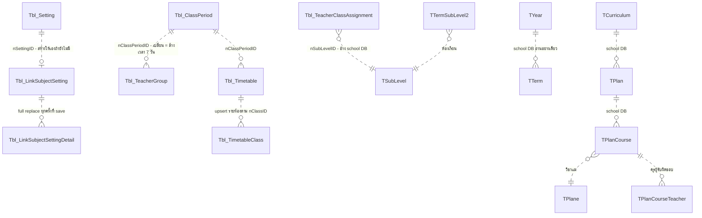

# timetableai — Data Model

> Budget ≤ 15 KB (`policies\documentation.md` §4) · เขียนโดย `system-analyst` เท่านั้น · นี่คือ **schema contract** — `qa-engineer` อ่านเต็มทุกรอบ, engineers implement verbatim

## Data Model

**27. Data Architecture**

> DES-004 — traceability: หัวข้อนี้คือมุมมอง schema/ER เชิงลึกของ entity ที่สัญญา DES-004 สรุปไว้

**27.1 ความสัมพันธ์ข้อมูล (ฐาน A — AITimeTable, เขียนได้; ทุกเส้นคือ app-level reference — ไม่มี FK ใน schema จริง):**

**27.2 Entity ฐาน A — responsibility / read / write / lifecycle:**

| Entity | Responsibility | ใครอ่าน | ใครเขียน | Lifecycle / ข้อจำกัด |
|---|---|---|---|---|
| `Tbl_Setting` | กติกากลางรายปี — แหล่งเดียวของเพดานครู/homeroom/continuity/intensity | generator + วางมือ (ผ่าน Setting/Get — default object ถ้ายังไม่มีแถว) | Setting/Set (lookup แล้วสร้างเอง — D11), ClassContinuity/Set, LinkSubjectSetting/Set (สร้างแทนถ้าไม่มี) | upsert แถวเดียวต่อ (school, year); **ไม่มี isDeleted**; ไม่มี unique index |
| `Tbl_ClassPeriod` | template คาบ = โครงกริดของทุกอย่าง | ทุกหน้า + generator | ClassPeriod/Set\|Delete | soft delete; **ไม่มีกันลบ template ที่ตารางกำลังใช้**; ไม่มีกันชื่อซ้ำ |
| `Tbl_TeacherGroup` (CLR class ชื่อ `Tbl_TeacherSchedule`) | กลุ่มครู + เวลาไม่ว่าง 7 วัน (jsonb รายวัน) | generator (isOn=false = ครูไม่ว่าง) + หน้ารายครู | TeacherGroup/* (SetTeachers = full replace CSV) | soft delete; เปลี่ยน template = backend ล้างเวลาทั้ง 7 วัน (WebAPIController.cs:1578-1592) |
| `Tbl_TeacherClassAssignment` | ครูที่ปรึกษารายระดับ/ห้อง → แหล่ง "คุณสมบัติครู" | หน้า generate (GetTeachersByClass) | Set\|Delete | soft delete; อนุญาตระดับซ้ำ (D7) |
| `Tbl_Timetable` | หัวตาราง 1 ชุด (ชื่อ/ปี/template/หลักสูตร/แผน CSV/isActive) | [year] page, generator (conflict) | Timetable/Set (upsert), SetStatus, Delete | สร้างใหม่ isActive=true; soft delete cascade ลูก |
| `Tbl_TimetableClass` | กริดรายห้อง = **snapshot jsonb 7 วัน** | Timetable/Get, GetAllByYear | Timetable/Set → UpsertTermSubLevel2Rows | จับคู่ in-memory ตาม nClassID (ไม่มี unique — D31); ห้องที่หายจาก payload ถูก soft delete |
| `Tbl_LinkSubjectSetting` + `_Detail` | กติกาตรึงวิชา (พ่อ: กลุ่มห้อง+template; ลูก: วิชา+คาบ+วัน) | generator (ผ่าน SubjectSettings/Get) | LinkSubjectSetting/Set (full replace รายลิงก์), Delete | soft delete; save = ลบของเดิมทั้งชุดแล้วใส่ใหม่ — non-atomic (D29) |

**27.3 Snapshot semantics (หัวใจของ data model):** เซลล์ jsonb (`ItemTimetableSubject` — Request.cs:298-320) เก็บทั้งโครงเวลา **และ** ข้อมูลวิชา/ครู/ห้อง/เครดิต/สี/รหัส SB ณ วินาทีบันทึก → ตารางที่บันทึกแล้ว**ไม่ผูกกับข้อมูลหลักด้วย key ใด ๆ** แก้ชื่อวิชา/ย้ายครูทีหลังไม่กระทบตารางเก่า (BR-20) และการ restore จับคู่เซลล์ด้วย `sStartTime` รายวัน ไม่ใช่ id

**27.4 ข้อเท็จจริง schema:** PK-only ทุกตาราง (ไม่มี FK/unique/check); **ไม่มี EF Migrations และไม่มี EnsureCreated/Migrate** — schema ดูแลด้วย SQL มือ (dump ใน repo เก่ากว่าจริง — D24); jsonb mapping ผ่าน fluent config เฉพาะ 7 คอลัมน์รายวันของ `Tbl_TimetableClass`; UTC converter กับทุก DateTime; school DB อ่านผ่าน `StudentDataContext` (TYear/TTerm/TSubLevel/TTermSubLevel2/TCurriculum/TPlan/TPlanCourse/TPlane/TPlanCourseTeacher/TEmployees/TClassMember)

**27.5 Target data model ของมิติภาคเรียน (REQ-012) — `Data/schema: changed` · ยังไม่มี human schema confirmation ที่ตรวจได้จากบันทึก 2026-10-04**

> **Approval provenance (ตรวจ 2026-10-09):** ประวัติที่เคยอ้าง "เซ็นแล้ว 2026-10-04" อยู่ใน `archive.md:2717` verbatim และระบุว่า AskUserQuestion ไม่ได้รับคำตอบแล้วใช้ข้อเสนอของ design เอง จึงไม่ใช่คำยืนยัน/sign-off ของมนุษย์ตาม CLAUDE.md · รูป schema/ชนิด/กติกาทางเทคนิคในหัวข้อนี้คงเดิมในฐานะข้อเสนอ; การทำ dev ตามขอบเขตที่ผู้ใช้อนุญาตและ verdict BE-010 เดิมไม่เปลี่ยน · ห้ามใช้ประวัตินี้เป็นสิทธิ์เริ่ม schema ใหม่/DDL/migration/shared-environment deploy; งานที่รอเจ้าของยืนยันพักตาม `plan/index.md ## Waiting on Human` #4/#5

> **สถานะ: ข้อเสนอทางเทคนิคที่ผูกกับ requirement ที่ยืนยันแล้ว — ยังไม่มีแถว/คอลัมน์ใดถูกแก้** สัญญาเชิงกติกาอยู่ที่ §34 (DES-009) หัวข้อนี้คือรูป schema เป้าหมายเท่านั้น · **ห้าม engineer แตะ schema ก่อนคนเซ็น** (ประตูมนุษย์: schema change + migration/backfill)

**(ก) ชนิดและชื่อของคีย์เทอม — จุดที่ต้องแก้ความเข้าใจจาก requirement.md**

`requirement.md` (REQ-012 หมายเหตุ) พูดถึง `nTermID`; **schema จริงไม่รองรับชื่อ/ชนิดนั้น**: PK ของ `TTerm` ใน school DB คือ **`nTerm` ชนิด `string`** ไม่ใช่ int (Models/TTerm.cs:16 — EVD-025) และ endpoint ที่มีอยู่แล้วก็คืนค่าเป็น `sTermID = x.nTerm` (WebAPIController.cs:143 — EVD-026) · ตารางอื่นของ school DB ที่อ้างเทอมก็ใช้ string ทั้งหมด (`TTermSubLevel2.nTerm`, `TClassMember.nTerm`)

→ **ข้อเสนอ: คอลัมน์ `sTermID varchar NULL` เก็บ `TTerm.nTerm` ตรง ๆ** — รูปแบบเดียวกับที่ `nYear` เก็บ `TYear.nYear` วันนี้ (อ่านอย่างเดียว ไม่มี FK ตามข้อเท็จจริง §27.4)
ห้ามใช้ `numberTerm`/`sTerm` เป็นคีย์: ทั้งสองไม่ unique ข้ามปี/ข้ามโรงเรียน ใช้ได้เฉพาะการแสดงผลและการเรียงลำดับ · ชื่อคอลัมน์/ชนิดสุดท้ายเป็น **SA-Q1 (รอยืนยัน)**

**(ข) ตารางที่ได้คอลัมน์ใหม่จริง — 4 ตาราง ("ราก" ที่วันนี้ถือ `nYear` เอง)**

| ตาราง | วันนี้ | หลังเปลี่ยน | จุดที่ต้องแก้ตาม |
|---|---|---|---|
| `Tbl_Setting` | `nYear int?` (Models/Tbl_Setting.cs:12) — 1 แถวต่อ (school, year) | + `sTermID` → 1 แถวต่อ **(school, year, term)** | lookup ที่ `Setting/Set` (:2046 — EVD-033) และ `Setting/Get` (:1967) ต้องเติมเงื่อนไขเทอม ไม่ใช่แค่ส่งค่าไปเก็บ |
| `Tbl_ClassPeriod` | `nYear int?` (:12) | + `sTermID` → template เป็นของเทอม | `ClassPeriod/Get` (:816), `Set` (:856) · **ตัวนี้เป็นตัวส่งต่อขอบเขตให้ `Tbl_TeacherGroup` และ `Tbl_LinkSubjectSetting`** |
| `Tbl_TeacherClassAssignment` | `nYear int?` (:11) | + `sTermID` | `TeacherClassAssignment/GetAll` (:2107), `GetAllByYear` (:2167), `Set` (:2289) |
| `Tbl_Timetable` | `nYear int` (:12) | + `sTermID` | `Timetable/GetAllByYear` (:2809 — EVD-035), `Get` (:2579), `Set` (:2626) · เป็นตัวกำหนด conflict set ของ BR-17 (§34.3) |

**(ค) ตารางที่ *ไม่* ได้คอลัมน์ใหม่ — เพราะวันนี้ก็ไม่ได้ถือ `nYear` เอง (derive ตามแม่)**

| ตาราง | ขอบเขตวันนี้ derive จากอะไร | หลักฐาน | ผลเมื่อแม่มี `sTermID` |
|---|---|---|---|
| `Tbl_TeacherGroup` (CLR `Tbl_TeacherSchedule`) | **ไม่มีคอลัมน์ปีเลย** — `TeacherGroup/GetAll|GetAllByYear` กรองปีด้วยการหาชุด `nPeriodID` ของปีนั้นก่อน แล้วค่อยกรองกลุ่มด้วย `nClassPeriodID` | Models/Tbl_TeacherSchedule.cs:12-20 (EVD-029) · WebAPIController.cs:1868-1875, 1921-1927 (EVD-028) | กลุ่มครูกลายเป็นของ (ปี, เทอม) ของ template ที่ผูกไว้ **โดยอัตโนมัติ** — แก้เฉพาะ query ที่หา `periodIDsInYear` ให้เป็น `periodIDsInYearTerm` |
| `Tbl_LinkSubjectSetting` + `_Detail` | ไม่มีทั้ง `nSchoolID`/`nYear` — ผูกผ่าน `nSettingID` (→`Tbl_Setting`) + `nPeriodID` (→`Tbl_ClassPeriod`) | Models/Tbl_LinkSubjectSetting.cs:9-14 (EVD-039) | ได้เทอมตาม setting/template ที่อ้าง |
| `Tbl_TimetableClass` | ลูกของ `nTimetableID` เท่านั้น | Models/Tbl_TimetableClass.cs:11-13 | ได้เทอมตามตารางแม่ · **และ `nClassID` เป็นห้องของเทอมอยู่แล้วโดยธรรมชาติ** (EVD-030) |

**ทางเลือกที่พิจารณาแล้วและไม่เลือก:** เติม `sTermID` ซ้ำลง 3 ตารางนี้ด้วย (denormalize ให้ query ตรง) — **ไม่เลือก** เพราะจะเกิดแหล่งความจริง 2 ที่ (คอลัมน์ของตัวเอง vs เทอมของแม่) ในระบบที่ **ไม่มี FK/constraint ใดคอยบังคับให้ตรงกัน** (§27.4, DES-001 Fallback) — ค่าที่ค้างไม่ตรงกันจะกลายเป็นข้อมูลข้ามเทอมเงียบ ๆ ซึ่งแย่กว่าการ join เพิ่มหนึ่งชั้น · หากผู้ตัดสิน schema เลือกทาง denormalize ต้องมาพร้อมกฎการเขียนที่อัปเดตทั้งสองที่พร้อมกันทุกครั้ง และ §34 ต้องถูก amend ก่อน implement

**(ง) index ที่ควรมาพร้อมกัน (ไม่ใช่ข้อบังคับของ REQ-012 แต่เป็นจุดที่ถูกที่สุดที่จะทำ)**

`Tbl_Setting` วันนี้ไม่มี unique index (D11) และการเพิ่มมิติเทอมทำให้จำนวนแถวต่อโรงเรียนคูณจำนวนเทอม → โอกาสได้แถวซ้ำเพิ่มขึ้นตามตัวคูณ (R15) · ข้อเสนอเดิม §32.1 ข้อ 3 (unique index) จึงมีน้ำหนักขึ้น: `unique (nSchoolID, nYear, sTermID)` บน `Tbl_Setting` และ `unique (nTimetableID, nClassID)` บน `Tbl_TimetableClass` (D31) — **เป็นการตัดสินใจ schema แยกเรื่อง ต้องยืนยันพร้อมกันในรอบเดียวกัน ไม่ใช่ของแถมที่ engineer เพิ่มเอง**

**(จ) Migration / backfill (AC-028) — ลำดับบังคับ**

ข้อจำกัดจริงที่กำหนดวิธีทำ: **ไม่มี EF Migrations และไม่มี EnsureCreated/Migrate** (§27.4) → DDL เป็น SQL มือ · และ **module DB กับ school DB อยู่คนละ host** (`ConnectionStrings` — `DefaultConnectionForPostgreSQL` ≠ `SchoolConnectionForPostgre` — EVD-032) → **backfill ไม่สามารถเป็น SQL join เดียวได้** ต้องอ่าน `TTerm` ผ่าน application/สคริปต์ที่ต่อได้ทั้งสองฝั่ง

1. เพิ่มคอลัมน์ `sTermID` แบบ **nullable ไม่มี default** ทั้ง 4 ตาราง (แถวเดิมทั้งหมด = NULL, ระบบเดิมยังทำงานได้เหมือนเดิม)
2. deploy code ที่ **อ่านแบบเข้ากันได้ย้อนหลัง**: `sTermID` ที่ส่งมาเป็น null/ละเว้น = พฤติกรรมเดิมทั้งปี และแถวที่ `sTermID IS NULL` ยังถูกอ่านเห็น (นี่คือ Fallback ของ DES-009)
3. backfill: ต่อ (nSchoolID, nYear) หา `TTerm` ที่ `SchoolID` ตรง, `nYear` ตรง, `cDel != "1"` แล้วเลือก **เทอมแรกตาม `dStart`** (tie-break: `numberTerm` น้อยสุด) → เขียน `sTermID` ของทุกแถวของ (school, year) นั้น — นี่คือคำแปลทางเทคนิคของ "default เป็นเทอม 1" ตาม AC-028 (ยึด `dStart` เพราะ `numberTerm` เป็น nullable ใน model จริง)
4. (Rev 11) รายงาน backfill บันทึกจำนวนแถวที่ยังเป็น NULL ต่อ (school, year) **เป็นข้อมูลประกอบ** — ไม่ใช่เงื่อนไขให้คนแก้ก่อนขั้นถัดไปอีกต่อไป (OQ-36)
5. เปิดโหมดที่ทุกการเขียนใหม่ต้องมี `sTermID` (บังคับที่ app layer เท่านั้น ตาม DES-001 Fallback)

**จังหวะ cutover (Rev 12 — SA-Q3 ปิด per user chat 2026-09-30: "เริ่มเลย"):** โหมดบังคับเทอม (ขั้น 5 + VR-9) **มีผลตั้งแต่ release ของ DES-009 — ไม่มีช่วงผ่อนผัน (grace period)** ให้ frontend เดิมที่ไม่ส่งเทอม → ขั้น 1–5 ทำใน release window เดียว: DDL → backfill → deploy backend + frontend ที่ส่ง `sTermID` **พร้อมกัน** · ความสามารถอ่านแถว NULL ของขั้น 2 ยังต้องมี (BR-17a, แถวของปีที่ไม่มี `TTerm`) แต่ไม่มีช่วงที่ backend รับ request ไม่มีเทอมหลัง release · **ไม่มีวันที่ตามปฏิทิน** — ผู้ใช้ไม่ได้ให้วัน; วัน release เป็นของคนที่สั่ง deploy (SA ไม่กำหนด ไม่เดา)

**ข้อมูลในฐานข้อมูลโมดูล (Rev 12 — แทนเงื่อนไขก่อนขั้น 3 ของ Rev 11 ที่อยู่ใน `design-archive.md`):** ผู้ใช้ยืนยัน 2026-09-30 ว่าฐานข้อมูลโมดูล (backend dev ที่ production ชี้อยู่ — R32) **มีเฉพาะข้อมูลทดสอบ ไม่มีข้อมูลโรงเรียนจริง** → เงื่อนไขนี้ผ่านแล้ว ไม่ใช่จุดหยุดของ migration อีก · **ต้องยืนยันซ้ำถ้ามีข้อมูลโรงเรียนจริงเกิดขึ้นก่อน backfill ถูกรัน** (R36) — ถ้ามี → OQ-36/OQ-37 เปิดใหม่ (ข้อความ SA-Q2 เดิมใน `design-archive.md`)

**กรณีที่ backfill แปลไม่ได้ (Rev 11 — OQ-36 / SA-Q2 ปิด per user chat 2026-09-30: ข้อมูล legacy เป็นข้อมูลช่วงทดสอบ ไม่ต้องดูแล · ข้อความเดิมอยู่ใน `design-archive.md` · Rev 12 — OQ-37: "ไม่ต้องสนใจข้อมูลเก่า" ใช้ **เฉพาะปีที่ไม่มี `TTerm`** — ปีที่มี `TTerm` ต้องย้ายเข้าเทอมแรกตามขั้น 3 / AC-028 เสมอ):** (school, year) ที่ **ไม่มีแถว `TTerm` เลย** → `sTermID` ค้าง NULL และ **ไม่มีการจัดการพิเศษ**: ไม่แสดงเป็น "ไม่ระบุเทอม", ไม่ต้องรายงานให้คนแก้, ไม่สร้างเทอมใน school DB (ห้ามตาม DES-004 Fallback) · ผลเชิงพฤติกรรม: หน่วยนั้นเลือกเทอมไม่ได้ จึงตกอยู่ใต้ Fallback เดิมของ DES-009 ("`TTerm` ว่าง → หน้าแจ้งผู้ใช้ ห้ามเดาเทอม") และแถว NULL ไม่ถูกแสดงในมุมมองรายเทอมใด · **ห้ามลบ/ย้ายแถวอัตโนมัติ** (การลบข้อมูลเป็นการกระทำแยกที่ต้องมีคนอนุมัติ — ไม่อยู่ในสัญญานี้)

**ผลของการย่อนี้ต่อประตู schema confirmation §27.5 (บันทึกเท่านั้น — ไม่ได้แก้ schema):** DDL ไม่เปลี่ยน (ยังเป็น `sTermID varchar NULL` บน 4 ตาราง + index (ง) — ต้องเป็น nullable ต่อไปเพราะแถวของปีที่ไม่มี `TTerm` ค้าง NULL) · SA-Q2 หลุดจากรายการที่ต้องปิดก่อนเซ็น (เหลือ SA-Q1) · ขั้น 4 ไม่เป็นจุดหยุดรอคนอีก · (Rev 12) **ขั้น 3 (backfill เข้าเทอมแรก) บังคับ — ข้ามไม่ได้** (OQ-37: AC-028 คงอยู่; ทางเลือก "ข้ามขั้น 3" ของ Rev 11 ตกไป — อยู่ใน `design-archive.md`) · migration ทั้งหมดอยู่ใน release window เดียวกับ cutover (SA-Q3)

**27.6 Target data model ของ REQ-016 / REQ-017 / REQ-018 / REQ-019 — `Data/schema: changed` · (ข)(ค)(จ) ยืนยันสำหรับ dev เท่านั้น 2026-10-11; (ก)(ง) ยืนยัน jtrp98 2026-10-11; (ก2) C1′ read/K1 + `TClassSetting` (ไม่มี sEmp) ยืนยัน 2026-10-11; ตารางลูก `TClassSettingCaretaker` + DTO `lstCaretakers` ยืนยัน 2026-10-11 (gate #2 รูปปิด; DDL execution ไม่อนุมัติ)**

> **Approval provenance:** archive.md:2717 ที่ AskUserQuestion ไม่มีคำตอบ 2026-10-04 ไม่ใช่ approval และไม่ย้อนอนุมัติทุก schema; ใช้คำตอบจริง 2026-10-11 ตามขอบเขต (ก2) storage/read-only และ (ข)(ค)(จ) dev only ด้านล่าง · (ก)(ง) ยืนยันโดย jtrp98 2026-10-11 (schema/contract confirmed; DDL ให้ผู้ใช้รันเอง); §27.5/DDL/shared deploy ยังรอเจ้าของตาม gate ของตน

> ประวัติ Rev 6/7 (C2/ทั้งสี่ส่วนรอเซ็น) อยู่ archive.md verbatim; สถานะ active ใช้คำตอบจริง 2026-10-11 ใน (ก)(ก2)(ง) และคำยืนยัน BE-013 (ข)(ค)(จ) ด้านล่าง

> **สถานะ: (ข)(ค)(จ) พร้อม dev ตามคำยืนยันจริงด้านล่าง; (ก)(ง) ยืนยัน schema โดย jtrp98 2026-10-11; (ก2) read states + `TClassSetting` confirmed + `TClassSettingCaretaker`/DTO `lstCaretakers` confirmed (รูปเท่านั้น) — amend นี้ไม่ execute DDL** กติกาอยู่ที่ §38–§41 · engineer ทำเฉพาะส่วน/schema ที่มนุษย์ยืนยันและ PM กำหนด exact Write paths · ตาราง/แถวราก ใหม่ทุกตัวต้องมี `sTermID` ตาม DES-009 **ถ้า** DES-009 ผ่านก่อนหรือพร้อมกัน (รูปแบบเดียวกับ §27.5 ข) · ฐานข้อมูลไม่มี FK/unique (§27.4) — uniqueness บังคับที่ app layer ตาม DES-001 Fallback เว้นแต่ผู้อนุมัติ schema เลือก unique index ในรอบเดียวกัน · REQ-014 และ REQ-015 **ไม่มี DDL** (REQ-015 เปลี่ยนรูปแบบภายใน jsonb เท่านั้น — §37.2)

**(ก) REQ-016 — ตารางใหม่ `Tbl_SubjectRoom` (ตารางราก ถือขอบเขตเอง) + key ห้องใน snapshot — ยืนยัน schema jtrp98 2026-10-11**

| คอลัมน์ | ชนิด | ความหมาย |
|---|---|---|
| `nSubjectRoomID` | int PK | |
| `nSchoolID` | int | |
| `nYear` | int | |
| `sTermID` | varchar NULL | ตาม DES-009 (ถ้ามี) |
| `sCourseCode` | varchar | key เดียวกับแถว continuity และ snapshot `sSBCourseCode` |
| `sRoomID` | varchar(10) | = `TClass.sClassID` (2026-10-11 แทน TRoom; ชื่อคอลัมน์คงเดิม; ความยาวสูงสุด 10 ตาม [StringLength(10)] ใน EF model PostgreSQL.SchoolDB.TClass ที่ jtrp98 ส่ง 2026-10-11 — SA-Q5 ส่วน model fields ตอบแล้ว; ไม่ได้ตรวจ live DDL) |
| `isDeleted`, `CreatedBy/At`, `UpdatedBy/At` | | ตามแบบแผนตารางอื่นของโมดูล |

- uniqueness (app layer): `(nSchoolID, nYear, sTermID, sCourseCode)` ที่ `isDeleted=false` (BR-34)
- snapshot: `ItemTimetableSubject` + `sRoomID string?`, `sRoomName string?` — อยู่ใน jsonb รายวันของ `Tbl_TimetableClass` จึง **ไม่มี DDL** (เพิ่ม property ใน `Request.cs` เท่านั้น) · `nClassroomID/sClassroomName/sClassroomColor` เดิมคงไว้ไม่ใช้ (D42)
- school DB: map `TClass` (+ `TClassSetting`/`TClassSettingCaretaker` ก2) แบบอ่านอย่างเดียวใน `StudentDataContext` (ไม่เขียน — DES-004 Fallback); active = `cDel IS NULL OR cDel = '0'` (ยืนยัน jtrp98 2026-10-11 SA-Q25 — `requirement\req-016.md:22`; DES-013 BR-33)
- ทางเลือกที่ไม่เลือก: เก็บ mapping เป็น jsonb ใน `Tbl_Setting` — ไม่เลือกเพราะเป็น collection ที่ต้องตรวจ VR-10/VR-11 รายแถว และ `Tbl_Setting` ถือ 2 เมนูอยู่แล้ว (R25)
- Rev 6: 1 วิชา : 1 ห้อง ยืนยันแล้ว (OQ-15 ข) → uniqueness `(nSchoolID, nYear, sTermID, sCourseCode)` คงเดิม · ตั้งที่ `/timetable/subject-settings` (OQ-15 จ) → อยู่ในเมนู "กติกาวิชา" ของ REQ-013

**(ก2) REQ-016 — C1′ ที่ School DB อ่านอย่างเดียว (jtrp98 2026-10-11) · storage/permission/read states/K1 ยืนยันแล้ว; `TClassSetting` ยืนยันรูป 2026-10-11 (เอา sEmp ออกตาม OQ-44); `TClassSettingCaretaker` + DTO `lstCaretakers` ยืนยัน jtrp98 2026-10-11**

ผู้ใช้ตอบ **"เก็บใน School DB แต่ไม่ต้องสร้างเองนะ ทำแค่ ไฟล์ sql ก็พอ เดี๋ยวฉันไปรันเอง"** และ **"ให้อ่านอย่างเดียว ฉันจัดค่าผ่านระบบอื่นหรือ SQL เอง"** → SA-Q9 เลือก C1′; ไม่มี `Tbl_RoomSetting` ฝั่งโมดูล, ไม่มี `RoomSetting/Set`/proxy/editor/การคัดลอก capacity หรือผู้ดูแลทั้ง `subjectConditions`/`all` · mapping `Tbl_SubjectRoom` ยังเขียน/คัดลอกในโมดูลตาม (ก) และ DES-010 BR-66 · C2 เป็นประวัติใน `archive.md` ไม่มีผลเป็นทางเลือก active

**รูป SQL artifact (2026-10-11):** PostgreSQL relations ใหม่สองตัวใน School DB · ไม่ ALTER `TClass`, ไม่มี FK, ไม่มี EF migration/EnsureCreated/Migrate/startup DDL, ไม่มีสิทธิ์ execute · `CREATE TABLE` ไม่ใส่ IF NOT EXISTS เพื่อหยุดเมื่อชื่อชน (dump ไม่มีทั้งสองชื่อ — live ไม่ทราบ)

**`public."TClassSetting"` — ยืนยัน jtrp98 2026-10-11:** **"ยืนยันรูปนี้ + เพิ่ม audit 4 คอลัมน์"** + OQ-43 **"มี nYear (Recommended)"** (`requirement\req-016.md:22`) · `sEmp` **ถูกเอาออก** เพราะ OQ-44 ผู้ดูแลมีได้หลายคน (`open-questions\oq-44.md:13`) — การเอาออกเป็นผลบังคับของคำตอบนั้น; รูปที่เหลือไม่เปลี่ยน

| คอลัมน์ quoted exact | PostgreSQL type | NULL / default / ขอบเขต |
|---|---|---|
| `SchoolID` | integer | NOT NULL, ไม่มี default; = `TClass.SchoolID` |
| `nYear` | integer | NOT NULL, ไม่มี default; ปี `TTerm.nYear` (OQ-43 ปิด) |
| `nTerm` | text | NOT NULL, ไม่มี default; key `TTerm.nTerm` (string) ตรงตัว; ไม่มี legacy NULL ทั้งปี |
| `sClassID` | varchar | NOT NULL, ไม่มี default; key `TClass.sClassID` ตรงตัว; ไม่ระบุความยาวเพราะ varchar(10) ของ dump ไม่ใช่ live |
| `nCapacity` | integer | NULL, DEFAULT NULL; CHECK `nCapacity IS NULL OR nCapacity >= 1`; NULL = ยังไม่ตั้งความจุ |
| `CreatedBy`, `UpdatedBy` | integer | NULL, DEFAULT NULL — แบบ `TClass` (dump `school_db.sql:1112–1113`, inferred) |
| `CreatedDate`, `UpdatedDate` | timestamp | NULL, DEFAULT NULL — แบบ `TClass` (dump `:1114–1115`, inferred); external writer เติม, โมดูลไม่อ่าน/ไม่เขียน audit |

- **PRIMARY KEY `(SchoolID,nYear,nTerm,sClassID)`** (ยืนยัน) · external writer จัด/ลบ row เอง · ห้าม UNIQUE/FK บน `TClass`/`TTerm`/`TEmployees`

**`public."TClassSettingCaretaker"` — ยืนยัน jtrp98 2026-10-11:** **"ยืนยันทั้งตารางลูกและ DTO (Recommended)"** (ไม่แก้ `TClass`/`TClassSetting`; `TClassSetting` เหลือ `nCapacity`+audit ไม่มี `sEmp`) · 1 แถว = ผู้ดูแล 1 คนของ (โรงเรียน, ปี, เทอม, ห้อง)

| คอลัมน์ quoted exact | PostgreSQL type | NULL / default / ขอบเขต |
|---|---|---|
| `SchoolID`, `nYear`, `nTerm`, `sClassID` | integer, integer, text, varchar | NOT NULL ทุกตัว ไม่มี default; ความหมายเดียวกับ `TClassSetting` |
| `sEmp` | integer | NOT NULL; = `TEmployees.sEmp` (PK int — `Models/TEmployees.cs:13–14`) ของ SchoolID เดียวกัน; ไม่มีแถว = ไม่ตั้งผู้ดูแล (OQ-31 ข) |
| `CreatedBy`, `UpdatedBy` / `CreatedDate`, `UpdatedDate` | integer / timestamp | NULL, DEFAULT NULL — แบบ `TClass` |

- **PRIMARY KEY `(SchoolID,nYear,nTerm,sClassID,sEmp)`** กันผู้ดูแลซ้ำ · ไม่มี FK ไป `TClassSetting`/`TClass`/`TEmployees` · อ่านอิสระจาก `TClassSetting` ด้วยคีย์หน่วยเดียวกัน: มีผู้ดูแลแต่ไม่มีแถว `TClassSetting` = capacity absence (K=1+RoomSettingMissing) และใช้ผู้ดูแลตามปกติ — ไม่ใช่ invalid
- เหตุผลที่เลือกตารางลูก: PK กันซ้ำที่ DB, external writer ใช้ INSERT/DELETE ตรง, join `TEmployees`/แผนได้ตรง, คง `TClassSetting` ตามรูปที่ยืนยัน · ไม่เลือก `integer[]`/jsonb บน `TClassSetting` (ต้อง validate element null/ซ้ำ/ชนิดที่ app, fail-closed ยากกว่า) · ไม่เลือกหลายแถวต่อห้องใน `TClassSetting` (`sEmp` เข้า PK ทำให้ `nCapacity` ซ้ำ/ขัดกันได้ต่อแถว)
- ชื่อคอลัมน์ DB (`sClassID`/`sEmp`) ต่างจาก DTO (`sRoomID`/`lstCaretakers[].nTeacherID`) โดยตั้งใจ: โมดูลใช้ `sClassIDs`/`nClassID` = ห้องเรียนนักเรียน int — ห้ามผสม
- หน่วยค่าคือ (school, year, term, room); ไม่อ่านปี/เทอมอื่น ไม่สืบทอด ไม่ backfill/copy ให้อัตโนมัติ; ไม่มีแถวและแถวที่ capacity NULL เป็น "ไม่ได้ตั้ง" ต่างจาก read error · **successful absence/NULL capacity ใช้ K=1+RoomSettingMissing ยืนยันแล้ว**; read failure/invalid data BLOCK ไม่มี business fallback ใหม่สำหรับค่า invalid
- **Read contract confirmed**: `StudentDataContext` อ่าน relation นี้แบบ read-only/no-tracking โดย filter SchoolID จาก authenticated context และ `nYear`/`nTerm` ของตาราง; validate เทอมของโรงเรียน/ปี, room ของโรงเรียน, caretaker ของโรงเรียนก่อนใช้ · ไม่มี INSERT/UPDATE/DELETE/SaveChanges ต่อ School DB จากโมดูล
- DTO Rooms (ยืนยัน jtrp98 2026-10-11): `nCapacity:int|null` คงเดิม; `nCaretakerTeacherID`/`sCaretakerTeacherName` เดี่ยว → `lstCaretakers:[{nTeacherID:int,sTeacherName:string|null,isInPlan:bool}]` (ไม่มีผู้ดูแล = `[]`) · `sTeacherName` = ชื่อเมื่อ `TEmployees.cDel IS NULL` ไม่ขึ้นกับ `isInPlan`; ครูที่ถูกลบ/ชื่อว่าง = `null` (DES-013 §38.5a ข้อ 2 — SA ตัดสินตามที่ผู้ใช้มอบอำนาจ 2026-10-11; shape ไม่เปลี่ยน) · `isInPlan` = ผู้สอนในแผน/หลักสูตรของโรงเรียน ปี/เทอมเดียวกัน (OQ-45 ข) ตามนิยาม DES-013 BR-71 · `nTerm` บน School DB map กับ query `sTermID:string` ตรงตัว · successful absence/read failure/invalid external data ตาม DES-013 §38.3/§38.5 (ใช้กับทั้งสอง relation) ไม่ตีความ read failure ว่า absence
- Evidence อ่านจริง: `sb-api-academic-timetable-ai/AITimeTableBackend/Helpers/StudentDataContext.cs:20` ใช้ `UseNpgsql`; `Models/TTerm.cs:16,25,32` ให้ nTerm string/SchoolID int/nYear int?; `Models/TEmployees.cs:13–14,24` ให้ sEmp int [Key]/SchoolID int?; แผน: `Models/TPlanCourseTeacher.cs:12–16,21` (PlanCourseId, sEmp int, IsActive bool?, SchoolID, cDel bool), `Models/TPlanCourse.cs:12–13,21–25` (PlanId, CourseStatus, IsActive, cDel bool), `Models/TPlan.cs:12–22` (ไม่มีปี/เทอม), `Models/TPlanTermSubLevel2.cs:11–15` (PlanId→nTermSubLevel2), `Models/TTermSubLevel2.cs:16` (nTerm string) · dump (D24) `school_db.sql:1106–1117` TClass, `:1626` TEmployees.sEmp INTEGER **inferred เท่านั้น ไม่ใช่ live-schema/length/FK confirmation** · Academic source `Tclass.cs:8–14`, `TimetableRepository.cs:621–630` (confirmed เฉพาะ source)
- **Quality/operations (proposal):** PK สนับสนุน exact school/year/term query และอ่าน room rows แบบ batch ไม่ N+1; ปริมาณ/peak ไม่มีตัวเลขยืนยัน ต้องวัดก่อนเปิดใช้ · ไม่มี cache ข้ามหน่วย/no stale fallback; logs เก็บ school/year/term กับ read-state ไม่เผย PII ชื่อครู/JWT · external writer owner ดูแล retention/delete/SQL rollout; module ไม่เพิ่ม job/vendor/operational writer · School DB unavailable/invalid data เป็น visible fail-closed state ตาม DES-013 ไม่ clamp เป็น default
- **read states/K1/`TClassSetting`/`TClassSettingCaretaker`/DTO `lstCaretakers`/SA-Q25 ปิดตามคำตอบจริง (gate #2 ส่วนรูปตารางปิด 2026-10-11)**; SA-Q5 runtime TClass, SA-Q10 Academic read path, module mapping schema (ก), DDL execution, security และ release ยังเปิด · backend-engineer เขียน SQL artifact ใหม่ (`class-setting-school-db.sql` ทั้งสอง relation) ตาม PM exact Write paths (ตารางลูกยืนยันแล้ว 2026-10-11); artifact review ไม่ใช่ permission execute/live-create; ไม่มีตาราง/คอลัมน์ใดถูกรันจาก amend นี้

> **คำยืนยันจริงเพิ่มเติม jtrp98 2026-10-11 (รูป TRoomTermSetting ถูกแทนโดยคำสั่ง TClass/TClassSetting วันเดียวกัน; สัญญาอ่าน/K1 ยังมีผล):** ผู้ใช้ตรวจ concrete SQL `room-term-setting-school-db.sql:14–22` (six columns+PK/check ตรงรูปนี้; review14/QA17 เป็น static partial ไม่ใช่ runtime) แล้วตอบ **"ยืนยันตารางและสัญญาอ่านนี้ (แนะนำ)"** — ยืนยัน exact C1′ schema/DTO/read scopes/ownership และ read failure/invalid external data BLOCK ตาม DES-013 §38.3/38.5 · ตอบ **"ใช้ความจุ 1 พร้อมคำเตือน (แนะนำ)"** — successful absence ไม่มี row หรือ capacity NULL เท่านั้นใช้ K=1+RoomSettingMissing; ไม่ใช้เมื่ออ่านล้ม/ข้อมูล invalid · ไม่ยืนยัน live TRoom/Academic/module mapping schema (ก)/DDL execution/shared DB/migration/deploy/release/security

> **คำยืนยันจริงเฉพาะ BE-013 / dev (jtrp98 2026-10-11):** ผู้ใช้ตอบ **"อนุมัติรูปนี้สำหรับ dev; ตั้งเพดานใหม่เมื่อเปิดใช้"** หลังเห็น (ข) `nMaxTeachingHoursPerDay/Week int NOT NULL DEFAULT 0`, keys รายคน; (ค) `jHomeroomRestrictedTeachers jsonb NULL = [{nTeacherID}]` (H1); คงคอลัมน์เดิมและหยุดอ่านหลัง paired cutover; (จ) M1 ไม่แปลง/ไม่มี backfill และผลเพดาน default 0 จนตั้งใหม่ · เป็น human schema/breaking approval ของ (ข)(ค)(จ) **เฉพาะ dev** จึงปิด SA-Q4/H1 สำหรับ dev; ไม่อนุมัติ (ก)(ง), §27.5; (ก2) มีคำยืนยันแยกด้านบนเฉพาะ schema/read, DDL execution/shared-environment migration/deploy หรือวัน cutover · SA-Q8 (BE-013 คู่ FE-025/DES-011) ยัง hold release แต่ไม่ขวาง dev หลัง PM ระบุ exact Write paths · ประวัติ archive.md:2717 คงเป็นประวัติที่ไม่ใช่ human approval

**(ข) REQ-017 — `Tbl_Setting` + คอลัมน์เพดานหน่วยชั่วโมงเต็ม (Rev 6 — AC-041: จำนวนเต็มเท่านั้น)**

- `nMaxTeachingHoursPerDay int NOT NULL DEFAULT 0`, `nMaxTeachingHoursPerWeek int NOT NULL DEFAULT 0` (0 = ไม่กำหนด) — Rev 5 เสนอหน่วยนาทีเพื่อรองรับเศษ; ไม่จำเป็นแล้ว เก็บตรงตามค่าที่ผู้ใช้กรอก ไม่ต้องแปลง/ปัด
- jsonb `jSetMaxPeriodIndividually` แต่ละแถว + key `nMaxTeachingHoursPerDay`, `nMaxTeachingHoursPerWeek` (ไม่มี DDL)
- คอลัมน์เดิม `nMaxTeachingPeriodPerDay`, `isApplyMaxPeriodToAllTeachers`, `isExceptMaxPeriodTeachers`, `sMaxPeriodExceptTeacherIDs` **คงไว้ ไม่ลบ แต่ไม่ถูกอ่านหลัง cutover** · SA-Q4 ชื่อ/ชนิดนี้ยืนยันเฉพาะ dev โดย jtrp98 2026-10-11

**(ค) REQ-018 — `Tbl_Setting` + `jHomeroomRestrictedTeachers jsonb NULL`**

- รูปแบบ **H1** `[{nTeacherID}]` เท่านั้น (Rev 6 — OQ-17 ก ปิด: ห้องที่รับผิดชอบมาจาก `TClassMember` อัตโนมัติ; H2 ตกไป)
- ธง homeroom 7 คอลัมน์เดิม (`isUseAllHomeroomTeachers` … `sHomeroomExceptTeacherIDs`) คงไว้ ไม่อ่านหลัง cutover
- `Tbl_TeacherClassAssignment` **ไม่แก้ ไม่ลบ** (AC-046a — dead data; การลบเป็นการตัดสินใจแยกที่ต้องมีคนอนุมัติ)

**(ง) REQ-019 — ตารางใหม่ `Tbl_TimetableAcademicSync` (บังคับ; ยืนยัน schema jtrp98 2026-10-11)**

> A+atomic T1 direction และ schema ยืนยันจริงโดย jtrp98 2026-10-11: "ยืนยันสัญญา T1 Atomic Replace (POST api/gateway/timetables/atomic-replace, Single DB Transaction พร้อม Revision check) และ schema Tbl_TimetableAcademicSync (บันทึก nStatus 1=Sent, 2=Rejected, 3=Failed)" ตาม DES-016 §41.4a; ไม่มีสถานะ Partial ใน atomic replace (T2 ตกไป); DDL execution ใน School DB ให้ผู้ใช้รันเอง

| คอลัมน์ | ชนิด | ความหมาย |
|---|---|---|
| `nSyncID` | int PK | |
| `nSchoolID` | int | |
| `nTimetableID` | int | ตารางต้นทาง (`Tbl_Timetable`) |
| `nClassID` | int | ห้องเรียน = `nTermSubLevel2` ที่ส่ง |
| `sTermID` | varchar | = `nTerm` ที่ส่ง (BR-46) |
| `nStatus` | int | 1 Sent / 2 Rejected / 3 Failed (BR-48, §41.4) |
| `jScheduleIDs` | jsonb | `scheduleId` ที่ Service Academic คืนมาของชุดล่าสุดที่เขียนสำเร็จ (ใช้โดย BR-56) |
| `jDetail` | jsonb | ผลรายแถว/ข้อความจาก Service Academic |
| `dSentAt`, `nSentBy` | timestamp, int | ผู้ส่ง/เวลา (ค่าจาก client — §9) |
| `CreatedBy/At`, `UpdatedBy/At` | | |

- 1 แถวต่อ `(nTimetableID, nClassID, sTermID)` — upsert (uniqueness ที่ app layer) · เหตุผลที่เป็นตาราง ไม่ใช่คอลัมน์บน `Tbl_Timetable` ตามข้อเสนอ Rev 5: ผลเป็น **รายห้องเรียน** (BR-48) และ BR-56 ต้อง lookup ตาม `scheduleId` ทั้งปี
- ไม่มี state lock (OQ-13 ปิด — ไม่มี publish/lock) → DES-003 ไม่เปลี่ยน

**(จ) Migration / backfill (Rev 6)**

- (ก)(ค)(ง): ตาราง/คอลัมน์ใหม่แบบ nullable/default → ไม่มี backfill · (ก2) C1′ School DB เป็น SQL artifact เท่านั้น ผู้ใช้รันเอง ไม่มี module migration/backfill · DDL execution ของทุกส่วนยังไม่อนุมัติจาก amend นี้
- (ก) กับ DES-009: legacy Tbl_SubjectRoom.sTermID NULL เท่านั้นที่ใช้ §27.5 (จ); ถ้าออกพร้อม/หลัง DES-009 แถวใหม่ต้องมี sTermID · (ก2) TClassSetting/TClassSettingCaretaker ใหม่ไม่มี legacy NULL/year-wide row และไม่ถูก backfill/copy โดยโมดูล
- (ข): **M1 — ไม่แปลง ไม่ backfill** (ยืนยันธุรกิจ — OQ-16 ข ปิด 2026-09-28): คอลัมน์ใหม่ default 0 = ไม่จำกัด จนกว่าผู้ใช้กรอกค่าใหม่เป็นชั่วโมง · ค่าเดิม `nMaxTeachingPeriodPerDay` ไม่ถูกแปลงและไม่ถูกอ่านหลัง cutover · M2/M3 ตกไป · ผลที่ต้องแจ้งคน: เพดานที่ทุกโรงเรียนตั้งไว้หมดผลทันทีที่ cutover — SA เสนอรายงานรายชื่อ (โรงเรียน, ปี) ที่เคยตั้งเพดานไว้เพื่อใช้สื่อสารผู้ใช้ก่อน deploy (เอกสารประกอบการสื่อสาร ไม่ใช่ขั้น migration)

**27.7 Target data model ของ Rev 8 — `Data/schema: changed` · รอ schema confirmation จากคน**

> **สถานะ (Rev 9): (ก) schema ยืนยันโดยผู้ใช้แล้ว — ยังไม่มีคอลัมน์ใดถูกแก้จริง (DDL เป็นงาน `devops`)** · (ข) ไม่มี DDL · DES-018 และ DES-020 **ไม่มี DDL**

**(ก) DES-019 — ความเข้มข้นต่อตาราง: `Tbl_Timetable` + 1 คอลัมน์ (Rev 9 — schema ยืนยันโดยผู้ใช้ 2026-09-29)**

| คอลัมน์ | ชนิด | ความหมาย |
|---|---|---|
| `nCourseIntensity` | smallint NULL | ระดับ L ของตารางนี้: 0 = ไม่กระจาย, 1 = พยายามกระจายวิชาหนัก, 2 = พยายามสลับหนัก-เบา (BR-78) · **NULL = 0** |

- DDL (SQL มือ — §27.4; `devops` รัน): `ALTER TABLE "Tbl_Timetable" ADD COLUMN "nCourseIntensity" smallint NULL;` · model `Tbl_Timetable.cs` + `int? nCourseIntensity`
- **ไม่ backfill** (ยืนยัน) — ตารางเดิม NULL · `Tbl_Setting.nCourseIntensity` **คงไว้ ไม่ลบ** (ยืนยัน) — ใช้เป็นค่า prefill ของตารางใหม่เท่านั้น
- ข้อขัดที่แก้: as-built เก็บต่อ (โรงเรียน, ปี) (EVD-096) แต่คำตอบธุรกิจ = ต่อตาราง · ไม่มีคอลัมน์ความหนักรายวิชา (ระบบคำนวณเท่านั้น — BR-77) · ถ้า DES-009 ออกพร้อมกัน ไม่มีผลเพิ่ม (คอลัมน์อยู่บนตารางราก `Tbl_Timetable`)

**(ข) DES-021 — ลบ legacy (Rev 9: ไม่มี DDL)**

- ผู้ใช้ตัดสินใจ 2026-09-29: **ไม่ DROP `Tbl_TeachingSchedule`** — ตารางและข้อมูลคงอยู่ (REQ-020 AC-059) · ลบเฉพาะโค้ด (§46) · คอลัมน์เก่า `Tbl_Timetable.nTeachingScheduleID` (ถ้ามีใน production — EVD-112) ก็ไม่ถูกแตะ · schema confirmation ของส่วนนี้ **หมดความจำเป็น (moot)** · ข้อความฉบับ Rev 8 อยู่ใน `design-archive.md`

---

## Change Log

- 2026-10-11 — schema Tbl_SubjectRoom §27.6 (ก) (1 วิชา : 1 ห้อง, sRoomID varchar(10) แมป TClass.sClassID) และ schema Tbl_TimetableAcademicSync §27.6 (ง) (nStatus: 1=Sent, 2=Rejected, 3=Failed) ได้รับการยืนยันจาก jtrp98; DDL execution ยังคงให้ผู้ใช้รันเองตามข้อตกลงเดิม

- 2026-10-11 — SA-Q5 ส่วน TClass model fields ยืนยันจาก model ที่ jtrp98 ส่ง: public.TClass, sClassID max10/key order0 + SchoolID int/key order1, sClass max250, sClassIP max15, cDel max1, nullable audit 4; ไม่ select sClassIP. SA-Q10 เลือก X2 + นับคาบไม่ถูกลบทั้งหมดรวม inactive (DES-013 §38.4). Module mapping schema (ก)/concrete X2 contract/runtime/security/DDL/deploy/release ยังไม่อนุมัติ; ไม่มี live DB check.

- 2026-10-11 — (ก2) DTO `lstCaretakers[].sTeacherName` ค่าตาม DES-013 §38.5a ข้อ 2 (active โรงเรียนเดียวกัน→ชื่อ, ลบ/ว่าง→null) — SA ตัดสินตามที่ผู้ใช้มอบอำนาจ 2026-10-11 ไม่ใช่การอนุมัติของมนุษย์; shape/ตาราง/DDL ไม่เปลี่ยน; additive ไม่มีข้อความถูกแทน

- 2026-10-11 — jtrp98 "ยืนยันทั้งตารางลูกและ DTO (Recommended)": (ก2) `TClassSettingCaretaker` + DTO `lstCaretakers` confirmed (gate #2 รูปปิด); ไม่รัน/ไม่อนุมัติ DDL execution; SA-Q5/SA-Q10/(ก)/security/release ยังเปิด; ส่วนที่แทน archive.md verbatim

- 2026-10-11 — คำตอบ jtrp98 (req-016.md:22; OQ-43/44/45; SA-Q25): (ก2) `TClassSetting` ยืนยันรูป + audit 4 + nYear, เอา `sEmp` ออก; เสนอ `TClassSettingCaretaker` (PK 5 คอลัมน์, audit, ไม่มี FK) + DTO `lstCaretakers[{nTeacherID,sTeacherName,isInPlan}]` **รอ gate #2**; cDel active ยืนยัน; ไม่รัน DDL; ส่วนที่แทน archive.md verbatim

- 2026-10-11 — jtrp98 ยืนยัน exact concrete C1′ SQL/read/ownership + read failure/invalid BLOCK และ successful absence/NULL K1+warning จริง; (ก2) gate ปิด ไม่ execute SQL/ปิด live TRoom/Academic/modulemapping/release/security; superseded proposal archive.md verbatim

- 2026-10-11 — บันทึก jtrp98 คำตอบจริง C1′/read-only/SQL self-execute และ BE-013 schema+breaking (ข)(ค)(จ) dev only; C1′ exact table/read contract เป็น proposal; K=1/SA-Q5/SA-Q10 ยังเปิด; ส่วนที่ถูกแทนอยู่ archive.md verbatim ไม่มี code/DDL/deploy/Status writes

- 2026-10-09 — แก้ approval provenance ของ §27.5/§27.6: archive.md:2717 ระบุไม่ได้รับคำตอบ AskUserQuestion แล้วใช้ข้อเสนอเอง จึงไม่ใช่ human schema/breaking confirmation; เก็บประวัติเดิม verbatim ไม่เปลี่ยน schema/API/migration/business rules, verdict BE-010 หรือสิทธิ์ทำ dev ที่ผู้ใช้ให้; งานที่ต้องยืนยันเจ้าของพักตาม Waiting on Human #4/#5

- 2026-10-07 — Migrated to split layout

Back-links: `index.md` · `../../INDEX.md`
