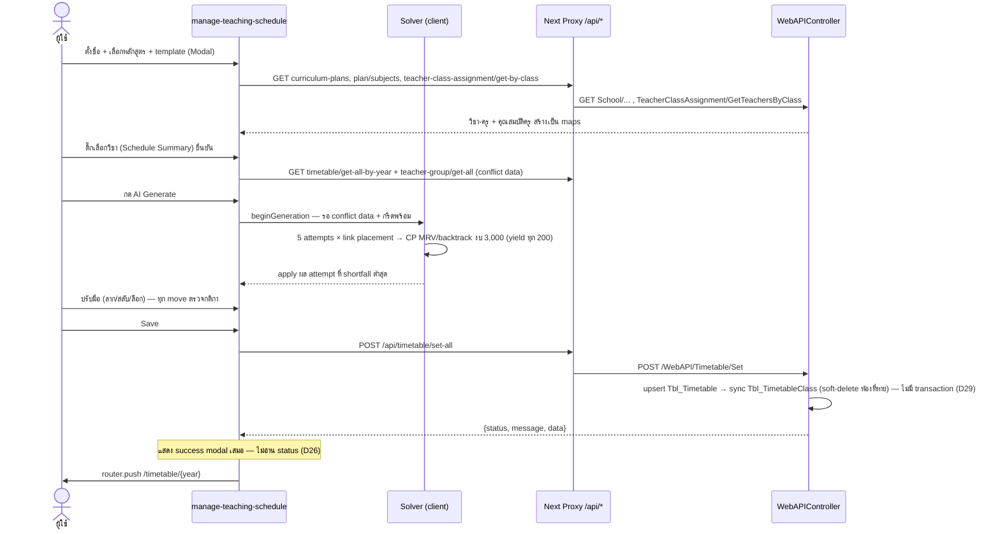
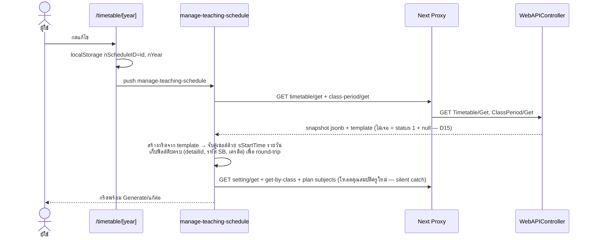

# DES-007 — 29. Settings → Generation Influence Map (ความสัมพันธ์ settings กับ generate/validate)

> Budget ≤ 8 KB (`policies\documentation.md` §4) · เขียนโดย `system-analyst` · ไฟล์นี้ = 1 contract · ต้องมีแถวใน `index.md` ตาราง DES

| ตั้งที่หน้า | Persist ที่ | ผลต่อ Generation | ผลต่อ Manual Edit | หมายเหตุ |
|---|---|---|---|---|
| create-class-period: template | `Tbl_ClassPeriod.jPeriodConfig` | โครงกริดทั้งหมด (วัน/คอลัมน์/เวลา) + เพดานสล็อตต่อห้อง | โครงกริดที่ลากวาง | server ตรวจ OverlappedTimeRanges (VR-1) |
| settings: เพดานคาบ/วัน + รายคน + ยกเว้น | `Tbl_Setting` | hard constraint ต่อครูต่อสล็อต | เดียวกัน (`getEffectiveMaxPeriod`) | ลำดับความสำคัญ BR-8 |
| settings: คาบต่อเนื่องไม่พัก | `Tbl_Setting` | hard constraint ต่อครู | เดียวกัน | มีผลเสมอ (BR-9) |
| settings: homeroom flags | `Tbl_Setting` | กำหนด `teacherEligibleClassesMap` (ครูไหนสอนห้องไหน) | เดียวกัน | ม.ต้น/ม.ปลาย filter ค่าเดียวกัน (D18) |
| settings: `nCourseIntensity` | `Tbl_Setting` | **ไม่มีผล (D12)** | ไม่มี | เก็บไว้อย่างเดียว |
| subject-settings: continuity | `Tbl_Setting.jSetSubjectsClassContinuity` | **ไม่มีผล (D12)** | ไม่มี | เก็บไว้อย่างเดียว |
| subject-settings: link subjects | `Tbl_LinkSubjectSetting(+Detail)` | pre-placement สูงสุด เขียนทับได้ | ช่อง `isLinkedSubject` ห้ามแตะ/สลับ | บังคับทั้ง generate และวางมือ |
| manage-timetable: กลุ่มครู + เวลา `isOn=false` | `Tbl_TeacherGroup` | hard: ครูไม่ว่างช่วงนั้น | เดียวกัน | แสดงเป็น unavailable ในมุมมองรายครู |
| manage-timetable: ครูที่ปรึกษา | `Tbl_TeacherClassAssignment` | แหล่งคุณสมบัติครู (eligible classes + วิชาที่รับผิดชอบ) | เดียวกัน | get-by-class |
| ตารางอื่นของปีเดียวกัน (บันทึกแล้ว) | `Tbl_TimetableClass` jsonb | hard: กันชนข้ามตารางด้วยเวลาจริง | เดียวกัน | โหลดครั้งเดียวตอนเปิดหน้า |

> **Rev 8 (target):** แถว `nCourseIntensity` → ค่า **ต่อตาราง** บน `Tbl_Timetable` (§27.7 ก) มีผลแบบ soft (DES-019) · แถว "ตารางอื่นของปีเดียวกัน" → เทอมเดียวกัน (BR-17a)

**จังหวะการอ่าน:** setting/กติกาทั้งหมดถูกอ่าน**ตอนเปิดหน้า generate** เท่านั้น — แก้กติกาขณะเปิดหน้าอยู่ไม่มีผลกับ session นั้น และตารางที่บันทึกแล้วไม่เคยถูก re-validate ด้วยกติกาใหม่ (snapshot — §15)

Contract:SettingsGenerationInfluence.v1
DEC-007

> path ด้านล่างสัมพัทธ์กับ repo frontend `sb-tech-upgrade-web-system` @ `a2c9138d49602f49f50f860f038308089be10c0f` (ค่าที่ persist ในตารางฝั่ง A ผูกกับ entity ตาม DES-004)

Evidence EVD-019: claim=DES-007 | state=confirmed | path=src/app/[locale]/timetable/manage-teaching-schedule/page.tsx | symbol=getEffectiveMaxPeriod | line=253 | revision=e300ca33bce4a0124983fe814a6b2b47870153c4 | basis=source | tool=rg-read | hash=78c7e8e453d176b6b3e6fedf9ae17969e1f0dd055d564389a267741a5259c188
Evidence EVD-020: claim=Contract:SettingsGenerationInfluence.v1 | state=confirmed | path=src/app/[locale]/timetable/manage-teaching-schedule/_lib/use-timetable-generation.ts | symbol=isConflictDataReady | line=914 | revision=e300ca33bce4a0124983fe814a6b2b47870153c4 | basis=source | tool=rg-read | hash=355c785d39b4484906272499ea2177688c13508cec096c6963bd7ceae6cb4030
Evidence EVD-021: claim=DEC-007 | state=confirmed | path=src/app/[locale]/timetable/manage-teaching-schedule/_lib/use-timetable-generation.ts | symbol=isLinkedSubject | line=475 | revision=e300ca33bce4a0124983fe814a6b2b47870153c4 | basis=source | tool=rg-read | hash=355c785d39b4484906272499ea2177688c13508cec096c6963bd7ceae6cb4030

Compatibility: unchanged
Data/schema: unchanged
Migration/backfill: none
Security: none
Fallback: setting/กติกาทั้งหมดถูกอ่านตอนเปิดหน้า generate เท่านั้น — Generate หรือลากวางต้องรอ `isConflictDataReady` (ตารางอื่นของปี + เวลาไม่ว่างกลุ่มครูโหลดครบ) และกริดทุกห้องพร้อม · แก้กติกาขณะเปิดหน้าอยู่ไม่มีผลกับ session นั้น ต้องเปิดหน้าใหม่ · ตารางที่บันทึกแล้วไม่ re-validate ด้วยกติกาใหม่ (snapshot) · `nCourseIntensity` และ `jSetSubjectsClassContinuity` เก็บเท่านั้น ไม่มีผล (D12)
Material ambiguity: none

---

## 30. Important Sequence Flows

> DES-006, DES-008 — traceability: sequence ทั้งสองเดินตามกลไก generate ใน DES-006 และเส้นทาง integration ใน DES-008

**30.1 สร้างตารางใหม่: Generate + Save (happy path พร้อมจุดล้มเหลว):**

**30.2 แก้ไขตารางเดิม (Restore):**

(4 หน้าตั้งค่าเป็น CRUD ตรง — รายละเอียดอยู่ §3 Flow A และ §5 ไม่ซ้ำด้วย diagram)

---

## Change Log

- 2026-10-07 — Migrated to split layout

Back-links: `index.md` · `../../INDEX.md`
