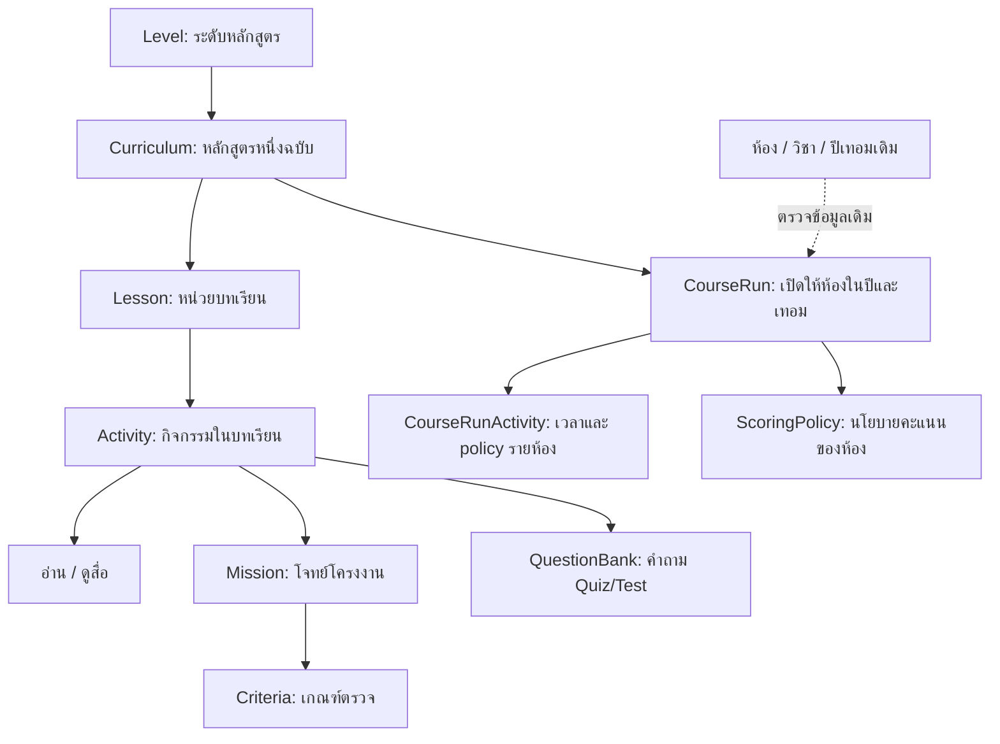
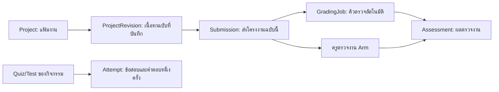
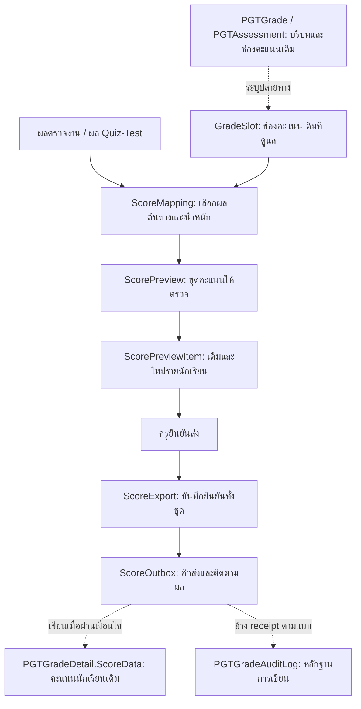

# แผนภาพอ่านข้อมูล SchoolBot

[กลับคู่มือ](data-model.md) · [ชื่อจริงทั้ง 32 ตาราง](data-dictionary/index.md) · [ตารางเดิมที่เชื่อม](data-legacy-001.md)

ลูกศรในหน้านี้แสดงเส้นทางใช้งานและความสัมพันธ์เชิงตรรกะเท่านั้น ร่าง SQL คงเฉพาะ PK ไม่มี FOREIGN KEY; application ต้องตรวจการอ้างอิงเอง ชื่อ SchoolBot ในรูปละ prefix เพื่อให้ภาพอ่านง่าย

## จากบทเรียนไปถึงคะแนน เก็บตรงไหนบ้าง

1. ส่วนกลางสร้าง `Level → Curriculum → Lesson` แล้วใส่ `Activity` เช่น อ่านบทเรียน สร้างโครงงาน ทำ Quiz หรือทำ Test
2. ถ้า Activity เป็นงานโครงงาน จะอ้าง `Mission` ซึ่งมี `Criteria` บอกว่าจะตรวจงานอย่างไร ส่วน Quiz/Test อ้างคำถามใน `QuestionBank` ผ่าน JSON `Config`
3. โรงเรียนเปิด `CourseRun` เช่น “ห้อง ป.3/1 เรียนหลักสูตร Level 2 ฉบับ 1 ในเทอมนี้” โดยอ้างรหัสห้อง/ปี/เทอม/รายวิชาจากระบบเดิม เนื้อหากลางชุดเดียวกันจึงใช้ได้หลายโรงเรียน
4. นักเรียนบันทึกงานใน `Project` และ `ProjectRevision` เมื่อส่งงานจะสร้าง `Submission` อ้างฉบับงานที่ส่ง แล้วได้ผลตรวจใน `Assessment`; ถ้าทำ Quiz/Test จะเก็บแต่ละครั้งใน `Attempt`
5. `GradeSlot` ระบุช่องคะแนนปลายทางที่ SchoolBot ดูแล ส่วน `ScoreMapping` ระบุว่าจะนำผลกิจกรรมไหนมาคิดลงช่องนั้น จากนั้นสร้าง `ScorePreview` และ `ScorePreviewItem` ให้ตรวจคะแนนเดิม→ใหม่
6. เมื่อครูยืนยัน จึงมี `ScoreExport` และคิวส่งรายนักเรียนใน `ScoreOutbox` การส่งเข้าระบบเกรดเดิมยังต้องผ่านเงื่อนไขใน [DES-009](des-009.md)

เส้นทางด้านบนเป็นความสัมพันธ์ในการทำงาน บางเส้นเชื่อมผ่าน JSON หรือข้อมูลคนละฐาน ไม่ใช่ Foreign Key ทั้งหมด ดูหัวข้อความสัมพันธ์ในแต่ละตารางเพื่อแยกชนิดการเชื่อม

## เนื้อหากลางกับห้องเรียน

หลักสูตรกลางไม่ใช่ชั้นเรียนหนึ่งห้อง ส่วน `CourseRun` คือการนำหลักสูตรฉบับนั้นไปเปิดให้ห้องเรียนจริง จึงต้องแยกรหัสหลักสูตรกลางออกจากรหัสห้อง/ปี/เทอมเดิม

## นักเรียนทำงานแล้วผลไปเก็บที่ไหน

การแก้ Project ภายหลังไม่ควรทำให้เนื้อหาที่ส่งตรวจไว้เปลี่ยนตาม จึงอ้าง `ProjectRevision` ที่ส่งจริง ส่วน `Attempt` เก็บสำเนาคำถามและนโยบายตอนเริ่มสอบ เพื่อให้การแก้คลังข้อสอบไม่เปลี่ยนข้อสอบครั้งเก่า

## จากผลเรียนไปสู่ช่องคะแนนเดิม

`ScorePreview` ยังไม่ใช่การเขียนคะแนน การมี `ScoreExport` ยังไม่แปลว่าทุกรายการส่งสำเร็จ ต้องดูสถานะ `ScoreOutbox` และหลักฐานปลายทางด้วย ความสามารถส่งคะแนนยังรอ writer และเงื่อนไขใน [DES-009](des-009.md) ไม่ใช่สิ่งที่ยืนยันว่าใช้งานจริงแล้ว

## Change Log

- 2026-10-23 — นายช่างเพิ่มภาพอธิบายเส้นทางข้อมูลตาม data-model Rev5 และ DES-003/005/008/009/010 โดยแยก data flow ออกจาก FK
