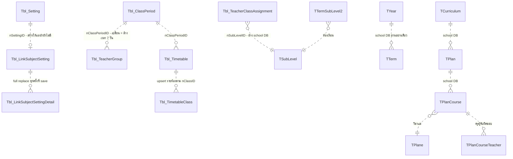

# timetableai — Data Model

> Budget ≤ 15 KB (`policies\documentation.md` §4) · เขียนโดย `system-analyst` เท่านั้น · นี่คือ **schema contract** — `qa-engineer` อ่านเต็มทุกรอบ, engineers implement verbatim

## Data Model

**27. Data Architecture**

> DES-004 — traceability: หัวข้อนี้คือมุมมอง schema/ER เชิงลึกของ entity ที่สัญญา DES-004 สรุปไว้

**27.1 ความสัมพันธ์ข้อมูล (ฐาน A — AITimeTable, เขียนได้; ทุกเส้นคือ app-level reference — ไม่มี FK ใน schema จริง):**

**27.2 Entity ฐาน A — responsibility / read / write / lifecycle:**

| Entity | Responsibility | ใครอ่าน | ใครเขียน | Lifecycle / ข้อจำกัด |
|---|---|---|---|---|
| `Tbl_Setting` | กติกากลางรายปี — แหล่งเดียวของเพดานครู/homeroom/continuity/intensity | generator + วางมือ (ผ่าน Setting/Get — default object ถ้ายังไม่มีแถว) | Setting/Set (lookup แล้วสร้างเอง — D11), ClassContinuity/Set, LinkSubjectSetting/Set (สร้างแทนถ้าไม่มี) | upsert แถวเดียวต่อ (school, year); **ไม่มี isDeleted**; ไม่มี unique index |
| `Tbl_ClassPeriod` | template คาบ = โครงกริดของทุกอย่าง | ทุกหน้า + generator | ClassPeriod/Set\|Delete | soft delete; **ไม่มีกันลบ template ที่ตารางกำลังใช้**; ไม่มีกันชื่อซ้ำ |
| `Tbl_TeacherGroup` (CLR class ชื่อ `Tbl_TeacherSchedule`) | กลุ่มครู + เวลาไม่ว่าง 7 วัน (jsonb รายวัน) | generator (isOn=false = ครูไม่ว่าง) + หน้ารายครู | TeacherGroup/* (SetTeachers = full replace CSV) | soft delete; เปลี่ยน template = backend ล้างเวลาทั้ง 7 วัน (WebAPIController.cs:1578-1592) |
| `Tbl_TeacherClassAssignment` | ครูที่ปรึกษารายระดับ/ห้อง → แหล่ง "คุณสมบัติครู" | หน้า generate (GetTeachersByClass) | Set\|Delete | soft delete; อนุญาตระดับซ้ำ (D7) |
| `Tbl_Timetable` | หัวตาราง 1 ชุด (ชื่อ/ปี/template/หลักสูตร/แผน CSV/isActive) | [year] page, generator (conflict) | Timetable/Set (upsert), SetStatus, Delete | สร้างใหม่ isActive=true; soft delete cascade ลูก |
| `Tbl_TimetableClass` | กริดรายห้อง = **snapshot jsonb 7 วัน** | Timetable/Get, GetAllByYear | Timetable/Set → UpsertTermSubLevel2Rows | จับคู่ in-memory ตาม nClassID (ไม่มี unique — D31); ห้องที่หายจาก payload ถูก soft delete |
| `Tbl_LinkSubjectSetting` + `_Detail` | กติกาตรึงวิชา (พ่อ: กลุ่มห้อง+template; ลูก: วิชา+คาบ+วัน) | generator (ผ่าน SubjectSettings/Get) | LinkSubjectSetting/Set (full replace รายลิงก์), Delete | soft delete; save = ลบของเดิมทั้งชุดแล้วใส่ใหม่ — non-atomic (D29) |

**27.3 Snapshot semantics (หัวใจของ data model):** เซลล์ jsonb (`ItemTimetableSubject` — Request.cs:298-320) เก็บทั้งโครงเวลา **และ** ข้อมูลวิชา/ครู/ห้อง/เครดิต/สี/รหัส SB ณ วินาทีบันทึก → ตารางที่บันทึกแล้ว**ไม่ผูกกับข้อมูลหลักด้วย key ใด ๆ** แก้ชื่อวิชา/ย้ายครูทีหลังไม่กระทบตารางเก่า (BR-20) และการ restore จับคู่เซลล์ด้วย `sStartTime` รายวัน ไม่ใช่ id

**27.4 ข้อเท็จจริง schema:** PK-only ทุกตาราง (ไม่มี FK/unique/check); **ไม่มี EF Migrations และไม่มี EnsureCreated/Migrate** — schema ดูแลด้วย SQL มือ (dump ใน repo เก่ากว่าจริง — D24); jsonb mapping ผ่าน fluent config เฉพาะ 7 คอลัมน์รายวันของ `Tbl_TimetableClass`; UTC converter กับทุก DateTime; school DB อ่านผ่าน `StudentDataContext` (TYear/TTerm/TSubLevel/TTermSubLevel2/TCurriculum/TPlan/TPlanCourse/TPlane/TPlanCourseTeacher/TEmployees/TClassMember)

**27.5 Target data model ของมิติภาคเรียน (REQ-012) — `Data/schema: changed` · รอ schema confirmation จากคน — เซ็นแล้ว 2026-10-04 (ผู้ใช้ — ดูหมายเหตุหัวเอกสาร 2026-10-04)**

> **สถานะ: ข้อเสนอทางเทคนิคที่ผูกกับ requirement ที่ยืนยันแล้ว — ยังไม่มีแถว/คอลัมน์ใดถูกแก้** สัญญาเชิงกติกาอยู่ที่ §34 (DES-009) หัวข้อนี้คือรูป schema เป้าหมายเท่านั้น · **ห้าม engineer แตะ schema ก่อนคนเซ็น** (ประตูมนุษย์: schema change + migration/backfill)

**(ก) ชนิดและชื่อของคีย์เทอม — จุดที่ต้องแก้ความเข้าใจจาก requirement.md**

`requirement.md` (REQ-012 หมายเหตุ) พูดถึง `nTermID`; **schema จริงไม่รองรับชื่อ/ชนิดนั้น**: PK ของ `TTerm` ใน school DB คือ **`nTerm` ชนิด `string`** ไม่ใช่ int (Models/TTerm.cs:16 — EVD-025) และ endpoint ที่มีอยู่แล้วก็คืนค่าเป็น `sTermID = x.nTerm` (WebAPIController.cs:143 — EVD-026) · ตารางอื่นของ school DB ที่อ้างเทอมก็ใช้ string ทั้งหมด (`TTermSubLevel2.nTerm`, `TClassMember.nTerm`)

→ **ข้อเสนอ: คอลัมน์ `sTermID varchar NULL` เก็บ `TTerm.nTerm` ตรง ๆ** — รูปแบบเดียวกับที่ `nYear` เก็บ `TYear.nYear` วันนี้ (อ่านอย่างเดียว ไม่มี FK ตามข้อเท็จจริง §27.4)
ห้ามใช้ `numberTerm`/`sTerm` เป็นคีย์: ทั้งสองไม่ unique ข้ามปี/ข้ามโรงเรียน ใช้ได้เฉพาะการแสดงผลและการเรียงลำดับ · ชื่อคอลัมน์/ชนิดสุดท้ายเป็น **SA-Q1 (รอยืนยัน)**

**(ข) ตารางที่ได้คอลัมน์ใหม่จริง — 4 ตาราง ("ราก" ที่วันนี้ถือ `nYear` เอง)**

| ตาราง | วันนี้ | หลังเปลี่ยน | จุดที่ต้องแก้ตาม |
|---|---|---|---|
| `Tbl_Setting` | `nYear int?` (Models/Tbl_Setting.cs:12) — 1 แถวต่อ (school, year) | + `sTermID` → 1 แถวต่อ **(school, year, term)** | lookup ที่ `Setting/Set` (:2046 — EVD-033) และ `Setting/Get` (:1967) ต้องเติมเงื่อนไขเทอม ไม่ใช่แค่ส่งค่าไปเก็บ |
| `Tbl_ClassPeriod` | `nYear int?` (:12) | + `sTermID` → template เป็นของเทอม | `ClassPeriod/Get` (:816), `Set` (:856) · **ตัวนี้เป็นตัวส่งต่อขอบเขตให้ `Tbl_TeacherGroup` และ `Tbl_LinkSubjectSetting`** |
| `Tbl_TeacherClassAssignment` | `nYear int?` (:11) | + `sTermID` | `TeacherClassAssignment/GetAll` (:2107), `GetAllByYear` (:2167), `Set` (:2289) |
| `Tbl_Timetable` | `nYear int` (:12) | + `sTermID` | `Timetable/GetAllByYear` (:2809 — EVD-035), `Get` (:2579), `Set` (:2626) · เป็นตัวกำหนด conflict set ของ BR-17 (§34.3) |

**(ค) ตารางที่ *ไม่* ได้คอลัมน์ใหม่ — เพราะวันนี้ก็ไม่ได้ถือ `nYear` เอง (derive ตามแม่)**

| ตาราง | ขอบเขตวันนี้ derive จากอะไร | หลักฐาน | ผลเมื่อแม่มี `sTermID` |
|---|---|---|---|
| `Tbl_TeacherGroup` (CLR `Tbl_TeacherSchedule`) | **ไม่มีคอลัมน์ปีเลย** — `TeacherGroup/GetAll|GetAllByYear` กรองปีด้วยการหาชุด `nPeriodID` ของปีนั้นก่อน แล้วค่อยกรองกลุ่มด้วย `nClassPeriodID` | Models/Tbl_TeacherSchedule.cs:12-20 (EVD-029) · WebAPIController.cs:1868-1875, 1921-1927 (EVD-028) | กลุ่มครูกลายเป็นของ (ปี, เทอม) ของ template ที่ผูกไว้ **โดยอัตโนมัติ** — แก้เฉพาะ query ที่หา `periodIDsInYear` ให้เป็น `periodIDsInYearTerm` |
| `Tbl_LinkSubjectSetting` + `_Detail` | ไม่มีทั้ง `nSchoolID`/`nYear` — ผูกผ่าน `nSettingID` (→`Tbl_Setting`) + `nPeriodID` (→`Tbl_ClassPeriod`) | Models/Tbl_LinkSubjectSetting.cs:9-14 (EVD-039) | ได้เทอมตาม setting/template ที่อ้าง |
| `Tbl_TimetableClass` | ลูกของ `nTimetableID` เท่านั้น | Models/Tbl_TimetableClass.cs:11-13 | ได้เทอมตามตารางแม่ · **และ `nClassID` เป็นห้องของเทอมอยู่แล้วโดยธรรมชาติ** (EVD-030) |

**ทางเลือกที่พิจารณาแล้วและไม่เลือก:** เติม `sTermID` ซ้ำลง 3 ตารางนี้ด้วย (denormalize ให้ query ตรง) — **ไม่เลือก** เพราะจะเกิดแหล่งความจริง 2 ที่ (คอลัมน์ของตัวเอง vs เทอมของแม่) ในระบบที่ **ไม่มี FK/constraint ใดคอยบังคับให้ตรงกัน** (§27.4, DES-001 Fallback) — ค่าที่ค้างไม่ตรงกันจะกลายเป็นข้อมูลข้ามเทอมเงียบ ๆ ซึ่งแย่กว่าการ join เพิ่มหนึ่งชั้น · หากผู้ตัดสิน schema เลือกทาง denormalize ต้องมาพร้อมกฎการเขียนที่อัปเดตทั้งสองที่พร้อมกันทุกครั้ง และ §34 ต้องถูก amend ก่อน implement

**(ง) index ที่ควรมาพร้อมกัน (ไม่ใช่ข้อบังคับของ REQ-012 แต่เป็นจุดที่ถูกที่สุดที่จะทำ)**

`Tbl_Setting` วันนี้ไม่มี unique index (D11) และการเพิ่มมิติเทอมทำให้จำนวนแถวต่อโรงเรียนคูณจำนวนเทอม → โอกาสได้แถวซ้ำเพิ่มขึ้นตามตัวคูณ (R15) · ข้อเสนอเดิม §32.1 ข้อ 3 (unique index) จึงมีน้ำหนักขึ้น: `unique (nSchoolID, nYear, sTermID)` บน `Tbl_Setting` และ `unique (nTimetableID, nClassID)` บน `Tbl_TimetableClass` (D31) — **เป็นการตัดสินใจ schema แยกเรื่อง ต้องยืนยันพร้อมกันในรอบเดียวกัน ไม่ใช่ของแถมที่ engineer เพิ่มเอง**

**(จ) Migration / backfill (AC-028) — ลำดับบังคับ**

ข้อจำกัดจริงที่กำหนดวิธีทำ: **ไม่มี EF Migrations และไม่มี EnsureCreated/Migrate** (§27.4) → DDL เป็น SQL มือ · และ **module DB กับ school DB อยู่คนละ host** (`ConnectionStrings` — `DefaultConnectionForPostgreSQL` ≠ `SchoolConnectionForPostgre` — EVD-032) → **backfill ไม่สามารถเป็น SQL join เดียวได้** ต้องอ่าน `TTerm` ผ่าน application/สคริปต์ที่ต่อได้ทั้งสองฝั่ง

1. เพิ่มคอลัมน์ `sTermID` แบบ **nullable ไม่มี default** ทั้ง 4 ตาราง (แถวเดิมทั้งหมด = NULL, ระบบเดิมยังทำงานได้เหมือนเดิม)
2. deploy code ที่ **อ่านแบบเข้ากันได้ย้อนหลัง**: `sTermID` ที่ส่งมาเป็น null/ละเว้น = พฤติกรรมเดิมทั้งปี และแถวที่ `sTermID IS NULL` ยังถูกอ่านเห็น (นี่คือ Fallback ของ DES-009)
3. backfill: ต่อ (nSchoolID, nYear) หา `TTerm` ที่ `SchoolID` ตรง, `nYear` ตรง, `cDel != "1"` แล้วเลือก **เทอมแรกตาม `dStart`** (tie-break: `numberTerm` น้อยสุด) → เขียน `sTermID` ของทุกแถวของ (school, year) นั้น — นี่คือคำแปลทางเทคนิคของ "default เป็นเทอม 1" ตาม AC-028 (ยึด `dStart` เพราะ `numberTerm` เป็น nullable ใน model จริง)
4. (Rev 11) รายงาน backfill บันทึกจำนวนแถวที่ยังเป็น NULL ต่อ (school, year) **เป็นข้อมูลประกอบ** — ไม่ใช่เงื่อนไขให้คนแก้ก่อนขั้นถัดไปอีกต่อไป (OQ-36)
5. เปิดโหมดที่ทุกการเขียนใหม่ต้องมี `sTermID` (บังคับที่ app layer เท่านั้น ตาม DES-001 Fallback)

**จังหวะ cutover (Rev 12 — SA-Q3 ปิด per user chat 2026-09-30: "เริ่มเลย"):** โหมดบังคับเทอม (ขั้น 5 + VR-9) **มีผลตั้งแต่ release ของ DES-009 — ไม่มีช่วงผ่อนผัน (grace period)** ให้ frontend เดิมที่ไม่ส่งเทอม → ขั้น 1–5 ทำใน release window เดียว: DDL → backfill → deploy backend + frontend ที่ส่ง `sTermID` **พร้อมกัน** · ความสามารถอ่านแถว NULL ของขั้น 2 ยังต้องมี (BR-17a, แถวของปีที่ไม่มี `TTerm`) แต่ไม่มีช่วงที่ backend รับ request ไม่มีเทอมหลัง release · **ไม่มีวันที่ตามปฏิทิน** — ผู้ใช้ไม่ได้ให้วัน; วัน release เป็นของคนที่สั่ง deploy (SA ไม่กำหนด ไม่เดา)

**ข้อมูลในฐานข้อมูลโมดูล (Rev 12 — แทนเงื่อนไขก่อนขั้น 3 ของ Rev 11 ที่อยู่ใน `design-archive.md`):** ผู้ใช้ยืนยัน 2026-09-30 ว่าฐานข้อมูลโมดูล (backend dev ที่ production ชี้อยู่ — R32) **มีเฉพาะข้อมูลทดสอบ ไม่มีข้อมูลโรงเรียนจริง** → เงื่อนไขนี้ผ่านแล้ว ไม่ใช่จุดหยุดของ migration อีก · **ต้องยืนยันซ้ำถ้ามีข้อมูลโรงเรียนจริงเกิดขึ้นก่อน backfill ถูกรัน** (R36) — ถ้ามี → OQ-36/OQ-37 เปิดใหม่ (ข้อความ SA-Q2 เดิมใน `design-archive.md`)

**กรณีที่ backfill แปลไม่ได้ (Rev 11 — OQ-36 / SA-Q2 ปิด per user chat 2026-09-30: ข้อมูล legacy เป็นข้อมูลช่วงทดสอบ ไม่ต้องดูแล · ข้อความเดิมอยู่ใน `design-archive.md` · Rev 12 — OQ-37: "ไม่ต้องสนใจข้อมูลเก่า" ใช้ **เฉพาะปีที่ไม่มี `TTerm`** — ปีที่มี `TTerm` ต้องย้ายเข้าเทอมแรกตามขั้น 3 / AC-028 เสมอ):** (school, year) ที่ **ไม่มีแถว `TTerm` เลย** → `sTermID` ค้าง NULL และ **ไม่มีการจัดการพิเศษ**: ไม่แสดงเป็น "ไม่ระบุเทอม", ไม่ต้องรายงานให้คนแก้, ไม่สร้างเทอมใน school DB (ห้ามตาม DES-004 Fallback) · ผลเชิงพฤติกรรม: หน่วยนั้นเลือกเทอมไม่ได้ จึงตกอยู่ใต้ Fallback เดิมของ DES-009 ("`TTerm` ว่าง → หน้าแจ้งผู้ใช้ ห้ามเดาเทอม") และแถว NULL ไม่ถูกแสดงในมุมมองรายเทอมใด · **ห้ามลบ/ย้ายแถวอัตโนมัติ** (การลบข้อมูลเป็นการกระทำแยกที่ต้องมีคนอนุมัติ — ไม่อยู่ในสัญญานี้)

**ผลของการย่อนี้ต่อประตู schema confirmation §27.5 (บันทึกเท่านั้น — ไม่ได้แก้ schema):** DDL ไม่เปลี่ยน (ยังเป็น `sTermID varchar NULL` บน 4 ตาราง + index (ง) — ต้องเป็น nullable ต่อไปเพราะแถวของปีที่ไม่มี `TTerm` ค้าง NULL) · SA-Q2 หลุดจากรายการที่ต้องปิดก่อนเซ็น (เหลือ SA-Q1) · ขั้น 4 ไม่เป็นจุดหยุดรอคนอีก · (Rev 12) **ขั้น 3 (backfill เข้าเทอมแรก) บังคับ — ข้ามไม่ได้** (OQ-37: AC-028 คงอยู่; ทางเลือก "ข้ามขั้น 3" ของ Rev 11 ตกไป — อยู่ใน `design-archive.md`) · migration ทั้งหมดอยู่ใน release window เดียวกับ cutover (SA-Q3)

**27.6 Target data model ของ Rev 5 / Rev 6 (REQ-016 / REQ-017 / REQ-018 / REQ-019) — `Data/schema: changed` · รอ schema confirmation จากคน — เซ็นแล้ว 2026-10-04 (ผู้ใช้ — (ก2) เลือก C2 · ดูหมายเหตุหัวเอกสาร 2026-10-04)**

> **Rev 6:** แก้ในที่ตามคำตอบธุรกิจ 2026-09-28 — (ก) เพิ่มความจุ/ครูผู้ดูแลห้อง (ก2) · (ข) หน่วยเปลี่ยนเป็น **ชั่วโมงเต็ม** · (ค) รูปแบบ H1 เท่านั้น · (ง) **บังคับ** และเปลี่ยนจากคอลัมน์บน `Tbl_Timetable` เป็นตารางใหม่ · (จ) M1 — ไม่มี backfill · ทั้ง 4 ส่วนยังรอคนเซ็น

> **Rev 7:** แก้ในที่เฉพาะ (ก2) ตามคำตอบ OQ-26 (ข) — ความจุ/ครูผู้ดูแลเป็นค่า **ต่อ (ปี, เทอม)** → `Tbl_RoomSetting` ได้ `nYear` + `sTermID` และผู้ดูแลมีผลต่อการจัด (BR-71) · C1 (คอลัมน์บน `TRoom`) ตกไป → C1′ · (จ) เติมผลของ DES-009 backfill ต่อ (ก2) · ข้อความ (ก2) ฉบับ Rev 6 อยู่ใน `design-archive.md` · ทั้ง 4 ส่วนยังรอคนเซ็น — **(ก2) ต้องเซ็นรูปใหม่**

> **สถานะ: ข้อเสนอทางเทคนิคที่ผูกกับ requirement ที่ยืนยันแล้ว — ยังไม่มีตาราง/คอลัมน์ใดถูกแก้** กติกาอยู่ที่ §38–§41 · **ห้าม engineer แตะ schema ก่อนคนเซ็น** · ตาราง/แถวราก ใหม่ทุกตัวต้องมี `sTermID` ตาม DES-009 **ถ้า** DES-009 ผ่านก่อนหรือพร้อมกัน (รูปแบบเดียวกับ §27.5 ข) · ฐานข้อมูลไม่มี FK/unique (§27.4) — uniqueness บังคับที่ app layer ตาม DES-001 Fallback เว้นแต่ผู้อนุมัติ schema เลือก unique index ในรอบเดียวกัน · REQ-014 และ REQ-015 **ไม่มี DDL** (REQ-015 เปลี่ยนรูปแบบภายใน jsonb เท่านั้น — §37.2)

**(ก) REQ-016 — ตารางใหม่ `Tbl_SubjectRoom` (ตารางราก ถือขอบเขตเอง) + key ห้องใน snapshot**

| คอลัมน์ | ชนิด | ความหมาย |
|---|---|---|
| `nSubjectRoomID` | int PK | |
| `nSchoolID` | int | |
| `nYear` | int | |
| `sTermID` | varchar NULL | ตาม DES-009 (ถ้ามี) |
| `sCourseCode` | varchar | key เดียวกับแถว continuity และ snapshot `sSBCourseCode` |
| `sRoomID` | varchar(10) | = `TRoom.sRoomID` (ความยาวตาม dump — ยืนยันที่ SA-Q5) |
| `isDeleted`, `CreatedBy/At`, `UpdatedBy/At` | | ตามแบบแผนตารางอื่นของโมดูล |

- uniqueness (app layer): `(nSchoolID, nYear, sTermID, sCourseCode)` ที่ `isDeleted=false` (BR-34)
- snapshot: `ItemTimetableSubject` + `sRoomID string?`, `sRoomName string?` — อยู่ใน jsonb รายวันของ `Tbl_TimetableClass` จึง **ไม่มี DDL** (เพิ่ม property ใน `Request.cs` เท่านั้น) · `nClassroomID/sClassroomName/sClassroomColor` เดิมคงไว้ไม่ใช้ (D42)
- school DB: map `TRoom` แบบอ่านอย่างเดียวใน `StudentDataContext` (ไม่เขียน — DES-004 Fallback)
- ทางเลือกที่ไม่เลือก: เก็บ mapping เป็น jsonb ใน `Tbl_Setting` — ไม่เลือกเพราะเป็น collection ที่ต้องตรวจ VR-10/VR-11 รายแถว และ `Tbl_Setting` ถือ 2 เมนูอยู่แล้ว (R25)
- Rev 6: 1 วิชา : 1 ห้อง ยืนยันแล้ว (OQ-15 ข) → uniqueness `(nSchoolID, nYear, sTermID, sCourseCode)` คงเดิม · ตั้งที่ `/timetable/subject-settings` (OQ-15 จ) → อยู่ในเมนู "กติกาวิชา" ของ REQ-013

**(ก2) REQ-016 — ความจุ + ครูผู้ดูแลห้อง ต่อ (ปี, เทอม) (Rev 7 — AC-038a + OQ-26 ก/ข ปิด 2026-09-29) · ที่เก็บ = SA-Q9**

ข้อเท็จจริง: `TRoom` (dump) มีเพียง `sRoomID varchar(10)`, `sRoomName`, `cDel`, `SchoolID` + audit — **ไม่มีคอลัมน์ความจุ/ครูผู้ดูแล** (EVD-072) · worktree frontend ยังไม่มี UI ตั้งค่าทั้งสอง (EVD-084) · Rev 7: ธุรกิจยืนยันว่าค่าทั้งสองเป็น **ของ (โรงเรียน, ปี, เทอม, ห้อง)** ไม่ใช่ของห้องกายภาพ → ที่เก็บต้องมีมิติปี/เทอม ซึ่ง `TRoom` (แถวต่อ `(SchoolID, sRoomID)`) ไม่มี

- **C2 — ข้อเสนอ SA:** ตารางใหม่ฝั่งโมดูล `Tbl_RoomSetting` — **ตารางราก ถือขอบเขตเอง** (รูปแบบเดียวกับ `Tbl_SubjectRoom` §27.6 ก และตารางรากของ §27.5 ข)

| คอลัมน์ | ชนิด | ความหมาย |
|---|---|---|
| `nRoomSettingID` | int PK | |
| `nSchoolID` | int | |
| `nYear` | int | ปีการศึกษาของค่า (OQ-26 ข) |
| `sTermID` | varchar NULL | = `TTerm.nTerm` ตาม DES-009 (§27.5 ก — ชนิดสุดท้าย = SA-Q1) · NULL = ทั้งปี (legacy ก่อน DES-009 — BR-22/BR-24) |
| `sRoomID` | varchar(10) | = `TRoom.sRoomID` (ความยาวตาม dump — SA-Q5) |
| `nCapacity` | int NULL | จำนวนห้องเรียนที่ใช้ห้องพร้อมกันได้ (≥ 1) · NULL = ยังไม่ตั้ง → K = 1 (BR-54) |
| `nCaretakerTeacherID` | int NULL | ครูผู้ดูแลห้อง → `TEmployees` · **มีผลต่อการจัด** (BR-71) · NULL = ไม่มีผู้ดูแลในหน่วยนี้ (fallback OQ-31 ข) |
| `isDeleted`, `CreatedBy/At`, `UpdatedBy/At` | | ตามแบบแผนตารางอื่นของโมดูล |

 - uniqueness (app layer): `(nSchoolID, nYear, sTermID, sRoomID)` ที่ `isDeleted=false` · ห้องที่ไม่มีแถวในหน่วยนั้น = ไม่ได้ตั้งทั้งสองค่า → K = 1 และไม่มีข้อบังคับผู้ดูแล (BR-54, BR-71)
 - **ไม่สืบค่าข้ามหน่วย:** เทอม/ปีใหม่ไม่รับค่าของเทอมก่อนอัตโนมัติ (ตรงคำตอบ "ต่อปี/เทอม") — ทางเดียวที่ได้ค่าเดิมคือการคัดลอก (REQ-013) ซึ่ง requirement ยังไม่ระบุจุด → **จนกว่า OQ-31 (ค) ตอบ: ไม่อยู่ใน scope คัดลอกใด** (§35.8 BR-66)
 - เหตุผลที่เสนอ C2: โมดูลเขียนเองได้ (DES-004 ห้ามเขียน school DB), คัดลอกข้ามเทอมได้ใน transaction เดียวกับ `Copy/Apply` (§35.3), ไม่ต้องรอทีม school DB
- **C1′ — ทางเลือก (แทน C1 ของ Rev 6):** ตารางใหม่ใน school DB คีย์ `(SchoolID, nYear, nTerm, sRoomID)` ที่เจ้าของ school DB สร้าง — ระบบอื่นเห็นค่าเดียวกัน แต่ **โมดูลเขียนไม่ได้** → ต้องมีช่องทางแก้ค่านอกโมดูล, `RoomSetting/Set` ไม่มี, และ REQ-013 คัดลอกค่าชุดนี้จากโมดูลไม่ได้ · **คอลัมน์บน `TRoom` ตรง ๆ (C1 เดิม) ตกไป** เพราะไม่มีมิติปี/เทอม
- ทางที่ไม่เลือก: เก็บความจุ/ผู้ดูแลใน `Tbl_SubjectRoom` ต่อวิชา — ผิดแบบจำลอง (เป็นของห้อง: สองวิชาที่ใช้ห้องเดียวกันต้องเห็นค่าเดียวกัน) · เก็บต่อห้องกายภาพทุกปี (ข้อเสนอ Rev 6) — ธุรกิจปฏิเสธ (OQ-26 ข)

**(ข) REQ-017 — `Tbl_Setting` + คอลัมน์เพดานหน่วยชั่วโมงเต็ม (Rev 6 — AC-041: จำนวนเต็มเท่านั้น)**

- `nMaxTeachingHoursPerDay int NOT NULL DEFAULT 0`, `nMaxTeachingHoursPerWeek int NOT NULL DEFAULT 0` (0 = ไม่กำหนด) — Rev 5 เสนอหน่วยนาทีเพื่อรองรับเศษ; ไม่จำเป็นแล้ว เก็บตรงตามค่าที่ผู้ใช้กรอก ไม่ต้องแปลง/ปัด
- jsonb `jSetMaxPeriodIndividually` แต่ละแถว + key `nMaxTeachingHoursPerDay`, `nMaxTeachingHoursPerWeek` (ไม่มี DDL)
- คอลัมน์เดิม `nMaxTeachingPeriodPerDay`, `isApplyMaxPeriodToAllTeachers`, `isExceptMaxPeriodTeachers`, `sMaxPeriodExceptTeacherIDs` **คงไว้ ไม่ลบ แต่ไม่ถูกอ่านหลัง cutover** · ชื่อ/ชนิดสุดท้าย = SA-Q4

**(ค) REQ-018 — `Tbl_Setting` + `jHomeroomRestrictedTeachers jsonb NULL`**

- รูปแบบ **H1** `[{nTeacherID}]` เท่านั้น (Rev 6 — OQ-17 ก ปิด: ห้องที่รับผิดชอบมาจาก `TClassMember` อัตโนมัติ; H2 ตกไป)
- ธง homeroom 7 คอลัมน์เดิม (`isUseAllHomeroomTeachers` … `sHomeroomExceptTeacherIDs`) คงไว้ ไม่อ่านหลัง cutover
- `Tbl_TeacherClassAssignment` **ไม่แก้ ไม่ลบ** (AC-046a — dead data; การลบเป็นการตัดสินใจแยกที่ต้องมีคนอนุมัติ)

**(ง) REQ-019 — ตารางใหม่ `Tbl_TimetableAcademicSync` (Rev 6 — บังคับ ไม่ใช่ทางเลือก)**

| คอลัมน์ | ชนิด | ความหมาย |
|---|---|---|
| `nSyncID` | int PK | |
| `nSchoolID` | int | |
| `nTimetableID` | int | ตารางต้นทาง (`Tbl_Timetable`) |
| `nClassID` | int | ห้องเรียน = `nTermSubLevel2` ที่ส่ง |
| `sTermID` | varchar | = `nTerm` ที่ส่ง (BR-46) |
| `nStatus` | int | 1 Sent / 2 Rejected / 3 Failed / 4 Partial (BR-48, §41.4) |
| `jScheduleIDs` | jsonb | `scheduleId` ที่ Service Academic คืนมาของชุดล่าสุดที่เขียนสำเร็จ (ใช้โดย BR-56 และการลู่เข้าของ T2) |
| `jDetail` | jsonb | ผลรายแถว/ข้อความจาก Service Academic |
| `dSentAt`, `nSentBy` | timestamp, int | ผู้ส่ง/เวลา (ค่าจาก client — §9) |
| `CreatedBy/At`, `UpdatedBy/At` | | |

- 1 แถวต่อ `(nTimetableID, nClassID, sTermID)` — upsert (uniqueness ที่ app layer) · เหตุผลที่เป็นตาราง ไม่ใช่คอลัมน์บน `Tbl_Timetable` ตามข้อเสนอ Rev 5: ผลเป็น **รายห้องเรียน** (BR-48) และ BR-56 ต้อง lookup ตาม `scheduleId` ทั้งปี
- ไม่มี state lock (OQ-13 ปิด — ไม่มี publish/lock) → DES-003 ไม่เปลี่ยน

**(จ) Migration / backfill (Rev 6)**

- (ก)(ก2)(ค)(ง): ตาราง/คอลัมน์ใหม่แบบ nullable/default → ไม่มี backfill · DDL เป็น SQL มือ (ไม่มี EF Migrations — §27.4)
- (ก)(ก2) กับ DES-009 (Rev 7): ถ้า `Tbl_SubjectRoom`/`Tbl_RoomSetting` ออกก่อน DES-009 แถวที่สร้างจะมี `sTermID` NULL (ทั้งปี) และถูก backfill ตาม §27.5 (จ) ข้อ 3 เป็น **เทอมแรกของปี** → เทอมอื่นของปีนั้นเริ่มโดยไม่มี mapping/ค่าห้อง (K = 1, ไม่มีผู้ดูแล) หลัง backfill — ผลที่ต้องแจ้งคนในรายงาน backfill (ขั้น 4) ไม่ใช่การคัดลอกให้อัตโนมัติ · ถ้าออกพร้อม/หลัง DES-009 ทุกแถวใหม่ต้องมี `sTermID` (BR-22) และไม่มี backfill
- (ข): **M1 — ไม่แปลง ไม่ backfill** (ยืนยันธุรกิจ — OQ-16 ข ปิด 2026-09-28): คอลัมน์ใหม่ default 0 = ไม่จำกัด จนกว่าผู้ใช้กรอกค่าใหม่เป็นชั่วโมง · ค่าเดิม `nMaxTeachingPeriodPerDay` ไม่ถูกแปลงและไม่ถูกอ่านหลัง cutover · M2/M3 ตกไป · ผลที่ต้องแจ้งคน: เพดานที่ทุกโรงเรียนตั้งไว้หมดผลทันทีที่ cutover — SA เสนอรายงานรายชื่อ (โรงเรียน, ปี) ที่เคยตั้งเพดานไว้เพื่อใช้สื่อสารผู้ใช้ก่อน deploy (เอกสารประกอบการสื่อสาร ไม่ใช่ขั้น migration)

**27.7 Target data model ของ Rev 8 — `Data/schema: changed` · รอ schema confirmation จากคน**

> **สถานะ (Rev 9): (ก) schema ยืนยันโดยผู้ใช้แล้ว — ยังไม่มีคอลัมน์ใดถูกแก้จริง (DDL เป็นงาน `devops`)** · (ข) ไม่มี DDL · DES-018 และ DES-020 **ไม่มี DDL**

**(ก) DES-019 — ความเข้มข้นต่อตาราง: `Tbl_Timetable` + 1 คอลัมน์ (Rev 9 — schema ยืนยันโดยผู้ใช้ 2026-09-29)**

| คอลัมน์ | ชนิด | ความหมาย |
|---|---|---|
| `nCourseIntensity` | smallint NULL | ระดับ L ของตารางนี้: 0 = ไม่กระจาย, 1 = พยายามกระจายวิชาหนัก, 2 = พยายามสลับหนัก-เบา (BR-78) · **NULL = 0** |

- DDL (SQL มือ — §27.4; `devops` รัน): `ALTER TABLE "Tbl_Timetable" ADD COLUMN "nCourseIntensity" smallint NULL;` · model `Tbl_Timetable.cs` + `int? nCourseIntensity`
- **ไม่ backfill** (ยืนยัน) — ตารางเดิม NULL · `Tbl_Setting.nCourseIntensity` **คงไว้ ไม่ลบ** (ยืนยัน) — ใช้เป็นค่า prefill ของตารางใหม่เท่านั้น
- ข้อขัดที่แก้: as-built เก็บต่อ (โรงเรียน, ปี) (EVD-096) แต่คำตอบธุรกิจ = ต่อตาราง · ไม่มีคอลัมน์ความหนักรายวิชา (ระบบคำนวณเท่านั้น — BR-77) · ถ้า DES-009 ออกพร้อมกัน ไม่มีผลเพิ่ม (คอลัมน์อยู่บนตารางราก `Tbl_Timetable`)

**(ข) DES-021 — ลบ legacy (Rev 9: ไม่มี DDL)**

- ผู้ใช้ตัดสินใจ 2026-09-29: **ไม่ DROP `Tbl_TeachingSchedule`** — ตารางและข้อมูลคงอยู่ (REQ-020 AC-059) · ลบเฉพาะโค้ด (§46) · คอลัมน์เก่า `Tbl_Timetable.nTeachingScheduleID` (ถ้ามีใน production — EVD-112) ก็ไม่ถูกแตะ · schema confirmation ของส่วนนี้ **หมดความจำเป็น (moot)** · ข้อความฉบับ Rev 8 อยู่ใน `design-archive.md`

---

## Change Log

- 2026-10-07 — Migrated to split layout

Back-links: `design\index.md` · `..\index.md`
