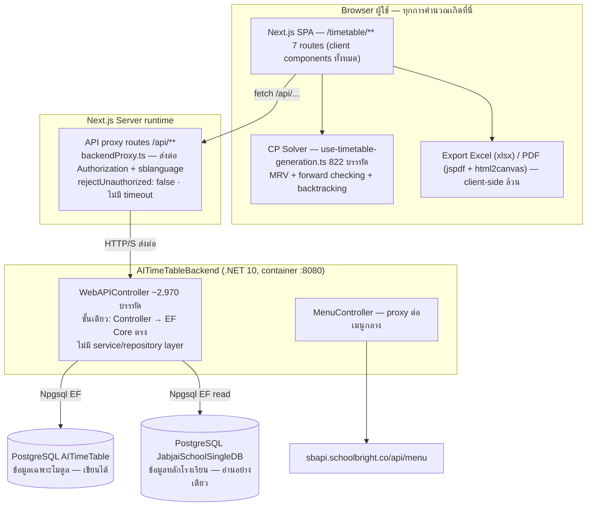

# DES-004 — 12. Data / Entity สำคัญ (มุมมองธุรกิจ)

> Budget ≤ 8 KB (`policies\documentation.md` §4) · เขียนโดย `system-analyst` · ไฟล์นี้ = 1 contract · ต้องมีแถวใน `design\index.md` ตาราง DES

**ฐานข้อมูล A — "AITimeTable" (ของโมดูลนี้, เขียนได้):**

| ตาราง | หน้าที่ | Key/โครงสร้างสำคัญ |
|---|---|---|
| `Tbl_Setting` | เงื่อนไขระบบต่อปี (รวม continuity jsonb) | (nSchoolID, nYear) — uniqueness ฝั่ง app เท่านั้น |
| `Tbl_ClassPeriod` | template คาบเรียน | `jPeriodConfig` jsonb + CSV ระดับ/แผน/ห้อง + isCustom + nYear |
| `Tbl_TeacherGroup` | กลุ่มครู + เวลาไม่ว่าง | sTeacherIDs CSV + 7 คอลัมน์ jsonb รายวัน + nClassPeriodID |
| `Tbl_TeacherClassAssignment` | ครูที่ปรึกษาประจำระดับ/ห้อง | nSubLevelID + CSV ห้อง + CSV ครู + nYear |
| `Tbl_Timetable` | หัวตารางสอน | ชื่อ, nYear, nClassPeriodID, nCurriculumID, sPlanIDs CSV, isActive |
| `Tbl_TimetableClass` | กริดรายห้อง (ลูก) | nTimetableID + nClassID + 7 คอลัมน์ jsonb รายวัน |
| `Tbl_LinkSubjectSetting` + `_Detail` | กติกาตรึงวิชา | พ่อผูก nSettingID+nPeriodID+nSubLevelID+CSV; ลูก = วิชา+sPlaneID(string)+nPeriod+nWeekday |
| `Tbl_TeachingSchedule` | หัวตารางแบบเก่า (ถูกหน้า page-old ใช้) | ยังมี endpoint อยู่ (Schedules/Schedule) แต่ 5 routes ไม่ใช้ — D21 |
| (`Tbl_ClassPeriodDetail` model) | model กากับาย ไม่มี DbSet/ไม่มีตาราง | — |

**ฐานข้อมูล B — School DB (อ่านอย่างเดียว):** `TYear`(ปี) → `TTerm`(ภาคเรียน) → `TLevel/TSubLevel`(ระดับ) → `TTermSubLevel2`(ห้องเรียน = nTermSubLevel2 ที่ `Tbl_TimetableClass.nClassID` อ้าง) · `TCurriculum`(หลักสูตร) → `TPlan`(แผน/แผนก) → `TPlanCourse`(วิชาในแผน) → `TPlane`(วิชาหลัก) + `TPlanCourseTeacher`(ครูผู้รับผิดชอบ) · `TEmployees`(ครู) · `TClassMember`(ครูที่ปรึกษา+ผู้ช่วย ของห้อง/เทอม)

**ฐานข้อมูล C — Master DB:** ลงทะเบียนแต่ไม่ถูกเรียกใช้โดย WebAPI (มีแต่ MenuController อ่าน TMessageSystem จาก school DB + cookie) — dead wiring (D22)

**ข้อสังเกตเชิงข้อมูล:** ตารางฝั่ง A ไม่มี FK/unique/check ใด ๆ เลย (มีแค่ PK) — ทุกความสัมพันธ์/กันซ้ำอยู่ที่ app layer; ระบบตารางสอน**เก่า** (`TSchedule, TTermTimeTable, TPeriod, TCourseAbbreviation` …) ยังอยู่ใน school DB และถูกอีก backend (Service Academic) ใช้อยู่ — สองระบบตารางคู่ขนานกัน ไม่ sync กัน

Contract:TimetableEntityModel.v1
DEC-004

> path ด้านล่างสัมพัทธ์กับ repo backend `sb-api-academic-timetable-ai` @ `6d997a336feac50828aa84383437dfabe05566bc` · มุมมอง schema เชิงลึก (ER diagram, lifecycle ราย entity, snapshot semantics) อยู่ที่ `## Data Model` (§27)

Evidence EVD-010: claim=DES-004 | state=confirmed | path=AITimeTableBackend/Models/Request.cs | symbol=ItemTimetableSubject | line=279 | revision=0beb20096dd5b2d54d6758a4ac64bc76e5b126de | basis=source | tool=rg-read | hash=c8b380570b410fd99c27ee375cfcd97bce074af384258e674cc21dca9789f48a
Evidence EVD-011: claim=Contract:TimetableEntityModel.v1 | state=confirmed | path=AITimeTableBackend/Controllers/WebAPIController.cs | symbol=UpsertTermSubLevel2Rows | line=2787 | revision=0beb20096dd5b2d54d6758a4ac64bc76e5b126de | basis=source | tool=rg-read | hash=0a5aed803ecf85a46e60e9077fc15f9e3ca3d881592b332132d18c732cf294d6
Evidence EVD-012: claim=DEC-004 | state=confirmed | path=AITimeTableBackend/Helpers/StudentDataContext.cs | symbol=SchoolConnectionForPostgre | line=20 | revision=0beb20096dd5b2d54d6758a4ac64bc76e5b126de | basis=source | tool=rg-read | hash=1ec580d10628bb39a7a2a8922b14cf38f4cf44541e3655917aa003a718126b21

Compatibility: unchanged
Data/schema: unchanged
Migration/backfill: none
Security: none
Fallback: ตารางฝั่ง A เขียนผ่าน DataContext เท่านั้น · ข้อมูลหลักโรงเรียนอ่านอย่างเดียวผ่าน StudentDataContext (`SchoolConnectionForPostgre`) — ห้ามเขียน school DB จาก backend นี้ · snapshot jsonb (`ItemTimetableSubject`) เก็บข้อมูลตายายเวลาบันทึก การแก้ข้อมูลหลักทีหลังไม่กระทบตารางเก่า (BR-20) · dump SQL ใน repo ล้าสมัยกว่า model (D24) ห้ามใช้ตัดสิน schema
Material ambiguity: none

---

## 13. API / Endpoint ที่รองรับแต่ละ Feature (ผ่าน Next proxy → backend)

> DES-008 — traceability: ตารางนี้คือเส้นทางที่ผัง integration ใน DES-008 อ้างถึง

| Feature | Proxy (frontend เรียก) | Backend | ชนิด |
|---|---|---|---|
| ปีการศึกษา | `/api/school/{id}/years` | `GET School/{id}/Years` | อ่าน |
| ระดับ/ห้อง/ครู/วิชา/หลักสูตร/แผน | `/api/school/{id}/levels|level-classes|classes|teachers|all-courses|courses|years/{y}/curriculums|curriculum-plans|years/{y}/plans|plan/{p}/subjects|sub-level/{l}/teachers` | `GET School/...` | อ่าน |
| F1 เงื่อนไขระบบ | `/api/setting/get`, `/api/setting/set` | `Setting/Get`, `Setting/Set` | อ่าน/เขียน |
| F2 วิชาต่อเนื่อง | `/api/class-continuity/set` (+get ผ่าน subject-settings) | `ClassContinuity/Set`, `Get` | เขียน |
| F3 ตรึงวิชา | `/api/link-subject-setting/set`, `/delete`; `/api/subject-settings/get` | `LinkSubjectSetting/Set,Delete`, `LinkSubjectSettings/Get`, `SubjectSettings/Get` | เขียน/อ่าน |
| F4 คาบเรียน | `/api/class-period/get`, `/set`, `/delete` | `ClassPeriod/Get,Set,Delete` | อ่าน/เขียน |
| F5 กลุ่มครู | `/api/teacher-group/get-all|add-multiple|update|delete|add-teacher|set-times` | `TeacherGroup/GetAll,AddMultiple,Update,Delete,SetTeachers,SetTimes` | อ่าน/เขียน |
| F6 ครูที่ปรึกษา | `/api/teacher-class-assignment/get-all|get-by-class|set|delete` | `TeacherClassAssignment/GetAll,GetTeachersByClass,Set,Delete` | อ่าน/เขียน |
| F7 รายการ/สถานะตาราง | `/api/timetable/get-all-by-year`, `/set-status`, `/delete`, `/get-all`, `/get` | `Timetable/GetAllByYear,SetStatus,Delete,GetAll,Get` | อ่าน/เขียน |
| F10 บันทึกตาราง | `/api/timetable/set-all` | **`Timetable/Set`** | เขียน |
| — (มีใน backend แต่ 5 routes ไม่ใช้) | — | `Schedule/Set,SetWithPeriods,Delete,Schedules/{id}`, `TeacherGroup/Add,RemoveTeacher,SetAll,Get,GetAllByYear`, `TeacherClassAssignment/GetAllByYear,GetTeachersBySubLevel`, `Timetable/SetAll`, `LinkSubjectSettings/Set`, `Setting/Edit(proxy)`, `SubjectSettings/Set`, `LinkSubjectSetting/Get` | — |
| **ภาคเรียน (REQ-012 · AC-027)** — *backend มีแล้ว ไม่มี proxy* | **ยังไม่มี** → ต้องเพิ่ม `/api/school/{id}/years/{y}/terms` | **`GET School/{schoolid}/Year/{yearid}/Terms` — มีอยู่แล้ว (EVD-026)** คืน `{sTermID, sTermNumber, dStart, dEnd}` | อ่าน |
| **copy กติกา/ตาราง (REQ-013)** — *ยังไม่มีทั้งสองฝั่ง* | ต้องเพิ่ม `/api/timetable/copy/preview`, `/api/timetable/copy/apply` | ต้องเพิ่ม `Timetable/Copy/Preview`, `Timetable/Copy/Apply` (สัญญา §35) | อ่าน/เขียน |
| **บล็อก Generate (REQ-014)** — *Rev 6* | ไม่มีใหม่ — GET plan subjects (+ `TPlanCourseTeacher`) ของ **ทุกแผนที่เลือก** + ข้อมูลครูจำกัดห้อง (DES-015) ซ้ำเพื่อตรวจใหม่ (§36) · ทางลัดไปหน้า "จัดการหลักสูตร/แผน" (นอกโมดูล) — URL จากข้อมูลเมนูฝั่ง server ที่ layout โหลดอยู่แล้ว (BR-51) | — | อ่าน |
| **คาบต่อเนื่อง + กลุ่มวิชา (REQ-015)** — *Rev 6* | ไม่มีใหม่ — `/api/class-continuity/set`, `/api/subject-settings/get` (blob รูปแบบ object `{continuityRows, subjectGroups}` — §37.2, §42) | `ClassContinuity/Set`, `SubjectSettings/Get` — **ไม่ต้องแก้** (เก็บ verbatim — EVD-045) | อ่าน/เขียน |
| **ห้อง + ความจุ + mapping วิชา→ห้อง + การใช้ห้องของ `/academic` (REQ-016)** — *Rev 6 · ยังไม่มีทั้งสองฝั่ง* | ต้องเพิ่ม `/api/school/{id}/rooms`, `/api/subject-room/get|set`, `/api/room-setting/set` (ถ้า SA-Q9 = C2) · การใช้ห้องของ `/academic`: X2 `/api/gateway/service-academic/timetables/room-usage?nTerm=…` (**endpoint ใหม่ของ Service Academic — ยังไม่มี**, SA-Q10) · **ห้ามต่อยอด** `/api/classroom-list/get|set` (D42) | ต้องเพิ่ม `GET School/{schoolid}/Rooms` (อ่าน `TRoom` + ความจุ/ผู้ดูแล **ของ (ปี[, เทอม])** — Rev 7), `SubjectRoom/Get|Set`, `RoomSetting/Set` (ถ้า C2 — ต่อ (ปี[, เทอม]) — Rev 7) · ถ้า SA-Q10 = X1: `GET School/{schoolid}/Terms/{nTerm}/AcademicRoomUsage` (อ่านอย่างเดียว) (§38.3–§38.4) | อ่าน/เขียน + อ่านข้ามระบบ |
| **เพดานชั่วโมง (REQ-017)** — *Rev 6* | `/api/setting/get|set` + ฟิลด์ `nMaxTeachingHoursPerDay`, `nMaxTeachingHoursPerWeek` (จำนวนเต็มชั่วโมง) | `Setting/Get|Set` เพิ่มฟิลด์ additive (§39.2) — วันนี้ `nMaxTeachingPeriodPerWeek` ที่ frontend ส่งถูกทิ้งเงียบ (D38) | อ่าน/เขียน |
| **ครูประจำชั้นจำกัดห้อง (REQ-018)** — *Rev 6* | `/api/setting/get|set` + `jHomeroomRestrictedTeachers` (`[{nTeacherID}]` — H1); `/api/teacher-class-assignment/get-by-class` คืน `lstRestrictedClasses` จาก `TClassMember` · `/api/teacher-class-assignment/set|delete` ไม่มี caller หลังเลิก wizard | `Setting/Get|Set`, `TeacherClassAssignment/GetTeachersByClass` (§40.3) | อ่าน/เขียน |
| **ส่งตารางเข้า `/academic` (REQ-019)** — *Rev 6 · Service Academic มีบางส่วน ฝั่งโมดูลยังไม่มี* | Preview: `GET /api/gateway/service-academic/timetables/by-room` ต่อ (ห้องเรียน, เทอม) · Apply: T1 endpoint แทนที่แบบ atomic (**ยังไม่มี** — SA-Q12) หรือ T2 `POST /timetables/by-room` + `DELETE /timetables/{scheduleId}` (มีแล้ว) · ฝั่งโมดูล: `/api/timetable/academic-sync-result/set|get` (**บังคับ**) | **Service Academic** `timetables/*` (คนละ backend, envelope `{code, message, messageTh, results}` — EVD-064) · ฝั่งโมดูล: `Timetable/SetAcademicSyncResult`, `Timetable/GetAcademicSyncResults` (§41.4) | เขียน (ข้ามระบบ) |

รูปแบบ response ทุกตัว: HTTP 200 + `{status, message, data}` (§7)

> **Rev 4 — ผลของ REQ-012 ต่อตารางนี้ (ยังไม่ implement):** endpoint ที่รับ `nYear` อยู่แล้วต้องรับคีย์เทอมเพิ่มเป็น **พารามิเตอร์ทางเลือก (optional, additive)** — `Setting/Get|Set`, `ClassPeriod/Get|Set`, `TeacherGroup/GetAll|GetAllByYear`, `TeacherClassAssignment/GetAll|GetAllByYear`, `Timetable/GetAllByYear|Set`, `SubjectSettings/Get` (ผ่าน `nSettingID`) · **ละเว้น = พฤติกรรมเดิมทั้งปี** เพื่อให้ช่วงย้ายข้อมูลไม่พัง แต่ทุกหน้าของโมดูลต้องส่งคีย์เทอมเสมอหลัง cutover (§34.2) — รูปแบบ request/response เป็นการ **เพิ่มฟิลด์** ไม่ลบ/ไม่เปลี่ยนชนิด จึงไม่ใช่ breaking change เชิงสัญญา ส่วนที่ผู้ใช้เห็นต่าง (หน้าเห็นเฉพาะข้อมูลของเทอมตัวเอง) คือส่วนที่ต้องได้ยืนยันจากคน · **Rev 14 — ถูกแทนบางส่วน:** "ละเว้น = พฤติกรรมเดิม" ใช้ได้เฉพาะภายใน release window ของ migration — SA-Q3/AC-065 (ไม่มีช่วงผ่อนผัน) ทำให้ request ที่ละเว้นเทอมถูกปฏิเสธ (VR-9) ตั้งแต่ release และ DES-009 เป็น `breaking` (§34 Compatibility, §27.5 จ)

> **Rev 5 — ผลต่อตารางนี้ (ยังไม่ implement):** `Timetable/Copy/Preview|Apply` รับ `scope` เป็น enum 5 ค่า (`all|systemConditions|subjectConditions|classPeriods|teacherConditions`) ตาม §35.7 แทน `["rules"|"timetable"]` · Service Academic อยู่หลัง API Gateway (school/user มาจาก JWT claims) และใช้ envelope `{code, message, messageTh, results}` — **ห้ามตีความผลของมันด้วยกติกา `{status, message, data}` ของ backend โมดูลนี้** (§7) · แถว REQ-016/017/018 ข้างบนเป็นการเพิ่มฟิลด์/endpoint แบบ additive ทั้งหมด แต่ REQ-017/018 เปลี่ยนความหมายของการบังคับกติกา (ดู Compatibility ของ DES-014/DES-015)

> **Rev 6 — ผลต่อตารางนี้ (ยังไม่ implement):** แถว REQ-014..REQ-019 ข้างบนแก้ในที่ตามคำตอบธุรกิจ 2026-09-28 · endpoint ที่ต้อง **มีเจ้าของระบบอื่นสร้าง** (ไม่อยู่ใน `## Targets` ของโมดูลนี้): X2 `timetables/room-usage` (DES-013) และ T1 endpoint แทนที่แบบ atomic (DES-016) — ถ้าคนเลือกทางนี้ ต้องเพิ่ม Target ของ Service Academic ผ่าน binding ก่อนวางงาน · `Copy/Preview|Apply` ได้ error ใหม่ `MissingTemplate`, `PartialMatchConfirmationRequired`, `DependentsWouldBeOrphaned` และ input `isConfirmPartial` (§35.8) · ข้อความ "Service Academic … 5 routes ไม่ยุ่ง" ใน §14 ไม่จริงอีกต่อไปสำหรับ DES-013 (อ่าน) และ DES-016 (เขียน)

---

## 14. Dependencies / Integrations

> DES-008 — traceability: ตารางนี้เป็นมุมมองรวมของผัง integration เชิงลึกใน DES-008

| องค์ประกอบ | บทบาท | สถานะจริง |
|---|---|---|
| PostgreSQL AITimeTable | ข้อมูลเฉพาะโมดูล | ใช้งานจริง |
| PostgreSQL JabjaiSchoolSingleDB | ข้อมูลหลักโรงเรียน (ปี/เทอม/ระดับ/ห้อง/ครู/วิชา/แผน) | อ่านอย่างเดียวจาก backend นี้ |
| PostgreSQL JabjaiMasterSingleDB | master user | ลงทะเบียนแต่ไม่ถูกใช้โดย WebAPI (dead) |
| Huawei Cloud OBS | file storage | **dead code** — APIController ไม่มี action ใด ๆ |
| `sbapi.schoolbright.co/api/menu` | แหล่งเมนู (MenuController proxy ต่อ) | ใช้โดย layout เมนูฝั่ง frontend |
| Legacy OCR `api-grade.schoolbright.co/api/TimeTable/ImportTimeTable` | import ตารางจาก PDF | ของโมดูล academic (ผ่าน `/api/timetable-pdf-import`) — ไม่เกี่ยวกับ 5 routes |
| kruai AI `dev-api-kruai.schoolbright.co` | AI import ตารางจากไฟล์ (xlsx/pdf) | ของโมดูล academic (`/api/import-timetable`) — ไม่เกี่ยวกับ 5 routes |
| Service Academic (gateway) | ตารางแบบใหม่อีกชุด (`/timetables/by-room` ฯลฯ) | โมดูล `/academic` ใช้ — คนละ backend กับ repo นี้; 5 routes ไม่ยุ่ง |
| Next.js proxy (`backendProxy`) | ชั้นกลางทุก call ของโมดูลนี้ | แนบ Authorization + sblanguage; TLS verify ปิด |

---

## 15. Manual vs Automatic Behavior (สรุปแยกชัด)

> DES-006 — traceability: การแบ่ง manual/automatic ตรงกับขอบเขตของ CP solver และกติกา 2 ชั้นใน DES-006

**อัตโนมัติ:** จัดตาราง (CP solver) ตาม §3.1 — ตรึง link subjects → รักษาช่องล็อก → เติมตามโควตา/เพดาน/ทับซ้อน · ลากเวลาเริ่มคาบถัดไปตามคาบก่อน (form) · สร้างแถว lunch อัตโนมัติ · ลากค่าครู-ห้องจาก assignment มาเป็นคุณสมบัติครู

**มือทั้งหมด:** ทุกการตั้งค่า (4 หน้า), การเลือกวิชา, การวาง/สลับ/ลบเซลล์, การสั่งบันทึก, การเปิด-ปิด/ลบตาราง, export

**ขอบเขตสำคัญ:** ไม่มีการตรวจ "ความครบของโควตา" อัตโนมัติก่อนบันทึก; ไม่มี auto-save; ไม่มี re-generate อัตโนมัติเมื่อกติกาเปลี่ยน (กติกาใหม่มีผลเมื่อ Generate ครั้งถัดไปหรือตอนวางมือจุดใหม่เท่านั้น); ตารางที่บันทึกแล้วไม่ถูกผลกระทบโดยการแก้ template/settings (snapshot)

---

## 16. Error / Failure Flows ที่ผู้ใช้เจอจริง

> DES-002 — traceability: พฤติกรรม error ทั้งหมดเกิดจากรูปแบบ response contract ใน DES-002

| สถานการณ์ | พฤติกรรมปัจจุบัน |
|---|---|
| Save setting/continuity/link ล้มเหลว (`status≠1` หรือ HTTP fail) | ข้อความแดง / ไม่ปิด modal — ผู้ใช้แก้แล้วลองใหม่ได้ |
| บันทึก template คาบผิดกติกาเวลา | backend ปฏิเสธ `OverlappedTimeRanges` → toast ข้อความจาก backend |
| ลบ template/กลุ่มครู/assignment/สถานะตาราง | fire-and-forget: UI ลบ/เปลี่ยนทันทีไม่ว่า backend สำเร็จหรือไม่ (D5) |
| บันทึกตาราง (manage-teaching-schedule) ล้มเหลว | เงียบสนิท — ไม่มี toast/error (D10) |
| Backend exception ใด ๆ | HTTP 200 + `status -1 "Server Error : ..."` (ข้อความ exception ดิบหลุดถึง client) |
| Token หมด/ไม่มี (นอก localhost) | หน้า SessionExpired พาไป `system.schoolbright.co` |
| เวลาทับกันตอนลากวาง | modal แดงตำแหน่ง fixed อธิบายเหตุผล (ทับซ้อนครู/เกินเพดาน/เกินต่อเนื่อง) |
| Generate แล้ววางไม่ครบ | ไม่แจ้งเตือนเป็นตัวเลข shortfall — ผู้ใช้ต้องสังเกตช่องว่างเอง (`Needs Confirmation` ว่าเคยมี UI แจ้งไหม) |

---

## 17. Edge Cases ที่ code จัดการไว้แล้ว (พฤติกรรมจริง)

> DES-001 — traceability: edge cases เหล่านี้คือกติกาใน DES-001 ที่ code จัดการไว้แล้ว

1. วันข้ามเที่ยงโดยไม่มีพัก → แทรกคอลัมน์ lunch 12:00–13:00 ให้อัตโนมัติ; ขอบเขต 12:00 ใน form → เว้นเป็น 13:00
2. ห้อง/ตารางอื่นใช้ template ต่างกัน → เทียบด้วยเวลาจริงเสมอ (คอลัมน์ที่ 3 ของกริดนี้ ≠ คอลัมน์ที่ 3 ของอีกกริด)
3. ครูคนเดียวสอนหลายห้องพร้อมกันโดย design (link subject) → นับเป็นสล็อตเดียว ไม่ถือว่าทับ
4. `jSetMaxPeriodIndividually` มาจาก backend เป็น string หรือ array → parse ได้ทั้งคู่
5. template id รูปแบบเก่า `basic-type-` → มี compatibility path (slotCount = 30) แม้ UI ปัจจุบันสร้างไม่ได้แล้ว
6. ปีที่ยังไม่เคยตั้ง setting → ตอบค่า default ครบทุกฟิลด์ (ไม่ error)
7. ผู้ใช้กด Generate ก่อน conflict data โหลด → รอ (ไม่ Generate ด้วยข้อมูลว่าง)
8. `Setting/Get` ตอนยังไม่มีแถว → ให้ default object ทันที (ไม่บังคับสร้างก่อน)
9. ลบห้องออกจาก payload ตอนบันทึก → แถว `Tbl_TimetableClass` ของห้องนั้นถูก soft delete ให้
10. แก้ template ของกลุ่มครู → เวลาไม่ว่างถูกล้าง (กันโครงเวลาค้างจาก template เก่า)

---

## 18. ข้อจำกัดที่พบจาก implementation (ข้อเท็จจริง ไม่ใช่ข้อเสนอ)

> DES-006 — traceability: ข้อจำกัดข้อ 1–2 มาจากการ compute ฝั่ง client ทั้งหมดใน DES-006

1. **ไม่มี AI ฝั่ง server** — ทุกอย่างคำนวณในเครื่องผู้ใช้; ตารางใหญ่/เครื่องอ่อน = ช้า (มี yield กันค้าง แต่ยังเป็น main thread)
2. ไม่รับประกันผลลัพธ์ครบ 100% — CP มีงบ backtrack 3,000 × 5 attempt; ตันแล้วปล่อยว่าง
3. **ไม่รองรับภาคเรียน** — ทุกอย่างจัดต่อปี; โครงสร้างข้อมูลไม่มี term ในตารางฝั่ง A — **(Rev 4: ยังจริงในฐานะ as-built แต่ถูกกลับโดย REQ-012 ที่ยืนยันธุรกิจแล้ว → เป้าหมายอยู่ที่ §34/DES-009 + §27.5 รอ schema confirmation จากคน ห้าม implement ก่อน)** · หมายเหตุสำคัญที่พบใน Rev 4: มิติเทอม **รั่วเข้ามาอยู่แล้วโดยไม่ตั้งใจ** เพราะห้องเรียนฝั่ง school DB (`TTermSubLevel2`) เป็นแถวต่อเทอม (EVD-030) และ endpoint Plans/LevelClasses ไม่กรองเทอม (D36)
4. ทุกห้องในตารางเดียวใช้ template คาบเดียวกัน (ห้องละ template ไม่ได้)
5. ไม่มี undo/redo/version history; ลบแล้วกู้ไม่ได้ผ่านระบบ
6. ไม่มี validation "ครบโควตา" ก่อนบันทึก; ไม่มีการเตือนวิชาค้าง
7. การเปลี่ยนข้อมูลหลัก (ย้ายครู/เปลี่ยนชื่อวิชา) หลังบันทึกตาราง **ไม่**อัปเดตตารางเดิม (by design — snapshot)
8. ความจุข้อมูลจำกัดโดยโครงสร้าง CSV/jsonb — ไม่มี index/query ระดับฐานข้อมูลบนเนื้อหาใน jsonb
9. dump SQL ใน repo ล้าสมัยกว่า schema จริง (ใช้ตัดสินอะไรจาก dump ไม่ได้ — §20 D24)
10. `Setting/Edit` proxy มีอยู่ใน frontend แต่ backend ไม่มี action `Setting/Edit` (D23)

---

## 19. พฤติกรรมที่รองรับจริง แต่ UI/documentation ไม่ได้บอก (Hidden Behaviors)

> DES-001 — traceability: พฤติกรรมซ่อนเหล่านี้คือกติกาใน DES-001 ที่ UI ไม่ได้บอก

1. ปุ่ม "User Guide" และ "Usage History" ทุกหน้าเป็นของตกแต่ง — ไม่มี event
2. Edit/Delete ของ template คาบซ่อนใน popup ที่ต้องกดการ์ดก่อน
3. ชื่อวันภาษาอังกฤษใน `sWeekdays` เป็นคีย์การ match ข้ามหน้า — localize แล้วระบบพัง
4. กด badge สถานะกลุ่มครู = ปุ่มเปิด Manage Time (ไม่ใช่แค่การแสดงผล)
5. ปิดสล็อตเวลาในกลุ่มครูคือกลไก "ครูลา/ติดธุระ" ที่ generator หลักใช้จริง
6. Generate ซ้ำเข้าใจช่องล็อก (Regenerate คงล็อกไว้)
7. สลับช่องตารางด้วยการกดค้าง 500 ms (นอกจากลากวาง)
8. export Excel/PDF ทำใน browser ทั้งหมด (ไม่มี API/export service)
9. ปีแสดงเป็น พ.ศ./ค.ศ. ตาม locale ของ UI ไม่ใช่ข้อมูล (ข้อมูลเก็บ numberYear เดียว)
10. ลบแถว continuity / ลบครูรายคนในกลุ่ม = ยังไม่บันทึกจริงจนกว่าจะ save รอบถัดไป (ดู D3)
11. `/api/timetable/set-all` ของ Next จริง ๆ ยิงเข้า `Timetable/Set` ของ backend
12. แท็บทั้งสองของ manage-timetable โหลดข้อมูลพร้อมกันตั้งแต่เปิดหน้า

---

## 20. Discrepancies / ข้อไม่สอดคล้องที่พบ (บันทึกไว้ ไม่แก้อะไร)

> DES-005 — traceability: D1–D35 ส่วนใหญ่เป็นผลจากสถาปัตยกรรม backend ชั้นเดียวใน DES-005 (ความเสี่ยงรวมดู `## Risks & Dependencies`)

> ทั้งหมดนี้เป็นข้อเท็จจริงจาก code ณ วันวิเคราะห์ — เสนอให้ระบุเจ้าของต่อใน review ไม่ใช่ scope ของเอกสารนี้ไปแก้

| # | ประเด็น | หลักฐาน | ความเสี่ยงเชิงธุรกิจ |
|---|---|---|---|
| D1 | Backend ไม่มี authorization ใด ๆ (Authorize ถูก comment, CORS เปิดหมด, เชื่อ nSchoolID จาก client); token JWT มี connection string ฝังใน payload | WebAPIController.cs:31, Startup.cs CORS | สูงถ้าไม่มี gateway คุม — `Needs Confirmation` |
| D2 | หน้า settings คำนวณ `isFormValid` แต่ Save ไม่ผูก — บันทึกค่าว่าง/0 ได้ | settings/[year]/page.tsx:164-168 vs 553-559 | เพดานเป็น 0 = ไม่มีผลบังคับโดยไม่รู้ตัว |
| D3 | ลบแถว continuity และลบครูรายคนในกลุ่ม = local-only; ลบ link detail error ถูกกลืน | subject-settings page.tsx:445, TeacherGroupsTab 255-259, 311-313 | UI กับข้อมูลจริงไม่ตรงกันหลัง refresh |
| D4 | Edit/Delete template ซ่อนใน popup | TimetableTypeCard | ผู้ใช้ใหม่หาไม่เจอ |
| D5 | ลบ (template, กลุ่มครู, assignment, toggle สถานะ) เมิน response ทั้งหมด | หลายจุด | ลบล้มเหลวเงียบ — state จอหลอน |
| D6 | badge สถานะไม่ใช้ค่า status ที่ส่งเข้า (สีคงที่) | ScheduleBadge.tsx:9-31 | สัญญาณสีบอกอะไรไม่ได้ |
| D7 | สร้าง assignment ระดับซ้ำได้ ไม่มีกัน | MainTeachingGradeTab | ข้อมูลซ้ำ/คลุมเครือครูที่ปรึกษา |
| D8 | โหลด template ใน manage-timetable ไม่ส่ง nYear → เห็นข้ามปี | TeacherGroupsTab.tsx:77 | เลือก template ปีอื่นได้ |
| D9 | ชื่อ proxy `set-all` ↔ backend `Timetable/Set` ไม่ตรง; backend มี `Timetable/SetAll` แต่ไม่มีใครใช้ | route.ts, WebAPIController.cs:2859 | สับสนตอน debug/ต่อยอด |
| D10 | Save ตารางล้มเหลวเงียบ (catch ว่าง) | manage-teaching-schedule page.tsx:663 | งานหายโดยไม่รู้ตัว |
| D11 | `Tbl_Setting` (school,year) ไม่มี unique index — lookup แล้วสร้าง; ชนกันได้ตอนเขียนพร้อมกัน | WebAPIController.cs:2046 | setting ซ้ำ 2 แถวเป็นไปได้ |
| D12 | `nCourseIntensity` และ `jSetSubjectsClassContinuity` ถูกเก็บแต่ generator ไม่อ่านใช้ | grep ทั้ง frontend | ผู้ใช้ตั้งแล้วคิดว่ามีผล — ไม่มีผล (`Needs Confirmation` เจตนาผลิตภัณฑ์) |
| D13 | `Timetable/SetAll` ไม่ลบของที่ไม่อยู่ใน payload ต่างจาก `TeacherGroup/SetAll` | WebAPIController.cs:2859 vs 1750 | สมมาตรของ sync ไม่เท่ากัน |
| D14 | teacher-class-assignment set เช็คสำเร็จจาก `data.nAssignmentID` ไม่ได้เช็ค `status` | MainTeachingGradeTab.tsx:618 | error ถูกถือว่าสำเร็จได้ในบางกรณี |
| D15 | `Timetable/Get` not-found ตอบ `status 1` + null (ไม่เหมือน endpoint อื่น) | WebAPIController.cs:2591 | client แยก "ไม่พบ" ออกจาก "สำเร็จ" ไม่ได้ตรง ๆ |
| D16 | สถานะล็อกช่องตารางไม่ถูก persist | grid cell state | ล็อกหายทุกครั้งที่ปิดหน้า |
| D17 | `BACKEND_URL` hardcoded เป็นโดเมน dev ใน frontend config | config.ts:3-4 | ต่อสภาพแวดล้อม production อย่างไร — `Needs Confirmation` |
| D18 | filter ครูที่ปรึกษา ม.ต้น/ม.ปลาย ใช้ค่า nSortValue เดียวกัน (300000) → สลับกันไม่ได้จริง | timetable-helpers.ts:121 | toggle 2 อันทำงานเหมือนกัน |
| D19 | proxy ปิด TLS verification (`rejectUnauthorized: false`) | backendProxy.ts:41 | ความปลอดภัยช่องทาง server-to-server |
| D20 | `LinkSubjectsModal` แปลงปีกลับด้าน (th: +543) ต่างจากทุกหน้าอื่น (th: แสดงตรง/en: −543) | LinkSubjectsModal.tsx:209-210 | ปีที่โชว์ผิดใน locale ใด locale หนึ่ง |
| D21 | `Schedule/SetWithPeriods` ทำงานเหมือน `Schedule/Set` เป๊ะ (ไม่รับ periods ทั้งที่ชื่อบอก) และ `Tbl_TeachingSchedule` ถูกใช้เฉพาะหน้า legacy | WebAPIController.cs:713-762 | endpoint หลอกผู้เรียกใช้ |
| D22 | MasterDataContext ลงทะเบียนแต่ไม่มี controller ไหนฉีดใช้ (ยกเว้น header service ที่ dead) | Startup.cs, APIController | wiring ตาย — ทำให้เข้าใจ auth ผิด |
| D23 | proxy `Setting/Edit` ชี้ endpoint ที่ backend ไม่มี | api/setting/edit/route.ts | ยิงแล้ว 404 จาก backend |
| D24 | dump SQL (`db_20260606.sql`) เก่ากว่า model จริงหลาย migration (ไม่มี nYear, Tbl_TimetableClass ไม่มีใน dump) | dump vs Models | ห้ามใช้ dump ตัดสิน schema |
| D25 | การโหลดห้องจาก `localStorage["schedules"]` ใน manage-teaching-schedule — ไม่มีใครเขียน key นี้แล้ว (legacy read path) | page.tsx:822 | สาขาที่ตาย/พึ่งพาไม่ได้ |
| D26 | บันทึกตาราง: **success modal แสดงเสมอโดยไม่อ่าน response body** (แม้ backend ตอบ status 0/-1) + `catch {}` เงียบ — รวมกับ D10: ผู้ใช้เห็น "สำเร็จ" แม้บันทึกล้มเหลว | manage-teaching-schedule/page.tsx:645-664 (modal :662, catch :663) | งานหายทั้งชุดทั้งที่ผู้ใช้เชื่อว่าสำเร็จ |
| D27 | Next proxy ไม่ตั้ง timeout ใด ๆ (raw http/https request, ไม่มี AbortSignal) — backend ค้าง = call ค้างไม่มีวันจบ | backendProxy.ts:25-86 | request ค้างสะสม ทรัพยากร server หมด |
| D28 | credentials จริงถูก commit ใน repo: `appsettings.json` (JWT `Token_Secret`, Huawei AK/SK, รหัสผ่าน PostgreSQL/SQL Server ทุกตัว), `app.config` (connection string SQL Server ภายนอก + LibraryManagement) — ขัดกับ comment ใน Dockerfile ที่บอกว่า secrets ต้อง inject ผ่าน compose/K8s | appsettings.json:12-34, app.config, Dockerfile:53 | ความลับรั่วผ่าน source control |
| D29 | **ไม่มี DB transaction ใด ๆ ทั้ง repo** (grep ไม่พบ BeginTransaction/TransactionScope) — flow หลาย SaveChanges เช่น LinkSubjectSetting/Set (สร้าง Setting → save → link → save → details), SubjectSettings/Set (ลบทั้งชุด → insert รายลิงก์ save ใน loop), Timetable/Set (บันทึกพ่อ → save → sync ลูก) ไม่เป็น atomic | WebAPIController.cs:1027-1123, 1199-1298, 2626-2682+2923-2971 | ล้มกลางทาง = ข้อมูลครึ่งก้อน (เช่น ตารางไม่มีกริดลูก, กติกาวิชาหายเปล่า) |
| D30 | Global exception handler ชี้ `/Home/Error` ซึ่ง**ไม่มี controller นี้อยู่** (จริง 404) — ชดเชยด้วย try/catch ราย action ทุกตัว แต่ exception ที่หลุดรอบนอกนั้นไม่มีทางไป | Startup.cs:92 | error path ที่ไม่เคยทำงานจริง |
| D31 | ไม่มี unique index บน (nTimetableID, nClassID) — `Timetable/Set` จับคู่แถวลูก in-memory; request ซ้อนเวลาสร้างแถวกริดซ้ำต่อห้องได้ | WebAPIController.cs:2923-2971 | กริดซ้ำ 2 แถวของห้องเดียว |
| D32 | โฟลเดอร์ legacy `create-classroom` / `create-courses-and-credits` / `create-teachers-schedule` มีแต่ `page-old.tsx` — **ไม่มี page.tsx = ไม่มี route เลย แม้ทาง URL** (ชี้ขาด §22 ที่เขียนแบบมีเงื่อนไข) | find ใน tree (ไม่มี page.tsx ทั้ง 3 โฟลเดอร์) | ตายสนิท — เหลือเพียง `ManageTimeModal` ที่ถูก reuse |
| D33 | Algorithm greedy (`handleAiGenerate`) ถูกเก็บไว้ใน code แต่**ไม่มี UI เรียก** — CP เป็นทางเดียวที่ active (`generationAlgorithmRef = "cp"`) | use-timetable-generation.ts:166-167, 486-565, 745-754 | dead code path — คนต่อไปอาจเข้าใจว่ามี 2 algorithm ใช้งานได้ |
| D34 | "ล้างทั้งหมด" (Clear All) **ลบช่องล็อกด้วย** — ต่างจาก Regenerate ที่เก็บล็อกไว้ | page.tsx:503-516 vs 366-382 | ล็อกหายโดยไม่ตั้งใจ |
| D35 | Backend synchronous ทั้งหมด (EF `SaveChanges` ไม่ async), ไม่มี cache, ไม่มี concurrency token/row version, ไม่มี background job — last-writer-wins ทุก endpoint | grep ทั้ง repo (ไม่พบ async EF/cache/queue) | รองรับผู้ใช้พร้อมกันต่ำ; แก้ทับกันเงียบ ๆ |
| D36 | **ห้องเรียนที่โมดูลใช้เป็น "ห้องต่อเทอม" อยู่แล้ว แต่ไม่มีการกรองเทอม** — `Tbl_TimetableClass.nClassID` = `TTermSubLevel2.nTermSubLevel2` ซึ่งมีคอลัมน์ `nTerm` (แถวหนึ่งต่อห้องต่อเทอม) ส่วน `School/{id}/Year/{y}/Plans` join `TPlanTermSubLevel2 → TTermSubLevel2` **โดยไม่กรองเทอม** และ `School/{id}/LevelClasses` ไม่กรองทั้งปีและเทอม | WebAPIController.cs:451-470 (Plans), :573-584 (LevelClasses), Models/TTermSubLevel2.cs:16 | ปีหนึ่งอาจคืน "ห้องเดียวกัน" หลายแถวจากหลายเทอม → ผู้ใช้เลือกห้องของเทอมอื่นได้โดยไม่รู้ตัว และเป็นรากของปัญหา map ห้องตอน copy (§35.4) — **พบใน Rev 4 ก่อนงาน REQ-012 จะเริ่ม** |
| D37 | **backend มี endpoint ภาคเรียนอยู่แล้ว แต่ frontend ไม่มี proxy route ให้เรียก** — `GET School/{schoolid}/Year/{yearid}/Terms` ทำงานได้ (:134-152) ขณะที่ `src/app/api/school/[schoolId]/**` ไม่มี route `years/[yearId]/terms` · คนละเส้นกับ `/api/directory/terms` ที่ proxy ไป **system API อีกตัว** (`proxyToSystemApi`) ไม่ใช่ backend ของโมดูลนี้ | WebAPIController.cs:134; ราย route ใต้ `src/app/api/school/[schoolId]` (ไม่มี terms); `src/app/api/directory/terms/route.ts:6` | งาน AC-027 ฝั่ง backend เกือบไม่มีต้นทุน แต่ต้องระวังไม่ไปดึงเทอมจากคนละแหล่ง (เสี่ยงคีย์ไม่ตรงกับที่ `Tbl_*` เก็บ) |
| D38 | **เพดาน/สัปดาห์ "รวม" ไม่ถูกบันทึกเลย** — หน้า settings (ยังไม่ commit) ส่ง `nMaxTeachingPeriodPerWeek` แต่ `RequestSetting` และ `Tbl_Setting` ไม่มีฟิลด์นี้ → model binding ทิ้งเงียบ · ค่า/สัปดาห์ "รายคน" รอดเพราะอยู่ในสตริง jsonb `jSetMaxPeriodIndividually` · ไม่มีใครอ่านทั้งสองค่า — **แก้ข้อสมมติใน requirement.md REQ-017 ที่ว่า "บันทึกได้แต่ไม่มีใครอ่านใช้"** (จริงเฉพาะค่ารายคน) — **พบใน Rev 5** | settings/[year]/page.tsx:259 (worktree), Request.cs:119-128, Tbl_Setting.cs:14-20 | ผู้ใช้กรอกเพดานรายสัปดาห์แล้วค่าหายหลัง reload |
| D39 | UI ใหม่เอา checkbox "ใช้กับครูทุกคน/ยกเว้น" ออก แต่ยังส่งค่าธงเดิมที่ซ่อนอยู่กลับไปทุกครั้ง ขณะที่ `getEffectiveMaxPeriod` ยังบังคับเพดานรวมเฉพาะเมื่อ `isApplyMaxPeriodToAllTeachers=true` → ปีที่ธงเป็น false (ค่าเริ่มต้นของปีใหม่) เพดานรวมที่กรอกในหน้าใหม่ **ไม่มีผล** — **พบใน Rev 5** | settings/[year]/page.tsx:240-262 (worktree), manage-teaching-schedule/page.tsx:228-235 | เพดานไม่ถูกบังคับ และผู้ใช้ไม่มีทางเห็น/แก้ธงที่ซ่อน |
| D40 | ป้ายหน่วยใน UI ใหม่เป็น "ชั่วโมง/วัน", "ชั่วโมง/สัปดาห์" แต่ solver/validateDrop นับ **จำนวนช่อง** (`ranges.length >= maxPeriod`) · ตารางรายคนมีป้ายผสม "จำนวนคาบสอนสูงสุดต่อวัน" กับ "ชม./วัน" — **พบใน Rev 5** | messages/th.json:567-573, 603-606 (worktree); manage-teaching-schedule/page.tsx:370 | ผู้ใช้กรอก 5 ชั่วโมง ระบบบังคับ 5 คาบ |
| D41 | `jSetSubjectsClassContinuity` ถูกเปลี่ยนเป็น object `{continuityRows, subjectGroups}` — backend เข้ากันได้ (เก็บ verbatim) แต่ **`subjectGroups` (กลุ่มวิชา) เป็นแนวคิดใหม่ที่ไม่มี REQ และไม่มีฟิลด์ backend** ถูกฝากไว้ใน blob ของ continuity · `SubjectSettings/Set` (ไม่มี caller วันนี้) เขียนทับ blob ทั้งก้อนได้ — **พบใน Rev 5** | subject-settings/[year]/page.tsx:80-125 (worktree), WebAPIController.cs:1214, 1225, 1343 | feature ที่ไม่มีใครอนุมัติ + ข้อมูลกลุ่มหายถ้า caller ใดเขียน array เดิม |
| D42 | **โครง "ห้อง" ค้างครึ่งทาง** — snapshot `ItemTimetableSubject.nClassroomID int?/sClassroomName/sClassroomColor` round-trip ได้แต่ไม่มีแหล่งข้อมูล; state `classrooms` ของหน้า generate ไม่เคยถูก set; proxy `/api/classroom-list/get|set` ชี้ `ClassroomList/*` ที่ **ไม่มีใน backend** และไม่มี caller; `nClassroomID` เป็น int ขณะที่ `TRoom.sRoomID` (dump) เป็น varchar — **พบใน Rev 5** | Request.cs:317-319; manage-teaching-schedule/page.tsx:180; src/app/api/classroom-list/get/route.ts:6 (worktree); school_db.sql:3799 | ต่อยอดผิดโครง (บทเรียนเดียวกับ D21/D23) |
| D43 | การ์ด "3. ครูประจำชั้นสอนเฉพาะห้องที่รับผิดชอบ" ใน /settings เป็น **mock** (`MOCK_HOMEROOM_CLASSROOMS`, ไม่มี API) และ tooltip ระบุกติกาที่ **ไม่มีใน requirement**: "การตั้งค่าจำนวนคาบสอนสูงสุดต่อวัน และการตั้งค่าจำนวนคาบสอนต่อเนื่องโดยไม่พักไม่มีผลกับการตั้งค่านี้" — **พบใน Rev 5** | settings/[year]/page.tsx:28-41, 564 (worktree); messages/th.json:617-619 | กติกาธุรกิจเกิดจากข้อความ UI โดยไม่มีใครยืนยัน |
| D44 | **สิทธิ์ "ครูสอนห้องใดได้" มาจาก `Tbl_TeacherClassAssignment` แหล่งเดียว** (`lstClassTaught`) และ `getEligibleClasses` คืนค่านี้เป็นค่าตั้งต้นทุกกรณีที่ไม่ใช้ธง homeroom → REQ-018 + AC-046a (เลิก wizard, ไม่ migrate, ไม่อ่านต่อ) ทำให้ **ไม่มีแหล่งสิทธิ์ห้องเหลือ** — **พบใน Rev 5** | WebAPIController.cs:2489-2544; timetable-helpers.ts:108-130 | ทุกวิชา "ไม่มีครูผู้มีคุณสมบัติ" → REQ-014 บล็อก Generate ทั้งหมด |
| D45 | ปุ่ม Copy ของหน้า list ทั้ง 5 หน้าเปิด `timetable-copy-modal` ที่เป็น **UI-only mock** (ตัวเลือกเทอม mock, ไม่มี API — ระบุในคอมเมนต์ของไฟล์เอง) — **พบใน Rev 5** | timetable-copy-modal.tsx:27-32, 69 (worktree) | ถ้าถูกปล่อยออกไป ผู้ใช้กดคัดลอกแล้วไม่มีอะไรถูกคัดลอก |
| D46 | **ที่เก็บ "ห้อง" ของ `/academic` ไม่ตรงกันระหว่าง schema กับ API** — `TSchedule` (dump) ไม่มีคอลัมน์ห้องเลย (มี `sClassID`, `sPlaneID`, `sEmp`, `nTermTable`, เวลาเช็คชื่อ, `calculate`, `cActive`, `cDel`) ขณะที่ Service Academic รับ `roomId` ตอน upsert และคืน `roomId` ใน detail · และ `TRoom` (dump) ไม่มีคอลัมน์ความจุ/ครูผู้ดูแล ที่ AC-038a ต้องการ — **พบใน Rev 6** | school_db.sql:3799-3809 (TRoom), :3836-3861 (TSchedule); academic-api-spec.md:880, :924 | ออกแบบการอ่านการใช้ห้องของ `/academic` ด้วย SQL ตรงไม่ได้จนกว่าเจ้าของยืนยันว่าห้องเก็บที่ใด (dump ล้าสมัย — D24) |
| D47 | **Service Academic ไม่มี endpoint อ่านการใช้ห้องตาม `roomId`** — `GET timetables/by-room` คือ "ต่อห้องเรียน `nTermSubLevel2`" และ `TimeTableItem` ในรายการไม่มี `roomId`; `roomId` มีเฉพาะ `GET timetables/{scheduleId}` ทีละแถว · `timetables/import` (all-or-nothing) รับเพียง `day, courseCode, timeStart, timeEnd, userName, teacherName` — ไม่มี `calculate`/`roomId` — **พบใน Rev 6** | academic-api-spec.md:766-801, :868-891, :1003 | นับการใช้ห้องทั้งโรงเรียนด้วย API วันนี้ = N+1 ทุกแถวของเทอม; และส่งแบบ atomic พร้อม `calculate=true` (AC-052) ด้วย import ไม่ได้ |
| D48 | **หน้า "จัดการหลักสูตร/แผน" ไม่อยู่ใน frontend repo นี้เป็น route** — มีเพียงป้ายแปลใน Sidebar ของเมนูที่มาจาก menu API ฝั่ง server (URL มากับข้อมูลเมนู) · ทางลัดของ REQ-014 จึงต้อง resolve จากข้อมูลเมนู ไม่ใช่ path ในโค้ด — **พบใน Rev 6** | src/components/layout/Sidebar.tsx:576 (worktree) | hardcode URL = ลิงก์ตายเมื่อเมนูเปลี่ยน/ผู้ใช้ไม่มีสิทธิ์เมนูนั้น |
| D49 | **`token_secret` ที่ใช้ร่วมกับทั้งระบบ SB (req OQ-29 ข) ถูก commit เป็น plaintext ใน repo backend** — ยกระดับ D28: ผู้อ่าน repo ปลอม JWT ที่ระบบ SB ทุกระบบที่ใช้ secret นี้ยอมรับได้ (ข้ามโรงเรียน) · ค่าไม่ถูกคัดลอกลงเอกสารนี้ — **พบใน Rev 8** | appsettings.json:13 (EVD-093) | Critical — ต้อง rotate + ย้ายไป secret store โดยเจ้าของระบบ SB (ประตูมนุษย์ + `security`) |
| D50 | backend **มีโค้ดถอด/verify JWT อยู่แล้ว** (`ParseToken` — JwtDecoder HMACSHA256 `verify:true` กับ `token_secret`) แต่ใช้เป็น endpoint ธรรมดาที่เรียกได้โดยไม่มี auth และไม่มีใครใน frontend เรียก · `TokenModel` ไม่มี `Menus`/`admin_id` — D1 "ไม่มี auth" ยังจริง แต่ building block มีแล้ว — **พบใน Rev 8** | WebAPIController.cs:52-96 (EVD-086), Request.cs:11 (EVD-088) | งาน DES-018 ต่อยอดตัวถอดเดิมได้ ไม่ต้องเพิ่ม library |
| D51 | ป้าย `nCourseIntensity` ใน UI: key `low/medium/high` = 0/1/2 แต่ข้อความ = "ไม่กำหนดเงื่อนไข"/"ความเข้มข้นต่ำ…"/"ความเข้มข้นปานกลาง…" (เลื่อนกันหนึ่งระดับ) และนิยามการสลับ **พื้นฐาน↔เพิ่มเติม** ขณะที่คำตอบธุรกิจนิยาม **หนัก↔เบา** (req OQ-30) — **พบใน Rev 8** | settings/[year]/page.tsx:80 (EVD-097), messages/th.json:711-716 (EVD-098) | กติกาเกิดจากข้อความ UI (แบบ D43) — ห้ามใช้เป็นนิยามระดับจนกว่าธุรกิจยืนยัน |
| D52 | **`page-old.tsx` ทั้ง 3 โฟลเดอร์ไม่มีแล้วใน worktree** (D32 stale) แต่ proxy `/api/schedule(s)/*` 4 ตัวยังอยู่โดยไม่มี caller และ component ที่ path ชื่อ legacy (`create-classroom/ManageTimeModal`, `create-teaching-schedule/**`) ยังถูกใช้โดยหน้าปัจจุบัน — **พบใน Rev 8** | EVD-109, EVD-110, EVD-111 | ลบตามชื่อโฟลเดอร์ = พังหน้า manage-timetable/generate → DES-021 inventory |
| D54 | **Service Academic gateway อ่าน token จาก custom header ที่ชื่อฝัง schoolId/userId** ไม่ใช่ `Authorization: Bearer` (คอมเมนต์ + `academicAuthHeaders`) — §41.3 และ SA-Q7 เขียนแบบรวม ๆ ว่า "JWT ผู้ใช้ผ่าน gateway" · พบเมื่อตรวจ frontend commit `c212ca6` — **พบใน Rev 10** | src/services/academic/client.academic.ts:19-30 (c212ca6) | ออกแบบ DES-016/DES-013 X2 ต้องใช้ header ของ gateway ตามจริง ไม่ใช่ Bearer ของ DES-018 |
| D53 | เมนู Teaching Schedule ถูก **inject ฝั่ง client** ให้ทุกคนในกลุ่ม Academic "22" — ไม่ผูก MenuID ใด → การเห็นเมนูไม่สัมพันธ์กับสิทธิ์เมนูที่ DES-018 จะบังคับ — **พบใน Rev 8** | Sidebar.tsx:884-915 (EVD-094) | ผู้ไม่มีสิทธิ์เห็นเมนูแต่ถูก 403 · MenuID ของ timetableai ยืนยันจาก repo ไม่ได้ (SA-Q14) · **Rev 11: แก้โดย §47 DES-022** (OQ-35 ปิด — per user chat 2026-09-30) |

---

## Unresolved Open Questions

**21. Open Questions / Needs Confirmation (รอคำตอบจากเจ้าของผลิตภัณฑ์/ทีม)**

> **Rev 8:** ข้อ 1–7 (= requirement.md OQ-1..OQ-7) **ปิดทางธุรกิจแล้ว 2026-09-29** — ข้อความเดิมย้ายไป `design-archive.md` แบบ verbatim · กติกาที่ใช้จริง: ข้อ 1 → §43 DES-018 (Rev 9: req OQ-29 ปิด — เหลือการตรวจ DB SA-Q14/SA-Q15 §21.3) · ข้อ 2 → เจตนาปิด (บังคับจริง แบบ soft) → §44 DES-019 (Rev 9: req OQ-30 ปิด · Rev 10: SA-Q16 ปิด · Rev 11: OQ-34 ปิด — ไม่มีคำถามเหลือ) · ข้อ 3 → draft = `isActive=false` (DES-003 คงเดิม) · ข้อ 4 → ตัดสินใจชั่วคราว: production ชี้ dev ต่อไป → DES-008 หมายเหตุ Rev 8 + R32 · ข้อ 5 → ลบทิ้ง → §46 DES-021 (Rev 9: ลบเฉพาะโค้ด ไม่ DROP — SA-Q17 ตกไป) · ข้อ 6 → มี UI แจ้งหลัง Generate → §45 DES-020 · ข้อ 7 → timetableai จัด → `/academic` เก็บ/ใช้ ทางเดียว (DES-016 BR-49 คงเดิม — ไม่มีการเปลี่ยนสัญญา)

**21.1 คำถามของงาน REQ-012 / REQ-013 (เพิ่ม Rev 4) — ต้องปิดก่อนหรือระหว่าง implement ตามที่ระบุ**

| # | คำถาม | เจ้าของคำตอบ | ต้องปิดเมื่อไร | กระทบอะไร |
|---|---|---|---|---|
| ~~OQ-8~~ | *(Rev 8: ปิด 2026-09-29 — S1 เทอมเดียวกัน → §34.3 BR-17a; แถวเดิมอยู่ใน `design-archive.md`; ผลต่อ G2/ความจุห้อง → OQ-32 §21.3)* | — | — | — |
| ~~SA-Q1~~ | *(ปิด 2026-10-04 — schema confirmation §27.5 เซ็น (คำสั่ง "ปิด human gate ทั้งหมด" ของผู้ใช้): ยืนยัน `sTermID varchar` (= `TTerm.nTerm` string) ตามข้อเสนอ SA · รายละเอียด `plan.md` WoH #10 + หมายเหตุหัวเอกสาร 2026-10-04)* | — | — | — |
| ~~SA-Q2~~ | *(Rev 11: ปิด 2026-09-30 = OQ-36 — ผู้ใช้: ข้อมูล legacy เป็นข้อมูลช่วงทดสอบ ไม่ต้องดูแล → §27.5 (จ), DES-009 BR-24 · **ต้องยืนยันซ้ำก่อนมีข้อมูล production** (R36) · แถวเดิมอยู่ใน `design-archive.md`)* | — | — | — |
| ~~SA-Q3~~ | *(Rev 12: ปิด 2026-09-30 per user chat — "เริ่มเลย" = โหมดบังคับเทอมมีผลตั้งแต่ release ของ DES-009 ไม่มีช่วงผ่อนผัน · **ผู้ใช้ไม่ได้ให้วันที่ปฏิทิน — ไม่บันทึกวันใด** → §27.5 (จ) จังหวะ cutover, VR-9, DES-009 Compatibility `breaking` · แถวเดิมอยู่ใน `design-archive.md`)* | — | — | — |
| ~~OQ-37~~ | *(Rev 12: ปิด 2026-09-30 per user chat — "ไม่ต้องสนใจข้อมูลเก่า" ใช้เฉพาะปีที่ไม่มี `TTerm`; การย้ายเข้าเทอมแรก (AC-028) คงอยู่ → §27.5 (จ), BR-24)* | — | — | — |

> 4 ข้อที่เหลือ **ไม่ใช่ข้อที่ SA ตัดสินได้เอง** — OQ-8 เป็นกฎธุรกิจ, SA-Q1/SA-Q2/SA-Q3 ต้องการอำนาจอนุมัติ schema/แผน deploy และวันที่จากคน · **Rev 11: เหลือเปิด SA-Q1 และ SA-Q3 (วัน cutover — คนเป็นผู้ให้ SA ไม่เดา)** · **Rev 12: SA-Q3 ปิด (release, ไม่มี grace, ไม่มีวันที่) → เหลือเปิด SA-Q1 เท่านั้น** · **Rev 6:** OQ-9/OQ-10 ของตารางนี้ปิดแล้ว 2026-09-28 (= requirement.md OQ-22 "เตือนแล้วแทนที่ทั้งหมด" / OQ-23 "เตือนแล้วคัดลอกส่วนที่จับคู่ได้") → แถวเดิมย้ายไป `design-archive.md` · กติกาอยู่ที่ §35.8

**21.2 คำถามของงาน Rev 5 / Rev 6 (REQ-013..REQ-019) — ต้องปิดก่อน implement ส่วนที่ระบุ**

> **Rev 7:** คำถามธุรกิจ **OQ-25..OQ-28 ปิดครบ** (requirement.md 2026-09-29) — แถวเดิม, หมายเหตุหัวตารางฉบับ Rev 6 และรายการ requirement drift ของ Rev 6 (BA แก้แล้ว 2026-09-29) **ย้ายไป `design-archive.md` แบบ verbatim** · กติกาที่ใช้จริงอยู่ที่ §35.8 (OQ-28), §37/§42 (OQ-25), §38 + §27.6 ก2 (OQ-26), §41 BR-60 (OQ-27) · ตารางนี้เหลือ (ก) คำถามเทคนิค/อำนาจอนุมัติ SA-Q4..SA-Q13 และ (ข) **OQ-31** — ช่องว่างทางธุรกิจที่เกิดจากการนำคำตอบ OQ-26 มาออกแบบจริง (เลขที่ SA เสนอ ให้ BA ลงทะเบียนตรงกันใน requirement.md — เลขสูงสุดของ requirement.md ตอนนี้คือ OQ-28 จึงไม่ชน) — **ไม่ได้เปิดคำถามที่ธุรกิจปิดแล้วซ้ำ** และมี fallback ที่ executable

> **Rev 8 — ประสานเลขคำถาม (เลขชนกัน):** Rev 7 เสนอคำถามห้องเป็น "OQ-29" แต่ requirement.md ไม่ได้ลงทะเบียน และใช้ **OQ-29 = กลไก auth / MenuID** และ **OQ-30 = `nCourseIntensity`** ไปแล้ว (2026-09-29) → ตั้งแต่ Rev 8 ใน design.md: **OQ-31 = คำถามห้อง (เดิม "OQ-29" ของ Rev 7)** — ทุกการอ้างในเนื้อสัญญาถูกเปลี่ยนแล้ว · ข้อความประวัติ (หัวเอกสาร Rev 7, Change Log Rev 7, `design-archive.md`) คงเลข "OQ-29" เดิม ให้อ่านเป็น OQ-31 · **req OQ-29 / req OQ-30** = เลขของ requirement.md (auth / intensity) ใช้ตรงกันทั้งสองเอกสาร · **OQ-32** = คำถามใหม่ Rev 8 (§21.3) · BA ต้องลงทะเบียน OQ-31, OQ-32 ใน requirement.md *(Rev 9: BA ลงทะเบียนและปิดทั้งสองแล้ว 2026-09-29 · เลขใหม่ Rev 9 = **OQ-33** — ให้ BA ลงทะเบียนเลขเดียวกัน)*

| # | คำถาม | เจ้าของคำตอบ | ต้องปิดเมื่อไร | กระทบอะไร |
|---|---|---|---|---|
| **SA-Q4** | REQ-017: ยืนยันการเก็บเพดานเป็น **จำนวนเต็มชั่วโมง** ในคอลัมน์ใหม่ `nMaxTeachingHoursPerDay/PerWeek` (Rev 6 — แทนข้อเสนอหน่วยนาทีของ Rev 5 เพราะ AC-041 รับเฉพาะชั่วโมงเต็ม) แทนการนำคอลัมน์ `nMaxTeachingPeriodPerDay` เดิมมาใช้ซ้ำ (ใช้ซ้ำ = เปลี่ยนความหมายของข้อมูลเดิมเงียบ ๆ และขัด M1) | Technical owner + ผู้อนุมัติ schema | พร้อม schema confirmation | DES-014 |
| ~~SA-Q5~~ | *(ปิด 2026-10-04 — ยืนยันตามข้อเสนอ: map `TRoom` ใน `StudentDataContext` (คำสั่ง "ปิด human gate ทั้งหมด" ของผู้ใช้) — **schema จริงของ `TRoom` ยังต้องตรวจกับ DB จริงก่อน BE-012 = Unverified** · ดู `plan.md` WoH #12 + หมายเหตุหัวเอกสาร 2026-10-04)* | — | — | — |
| **SA-Q6** | REQ-019: ยืนยันสัญญาจริงของ Service Academic กับเจ้าของระบบ — `timetables/import` แทนที่หรือเพิ่มแถวของ (ห้องเรียน, เทอม), all-or-nothing จริงหรือไม่, รับ `calculate`/`roomId`/`teacherIds` ได้หรือไม่ (spec บอกไม่ได้ — EVD-077), `planeId` คือ id อะไรเทียบกับ snapshot (`nCourseID`/`nSubCourseID`/`sSBCourseCode`), รูปแบบ `day`/`nPlaneDay`, การจับคู่ครู, ขนาด request/rate limit | เจ้าของ Service Academic | ก่อน implement DES-016 | BR-47, BR-59, SA-Q12 |
| **SA-Q7** | REQ-019: orchestrate ที่ browser ผ่าน gateway ด้วย JWT ผู้ใช้ (ตัวเลือก A — ข้อเสนอ) หรือ server-to-server จาก backend โมดูล (ตัวเลือก B — ต้องมี service credential) | Technical owner + `security` | ก่อน implement DES-016 | §41.3 · ใช้ตัวเลือกเดียวกันกับ read path X2 ของ DES-013 |
| **SA-Q8** | ลำดับ cutover: DES-014 ออกรุ่นเดียว (ห้ามผสมหน่วย) · DES-015 (BR-41) ก่อน/พร้อม DES-011 · DES-016 (บันทึกผลการส่ง) ก่อน/พร้อมการเปิด BR-56 ของ DES-013 · DES-013 เปิดใช้เมื่อ read path ข้ามระบบพร้อมเท่านั้น (Fallback ของ DES-013) · งาน frontend ที่ยังไม่ commit ซึ่งขัดสัญญา (D38–D43, D45) จะถูกจัดการอย่างไรก่อน merge | Technical owner (+ project-manager เมื่อทำ plan.md) | ก่อน plan.md | R20, R21, R24, R27 |
| ~~SA-Q9~~ | *(ปิด 2026-10-04 — เลือก **C2** `Tbl_RoomSetting` ต่อ (ปี, เทอม) ตามข้อเสนอ SA (คำสั่ง "ปิด human gate ทั้งหมด" ของผู้ใช้) — ตรงสัญญาปัจจุบัน RoomSetting/Set/editor/Copy ตาม Rev 21 · ข้อเสนอ C1′ ตกไป · ดู `plan.md` WoH #12 + หมายเหตุหัวเอกสาร 2026-10-04)* | — | — | — |
| ~~SA-Q10~~ | *(ปิด 2026-10-04 — เลือก **X2**: endpoint อ่านใหม่ของ Service Academic ผ่าน gateway = Target ใหม่ (คำสั่ง "ปิด human gate ทั้งหมด" ของผู้ใช้) — นิยาม "แถวที่ใช้งาน" (`cActive`/`cDel`/`calculate`) + อ่านสดตอนเปิดหน้าไม่ cache ยืนยันตาม design · ต้องตามด้วย SA amend endpoint ที่ยืนยัน และสั่งทีม Service Academic แยก · ดู `plan.md` WoH #13 + หมายเหตุหัวเอกสาร 2026-10-04)* | — | — | — |
| **SA-Q11** | REQ-019: **ค่า default ต่อฟิลด์ของ payload** (ข้อเสนอ SA §41.7) — โดยเฉพาะ `timeStartIn/Out`, `timeEndIn/Out`, `timeHalf`, `timeLate` = `null` ในระบบเช็คชื่อหมายถึง "ใช้ค่าตั้งต้นของโรงเรียน" หรือ "ไม่เช็คชื่อคาบนี้" · `active=true` · `abbreviation*` = `null` | เจ้าของ `/academic` + เจ้าของระบบเช็คชื่อ | ก่อน implement DES-016 | BR-59, AC-052 |
| **SA-Q12** | REQ-019: **transaction boundary ของการแทนที่ต่อ (ห้องเรียน, เทอม) และการส่งซ้ำ (AC-049)** — **T1** endpoint แทนที่แบบ atomic ฝั่ง Service Academic ที่รับฟิลด์ครบ (ข้อเสนอ — ต้องเพิ่ม Target) หรือ **T2** เขียนใหม่ก่อนแล้วลบของเดิมบน API ที่มีวันนี้ (ลู่เข้าเมื่อส่งซ้ำ แต่มีช่วง "เก่า+ใหม่ซ้อนกัน") · T3 (ลบก่อนเขียน) ห้าม · idempotency ของการกด Apply ซ้ำ | เจ้าของ Service Academic + technical owner | ก่อน implement DES-016 | §41.4, R28 |
| **SA-Q13** | REQ-014: identity ของเมนู "จัดการหลักสูตร/แผน" ในข้อมูลเมนูฝั่ง server (key/URL ที่เสถียร) และหน้านั้นรับ deep-link (แผน/วิชา) หรือไม่ | Technical owner ของเมนู (upgrade-backend `PortfolioService.getLeftMenu` — §10) | ก่อน implement DES-011 (มี fallback — ไม่บล็อก) | BR-51, D48 |
| ~~OQ-31~~ | *(Rev 9: ปิด 2026-09-29 — (ก) อ่านตรงตัว (ข) ไม่บังคับ + `RoomSettingMissing` (ค) คัดลอกกับ `subjectConditions` → DES-013 BR-71, DES-010 BR-66; แถวเดิมอยู่ใน `design-archive.md`; ยืนยัน scope → OQ-33)* | — | — | — |
> SA-Q4..SA-Q13 ต้องการอำนาจอนุมัติ schema / เจ้าของระบบอื่น — SA ไม่ตัดสินแทน · OQ-31 เป็นการตัดสินใจทางธุรกิจ (ส่ง business-analyst) · **requirement drift ที่ส่ง business-analyst (Rev 7):** (1) ข้อความใน requirement.md ที่ยังเขียนว่า OQ-25..OQ-28 **เปิด** ทั้งที่ปิดแล้ว 2026-09-29 — REQ-013 AC-050 หมายเหตุ ("ยังเปิดอยู่ที่ OQ-28"), REQ-015 ย่อหน้า `subjectGroups` ("OQ-25 (เปิด)" + "fallback ว่ายังไม่บังคับ"), REQ-016 ย่อหน้า "กติกาปัจจุบัน" ("ยังเปิดอยู่ที่ OQ-26"), REQ-016 "ข้อค้นพบจากโค้ด" ("คำถามธุรกิจต่อเนื่อง = OQ-26"), REQ-019 หมายเหตุข้อเท็จจริง ("ยังเปิดอยู่ที่ OQ-27"), แถว OQ-21 ("เปิดต่อที่ OQ-25"), `## Scope` ("OQ-25..OQ-28 (เปิด …)") (2) REQ-016 ยังไม่มี AC ของคำตอบ OQ-26 (ก) ครูผู้ดูแลห้องต้องเป็นผู้สอน และ (ข) ค่าต่อปี/เทอม — มีเพียงในแถว OQ-26 (3) ตาราง 5 จุดเข้าของ REQ-013 ไม่ระบุว่าการตั้งค่าห้องต่อเทอมคัดลอกกับจุดใด (= OQ-31 ค) (4) ลงทะเบียน OQ-31

**21.3 คำถามของงาน Rev 8 / Rev 9 (DES-018..DES-021) — ตรวจก่อน deploy ส่วนที่ระบุ**

| # | คำถาม | เจ้าของคำตอบ | ต้องปิดเมื่อไร | กระทบอะไร |
|---|---|---|---|---|
> **Rev 9:** req OQ-29, req OQ-30, OQ-31, OQ-32 **ปิด 2026-09-29** · SA-Q17 ตกไป (ไม่ DROP) · แถว/ประโยคปิดฉบับ Rev 8 ย้ายไป `design-archive.md` · ที่เหลือด้านล่าง **ไม่มีข้อใดบล็อกการวางแผน** — เป็นการตรวจข้อเท็จจริงก่อน deploy หรือการยืนยันที่มี fallback

| # | คำถาม | เจ้าของคำตอบ | ต้องปิดเมื่อไร | กระทบอะไร |
|---|---|---|---|---|
| **SA-Q14** (Rev 9) | DES-018: **ตรวจใน master DB** ว่า MenuID 401, 402, 403, 404, **422** มีใน `TMenu` (active) และ `TMenuPermission.MenuUrl` ตรง route (§43.2a) · ค่าที่มีจริงของ `TGroupPermissionMenu.Type` (มีแต่ 'W' หรือมี 'R' ฯลฯ) และ `Role` มีความหมายอ่าน/เขียนหรือไม่ — SA ตรวจจาก repo ไม่ได้ (EVD-095) · (Rev 17) มีแถว `TGroupPermissionUser` ที่ IsActive = true แต่ IsDel = true ของผู้ที่ควรเข้าได้หรือไม่ (BR-74 ไม่นับแถวนี้) · *(2026-10-04: ผู้ใช้สั่งปิด gate — fallback ของแถวนี้ (`W` = เขียน, แถว active = อ่าน, Role ไม่ตีความ) ใช้เป็นกติกาจนกว่าจะตรวจ DB จริง ถ้าไม่ตรง → SA amend — ดูหมายเหตุหัวเอกสาร 2026-10-04)* | `devops` / เจ้าของระบบ SB | ก่อน deploy DES-018 | BR-74, BR-75 · fallback: BR-75 (`W` = เขียน, แถว active = อ่าน, Role ไม่ตีความ) |
| **SA-Q15** (Rev 9) | DES-018: token ที่ frontend ได้มี `admin_id` / `exp` หรือไม่ — ไม่บล็อก (เลือก P2 แล้ว) · *(2026-10-04: ปิด gate ตามคำสั่ง "ปิด human gate ทั้งหมด" ของผู้ใช้ — คง P2 ตามที่เลือกไว้; รอบ `security` ยังยืนยันข้อนี้)* | เจ้าของระบบ SB + `security` | ก่อนรอบ `security` | BR-72 (อายุ token), BR-76 |
| ~~SA-Q16~~ | *(Rev 10: ปิด 2026-09-29 — ผู้ใช้ตอบ: หมวด "พื้นฐาน/เพิ่มเติม" อยู่ที่ `TCourseGroup` → DES-019 BR-77 · ไม่ต้องถามต่อ · แถวเดิมอยู่ใน `design-archive.md`)* | — | — | — |
| ~~OQ-33~~ | *(Rev 11: ปิด 2026-09-29 ใน requirement.md — `Tbl_RoomSetting` อยู่ใน scope `subjectConditions` อย่างเดียว = ตรงกับ BR-66 ของ DES-010 · แถวเดิมอยู่ใน `design-archive.md`)* | — | — | — |
| ~~OQ-34~~ | *(Rev 11: ปิด per user chat 2026-09-30 → DES-019 BR-81a ยืนยัน)* | — | — | — |
| ~~OQ-35~~ | *(Rev 11: ปิด per user chat 2026-09-30 → §47 DES-022)* | — | — | — |
| **SA-Q18** (Rev 11) | DES-019 BR-77: **ตรวจค่าจริง** ของ `TCourseGroup.Description` (ไม่ลบ `cDel=false`) ใน school DB ทุกโรงเรียนที่ใช้โมดูล — ค่าที่เป็นหมวดพื้นฐาน/เพิ่มเติมขึ้นต้นด้วย "พื้นฐาน"/"เพิ่มเติม" จริงหรือไม่ (เช่น ไม่ใช่ "รายวิชาพื้นฐาน") · และคอลัมน์ `MasterCode`/`PurposeCode` (มีใน dump — ไม่มีใน EF model — D24) เป็นรหัสมาตรฐานของหมวดหรือไม่ · SA ตรวจจาก repo ไม่ได้ (dump ไม่ export แถวข้อมูล; ค่า "พื้นฐาน"/"เพิ่มเติม" พบเฉพาะใน mock ของ frontend) · *(2026-10-04: ผู้ใช้สั่งปิด gate — fallback ของแถวนี้ (BR-77 ค่าภาษาไทยดิบ + ไม่ตรง = เบา/ทั้งแผน "จำแนกวิชาหนักไม่ได้") ใช้เป็นกติกาจนกว่าจะตรวจ DB จริง ถ้าไม่ตรง → SA amend — ดูหมายเหตุหัวเอกสาร 2026-10-04)* | `devops` / technical owner (school DB) | ก่อนเปิดใช้ intensity กับโรงเรียนจริง — ไม่บล็อกการวางแผน | BR-77, R37 · fallback: กติกาขึ้นต้นด้วยค่าภาษาไทย (BR-77) + ไม่ตรง = เบา / ทั้งแผน = "จำแนกวิชาหนักไม่ได้" · ถ้าพบรหัสมาตรฐาน → amend BR-77 ให้ใช้รหัสแทนข้อความ |
| ~~PM-Q1, TP-Q1..TP-Q8~~ | *(Rev 15: ปิด 2026-09-30 โดย SA — คำตัดสินเชิงเทคนิคจากสัญญา + code จริง ไม่มีกติกาธุรกิจใหม่ · PM-Q1/TP-Q1 → DES-019 BR-81b (ฟังก์ชันเดียว, D_c จากช่องสอนในโครงคาบ, H_c จากกริดสำหรับการประเมิน / จากโควตาสำหรับ value ordering) · TP-Q2 → BR-80 เทียบระดับคู่ · TP-Q3 → BR-80(4) หลักฐานเชิงโครงสร้าง + RNG ฉีดได้ · TP-Q4 → BR-80 ทริกเกอร์รวมการเปลี่ยนวิชาผ่าน `AddCourseModal` · TP-Q7 → BR-80(2) หน่วย = จำนวนแถวข้อเสนอแนะ · TP-Q5/TP-Q6/TP-Q8 + การจัด 401 ของ `timetableFetch` → DES-022 BR-88/BR-89/47.3)* | — | — | — |
| ~~TP-Q9~~ | *(Rev 16: ปิด 2026-09-30 — ผู้ใช้ยืนยัน: ชุดวันของ `lstClassDays` = ชุดวันของตัวนับ D_c (BR-81b ข); วันที่มีช่องสอนแต่ไม่มีวิชา แสดง `nHeavy 0, nLight 0`; วันที่มีแต่ club/break ไม่แสดงและไม่นับ → DES-019 BR-81)* | — | — | — |
| **TP-D1** (Rev 15 — จาก test-plan.md) | ตำแหน่งจริงของ `AuthTests` ที่ `review.md` อ้างว่าผ่าน 17/17 — ไม่พบใน Target backend | `qa-engineer` (หาไม่พบ → คนที่รันต้องชี้ที่อยู่ หรือ `qa-engineer` แก้บันทึก) | ก่อนใช้เป็น baseline ของ AC-062 (BE-006) | BE-006 regression · fallback: baseline ด้วย `[manual-API]` ก่อนแก้ filter |
| **TP-D2** (Rev 15) | บัญชีทดสอบ U0–U6 + แถวสิทธิ์ใน master DB ที่ใช้ร่วมทั้งองค์กร — agent สร้าง/แก้ไม่ได้ | `devops` / เจ้าของระบบ SB (คน) | ก่อนทดสอบ S1 ของ BE-006/BE-007 | AC-062, AC-064 · ไม่มี → S1 ทำได้เพียงอ่านโค้ด (Unverified Behaviour) |
| **TP-D3** (Rev 15) | เพิ่ม backend test project ใน `sb-api-academic-timetable-ai` หรือไม่ (tests opt-in; เพิ่มโปรเจกต์ใน solution = การตัดสินของคน) | ผู้ใช้ / technical owner | ก่อนเริ่ม BE-006 | ไม่เพิ่ม → S1 เป็น `[manual-API]` + อ่านโค้ด และเข้า Unverified Behaviour |
| ~~SA-P5-Q1 (1) RV-10 · RV-2 ส่วน IsDel~~ | *(Rev 17: ปิด 2026-10-01 โดย SA — เชิงเทคนิค · 401 ไม่มี toast/Alert ของหน้า → §43.2b ข้อ 1 · นิยามโหลดสำเร็จ + ชั้น required → §43.2b ข้อ 2–3 · `TGroupPermissionUser.IsDel ≠ true` → BR-74 · คำถามเดิมอยู่ใน `design-archive.md` · Rev 19: ส่วน IsDel เป็นการตีความของ SA ยังไม่มีคนยืนยัน → ~~SA-Q23~~ (ปิด 2026-10-02 — ผู้ใช้ยืนยัน; วลีเดิม "**SA-Q23** (เปิด)" อยู่ใน `design-archive.md`))* | — | — | — |
| ~~SA-Q19~~ | *(Rev 18: ปิด per user chat 2026-10-01 — ผู้ใช้เลือก **A** → §43.2b ข้อ 4 (บล็อกเฉพาะ Generate/Regenerate/Save, ยกเลิก Generate ที่รออยู่, หน้ายังดูได้, กู้คืน = reload จนกว่า UX-004 เซ็น, แก้ gate `setting/get`) · R38 · แถวเดิมอยู่ใน `design-archive.md`)* | — | — | — |
| ~~SA-Q20~~ | *(Rev 18: ปิด per user chat 2026-10-01 — ผู้ใช้รับทั้ง **(ก)** → BR-76 (admin ไม่ active หรือถูกลบ = ปฏิเสธ) และ **(ข)** → BR-74 (เส้นทางผู้ใช้ทั่วไปต้องมีโรงเรียน active และไม่ถูกลบ) · ส่วนที่ผู้ใช้ไม่ได้ตัดสิน (คอลัมน์จริง) → SA-Q21 · แถวเดิมอยู่ใน `design-archive.md`)* | — | — | — |
| ~~SA-Q21~~ | *(Rev 19: ปิด 2026-10-02 = requirement.md OQ-39 — ผู้ใช้ตอบผ่าน AskUserQuestion ของ orchestrator (วันที่ผู้ใช้ให้) · โรงเรียนผ่าน = `TCompany.isActive != false` และ `TCompany.cDel != true` · admin ผ่าน = `TAdmin.active != false` และ `TAdmin.del != true` · ไม่ใช้ `TAdmin.IsActive` · null = active / ไม่ถูกลบ → DES-018 BR-74 (ข), BR-76 (ก) · **ส่วนที่ยังไม่ทำ (ก่อน production):** `devops` ตรวจข้อมูลจริงตามกฎนี้ · `security` ยืนยันว่าผลเป็น fail-closed · แถวเดิม + คำตอบตามตัวอักษรอยู่ใน `design-archive.md`)* | — | — | — |
| ~~SA-Q23~~ | *(Rev 19 หมายเหตุปิด: ปิด 2026-10-02 (วันที่ผู้ใช้ให้) — ผู้ใช้ตอบผ่าน AskUserQuestion ของ orchestrator "ถูกต้อง: IsDel != true" (null = ยังไม่ถูกลบ, ตรงกับโค้ดปัจจุบัน) → DES-018 BR-74: แถว `TGroupPermissionUser` นับเป็นสิทธิ์เมื่อ `IsDel != true` (null = ไม่ถูกลบ) = **กติกาที่ยืนยัน** (fallback เดิมยืนยันตามที่เขียน — ไม่มีพฤติกรรมเปลี่ยน, ไม่ต้อง amend code) · RV-2 settle ครบในระดับสัญญา (admin = OQ-39 · IsDel = SA-Q23) — แถว RV-2 ใน `review.md` เป็นของ `reviewer` · **ส่วนที่ยังไม่ทำ (ก่อน production):** `devops` ตรวจแถวข้อมูลจริงที่ IsActive = true แต่ IsDel = true (SA-Q14) · แถวเดิม + คำตอบตามตัวอักษรอยู่ใน `design-archive.md`)* | — | — | — |
| ~~SA-Q24~~ | ปิด 2026-10-04 = requirement.md OQ-42 = A (ผู้ใช้) → DES-018 §43.2b ข้อ 5.4; คำถาม/ทางเลือก/คำตอบเดิมย้าย verbatim ไป design-archive.md รอบ clarification 2026-10-04 | — | — | — |
| ~~SA-Q22~~ | *(ปิด 2026-10-02 = วันที่ของ session — ผู้ใช้ตอบ requirement.md OQ-41 (= SA-Q22) "A ทำตามคำแนะนำ" ใน chat ส่งต่อโดย coordinator · business-analyst บันทึกใน requirement.md (OQ-41 ปิด, AC-072) → ไม่พบแถวโรงเรียนของ `NCompany` ในทะเบียน master = ปฏิเสธ = **กฎธุรกิจ** ใน DES-018 BR-74 (ข) (พฤติกรรมเดิม — ไม่ amend สัญญา, ไม่ประเมิน Security ใหม่) · กลุ่มนี้รวมในขอบเขต breaking OQ-40 (ยังเปิด — ยังไม่รับทราบ; *Rev 19: รับทราบแล้ว 2026-10-02*) · แถวเดิม + คำตอบอยู่ใน `design-archive.md`)* | — | — | — |

> SA-Q14..SA-Q16 เป็นการตรวจข้อเท็จจริงถึงเจ้าของระบบ — SA ไม่ตัดสินแทน · *(requirement drift cross-ref 2026-10-02 ข้อ (1)–(3) ปิดแล้ว 2026-10-02 — REQ-021 อ้าง §43.2b ข้อ 4 (a)–(e) แล้ว · SA-Q22 = OQ-41 = A · OQ-39 = SA-Q21 และ OQ-40 ตรงกัน · ข้อความเดิมอยู่ใน `design-archive.md`)* · *(Rev 11: OQ-33 ปิดแล้ว — ประโยคเดิม "OQ-33 เป็นการยืนยันทางธุรกิจ (ส่ง business-analyst ลงทะเบียน)" อยู่ใน `design-archive.md`)* · **requirement drift ที่ส่ง business-analyst (Rev 11):** (1) ปิด OQ-34/OQ-35/OQ-36 ตามคำตอบผู้ใช้ 2026-09-30 (2) REQ-002 AC-055 — เกณฑ์ BR-81a ไม่ใช่ (สมมติฐาน) แล้ว + ระดับ 0 ไม่มีข้อเสนอแนะ + `ConsecutiveHeavy` เฉพาะระดับ 2 (3) REQ-002 AC-054 — กติกาจับคู่หมวดใช้ค่าภาษาไทยของ `TCourseGroup` (ไม่ขึ้นกับภาษา UI) (4) *(Rev 12 — แทนข้อความ Rev 11 ที่อยู่ใน `design-archive.md`)* REQ-012 AC-028 **คงอยู่** (ย้ายเข้าเทอมแรก) — เพิ่มเพียงข้อยกเว้นของ OQ-37: (โรงเรียน, ปี) ที่ไม่มี `TTerm` ไม่ต้องดูแล · บันทึกคำยืนยันผู้ใช้ 2026-09-30 ว่าฐานข้อมูลโมดูลมีเฉพาะข้อมูลทดสอบ (ยืนยันซ้ำถ้ามีข้อมูลจริงก่อน backfill — R36) · SA-Q3: cutover = release ไม่มีช่วงผ่อนผัน ไม่มีวันที่ปฏิทิน (ถ้า requirement มี AC/Constraint เรื่องช่วงเปลี่ยนผ่าน ต้องแก้ตาม) (5) REQ-021 — ยังไม่มี AC ของการแสดงเมนู Sidebar แบบปิด (DES-022) · *(Rev 14: ข้อ (1), (4), (5) BA แก้แล้วใน requirement.md 2026-09-30 — OQ-34..OQ-38 ปิด, AC-028 ข้อยกเว้น, AC-064/AC-065 ใหม่)* · **requirement drift ที่ส่ง business-analyst (Rev 9):** (1) `## Constraints & Assumptions` bullet Auth ยังเขียน "รายละเอียดกลไก = OQ-29 (สมมติฐาน — ยังไม่ยืนยัน)" และ bullet `nCourseIntensity` ยังเขียน "กติกา… = OQ-30 (สมมติฐาน)" ทั้งที่ปิดแล้ว (2) REQ-002 AC-054 ยังเขียน "รอ schema confirmation" — schema ยืนยันแล้ว (3) `## Target Users & Roles` bullet ที่ 1–2 (ไม่มี role/สิทธิ์เห็นเมนูเท่านั้น) ควรชี้ไป bullet สิทธิ์ API (4) REQ-015/`## Scope` ยังมีสถานะเก่า (5) ลงทะเบียน OQ-33 · *(รายการ requirement drift Rev 8 — แก้แล้ว 2026-09-29 — ย้ายไป `design-archive.md` แบบ verbatim ในรอบ cross-ref 2026-10-02)*

---

## 22. Out of Scope / ระบบเพื่อนบ้าน (อย่าปนกับโมดูลนี้)

> DES-008 — traceability: ระบบเพื่อนบ้านถูกแยกขอบเขตออกจากผัง integration ของโมดูลนี้ (DES-008)

- `/academic/schedule*`, `/academic/import-timetable` — ระบบตารางอีกชุด (backend Service Academic ผ่าน gateway; มี import OCR/AI จริง) — ใช้ตารางเก่า `TSchedule*` ใน school DB
- `/api/timetable-pdf-import`, `/api/import-timetable` — proxy ไปยัง OCR service / kruai AI ของโมดูล academic
- หน้า `page-old.tsx` ภายใต้ `/timetable/create-classroom|create-courses-and-credits|create-teachers-schedule` — legacy ที่ยังอยู่ใน tree แต่ไม่มีเมนู (ยังเข้าได้ทาง URL ถ้ามี route file)
- Menu/notification (`MenuController`) — เป็นบริการเมนู/แจ้งเตือนรวม ไม่ใช่ตรรกะตาราง

> **Rev 5:** `/academic` ไม่ใช่ "ระบบที่ไม่เกี่ยว" อีกต่อไปในฐานะ **ปลายทางของการส่งตาราง** (REQ-019 ยืนยันธุรกิจ 2026-09-23 → §41 DES-016) — ยังเป็นระบบ/backend คนละตัว และโมดูลนี้ **ไม่** ใช้ข้อมูล/ตรรกะของ `/academic` ในการจัดตาราง · ข้อห้ามเขียน school DB ตรง (DES-004 Fallback) ยังมีผลเต็ม: การส่งต้องผ่าน API ของ Service Academic เท่านั้น (BR-45) · รายการอื่นในหัวข้อนี้ (OCR/kruai import, page-old, MenuController) ยังนอกขอบเขตเหมือนเดิม

> **Rev 8:** bullet `page-old.tsx` ไม่จริงแล้ว — ไฟล์หายจาก worktree (D52) และ OQ-5 ตัดสินให้ลบ legacy ทั้งชุด → §46 DES-021 · OQ-7 ปิด: timetableai จัด → `/academic` เก็บ/ใช้ ทางเดียว (ไม่เปลี่ยนสัญญา)

> **Rev 6:** ประโยค Rev 5 ข้างบนที่ว่าโมดูลนี้ "**ไม่** ใช้ข้อมูล/ตรรกะของ `/academic` ในการจัดตาราง" **ไม่จริงอีกต่อไปเฉพาะเรื่องห้อง**: AC-039 (แก้ 2026-09-28) ให้การกันห้องเกินความจุ **นับการใช้ห้องใน `/academic`** → โมดูล **อ่าน** การใช้ห้องของ `/academic` ตอนเปิดหน้า generate (§38 DES-013 BR-55; read path = SA-Q10) · ยังไม่อ่านอย่างอื่นของ `/academic` (ครู/วิชา/เวลาเช็คชื่อ) ในการจัดตาราง และไม่มี read-back ของเนื้อตาราง (OQ-12 ปิด — ทางเดียว) · ข้อห้ามเขียน school DB ตรงยังมีผลเต็ม

---

## 23. สิ่งที่ทีมต่อไปควรทำกับเอกสารนี้ (ข้อเสนอแนะกระบวนการ — ไม่ใช่ Current Behavior)

> DES-005 — traceability: ประเด็นที่เสนอให้เข้ารอบ security (D1/D17/D19) อยู่ในสัญญา DES-005 และ DES-008

- ประเด็น D1/D17/D19 ควรเข้ารอบ security (ตาม pipeline: `security` agent) โดยไม่รอ
- D2/D10/D3/D5 ควรถูกจัด priority เป็น bug list ของฝ่าย engineer — เอกสารนี้บันทึกไว้ให้แล้ว
- หากจะเดิน production pipeline ต่อ: ต้องมี `requirement.md` จากการ interview เจ้าของผลิตภัณฑ์ (เอกสารนี้เป็น reverse-engineering ล้วน ไม่ได้ invent requirement ใด) และ `plan.md` โดย project-manager

---

## 24. Technical Architecture Overview (SA — Rev 2)

> DES-005 — traceability: system context นี้คือภาพรวมของสัญญา backend ใน DES-005

**System Context — ยืนยันจาก code จริงทั้งสองฝั่ง:**

**ข้อเท็จจริงเชิงสถาปัตยกรรมที่กำหนดทุกอย่างอื่น (fact จาก code):**

1. **การคำนวณทั้งหมดอยู่ฝั่ง client** — backend เป็น CRUD-over-EF ล้วน: grep ทั้ง repo ไม่พบ solver/ML/คำนวณตาราง/background job ใด ๆ (ยืนยันซ้ำต่างจากชื่อผลิตภัณฑ์ — §28.1)
2. **ชั้น backend แบนชั้นเดียว** — `WebAPIController` อ่าน request model → query EF → ตอบ anonymous object; ไม่มี application service / repository / DTO mapping / unit-of-work
3. **สองฐานข้อมูล สองบทบาทชัดเจน** — เขียนได้เฉพาะ `AITimeTable`; school DB ถูกอ่านอย่างเดียว (join เชิงธุรกิจทำใน controller ไม่ใช่ใน DB)
4. **ไม่มี state ฝั่ง server ระหว่าง request** — ไม่มี session/cache/queue; ทุก request อ่าน DB ใหม่เสมอ
5. **Deployment จริง:** frontend Next.js (Dockerfile), backend .NET 10 container 3-stage, non-root user, port 8080; ปลายทางที่ frontend ชี้จริงคือ `dev-service-academic-timetable-ai.schoolbright.co` hardcoded (D17) · Swagger ไม่มี · body limit 500 MB (FormOptions+Kestrel — สูงผิดปกติสำหรับโดเมนนี้)

---

## 25. Frontend Architecture

> DES-006 — traceability: สถาปัตยกรรม frontend นี้คือ host ของ solver และกติกา 2 ชั้น (solver + validateDrop) ใน DES-006

**25.1 แผนที่ route → responsibility → state → API** (ทุกหน้า `"use client"`; ไม่มี Zustand/Redux/Context ร่วม — state รายหน้า + localStorage เท่านั้น)

| Route (ไฟล์) | Responsibility | State หลัก | API ผ่าน proxy |
|---|---|---|---|
| `/timetable` (125 บรรทัด) | เลือกปี → ประตูเข้าโมดูล | useState | GET school/years (catch ทิ้ง) |
| `/timetable/[year]` (369) | รายการตารางของปี + toggle/ลบ/แก้ | useState; **เขียน localStorage `nScheduleID`/`nYear`** (จุดเดียวของโมดูล) | timetable/get-all-by-year, set-status*, delete* (*fire-and-forget D5) |
| `/timetable/settings/[year]` (680) | เงื่อนไขครูต่อปี + SetIndividuallyModal | form useState | setting/get, setting/set, school/teachers |
| `/timetable/subject-settings/[year]` (678) | กติกาวิชา (continuity + link wizard) | form useState | subject-settings/get, class-continuity/set, link-subject-setting/set\|delete, school/all-courses |
| `/timetable/create-class-period/[year]` (form 874) | template คาบเรียน มาตรฐาน/กำหนดเอง | form useState | class-period/get\|set\|delete, school/plans, level-classes |
| `/timetable/manage-timetable/[year]` (tab 645+621) | กลุ่มครู + ครูที่ปรึกษา — 2 tabs **mount พร้อมกัน** toggle ด้วย CSS hidden | useState ต่อ tab | teacher-group/* (7), teacher-class-assignment/*, class-period/get (**ไม่ส่ง nYear — D8**), school/* |
| `/timetable/manage-teaching-schedule` (1,514) | workspace สร้าง/แก้ตาราง + solver host | useState + refs จำนวนมาก: `gridRefsMap` (imperative handle ต่อห้อง), `gridPlacements` (mirror ของทุกกริดไว้ตรวจกติกาข้ามห้อง), refs สำหรับ conflict data | 13 GET (§5.7-6) + POST timetable/set-all → backend `Timetable/Set` (D9) |

**25.2 State architecture สำคัญ:**

- **ไม่มี shared client store** — 5 หน้าตั้งค่ากับหน้า generate ไม่แชร์ state เลย หน้า generate ดึง setting/กติกาใหม่จาก API เองทุกครั้ง → **single source of truth คือ DB เสมอ**
- สะพานข้ามหน้ามีแค่ `localStorage.nScheduleID` + `nYear` (เขียนโดย `/timetable/[year]` เท่านั้น); key `schedules` ถูกอ่านแต่ไม่มีใครเขียนแล้ว (D25)
- กริดแต่ละห้องเป็น **owner ของ rows ตัวเอง**; หน้าแม่ควบคุมผ่าน imperative ref (`TimetableGridHandle.getRows/setGridRows/getColumnMetas`) และเก็บ mirror `gridPlacements` ไว้ตรวจกติกาข้ามห้อง — สอง state นี้ต้อง sync กันทุก drop/add/clear (จุดเสี่ยง consistency ของ UI)

**25.3 Logic ที่ถูก implement ซ้ำกระจายหลายไฟล์ (จาก code จริง):**

| Logic ซ้ำ | จำนวนจุด |
|---|---|
| แปลงปี พ.ศ./ค.ศ. `displayYear` | 5 (4 หน้า year-list + MainTeachingGradeTab) |
| ชื่อวันภาษาอังกฤษ (คีย์ match `sWeekdays`) | 6+ (TimetableGrid, timetable-helpers, create-period form, TeacherGroupsTab, manage page, solver) |
| `parseJsonArray` (jsonb มาเป็น string หรือ array) | 3 ไฟล์ |
| `timeToMin`/เทียบเวลา | 3 จุด |
| แทรกคอลัมน์ lunch 12:00–13:00 | 2 จุด |
| **กติกาการวาง (เพดานครู/ทับซ้อน/ต่อเนื่อง)** | **2 ชั้นเต็ม: solver (`buildGenerationBase`) และ `validateDrop` ของหน้า — ตรวจซ้ำตอนลากวาง** |

ผลเชิงสถาปัตยกรรม: กติกาเดียว implement ซ้ำหลายจุด — การแก้กติกาต้องแก้หลายไฟล์ให้ตรงกัน (Risk R5)

**25.4 รูปแบบ error handling จริง 4 แบบ (catalog จาก code):**

1. ตรวจ `res.ok && status===1` ครบ — setting/set, class-continuity/set, link-subject-setting/set, class-period/set, teacher-group/add-multiple\|update (ทำถูกต้อง)
2. เช็คเฉพาะ field ข้อมูล — teacher-class-assignment/set เช็คแต่ `data.nAssignmentID` (D14)
3. fire-and-forget เมิน response — timetable/delete, set-status, class-period/delete, teacher-group/delete, set-times, teacher-class-assignment/delete (D5)
4. เมินทั้ง response และ error — **timetable/set-all (บันทึกตาราง)**: awaited แต่ไม่อ่าน body, success modal ขึ้นเสมอ, `catch {}` (D26)

---

## Change Log

- 2026-10-07 — Migrated to split layout

Back-links: `design\index.md` · `..\index.md`
