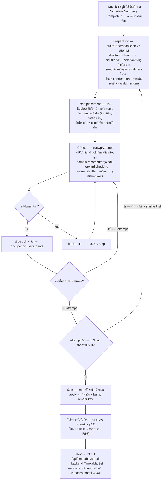

# DES-006 — 28. Timetable Generation Architecture

> Budget ≤ 8 KB (`policies\documentation.md` §4) · เขียนโดย `system-analyst` · ไฟล์นี้ = 1 contract · ต้องมีแถวใน `design\index.md` ตาราง DES

**28.1 "AI" คืออะไรจาก code จริง:** ไม่มี AI/LLM/ML ทั้งสองฝั่ง (grep ยืนยัน backend และ timetable tree) — "AI Generate" คือ **CSP solver แบบ constraint programming รันใน browser** ที่ไฟล์เดียว `use-timetable-generation.ts` (822 บรรทัด); algorithm ที่ active คือ CP (`handleCpGenerate`, default ที่ `generationAlgorithmRef = "cp"`); มี greedy fill (`handleAiGenerate`) เหลือเป็น dead code (D33) ความสามารถ AI จริงของผลิตภัณฑ์ (OCR/kruai import) อยู่โมดูล `/academic` — คนละระบบ (§22)

**28.2 ผัง flow การ generate (จาก code):**

- Solver **async แบบ cooperative**: `YIELD_EVERY = 200` iteration → `setTimeout(0)` ให้ browser วาด spinner — main thread เดียว **ไม่มี Web Worker** (use-timetable-generation.ts:647-655)
- วิชาที่**ถูกตัดจากการจัดอัตโนมัติ**: ไม่มีครูผู้มีคุณสมบัติ หรือโควตา 0 — เหลือให้วางมือ/ผูกด้วย link subject เท่านั้น (:205-207)
- Gate ก่อนยิง: `isConflictDataReady` (ตารางอื่น + เวลาไม่ว่างโหลดครบ) **และ** กริดทุกห้องพร้อม (:757-801)

**28.3 Constraint — แยก hard / soft / ไม่บังคับ:**

| ประเภท | Constraint | บังคับที่ไหน |
|---|---|---|
| Hard | ครูไม่เกินเพดานคาบ/วัน — ลำดับ: รายคน > apply-all−ยกเว้น > ไม่จำกัด (page.tsx:203-210) | solver + validateDrop |
| Hard | ครูไม่เกินคาบต่อเนื่องไม่พัก (รายคนทับ global, เทียบด้วยนาทีจริง) | solver + validateDrop |
| Hard | ครูไม่ชน**ตารางอื่นที่บันทึกแล้วของปีเดียวกัน** — เทียบเวลาจริง start/end ข้าม template (externalBusyRanges) | solver + validateDrop |
| Hard | ครูไม่สอนในสล็อตที่กลุ่มครูปิด (`isOn=false`) | solver + validateDrop |
| Hard | ครูไม่สอน 2 ห้องพร้อมกัน — ยกเว้น link subject กลุ่มเดียวกัน (นับเป็นสล็อตเดียว) | solver (hasSlotConflict) + validateDrop |
| Hard | วิชาไม่เกินโควตา periods/week และ max/วัน รายห้อง | grid + solver |
| Hard (ลำดับ) | Link subject: วางก่อนเสมอ เขียนทับได้ วันคาบไม่พอ = ข้าม | solver pre-placement (:365-461) |
| Soft (สุ่มได้) | ลำดับวิชา/ครู/ค่า value ถูก shuffle — ผลต่างกันได้แต่ละรัน แล้วเลือก attempt ดีสุด | solver |
| **ไม่บังคับ** | Class continuity (`jSetSubjectsClassContinuity`) และ `nCourseIntensity` — เก็บเท่านั้น ไม่มีใครอ่าน (D12) | — |
| **ไม่มีเลย** | Scoring/ranking นอกจาก shortfall · validation หลัง generate · completeness check · conflict detection ฝั่ง server · retry อัตโนมัติหลัง save | — |

> **Rev 5 (target — ยังไม่ implement; ตารางข้างบนยังเป็น as-built):** แถว "ครูไม่เกินเพดานคาบ/วัน" → DES-014 (นาที/วัน + นาที/สัปดาห์, 2 ระดับ) · แถว "ไม่บังคับ: Class continuity" → DES-012 (hard constraint แบบบล็อก; `nCourseIntensity` ยังไม่บังคับ) · hard ใหม่: ห้องไม่ชนข้ามตารางของปี → DES-013 · ตัวกรองวิชาก่อน solve (ตัดเงียบ) → DES-011 (บล็อกแทน) · แหล่งสิทธิ์ห้องของครู (`teacherEligibleClassesMap`) → DES-015 · ทุกข้อต้องบังคับทั้ง solver และ validateDrop ด้วยฟังก์ชันร่วมตัวเดียว (R5)

> **Rev 6 (target — ต่อจากหมายเหตุ Rev 5):** ห้อง: จาก "ไม่ชน" เป็น **ไม่เกินความจุ นับรวมการใช้ห้องใน `/academic`** (DES-013) — การใช้ห้องของ `/academic` เป็นส่วนหนึ่งของ conflict data (gate `isConflictDataReady` — BR-57) · continuity: ห้ามข้ามพัก, วางเป็นบล็อกเต็มเท่านั้น, เพดานต่อเนื่องครูชนะ (DES-012) · เพดานครู: ชั่วโมงเต็ม (DES-014) · hard ใหม่: กลุ่มวิชาห้ามชนกันเอง (DES-017 — **ยังไม่บังคับ** จนกว่า OQ-25 ตอบ)

> **Rev 7 (target — ต่อจากหมายเหตุ Rev 6):** กลุ่มวิชา (DES-017) ขอบเขตยืนยันแล้ว = G2 (ชุดเดียวกับ BR-17) รหัสเดียวกันต่างห้องเรียนชนเฉพาะเมื่อครูคนเดียวกัน — **บังคับเมื่อ implement** (หมายเหตุ "ยังไม่บังคับ" ข้างบนหมดผล) · hard ใหม่: วิชาที่ใช้ห้องที่มีครูผู้ดูแลในหน่วย (ปี, เทอม) ต้องสอนโดยผู้ดูแลเท่านั้น (DES-013 BR-71) — ทำงานเป็นตัวกรองสิทธิ์ครูในจุด eligibility เดียวกับ DES-015 · ความจุห้องอ่านจากค่าของ (ปี, เทอม) ของตาราง (BR-54)

> **Rev 8 (target — ต่อจากหมายเหตุ Rev 7):** แถว hard "ครูไม่ชนตารางอื่นที่บันทึกแล้วของปีเดียวกัน" → **เทอมเดียวกัน** (BR-17a — §34.3) เมื่อ DES-009 ใช้งาน · แถว "ไม่บังคับ: `nCourseIntensity`" → **soft** (DES-019 — ไม่ปฏิเสธการวาง, ไม่ backtrack, ใช้ใน value ordering + เลือก attempt รองจาก shortfall) · แถว "ไม่มีเลย: scoring นอกจาก shortfall" → shortfall ถูกแสดงผู้ใช้ทุกครั้ง (DES-020) + intensity violation เป็นเกณฑ์รอง

**28.4 Manual override / failure handling:**

- มือ: ลากวาง, กดค้าง 500 ms เข้าโหมดสลับ (ตรวจทั้งสองทิศ), `AddCourseModal` เพิ่ม/เปลี่ยน (กลไกล็อกช่องอยู่ที่นี่ — `locked` flag), Regenerate (สร้างกริดเปล่า **คงช่องล็อก**), Clear All (**ลบล็อกด้วย — D34**); ล็อกไม่ persist (D16)
- ทุก move ผ่านกติกาเดียวกับ solver (ตรวจซ้ำ 2 ชั้น: ในกริด + `validateDrop` ของหน้า) — ผิด = modal แดงอธิบายเหตุผล
- ล้มเหลวบางส่วน: หมดงบ backtrack → วิชาค้าง (shortfall) → เลือก attempt ที่ค้างน้อยสุด → ช่องว่างให้จัดมือ; **ไม่มีการแจ้ง shortfall เป็นตัวเลข**
- Save: ไม่ตรวจความครบ, success modal ขึ้นเสมอ (D26) — ตารางยังวางไม่ครบบันทึกได้โดยไม่มีเตือน

Contract:TimetableGeneration.v1
DEC-006

> path ด้านล่างสัมพัทธ์กับ repo frontend `sb-tech-upgrade-web-system` @ `a2c9138d49602f49f50f860f038308089be10c0f` (solver รันทั้งหมดใน browser — ฝั่ง server ไม่มีการคำนวณตารางใด ๆ ตาม DES-005)

Evidence EVD-016: claim=DES-006 | state=confirmed | path=src/app/[locale]/timetable/manage-teaching-schedule/_lib/use-timetable-generation.ts | symbol=handleCpGenerate | line=874 | revision=e300ca33bce4a0124983fe814a6b2b47870153c4 | basis=source | tool=rg-read | hash=355c785d39b4484906272499ea2177688c13508cec096c6963bd7ceae6cb4030
Evidence EVD-017: claim=Contract:TimetableGeneration.v1 | state=confirmed | path=src/app/[locale]/timetable/manage-teaching-schedule/_lib/use-timetable-generation.ts | symbol=backtrackBudget | line=729 | revision=e300ca33bce4a0124983fe814a6b2b47870153c4 | basis=source | tool=rg-read | hash=355c785d39b4484906272499ea2177688c13508cec096c6963bd7ceae6cb4030
Evidence EVD-018: claim=DEC-006 | state=confirmed | path=src/app/[locale]/timetable/manage-teaching-schedule/page.tsx | symbol=validateDrop | line=378 | revision=e300ca33bce4a0124983fe814a6b2b47870153c4 | basis=source | tool=rg-read | hash=78c7e8e453d176b6b3e6fedf9ae17969e1f0dd055d564389a267741a5259c188

Compatibility: unchanged
Data/schema: unchanged
Migration/backfill: none
Security: none
Fallback: งบ backtrack 3,000 step ต่อ attempt × 5 attempts (CP_MAX_ATTEMPTS) หมดแล้ววิชาใดยังไม่ได้วาง = ปล่อยว่าง (shortfall) — ระบบเลือก attempt ที่วิชาค้างน้อยสุด ช่องว่างให้ผู้ใช้จัดมือ ทุก move ผ่านกติกาเดียวกับ solver (validateDrop ตรวจซ้ำ 2 ชั้น) · solver yield ให้ browser วาดทุก 200 iteration บน main thread (ไม่มี Web Worker — YIELD_EVERY = 200)
Material ambiguity: none

---

## Change Log

- 2026-10-07 — Migrated to split layout

Back-links: `design\index.md` · `..\index.md`
